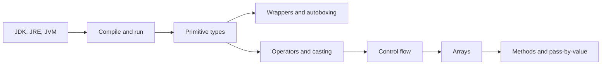
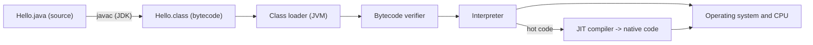
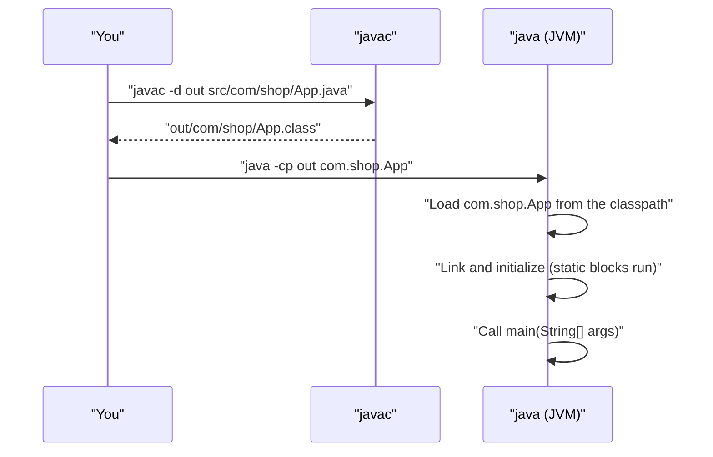
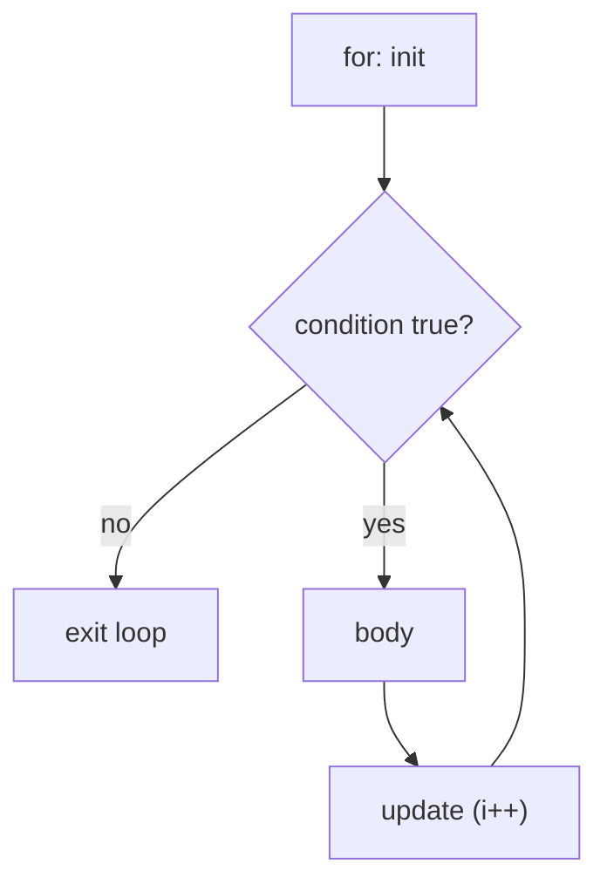

@@ 1 | MODULE | Phase 1 — Java Foundations (Beginner) | How Java runs, types, operators, control flow, arrays, methods | MUST
# Phase 1: Java Foundations (Beginner)

This phase covers how a Java program goes from text to running code, and the building blocks every program uses: types, operators, loops, arrays and methods. Interviewers use these topics in screening rounds to check that your basics are solid. A wrong answer to "Is Java pass-by-reference?" ends many interviews early.



**Prerequisites:** none. JDK 21 or newer installed (see Setup).

**The 5 questions from this phase that come up most often**
1. What is the difference between JDK, JRE and JVM?
2. Why is Java "write once, run anywhere"?
3. Is Java pass-by-value or pass-by-reference?
4. Why does `Integer a = 127, b = 127; a == b` print true but 128 prints false?
5. What is the difference between `i++` and `++i`?

@@ 2 | MODULE | How Java runs | JDK, JRE, JVM and the compile-run cycle | MUST
# How Java runs

**Shared analogy: a recipe translated for every kitchen.** You write a recipe once in a universal language (bytecode). Each kitchen has a chef who reads that language and cooks with the local stove (the JVM for each operating system). You never rewrite the recipe for a new kitchen.

@@ 3 | TOPIC | JDK, JRE and JVM | What each one is, what is inside it, and which one you need | MUST
# JDK, JRE and JVM

**Level: Beginner | Phase 1 | Priority: MUST | Since: Java 1.0 (separate JRE download dropped in Java 11)**

> **30-second interview answer:** The JVM is the engine that runs bytecode on a specific operating system. The JRE is the JVM plus the standard class libraries, everything needed to *run* Java. The JDK is the JRE plus development tools such as `javac`, `jar` and `jdb`, everything needed to *write and build* Java. JDK contains JRE contains JVM.

## 1. Concept in Simple Words
### Analogy
Think of a music system.

| Music system | Java |
|---|---|
| The speaker that turns a signal into sound | JVM: turns bytecode into machine actions |
| The speaker plus the music library you play | JRE: JVM plus the standard libraries (`java.lang`, `java.util`, ...) |
| The full studio with microphones and mixing desk to *make* music | JDK: JRE plus compiler, debugger, packager |
| A song file that plays on any speaker | A `.class` file that runs on any JVM |

A listener only needs a speaker and a library. A musician needs the studio.

### What it is
- **JVM (Java Virtual Machine):** a program that loads `.class` files, checks them, and executes their bytecode. There is a different JVM build for Windows, Linux and macOS, but they all understand the same bytecode.
- **Bytecode:** the instruction set that `javac` produces. It is not machine code for any real CPU; it is machine code for the "virtual" machine.
- **JRE (Java Runtime Environment):** JVM plus the core class libraries plus supporting files.
- **JDK (Java Development Kit):** JRE plus tools: `javac` (compiler), `java` (launcher), `jar` (packager), `javadoc`, `jdb` (debugger), `jshell` (interactive shell), `jcmd` and `jconsole` (monitoring).

### Why it exists
Before Java, a C program had to be compiled separately for each operating system and CPU, and code often needed changes per platform. Java's designers put a virtual machine in between: compile once to bytecode, and let each platform's JVM do the last step. That is the "write once, run anywhere" promise.

## 2. How It Works


Step by step:
1. You write `Hello.java`.
2. `javac` (part of the JDK) compiles it to `Hello.class`, which holds bytecode.
3. `java Hello` starts a JVM. The **class loader** finds and loads `Hello.class` plus the library classes it uses.
4. The **verifier** checks that the bytecode is safe (no jumping to random memory, correct types on the stack).
5. The **interpreter** starts executing bytecode instructions one by one.
6. The **JIT (Just-In-Time) compiler** watches which methods run often ("hot") and compiles them to native machine code, so they run as fast as C++ code.
7. The **garbage collector** frees memory for objects nobody uses any more.

What is inside the JDK, as nested boxes:
```text
+---------------------------------------------- JDK ----+
|  javac  jar  javadoc  jdb  jshell  jcmd  jconsole     |
|  +------------------------------------- JRE --------+ |
|  |  Class libraries: java.lang, java.util, java.io  | |
|  |  +------------------------------- JVM ---------+ | |
|  |  |  Class loader, verifier, interpreter, JIT,  | | |
|  |  |  garbage collector, memory areas            | | |
|  |  +---------------------------------------------+ | |
|  +--------------------------------------------------+ |
+-------------------------------------------------------+
```

**Modern note:** since Java 11, Oracle and most vendors no longer ship a separate JRE download. You install a JDK, or you build a trimmed custom runtime for your app with `jlink`. Interviewers still ask the JDK/JRE/JVM question because it tests whether you understand the layers.

**Is the JVM platform independent?** No. Bytecode is platform independent; the JVM itself is a native program built separately for each platform. This is a classic trap question.

## 3. Code Example
### Code
```java
// File: WhoRunsMe.java
public class WhoRunsMe {
    public static void main(String[] args) {
        // System properties are filled in by the JVM at start-up
        String vendor = System.getProperty("java.vm.vendor");
        String vmName = System.getProperty("java.vm.name");
        String os = System.getProperty("os.name");
        String arch = System.getProperty("os.arch");

        System.out.println("Java version : " + Runtime.version().feature());
        System.out.println("JVM          : " + vmName + " by " + vendor);
        System.out.println("Running on   : " + os + " / " + arch);

        // Every class is loaded by a class loader, a JVM component
        System.out.println("My loader    : " + WhoRunsMe.class.getClassLoader().getName());
        // Core classes like String are loaded by the bootstrap loader, shown as null
        System.out.println("String loader: " + String.class.getClassLoader());
    }
}
```

### Walkthrough
- `System.getProperty(...)` reads values the JVM sets when it starts. They show which JVM build is running and on which OS.
- `Runtime.version().feature()` returns the major version number, such as 21 or 25.
- `WhoRunsMe.class.getClassLoader()` returns the **application class loader**, which loads your own classes from the class path.
- `String.class.getClassLoader()` returns `null`, because core classes are loaded by the **bootstrap class loader**, which is written in native code and has no Java object.

### Output
Compile and run with the JDK tools:
```bash
javac WhoRunsMe.java
java WhoRunsMe
```
```text
Java version : 25
JVM          : OpenJDK 64-Bit Server VM by Eclipse Adoptium
Running on   : Windows 11 / amd64
My loader    : app
String loader: null
```
The same `WhoRunsMe.class` file, copied to a Linux machine, prints `Linux / amd64` without recompiling. That is platform independence in action.

### Compare
| Without a JVM (C) | With a JVM (Java) |
|---|---|
| Compile once per OS and CPU | Compile once, run on every JVM |
| Program talks to the OS directly | JVM sits between program and OS |
| Manual memory management | Garbage collector frees memory |

## 4. Interview Questions
**Basic**
1. **What is the difference between JDK, JRE and JVM?**
   The JVM runs bytecode. The JRE is the JVM plus the standard libraries needed to run programs. The JDK is the JRE plus development tools like `javac`. To develop you need the JDK; to only run, a runtime is enough.
2. **What is bytecode?**
   The output of `javac`: a compact instruction set for the JVM, stored in `.class` files. It is the same on every platform, which makes Java portable.
3. **Why is Java called platform independent?**
   Because compiled bytecode runs unchanged on any OS that has a JVM. The platform-specific part is moved into the JVM.

**Follow-up**
4. **Is the JVM itself platform independent?**
   No. Each OS and CPU needs its own JVM build. Bytecode is portable; the JVM is not.
5. **Is Java interpreted or compiled?**
   Both. `javac` compiles source to bytecode ahead of time; the JVM then interprets bytecode and JIT-compiles hot methods to native code at runtime.
6. **What does the JIT compiler do and why?**
   It compiles frequently executed bytecode to native machine code while the program runs. Interpretation starts fast; JIT gives peak speed for hot code, using runtime information the static compiler does not have.

**Tricky / scenario**
7. **Can you run a Java program with only a JRE?**
   Yes, if it is already compiled. Since Java 11 you can even run a single `.java` file with `java File.java`, but that uses an in-memory compiler, which is part of the JDK.
8. **A jar built with JDK 21 fails on a server with Java 17: `UnsupportedClassVersionError`. Why, and how do you fix it?**
   Each Java version writes a class-file version number (Java 21 is 65, Java 17 is 61). An older JVM refuses newer class files. Either upgrade the server's Java or compile with `--release 17`.

**What the interviewer is really testing:** that you understand the layers between your source code and the CPU, and the "compile once, run anywhere" idea, not just three acronyms.

## 5. Pitfalls & Best Practices
### Common mistakes
| Mistake | What goes wrong | Fix |
|---|---|---|
| Saying "the JVM is platform independent" | Wrong answer in interviews | Bytecode is portable; the JVM is per platform |
| Compiling with a newer JDK than production runs | `UnsupportedClassVersionError` at start-up | Use `--release N` or match versions |
| Several JDKs installed and `JAVA_HOME` points to the wrong one | Builds use an unexpected version | Check `java -version` and `JAVA_HOME`; use Maven toolchains |
| Thinking JIT means "Java is slow at first, then the same" | Missing the trade-off | JIT trades warm-up time for peak speed; native images trade peak speed for fast start |

### Best practices
- Use an **LTS** release in production (17, 21, 25). LTS versions get years of security updates.
- Pin the Java version in your build (`<maven.compiler.release>21</maven.compiler.release>`).
- In containers, use a JRE-sized base image or a `jlink` custom runtime to keep images small.

### Compare with
| | JVM | JRE | JDK |
|---|---|---|---|
| Purpose | Execute bytecode | Run programs | Develop programs |
| Contains | Loader, interpreter, JIT, GC | JVM plus libraries | JRE plus tools |
| Who needs it | Every Java program | Users and servers | Developers and build servers |

## 6. Hands-on Exercise
Write a program `VersionGuard` that prints `OK` if it runs on Java 21 or newer, and otherwise prints `Need Java 21+, found N` and exits with status code 1. Then compile it with `--release 17` and run it.

Acceptance criteria:
- Uses `Runtime.version().feature()`.
- Exit code is 1 on old versions (`System.exit(1)`).

<details><summary>Solution</summary>

```java
public class VersionGuard {
    public static void main(String[] args) {
        int feature = Runtime.version().feature();
        if (feature < 21) {
            System.out.println("Need Java 21+, found " + feature);
            System.exit(1); // non-zero exit code tells scripts it failed
        }
        System.out.println("OK");
    }
}
```

`javac --release 17 VersionGuard.java` produces class-file version 61, which runs on Java 17 and newer. On your JDK 25 it prints `OK`.
</details>

## 7. Recall
Q: In JDK, JRE and JVM, which one contains the compiler `javac`?
A: The JDK. The JRE and JVM only run code.

Q: Is the JVM platform independent?
A: No. Bytecode is platform independent; each OS and CPU has its own JVM build.

Q: What does the JIT compiler in the JVM do?
A: It compiles frequently executed (hot) bytecode to native machine code at runtime for speed.

Q: What causes `UnsupportedClassVersionError`?
A: Running a class compiled for a newer Java version on an older JVM.

Q: Is Java compiled or interpreted?
A: Both: compiled to bytecode by `javac`, then interpreted and JIT-compiled by the JVM.

**Related:** [[Compiling and Running a Program]] · [[Class Loading and ClassLoaders]] · [[JVM Memory Areas]]

@@ 3 | TOPIC | Compiling and Running a Program | main method, javac, java, classpath, jar files and single-file launch | MUST
# Compiling and Running a Program

**Level: Beginner | Phase 1 | Priority: MUST | Since: Java 1.0 (single-file launch Java 11, instance main Java 25)**

> **30-second interview answer:** `javac` compiles `.java` source into `.class` bytecode; `java` starts a JVM that loads the class and calls its `public static void main(String[] args)`. The classpath tells the JVM where to find classes. For distribution we package classes into a `.jar`, and Spring Boot builds an executable "fat jar" with all dependencies inside.

## 1. Concept in Simple Words
### Analogy
A play in a theatre.

| Theatre | Java |
|---|---|
| Script written by the playwright | `.java` source file |
| Script translated into the actors' working copy | `javac` creating `.class` files |
| The director who knows where every actor waits backstage | Classpath |
| "Curtain up" — the first scene everyone starts from | The `main` method |
| A boxed touring set with all props included | A jar file (and a Spring Boot fat jar) |

### What it is
- **Source file:** a `.java` file. A public class `Order` must live in `Order.java`.
- **Compilation:** `javac Order.java` checks syntax and types and produces `Order.class`.
- **Entry point:** the JVM starts at `public static void main(String[] args)`.
- **Classpath:** the list of folders and jars the JVM searches for classes (`-cp` or `-classpath`).
- **Package:** a namespace (`com.orderhub.model`) that must match the folder structure (`com/orderhub/model/`).
- **Jar:** a zip file of classes plus a `META-INF/MANIFEST.MF` that can name the main class.

### Why it exists
Separating compile time from run time catches errors early (a type error never reaches production) and lets the bytecode be shipped anywhere. Jars bundle hundreds of classes into one file to ship.

## 2. How It Works


Why `main` looks the way it does:
| Part | Reason |
|---|---|
| `public` | The JVM, outside your class, must be able to call it |
| `static` | No object exists yet when the program starts, so the method must belong to the class |
| `void` | The JVM does not use a return value; use `System.exit(code)` for exit codes |
| `String[] args` | Command-line arguments |

**Single-file source launch (Java 11+):** `java Hello.java` compiles in memory and runs immediately. Great for scripts and learning. **Java 22+** allows several source files, and **Java 25** finalized instance main methods, so `void main() { IO.println("Hi"); }` is a valid small program. Production code still uses the classic form.

**Compile errors vs runtime errors:** `javac` catches type errors, missing symbols and syntax errors. Problems like dividing by zero or a missing class at runtime (`ClassNotFoundException`, `NoClassDefFoundError`) only appear when you run.

## 3. Code Example
### Code
Project layout:
```text
shop/
  src/com/shop/App.java
  src/com/shop/model/Product.java
```

```java
// File: src/com/shop/model/Product.java
package com.shop.model;            // must match the folder com/shop/model

public class Product {
    private final String name;
    private final double price;

    public Product(String name, double price) {
        this.name = name;
        this.price = price;
    }

    public String describe() {
        return name + " costs " + price;
    }
}
```

```java
// File: src/com/shop/App.java
package com.shop;

import com.shop.model.Product;     // use a class from another package

public class App {
    public static void main(String[] args) {
        // args come from the command line: java ... com.shop.App Mouse 25
        String name = args.length > 0 ? args[0] : "Keyboard";
        double price = args.length > 1 ? Double.parseDouble(args[1]) : 49.99;

        Product p = new Product(name, price);
        System.out.println(p.describe());
    }
}
```

```bash
# 1. Compile everything into the out/ folder (-d keeps package folders)
javac -d out src/com/shop/model/Product.java src/com/shop/App.java

# 2. Run: -cp says "look for classes in out/", then the FULL class name
java -cp out com.shop.App Mouse 25

# 3. Package into an executable jar with App as the entry point
jar --create --file shop.jar --main-class com.shop.App -C out .
java -jar shop.jar
```

### Walkthrough
- `package com.shop.model;` puts `Product` in a namespace. The compiled file lands in `out/com/shop/model/Product.class` because of `-d out`.
- `import com.shop.model.Product;` lets `App` use the short name `Product`.
- `args[0]` and `args[1]` are the words after the class name. `Double.parseDouble` turns the text `"25"` into the number 25.0.
- `java -cp out com.shop.App` uses the **fully qualified name** (package plus class), not a file path.
- `jar --main-class` writes `Main-Class: com.shop.App` into the manifest, so `java -jar` knows where to start.

### Output
```text
java -cp out com.shop.App Mouse 25
Mouse costs 25.0
java -jar shop.jar
Keyboard costs 49.99
```

### Compare
| Plain jar | Spring Boot fat jar |
|---|---|
| Only your classes | Your classes plus every dependency jar inside `BOOT-INF/lib` |
| Dependencies must be on the classpath separately | One file: `java -jar app.jar` |
| Main-Class is your class | Main-Class is Spring's `JarLauncher`, which then calls your class |

## 4. Interview Questions
**Basic**
1. **Why is `main` public, static and void?**
   Public so the JVM can call it from outside, static because no object exists at start-up, void because the JVM ignores return values; use `System.exit` for exit codes.
2. **What is the classpath?**
   The list of directories and jar files the JVM and compiler search for classes. Set with `-cp`, the `CLASSPATH` variable, or the jar manifest.
3. **Can a file contain more than one class?**
   Yes, but at most one top-level `public` class, and its name must match the file name.

**Follow-up**
4. **Can you overload `main`?**
   Yes, you can write other `main` methods with different parameters, but the JVM only calls `main(String[])` (or, since Java 25, the instance and no-arg forms when no static one exists).
5. **What is the difference between `ClassNotFoundException` and `NoClassDefFoundError`?**
   `ClassNotFoundException` is a checked exception when code loads a class by name (`Class.forName`) and it is missing. `NoClassDefFoundError` is an error when a class that was present at compile time is missing or failed to initialize at runtime.
6. **What happens if `main` throws an exception?**
   The exception propagates to the JVM, which prints the stack trace and ends the main thread; the process exits with a non-zero code if no other non-daemon threads are running.

**Tricky / scenario**
7. **What does `java -jar app.jar` do with the `-cp` option?**
   It ignores it. With `-jar`, the classpath comes only from the jar's manifest. A common bug when people add libraries with `-cp`.
8. **How does Spring Boot's fat jar load nested jars when the standard class loader cannot read jars inside jars?**
   The manifest's Main-Class is Spring Boot's launcher, which uses a custom class loader that reads `BOOT-INF/classes` and the nested jars in `BOOT-INF/lib`, then calls your `Start-Class`.

**What the interviewer is really testing:** whether you know what happens before your first line runs, and can debug classpath and packaging errors.

## 5. Pitfalls & Best Practices
### Common mistakes
| Mistake | What goes wrong | Fix |
|---|---|---|
| `java com/shop/App.class` | "Could not find or load main class" | Use the fully qualified name `com.shop.App` |
| Package line does not match folders | Class not found at runtime | Keep `package` and folder path identical |
| Mixing `-jar` and `-cp` | Libraries silently ignored | Put dependencies in the manifest or use a fat jar |
| Public class name differs from file name | Compile error | Name the file after the public class |

### Best practices
- Never compile by hand in real projects: use **Maven** or **Gradle** (Phase 5).
- Use reverse-domain package names (`com.company.project.module`).
- Keep `main` tiny: parse arguments, then call real code.

### Compare with
| Command | What it does |
|---|---|
| `javac` | Source to bytecode |
| `java ClassName` | Run a compiled class |
| `java File.java` | Compile in memory and run (Java 11+) |
| `java -jar app.jar` | Run the jar's Main-Class |
| `jshell` | Try expressions interactively |

## 6. Hands-on Exercise
Create a program `Greeter` in package `com.practice` that prints `Hello, <name>! You passed N arguments.` using the first argument as the name (default `World`). Compile it into `out/`, run it with two arguments, then build `greeter.jar` and run it with `java -jar`.

<details><summary>Solution</summary>

```java
// File: src/com/practice/Greeter.java
package com.practice;

public class Greeter {
    public static void main(String[] args) {
        String name = args.length > 0 ? args[0] : "World";
        System.out.println("Hello, " + name + "! You passed " + args.length + " arguments.");
    }
}
```

```bash
javac -d out src/com/practice/Greeter.java
java -cp out com.practice.Greeter Sam extra
# Hello, Sam! You passed 2 arguments.
jar --create --file greeter.jar --main-class com.practice.Greeter -C out .
java -jar greeter.jar
# Hello, World! You passed 0 arguments.
```
</details>

## 7. Recall
Q: Why must `main` be static?
A: The JVM calls it before any object exists, so it must belong to the class.

Q: What option does `java -jar` ignore?
A: `-cp`. The classpath comes only from the jar's manifest.

Q: What is the difference between `ClassNotFoundException` and `NoClassDefFoundError`?
A: The first is thrown when loading a class by name fails; the second when a class present at compile time is missing or broken at runtime.

Q: How do you run a single Java source file without `javac` (Java 11+)?
A: `java File.java` compiles it in memory and runs it.

Q: What does the manifest's `Main-Class` entry do in a jar?
A: It names the class whose `main` method `java -jar` calls.

**Related:** [[JDK, JRE and JVM]] · [[Maven Basics: pom.xml, Lifecycle and Scopes]] · [[Packages and Access Modifiers]]

@@ 2 | MODULE | Language basics | Types, wrappers, operators, control flow, arrays and methods | MUST
# Language basics

**Shared analogy: a kitchen.** Primitive types are ingredients of fixed sizes (an egg, a cup of milk). Wrapper classes put an ingredient in a labelled jar so it can go on shelves (collections). Operators are the kitchen tools, control flow is the recipe's "if the dough is sticky, add flour" and "knead 10 times", arrays are an egg carton with numbered slots, and methods are reusable mini-recipes.

@@ 3 | TOPIC | Primitive Types and Variables | The 8 primitives, sizes, defaults, literals, and primitive vs reference | MUST
# Primitive Types and Variables

**Level: Beginner | Phase 1 | Priority: MUST | Since: Java 1.0 (var Java 10, underscores in literals Java 7)**

> **30-second interview answer:** Java has 8 primitive types: `byte`, `short`, `int`, `long` for whole numbers, `float` and `double` for decimals, `char` for a UTF-16 character, and `boolean`. They hold the value directly and have fixed sizes on every platform. Everything else is a reference type: the variable holds a reference to an object on the heap.

## 1. Concept in Simple Words
### Analogy
Boxes versus address cards.

| Real world | Java |
|---|---|
| A small box with the actual coins inside | A primitive variable holds the value itself |
| A card with a house address written on it | A reference variable holds the address of an object |
| Box sizes are standard everywhere | Primitive sizes are fixed on every platform |
| Two cards with the same address point to one house | Two references can point to the same object |

### What it is
| Type | Size | Range (approx.) | Default (field) | Literal example |
|---|---|---|---|---|
| `byte` | 8 bits | -128 to 127 | 0 | `(byte) 10` |
| `short` | 16 bits | -32,768 to 32,767 | 0 | `(short) 300` |
| `int` | 32 bits | about plus or minus 2.1 billion | 0 | `42`, `1_000_000`, `0xFF`, `0b1010` |
| `long` | 64 bits | about plus or minus 9.2 quintillion | 0L | `42L` |
| `float` | 32 bits | about 7 decimal digits | 0.0f | `3.14f` |
| `double` | 64 bits | about 15 decimal digits | 0.0 | `3.14`, `1e-9` |
| `char` | 16 bits | 0 to 65,535 (UTF-16 unit) | `'\u0000'` | `'A'`, `'\n'` |
| `boolean` | JVM-dependent | true or false | false | `true` |

- **Variable:** a named storage location with a type.
- **Local variable:** declared inside a method; has **no default**, so you must assign it before reading.
- **Field (instance or static variable):** declared in a class; gets the default above.
- **`var` (Java 10+):** lets the compiler infer the type of a local variable from its initializer. The type is still fixed; Java stays statically typed.

### Why it exists
Primitives are fast and small: no object header, no garbage collection, stored directly on the stack or inside an object. Java kept them for performance, while everything else is an object for flexibility.

## 2. How It Works
```text
void demo() {
    int count = 5;                 // primitive: value lives in the stack frame
    String name = "Ann";           // reference: stack holds an address
    int[] nums = {1, 2};           // arrays are objects too
}

   STACK (frame of demo)              HEAP
  +----------------------+
  | count = 5            |
  | name  = @a1   ------------->  String "Ann"
  | nums  = @b7   ------------->  int[] {1, 2}
  +----------------------+
```
- When `demo()` ends, the stack frame disappears. The heap objects stay until the garbage collector sees no references to them.
- Fields of an object live inside the object on the heap, including primitive fields.

**Integer overflow** wraps around silently, because numbers are stored in two's complement:
```text
Integer.MAX_VALUE      = 2147483647  = 0111...1111
Integer.MAX_VALUE + 1  = -2147483648 = 1000...0000
```

**Floating-point** numbers are binary fractions, so many decimals cannot be stored exactly: `0.1 + 0.2` is `0.30000000000000004`. Use `BigDecimal` for money (Phase 3).

## 3. Code Example
### Code
```java
public class PrimitivesDemo {
    static int counter;        // field: gets default 0
    static boolean active;     // field: gets default false

    public static void main(String[] args) {
        // Fixed sizes on every platform
        System.out.println("int range : " + Integer.MIN_VALUE + " to " + Integer.MAX_VALUE);
        System.out.println("long max  : " + Long.MAX_VALUE);

        // Defaults apply to fields, not local variables
        System.out.println("defaults  : " + counter + ", " + active);
        int local;               // declared but not assigned
        // System.out.println(local); // compile error: might not have been initialized
        local = 10;
        System.out.println("local     : " + local);

        // Readable literals
        int million = 1_000_000;
        int hex = 0xFF, binary = 0b1010;
        long big = 9_000_000_000L;   // without L this does not compile: too big for int
        System.out.println("literals  : " + million + " " + hex + " " + binary + " " + big);

        // Overflow wraps silently
        int max = Integer.MAX_VALUE;
        System.out.println("overflow  : " + (max + 1));
        // Math.addExact throws instead of wrapping
        try {
            Math.addExact(max, 1);
        } catch (ArithmeticException e) {
            System.out.println("addExact  : " + e.getMessage());
        }

        // Floating point is not exact
        System.out.println("0.1 + 0.2 : " + (0.1 + 0.2));

        // char is a number underneath
        char c = 'A';
        System.out.println("char math : " + (c + 1) + " " + (char) (c + 1));

        // var infers the type at compile time; the type never changes
        var price = 19.99;       // double
        // price = "free";        // compile error: String cannot become double
        System.out.println("var type  : " + ((Object) price).getClass().getSimpleName());
    }
}
```

### Walkthrough
- `Integer.MIN_VALUE` and `MAX_VALUE` show the fixed 32-bit range.
- `counter` and `active` are **fields**, so they get defaults. `local` is a **local variable**, so reading it before assignment is a compile error.
- Underscores in `1_000_000` are only for readability. `0xFF` is hexadecimal (255), `0b1010` is binary (10).
- A whole-number literal is an `int` by default, so 9 billion needs the `L` suffix.
- `max + 1` wraps to the minimum value. `Math.addExact` detects overflow and throws `ArithmeticException`.
- `c + 1` promotes `char` to `int` (66). Casting back with `(char)` gives `'B'`.
- `var price = 19.99` makes `price` a `double` forever.

### Output
```text
int range : -2147483648 to 2147483647
long max  : 9223372036854775807
defaults  : 0, false
local     : 10
literals  : 1000000 255 10 9000000000
overflow  : -2147483648
addExact  : integer overflow
0.1 + 0.2 : 0.30000000000000004
char math : 66 B
var type  : Double
```

### Compare
| Primitive | Reference |
|---|---|
| Holds the value | Holds an address |
| Cannot be null | Can be null |
| `==` compares values | `==` compares addresses; use `equals` for content |
| No methods | Has methods |
| Default 0 or false (fields) | Default null (fields) |

## 4. Interview Questions
**Basic**
1. **Name the 8 primitive types and their sizes.**
   byte 8, short 16, int 32, long 64, float 32, double 64, char 16 bits; boolean's size is not defined by the specification (usually one byte in arrays).
2. **What is the default value of a local variable?**
   There is none. The compiler forces you to assign a local variable before reading it. Fields get defaults (0, false, null).
3. **Why is `char` 16 bits in Java?**
   Java uses UTF-16 code units for characters, so one `char` can hold any character in the Basic Multilingual Plane. Characters outside it (many emoji) need two chars, a surrogate pair.

**Follow-up**
4. **What happens on integer overflow?**
   It wraps around silently using two's complement: `Integer.MAX_VALUE + 1` equals `Integer.MIN_VALUE`. Use `Math.addExact` or `long` when overflow is possible.
5. **Why does `0.1 + 0.2` not equal `0.3`?**
   Doubles are binary fractions and 0.1 has no exact binary form, so tiny rounding errors appear. Compare with a tolerance or use `BigDecimal`.
6. **Does `var` make Java dynamically typed?**
   No. The compiler infers a fixed type from the initializer at compile time. It is only allowed for local variables with an initializer, not fields or parameters.

**Tricky / scenario**
7. **Does `long x = 3_000_000_000;` compile?**
   No. Without `L` the literal is an `int`, and 3 billion is out of int range. Write `3_000_000_000L`.
8. **What does `System.out.println('a' + 'b');` print?**
   `195`. Both chars are promoted to int (97 + 98) before addition. `"" + 'a' + 'b'` prints `ab`.

**What the interviewer is really testing:** whether you know the difference between values and references, and the silent traps of overflow and floating point.

## 5. Pitfalls & Best Practices
### Common mistakes
| Mistake | What goes wrong | Fix |
|---|---|---|
| Using `double` for money | Rounding errors in totals | `BigDecimal` or `long` cents |
| Summing large ints into an `int` | Silent overflow | Use `long` or `Math.addExact` |
| Comparing doubles with `==` | False negatives | Compare `Math.abs(a - b) < 1e-9` |
| `var list = new ArrayList<>();` | Infers `ArrayList<Object>` | Give the type argument: `new ArrayList<String>()` |

### Best practices
- Use `int` for counts and indices, `long` for IDs and timestamps.
- Use `var` when the type is obvious from the right side (`var orders = new ArrayList<Order>()`), not when it hides meaning.
- Prefer `final` local variables when the value should not change.

### Compare with
| Type | Use for |
|---|---|
| `int` | Counters, indexes, small quantities |
| `long` | Database IDs, epoch millis, large sums |
| `double` | Scientific values where tiny errors are fine |
| `BigDecimal` | Money, exact decimals |

## 6. Hands-on Exercise
Write `SafeSum` that sums an `int[]` of large values. It should print the wrong `int` sum, the correct `long` sum, and catch the overflow with `Math.addExact`. Use `{2_000_000_000, 2_000_000_000}`.

<details><summary>Solution</summary>

```java
public class SafeSum {
    public static void main(String[] args) {
        int[] values = {2_000_000_000, 2_000_000_000};
        int wrong = 0;
        long right = 0;
        for (int v : values) {
            wrong += v;      // wraps around
            right += v;      // v is widened to long before adding
        }
        System.out.println("int sum : " + wrong);   // -294967296
        System.out.println("long sum: " + right);   // 4000000000
        try {
            int checked = 0;
            for (int v : values) checked = Math.addExact(checked, v);
        } catch (ArithmeticException e) {
            System.out.println("caught  : " + e.getMessage()); // integer overflow
        }
    }
}
```
</details>

## 7. Recall
Q: Which primitive types does Java have?
A: byte, short, int, long, float, double, char and boolean.

Q: Do local variables in Java get default values?
A: No. Only fields get defaults; locals must be assigned before use.

Q: What is `Integer.MAX_VALUE + 1` in Java?
A: `Integer.MIN_VALUE` (-2147483648), because int overflow wraps silently.

Q: Does `var` in Java make a variable dynamically typed?
A: No. The type is inferred once at compile time and never changes.

Q: Why should money not be stored in a Java `double`?
A: Binary floating point cannot represent most decimals exactly, so rounding errors appear.

**Related:** [[Wrapper Classes, Autoboxing and Caching]] · [[Operators, Casting and Type Promotion]] · [[BigDecimal and Money]]

@@ 3 | TOPIC | Wrapper Classes, Autoboxing and Caching | Integer and friends, boxing rules, the Integer cache and the == trap | MUST
# Wrapper Classes, Autoboxing and Caching

**Level: Beginner | Phase 1 | Priority: MUST | Since: Java 1.0 (autoboxing Java 5)**

> **30-second interview answer:** Each primitive has a wrapper class (`Integer`, `Long`, `Double`, `Character`, `Boolean`, ...) that turns the value into an object, so it can go into collections, be null, and have methods. Autoboxing converts primitive to wrapper automatically and unboxing does the reverse. `Integer.valueOf` caches values from -128 to 127, so `==` on two boxed 127s is true but on 128s is false: always compare wrappers with `equals`.

## 1. Concept in Simple Words
### Analogy
Coins and coin envelopes.

| Real world | Java |
|---|---|
| A loose coin | A primitive `int` |
| A coin sealed in a labelled envelope | An `Integer` object |
| The bank's filing cabinet only accepts envelopes | Collections only accept objects (`List<Integer>`, not `List<int>`) |
| A cashier who seals and opens envelopes for you | Autoboxing and unboxing |
| A stack of pre-made envelopes for common coins | The Integer cache for -128 to 127 |
| An empty envelope | `null`: opening it to get the coin crashes (`NullPointerException`) |

### What it is
| Primitive | Wrapper |
|---|---|
| `byte` | `Byte` |
| `short` | `Short` |
| `int` | `Integer` |
| `long` | `Long` |
| `float` | `Float` |
| `double` | `Double` |
| `char` | `Character` |
| `boolean` | `Boolean` |

- **Boxing:** primitive to wrapper. `Integer x = 5;` becomes `Integer x = Integer.valueOf(5);`.
- **Unboxing:** wrapper to primitive. `int y = x;` becomes `int y = x.intValue();`.
- Wrappers are **immutable**: `x++` creates a new `Integer`.

### Why it exists
Generics and collections only work with objects. Wrappers also let a value be "absent" (`null`), which is useful for database columns that allow NULL, and they hold helpful methods like `Integer.parseInt` and `Character.isDigit`.

## 2. How It Works
The compiler rewrites your code:
```text
You write                       Compiler generates
---------------------------     ------------------------------------
Integer a = 100;                Integer a = Integer.valueOf(100);
int b = a;                      int b = a.intValue();
list.add(7);                    list.add(Integer.valueOf(7));
a++;                            a = Integer.valueOf(a.intValue() + 1);
```

`Integer.valueOf` looks in a cache first:
```text
Integer.valueOf(int i):
    if -128 <= i <= 127  -> return the shared object from IntegerCache
    else                 -> return new Integer(i)

Integer a = 127, b = 127;     a ---> [127] <--- b     a == b  is true  (same object)
Integer c = 128, d = 128;     c ---> [128]
                              d ---> [128]             c == d  is false (two objects)
```
- `Byte`, `Short`, `Long` and `Character` (0 to 127) cache too; `Boolean` has only `TRUE` and `FALSE`. `Float` and `Double` do not cache.
- The upper Integer bound can be raised with `-XX:AutoBoxCacheMax=1000`, which is exactly why you must never depend on it.

**Mixed comparisons:** if one side of `==` is a primitive, the wrapper is unboxed and values are compared. `Integer c = 128; int e = 128; c == e` is true.

## 3. Code Example
### Code
```java
import java.util.ArrayList;
import java.util.HashMap;
import java.util.List;
import java.util.Map;

public class BoxingDemo {
    public static void main(String[] args) {
        // 1. The cache trap
        Integer a = 127, b = 127;
        Integer c = 128, d = 128;
        System.out.println("127 == 127   : " + (a == b));      // same cached object
        System.out.println("128 == 128   : " + (c == d));      // different objects
        System.out.println("128 equals   : " + c.equals(d));   // compares values
        int e = 128;
        System.out.println("Integer==int : " + (c == e));      // c is unboxed

        // 2. Collections need objects: boxing happens automatically
        List<Integer> scores = new ArrayList<>();
        scores.add(90);                 // boxed with Integer.valueOf(90)
        int first = scores.get(0);      // unboxed with intValue()
        System.out.println("first score  : " + first);

        // 3. The remove(int) vs remove(Object) trap
        List<Integer> nums = new ArrayList<>(List.of(10, 20, 30));
        nums.remove(1);                       // removes INDEX 1 -> [10, 30]
        nums.remove(Integer.valueOf(10));     // removes VALUE 10 -> [30]
        System.out.println("after remove : " + nums);

        // 4. Unboxing null throws NullPointerException
        Map<String, Integer> stock = new HashMap<>();
        Integer maybe = stock.get("mouse");   // null: key missing
        try {
            int count = maybe;                // maybe.intValue() on null
            System.out.println(count);
        } catch (NullPointerException ex) {
            System.out.println("unboxing null: NullPointerException");
        }
        int safe = stock.getOrDefault("mouse", 0);
        System.out.println("safe count   : " + safe);

        // 5. Useful static helpers
        System.out.println("parseInt     : " + Integer.parseInt("42"));
        System.out.println("isDigit      : " + Character.isDigit('7'));
        System.out.println("compare      : " + Integer.compare(5, 9));
        System.out.println("binary       : " + Integer.toBinaryString(10));

        // 6. Boxing in a loop creates garbage
        long start = System.nanoTime();
        Long boxedSum = 0L;
        for (int i = 0; i < 1_000_000; i++) boxedSum += i;   // new Long almost every step
        long boxedTime = System.nanoTime() - start;
        start = System.nanoTime();
        long primSum = 0L;
        for (int i = 0; i < 1_000_000; i++) primSum += i;
        long primTime = System.nanoTime() - start;
        System.out.println("same sum     : " + boxedSum.equals(primSum));
        System.out.println("boxed slower : " + (boxedTime > primTime));
    }
}
```

### Walkthrough
- Part 1 shows the cache: 127 is shared, 128 is not. `equals` is always right. Comparing with an `int` unboxes first.
- Part 2 shows boxing when adding to a `List<Integer>` and unboxing when reading into an `int`.
- Part 3: `remove(1)` matches the `remove(int index)` overload, because an exact primitive match beats boxing. To remove the value, pass an `Integer`.
- Part 4: `Map.get` returns `null` for a missing key; assigning it to an `int` calls `intValue()` on null. `getOrDefault` avoids it.
- Part 5: wrappers hold static utilities for parsing, character checks and comparison.
- Part 6: `Long boxedSum` creates a new `Long` object on most iterations; the primitive loop creates none. Timing varies, but the boxed loop is reliably slower.

### Output
```text
127 == 127   : true
128 == 128   : false
128 equals   : true
Integer==int : true
first score  : 90
after remove : [30]
unboxing null: NullPointerException
safe count   : 0
parseInt     : 42
isDigit      : true
compare      : -1
binary       : 1010
same sum     : true
boxed slower : true
```

### Compare
| `int` | `Integer` |
|---|---|
| Value, cannot be null | Object, can be null |
| Allowed in arrays, not in generics | Allowed in generics and collections |
| `==` compares values | `==` compares references |
| No allocation | May allocate (outside the cache) |

## 4. Interview Questions
**Basic**
1. **What are wrapper classes and why do we need them?**
   Object versions of the primitives. Collections and generics need objects, wrappers can be null, and they provide utility methods like `parseInt`.
2. **What is autoboxing?**
   The compiler automatically converting a primitive to its wrapper (via `valueOf`) and back (via `xxxValue()`), introduced in Java 5.
3. **Are wrapper objects mutable?**
   No, they are immutable. `count++` on an `Integer` creates a new object and reassigns the variable.

**Follow-up**
4. **Why does `Integer a = 127, b = 127; a == b` print true but with 128 prints false?**
   `Integer.valueOf` returns cached objects for -128 to 127, so both variables point to the same object. 128 creates two different objects, and `==` compares references.
5. **When can unboxing throw an exception?**
   When the wrapper is null, unboxing calls a method on null and throws `NullPointerException`. Common with `Map.get` and with nullable database fields mapped to primitives.
6. **What is the difference between `Integer.parseInt` and `Integer.valueOf`?**
   `parseInt` returns a primitive `int`; `valueOf` returns an `Integer`, using the cache.

**Tricky / scenario**
7. **`list.remove(1)` on a `List<Integer>` containing `[1, 2, 3]`: what is left?**
   `[1, 3]`. Overload resolution picks `remove(int index)` first because it needs no boxing. Use `remove(Integer.valueOf(1))` to remove the value.
8. **A JPA entity has `private int discount;` but the column allows NULL. What happens?**
   Loading a row with NULL fails, because NULL cannot be put into a primitive. Use `Integer` for nullable columns.

**What the interviewer is really testing:** whether you know that `==` on objects compares references, and the hidden costs and crashes of automatic conversion.

## 5. Pitfalls & Best Practices
### Common mistakes
| Mistake | What goes wrong | Fix |
|---|---|---|
| Comparing wrappers with `==` | Works for small numbers, fails above 127 | Use `equals` or `Objects.equals` |
| Unboxing a possibly-null wrapper | `NullPointerException` | Check for null or use `getOrDefault` |
| `Long sum = 0L` in a hot loop | Millions of temporary objects | Use primitive `long` |
| Using `new Integer(5)` | Deprecated for removal, bypasses the cache | Use `Integer.valueOf(5)` or autoboxing |

### Best practices
- Use primitives for local math and fields that are never absent.
- Use wrappers for nullable data (DTO fields, optional query parameters, JPA nullable columns).
- For heavy numeric work on collections, use `IntStream` or primitive arrays instead of `List<Integer>`.

### Compare with
| Comparison | Correct way |
|---|---|
| int vs int | `==` |
| Integer vs Integer | `a.equals(b)` or `Objects.equals(a, b)` (null-safe) |
| Integer vs int | `==` works (unboxes) but throws NPE if the Integer is null |
| Sorting order | `Integer.compare(a, b)` |

## 6. Hands-on Exercise
Write `WordCounter` that counts words in the sentence `"to be or not to be"` with a `Map<String, Integer>`. Use `merge` so you never unbox a null. Then print whether the count for `"to"` `==` the count for `"be"` using both `==` and `equals`, and explain the result in a comment.

<details><summary>Solution</summary>

```java
import java.util.Map;
import java.util.TreeMap;

public class WordCounter {
    public static void main(String[] args) {
        Map<String, Integer> counts = new TreeMap<>();
        for (String word : "to be or not to be".split(" ")) {
            // merge: put 1 if absent, otherwise add 1 to the old value
            counts.merge(word, 1, Integer::sum);
        }
        System.out.println(counts); // {be=2, not=1, or=1, to=2}

        Integer to = counts.get("to");
        Integer be = counts.get("be");
        // Both are 2, inside the -128..127 cache, so they are the SAME object.
        // == prints true here only by luck of the cache; equals is always correct.
        System.out.println(to == be);       // true
        System.out.println(to.equals(be));  // true
    }
}
```
</details>

## 7. Recall
Q: Which Integer values does `Integer.valueOf` cache by default?
A: -128 to 127.

Q: What does `Integer c = 128, d = 128; c == d` evaluate to and why?
A: false, because 128 is outside the cache so two different objects are created and `==` compares references.

Q: When does unboxing throw a `NullPointerException`?
A: When the wrapper reference is null, because unboxing calls a method like `intValue()` on it.

Q: On a `List<Integer>`, what does `remove(1)` remove?
A: The element at index 1, because `remove(int)` wins over `remove(Object)` without boxing.

Q: Are Java wrapper objects mutable?
A: No, they are immutable.

**Related:** [[Primitive Types and Variables]] · [[The Object Class Methods]] · [[Collections Hierarchy and Choosing a Collection]]

@@ 3 | TOPIC | Operators, Casting and Type Promotion | Arithmetic, increment, logical short-circuit, bitwise, widening and narrowing | MUST
# Operators, Casting and Type Promotion

**Level: Beginner | Phase 1 | Priority: MUST | Since: Java 1.0**

> **30-second interview answer:** Java has arithmetic, comparison, logical, bitwise, assignment and ternary operators. In arithmetic, operands smaller than `int` are promoted to `int`, and mixed types promote to the wider type. Widening casts (int to long) are automatic and safe; narrowing casts (double to int) need an explicit cast and may lose data. `&&` and `||` short-circuit; `&` and `|` always evaluate both sides.

## 1. Concept in Simple Words
### Analogy
Pouring liquid between containers.

| Containers | Java |
|---|---|
| Pouring a cup into a bucket: always fits | Widening: `int` to `long`, automatic |
| Pouring a bucket into a cup: spills | Narrowing: `long` to `int`, needs a cast, may lose data |
| Writing "I know it will spill" on the cup | The explicit cast `(int)` |
| Two jugs mixed in the bigger jug | Binary promotion: `int + double` becomes `double` |
| A guard who stops checking once the first ID fails | Short-circuit `&&` |

### What it is
| Category | Operators |
|---|---|
| Arithmetic | `+ - * / %` |
| Increment and decrement | `++ --` (prefix and postfix) |
| Comparison | `== != < > <= >=` |
| Logical | `&& !` and the "or" operator written with two vertical bars |
| Bitwise | `& ^ ~ << >> >>>` and the single vertical bar (bitwise or) |
| Assignment | `= += -= *= /= %=` |
| Ternary | `condition ? a : b` |
| Type check | `instanceof` |

(The "or" operators are described in words because this note format cannot show the vertical bar inside tables.)

- **Widening conversion:** byte → short → int → long → float → double, and char → int. Automatic.
- **Narrowing conversion:** the reverse direction. Needs `(type)`; the extra bits are cut off, decimals are truncated toward zero.
- **Numeric promotion:** in `a + b`, byte, short and char become int; if either side is long, float or double, the result is that wider type.

### Why it exists
Promotion rules make arithmetic predictable on every platform. Requiring explicit narrowing casts forces you to acknowledge possible data loss.

## 2. How It Works
**Prefix vs postfix:**
```text
int i = 5;
int a = i++;   // a gets the OLD value 5, then i becomes 6
int b = ++i;   // i becomes 7 FIRST, then b gets 7
```

**Short-circuit evaluation:**
```text
if (user != null && user.isActive())   // if user is null, isActive() is never called
if (user != null &  user.isActive())   // both sides always run -> NullPointerException
```

**Narrowing cuts bits:**
```text
int 300 = 0000 0001 0010 1100
(byte) 300 keeps the lowest 8 bits = 0010 1100 = 44
```

**Compound assignment hides a cast:**
```text
byte b = 10;
b = b + 5;    // compile error: b + 5 is an int
b += 5;       // compiles: means b = (byte)(b + 5)
```

**Integer division and modulo:** `7 / 2` is `3` (truncates), `-7 / 2` is `-3`, `-7 % 2` is `-1` (sign follows the left operand). Dividing an int by zero throws `ArithmeticException`; a double divided by zero gives `Infinity`.

**Shifts:** `<<` multiplies by 2 per step, `>>` divides by 2 keeping the sign, `>>>` shifts in zeros (unsigned).

**Operator precedence (high to low, simplified):** postfix `++`, unary `! ~`, `* / %`, `+ -`, shifts, comparisons, equality, `&`, `^`, bitwise or, `&&`, logical or, ternary, assignment. When unsure, use parentheses.

## 3. Code Example
### Code
```java
public class OperatorsDemo {
    static boolean check(String label, boolean result) {
        System.out.println("  evaluated " + label);
        return result;
    }

    public static void main(String[] args) {
        // Integer division, modulo and casting
        System.out.println("7 / 2          = " + (7 / 2));
        System.out.println("7 / 2.0        = " + (7 / 2.0));
        System.out.println("(double) 7 / 2 = " + ((double) 7 / 2));
        System.out.println("(double)(7/2)  = " + ((double) (7 / 2)));
        System.out.println("-7 % 2         = " + (-7 % 2));
        System.out.println("Math.floorMod  = " + Math.floorMod(-7, 2));

        // Prefix vs postfix
        int i = 5;
        int a = i++;
        int b = ++i;
        System.out.println("a=" + a + " b=" + b + " i=" + i);

        // Short-circuit
        System.out.println("&& with false first:");
        boolean r1 = check("left", false) && check("right", true);
        System.out.println("&  with false first:");
        boolean r2 = check("left", false) & check("right", true);
        System.out.println("results " + r1 + " " + r2);

        // Narrowing and widening
        long big = 3_000_000_000L;
        int narrowed = (int) big;          // high bits cut off
        double d = 9.99;
        int truncated = (int) d;           // decimals dropped, not rounded
        long rounded = Math.round(d);      // proper rounding
        System.out.println("narrowed  = " + narrowed);
        System.out.println("truncated = " + truncated + ", rounded = " + rounded);
        System.out.println("(byte)300 = " + (byte) 300);

        // Compound assignment includes a hidden cast
        byte small = 10;
        small += 5;                        // fine
        // small = small + 5;              // compile error: int to byte
        System.out.println("small     = " + small);

        // Bitwise tricks used in interviews
        int n = 12;                        // 1100 in binary
        System.out.println("n is even = " + ((n & 1) == 0));
        System.out.println("n << 1    = " + (n << 1));
        System.out.println("n >> 2    = " + (n >> 2));
        System.out.println("-8 >> 1   = " + (-8 >> 1));
        System.out.println("-8 >>> 28 = " + (-8 >>> 28));
        int x = 3, y = 9;
        x ^= y; y ^= x; x ^= y;            // swap without a temp variable
        System.out.println("swapped   = " + x + ", " + y);

        // String concatenation is left to right
        System.out.println(1 + 2 + "3" + 4 + 5);

        // Ternary
        int stock = 0;
        String label = stock > 0 ? "In stock" : "Sold out";
        System.out.println("label     = " + label);

        // Division by zero
        System.out.println("1.0 / 0   = " + (1.0 / 0));
        try {
            System.out.println(1 / 0);
        } catch (ArithmeticException e) {
            System.out.println("1 / 0     = " + e.getMessage());
        }
    }
}
```

### Walkthrough
- `7 / 2` uses integer division. Making either operand a double changes the result. `(double)(7/2)` casts **after** the integer division, so it gives 3.0.
- `-7 % 2` is -1 because the remainder takes the sign of the left side. `Math.floorMod` always returns a non-negative result for a positive divisor, which is what you want for circular indexes.
- The `check` helper prints when it is evaluated, proving that `&&` skips the right side and `&` does not.
- `(int) 3_000_000_000L` keeps only the lowest 32 bits. `(int) 9.99` truncates to 9; `Math.round` gives 10.
- `small += 5` compiles because compound assignment casts back to `byte`.
- `n & 1` checks the lowest bit (even or odd). `>>` keeps the sign; `>>>` fills with zeros, so `-8 >>> 28` gives 15.
- `1 + 2 + "3" + 4 + 5` evaluates left to right: `3`, then `"33"`, then `"334"`, then `"3345"`.

### Output
```text
7 / 2          = 3
7 / 2.0        = 3.5
(double) 7 / 2 = 3.5
(double)(7/2)  = 3.0
-7 % 2         = -1
Math.floorMod  = 1
a=5 b=7 i=7
&& with false first:
  evaluated left
&  with false first:
  evaluated left
  evaluated right
results false false
narrowed  = -1294967296
truncated = 9, rounded = 10
(byte)300 = 44
small     = 15
n is even = true
n << 1    = 24
n >> 2    = 3
-8 >> 1   = -4
-8 >>> 28 = 15
swapped   = 9, 3
3345
label     = Sold out
1.0 / 0   = Infinity
1 / 0     = / by zero
```

### Compare
| `&&` | `&` |
|---|---|
| Logical only | Logical and bitwise |
| Skips the right side if the left is false | Always evaluates both sides |
| Use for conditions | Use for bit masks |

## 4. Interview Questions
**Basic**
1. **What is the difference between `i++` and `++i`?**
   Both add one. `i++` returns the old value then increments; `++i` increments then returns the new value. Alone on a line they behave the same.
2. **What is the difference between `&&` and `&`?**
   `&&` is the short-circuit logical AND and skips the right side when the left is false. `&` evaluates both sides and also works as bitwise AND on integers.
3. **What is widening and narrowing?**
   Widening converts to a larger type automatically without losing magnitude. Narrowing converts to a smaller type, needs an explicit cast, and can lose data.

**Follow-up**
4. **Why does `byte b = 10; b = b + 1;` fail to compile but `b += 1` works?**
   `b + 1` is promoted to `int`, and assigning int to byte needs a cast. Compound assignment includes an implicit cast back to the variable's type.
5. **What is the difference between `>>` and `>>>`?**
   `>>` is an arithmetic shift that copies the sign bit, so negatives stay negative. `>>>` is a logical shift that fills with zeros.
6. **What does `(int) 3.99` return? And `(int) -3.99`?**
   3 and -3. Casting truncates toward zero. Use `Math.round`, `Math.floor` or `Math.ceil` for rounding.

**Tricky / scenario**
7. **What does `int i = 0; i = i++; System.out.println(i);` print?**
   0. `i++` returns the old value 0, then `i` becomes 1, then the assignment overwrites `i` with 0.
8. **What does `System.out.println(1 + 2 + "3" + 4 + 5);` print?**
   `3345`. Evaluation goes left to right: numeric addition until a String appears, then concatenation.

**What the interviewer is really testing:** careful reasoning about evaluation order and silent conversions, which is the root of many production bugs.

## 5. Pitfalls & Best Practices
### Common mistakes
| Mistake | What goes wrong | Fix |
|---|---|---|
| `double avg = sum / count;` with ints | Integer division before widening | `(double) sum / count` |
| `(int) price` to round | Truncates 9.99 to 9 | `Math.round(price)` |
| `i % n` for a circular index with negative i | Negative index | `Math.floorMod(i, n)` |
| Using `&` in null checks | `NullPointerException` | Use `&&` |
| `i = i++` | Value never changes | Write `i++` alone |

### Best practices
- Use parentheses whenever precedence is not obvious.
- Avoid `++` inside bigger expressions; keep it on its own line.
- Use `Math.addExact`, `Math.multiplyExact` and `Math.toIntExact` where overflow would be a bug.

### Compare with
| Goal | Use |
|---|---|
| Round to nearest | `Math.round(x)` |
| Round down | `Math.floor(x)` |
| Round up | `Math.ceil(x)` |
| Drop decimals | `(int) x` |
| Safe long to int | `Math.toIntExact(x)` |

## 6. Hands-on Exercise
Write `Average` that takes `int[] marks = {70, 85, 90}` and prints the average with integer division (wrong), with a correct cast, and rounded to the nearest whole number. Then write a method `isPowerOfTwo(int n)` using a single bitwise expression.

<details><summary>Solution</summary>

```java
public class Average {
    static boolean isPowerOfTwo(int n) {
        // A power of two has one 1-bit; n & (n - 1) clears the lowest 1-bit
        return n > 0 && (n & (n - 1)) == 0;
    }

    public static void main(String[] args) {
        int[] marks = {70, 85, 90};
        int sum = 0;
        for (int m : marks) sum += m;             // 245
        System.out.println(sum / marks.length);            // 81 (truncated)
        System.out.println((double) sum / marks.length);   // 81.66666666666667
        System.out.println(Math.round((double) sum / marks.length)); // 82
        System.out.println(isPowerOfTwo(64) + " " + isPowerOfTwo(65)); // true false
    }
}
```
</details>

## 7. Recall
Q: What is the result type of `byte + byte` in Java?
A: int, because operands smaller than int are promoted to int.

Q: What does `(int) -3.99` evaluate to?
A: -3, because casting truncates toward zero.

Q: What does `int i = 0; i = i++;` leave in `i`?
A: 0. The old value is assigned back after the increment.

Q: What is the difference between `&&` and `&` for booleans?
A: `&&` short-circuits and skips the right side when the left is false; `&` always evaluates both.

Q: Why does `b += 1` compile for a byte when `b = b + 1` does not?
A: Compound assignment includes an implicit narrowing cast.

**Related:** [[Primitive Types and Variables]] · [[Control Flow and Loops]] · [[String Immutability and the String Pool]]

@@ 3 | TOPIC | Control Flow and Loops | if, switch, for, enhanced for, while, do-while, break, continue and labels | MUST
# Control Flow and Loops

**Level: Beginner | Phase 1 | Priority: MUST | Since: Java 1.0 (enhanced for Java 5, switch on String Java 7, switch expressions Java 14)**

> **30-second interview answer:** Control flow decides which statements run: `if`/`else` and `switch` choose a path; `for`, enhanced `for`, `while` and `do-while` repeat. `break` exits a loop or switch, `continue` skips to the next iteration, and labels let you break out of nested loops. Modern Java adds switch expressions with arrows, which return a value and have no fall-through.

## 1. Concept in Simple Words
### Analogy
A GPS guiding a delivery driver.

| GPS | Java |
|---|---|
| "If the road is closed, take the detour" | `if` / `else` |
| A roundabout with one exit per destination | `switch` |
| "Deliver to houses 1 to 20" | `for` loop with a counter |
| "Deliver to every house on this list" | enhanced `for` |
| "Keep driving while there is fuel" | `while` |
| "Ring the bell at least once, then check if anyone answers" | `do-while` |
| "Skip this house, go to the next" | `continue` |
| "Stop the route now" | `break` |

### What it is
- **`if` / `else if` / `else`:** runs the first block whose condition is true.
- **`switch` statement:** jumps to a matching `case`. Works on int-like types, `char`, `String`, enums and (Java 21) any type with pattern matching. Old-style `case X:` falls through to the next case unless you `break`.
- **Switch expression (Java 14+):** `case X -> value`, returns a value, no fall-through, must cover all cases.
- **`for (init; condition; update)`:** best when you need an index.
- **Enhanced for `for (T item : collection)`:** best when you only need each element.
- **`while (condition)`:** checks first; may run zero times.
- **`do { } while (condition);`:** runs at least once.
- **Labelled break:** `outer: for (...) { for (...) { break outer; } }`.

### Why it exists
Programs need decisions and repetition. Switch expressions were added because old switches caused bugs from forgotten `break` statements.

## 2. How It Works


**Fall-through in an old switch:**
```text
switch (day) {
    case 1: System.out.println("Mon");   // day = 1 prints Mon, Tue
    case 2: System.out.println("Tue"); break;
    case 3: System.out.println("Wed");
}
```

**The enhanced for loop** over a collection is compiled to an `Iterator`:
```text
for (String s : list) { ... }
becomes
for (Iterator<String> it = list.iterator(); it.hasNext(); ) { String s = it.next(); ... }
```
That is why removing from the list inside an enhanced for throws `ConcurrentModificationException` (Phase 4). For arrays it compiles to an indexed loop.

**Switch on String** compares `hashCode()` first and then `equals()`, so it is fast. A `null` value throws `NullPointerException` unless you add `case null` (Java 21 pattern switch).

## 3. Code Example
### Code
```java
import java.util.List;

public class ControlFlowDemo {
    enum Status { NEW, PAID, SHIPPED, CANCELLED }

    // Switch EXPRESSION: returns a value, no fall-through, must be exhaustive
    static String describe(Status s) {
        return switch (s) {
            case NEW -> "Waiting for payment";
            case PAID, SHIPPED -> "On its way";     // several labels in one case
            case CANCELLED -> {
                String msg = "Refund started";
                yield msg;                           // yield returns from a block
            }
        };                                           // no default needed: all enum values covered
    }

    // Old switch STATEMENT with fall-through used on purpose
    static int daysInMonth(int month) {
        int days;
        switch (month) {
            case 4: case 6: case 9: case 11:
                days = 30;
                break;
            case 2:
                days = 28;
                break;
            default:
                days = 31;
        }
        return days;
    }

    public static void main(String[] args) {
        // if / else if / else
        int amount = 120;
        if (amount >= 100) {
            System.out.println("Free shipping");
        } else if (amount >= 50) {
            System.out.println("Half-price shipping");
        } else {
            System.out.println("Full shipping");
        }

        // switch
        System.out.println(describe(Status.PAID));
        System.out.println(describe(Status.CANCELLED));
        System.out.println("Feb has " + daysInMonth(2) + " days, Apr has " + daysInMonth(4));

        // classic for: need the index
        List<String> items = List.of("pen", "book", "lamp");
        for (int i = 0; i < items.size(); i++) {
            System.out.println(i + ": " + items.get(i));
        }

        // enhanced for with continue
        for (String item : items) {
            if (item.startsWith("b")) continue;     // skip items starting with b
            System.out.println("packing " + item);
        }

        // while: may run zero times
        int stock = 3;
        while (stock > 0) {
            System.out.println("sold one, left " + --stock);
        }

        // do-while: runs at least once
        int attempts = 0;
        boolean connected;
        do {
            attempts++;
            connected = attempts == 2;              // pretend the 2nd attempt works
            System.out.println("attempt " + attempts + " connected=" + connected);
        } while (!connected);

        // labelled break: leave both loops at once
        int[][] grid = {{1, 2, 3}, {4, 99, 6}, {7, 8, 9}};
        search:
        for (int r = 0; r < grid.length; r++) {
            for (int c = 0; c < grid[r].length; c++) {
                if (grid[r][c] == 99) {
                    System.out.println("found 99 at row " + r + ", col " + c);
                    break search;
                }
            }
        }
    }
}
```

### Walkthrough
- `describe` uses a switch **expression**. The arrow form never falls through. `case PAID, SHIPPED` groups labels. `yield` returns a value from a block. Because all enum constants are covered, no `default` is needed, and adding a new constant later causes a compile error, which is a safety net.
- `daysInMonth` uses an old switch where fall-through is intentional: 4, 6, 9 and 11 share one body.
- The classic `for` is used when the index matters; the enhanced `for` when only elements matter.
- `continue` skips "book". `--stock` decrements before printing.
- `do-while` runs once before checking the condition, which suits retry logic.
- `break search` exits the outer loop labelled `search`, not only the inner loop.

### Output
```text
Free shipping
On its way
Refund started
Feb has 28 days, Apr has 30
0: pen
1: book
2: lamp
packing pen
packing lamp
sold one, left 2
sold one, left 1
sold one, left 0
attempt 1 connected=false
attempt 2 connected=true
found 99 at row 1, col 1
```

### Compare
| Switch statement (old) | Switch expression (Java 14+) |
|---|---|
| `case X:` with fall-through | `case X ->` with no fall-through |
| Needs `break` | No `break` |
| Does not return a value | Returns a value (`yield` in blocks) |
| Missing cases compile fine | Must be exhaustive |

## 4. Interview Questions
**Basic**
1. **What is the difference between `while` and `do-while`?**
   `while` checks the condition before each iteration and may run zero times. `do-while` checks after, so the body runs at least once.
2. **What does `break` do and what does `continue` do?**
   `break` exits the nearest loop or switch. `continue` skips the rest of the current iteration and moves to the next one.
3. **Which types can a switch work on?**
   byte, short, char, int and their wrappers, String, enums, and since Java 21 any reference type through pattern matching. Not long, float, double or boolean as plain constants.

**Follow-up**
4. **What is fall-through and how do switch expressions avoid it?**
   In an old switch, execution continues into the next case unless there is a `break`. Arrow cases execute only their own body.
5. **How do you exit nested loops?**
   Use a labelled break (`break outer;`), or move the loops into a method and `return`.
6. **What is `yield`?**
   It returns a value from a block inside a switch expression.

**Tricky / scenario**
7. **What happens when you switch on a null String?**
   `NullPointerException`, unless you use a Java 21 pattern switch with `case null`.
8. **Is `for (;;) {}` valid?**
   Yes. All three parts are optional; it is an infinite loop, like `while (true)`.

**What the interviewer is really testing:** clean, safe control flow and awareness of modern switch syntax, which shows you write current Java.

## 5. Pitfalls & Best Practices
### Common mistakes
| Mistake | What goes wrong | Fix |
|---|---|---|
| Forgetting `break` in an old switch | Several cases run | Use switch expressions |
| Off-by-one: `i <= list.size()` | `IndexOutOfBoundsException` | Use `i < list.size()` or enhanced for |
| Removing from a list inside enhanced for | `ConcurrentModificationException` | Use `Iterator.remove()` or `removeIf` |
| Loop that never updates its condition | Infinite loop | Update the variable in the body |

### Best practices
- Prefer the enhanced for loop or streams when you do not need the index.
- Prefer switch expressions; let the compiler check exhaustiveness for enums and sealed types.
- Use early `return` ("guard clauses") instead of deep `if` nesting.

### Compare with
| Need | Use |
|---|---|
| Index needed | Classic `for` |
| Every element, no index | Enhanced `for` |
| Unknown number of repeats | `while` |
| At least one run | `do-while` |
| Choose by value | Switch expression |

## 6. Hands-on Exercise
Write `FizzBuzz` for 1 to 15. Compute a key `(i % 3 == 0 ? 1 : 0) + (i % 5 == 0 ? 2 : 0)` and use a switch expression on it, where 0 = the number, 1 = Fizz, 2 = Buzz and 3 = FizzBuzz. Print one result per line.

<details><summary>Solution</summary>

```java
public class FizzBuzz {
    public static void main(String[] args) {
        for (int i = 1; i <= 15; i++) {
            int key = (i % 3 == 0 ? 1 : 0) + (i % 5 == 0 ? 2 : 0);
            String out = switch (key) {
                case 1 -> "Fizz";
                case 2 -> "Buzz";
                case 3 -> "FizzBuzz";
                default -> String.valueOf(i);
            };
            System.out.println(out);
        }
    }
}
```
Output: 1, 2, Fizz, 4, Buzz, Fizz, 7, 8, Fizz, Buzz, 11, Fizz, 13, 14, FizzBuzz (one per line).
</details>

## 7. Recall
Q: In Java, what is the difference between `while` and `do-while`?
A: `do-while` runs the body at least once because it checks the condition after.

Q: How do you break out of two nested loops at once in Java?
A: Use a labelled break such as `break outer;`.

Q: What does `yield` do in a switch expression?
A: It returns a value from a block-style case.

Q: Why do switch expressions not need `break`?
A: Arrow cases never fall through to the next case.

Q: What happens when a classic switch receives a null String?
A: It throws `NullPointerException`.

**Related:** [[Operators, Casting and Type Promotion]] · [[Arrays]] · [[var, Switch Expressions and Text Blocks]]

@@ 3 | TOPIC | Arrays | Declaring, default values, 2D arrays, Arrays utilities and array covariance | MUST
# Arrays

**Level: Beginner | Phase 1 | Priority: MUST | Since: Java 1.0**

> **30-second interview answer:** An array is a fixed-size, ordered container of elements of one type, stored contiguously and accessed by a zero-based index in O(1). Arrays are objects on the heap with a `length` field; elements get default values. The size cannot change after creation, so for growing lists we use `ArrayList`. `java.util.Arrays` provides sort, search, fill, copy, equals and toString.

## 1. Concept in Simple Words
### Analogy
An egg carton.

| Egg carton | Java array |
|---|---|
| Fixed number of slots, decided at the factory | Size fixed at creation |
| Slots are numbered from 0 | Zero-based index |
| You can jump straight to slot 7 | O(1) access by index |
| All slots hold eggs, not apples | One element type |
| An empty slot | Default value (0, false, null) |
| Need more slots? Buy a bigger carton and move the eggs | Create a new array and copy (`Arrays.copyOf`) |

### What it is
- Declaration: `int[] nums;` (preferred) or `int nums[];`.
- Creation: `new int[5]` (all zeros) or a literal `{3, 1, 4}`.
- Access: `nums[0]`; an invalid index throws `ArrayIndexOutOfBoundsException`.
- Length: the field `nums.length` (no parentheses; `String.length()` is a method).
- Multidimensional: `int[][] grid = new int[3][4];` is an array of arrays; rows can have different lengths ("jagged").

### Why it exists
Arrays are the most basic, fastest data structure: contiguous memory gives cache-friendly O(1) access. `ArrayList`, `HashMap` and `String` are all built on arrays internally.

## 2. How It Works
```text
int[] a = {10, 20, 30};

STACK           HEAP
a = @x1  ---->  +--------+--------+----+----+----+
                | header | length | 10 | 20 | 30 |
                +--------+--------+----+----+----+
                                    [0]  [1]  [2]

address of a[i] = start + i * 4 bytes     -> O(1) access
```

**Arrays of objects hold references, not objects:**
```text
String[] names = new String[3];   ->  [null, null, null]
names[0] = "Ann";                 ->  [@s1, null, null]  where @s1 -> "Ann"
```

**2D arrays are arrays of references to row arrays:**
```text
int[][] g = {{1, 2}, {3, 4, 5}};
g --> [ @r0, @r1 ]
        @r0 --> [1, 2]
        @r1 --> [3, 4, 5]     (jagged: rows differ in length)
```

**Array covariance:** `String[]` is a subtype of `Object[]`. The compiler allows `Object[] objs = new String[2]; objs[0] = 42;`, but the JVM checks the real type at runtime and throws `ArrayStoreException`. Generics are not covariant (`List<String>` is not a `List<Object>`), which avoids this problem at compile time.

## 3. Code Example
### Code
```java
import java.util.Arrays;

public class ArraysDemo {
    public static void main(String[] args) {
        // Creation and defaults
        int[] counts = new int[3];
        boolean[] flags = new boolean[2];
        String[] names = new String[2];
        System.out.println("defaults: " + Arrays.toString(counts) + " "
                + Arrays.toString(flags) + " " + Arrays.toString(names));

        // Literal, length, loop
        int[] prices = {50, 20, 80, 10};
        System.out.println("length  : " + prices.length);
        int total = 0;
        for (int p : prices) total += p;
        System.out.println("total   : " + total);

        // Printing an array directly shows type and hash, not the content
        System.out.println("raw     : " + (prices.toString().startsWith("[I@")));
        System.out.println("pretty  : " + Arrays.toString(prices));

        // Sort and binary search (search needs a sorted array)
        int[] sorted = prices.clone();     // copy, keep the original
        Arrays.sort(sorted);
        System.out.println("sorted  : " + Arrays.toString(sorted));
        System.out.println("index 50: " + Arrays.binarySearch(sorted, 50));

        // Copy and resize
        int[] bigger = Arrays.copyOf(prices, 6);         // extra slots get 0
        int[] middle = Arrays.copyOfRange(prices, 1, 3); // from index 1 up to 3 (exclusive)
        System.out.println("bigger  : " + Arrays.toString(bigger));
        System.out.println("middle  : " + Arrays.toString(middle));

        // Fill
        char[] line = new char[5];
        Arrays.fill(line, '-');
        System.out.println("fill    : " + new String(line));

        // Equality: == compares references, Arrays.equals compares content
        int[] x = {1, 2}, y = {1, 2};
        System.out.println("x == y  : " + (x == y));
        System.out.println("equals  : " + Arrays.equals(x, y));

        // 2D and jagged arrays
        int[][] grid = {{1, 2, 3}, {4, 5}, {6}};
        System.out.println("grid    : " + Arrays.deepToString(grid));
        System.out.println("row 1 length: " + grid[1].length);

        // Index out of bounds
        try {
            System.out.println(prices[4]);
        } catch (ArrayIndexOutOfBoundsException e) {
            System.out.println("error   : " + e.getMessage());
        }

        // Array covariance trap
        Object[] objects = new String[2];   // compiles: String[] is an Object[]
        try {
            objects[0] = 42;                // runtime type is String[]
        } catch (ArrayStoreException e) {
            System.out.println("store   : ArrayStoreException " + e.getMessage());
        }
    }
}
```

### Walkthrough
- New arrays are filled with defaults: 0, false and null.
- `prices.length` is a field. The enhanced for loop sums the elements.
- Printing an array calls `Object.toString()`, which shows something like `[I@1b6d3586` (type code `[I` means "int array"). Use `Arrays.toString`.
- `clone()` makes a shallow copy so sorting does not change `prices`. `binarySearch` returns the index in the sorted array.
- `copyOf` creates a new array, padding with zeros. `copyOfRange(a, 1, 3)` copies indexes 1 and 2.
- `==` compares references; `Arrays.equals` compares element by element. For nested arrays use `Arrays.deepEquals` and `deepToString`.
- The covariance example compiles but fails at runtime because the JVM remembers the array was created as `String[]`.

### Output
```text
defaults: [0, 0, 0] [false, false] [null, null]
length  : 4
total   : 160
raw     : true
pretty  : [50, 20, 80, 10]
sorted  : [10, 20, 50, 80]
index 50: 2
bigger  : [50, 20, 80, 10, 0, 0]
middle  : [20, 80]
fill    : -----
x == y  : false
equals  : true
grid    : [[1, 2, 3], [4, 5], [6]]
row 1 length: 2
error   : Index 4 out of bounds for length 4
store   : ArrayStoreException java.lang.Integer
```

### Compare
| Array | `ArrayList` |
|---|---|
| Fixed size | Grows automatically |
| Holds primitives or objects | Objects only (boxing for numbers) |
| `length` field | `size()` method |
| `a[i]` | `list.get(i)` |
| Covariant (runtime check) | Invariant generics (compile-time check) |

## 4. Interview Questions
**Basic**
1. **How is an array different from an ArrayList?**
   An array has a fixed size and can hold primitives; an ArrayList grows dynamically, holds only objects, and offers methods like add and remove. ArrayList uses an array internally.
2. **What are the default values of array elements?**
   0 for numbers, `'\u0000'` for char, false for boolean, null for references.
3. **Why is array access O(1)?**
   Elements are stored contiguously with a fixed size, so the address is computed as start plus index times element size.

**Follow-up**
4. **How do you compare two arrays for equal content?**
   `Arrays.equals(a, b)`, or `Arrays.deepEquals` for nested arrays. `==` and `a.equals(b)` compare references.
5. **Is `clone()` on an array deep or shallow?**
   Shallow. For an array of objects, the new array holds the same references. For a 2D array, the rows are shared.
6. **What is a jagged array?**
   A 2D array whose rows have different lengths, possible because a 2D array is an array of separate row arrays.

**Tricky / scenario**
7. **Does `Object[] o = new String[1]; o[0] = 1;` compile? What happens?**
   It compiles because arrays are covariant, but throws `ArrayStoreException` at runtime.
8. **Why can't you create a generic array like `new T[10]` or `new List<String>[10]`?**
   Generics are erased at runtime, so the JVM cannot do the array store check that arrays require. Use `ArrayList` or cast an `Object[]` with care.

**What the interviewer is really testing:** memory layout knowledge and awareness of reference vs content equality.

## 5. Pitfalls & Best Practices
### Common mistakes
| Mistake | What goes wrong | Fix |
|---|---|---|
| `System.out.println(arr)` | Prints `[I@1b6d3586` | `Arrays.toString(arr)` |
| `arr1 == arr2` for content | Always false for different arrays | `Arrays.equals` |
| Loop condition `i <= arr.length` | `ArrayIndexOutOfBoundsException` | `i < arr.length` |
| `Arrays.asList(intArray)` | Gives `List<int[]>` with one element | Use `Integer[]` or `Arrays.stream(intArray).boxed()` |
| `binarySearch` on unsorted data | Wrong results | Sort first |

### Best practices
- In application code, prefer `List` over arrays; use arrays for performance-critical code and primitives.
- Return an empty array, not null, when there is nothing to return.
- Copy arrays received from or given to callers to protect internal state (defensive copy).

### Compare with
| Task | Method |
|---|---|
| Print | `Arrays.toString`, `Arrays.deepToString` |
| Compare | `Arrays.equals`, `Arrays.deepEquals` |
| Sort | `Arrays.sort` (dual-pivot quicksort for primitives, TimSort for objects) |
| Copy | `clone`, `Arrays.copyOf`, `System.arraycopy` |
| To stream | `Arrays.stream(arr)` |

## 6. Hands-on Exercise
Write `RotateArray` with a method `rotateRight(int[] a, int k)` that returns a **new** array rotated right by k steps (k may be larger than the length). For `{1, 2, 3, 4, 5}` and k = 2 it returns `{4, 5, 1, 2, 3}`. Do not modify the input.

<details><summary>Solution</summary>

```java
import java.util.Arrays;

public class RotateArray {
    static int[] rotateRight(int[] a, int k) {
        int n = a.length;
        int[] result = new int[n];
        if (n == 0) return result;
        k = k % n;                       // rotating by n is a full circle
        for (int i = 0; i < n; i++) {
            result[(i + k) % n] = a[i];  // element i moves k places to the right
        }
        return result;
    }

    public static void main(String[] args) {
        int[] input = {1, 2, 3, 4, 5};
        System.out.println(Arrays.toString(rotateRight(input, 2)));  // [4, 5, 1, 2, 3]
        System.out.println(Arrays.toString(rotateRight(input, 7)));  // [4, 5, 1, 2, 3]
        System.out.println(Arrays.toString(input));                  // unchanged
    }
}
```
</details>

## 7. Recall
Q: Why is access by index in a Java array O(1)?
A: Elements are contiguous and equal-sized, so the address is start plus index times size.

Q: How do you print the contents of a Java array?
A: `Arrays.toString(arr)`, or `Arrays.deepToString` for nested arrays.

Q: What exception does `Object[] o = new String[1]; o[0] = 1;` throw?
A: `ArrayStoreException`, because arrays are covariant and checked at runtime.

Q: Is `clone()` on a Java array deep or shallow?
A: Shallow: object references and 2D rows are shared.

Q: Is `length` a field or a method for Java arrays?
A: A field: `arr.length`. For String it is the method `length()`.

**Related:** [[ArrayList vs LinkedList]] · [[Collections and Arrays Utility Classes]] · [[Generics, Bounded Types and Generic Methods]]

@@ 3 | TOPIC | Methods and Pass-by-Value | Method anatomy, overloading, varargs, recursion and why Java is always pass-by-value | MUST
# Methods and Pass-by-Value

**Level: Beginner | Phase 1 | Priority: MUST | Since: Java 1.0 (varargs Java 5)**

> **30-second interview answer:** Java is always pass-by-value. For primitives the value is copied. For objects the *reference* is copied, so the method can change the object's fields through its copy, but reassigning the parameter does not affect the caller's variable. Each method call gets its own stack frame with its own copies of the parameters.

## 1. Concept in Simple Words
### Analogy
Photocopied address cards.

| Real world | Java |
|---|---|
| You give a friend a photocopy of a number written on paper | Passing a primitive: the value is copied |
| They scribble on their copy; your paper is unchanged | Changing the parameter does not change your variable |
| You give a friend a photocopy of your house address card | Passing an object: the reference is copied |
| They visit and repaint your house | The method changes the object's fields: you see it |
| They cross out the address and write a new one on their copy | Reassigning the parameter: your card still points to your house |

### What it is
- **Method:** a named block of code. Anatomy: `modifiers returnType name(parameters) throws Exceptions { body }`.
- **Signature:** the method name plus parameter types (not the return type, not parameter names).
- **Overloading:** several methods with the same name but different parameter lists in the same class.
- **Varargs:** `int sum(int... nums)` accepts zero or more arguments as an array. Must be the last parameter.
- **Recursion:** a method calling itself; needs a base case or it ends in `StackOverflowError`.
- **Pass-by-value:** the method receives a copy of the argument's value.

### Why it exists
Methods give reuse and names for ideas. Pass-by-value makes it impossible for a method to swap or replace the caller's variables, which keeps code easier to reason about.

## 2. How It Works
Each call pushes a **stack frame** holding parameters and local variables.

```text
static void change(int n, int[] arr) {
    n = 99;            // changes only the copy
    arr[0] = 99;       // changes the shared array through the copied reference
    arr = new int[]{7};// points the COPY somewhere else; caller unaffected
}

main:  int x = 1;  int[] data = {1, 2};  change(x, data);

STACK                                         HEAP
+-- change frame --------+
| n   = 1 -> 99          |
| arr = @A -> @B   ----------+------------->  @B: [7]
+------------------------+   |
+-- main frame ----------+   |
| x    = 1               |   +------------->  @A: [1, 2] -> [99, 2]
| data = @A  -------------------------------^
+------------------------+

After the call: x is 1, data is [99, 2].
```

**Overload resolution** happens at compile time in three phases: exact match or widening first, then boxing and unboxing, then varargs. That is why `remove(1)` on a `List<Integer>` picks `remove(int)`.

**Recursion** uses one stack frame per call. Deep recursion (around 10,000 to 20,000 frames with default settings) throws `StackOverflowError`. Java does not optimize tail calls.

## 3. Code Example
### Code
```java
import java.util.ArrayList;
import java.util.List;

public class MethodsDemo {
    static class Account {
        String owner;
        int balance;
        Account(String owner, int balance) { this.owner = owner; this.balance = balance; }
        public String toString() { return owner + ":" + balance; }
    }

    // 1. Primitive parameter: the value is copied
    static void addBonus(int balance) {
        balance += 100;
    }

    // 2. Object parameter: the reference is copied, the object is shared
    static void deposit(Account acc) {
        acc.balance += 100;               // visible to the caller
    }

    // 3. Reassigning the parameter does not affect the caller
    static void replace(Account acc) {
        acc = new Account("Mallory", 0);  // only the local copy points to the new object
        acc.balance = 1_000_000;
    }

    // 4. The classic swap that does NOT work in Java
    static void swap(Account a, Account b) {
        Account tmp = a;
        a = b;
        b = tmp;
    }

    // 5. Overloading: same name, different parameter lists
    static String format(int n) { return "int " + n; }
    static String format(long n) { return "long " + n; }
    static String format(Integer n) { return "Integer " + n; }
    static String format(int... n) { return "varargs " + n.length; }

    // 6. Varargs
    static int sum(int... nums) {
        int total = 0;
        for (int n : nums) total += n;    // nums is an int[]
        return total;
    }

    // 7. Recursion with a base case
    static long factorial(int n) {
        if (n <= 1) return 1;             // base case stops the recursion
        return n * factorial(n - 1);
    }

    static int depth = 0;
    static void recurseForever() {
        depth++;
        recurseForever();                 // no base case
    }

    public static void main(String[] args) {
        int money = 50;
        addBonus(money);
        System.out.println("primitive after call : " + money);

        Account ann = new Account("Ann", 50);
        deposit(ann);
        System.out.println("object after deposit : " + ann);

        replace(ann);
        System.out.println("object after replace : " + ann);

        Account bob = new Account("Bob", 10);
        swap(ann, bob);
        System.out.println("after swap attempt   : " + ann + ", " + bob);

        // A list passed to a method can be modified, but not replaced
        List<String> cart = new ArrayList<>();
        fill(cart);
        System.out.println("cart                 : " + cart);

        byte b = 5;
        System.out.println(format(b));              // widening byte -> int beats boxing
        System.out.println(format(5L));
        System.out.println(format(Integer.valueOf(5)));
        System.out.println(format());               // only varargs matches no arguments
        System.out.println("sum                  : " + sum() + " " + sum(1, 2, 3));

        System.out.println("5!                   : " + factorial(5));
        try {
            recurseForever();
        } catch (StackOverflowError e) {
            System.out.println("stack overflow after more than 1000 calls: " + (depth > 1000));
        }
    }

    static void fill(List<String> list) {
        list.add("book");              // modifies the shared list
        list = new ArrayList<>();      // local copy now points elsewhere
        list.add("ignored");
    }
}
```

### Walkthrough
- `addBonus` changes its own copy of `balance`; `money` stays 50.
- `deposit` follows the copied reference to the same `Account` object and changes it, so `ann` shows 150.
- `replace` points its local `acc` at a new object. The caller's `ann` still points to the original, so it stays `Ann:150`.
- `swap` swaps two local copies. The caller sees no change. This is the standard proof that Java is not pass-by-reference.
- `fill` shows the same rule with a list: `add` changes the shared object, reassignment does not escape.
- Overloads: a `byte` widens to `int` (phase 1) before boxing (phase 2); `format()` with no arguments only matches varargs (phase 3).
- `factorial` has a base case. `recurseForever` has none and ends in `StackOverflowError`.

### Output
```text
primitive after call : 50
object after deposit : Ann:150
object after replace : Ann:150
after swap attempt   : Ann:150, Bob:10
cart                 : [book]
int 5
long 5
Integer 5
varargs 0
sum                  : 0 6
5!                   : 120
stack overflow after more than 1000 calls: true
```

### Compare
| Pass-by-value (Java) | Pass-by-reference (C++ `&`, C# `ref`) |
|---|---|
| Method gets a copy of the variable's value | Method gets an alias of the caller's variable |
| Reassigning the parameter has no effect outside | Reassigning changes the caller's variable |
| A swap method cannot work | A swap method works |
| Objects can still be mutated through the copied reference | Objects can be mutated and replaced |

## 4. Interview Questions
**Basic**
1. **Is Java pass-by-value or pass-by-reference?**
   Always pass-by-value. For objects the value that is copied is the reference, so the method can modify the object but cannot make the caller's variable point to a different object.
2. **What is method overloading?**
   Several methods in one class with the same name and different parameter lists. The compiler picks one at compile time from the argument types.
3. **What are varargs?**
   A parameter declared as `Type... name` that accepts zero or more arguments, received as an array. Only one per method and it must be last.

**Follow-up**
4. **Can two methods differ only by return type?**
   No. The return type is not part of the signature, so the compiler could not choose between them.
5. **Why can't you write a swap method for two Integer variables?**
   The method receives copies of the references; swapping the copies does not change the caller's variables, and Integer objects are immutable anyway.
6. **What causes `StackOverflowError`?**
   Too many nested calls, usually recursion without a correct base case. Each call uses a stack frame and the thread stack has a fixed size (set with `-Xss`).

**Tricky / scenario**
7. **You pass a `List` to a method that calls `list = new ArrayList<>()` and then adds items. Does the caller see them?**
   No. Reassignment only changes the local copy. Had the method called `list.add` before reassigning, the caller would see those items.
8. **`static void m(long x)` and `static void m(Integer x)`: which is called by `m(5)`?**
   `m(long)`. Widening is tried before boxing in overload resolution.

**What the interviewer is really testing:** a precise mental model of references and stack frames. Saying "objects are passed by reference" is a red flag for many interviewers.

## 5. Pitfalls & Best Practices
### Common mistakes
| Mistake | What goes wrong | Fix |
|---|---|---|
| Expecting reassignment of a parameter to update the caller | Changes are lost | Return the new value instead |
| Methods that silently mutate their arguments | Surprising side effects | Document it, or copy first |
| Recursion on deep input (a linked list of 100,000 nodes) | `StackOverflowError` | Use a loop or an explicit stack |
| Ambiguous overloads with null (`m(String)` and `m(Integer)` called with `m(null)`) | Compile error | Cast the argument or rename methods |

### Best practices
- Keep methods short and focused on one job; name them with verbs.
- Prefer returning new values over mutating parameters.
- Mark parameters that must not be reassigned as `final` if your team likes it, and avoid more than 3 or 4 parameters (use a parameter object).

### Compare with
| Overloading | Overriding (Phase 2) |
|---|---|
| Same class (or inherited), different parameters | Subclass, same signature |
| Chosen at compile time | Chosen at runtime |
| Return type can differ | Return type same or covariant |

## 6. Hands-on Exercise
Write a method `int[] minMax(int... values)` that returns an array `{min, max}` and throws `IllegalArgumentException` for zero values. Then write `void resetAll(int[] arr)` that sets every element to 0, and show that the caller sees the change, while `void resetRef(int[] arr) { arr = new int[arr.length]; }` does not.

<details><summary>Solution</summary>

```java
import java.util.Arrays;

public class MinMax {
    static int[] minMax(int... values) {
        if (values.length == 0) throw new IllegalArgumentException("need at least one value");
        int min = values[0], max = values[0];
        for (int v : values) {
            min = Math.min(min, v);
            max = Math.max(max, v);
        }
        return new int[]{min, max};
    }

    static void resetAll(int[] arr) { Arrays.fill(arr, 0); }      // mutates shared array
    static void resetRef(int[] arr) { arr = new int[arr.length]; } // only local copy changes

    public static void main(String[] args) {
        System.out.println(Arrays.toString(minMax(4, -2, 9, 0)));  // [-2, 9]
        int[] a = {1, 2, 3};
        resetRef(a);
        System.out.println(Arrays.toString(a));                    // [1, 2, 3]
        resetAll(a);
        System.out.println(Arrays.toString(a));                    // [0, 0, 0]
    }
}
```
</details>

## 7. Recall
Q: Is Java pass-by-value or pass-by-reference?
A: Always pass-by-value; for objects, the reference value is copied.

Q: Why does a swap method for two objects not work in Java?
A: It only swaps the method's own copies of the references.

Q: Can Java methods be overloaded by return type alone?
A: No, the return type is not part of the method signature.

Q: In Java overload resolution, which comes first: widening, boxing or varargs?
A: Widening first, then boxing, then varargs.

Q: What error does unbounded recursion cause in Java?
A: `StackOverflowError`.

**Related:** [[Primitive Types and Variables]] · [[Polymorphism: Overloading vs Overriding]] · [[JVM Memory Areas]]

@@ 3 | TOPIC | Practice — Coding drill: Java basics | Ten short interview tasks on types, operators, loops, arrays and methods | MUST
# Coding drill: Java basics

Ten short tasks of the kind asked in screening rounds. Try each one for 5 to 10 minutes before opening the solution. Write them in one file, `Drill1.java`, each as a static method, and call them from `main`.

## 1. Reverse an integer
Reverse the digits of an int: 1234 becomes 4321, -120 becomes -21. Return 0 if the result overflows.

**Hint:** take the last digit with `% 10`, build the result with `* 10`, check overflow with `Math.multiplyExact`.

<details><summary>Solution</summary>

```java
static int reverse(int x) {
    int result = 0;
    while (x != 0) {
        int digit = x % 10;          // last digit (negative for negative x)
        x /= 10;                     // drop the last digit
        try {
            result = Math.addExact(Math.multiplyExact(result, 10), digit);
        } catch (ArithmeticException e) {
            return 0;                // overflow
        }
    }
    return result;
}
// reverse(1234) = 4321, reverse(-120) = -21, reverse(1_534_236_469) = 0
```
`-120 % 10` is 0, then `-12 % 10` is -2, so negative numbers work without special cases.
</details>

## 2. Is it a palindrome number?
Return true if an int reads the same backwards (121 yes, -121 no, 10 no), without converting to a String.

<details><summary>Solution</summary>

```java
static boolean isPalindrome(int x) {
    if (x < 0 || (x % 10 == 0 && x != 0)) return false;
    int reversedHalf = 0;
    while (x > reversedHalf) {        // reverse only half the digits: no overflow
        reversedHalf = reversedHalf * 10 + x % 10;
        x /= 10;
    }
    // even length: x == reversedHalf; odd length: drop the middle digit
    return x == reversedHalf || x == reversedHalf / 10;
}
```
</details>

## 3. Sum of digits until one digit
Keep summing the digits of a positive number until one digit remains: 38 → 11 → 2.

<details><summary>Solution</summary>

```java
static int digitalRoot(int n) {
    while (n >= 10) {
        int sum = 0;
        while (n > 0) { sum += n % 10; n /= 10; }
        n = sum;
    }
    return n;
}
// Math shortcut: for n > 0 the answer is 1 + (n - 1) % 9
```
</details>

## 4. Second largest in an array
Find the second largest distinct value in one pass. Return `Integer.MIN_VALUE` if it does not exist.

<details><summary>Solution</summary>

```java
static int secondLargest(int[] a) {
    int first = Integer.MIN_VALUE, second = Integer.MIN_VALUE;
    for (int v : a) {
        if (v > first) {           // new champion: old champion becomes runner-up
            second = first;
            first = v;
        } else if (v > second && v != first) {
            second = v;
        }
    }
    return second;
}
// secondLargest(new int[]{5, 1, 5, 3}) = 3
```
</details>

## 5. Count vowels and consonants
For `"Hello World"` return vowels 3 and consonants 7. Ignore spaces and non-letters.

<details><summary>Solution</summary>

```java
static int[] vowelsConsonants(String s) {
    int vowels = 0, consonants = 0;
    for (char c : s.toLowerCase().toCharArray()) {
        if (c < 'a' || c > 'z') continue;            // skip non-letters
        if ("aeiou".indexOf(c) >= 0) vowels++;
        else consonants++;
    }
    return new int[]{vowels, consonants};
}
```
</details>

## 6. Prime check and primes up to N
Write `isPrime(int n)` in O(square root of n), then print all primes up to 30.

<details><summary>Solution</summary>

```java
static boolean isPrime(int n) {
    if (n < 2) return false;
    for (int d = 2; (long) d * d <= n; d++) {   // long avoids overflow in d * d
        if (n % d == 0) return false;
    }
    return true;
}
// for (int i = 2; i <= 30; i++) if (isPrime(i)) System.out.print(i + " ");
// 2 3 5 7 11 13 17 19 23 29
```
</details>

## 7. Fibonacci: recursive vs iterative
Return the n-th Fibonacci number (0, 1, 1, 2, 3, 5, ...). Explain why the naive recursion is slow.

<details><summary>Solution</summary>

```java
static long fibRecursive(int n) {          // O(2^n): recomputes the same values
    return n < 2 ? n : fibRecursive(n - 1) + fibRecursive(n - 2);
}

static long fibIterative(int n) {          // O(n) time, O(1) space
    long prev = 0, curr = 1;
    for (int i = 0; i < n; i++) {
        long next = prev + curr;
        prev = curr;
        curr = next;
    }
    return prev;
}
// fibIterative(50) = 12586269025; fibRecursive(50) takes minutes
```
</details>

## 8. Move zeros to the end
Rearrange `{0, 1, 0, 3, 12}` in place to `{1, 3, 12, 0, 0}`, keeping the order of non-zeros.

<details><summary>Solution</summary>

```java
static void moveZeros(int[] a) {
    int write = 0;                         // next position for a non-zero
    for (int v : a) if (v != 0) a[write++] = v;
    while (write < a.length) a[write++] = 0;
}
```
</details>

## 9. Predict the output
```java
int x = 5;
x = x++ * 2 + x--;
System.out.println(x);
```

<details><summary>Solution</summary>

Left to right: `x++` gives 5 and x becomes 6; `5 * 2` is 10; `x--` gives 6 and x becomes 5; `10 + 6` is 16; then x is assigned 16. Output: `16`.
</details>

## 10. Swap two ints without a temp variable
Show two ways and say which one is safe.

<details><summary>Solution</summary>

```java
int a = 3, b = 9;
a = a + b; b = a - b; a = a - b;   // works even on overflow (wrap-around cancels out) but is hard to read
a ^= b; b ^= a; a ^= b;            // XOR swap: no overflow
// In real code just use a temp variable: it is the clearest.
```
</details>

@@ 3 | TOPIC | Practice — Phase 1 review: Java Foundations | Cheat sheet, top 10 questions and rapid-fire flashcards for Phase 1 | MUST
# Phase 1 review: Java Foundations

## Cheat sheet

| Idea | Remember |
|---|---|
| JDK vs JRE vs JVM | JDK = JRE + tools; JRE = JVM + libraries; JVM runs bytecode |
| Portability | Bytecode is portable; each JVM is platform specific |
| Execution | Interpreter first, JIT compiles hot code |
| `main` | `public static void main(String[] args)` |
| Primitives | 8 types, fixed sizes, no null, locals have no default |
| Overflow | Wraps silently; use `Math.addExact` or `long` |
| Floating point | Not exact; `BigDecimal` for money |
| Wrapper cache | `Integer.valueOf` caches -128 to 127; compare with `equals` |
| Promotion | byte, short, char become int in arithmetic |
| Casting | Widening automatic; narrowing needs a cast and truncates |
| Short-circuit | `&&` skips the right side; `&` does not |
| Switch | Arrow form: no fall-through, returns a value, exhaustive |
| Arrays | Fixed size, O(1) index, `Arrays.toString` and `Arrays.equals` |
| Parameters | Always pass-by-value; references are copied |
| Overloading | Widening, then boxing, then varargs |

### Key code snippets
```java
long safe = Math.addExact(a, b);              // throws on overflow
boolean same = Objects.equals(boxedA, boxedB); // null-safe wrapper comparison
double avg = (double) sum / count;            // cast BEFORE dividing
int idx = Math.floorMod(i, n);                // non-negative circular index
String s = switch (status) {                  // switch expression
    case NEW -> "new";
    default -> "other";
};
System.out.println(Arrays.toString(arr));     // print an array
```

```java
// Pass-by-value proof in 6 lines
static void reassign(StringBuilder sb) { sb = new StringBuilder("new"); }
static void mutate(StringBuilder sb)   { sb.append("!"); }
StringBuilder sb = new StringBuilder("hi");
reassign(sb);  // sb is still "hi"
mutate(sb);    // sb is now "hi!"
```

## The 10 most likely interview questions

1. **JDK vs JRE vs JVM?** JDK has tools to build, JRE has what is needed to run, JVM executes bytecode.
2. **Why is Java platform independent?** Code compiles to bytecode that any platform's JVM can run.
3. **Is Java compiled or interpreted?** Both: `javac` to bytecode, then interpreted and JIT-compiled.
4. **Why is `main` static?** No object exists at start-up.
5. **What are the primitive types?** byte, short, int, long, float, double, char, boolean.
6. **Why does `Integer 128 == Integer 128` return false?** Values outside -128 to 127 are not cached, and `==` compares references.
7. **`i++` vs `++i`?** Post-increment returns the old value; pre-increment returns the new one.
8. **`&&` vs `&`?** Short-circuit vs always evaluating both sides (and bitwise).
9. **Is Java pass-by-value?** Yes, always; object references are copied.
10. **Array vs ArrayList?** Fixed size and primitives vs dynamic size and objects only.

## Rapid-fire flashcards

Q: What does the Java bytecode verifier do?
A: Checks loaded bytecode is safe and type-correct before it runs.

Q: What is the default value of a boolean field in Java?
A: false.

Q: What suffix makes a Java literal a long?
A: `L`, for example `10L`.

Q: What does `7 / 2` evaluate to in Java?
A: 3, because integer division truncates.

Q: What does `-7 % 2` evaluate to in Java?
A: -1, because the remainder takes the sign of the left operand.

Q: What does `(byte) 300` evaluate to?
A: 44, the lowest 8 bits.

Q: How do you exit nested loops in Java?
A: With a labelled break.

Q: Which Java class prints and compares arrays by content?
A: `java.util.Arrays` (`toString`, `equals`).

Q: Can varargs appear anywhere in a Java parameter list?
A: No, only as the last parameter, and only once.

Q: What does the JIT compiler optimize?
A: Frequently executed (hot) methods, compiled to native code at runtime.
