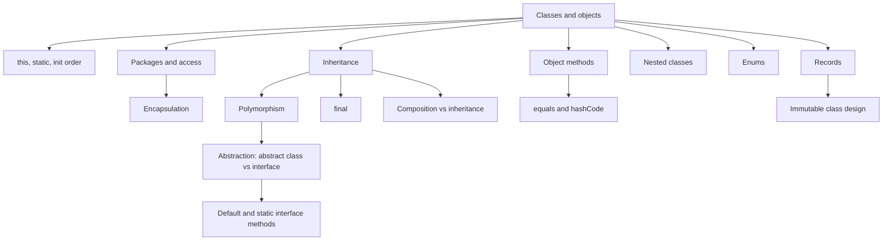

@@ 1 | MODULE | Phase 2 — Object-Oriented Programming (Beginner) | Classes, the four pillars, Object methods, equals/hashCode, enums, records, immutability | MUST
# Phase 2: Object-Oriented Programming (Beginner)

Java is an object-oriented language: you model the world as objects that hold data (fields) and behaviour (methods). This phase covers how classes and objects work, the four pillars (encapsulation, inheritance, polymorphism, abstraction), the methods every object inherits from `Object`, and modern building blocks like enums and records. OOP questions appear in every Java interview, and Spring itself is built on interfaces, polymorphism and composition.



**Prerequisites:** Phase 1 (types, methods, pass-by-value).

**The 5 questions from this phase that come up most often**
1. What are the four pillars of OOP? Give an example of each.
2. Abstract class vs interface: when do you use which?
3. Overloading vs overriding.
4. What is the equals and hashCode contract, and what breaks if you override only one?
5. How do you make a class immutable?

@@ 2 | MODULE | Classes and objects | Blueprints, instances, constructors, static members and packages | MUST
# Classes and objects

**Shared analogy: a cookie cutter and cookies.** The class is the cutter: it defines the shape. Each cookie is an object: same shape, its own decorations (field values). `static` things belong to the cutter itself (the bakery's counter of how many cookies were made), not to any single cookie. Packages are the labelled drawers where cutters are kept, and access modifiers decide who may open each drawer.

@@ 3 | TOPIC | Classes, Objects and Constructors | Blueprint vs instance, fields, constructors, overloading and chaining | MUST
# Classes, Objects and Constructors

**Level: Beginner | Phase 2 | Priority: MUST | Since: Java 1.0**

> **30-second interview answer:** A class is a blueprint that defines fields (state) and methods (behaviour). An object is an instance created from it with `new`, stored on the heap, with its own copy of the instance fields. A constructor initializes a new object; it has the class's name and no return type. If you write no constructor, the compiler adds a no-argument default one. Constructors can be overloaded and can call each other with `this(...)`.

## 1. Concept in Simple Words
### Analogy
House blueprints and houses.

| Construction | Java |
|---|---|
| The architect's blueprint | The class |
| A real house built from it | An object (instance) |
| Each house has its own paint colour | Each object has its own field values |
| The builder who sets up a new house before handing over keys | The constructor |
| Several build packages: basic, with garage, with pool | Overloaded constructors |
| The address of the house | The reference stored in a variable |

### What it is
- **Class:** a type declaration: `class Product { ... }`.
- **Field (instance variable):** data each object carries: `String name;`.
- **Method:** behaviour: `double priceWithTax() { ... }`.
- **Object:** created with `new Product(...)`, which allocates memory on the heap, sets fields to defaults, runs the constructor and returns a reference.
- **Constructor:** same name as the class, no return type, runs once per object.
- **Default constructor:** added by the compiler only when you declare **no** constructors at all.
- **Constructor chaining:** `this(...)` calls another constructor of the same class; `super(...)` calls the parent's constructor. Either must be the first statement (relaxed in Java 25 with "flexible constructor bodies", which allow statements that do not touch `this` before the call).

### Why it exists
Classes group data and the code that works on it, so a `BankAccount` carries both its balance and the rules for changing it. Constructors guarantee every object starts in a valid state.

## 2. How It Works
What `new Product("Pen", 2.5)` does:
```text
1. Load the Product class if this is the first use (static init runs once).
2. Allocate memory on the heap for all instance fields.
3. Set every field to its default (null, 0, false).
4. Call the constructor: first super(...) chain up to Object,
   then field initializers and instance initializer blocks in order,
   then the rest of the constructor body.
5. Return the reference, stored in the variable.

STACK              HEAP
p = @7a  ------>  Product { name = "Pen", price = 2.5 }
q = @7a  ------^  (q = p copies the reference: one object, two names)
r = @9c  ------>  Product { name = "Ink", price = 4.0 }
```

**Object lifetime:** an object lives while it is reachable from a live reference. When nothing references it, the garbage collector may reclaim it. There are no destructors in Java (`finalize` is deprecated for removal); use try-with-resources for cleanup.

## 3. Code Example
### Code
```java
public class Product {
    // Instance fields: each Product object has its own copy
    private final String name;
    private double price;
    private int stock;

    // Constructor 1: the "full" constructor does the real work
    public Product(String name, double price, int stock) {
        if (price < 0) throw new IllegalArgumentException("price must be >= 0");
        this.name = name;      // this.name is the field, name is the parameter
        this.price = price;
        this.stock = stock;
    }

    // Constructor 2: chains to constructor 1 with a default stock
    public Product(String name, double price) {
        this(name, price, 0);  // must be the first statement
    }

    // Instance methods use the fields of the object they are called on
    public void restock(int amount) { stock += amount; }
    public double priceWithTax(double rate) { return price * (1 + rate); }
    public String getName() { return name; }
    public int getStock() { return stock; }

    @Override
    public String toString() {
        return name + " (" + price + ", stock " + stock + ")";
    }

    public static void main(String[] args) {
        Product pen = new Product("Pen", 2.5);          // uses constructor 2
        Product lamp = new Product("Lamp", 30.0, 5);    // uses constructor 1
        pen.restock(10);

        System.out.println(pen);
        System.out.println(lamp);
        System.out.println("Lamp with tax: " + lamp.priceWithTax(0.2));

        Product alias = pen;          // copies the reference, not the object
        alias.restock(1);
        System.out.println("pen stock via alias: " + pen.getStock());
        System.out.println("same object? " + (alias == pen));

        try {
            new Product("Broken", -1);
        } catch (IllegalArgumentException e) {
            System.out.println("rejected: " + e.getMessage());
        }
    }
}
```

### Walkthrough
- Three private fields hold the state. `name` is `final`, so it must be set exactly once, in the constructor.
- The three-argument constructor validates input, so an invalid `Product` can never exist.
- The two-argument constructor delegates with `this(name, price, 0)`: one place holds the logic (the "telescoping" pattern).
- `this.name = name` resolves the name clash between field and parameter.
- `alias = pen` copies the reference. Restocking through `alias` changes the same object.
- `toString` is overridden so printing shows useful text instead of `Product@1b6d3586`.

### Output
```text
Pen (2.5, stock 10)
Lamp (30.0, stock 5)
Lamp with tax: 36.0
pen stock via alias: 11
same object? true
rejected: price must be >= 0
```

### Compare
| Constructor | Method |
|---|---|
| Same name as the class | Any name |
| No return type, not even void | Has a return type |
| Called once, by `new` | Called any number of times |
| Not inherited | Inherited |
| Can call `this(...)` or `super(...)` | Cannot |

## 4. Interview Questions
**Basic**
1. **What is the difference between a class and an object?**
   A class is a blueprint describing fields and methods; an object is a concrete instance of it in heap memory with its own field values.
2. **What is a default constructor?**
   A public no-argument constructor that the compiler adds only if the class declares no constructor at all. It calls `super()`.
3. **Can a constructor be private?**
   Yes. It prevents outside code from creating instances; used in singletons, utility classes and static factory methods.

**Follow-up**
4. **What happens if you add a constructor with parameters to a class that had none?**
   The compiler no longer adds the default constructor, so `new MyClass()` stops compiling. Frameworks like JPA need a no-arg constructor, so you must add one explicitly.
5. **What is constructor chaining?**
   Calling one constructor from another with `this(...)` in the same class, or `super(...)` for the parent. It keeps initialization logic in one place.
6. **Can a constructor be `final`, `static` or `abstract`?**
   No. Constructors are not inherited, so `final` and `abstract` make no sense, and they always work on an instance, so `static` is impossible.

**Tricky / scenario**
7. **Can a constructor return a value?**
   No. Writing a return type turns it into an ordinary method with the class's name, which compiles but is never called by `new`, a nasty bug.
8. **What does `new` return if the constructor throws?**
   Nothing: no reference is returned, the partially built object becomes garbage, and the exception propagates.

**What the interviewer is really testing:** that you can model state and guarantee valid objects, the basis of every domain class you will write.

## 5. Pitfalls & Best Practices
### Common mistakes
| Mistake | What goes wrong | Fix |
|---|---|---|
| Forgetting `this.` when parameter and field share a name | `name = name` assigns the parameter to itself | Write `this.name = name` |
| Adding a return type to a "constructor" | It becomes a method; field never set | Remove the return type |
| Duplicated logic in several constructors | Bugs fixed in one place only | Chain with `this(...)` |
| Calling overridable methods from a constructor | Subclass method runs before the subclass fields are set | Only call private or final methods |

### Best practices
- Validate arguments in the constructor; make invalid states impossible.
- With more than 3 or 4 parameters, use a builder (Phase 17) or a record.
- Prefer static factory methods with clear names (`Money.ofCents(150)`) when there are several ways to create an object.

### Compare with
| Way to create | When |
|---|---|
| Constructor | Simple, one obvious way |
| Static factory (`List.of`) | Named creation, caching, returning subtypes |
| Builder | Many optional parameters |
| Spring bean | The framework manages creation and wiring (Phase 10) |

## 6. Hands-on Exercise
Create a `BankAccount` class with `accountNumber` (final), `owner` and `balance`. Provide two constructors (with and without an opening balance, chained), `deposit` and `withdraw` methods that reject non-positive amounts and overdrafts with `IllegalArgumentException`, and a `toString`.

<details><summary>Solution</summary>

```java
public class BankAccount {
    private final String accountNumber;
    private final String owner;
    private double balance;

    public BankAccount(String accountNumber, String owner, double openingBalance) {
        if (openingBalance < 0) throw new IllegalArgumentException("negative opening balance");
        this.accountNumber = accountNumber;
        this.owner = owner;
        this.balance = openingBalance;
    }

    public BankAccount(String accountNumber, String owner) {
        this(accountNumber, owner, 0);
    }

    public void deposit(double amount) {
        if (amount <= 0) throw new IllegalArgumentException("amount must be positive");
        balance += amount;
    }

    public void withdraw(double amount) {
        if (amount <= 0) throw new IllegalArgumentException("amount must be positive");
        if (amount > balance) throw new IllegalArgumentException("insufficient funds");
        balance -= amount;
    }

    @Override
    public String toString() {
        return accountNumber + " " + owner + " balance=" + balance;
    }

    public static void main(String[] args) {
        BankAccount acc = new BankAccount("AC-1", "Ann");
        acc.deposit(100);
        acc.withdraw(30);
        System.out.println(acc);                  // AC-1 Ann balance=70.0
        try { acc.withdraw(500); }
        catch (IllegalArgumentException e) { System.out.println(e.getMessage()); } // insufficient funds
    }
}
```
</details>

## 7. Recall
Q: When does the Java compiler add a default constructor?
A: Only when the class declares no constructor at all.

Q: What must be the first statement when a constructor calls `this(...)` or `super(...)`?
A: That call itself (Java 25 relaxes this to allow statements that do not use `this` before it).

Q: Can a Java constructor be private, and why would you do it?
A: Yes, to stop outside instantiation, for singletons, utility classes and static factories.

Q: What does `Product b = a;` copy in Java?
A: Only the reference; both variables point to the same object.

Q: Can a Java constructor be final, static or abstract?
A: No.

**Related:** [[this, static and Initialization Order]] · [[Encapsulation]] · [[Builder]]

@@ 3 | TOPIC | this, static and Initialization Order | Instance vs class members, static blocks, instance blocks and the exact order objects are built | MUST
# this, static and Initialization Order

**Level: Beginner | Phase 2 | Priority: MUST | Since: Java 1.0**

> **30-second interview answer:** `this` refers to the current object. `static` members belong to the class, not to any object: one copy shared by all instances, accessible without creating an object. Static methods cannot use `this` or instance fields directly. Initialization order: static fields and static blocks run once when the class is loaded (parent first); then for each `new`, the parent constructor chain runs, then instance field initializers and instance blocks in source order, then the constructor body.

## 1. Concept in Simple Words
### Analogy
A school.

| School | Java |
|---|---|
| Each student's own name and grades | Instance fields |
| The school's single notice board, shared by everyone | Static field |
| The principal's announcement, made without picking a student | Static method |
| A student saying "me" | `this` |
| Setting up the school building once, before any student enrols | Static initializer block (class loading) |
| Preparing each new student's desk | Instance initializer and constructor |

### What it is
- **`this`:** a reference to the object on which the method or constructor is running. Uses: resolve name clashes (`this.name = name`), pass yourself (`register(this)`), chain constructors (`this(...)`), return yourself for fluent APIs.
- **Static field:** one copy per class (per class loader). Example: a counter of created objects, constants (`static final`).
- **Static method:** called on the class (`Math.max(1, 2)`). No `this`. Can only touch static members directly.
- **Static block:** `static { ... }` runs once when the class is initialized.
- **Instance initializer block:** `{ ... }` runs for every object before the constructor body.
- **Static nested class, static import:** other uses of the keyword, covered elsewhere.

### Why it exists
Some data and behaviour belong to the concept, not to individual objects: constants, counters, factory methods, utilities. `static` expresses that and avoids creating objects just to call a helper.

## 2. How It Works
**Memory layout:**
```text
Metaspace (class data)            Heap
Counter.class
  static int created = 2  <----- shared by all objects
                                  Counter@a1 { id = 1 }
                                  Counter@b2 { id = 2 }
```
Static fields live with the class (on the heap in a special class mirror object since Java 8, conceptually "with the class"), not inside each object.

**Class initialization happens on first active use:** creating an instance, calling a static method, reading a non-constant static field, or `Class.forName`. Reading a compile-time constant (`static final int MAX = 10`) does **not** trigger it, because the compiler inlines the value.

**Full order with inheritance** for `new Child()` the first time:
```text
1. Parent static fields and static blocks (source order)    once per class
2. Child static fields and static blocks                     once per class
3. Parent instance fields and instance blocks                every new
4. Parent constructor body                                   every new
5. Child instance fields and instance blocks                 every new
6. Child constructor body                                    every new
```

## 3. Code Example
### Code
```java
public class InitOrderDemo {
    static class Parent {
        static String log(String msg) { System.out.println(msg); return msg; }

        static String parentStatic = log("1. Parent static field");
        static { log("2. Parent static block"); }

        String parentField = log("5. Parent instance field");
        { log("6. Parent instance block"); }

        Parent() {
            log("7. Parent constructor");
            describe();  // calls the OVERRIDDEN method: dangerous
        }
        void describe() { log("   Parent.describe"); }
    }

    static class Child extends Parent {
        static String childStatic = log("3. Child static field");
        static { log("4. Child static block"); }

        String childField = log("8. Child instance field");
        { log("9. Child instance block"); }
        private final String label = "ready";

        Child() {
            super();  // implicit if omitted
            log("10. Child constructor");
        }
        @Override
        void describe() {
            // Runs during Parent's constructor, before Child's fields are set
            log("   Child.describe sees childField = " + childField);
        }
    }

    static class Counter {
        private static int created = 0;   // shared by all Counters
        private final int id;

        Counter() {
            created++;
            this.id = created;            // this = the object being built
        }
        static int getCreated() {         // static: no 'this' available
            // return id;  // compile error: non-static field from static context
            return created;
        }
        Counter self() { return this; }
    }

    public static void main(String[] args) {
        System.out.println("--- first new Child() ---");
        new Child();
        System.out.println("--- second new Child() ---");
        new Child();

        System.out.println("--- static counter ---");
        Counter a = new Counter();
        Counter b = new Counter();
        System.out.println("a.id=" + a.id + " b.id=" + b.id + " created=" + Counter.getCreated());
        System.out.println("self() returns this: " + (a.self() == a));
    }
}
```

### Walkthrough
- Static fields and blocks of `Parent` then `Child` run once, on the first `new Child()`.
- For each object, `Parent`'s instance field and block run, then `Parent`'s constructor, then `Child`'s instance parts and constructor.
- `Parent`'s constructor calls `describe()`. Because of polymorphism the **Child** version runs, but `childField` is still `null`: Child's initializers have not run yet. This is why constructors should not call overridable methods.
- The second `new Child()` skips steps 1 to 4: class initialization happens only once.
- `Counter.created` is shared, so each object gets the next id. `getCreated` is static and cannot read `id`.

### Output
```text
--- first new Child() ---
1. Parent static field
2. Parent static block
3. Child static field
4. Child static block
5. Parent instance field
6. Parent instance block
7. Parent constructor
   Child.describe sees childField = null
8. Child instance field
9. Child instance block
10. Child constructor
--- second new Child() ---
5. Parent instance field
6. Parent instance block
7. Parent constructor
   Child.describe sees childField = null
8. Child instance field
9. Child instance block
10. Child constructor
--- static counter ---
a.id=1 b.id=2 created=2
self() returns this: true
```

### Compare
| Instance member | Static member |
|---|---|
| One copy per object | One copy per class |
| Accessed via a reference | Accessed via the class name |
| Can use `this` | Cannot use `this` |
| Can be overridden (methods) | Hidden, not overridden |

## 4. Interview Questions
**Basic**
1. **What does the `static` keyword mean?**
   The member belongs to the class rather than to instances: one shared copy, usable without creating an object.
2. **Why can't a static method use `this`?**
   It is not called on an object, so there is no current instance for `this` to point to.
3. **What is a static block used for?**
   One-time class setup: initializing complex static fields, loading native libraries or configuration. It runs once when the class is initialized.

**Follow-up**
4. **What is the order of initialization when creating a subclass object?**
   Parent static, child static (once), then parent instance initializers and constructor, then child instance initializers and constructor.
5. **Can you override a static method?**
   No. A static method with the same signature in a subclass hides the parent's method; which one runs depends on the declared type, not the object.
6. **Why is `main` static, and can static methods be called on an instance?**
   `main` is static because no object exists at start-up. You can call a static method through an instance reference, but the compiler uses the declared class; it is misleading and IDEs warn about it.

**Tricky / scenario**
7. **What is printed when a parent constructor calls a method that the child overrides and uses a child field?**
   The child method runs and sees the field's default value (null or 0), because child field initializers have not run yet.
8. **A static `List` cache keeps growing in a long-running server. What is the problem?**
   Static fields live as long as the class, which usually means forever. Objects added are never collected: a memory leak. Use bounded caches with eviction.

**What the interviewer is really testing:** understanding of what belongs to the class versus the object, and object construction order, which explains many puzzling bugs.

## 5. Pitfalls & Best Practices
### Common mistakes
| Mistake | What goes wrong | Fix |
|---|---|---|
| Mutable static state in a web app | Shared across all requests and threads: race conditions | Avoid it, or use thread-safe types; prefer Spring beans |
| Calling overridable methods in constructors | Subclass sees unset fields | Call only private or final methods |
| Static collections as caches | Memory leaks | Bounded cache (Caffeine, Spring Cache) |
| Heavy work in static blocks | Slow start-up, `ExceptionInInitializerError` that makes the class unusable | Lazy initialization |

### Best practices
- Constants: `public static final` with UPPER_SNAKE_CASE names.
- Utility classes: `final` class with a private constructor and only static methods.
- In Spring apps, prefer injected singleton beans over static state: they are testable and replaceable.

### Compare with
| Static utility method | Instance method on a Spring bean |
|---|---|
| Easy to call, no setup | Needs injection |
| Hard to mock in tests | Easy to mock |
| Good for pure functions (`Math.max`) | Good for logic with dependencies |

## 6. Hands-on Exercise
Write a class `IdGenerator` with a private static counter starting at 1000 and a static method `next()` that returns `"ORD-1001"`, `"ORD-1002"` and so on. Add a static block that prints `IdGenerator loaded`. Show that the block runs only once even when `next()` is called three times. Make the class non-instantiable.

<details><summary>Solution</summary>

```java
public final class IdGenerator {
    private static int counter = 1000;

    static {
        System.out.println("IdGenerator loaded");
    }

    private IdGenerator() { }      // nobody can create an instance

    public static String next() {
        counter++;
        return "ORD-" + counter;
    }

    public static void main(String[] args) {
        System.out.println(IdGenerator.next());
        System.out.println(IdGenerator.next());
        System.out.println(IdGenerator.next());
    }
}
// IdGenerator loaded
// ORD-1001
// ORD-1002
// ORD-1003
```
Note: `counter++` is not thread-safe. In Phase 9 you will replace it with `AtomicInteger`.
</details>

## 7. Recall
Q: In Java, how many copies of a static field exist?
A: One per class (per class loader), shared by all instances.

Q: When does a Java static initializer block run?
A: Once, when the class is first initialized (first active use).

Q: Can a Java static method be overridden?
A: No, it can only be hidden; the declared type decides which one runs.

Q: In what order are static and instance initializers run for `new Child()` the first time?
A: Parent static, Child static, Parent instance plus constructor, Child instance plus constructor.

Q: What does a child override see if the parent constructor calls it?
A: The child's fields still at default values, because child initializers have not run yet.

**Related:** [[Classes, Objects and Constructors]] · [[Inheritance and super]] · [[Class Loading and ClassLoaders]]

@@ 3 | TOPIC | Packages and Access Modifiers | private, default, protected, public and how packages organize code | MUST
# Packages and Access Modifiers

**Level: Beginner | Phase 2 | Priority: MUST | Since: Java 1.0 (modules Java 9)**

> **30-second interview answer:** Packages group related classes into namespaces that match folders. Access modifiers control visibility: `private` means only inside the class; no modifier (package-private) means within the same package; `protected` means the same package plus subclasses in other packages; `public` means everywhere. Use the most restrictive level that works.

## 1. Concept in Simple Words
### Analogy
An office building.

| Office | Java |
|---|---|
| Your personal locked drawer | `private`: only the class itself |
| The team room, open to your team | package-private (no keyword): same package |
| The team room, plus your trainees working on other floors | `protected`: same package plus subclasses |
| The lobby, open to anyone | `public` |
| Floors of the building | Packages |
| The building's front gate list (Java 9 modules) | `module-info.java` exports |

### What it is
| Modifier | Same class | Same package | Subclass in other package | Everywhere else |
|---|---|---|---|---|
| `private` | yes | no | no | no |
| (none) package-private | yes | yes | no | no |
| `protected` | yes | yes | yes (through inheritance) | no |
| `public` | yes | yes | yes | yes |

- Top-level classes can only be `public` or package-private.
- **Package:** `package com.orderhub.order;` at the top of the file; the file must be in `com/orderhub/order/`.
- **Import:** `import com.orderhub.order.Order;` or wildcard `import com.orderhub.order.*;`. `java.lang` is imported automatically.
- **Static import:** `import static java.lang.Math.max;` then call `max(1, 2)`.
- **Modules (Java 9+):** a layer above packages; a module only exposes the packages it `exports`.

### Why it exists
Hiding details lets you change internals without breaking other code. Packages avoid name clashes (`java.util.Date` vs `java.sql.Date`) and organize large codebases.

## 2. How It Works
Access is checked by the compiler and again by the JVM when it links classes.

```text
com.shop.model                     com.shop.web
+------------------------+         +--------------------------+
| class Product          |         | class ProductController  |
|   private  cost  ------x---------x  cannot see              |
|   (none)   sku   ------x---------x  cannot see              |
|   protected margin ----x---------x  cannot (not a subclass) |
|   public   name  ------+---------+-> can see                |
+------------------------+         +--------------------------+
                                   | class SpecialProduct     |
                                   |   extends Product        |
                                   |   margin -> can see via  |
                                   |   inheritance (this)     |
                                   +--------------------------+
```

**The `protected` detail:** a subclass in another package can access the protected member only through its own type (`this.margin` or `otherSpecial.margin`), not through a plain `Product` reference.

**Overriding rule:** an overriding method cannot reduce visibility. A `public` method cannot be overridden as `protected`.

**Layered package structure** used in Spring projects:
```text
com.orderhub
  OrderHubApplication.java
  order/        OrderController, OrderService, OrderRepository, Order
  product/      ProductController, ProductService, ...
  common/       exceptions, utilities
```
"Package by feature" (above) keeps related classes together and lets you make many classes package-private.

## 3. Code Example
### Code
```java
// One file with nested types to show all four levels in a runnable way.
public class AccessDemo {

    static class Account {
        private double balance;           // only Account can touch this
        String branch = "Main";           // same package (and this file) can see it
        protected String type = "SAVINGS";// package plus subclasses
        public String owner;              // anyone

        Account(String owner, double opening) {
            this.owner = owner;
            this.balance = opening;
        }

        // Public method: the controlled way to change private state
        public void deposit(double amount) {
            if (amount <= 0) throw new IllegalArgumentException("amount must be positive");
            balance += amount;
        }

        public double getBalance() { return balance; }

        private void audit() { System.out.println("audit for " + owner); }

        public void close() {
            audit();                      // private method used internally
            balance = 0;
        }
    }

    static class PremiumAccount extends Account {
        PremiumAccount(String owner) {
            super(owner, 1000);
            type = "PREMIUM";             // protected: subclass may change it
            // balance = 5000;           // compile error: balance is private in Account
        }
    }

    public static void main(String[] args) {
        Account acc = new Account("Ann", 100);
        acc.deposit(50);
        System.out.println(acc.owner + " " + acc.getBalance() + " " + acc.branch + " " + acc.type);

        // Nested classes share the outer class's private access, so the next
        // line would compile HERE, but from another top-level class it would not.
        // acc.balance = 1_000_000;

        PremiumAccount p = new PremiumAccount("Bob");
        System.out.println(p.owner + " " + p.getBalance() + " " + p.type);

        acc.close();
        System.out.println("after close: " + acc.getBalance());
    }
}
```

```java
// File: com/shop/model/Item.java   (separate package, to show real restrictions)
package com.shop.model;

public class Item {
    private int cost = 5;
    int sku = 42;                 // package-private
    protected int margin = 3;
    public String name = "Cup";
}
```

```java
// File: com/shop/web/Shop.java
package com.shop.web;

import com.shop.model.Item;

public class Shop {
    public static void main(String[] args) {
        Item item = new Item();
        System.out.println(item.name);    // OK: public
        // item.cost;   compile error: private
        // item.sku;    compile error: package-private, different package
        // item.margin; compile error: protected, Shop is not a subclass
    }
}
```

### Walkthrough
- `balance` is private, so the only way to change it is `deposit`, which enforces the rule "amount must be positive". This is encapsulation (next group).
- `branch` has no modifier: visible inside the same package.
- `type` is protected: `PremiumAccount` changes it in its constructor.
- `PremiumAccount` cannot read `balance` directly, even though it inherits it; it must use `getBalance()`.
- Nested classes in the same top-level class can see each other's private members, which is why the comment explains that the forbidden line would compile only here.
- The two-package example shows the real compiler errors for each level.

### Output
```text
Ann 150.0 Main SAVINGS
Bob 1000.0 PREMIUM
audit for Ann
after close: 0.0
```
And for the package example:
```text
Cup
```

### Compare
| Modifier | Typical use |
|---|---|
| `private` | Fields, helper methods |
| package-private | Classes and methods used only inside a feature package |
| `protected` | Hooks meant for subclasses (template method pattern) |
| `public` | The API others call |

## 4. Interview Questions
**Basic**
1. **List the access modifiers from most to least restrictive.**
   private, package-private (no keyword), protected, public.
2. **What is the default access level?**
   Package-private: visible to all classes in the same package, nowhere else.
3. **Can a top-level class be private or protected?**
   No. Only public or package-private. Nested classes can use all four.

**Follow-up**
4. **What is the difference between protected and package-private?**
   Protected adds access for subclasses in other packages; package-private does not.
5. **Can an overriding method have a more restrictive modifier?**
   No. It can keep or widen visibility, never narrow it, otherwise code holding a parent reference could call a method it is not allowed to.
6. **Are private members inherited?**
   The object of a subclass contains the parent's private fields, but the subclass code cannot access them directly; in Java terms they are not inherited as members.

**Tricky / scenario**
7. **Can you access a private field from outside the class at all?**
   With reflection and `setAccessible(true)`, yes, unless the module system blocks it. Frameworks like Hibernate and Jackson do this. It does not make private useless: it is about the design contract.
8. **Why do many Spring teams make services and repositories package-private?**
   With package-by-feature, only the controller or a public facade needs to be visible. Hiding the rest stops other features from depending on internals. Spring can still create package-private beans.

**What the interviewer is really testing:** whether you design APIs that hide internals and know the exact visibility rules.

## 5. Pitfalls & Best Practices
### Common mistakes
| Mistake | What goes wrong | Fix |
|---|---|---|
| Public fields | Anyone can break invariants | Private fields plus methods |
| Making everything public "to be safe" | Tight coupling, no freedom to refactor | Start private, open only when needed |
| Wildcard imports with name clashes | `Date` ambiguous between `java.util` and `java.sql` | Use explicit imports |
| Package line not matching folders | Class not found | Keep them identical |

### Best practices
- Fields private; constructors and methods only as visible as needed.
- Package by feature, not by layer, in larger apps.
- Use `final` classes plus private constructors for utilities.

### Compare with
| Package by layer | Package by feature |
|---|---|
| `controller/`, `service/`, `repository/` | `order/`, `product/`, `customer/` |
| Everything must be public | Many classes can be package-private |
| Easy for tiny apps | Scales better; matches microservice boundaries |

## 6. Hands-on Exercise
Design a `Thermostat` class with a private `temperature`, a public `setTarget(int)` that only accepts 10 to 30, a public getter, and a protected method `onChange(int oldValue, int newValue)` that does nothing. Create a subclass `LoggingThermostat` that overrides `onChange` to print the change. Explain in a comment why `onChange` is protected and not public.

<details><summary>Solution</summary>

```java
public class Thermostat {
    private int temperature = 20;

    public void setTarget(int target) {
        if (target < 10 || target > 30) throw new IllegalArgumentException("10 to 30 only");
        int old = temperature;
        temperature = target;
        onChange(old, target);
    }

    public int getTemperature() { return temperature; }

    // protected: a hook for subclasses to customize, not part of the public API.
    // Outside callers should not trigger change notifications themselves.
    protected void onChange(int oldValue, int newValue) { }

    static class LoggingThermostat extends Thermostat {
        @Override
        protected void onChange(int oldValue, int newValue) {
            System.out.println("temperature " + oldValue + " -> " + newValue);
        }
    }

    public static void main(String[] args) {
        Thermostat t = new LoggingThermostat();
        t.setTarget(24);   // temperature 20 -> 24
        System.out.println(t.getTemperature()); // 24
    }
}
```
</details>

## 7. Recall
Q: What visibility does a Java member with no access modifier have?
A: Package-private: visible only inside the same package.

Q: What does `protected` add over package-private in Java?
A: Access for subclasses in other packages.

Q: Can an overriding method reduce visibility in Java?
A: No, it may only keep or widen it.

Q: Which access modifiers can a top-level Java class have?
A: Only public or package-private.

Q: Which package is imported automatically in every Java file?
A: `java.lang`.

**Related:** [[Encapsulation]] · [[Inheritance and super]] · [[Layered Architecture: Controller, Service, Repository]]

@@ 2 | MODULE | The four pillars | Encapsulation, inheritance, polymorphism and abstraction | MUST
# The four pillars

**Shared analogy: a car.** Encapsulation is the bonnet: you press the pedal without touching the fuel injectors. Inheritance is a sports car model built on the base car design. Polymorphism is that every car responds to "accelerate" in its own way (petrol, electric). Abstraction is the driving interface itself: wheel, pedals, gear selector, the same idea in every car regardless of what is under the bonnet.
