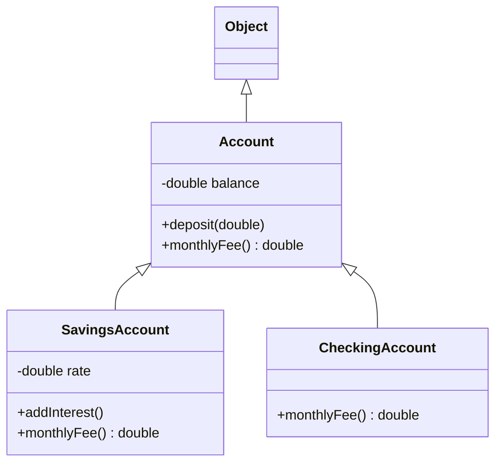
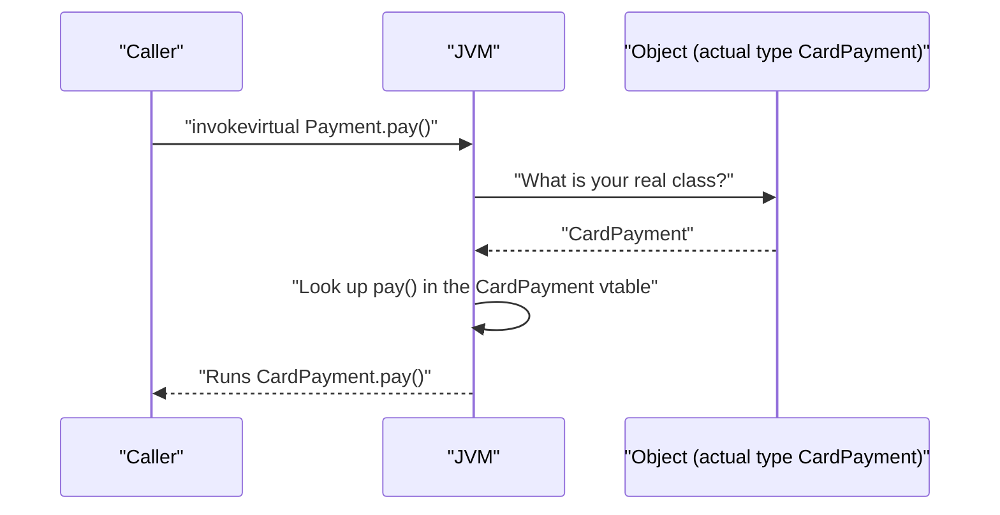

@@ 3 | TOPIC | Encapsulation | Hiding state behind methods, invariants, getters and setters done right | MUST
# Encapsulation

**Level: Beginner | Phase 2 | Priority: MUST | Since: Java 1.0**

> **30-second interview answer:** Encapsulation means bundling data with the methods that operate on it and hiding the data behind a controlled interface. Fields are private; outside code changes state only through methods that enforce the rules (invariants). It lets you change the internal representation without breaking callers, and it prevents objects from ever reaching an invalid state.

## 1. Concept in Simple Words
### Analogy
An ATM.

| ATM | Java |
|---|---|
| The cash vault inside the machine | Private fields |
| The screen and buttons | Public methods |
| "You cannot withdraw more than your balance" | The invariant enforced inside the method |
| The bank can replace the vault mechanism without changing the buttons | Changing internals without breaking callers |
| You never reach in and grab cash | No direct field access |

### What it is
- **Data hiding:** fields are `private`.
- **Controlled access:** public methods that validate input.
- **Invariant:** a rule that is always true for a valid object, such as "balance is never negative" or "an order has at least one line".
- **Getters and setters:** accessor methods. Encapsulation is **not** "add a getter and setter for every field": a setter that accepts anything is barely better than a public field.
- **Tell, don't ask:** instead of `if (acc.getBalance() >= x) acc.setBalance(acc.getBalance() - x)`, call `acc.withdraw(x)` and let the object decide.

### Why it exists
If any code can change any field, every bug could come from anywhere. Encapsulation shrinks the places that can change state to a few methods you can test and reason about.

## 2. How It Works
```text
        Outside code
             |
             v
   +--------------------+       public API (stable)
   | withdraw(amount)   |  ---- checks: amount > 0, amount <= balance
   | deposit(amount)    |  ---- checks: amount > 0
   | getBalance()       |
   +--------------------+
   | private balance    |       internal (free to change:
   | private history    |       double -> BigDecimal, add history...)
   +--------------------+
```

**Leaking internals:** returning a mutable internal object (like a `List` field) lets callers change your state without going through your methods. Return an unmodifiable view or a copy.

```java
public List<String> getItems() { return items; }                                // leaks
public List<String> getItems() { return List.copyOf(items); }                   // safe snapshot
public List<String> getItems() { return Collections.unmodifiableList(items); }  // read-only view
```

## 3. Code Example
### Code
```java
import java.util.ArrayList;
import java.util.Collections;
import java.util.List;

public class EncapsulationDemo {

    // BAD: public fields, no rules
    static class OpenCart {
        public List<String> items = new ArrayList<>();
        public double total;
    }

    // GOOD: private state, behaviour-rich methods, no leaks
    static class Cart {
        private final List<String> items = new ArrayList<>();
        private double total;
        private static final int MAX_ITEMS = 3;

        public void add(String item, double price) {
            if (price <= 0) throw new IllegalArgumentException("price must be positive");
            if (items.size() >= MAX_ITEMS) throw new IllegalStateException("cart is full");
            items.add(item);
            total += price;           // total always matches the items
        }

        public List<String> getItems() {
            return Collections.unmodifiableList(items); // read-only view
        }

        public double getTotal() { return total; }
        // No setTotal(): total can only change through add()
    }

    public static void main(String[] args) {
        OpenCart open = new OpenCart();
        open.items.add("Book");
        open.total = -999;            // nothing stops this
        System.out.println("open cart: " + open.items + " total " + open.total);

        Cart cart = new Cart();
        cart.add("Book", 12.5);
        cart.add("Pen", 1.5);
        System.out.println("cart: " + cart.getItems() + " total " + cart.getTotal());

        try {
            cart.getItems().add("Free TV");      // try to bypass add()
        } catch (UnsupportedOperationException e) {
            System.out.println("blocked: cannot modify items from outside");
        }
        try {
            cart.add("Lamp", 20);
            cart.add("Chair", 40);               // 4th item
        } catch (IllegalStateException e) {
            System.out.println("blocked: " + e.getMessage());
        }
        System.out.println("final: " + cart.getItems() + " total " + cart.getTotal());
    }
}
```

### Walkthrough
- `OpenCart` exposes everything, so `total` can be set to -999 and no longer matches the items.
- `Cart` keeps both fields private. The only way to change them is `add`, which enforces three rules: positive price, maximum size, and total kept in sync.
- `getItems` returns an unmodifiable view, so `cart.getItems().add(...)` throws `UnsupportedOperationException`.
- There is deliberately no `setTotal`: not every field needs a setter.

### Output
```text
open cart: [Book] total -999.0
cart: [Book, Pen] total 14.0
blocked: cannot modify items from outside
blocked: cart is full
final: [Book, Pen, Lamp] total 34.0
```

### Compare
| Anaemic object (getters and setters only) | Rich object (encapsulated behaviour) |
|---|---|
| Logic lives in services that poke fields | Logic lives next to the data |
| Any caller can break invariants | Invariants enforced in one place |
| `order.setStatus(SHIPPED)` | `order.ship()` that checks payment first |

## 4. Interview Questions
**Basic**
1. **What is encapsulation?**
   Bundling data and behaviour in a class and hiding the data behind methods, so state can only change in controlled ways.
2. **How do you achieve encapsulation in Java?**
   Make fields private and expose only the methods needed, with validation inside them.
3. **What is the difference between encapsulation and abstraction?**
   Encapsulation hides the data and implementation inside a class (how it is protected). Abstraction hides complexity behind a simple interface (what it does). They work together.

**Follow-up**
4. **Is a class with private fields and public getters and setters for all of them encapsulated?**
   Only technically. If setters accept any value, invariants are not protected. Real encapsulation exposes meaningful operations and validates.
5. **How can a getter break encapsulation?**
   By returning a mutable internal object such as a `List` or `Date`, which callers can then modify directly. Return a copy or an unmodifiable view.
6. **What is "tell, don't ask"?**
   Tell an object what to do (`account.withdraw(50)`) instead of asking for its data and making decisions outside it.

**Tricky / scenario**
7. **JPA entities need getters and setters. Does that kill encapsulation?**
   JPA can use field access and needs only a no-arg constructor (it can be protected). You can keep setters out of the public API and expose domain methods like `order.addLine(...)`.
8. **`Collections.unmodifiableList(items)` vs `List.copyOf(items)`: which do you return?**
   The unmodifiable view reflects later changes to the internal list and is cheap; `copyOf` is a snapshot that never changes. Pick based on whether callers should see later updates.

**What the interviewer is really testing:** whether you design objects that protect themselves, not just add boilerplate.

## 5. Pitfalls & Best Practices
### Common mistakes
| Mistake | What goes wrong | Fix |
|---|---|---|
| Generating setters for every field | Invariants unprotected | Add only meaningful operations |
| Returning internal mutable collections | Outside code changes state | Return copies or unmodifiable views |
| Storing a mutable argument directly | Caller can change it later | Copy in the constructor (defensive copy) |
| Validation scattered across services | Inconsistent rules | Validate inside the domain object |

### Best practices
- Start with `private final` fields; add mutability only when needed.
- Name methods by intent (`ship()`, `cancel()`), not by field (`setStatus`).
- In Spring apps, DTOs can be simple data carriers (records); domain entities should guard invariants.

### Compare with
| Pillar | Hides |
|---|---|
| Encapsulation | Data and internal state |
| Abstraction | Implementation complexity |

## 6. Hands-on Exercise
Create an `Order` class with a private list of lines (product name and quantity) and a private status (`NEW`, `PAID`, `SHIPPED`). Methods: `addLine` (only when NEW, quantity positive), `pay` (only when NEW and with at least one line), `ship` (only when PAID), and `getLines` returning a copy. Throw `IllegalStateException` for invalid transitions.

<details><summary>Solution</summary>

```java
import java.util.ArrayList;
import java.util.List;

public class Order {
    enum Status { NEW, PAID, SHIPPED }
    record Line(String product, int quantity) { }

    private final List<Line> lines = new ArrayList<>();
    private Status status = Status.NEW;

    public void addLine(String product, int quantity) {
        if (status != Status.NEW) throw new IllegalStateException("order is " + status);
        if (quantity <= 0) throw new IllegalArgumentException("quantity must be positive");
        lines.add(new Line(product, quantity));
    }

    public void pay() {
        if (status != Status.NEW) throw new IllegalStateException("order is " + status);
        if (lines.isEmpty()) throw new IllegalStateException("empty order");
        status = Status.PAID;
    }

    public void ship() {
        if (status != Status.PAID) throw new IllegalStateException("pay first");
        status = Status.SHIPPED;
    }

    public List<Line> getLines() { return List.copyOf(lines); }
    public Status getStatus() { return status; }

    public static void main(String[] args) {
        Order o = new Order();
        o.addLine("Book", 2);
        try { o.ship(); } catch (IllegalStateException e) { System.out.println(e.getMessage()); }
        o.pay();
        o.ship();
        System.out.println(o.getStatus() + " " + o.getLines());
    }
}
```
Output:
```text
pay first
SHIPPED [Line[product=Book, quantity=2]]
```
</details>

## 7. Recall
Q: What is encapsulation in Java?
A: Keeping fields private and changing state only through methods that enforce the object's rules.

Q: How can a getter break encapsulation?
A: By returning a mutable internal object that callers can modify.

Q: What is an invariant?
A: A rule that must always hold for a valid object, such as a non-negative balance.

Q: What does "tell, don't ask" mean?
A: Ask the object to perform an action instead of reading its data and deciding outside it.

Q: Is having getters and setters for every field good encapsulation?
A: No; setters that accept anything leave invariants unprotected.

**Related:** [[Packages and Access Modifiers]] · [[Immutable Class Design]] · [[Abstraction: Abstract Classes vs Interfaces]]

@@ 3 | TOPIC | Inheritance and super | extends, IS-A, super calls, method resolution and single inheritance | MUST
# Inheritance and super

**Level: Beginner | Phase 2 | Priority: MUST | Since: Java 1.0**

> **30-second interview answer:** Inheritance lets a class (subclass) extend another (superclass) with `extends`, reusing its fields and methods and adding or overriding behaviour. It models an IS-A relationship: a `SavingsAccount` is an `Account`. Java supports single inheritance of classes but multiple inheritance of interfaces. `super` calls the parent's constructor or methods. Every class ultimately extends `Object`.

## 1. Concept in Simple Words
### Analogy
Family recipes.

| Family recipe | Java |
|---|---|
| Grandma's basic cake recipe | Superclass |
| Mum's chocolate cake: same steps plus cocoa | Subclass that extends and adds |
| Mum changes the baking time | Overriding a method |
| "Do grandma's steps first, then add mine" | Calling `super.method()` |
| You have only one biological mother | Single class inheritance |
| You can learn many skills (swimming, chess) | Multiple interfaces |

### What it is
- `class Child extends Parent` gives `Child` all accessible fields and methods of `Parent`.
- **IS-A test:** inheritance is right only if "Child is a Parent" is true in every situation.
- **`super(...)`:** calls a parent constructor; must be first in the child constructor. If omitted, the compiler inserts `super()`, which fails if the parent has no no-arg constructor.
- **`super.method()`:** calls the parent version of an overridden method.
- **Kinds of inheritance in Java:** single, multilevel (A → B → C), hierarchical (B and C both extend A). Multiple class inheritance is not allowed (the diamond problem); multiple interface inheritance is.
- **Not inherited:** constructors, private members (not accessible), static methods (hidden, not overridden).

### Why it exists
To reuse common code and to let code work with a general type (`Account`) while specific subclasses vary. That second part, polymorphism, is the bigger benefit.

## 2. How It Works


A `SavingsAccount` object contains the fields of all its ancestors:
```text
SavingsAccount object on the heap
+----------------------------+
| Object header              |
| Account.balance            |  <- inherited (private: accessed via methods)
| SavingsAccount.rate        |
+----------------------------+
```

**Method lookup at runtime:** when you call `acc.monthlyFee()`, the JVM looks in the object's actual class first, then walks up the parent chain. This "dynamic dispatch" uses a per-class virtual method table (vtable), so it is fast.

**Why no multiple class inheritance (the diamond problem):**
```text
        A  (hello())
       / \
      B   C   both override hello()
       \ /
        D     which hello() does D inherit?
```

## 3. Code Example
### Code
```java
public class InheritanceDemo {

    static class Account {
        private final String id;
        protected double balance;

        Account(String id, double balance) {
            this.id = id;
            this.balance = balance;
        }

        void deposit(double amount) { balance += amount; }

        double monthlyFee() { return 5.0; }

        void endOfMonth() {
            balance -= monthlyFee();      // dynamic dispatch: subclass version runs
        }

        String getId() { return id; }

        @Override
        public String toString() {
            return getClass().getSimpleName() + "[" + id + ", " + balance + "]";
        }
    }

    static class SavingsAccount extends Account {
        private final double rate;

        SavingsAccount(String id, double balance, double rate) {
            super(id, balance);           // parent must be initialized first
            this.rate = rate;
        }

        void addInterest() { balance += balance * rate; }  // new behaviour

        @Override
        double monthlyFee() { return 0.0; }                // overridden behaviour
    }

    static class PremiumSavings extends SavingsAccount {   // multilevel
        PremiumSavings(String id, double balance) {
            super(id, balance, 0.05);
        }

        @Override
        void deposit(double amount) {
            super.deposit(amount);        // reuse parent logic
            super.deposit(1.0);           // plus a bonus
        }
    }

    public static void main(String[] args) {
        Account basic = new Account("A1", 100);
        SavingsAccount savings = new SavingsAccount("S1", 100, 0.02);
        Account premium = new PremiumSavings("P1", 100);   // parent-type reference

        Account[] all = {basic, savings, premium};
        for (Account a : all) {
            a.deposit(10);
            a.endOfMonth();
        }
        savings.addInterest();
        // premium.addInterest();  // compile error: Account has no addInterest()
        ((SavingsAccount) premium).addInterest();  // downcast: safe here

        for (Account a : all) System.out.println(a);

        System.out.println("premium is an Account?        " + (premium instanceof Account));
        System.out.println("premium is a SavingsAccount?  " + (premium instanceof SavingsAccount));
        System.out.println("basic is a SavingsAccount?    " + (basic instanceof SavingsAccount));
        System.out.println("superclass of PremiumSavings: "
                + PremiumSavings.class.getSuperclass().getSimpleName());
    }
}
```

### Walkthrough
- `SavingsAccount` calls `super(id, balance)` so `Account`'s fields are set before its own.
- `addInterest` is new behaviour only on savings accounts; `monthlyFee` is overridden.
- `endOfMonth` is written once in `Account`, but calls `monthlyFee()`, which resolves to the subclass version at runtime.
- `PremiumSavings.deposit` calls `super.deposit` to reuse the parent logic, then adds a bonus.
- `premium` is declared as `Account`, so the compiler only allows `Account` methods. A cast is needed for `addInterest`; `instanceof` checks the real type.
- Numbers: basic 100 + 10 - 5 = 105. Savings 110 - 0 = 110, then interest 2% = 112.2. Premium 100 + 10 + 1 = 111, fee 0, interest 5% = 116.55.

### Output
```text
Account[A1, 105.0]
SavingsAccount[S1, 112.2]
PremiumSavings[P1, 116.55]
premium is an Account?        true
premium is a SavingsAccount?  true
basic is a SavingsAccount?    false
superclass of PremiumSavings: SavingsAccount
```

### Compare
| `this` | `super` |
|---|---|
| Current object, current class's members | Current object, parent class's members |
| `this(...)` calls a sibling constructor | `super(...)` calls a parent constructor |
| `this.method()` uses dynamic dispatch | `super.method()` always calls the parent version |

## 4. Interview Questions
**Basic**
1. **What is inheritance?**
   A mechanism where a class acquires the fields and methods of another class using `extends`, modelling an IS-A relationship and enabling reuse and polymorphism.
2. **Does Java support multiple inheritance?**
   Not for classes, to avoid the diamond problem. A class can implement multiple interfaces.
3. **What does `super` do?**
   It refers to the parent class: `super(...)` calls a parent constructor, `super.method()` calls the parent's version of a method.

**Follow-up**
4. **What happens if the parent has no no-arg constructor and the child does not call `super(...)`?**
   Compile error: the compiler inserts `super()`, which does not exist.
5. **Are constructors inherited?**
   No. Each class declares its own; a child constructor must call one of the parent's.
6. **What is the root of every class?**
   `java.lang.Object`. Every class extends it directly or indirectly, which is why every object has `equals`, `hashCode` and `toString`.

**Tricky / scenario**
7. **`Account a = new SavingsAccount(...); a.addInterest();` — does it compile?**
   No. The compiler checks methods against the declared type `Account`. You need a cast or a variable of type `SavingsAccount`.
8. **Is `Square extends Rectangle` a good design?**
   Usually not: a rectangle allows setting width and height independently, but a square does not, so a `Square` breaks code written for `Rectangle`. This violates the Liskov Substitution Principle (Phase 17).

**What the interviewer is really testing:** whether you know when inheritance is appropriate and how method calls resolve at runtime.

## 5. Pitfalls & Best Practices
### Common mistakes
| Mistake | What goes wrong | Fix |
|---|---|---|
| Inheriting just to reuse code (`Stack extends Vector`) | Exposes unwanted parent methods | Use composition |
| Deep hierarchies (5+ levels) | Hard to understand and change | Keep hierarchies shallow |
| Overriding without calling `super` when needed | Parent logic skipped | Call `super.method()` deliberately |
| Downcasting without checking | `ClassCastException` | Use `instanceof` pattern matching |

### Best practices
- Use inheritance for true IS-A relationships and to vary behaviour polymorphically.
- Design classes for inheritance (document the hooks) or make them `final`.
- Always use `@Override`.

### Compare with
| Inheritance | Composition |
|---|---|
| IS-A | HAS-A |
| Fixed at compile time | Can be swapped at runtime |
| Tight coupling to the parent | Loose coupling |

## 6. Hands-on Exercise
Model `Employee` (name, baseSalary, method `salary()` returns base) with subclasses `Manager` (adds a bonus) and `Intern` (gets 50% of base). Store them in an `Employee[]` and print the total payroll using one loop.

<details><summary>Solution</summary>

```java
public class Payroll {
    static class Employee {
        protected final String name;
        protected final double baseSalary;
        Employee(String name, double baseSalary) { this.name = name; this.baseSalary = baseSalary; }
        double salary() { return baseSalary; }
    }
    static class Manager extends Employee {
        private final double bonus;
        Manager(String name, double base, double bonus) { super(name, base); this.bonus = bonus; }
        @Override double salary() { return super.salary() + bonus; }
    }
    static class Intern extends Employee {
        Intern(String name, double base) { super(name, base); }
        @Override double salary() { return baseSalary * 0.5; }
    }

    public static void main(String[] args) {
        Employee[] staff = {
            new Employee("Ann", 3000), new Manager("Bob", 5000, 1000), new Intern("Cy", 2000)
        };
        double total = 0;
        for (Employee e : staff) total += e.salary();   // each uses its own salary()
        System.out.println("Total payroll: " + total);  // 3000 + 6000 + 1000 = 10000.0
    }
}
```
</details>

## 7. Recall
Q: Why does Java not allow multiple inheritance of classes?
A: To avoid the diamond problem: ambiguity about which inherited implementation to use.

Q: What does the compiler insert if a constructor does not call `super(...)`?
A: A call to the parent's no-arg constructor, `super()`.

Q: Are constructors inherited in Java?
A: No.

Q: Which class does every Java class ultimately extend?
A: `java.lang.Object`.

Q: When `Account a = new SavingsAccount()`, which methods can you call on `a` without a cast?
A: Only the methods declared in `Account` and its parents.

**Related:** [[Polymorphism: Overloading vs Overriding]] · [[Composition vs Inheritance]] · [[SOLID Principles]]

@@ 3 | TOPIC | Polymorphism: Overloading vs Overriding | Compile-time vs runtime polymorphism, dynamic dispatch and overriding rules | MUST
# Polymorphism: Overloading vs Overriding

**Level: Beginner | Phase 2 | Priority: MUST | Since: Java 1.0 (covariant return types Java 5)**

> **30-second interview answer:** Polymorphism means one name, many forms. Compile-time polymorphism is overloading: same method name, different parameters, chosen by the compiler from argument types. Runtime polymorphism is overriding: a subclass provides its own version of an inherited method, and the JVM picks the version from the actual object type at runtime (dynamic dispatch). This lets code depend on a general type while behaviour varies.

## 1. Concept in Simple Words
### Analogy
A universal remote and a "play" button.

| Remote control | Java |
|---|---|
| One "play" button | One method name, `play()` |
| A TV, a speaker and a projector each react differently | Each subclass overrides `play()` |
| The remote does not care which device it is pointed at | Code uses the parent type |
| The device decides what "play" means when pressed | Dynamic dispatch at runtime |
| Buttons "volume up" and "volume up by 5" | Overloading: same name, different parameters |

### What it is
| | Overloading | Overriding |
|---|---|---|
| Where | Same class (or inherited) | Subclass |
| Parameters | Must differ | Must be the same |
| Return type | Any | Same or a subtype (covariant) |
| Chosen | At compile time, by declared argument types | At runtime, by actual object type |
| Access | Any | Same or wider |
| Checked exceptions | Any | Same, narrower or fewer |
| static, private, final methods | Can be overloaded | Cannot be overridden |

- **`@Override`:** tells the compiler you intend to override. If the signature does not match a parent method, it is a compile error. Always use it.
- **Covariant return type:** an override may return a subtype: parent returns `Animal`, child returns `Dog`.

### Why it exists
Polymorphism lets you write code once against an abstraction and add new types without changing it: a payment service calls `processor.charge()` whether it is a card, a wallet or a test fake. Spring relies on this everywhere: you inject an interface and Spring supplies an implementation or a proxy.

## 2. How It Works


- The compiler checks that `pay()` exists on the **declared** type (`Payment`).
- At runtime, the JVM uses the **actual** type to choose the implementation.
- **Fields are not polymorphic:** a field with the same name in a subclass hides the parent's field; which one you read depends on the declared type.
- **Static methods are not polymorphic:** they are resolved by declared type (method hiding).
- **Overload choice is made at compile time** using declared types, even if the object is more specific at runtime:

```text
void print(Object o) { "object" }
void print(String s) { "string" }

Object x = "hi";
print(x);    // prints "object": the compiler sees the declared type Object
```

## 3. Code Example
### Code
```java
import java.util.List;

public class PolymorphismDemo {

    static abstract class Payment {
        protected final double amount;
        Payment(double amount) { this.amount = amount; }

        abstract String pay();                         // each subtype decides

        Payment copy() { throw new UnsupportedOperationException(); }

        String name = "payment";                       // field: NOT polymorphic
        static String kind() { return "generic"; }     // static: NOT polymorphic
    }

    static class CardPayment extends Payment {
        CardPayment(double amount) { super(amount); }

        @Override
        String pay() { return "Charged card " + amount; }

        @Override
        CardPayment copy() { return new CardPayment(amount); }  // covariant return

        String name = "card";                          // hides the parent field
        static String kind() { return "card"; }        // hides, does not override
    }

    static class WalletPayment extends Payment {
        WalletPayment(double amount) { super(amount); }

        @Override
        String pay() { return "Paid from wallet " + amount; }
    }

    // Overloading: same name, different parameter lists
    static String describe(Object o)  { return "Object version"; }
    static String describe(String s)  { return "String version"; }
    static String describe(Payment p) { return "Payment version"; }
    static String describe(CardPayment p) { return "CardPayment version"; }

    public static void main(String[] args) {
        // Runtime polymorphism: one loop, different behaviour
        List<Payment> payments = List.of(new CardPayment(20), new WalletPayment(15));
        for (Payment p : payments) {
            System.out.println(p.pay());
        }

        Payment p = new CardPayment(50);   // declared Payment, actual CardPayment
        System.out.println("method : " + p.pay());       // CardPayment's pay
        System.out.println("field  : " + p.name);        // Payment's field
        System.out.println("static : " + Payment.kind() + " / " + CardPayment.kind());

        // Covariant return: no cast needed when the declared type is CardPayment
        CardPayment card = new CardPayment(9);
        CardPayment cloned = card.copy();
        System.out.println("copy   : " + cloned.pay());

        // Overloading uses the DECLARED type at compile time
        Object text = "hello";
        System.out.println(describe(text));      // Object version
        System.out.println(describe("hello"));   // String version
        System.out.println(describe(p));         // Payment version (declared type)
        System.out.println(describe(card));      // CardPayment version
    }
}
```

### Walkthrough
- The loop calls `pay()` on each element; each object runs its own override. Adding a new payment type needs no change to the loop.
- `p` is declared as `Payment` but holds a `CardPayment`: the **method** comes from the actual type, the **field** from the declared type, and static methods from the class you name.
- `CardPayment.copy()` returns `CardPayment` instead of `Payment`: a covariant return.
- `describe(text)` picks the `Object` overload because overloads are chosen by the declared type at compile time, even though `text` really holds a String. Same with `describe(p)`.

### Output
```text
Charged card 20.0
Paid from wallet 15.0
method : Charged card 50.0
field  : payment
static : generic / card
copy   : Charged card 9.0
Object version
String version
Payment version
CardPayment version
```

### Compare
| Compile-time (static) polymorphism | Runtime (dynamic) polymorphism |
|---|---|
| Overloading | Overriding |
| Decided by the compiler | Decided by the JVM |
| Based on declared types | Based on the actual object |
| No flexibility after compiling | New subclasses plug in |

## 4. Interview Questions
**Basic**
1. **What is polymorphism?**
   The ability of one interface or method name to have many implementations. In Java: overloading (compile time) and overriding (runtime).
2. **What is the difference between overloading and overriding?**
   Overloading: same name, different parameters, resolved at compile time. Overriding: same signature in a subclass, resolved at runtime from the actual object.
3. **Why use `@Override`?**
   The compiler verifies that you really override a parent method; a typo or wrong parameter type becomes a compile error instead of a silent new method.

**Follow-up**
4. **Can you override a static, private or final method?**
   No. Static methods are hidden, private methods are not visible to subclasses, and final methods forbid overriding.
5. **What are the rules for exceptions when overriding?**
   The override may throw the same, narrower, or no checked exceptions, but not new or broader ones. Unchecked exceptions are unrestricted.
6. **What is a covariant return type?**
   An overriding method may return a subtype of the parent's return type, such as `Dog` instead of `Animal`.

**Tricky / scenario**
7. **Are fields polymorphic?**
   No. A subclass field with the same name hides the parent's; access is resolved by the declared type. This is one more reason fields should be private and accessed through methods.
8. **`Object o = "hi"; print(o);` with overloads for `Object` and `String`: which runs?**
   The `Object` overload, because overload resolution uses the declared type at compile time. Runtime type only matters for overriding.

**What the interviewer is really testing:** the exact difference between compile-time and runtime decisions, which underlies Spring proxies and dependency injection.

## 5. Pitfalls & Best Practices
### Common mistakes
| Mistake | What goes wrong | Fix |
|---|---|---|
| `equals(Order o)` instead of `equals(Object o)` | Overloads instead of overrides; collections ignore it | Use an `Object` parameter and `@Override` |
| Expecting overloads to dispatch on runtime type | Wrong method runs | Use overriding or pattern matching |
| Same-named field in a subclass | Confusing reads | Keep fields private |
| `instanceof` chains instead of overriding | Every new type needs edits everywhere | Put behaviour in the subclasses |

### Best practices
- Program to the interface: declare variables as `List`, `Payment`, `OrderRepository`.
- Replace `if (type == X)` chains with polymorphic methods, or with a sealed hierarchy and a pattern switch (Phase 6).
- Keep overloads unambiguous; avoid overloads that differ only by boxing or by related types.

### Compare with
| Technique | When |
|---|---|
| Overriding | Behaviour varies by type, and new types appear over time |
| Overloading | Same operation on different input shapes |
| Pattern-matching switch on a sealed type | Fixed set of types, new operations appear over time |

## 6. Hands-on Exercise
Create an abstract `Shape` with `double area()` and a `toString` that prints the class name and area. Implement `Circle`, `Rectangle` and `Triangle`. Write `static double totalArea(List<Shape> shapes)`. Then add a fourth shape `Square` and show that `totalArea` needs no change.

<details><summary>Solution</summary>

```java
import java.util.List;

public class Shapes {
    static abstract class Shape {
        abstract double area();
        @Override public String toString() {
            return getClass().getSimpleName() + " area=" + String.format("%.2f", area());
        }
    }
    static class Circle extends Shape {
        final double r; Circle(double r) { this.r = r; }
        @Override double area() { return Math.PI * r * r; }
    }
    static class Rectangle extends Shape {
        final double w, h; Rectangle(double w, double h) { this.w = w; this.h = h; }
        @Override double area() { return w * h; }
    }
    static class Triangle extends Shape {
        final double b, h; Triangle(double b, double h) { this.b = b; this.h = h; }
        @Override double area() { return 0.5 * b * h; }
    }
    static class Square extends Shape {          // added later: nothing else changes
        final double s; Square(double s) { this.s = s; }
        @Override double area() { return s * s; }
    }

    static double totalArea(List<Shape> shapes) {
        double total = 0;
        for (Shape s : shapes) total += s.area();   // dynamic dispatch
        return total;
    }

    public static void main(String[] args) {
        List<Shape> shapes = List.of(new Circle(1), new Rectangle(2, 3), new Triangle(4, 5), new Square(2));
        shapes.forEach(System.out::println);
        System.out.printf("total=%.2f%n", totalArea(shapes));
    }
}
```
Output:
```text
Circle area=3.14
Rectangle area=6.00
Triangle area=10.00
Square area=4.00
total=23.14
```
</details>

## 7. Recall
Q: Which kind of polymorphism is method overloading?
A: Compile-time (static) polymorphism.

Q: Which type decides which overridden method runs in Java: declared or actual?
A: The actual (runtime) type of the object.

Q: Which type decides which overloaded method runs in Java?
A: The declared (compile-time) types of the arguments.

Q: Can a Java override throw a broader checked exception than the parent method?
A: No; it may throw the same, narrower or no checked exceptions.

Q: Are fields polymorphic in Java?
A: No, fields are hidden and resolved by declared type.

**Related:** [[Inheritance and super]] · [[Abstraction: Abstract Classes vs Interfaces]] · [[Methods and Pass-by-Value]]
