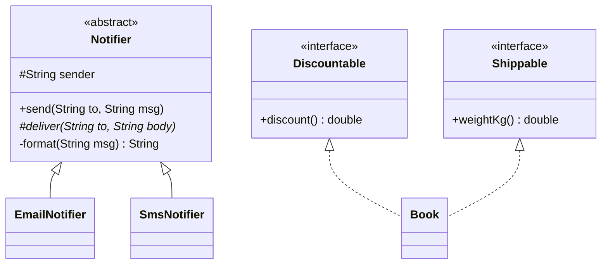
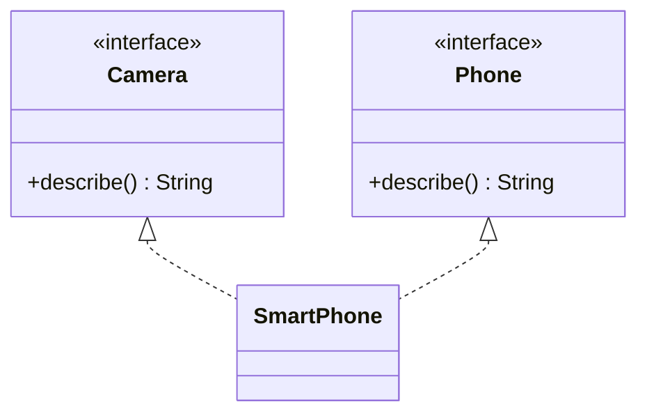

@@ 3 | TOPIC | Abstraction: Abstract Classes vs Interfaces | Hiding complexity, abstract methods, interface contracts and when to choose which | MUST
# Abstraction: Abstract Classes vs Interfaces

**Level: Beginner | Phase 2 | Priority: MUST | Since: Java 1.0 (default methods Java 8, private interface methods Java 9)**

> **30-second interview answer:** Abstraction means exposing what an object does and hiding how. Java offers abstract classes and interfaces. An abstract class can have state (fields), constructors and both abstract and concrete methods, and a class can extend only one. An interface defines a contract: abstract methods plus default, static and private methods, but no instance state, and a class can implement many. Use an interface for a capability or contract; use an abstract class to share state and code among closely related classes.

## 1. Concept in Simple Words
### Analogy
A power socket.

| Power socket | Java |
|---|---|
| The socket shape and voltage standard | An interface: the contract |
| Any device with a matching plug works | Any class implementing the interface works |
| A device can have several plugs (USB, mains) | A class can implement several interfaces |
| A half-built appliance kit with the motor installed; you add the casing | An abstract class: partial implementation plus shared parts |
| You can only build on one kit | A class extends only one abstract class |

### What it is
**Abstract class**
- Declared `abstract class Notifier { ... }`; cannot be instantiated.
- May contain abstract methods (no body) and concrete methods, fields, constructors, and any access modifiers.
- Subclasses must implement all abstract methods or be abstract themselves.

**Interface**
- Declared `interface PaymentGateway { ... }`.
- Methods are implicitly `public abstract` unless `default`, `static` or `private`.
- Fields are implicitly `public static final` constants.
- No constructors, no instance fields.
- A class can `implements` many interfaces; an interface can `extends` many interfaces.

### Why it exists
Callers should depend on a contract, not on a concrete class. Then implementations can be swapped (real vs fake in tests, one payment provider vs another) without changing callers. This is the core of dependency injection in Spring.

## 2. How It Works


- The abstract class holds shared state (`sender`) and a template (`send` calls `format`, then the abstract `deliver`). This is the **template method pattern**.
- `Book` gains two unrelated capabilities from two interfaces.

**Decision guide**
```text
Do the types share state (fields) or constructor logic?      -> abstract class
Is it a capability unrelated classes may have (Comparable)?  -> interface
Do you need multiple inheritance of type?                     -> interface
Will callers be injected with it (Spring service contract)?  -> interface
Unsure?                                                       -> start with an interface
```

## 3. Code Example
### Code
```java
import java.util.List;

public class AbstractionDemo {

    // Abstract class: shared state and a fixed algorithm with one variable step
    static abstract class Notifier {
        protected final String sender;

        protected Notifier(String sender) { this.sender = sender; }

        // Template method: final so subclasses cannot change the algorithm
        public final void send(String to, String message) {
            String body = format(message);
            deliver(to, body);
        }

        private String format(String message) {
            return "[" + sender + "] " + message.trim();
        }

        protected abstract void deliver(String to, String body);  // the variable step
    }

    static class EmailNotifier extends Notifier {
        EmailNotifier() { super("shop@orderhub.com"); }
        @Override
        protected void deliver(String to, String body) {
            System.out.println("EMAIL to " + to + ": " + body);
        }
    }

    static class SmsNotifier extends Notifier {
        SmsNotifier() { super("OrderHub"); }
        @Override
        protected void deliver(String to, String body) {
            System.out.println("SMS to " + to + ": " + body);
        }
    }

    // Interfaces: capabilities
    interface Discountable {
        double MAX_DISCOUNT = 0.5;            // implicitly public static final
        double discount();                    // implicitly public abstract
    }

    interface Shippable {
        double weightKg();
    }

    static class Book implements Discountable, Shippable {   // many interfaces
        @Override public double discount() { return 0.1; }
        @Override public double weightKg() { return 0.4; }
    }

    static class GiftCard implements Discountable {           // digital: not Shippable
        @Override public double discount() { return 0.0; }
    }

    static double shippingCost(List<? extends Shippable> items) {
        double kg = 0;
        for (Shippable s : items) kg += s.weightKg();
        return kg * 2.0;
    }

    public static void main(String[] args) {
        List<Notifier> notifiers = List.of(new EmailNotifier(), new SmsNotifier());
        for (Notifier n : notifiers) n.send("ann", "  Your order shipped  ");

        Book book = new Book();
        Discountable d = book;                 // view the book by one capability
        Shippable s = book;                    // ...or another
        System.out.println("book discount " + d.discount() + ", weight " + s.weightKg());
        System.out.println("max discount " + Discountable.MAX_DISCOUNT);
        System.out.println("shipping for 3 books " + shippingCost(List.of(book, book, book)));
        System.out.println("gift card shippable? " + (new GiftCard() instanceof Shippable));

        // new Notifier("x");   // compile error: abstract class cannot be instantiated
        // Anonymous subclass: provides the missing method inline
        Notifier console = new Notifier("test") {
            @Override protected void deliver(String to, String body) {
                System.out.println("CONSOLE " + to + ": " + body);
            }
        };
        console.send("dev", "hello");
    }
}
```

### Walkthrough
- `Notifier` holds the shared `sender` field and constructor, and fixes the algorithm in a `final` `send` method. Subclasses only fill in `deliver`.
- `Discountable` and `Shippable` are capabilities. `Book` has both; `GiftCard` only one. An abstract class could not express this, since a class can extend only one.
- `MAX_DISCOUNT` is an interface constant (public static final).
- `shippingCost` accepts anything `Shippable`, no matter what else it is.
- An abstract class cannot be instantiated, but an anonymous subclass that implements the missing method can.
- 3 books × 0.4 kg × 2.0 should be 2.4 but prints `2.4000000000000004` because of floating point.

### Output
```text
EMAIL to ann: [shop@orderhub.com] Your order shipped
SMS to ann: [OrderHub] Your order shipped
book discount 0.1, weight 0.4
max discount 0.5
shipping for 3 books 2.4000000000000004
gift card shippable? false
CONSOLE dev: [test] hello
```

### Compare
| Feature | Abstract class | Interface |
|---|---|---|
| Instance fields | Yes | No (only constants) |
| Constructors | Yes | No |
| Multiple inheritance | No, extend one | Yes, implement many |
| Method bodies | Yes | `default`, `static`, `private` only |
| Access modifiers on methods | Any | public (private helpers allowed) |
| Relationship | IS-A, close family | CAN-DO, capability |
| Adding a method later | Add a concrete one safely | Add a `default` method safely |

## 4. Interview Questions
**Basic**
1. **What is abstraction?**
   Showing only essential behaviour and hiding implementation details, achieved in Java with abstract classes and interfaces.
2. **Can you instantiate an abstract class?**
   No, but it can have constructors, which subclasses call with `super(...)`. You can create an anonymous subclass.
3. **What is the difference between an abstract class and an interface?**
   Abstract classes can hold state, constructors and any methods, with single inheritance. Interfaces define contracts without instance state and support multiple inheritance.

**Follow-up**
4. **Since Java 8 interfaces have default methods. Why still use abstract classes?**
   Interfaces still cannot hold instance state or constructors, and their methods are public. When related classes share fields and protected logic, an abstract class fits.
5. **Can an abstract class have no abstract methods?**
   Yes. It just cannot be instantiated; used to force subclassing (for example, `HttpServlet`).
6. **Can an interface extend a class?**
   No. An interface can only extend other interfaces, possibly several.

**Tricky / scenario**
7. **Why do Spring services often have an interface (`OrderService`) and an implementation?**
   It makes swapping implementations and mocking easy, and historically allowed JDK dynamic proxies for AOP. Today Spring proxies classes with CGLIB too, so a single class is fine when there is only one implementation.
8. **Can an abstract method be private, static or final?**
   No. Abstract means "a subclass must provide it", which contradicts all three.

**What the interviewer is really testing:** design judgement: whether you choose the right tool and understand contracts as the basis of loose coupling.

## 5. Pitfalls & Best Practices
### Common mistakes
| Mistake | What goes wrong | Fix |
|---|---|---|
| Huge interfaces with 20 methods | Implementers forced to stub methods | Split into small interfaces (Interface Segregation) |
| Abstract class used only to share utility code | Forces an inheritance chain | Use composition or static helpers |
| Constants-only interfaces | Pollutes implementing classes' namespace | Use a final class or an enum |
| An interface for every class "just because" | Noise | Add interfaces when there are real variations or boundaries |

### Best practices
- Depend on interfaces at boundaries (repositories, gateways, external services).
- Keep interfaces small and named by capability (`Shippable`, `Auditable`).
- Use abstract classes for template methods and shared state in a family.

### Compare with
| Example in the JDK | Kind | Why |
|---|---|---|
| `List`, `Comparable`, `Runnable` | Interface | Contracts that many unrelated classes implement |
| `AbstractList`, `InputStream` | Abstract class | Shared skeleton code for implementations |

## 6. Hands-on Exercise
Define an interface `DiscountPolicy` with `double apply(double amount)`. Write three implementations: `NoDiscount`, `PercentageDiscount(double percent)`, `FlatDiscount(double off)` (never below zero). Write `Checkout` that takes a `DiscountPolicy` in its constructor and has `double total(double amount)`. Show the same `Checkout` code with all three policies.

<details><summary>Solution</summary>

```java
public class DiscountDemo {
    interface DiscountPolicy { double apply(double amount); }

    static class NoDiscount implements DiscountPolicy {
        public double apply(double amount) { return amount; }
    }
    static class PercentageDiscount implements DiscountPolicy {
        private final double percent;
        PercentageDiscount(double percent) { this.percent = percent; }
        public double apply(double amount) { return amount * (1 - percent / 100); }
    }
    static class FlatDiscount implements DiscountPolicy {
        private final double off;
        FlatDiscount(double off) { this.off = off; }
        public double apply(double amount) { return Math.max(0, amount - off); }
    }

    static class Checkout {
        private final DiscountPolicy policy;           // depends on the contract only
        Checkout(DiscountPolicy policy) { this.policy = policy; }
        double total(double amount) { return policy.apply(amount); }
    }

    public static void main(String[] args) {
        System.out.println(new Checkout(new NoDiscount()).total(80));            // 80.0
        System.out.println(new Checkout(new PercentageDiscount(25)).total(80));  // 60.0
        System.out.println(new Checkout(new FlatDiscount(100)).total(80));       // 0.0
    }
}
```
This is exactly how Spring injection works: `Checkout` receives a policy instead of creating one. The pattern is called Strategy (Phase 17).
</details>

## 7. Recall
Q: Can an abstract class in Java have a constructor?
A: Yes; subclasses call it with `super(...)`, but you cannot instantiate the abstract class directly.

Q: What are interface fields in Java implicitly?
A: `public static final` constants.

Q: How many interfaces and how many classes can a Java class inherit from?
A: Many interfaces, only one class.

Q: When should you prefer an abstract class over an interface?
A: When related classes share instance state, constructors or protected logic.

Q: Can an abstract method be private, static or final?
A: No.

**Related:** [[Interface Default, Static and Private Methods]] · [[Polymorphism: Overloading vs Overriding]] · [[Strategy, Template Method and Observer]]

@@ 3 | TOPIC | Interface Default, Static and Private Methods | Java 8 and 9 interface methods, the diamond rule and functional interfaces | SHOULD
# Interface Default, Static and Private Methods

**Level: Beginner | Phase 2 | Priority: SHOULD | Since: default and static Java 8, private Java 9**

> **30-second interview answer:** Since Java 8, interfaces can have `default` methods (with a body, inherited by implementers, which can override them) and `static` methods (utility methods called on the interface, not inherited). Java 9 added `private` methods to share code between default methods. Default methods were introduced so that interfaces like `Collection` could gain new methods (`stream()`, `forEach`) without breaking every existing implementation.

## 1. Concept in Simple Words
### Analogy
A phone operating-system update.

| OS update | Java |
|---|---|
| New feature added to every phone automatically | `default` method: every implementer gets it |
| A phone maker can customize the feature | An implementer can override the default |
| A manual printed by the OS vendor, not part of any phone | `static` method on the interface |
| Internal helper code inside the update, not visible to apps | `private` interface method |

### What it is
```text
interface Greeter {
    String name();                                    // abstract: must implement
    default String greet() { return "Hi " + name(); } // default: inherited, overridable
    static Greeter of(String n) { return () -> n; }   // static: Greeter.of("x")
    private String shout(String s) { ... }            // private: helper for defaults
}
```
- **Default method:** public, has a body, inherited.
- **Static method:** belongs to the interface; called as `Greeter.of(...)`; not inherited by implementing classes.
- **Private method (Java 9):** reusable code for default and static methods.
- **Functional interface:** an interface with exactly one abstract method (defaults and statics do not count), usable with lambdas. Marked with `@FunctionalInterface` (Phase 7).

### Why it exists
Before Java 8, adding a method to a published interface broke every class implementing it. Default methods allowed the JDK to add `forEach`, `stream`, `removeIf` and `Comparator.thenComparing` to existing interfaces.

## 2. How It Works
**Conflict resolution rules** when a class inherits the same default method from two places:
```text
Rule 1: Class wins. A method in the class or a superclass beats any default.
Rule 2: Sub-interface wins. If B extends A and both define hello(), B's version wins.
Rule 3: Otherwise it is ambiguous: the class MUST override, and may pick one
        with InterfaceName.super.hello().
```


`SmartPhone` must override `describe()`, and can call `Camera.super.describe()` or `Phone.super.describe()` inside it.

## 3. Code Example
### Code
```java
import java.util.ArrayList;
import java.util.Comparator;
import java.util.List;

public class InterfaceMethodsDemo {

    interface Priced {
        double price();                                  // abstract

        default double priceWithTax() {                  // default
            return round(price() * (1 + taxRate()));
        }

        default double taxRate() { return 0.20; }        // overridable default

        static Priced of(double p) {                     // static factory
            return () -> p;                              // lambda: Priced is functional
        }

        private static double round(double v) {          // private helper (Java 9)
            return Math.round(v * 100) / 100.0;
        }
    }

    static class Food implements Priced {
        public double price() { return 10; }
        @Override public double taxRate() { return 0.05; }  // reduced tax
    }

    static class Gadget implements Priced {
        public double price() { return 10; }              // keeps default tax
    }

    // Diamond: two interfaces with the same default method
    interface Camera { default String describe() { return "takes photos"; } }
    interface Phone  { default String describe() { return "makes calls"; } }

    static class SmartPhone implements Camera, Phone {
        @Override
        public String describe() {                         // required: ambiguous
            return Phone.super.describe() + " and " + Camera.super.describe();
        }
    }

    // Rule 1: class wins over interface
    static class Device { public String describe() { return "a device"; } }
    static class Tablet extends Device implements Camera { }  // Device.describe wins

    public static void main(String[] args) {
        System.out.println("food   " + new Food().priceWithTax());
        System.out.println("gadget " + new Gadget().priceWithTax());
        System.out.println("static " + Priced.of(50).priceWithTax());
        // new Food().of(5);   // compile error: static interface methods are not inherited

        System.out.println(new SmartPhone().describe());
        System.out.println(new Tablet().describe());

        // Default methods the JDK added in Java 8
        List<String> names = new ArrayList<>(List.of("cy", "Ann", "bob"));
        names.removeIf(n -> n.length() < 3);            // Collection.removeIf (default)
        names.sort(Comparator.comparing((String n) -> n.toLowerCase())
                             .reversed());               // Comparator.reversed (default)
        names.forEach(n -> System.out.println("name " + n)); // Iterable.forEach (default)
    }
}
```

### Walkthrough
- `priceWithTax` is a default method that calls the abstract `price()` and the overridable default `taxRate()`. `Food` overrides only `taxRate`.
- `Priced.of(50)` is a static factory. Because `Priced` has exactly one abstract method, the lambda `() -> p` implements it.
- `round` is a private static helper, invisible to implementers.
- `SmartPhone` inherits two `describe` defaults, so it must override, and uses `Phone.super.describe()` to call a specific one.
- `Tablet` gets `describe` from its superclass `Device`, which wins over the interface default (rule 1).
- `removeIf`, `sort`, `Comparator.reversed` and `forEach` are default methods added to old interfaces in Java 8.

### Output
```text
food   10.5
gadget 12.0
static 60.0
makes calls and takes photos
a device
name bob
name Ann
```

### Compare
| | default | static | private |
|---|---|---|---|
| Has a body | yes | yes | yes |
| Inherited by implementers | yes | no | no |
| Can be overridden | yes | no | no |
| Called as | `obj.m()` | `Interface.m()` | inside the interface |

## 4. Interview Questions
**Basic**
1. **What is a default method?**
   A method with a body in an interface, marked `default`, inherited by all implementers, who can override it.
2. **Why were default methods added?**
   To evolve interfaces without breaking existing implementations; for example, adding `stream()` to `Collection` in Java 8.
3. **Are static interface methods inherited?**
   No. You must call them on the interface: `Comparator.naturalOrder()`.

**Follow-up**
4. **What happens if a class implements two interfaces with the same default method?**
   Compile error unless the class overrides it. Inside, it can call `A.super.m()` to reuse one.
5. **Class method vs interface default: which wins?**
   The class (or superclass) method always wins.
6. **Why were private interface methods added in Java 9?**
   To share code between default methods without making it part of the public interface.

**Tricky / scenario**
7. **Can a default method override `equals` or `hashCode` from `Object`?**
   No, it is a compile error. Class methods always win, so such a default could never be called.
8. **With default methods, is an interface now the same as an abstract class?**
   No. Interfaces still have no instance state, no constructors, and only public abstract and default methods; abstract classes can hold state and protected members.

**What the interviewer is really testing:** knowledge of modern Java and the reasoning behind language evolution.

## 5. Pitfalls & Best Practices
### Common mistakes
| Mistake | What goes wrong | Fix |
|---|---|---|
| Business logic with hidden state assumptions in defaults | Hard to override correctly | Keep defaults small, built on abstract methods |
| Calling a static interface method through an instance | Compile error | Call it on the interface name |
| Forgetting the override in a diamond | Compile error | Override and choose with `X.super.m()` |

### Best practices
- Use defaults for convenience methods built from the abstract ones (like `priceWithTax`).
- Use static methods for factories and helpers related to the interface (`List.of`, `Comparator.comparing`).
- Do not use default methods to fake multiple inheritance of state.

### Compare with
| Before Java 8 | Since Java 8 |
|---|---|
| Interface plus a companion utility class (`Collections`) | Static methods directly on the interface (`List.of`) |
| Interface plus an abstract skeleton class (`AbstractList`) | Often default methods are enough |

## 6. Hands-on Exercise
Create an interface `Validator<T>` with abstract `boolean isValid(T value)`, a default `and(Validator<T> other)` returning a combined validator, a default `negate()`, and a static `notNull()`. Use it to build a validator for usernames: not null, length 3 to 12, and not equal to `"admin"`.

<details><summary>Solution</summary>

```java
public class ValidatorDemo {
    @FunctionalInterface
    interface Validator<T> {
        boolean isValid(T value);

        default Validator<T> and(Validator<T> other) {
            return v -> isValid(v) && other.isValid(v);
        }
        default Validator<T> negate() {
            return v -> !isValid(v);
        }
        static <T> Validator<T> notNull() {
            return v -> v != null;
        }
    }

    public static void main(String[] args) {
        Validator<String> length = s -> s.length() >= 3 && s.length() <= 12;
        Validator<String> isAdmin = "admin"::equals;
        Validator<String> username = Validator.<String>notNull().and(length).and(isAdmin.negate());

        System.out.println(username.isValid("sam_dev"));  // true
        System.out.println(username.isValid("al"));       // false
        System.out.println(username.isValid("admin"));    // false
        System.out.println(username.isValid(null));       // false (notNull short-circuits)
    }
}
```
</details>

## 7. Recall
Q: Since which Java version can interfaces have default and static methods?
A: Java 8. Private interface methods came in Java 9.

Q: Are static methods of a Java interface inherited by implementing classes?
A: No; they are called on the interface name.

Q: How do you call a specific interface's default method when resolving a diamond?
A: `InterfaceName.super.method()`.

Q: If a superclass method and an interface default method clash, which wins?
A: The class method.

Q: Why were default methods introduced?
A: To add methods to existing interfaces without breaking implementations.

**Related:** [[Abstraction: Abstract Classes vs Interfaces]] · [[Lambdas and Functional Interfaces]] · [[Built-in Functional Interfaces]]

@@ 2 | MODULE | More building blocks | final, Object methods, equals/hashCode, composition, nested types, enums, records, immutability | MUST
# More building blocks

**Shared analogy: a well-run warehouse.** `final` is a sealed box label that cannot be changed. The `Object` methods are the standard form every package must carry (description, ID, equality check). `equals` and `hashCode` decide whether two parcels count as "the same item" and which shelf (bucket) they go on. Composition is building a delivery van from parts you can swap, instead of inheriting from a truck. Enums are the fixed list of shipping speeds, records are standard printed labels, and immutable objects are shrink-wrapped parcels that nobody can tamper with.

@@ 3 | TOPIC | The final Keyword | final variables, methods, classes, effectively final and what final does not mean | MUST
# The final Keyword

**Level: Beginner | Phase 2 | Priority: MUST | Since: Java 1.0 (effectively final Java 8)**

> **30-second interview answer:** `final` means "cannot change". A final variable can be assigned only once; a final method cannot be overridden; a final class cannot be extended. For reference variables, final fixes the reference, not the object: a `final List` can still have items added. Lambdas and anonymous classes may only capture local variables that are final or effectively final.

## 1. Concept in Simple Words
### Analogy
Things written in permanent marker.

| Permanent marker | Java |
|---|---|
| A name tag written in permanent marker | `final` variable: assigned once |
| The tag says "Box 7", but you can still put things in Box 7 | `final` reference: the object can still change |
| A recipe stamped "do not modify" | `final` method: cannot be overridden |
| A sealed master design: no one may make variants | `final` class: cannot be extended |

### What it is
| Where | Meaning |
|---|---|
| Local variable | Assign once |
| Field | Assign once: at declaration, in an initializer block, or in every constructor |
| Static field | Assign once: at declaration or in a static block |
| Parameter | Cannot be reassigned inside the method |
| Method | Cannot be overridden |
| Class | Cannot be subclassed (`String`, `Integer`, `LocalDate`) |

- **Blank final:** a final field without an initializer; the compiler checks every constructor assigns it exactly once.
- **Effectively final (Java 8):** a local variable never reassigned after initialization, even without the keyword. Lambdas can capture it.
- **Constants:** `static final` plus an immutable value, named in UPPER_SNAKE_CASE. Primitive and String constants are inlined by the compiler.

### Why it exists
Safety and clarity. Final fields make objects easier to reason about and safe to share between threads (the Java Memory Model guarantees that final fields are visible correctly after construction). Final classes and methods protect invariants and security-sensitive code: if `String` could be subclassed, a "string" could change after a security check.

## 2. How It Works
```text
final List<String> items = new ArrayList<>();

STACK                         HEAP
items = @a1  (locked)  --->   ArrayList ["pen"]  (contents can change)

items.add("pen");             // allowed: changes the object
items = new ArrayList<>();    // compile error: changes the reference
```

**Why lambdas need effectively final variables:** a lambda may run later, even on another thread, after the method that created it has returned. Java copies the value into the lambda. If the variable could still change, the copy and the original would disagree, so Java forbids it.

**final and the memory model:** writes to final fields in a constructor are guaranteed to be visible to every thread that sees the reference to the constructed object (as long as `this` did not escape during construction). Non-final fields have no such guarantee without synchronization.

## 3. Code Example
### Code
```java
import java.util.ArrayList;
import java.util.List;
import java.util.function.Supplier;

public class FinalDemo {
    static final double TAX_RATE = 0.2;                  // constant
    static final List<String> COUNTRIES;                 // blank static final

    static {
        COUNTRIES = List.of("BD", "UK", "US");           // assigned once in static block
    }

    static class Invoice {
        private final String number;                     // blank final field
        private final List<String> lines = new ArrayList<>();

        Invoice(String number) {
            this.number = number;                        // must be assigned in every constructor
        }

        void addLine(String line) {
            lines.add(line);                             // allowed: object changes, reference does not
            // lines = new ArrayList<>();               // compile error
        }

        final String header() {                          // final method
            return "Invoice " + number;
        }

        List<String> getLines() { return lines; }
    }

    static class SpecialInvoice extends Invoice {
        SpecialInvoice(String n) { super(n); }
        // String header() { return "hacked"; }          // compile error: cannot override final
    }

    static final class Money { }                         // final class
    // static class FakeMoney extends Money { }          // compile error

    public static void main(String[] args) {
        Invoice inv = new Invoice("INV-1");
        inv.addLine("Book x1");
        inv.addLine("Pen x3");
        System.out.println(inv.header() + " " + inv.getLines());
        System.out.println("tax " + TAX_RATE + ", countries " + COUNTRIES);

        // Effectively final: never reassigned, so a lambda can capture it
        String greeting = "Hello";
        Supplier<String> s = () -> greeting + " from a lambda";
        System.out.println(s.get());

        int counter = 0;
        counter++;                                       // reassigned: NOT effectively final
        // Runnable r = () -> System.out.println(counter);  // compile error

        // Workaround when a lambda needs to update a value: a mutable holder
        int[] holder = {0};
        Runnable inc = () -> holder[0]++;
        inc.run(); inc.run();
        System.out.println("holder " + holder[0]);

        // final parameter
        System.out.println(twice(21));

        // List.of is truly unmodifiable; final is not the same thing
        try {
            COUNTRIES.add("FR");
        } catch (UnsupportedOperationException e) {
            System.out.println("COUNTRIES is unmodifiable (because of List.of, not because of final)");
        }
    }

    static int twice(final int x) {
        // x = 5;                                        // compile error
        return x * 2;
    }
}
```

### Walkthrough
- `TAX_RATE` is a constant. `COUNTRIES` is a blank static final assigned in the static block.
- `Invoice.number` is a blank final field set in the constructor. `lines` is a final reference to a list whose contents still change.
- `header()` is final; `SpecialInvoice` cannot override it.
- `Money` is a final class.
- `greeting` is effectively final, so the lambda captures it. `counter` is reassigned, so capturing it would not compile. A one-element array is a common workaround (or `AtomicInteger`, Phase 9).
- `COUNTRIES.add` fails because `List.of` returns an unmodifiable list, a separate concept from the `final` keyword.

### Output
```text
Invoice INV-1 [Book x1, Pen x3]
tax 0.2, countries [BD, UK, US]
Hello from a lambda
holder 2
42
COUNTRIES is unmodifiable (because of List.of, not because of final)
```

### Compare
| `final` | `finally` | `finalize()` |
|---|---|---|
| Keyword: cannot change, override or extend | Block after try that always runs | Old `Object` method called before GC |
| Used constantly | Used for cleanup (prefer try-with-resources) | Deprecated for removal since Java 18; never use |

## 4. Interview Questions
**Basic**
1. **What does `final` mean on a variable, a method and a class?**
   Variable: assigned once. Method: cannot be overridden. Class: cannot be extended.
2. **Can you add elements to a `final List`?**
   Yes. Final fixes the reference, not the object's contents. Use an unmodifiable list to stop changes.
3. **What is the difference between final, finally and finalize?**
   `final` restricts change; `finally` is a block that always runs after try/catch; `finalize` is a deprecated method once called before garbage collection.

**Follow-up**
4. **What is "effectively final"?**
   A local variable that is never reassigned after initialization. Lambdas and anonymous classes can capture it without the `final` keyword.
5. **Why must variables captured by lambdas be effectively final?**
   The lambda captures a copy of the value and may run later or on another thread; allowing changes would make the copy and the variable inconsistent.
6. **Why is `String` final?**
   Security (its value cannot change after validation), safe use as hash keys, string pool sharing, and thread safety. A subclass could break all of these.

**Tricky / scenario**
7. **Can a final field be assigned in a constructor? In a method?**
   In every constructor (or an initializer), yes, exactly once. In a regular method, no.
8. **Does making all fields final make a class immutable?**
   Not by itself. If a final field references a mutable object (like a `List` or `Date`) that leaks out, the state can still change. You also need defensive copies and no leaking references.

**What the interviewer is really testing:** the difference between a fixed reference and an unchangeable object, which is the root of many immutability bugs.

## 5. Pitfalls & Best Practices
### Common mistakes
| Mistake | What goes wrong | Fix |
|---|---|---|
| Thinking `final List` is read-only | Contents change anyway | `List.of` or `List.copyOf` |
| Trying to update a captured local in a lambda | Compile error | Return values, or use `AtomicInteger` |
| Making a class final that frameworks must proxy | Spring or Hibernate cannot create subclass proxies | Do not make `@Transactional` services or JPA entities final |
| Public static final mutable array | Anyone can change its elements | Use an unmodifiable list |

### Best practices
- Make fields `final` by default; remove it only when mutation is needed.
- Use constructor injection with `private final` fields in Spring beans.
- Make classes final unless designed for inheritance (with care around frameworks that proxy them).

### Compare with
| Goal | Tool |
|---|---|
| Reference never changes | `final` |
| Collection never changes | `List.of`, `List.copyOf`, `Collections.unmodifiableList` |
| Whole object never changes | Immutable class design or a record |

## 6. Hands-on Exercise
Write a class `Config` with a `private final Map<String, String> settings`. The constructor receives a map. Make sure that changing the caller's map after construction does **not** change `Config`, and that `getSettings()` cannot be used to modify it. Prove both with a `main` method.

<details><summary>Solution</summary>

```java
import java.util.HashMap;
import java.util.Map;

public class Config {
    private final Map<String, String> settings;

    public Config(Map<String, String> settings) {
        this.settings = Map.copyOf(settings);   // defensive, unmodifiable copy
    }

    public Map<String, String> getSettings() { return settings; } // already unmodifiable

    public static void main(String[] args) {
        Map<String, String> source = new HashMap<>();
        source.put("env", "prod");
        Config c = new Config(source);

        source.put("env", "dev");                       // change the caller's map
        System.out.println(c.getSettings().get("env")); // prod

        try {
            c.getSettings().put("env", "hacked");
        } catch (UnsupportedOperationException e) {
            System.out.println("cannot modify settings"); // printed
        }
    }
}
```
`final` alone would not have protected the contents: `Map.copyOf` does.
</details>

## 7. Recall
Q: Does `final` on a reference variable make the object immutable?
A: No; it only prevents reassigning the reference.

Q: What is an effectively final variable in Java?
A: A local variable that is never reassigned after initialization, so lambdas may capture it.

Q: Can a Java final method be overridden?
A: No.

Q: Where can a blank final instance field be assigned?
A: Exactly once, in every constructor or in an instance initializer.

Q: Why should Spring `@Transactional` service classes not be final?
A: Spring may need to create a subclass (CGLIB) proxy, which a final class forbids.

**Related:** [[Immutable Class Design]] · [[String Immutability and the String Pool]] · [[Lambdas and Functional Interfaces]]

@@ 3 | TOPIC | The Object Class Methods | toString, equals, hashCode, getClass, clone, wait/notify and finalize | MUST
# The Object Class Methods

**Level: Beginner | Phase 2 | Priority: MUST | Since: Java 1.0**

> **30-second interview answer:** Every class extends `java.lang.Object`, which provides `toString`, `equals`, `hashCode`, `getClass`, `clone`, `wait`, `notify`, `notifyAll` and the deprecated `finalize`. The defaults are identity based: `equals` is `==`, `hashCode` is derived from identity, and `toString` prints the class name and hash. We usually override `toString`, `equals` and `hashCode` for value objects, avoid `clone` in favour of copy constructors, and use `wait/notify` only with synchronization.

## 1. Concept in Simple Words
### Analogy
The standard passport every citizen gets.

| Passport | Java |
|---|---|
| Every citizen gets one automatically | Every class inherits from `Object` |
| The photo page describing you | `toString()` |
| The rule for deciding two documents belong to the same person | `equals()` |
| The passport number used to find your file quickly | `hashCode()` |
| The nationality printed on it | `getClass()` |
| A photocopy service with tricky rules | `clone()` |
| "Wait in the lounge until called" | `wait()` / `notify()` |

### What it is
| Method | Default behaviour | Override? |
|---|---|---|
| `String toString()` | `ClassName@hexHash` | Almost always, for logs and debugging |
| `boolean equals(Object o)` | `this == o` (identity) | For value-like classes |
| `int hashCode()` | Identity-based number | Always together with `equals` |
| `Class<?> getClass()` | Runtime class | Final, cannot override |
| `Object clone()` | Shallow field copy if class implements `Cloneable`, else exception | Rarely; prefer copy constructors |
| `wait()`, `notify()`, `notifyAll()` | Thread coordination on the object's monitor | Final; use inside `synchronized` |
| `void finalize()` | Called before GC, maybe | Deprecated for removal; never use |

### Why it exists
A common root type lets any object go into a generic collection, be printed, compared and hashed. It gives the language a uniform way to treat all objects.

## 2. How It Works
**Default `toString`:**
```text
getClass().getName() + "@" + Integer.toHexString(hashCode())
-> "com.shop.Product@1b6d3586"
```

**Default `equals`:** identity, `this == obj`. Two separate objects with the same fields are not equal.

**Default `hashCode`:** an identity hash, computed once per object and stored in its header. It is not a memory address in modern JVMs (objects move during GC), though the spec allows it to be.

**`clone` and `Cloneable`:** `Cloneable` is a marker interface with no methods. `Object.clone()` checks it at runtime: if missing, it throws `CloneNotSupportedException`. The copy is **shallow**: referenced objects are shared.
```text
original: Order { id=1, items=@L1 }       L1 = ["book"]
clone:    Order { id=1, items=@L1 }       same list!  adding to one changes both
```

**`wait/notify`:** must be called while holding the object's lock (inside `synchronized(obj)`), otherwise `IllegalMonitorStateException`. Covered in Phase 9.

## 3. Code Example
### Code
```java
import java.util.ArrayList;
import java.util.List;
import java.util.Objects;

public class ObjectMethodsDemo {

    static class Plain {               // no overrides
        int x = 1;
    }

    static class Point {
        private final int x, y;
        Point(int x, int y) { this.x = x; this.y = y; }

        @Override
        public String toString() { return "Point(" + x + ", " + y + ")"; }

        @Override
        public boolean equals(Object o) {
            if (this == o) return true;                       // same object
            if (!(o instanceof Point p)) return false;        // null or other type
            return x == p.x && y == p.y;                      // compare state
        }

        @Override
        public int hashCode() { return Objects.hash(x, y); }  // same fields as equals
    }

    // clone pitfall: shallow copy
    static class Order implements Cloneable {
        int id;
        List<String> items = new ArrayList<>();
        Order(int id) { this.id = id; }

        @Override
        public Order clone() {
            try {
                return (Order) super.clone();                 // shallow copy
            } catch (CloneNotSupportedException e) {
                throw new AssertionError(e);
            }
        }

        // Better: a copy constructor with a deep copy of the list
        Order(Order other) {
            this.id = other.id;
            this.items = new ArrayList<>(other.items);
        }
    }

    public static void main(String[] args) {
        Plain a = new Plain(), b = new Plain();
        System.out.println("default toString starts with class name: "
                + a.toString().startsWith("ObjectMethodsDemo$Plain@"));
        System.out.println("default equals (same fields): " + a.equals(b));
        System.out.println("getClass: " + a.getClass().getSimpleName());

        Point p1 = new Point(1, 2), p2 = new Point(1, 2);
        System.out.println(p1 + " equals " + p2 + ": " + p1.equals(p2));
        System.out.println("== : " + (p1 == p2));
        System.out.println("equal hash codes: " + (p1.hashCode() == p2.hashCode()));
        System.out.println("equals(null): " + p1.equals(null));

        Order original = new Order(1);
        original.items.add("book");
        Order shallow = original.clone();
        shallow.items.add("pen");                 // also changes original.items!
        System.out.println("original after shallow clone change: " + original.items);

        Order deep = new Order(original);
        deep.items.add("lamp");
        System.out.println("original after copy-constructor change: " + original.items);
        System.out.println("deep copy: " + deep.items);

        try {
            a.wait();                             // not holding the lock
        } catch (IllegalMonitorStateException | InterruptedException e) {
            System.out.println("wait without synchronized: " + e.getClass().getSimpleName());
        }
    }
}
```

### Walkthrough
- `Plain` uses the defaults: `toString` shows the class name and a hex hash; `equals` is identity, so two objects with the same field are not equal.
- `Point` overrides `toString`, `equals` and `hashCode`. `equals` uses the Java 16 pattern `o instanceof Point p`, which checks the type, handles null, and casts in one step. `hashCode` uses the same fields as `equals`.
- `Order.clone()` makes a shallow copy: both orders share one list, so adding "pen" to the clone shows up in the original.
- The copy constructor creates a new `ArrayList`, so the copies are independent.
- Calling `wait()` without holding the lock throws `IllegalMonitorStateException`.

### Output
```text
default toString starts with class name: true
default equals (same fields): false
getClass: Plain
Point(1, 2) equals Point(1, 2): true
== : false
equal hash codes: true
equals(null): false
original after shallow clone change: [book, pen]
original after copy-constructor change: [book, pen]
deep copy: [book, pen, lamp]
wait without synchronized: IllegalMonitorStateException
```

### Compare
| `clone()` | Copy constructor or static factory |
|---|---|
| Needs `Cloneable` marker and a cast | Plain Java |
| Shallow by default | You choose shallow or deep |
| Checked exception noise | No exceptions |
| Does not work with final fields assigned in constructors | Works with final fields |

## 4. Interview Questions
**Basic**
1. **Which methods does `Object` provide?**
   `toString`, `equals`, `hashCode`, `getClass`, `clone`, `wait` (three overloads), `notify`, `notifyAll` and the deprecated `finalize`.
2. **What does the default `equals` do?**
   It compares references (`==`), so only the same object is equal to itself.
3. **Why override `toString`?**
   For readable logs, debugging and error messages; the default `Product@1b6d3586` tells you nothing.

**Follow-up**
4. **Is `clone()` deep or shallow?**
   Shallow: primitive fields are copied, references are shared. Deep copies need custom code.
5. **Why do many experts recommend avoiding `clone`?**
   It relies on a marker interface, returns `Object`, throws a checked exception, makes shallow copies, and conflicts with final fields. Copy constructors or factories are clearer.
6. **Why are `wait` and `notify` in `Object` and not in `Thread`?**
   Every object can act as a lock (monitor), and waiting is tied to a specific lock, not to a thread.

**Tricky / scenario**
7. **Can you override `getClass()`?**
   No, it is final.
8. **Is the default `hashCode` the memory address?**
   Not in modern HotSpot JVMs. It is an identity hash generated once and stored in the object header, because objects move in memory during garbage collection.

**What the interviewer is really testing:** whether you know which `Object` behaviours to override and why, which leads directly to the equals/hashCode contract.

## 5. Pitfalls & Best Practices
### Common mistakes
| Mistake | What goes wrong | Fix |
|---|---|---|
| Overriding `equals` but not `hashCode` | Breaks `HashMap` and `HashSet` | Always override both |
| `equals(MyType o)` signature | Overload, not override | Parameter must be `Object` |
| Including passwords in `toString` | Secrets in logs | Exclude sensitive fields |
| Relying on `clone` for deep copies | Shared mutable state | Copy constructors |

### Best practices
- Use records (Phase 2) for value types: they generate `equals`, `hashCode` and `toString`.
- Use `Objects.equals`, `Objects.hash` and `Objects.requireNonNull` helpers.
- Let your IDE generate these methods, then review them.

### Compare with
| Need | Use |
|---|---|
| Readable text | Override `toString` |
| Value equality | Override `equals` and `hashCode`, or use a record |
| Copy | Copy constructor or `List.copyOf` |
| Thread waiting | `java.util.concurrent` tools instead of raw `wait/notify` |

## 6. Hands-on Exercise
Write a class `Money` with `long cents` and `String currency`. Override `toString` to print `12.50 USD`, and override `equals` and `hashCode` so two `Money` objects with the same cents and currency are equal. Put three `Money` objects (two equal) into a `HashSet` and print its size.

<details><summary>Solution</summary>

```java
import java.util.HashSet;
import java.util.Objects;
import java.util.Set;

public class Money {
    private final long cents;
    private final String currency;

    public Money(long cents, String currency) {
        this.cents = cents;
        this.currency = Objects.requireNonNull(currency);
    }

    @Override public String toString() {
        return String.format("%d.%02d %s", cents / 100, cents % 100, currency);
    }

    @Override public boolean equals(Object o) {
        if (this == o) return true;
        if (!(o instanceof Money m)) return false;
        return cents == m.cents && currency.equals(m.currency);
    }

    @Override public int hashCode() { return Objects.hash(cents, currency); }

    public static void main(String[] args) {
        Set<Money> set = new HashSet<>();
        set.add(new Money(1250, "USD"));
        set.add(new Money(1250, "USD"));   // equal: not added again
        set.add(new Money(1250, "EUR"));
        System.out.println(set.size());               // 2
        System.out.println(new Money(1250, "USD"));   // 12.50 USD
    }
}
```
</details>

## 7. Recall
Q: What does the default `Object.equals` compare?
A: References: it returns `this == obj`.

Q: What does `Object.clone()` throw if the class does not implement `Cloneable`?
A: `CloneNotSupportedException`.

Q: Is `Object.clone()` a deep or shallow copy?
A: Shallow.

Q: What exception occurs when `wait()` is called without holding the object's lock?
A: `IllegalMonitorStateException`.

Q: Which `Object` method is final and returns the runtime class?
A: `getClass()`.

**Related:** [[equals() and hashCode() Contract]] · [[Records]] · [[wait, notify and notifyAll]]
