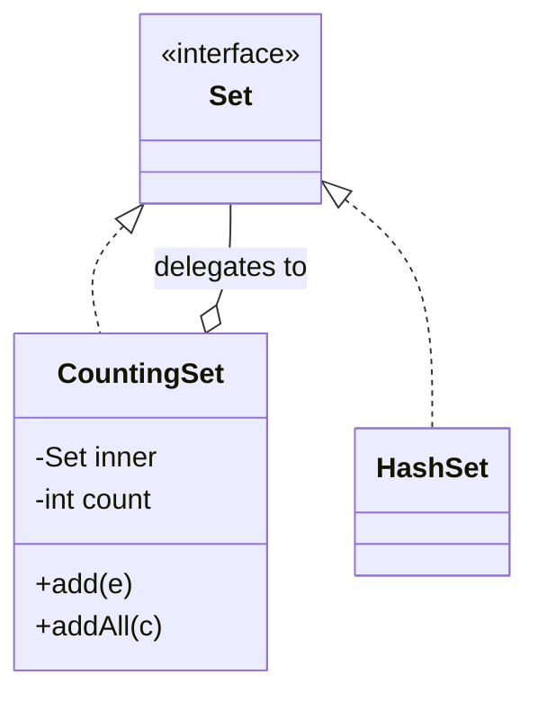

@@ 3 | TOPIC | equals() and hashCode() Contract | The rules, what breaks in HashMap and HashSet, and how to implement both correctly | MUST
# equals() and hashCode() Contract

**Level: Beginner | Phase 2 | Priority: MUST | Since: Java 1.0 (Objects.hash Java 7)**

> **30-second interview answer:** If two objects are equal by `equals`, they must have the same `hashCode`. The reverse is not required: equal hash codes may belong to unequal objects (a collision). `equals` must be reflexive, symmetric, transitive, consistent and return false for null. Hash-based collections first use `hashCode` to find the bucket and then `equals` to find the exact key, so overriding only `equals` makes `HashMap` and `HashSet` lose or duplicate entries.

## 1. Concept in Simple Words
### Analogy
A library with numbered shelves.

| Library | Java |
|---|---|
| The shelf number computed from a book's title | `hashCode()` picks the bucket |
| Checking the exact book on that shelf | `equals()` finds the exact key |
| Two copies of the same book must go to the same shelf | Equal objects must have equal hash codes |
| Different books can share a shelf | Collisions are allowed |
| If a copy is filed on the wrong shelf, you never find it | Overriding `equals` without `hashCode` loses entries |
| Changing a book's title after shelving it | Mutating a key after putting it in a map |

### What it is
**The `equals` contract** (for non-null x, y, z):
| Rule | Meaning |
|---|---|
| Reflexive | `x.equals(x)` is true |
| Symmetric | `x.equals(y)` equals `y.equals(x)` |
| Transitive | If x equals y and y equals z, then x equals z |
| Consistent | Repeated calls give the same result if nothing changed |
| Non-null | `x.equals(null)` is false |

**The `hashCode` contract:**
1. Consistent: same value during one run if the fields used by `equals` do not change.
2. **Equal objects → equal hash codes.** (The rule people break.)
3. Unequal objects may share a hash code, but fewer collisions mean better performance.

### Why it exists
Hash tables give O(1) lookups only if the hash code leads straight to the right bucket. That only works when "equal" objects agree on the bucket.

## 2. How It Works
```text
map.put(new Point(1,2), "A")
   hash = point.hashCode()          -> say 994
   bucket = hash & (table.length-1) -> bucket 2
   store entry in bucket 2

map.get(new Point(1,2))   (a DIFFERENT object with equal fields)
   With hashCode overridden:      994 -> bucket 2 -> equals() true -> "A"
   With ONLY equals overridden:   identity hash 71236 -> bucket 4 -> empty -> null
```

```text
buckets:  [0] -> null
          [1] -> null
          [2] -> (Point(1,2), "A") -> (Point(5,0), "Z")   collision: chained, equals() decides
          [3] -> null
```

**Implementing `equals` safely:**
```text
1. if (this == o) return true;                    fast path
2. if (!(o instanceof Point p)) return false;     null and type check
   or: if (o == null || getClass() != o.getClass()) return false;
3. compare significant fields: primitives with ==, objects with Objects.equals,
   doubles with Double.compare, arrays with Arrays.equals
```

**`instanceof` vs `getClass()`:** `instanceof` lets subclasses be equal to parents, which can break symmetry if a subclass adds fields. `getClass()` treats different classes as never equal. Use `getClass()` for non-final classes that may be extended with new state, or make the class final (records are final).

## 3. Code Example
### Code
```java
import java.util.HashMap;
import java.util.HashSet;
import java.util.Map;
import java.util.Objects;
import java.util.Set;

public class EqualsHashCodeDemo {

    // Broken: equals overridden, hashCode NOT overridden
    static class BrokenKey {
        final String code;
        BrokenKey(String code) { this.code = code; }
        @Override public boolean equals(Object o) {
            return o instanceof BrokenKey k && code.equals(k.code);
        }
    }

    // Correct
    static final class GoodKey {
        final String code;
        GoodKey(String code) { this.code = code; }
        @Override public boolean equals(Object o) {
            if (this == o) return true;
            if (!(o instanceof GoodKey k)) return false;
            return code.equals(k.code);
        }
        @Override public int hashCode() { return code.hashCode(); }
    }

    // Mutable key: a trap even with correct equals and hashCode
    static class MutableKey {
        String code;
        MutableKey(String code) { this.code = code; }
        @Override public boolean equals(Object o) {
            return o instanceof MutableKey k && Objects.equals(code, k.code);
        }
        @Override public int hashCode() { return Objects.hashCode(code); }
    }

    // Legal but terrible hashCode: every object collides
    static final class SlowKey {
        final int id;
        SlowKey(int id) { this.id = id; }
        @Override public boolean equals(Object o) { return o instanceof SlowKey k && id == k.id; }
        @Override public int hashCode() { return 42; }   // all in one bucket
    }

    public static void main(String[] args) {
        Map<BrokenKey, String> broken = new HashMap<>();
        broken.put(new BrokenKey("A1"), "Apple");
        System.out.println("broken get    : " + broken.get(new BrokenKey("A1")));
        Set<BrokenKey> brokenSet = new HashSet<>();
        brokenSet.add(new BrokenKey("A1"));
        brokenSet.add(new BrokenKey("A1"));
        System.out.println("broken set size: " + brokenSet.size());

        Map<GoodKey, String> good = new HashMap<>();
        good.put(new GoodKey("A1"), "Apple");
        System.out.println("good get      : " + good.get(new GoodKey("A1")));
        Set<GoodKey> goodSet = new HashSet<>();
        goodSet.add(new GoodKey("A1"));
        goodSet.add(new GoodKey("A1"));
        System.out.println("good set size : " + goodSet.size());

        MutableKey key = new MutableKey("X");
        Set<MutableKey> set = new HashSet<>();
        set.add(key);
        key.code = "Y";                                  // mutate AFTER insertion
        System.out.println("contains(key) after mutation: " + set.contains(key));
        System.out.println("size still    : " + set.size());

        Map<SlowKey, Integer> slow = new HashMap<>();
        for (int i = 0; i < 5; i++) slow.put(new SlowKey(i), i);
        System.out.println("slow map still correct: " + slow.get(new SlowKey(3)));

        // String, Integer, records and enums already implement both correctly
        System.out.println("\"ab\".hashCode() = " + "ab".hashCode());
        System.out.println("same hash, different strings: "
                + ("Aa".hashCode() == "BB".hashCode()) + ", equal? " + "Aa".equals("BB"));
    }
}
```

### Walkthrough
- `BrokenKey`: two keys with the same code are `equals`, but each gets its own identity hash, so `get` looks in the wrong bucket and returns null, and the set stores "duplicates".
- `GoodKey`: hash derived from the same field as `equals`; lookups and de-duplication work. It is `final`, so subclass symmetry issues cannot arise.
- `MutableKey`: correct methods, but changing `code` after insertion changes the hash. The set looks in the new bucket and cannot find the object, even though it is still inside: a silent leak.
- `SlowKey`: returning a constant hash is legal (equal objects do share it) but every entry lands in one bucket, so lookups degrade from O(1) to O(n) (or O(log n) after Java 8 treeification, Phase 8).
- `"Aa"` and `"BB"` have the same hash but are not equal: a collision, which is allowed.

### Output
```text
broken get    : null
broken set size: 2
good get      : Apple
good set size : 1
contains(key) after mutation: false
size still    : 1
slow map still correct: 3
"ab".hashCode() = 3105
same hash, different strings: true, equal? false
```

### Compare
| Situation | Result |
|---|---|
| equals and hashCode both overridden consistently | Correct |
| Only equals overridden | Map lookups fail, sets keep duplicates |
| Only hashCode overridden | Equal-looking objects are still different keys (identity equals) |
| Constant hashCode | Correct but very slow |
| Key mutated after insertion | Entry becomes unreachable |

## 4. Interview Questions
**Basic**
1. **What is the equals and hashCode contract?**
   Equal objects must have equal hash codes; unequal objects may share one. `equals` must be reflexive, symmetric, transitive, consistent and false for null.
2. **What happens if you override `equals` but not `hashCode`?**
   Equal objects get different identity hash codes, so `HashMap.get` misses and `HashSet` stores duplicates.
3. **Can two unequal objects have the same hash code?**
   Yes, that is a collision; the collection then uses `equals` to tell them apart.

**Follow-up**
4. **How does `HashMap` use both methods?**
   It computes the bucket from `hashCode`, then walks the entries in that bucket comparing hash and `equals` to find the key.
5. **Why should map keys be immutable?**
   If a key's fields change, its hash changes and the map looks in the wrong bucket, so the entry is lost.
6. **`instanceof` or `getClass()` in equals?**
   `instanceof` allows subclass instances to be equal and can break symmetry when subclasses add fields; `getClass()` is strict. Final classes and records avoid the issue.

**Tricky / scenario**
7. **How should JPA entities implement equals and hashCode?**
   Not on all fields, and not on a generated id that is null before saving (the hash would change). Common choices: a natural business key, or equals on id with a constant `hashCode` from `getClass().hashCode()`.
8. **Is `return 42;` a valid hashCode?**
   Valid by contract, but every object collides, turning hash collections into slow lists.

**What the interviewer is really testing:** whether you understand how hash collections actually find things, the most common Java interview topic of all.

## 5. Pitfalls & Best Practices
### Common mistakes
| Mistake | What goes wrong | Fix |
|---|---|---|
| Overriding only `equals` | Broken hash collections | Always override both |
| Different fields in equals and hashCode | Contract broken | Use exactly the same fields |
| Using mutable fields in hashCode for map keys | Lost entries | Immutable keys |
| Comparing doubles with `==` in equals | NaN and -0.0 issues | `Double.compare(a, b) == 0` |
| Including lazy JPA collections in equals | Triggers loading, N+1 queries | Use ids or business keys |

### Best practices
- Prefer records for value types: correct equals, hashCode and toString for free.
- Use `Objects.equals(a, b)` for null-safe field comparison and `Objects.hash(...)` for quick hash codes (it creates a small array; hand-written `31 * h + x` is faster in hot code).
- Write a unit test for equality: equal pair, unequal pair, null, symmetric check.

### Compare with
| Helper | Use |
|---|---|
| `Objects.equals(a, b)` | Null-safe equality |
| `Objects.hash(a, b, c)` | Quick combined hash |
| `Arrays.equals`, `Arrays.hashCode` | Array fields |
| `record` | Generates everything from components |

## 6. Hands-on Exercise
Write an `Employee` class with `id` (int), `email` (String) and `salary` (double). Two employees are equal if their **email** matches, ignoring case. Implement `equals` and `hashCode` consistently (careful: hashCode must also ignore case). Prove it with a `HashSet` containing `ann@x.com` and `ANN@x.com`.

<details><summary>Solution</summary>

```java
import java.util.HashSet;
import java.util.Locale;
import java.util.Set;

public final class Employee {
    private final int id;
    private final String email;
    private final double salary;

    public Employee(int id, String email, double salary) {
        this.id = id; this.email = email; this.salary = salary;
    }

    @Override public boolean equals(Object o) {
        if (this == o) return true;
        if (!(o instanceof Employee e)) return false;
        return email.equalsIgnoreCase(e.email);
    }

    @Override public int hashCode() {
        // must be consistent with equalsIgnoreCase: normalize the case first
        return email.toLowerCase(Locale.ROOT).hashCode();
    }

    public static void main(String[] args) {
        Set<Employee> set = new HashSet<>();
        set.add(new Employee(1, "ann@x.com", 5000));
        set.add(new Employee(2, "ANN@x.com", 6000));
        System.out.println(set.size());   // 1
    }
}
```
If `hashCode` used `email.hashCode()` without lower-casing, the two equal employees would land in different buckets and the set size would be 2.
</details>

## 7. Recall
Q: If `a.equals(b)` is true, what must be true of their hash codes?
A: `a.hashCode() == b.hashCode()`.

Q: What happens to a `HashSet` if a class overrides `equals` but not `hashCode`?
A: Equal objects land in different buckets, so the set keeps duplicates and lookups fail.

Q: Why should keys in a `HashMap` be immutable?
A: Mutating a key changes its hash, so the entry can no longer be found.

Q: Is a hash collision a contract violation?
A: No; unequal objects may share a hash code.

Q: What are the five properties of a correct `equals`?
A: Reflexive, symmetric, transitive, consistent, and false for null.

**Related:** [[The Object Class Methods]] · [[HashMap Internals]] · [[Records]]

@@ 3 | TOPIC | Composition vs Inheritance | HAS-A vs IS-A, the fragile base class problem and favouring composition | MUST
# Composition vs Inheritance

**Level: Beginner | Phase 2 | Priority: MUST | Since: design principle (Effective Java item "Favor composition over inheritance")**

> **30-second interview answer:** Inheritance (IS-A) reuses code by extending a class; composition (HAS-A) reuses code by holding a reference to another object and delegating to it. Prefer composition: it keeps coupling low, lets you swap parts at runtime, and avoids the fragile base class problem where changes in a parent silently break subclasses. Use inheritance only for true IS-A relationships designed for extension. Spring dependency injection is composition.

## 1. Concept in Simple Words
### Analogy
A car and its engine.

| Car | Java |
|---|---|
| A car HAS an engine | Composition: a field of type `Engine` |
| You can replace a petrol engine with an electric one | Swap the implementation without changing `Car` |
| A car IS a vehicle | Inheritance: `Car extends Vehicle` |
| Saying "a car IS an engine" to reuse its parts | Wrong use of inheritance |
| The engine maker changes a part and your car suddenly behaves differently | Fragile base class problem |

### What it is
- **Inheritance:** `class LoggingList extends ArrayList` — you get every public method of the parent, including those you do not want, and depend on its internal behaviour.
- **Composition:** `class LoggingList { private final List<String> inner; }` — you expose only what you choose and **delegate** calls to the inner object.
- **Delegation:** forwarding a call: `void add(x) { log(x); inner.add(x); }`.
- **Fragile base class:** a subclass relies on how the parent implements things internally; a harmless-looking parent change breaks it.

### Why it exists
Inheritance couples the child to the parent's implementation, not just its interface. Composition couples you only to an interface, which is how large systems stay changeable.

## 2. How It Works
The classic example (from *Effective Java*): counting added elements by extending `HashSet`.
```text
class CountingSet extends HashSet {
    add(e)    { count++; super.add(e); }
    addAll(c) { count += c.size(); super.addAll(c); }
}

addAll(["a","b","c"]):
   count += 3                       -> 3
   super.addAll(c)                  -> HashSet.addAll internally calls add() for each element
      add("a") (OUR override!)      -> count 4
      add("b")                      -> count 5
      add("c")                      -> count 6
Result: 6 instead of 3. We depended on a hidden implementation detail.
```

Composition version:

`CountingSet` wraps any `Set`, so the inner set's internal calls never reach our counting code.

## 3. Code Example
### Code
```java
import java.util.Collection;
import java.util.HashSet;
import java.util.List;
import java.util.Set;
import java.util.TreeSet;

public class CompositionDemo {

    // Inheritance: fragile
    static class InheritedCountingSet<E> extends HashSet<E> {
        int addCount = 0;
        @Override public boolean add(E e) { addCount++; return super.add(e); }
        @Override public boolean addAll(Collection<? extends E> c) {
            addCount += c.size();
            return super.addAll(c);          // internally calls add() -> double counting
        }
    }

    // Composition: robust and flexible
    static class CountingSet<E> {
        private final Set<E> inner;          // HAS-A
        private int addCount = 0;

        CountingSet(Set<E> inner) { this.inner = inner; }   // any Set can be plugged in

        boolean add(E e) { addCount++; return inner.add(e); }
        boolean addAll(Collection<? extends E> c) {
            addCount += c.size();
            return inner.addAll(c);          // inner's internal add() calls are not ours
        }
        int getAddCount() { return addCount; }
        Set<E> view() { return Set.copyOf(inner); }
    }

    // Composition in everyday design: a service built from collaborators
    interface PaymentGateway { String charge(double amount); }
    interface Notifier { void notify(String msg); }

    static class OrderService {
        private final PaymentGateway gateway;   // collaborators injected
        private final Notifier notifier;

        OrderService(PaymentGateway gateway, Notifier notifier) {
            this.gateway = gateway;
            this.notifier = notifier;
        }

        void placeOrder(double amount) {
            String receipt = gateway.charge(amount);
            notifier.notify("Order placed, " + receipt);
        }
    }

    public static void main(String[] args) {
        InheritedCountingSet<String> s1 = new InheritedCountingSet<>();
        s1.addAll(List.of("a", "b", "c"));
        System.out.println("inheritance count : " + s1.addCount);

        CountingSet<String> s2 = new CountingSet<>(new HashSet<>());
        s2.addAll(List.of("a", "b", "c"));
        System.out.println("composition count : " + s2.getAddCount());

        CountingSet<String> sorted = new CountingSet<>(new TreeSet<>()); // swap the part
        sorted.addAll(List.of("pear", "apple"));
        System.out.println("sorted inner set  : " + new TreeSet<>(sorted.view()));

        // Swap behaviour without touching OrderService
        OrderService real = new OrderService(a -> "card receipt " + a, System.out::println);
        OrderService test = new OrderService(a -> "FAKE receipt", msg -> System.out.println("[test] " + msg));
        real.placeOrder(25);
        test.placeOrder(25);
    }
}
```

### Walkthrough
- `InheritedCountingSet.addAll` adds 3, then `HashSet.addAll` (inherited from `AbstractCollection`) calls our overridden `add` three times: count 6.
- `CountingSet` holds a `Set` and delegates. The inner set's internal calls go to its own `add`, not ours: count 3.
- The same `CountingSet` works with a `TreeSet`, chosen at runtime.
- `OrderService` is composed of a gateway and a notifier passed in through the constructor. Swapping them (real vs test) needs no change to `OrderService`. This is exactly what Spring does with constructor injection.

### Output
```text
inheritance count : 6
composition count : 3
sorted inner set  : [apple, pear]
Order placed, card receipt 25.0
[test] Order placed, FAKE receipt
```

### Compare
| Inheritance | Composition |
|---|---|
| IS-A | HAS-A |
| White-box reuse: sees parent internals | Black-box reuse: uses only the interface |
| Decided at compile time | Can change at runtime |
| Inherits every public method | Exposes only chosen methods |
| Breaks if parent internals change | Robust to internal changes |
| Hard to unit test in isolation | Easy to inject fakes |

## 4. Interview Questions
**Basic**
1. **What is the difference between composition and inheritance?**
   Inheritance reuses code by extending a class (IS-A); composition holds an instance of another class and delegates to it (HAS-A).
2. **Why "favour composition over inheritance"?**
   Lower coupling, no dependence on parent internals, the ability to swap parts at runtime, and easier testing.
3. **Give a JDK example of inheritance misuse.**
   `Stack extends Vector`: a stack inherits methods like `add(index, e)` and `get(i)` that break stack behaviour. `Properties extends Hashtable` is another.

**Follow-up**
4. **What is the fragile base class problem?**
   A subclass depends on how its parent works internally, so a change in the parent (like `addAll` calling `add`) silently breaks the subclass.
5. **When is inheritance the right choice?**
   For a genuine IS-A relationship where the subclass can stand in for the parent everywhere (Liskov), and the parent is designed and documented for extension.
6. **How does Spring encourage composition?**
   Beans receive their collaborators through constructor injection instead of extending base classes, so implementations can be swapped and mocked.

**Tricky / scenario**
7. **What is the decorator pattern and how does it relate?**
   A decorator implements the same interface as an object it wraps and adds behaviour around delegated calls, like `CountingSet` or `BufferedInputStream`. It is composition used to extend behaviour.
8. **Your team has `BaseController` with 10 helper methods that every controller extends. Problem?**
   Every controller is coupled to that base class, changes ripple everywhere, and you cannot extend another class. Better: inject helper components or use `@ControllerAdvice`.

**What the interviewer is really testing:** design maturity: knowing that inheritance is a strong coupling tool to use rarely.

## 5. Pitfalls & Best Practices
### Common mistakes
| Mistake | What goes wrong | Fix |
|---|---|---|
| Extending a concrete library class to add logging | Depends on hidden internals | Wrap it (decorator) |
| "Util" base classes for code reuse | Rigid hierarchies | Composition or static helpers |
| Exposing the wrapped object via a getter | Callers bypass your wrapper | Expose only needed operations |

### Best practices
- Model behaviour with interfaces and compose implementations.
- Inject collaborators through constructors (`private final` fields).
- Keep inheritance shallow and intentional; mark classes `final` when not designed for extension.

### Compare with
| Pattern | Built on |
|---|---|
| Strategy, Decorator, Adapter, Proxy | Composition |
| Template Method | Inheritance |

## 6. Hands-on Exercise
You have `interface Logger { void log(String msg); }` and `ConsoleLogger`. Using composition, write `TimestampLogger` (adds a fixed `[12:00]` prefix) and `UpperCaseLogger`, each wrapping another `Logger`. Stack them so `new TimestampLogger(new UpperCaseLogger(new ConsoleLogger()))` prints `[12:00] ORDER SHIPPED` for `log("order shipped")`.

<details><summary>Solution</summary>

```java
public class LoggerDecorators {
    interface Logger { void log(String msg); }

    static class ConsoleLogger implements Logger {
        public void log(String msg) { System.out.println(msg); }
    }
    static class TimestampLogger implements Logger {
        private final Logger next;
        TimestampLogger(Logger next) { this.next = next; }
        public void log(String msg) { next.log("[12:00] " + msg); }
    }
    static class UpperCaseLogger implements Logger {
        private final Logger next;
        UpperCaseLogger(Logger next) { this.next = next; }
        public void log(String msg) { next.log(msg.toUpperCase()); }
    }

    public static void main(String[] args) {
        Logger logger = new TimestampLogger(new UpperCaseLogger(new ConsoleLogger()));
        logger.log("order shipped");   // [12:00] ORDER SHIPPED
    }
}
```
TimestampLogger adds the prefix, passes `[12:00] order shipped` to UpperCaseLogger, which upper-cases everything and passes it to ConsoleLogger.
</details>

## 7. Recall
Q: What relationship does composition model?
A: HAS-A: an object holds and delegates to another object.

Q: What is the fragile base class problem?
A: A subclass breaks because it depends on internal behaviour of its parent that changed.

Q: Why does a counting `HashSet` subclass double-count on `addAll`?
A: `HashSet.addAll` internally calls the overridden `add`.

Q: Which JDK class is a famous misuse of inheritance?
A: `Stack extends Vector` (also `Properties extends Hashtable`).

Q: How does Spring dependency injection relate to composition?
A: Beans get collaborators through constructors and delegate to them, instead of inheriting behaviour.

**Related:** [[Inheritance and super]] · [[Adapter, Decorator and Facade]] · [[IoC and Dependency Injection]]

@@ 3 | TOPIC | Nested, Inner and Anonymous Classes | Static nested, inner, local and anonymous classes and their memory implications | SHOULD
# Nested, Inner and Anonymous Classes

**Level: Beginner | Phase 2 | Priority: SHOULD | Since: Java 1.1**

> **30-second interview answer:** Java has four kinds of nested classes. A static nested class is like a top-level class placed inside another for grouping; it has no link to an outer instance. An inner (non-static) class holds a hidden reference to its outer object and can access its fields. A local class is declared inside a method, and an anonymous class is a one-off unnamed implementation. Prefer static nested classes; inner classes can cause memory leaks because they keep the outer object alive.

## 1. Concept in Simple Words
### Analogy
Rooms and furniture in a house.

| House | Java |
|---|---|
| A garden shed on the property: related, but stands alone | Static nested class |
| A built-in wardrobe: only exists as part of a specific room | Inner class: tied to an outer instance |
| A temporary tent set up for one party | Local class inside a method |
| A guest who helps once and never gives a name | Anonymous class |
| The wardrobe keeps the whole room from being demolished | Inner class keeps the outer object alive (leak risk) |

### What it is
| Kind | Declared | Outer instance needed? | Accesses outer instance fields? |
|---|---|---|---|
| Static nested | `static class Builder` inside a class | No | No (only static members) |
| Inner | `class Node` (no static) inside a class | Yes: `outer.new Inner()` | Yes |
| Local | Inside a method body | Yes if in an instance method | Yes, plus effectively final locals |
| Anonymous | `new Interface() { ... }` expression | Same as local | Same as local |

- Nested classes can access the outer class's **private** members, and vice versa.
- Records, enums and interfaces declared inside a class are implicitly static.
- Since Java 16, inner classes may declare static members.

### Why it exists
To group helper types with the only class that uses them (`Map.Entry`, `Builder`), to keep them private, and before Java 8, to pass behaviour (anonymous listeners). Lambdas have replaced most anonymous classes.

## 2. How It Works
**Inner class hidden reference:**
```text
class Outer {
    int secret = 7;
    class Inner { int peek() { return secret; } }   // really: Outer.this.secret
}

Compiled roughly as:
class Outer$Inner {
    final Outer this$0;            // hidden reference added by the compiler
    Outer$Inner(Outer o) { this$0 = o; }
    int peek() { return this$0.secret; }
}

Heap:  Inner object --this$0--> Outer object (cannot be GC'd while Inner lives)
```

**Class files:** `Outer.class`, `Outer$Inner.class`, `Outer$Builder.class`, and anonymous classes become `Outer$1.class`, `Outer$2.class`.

**Anonymous class vs lambda:**
| Anonymous class | Lambda |
|---|---|
| Can implement interfaces with many methods or extend classes | Only functional interfaces |
| `this` means the anonymous object | `this` means the enclosing object |
| Creates a new class file | Uses `invokedynamic`, no extra class file |
| Can have state (fields) | No state of its own |

## 3. Code Example
### Code
```java
import java.util.ArrayList;
import java.util.Comparator;
import java.util.Iterator;
import java.util.List;

public class NestedClassesDemo {
    private final List<String> items = new ArrayList<>();
    private final String name;

    NestedClassesDemo(String name) { this.name = name; }

    // 1. Static nested class: a builder that needs no outer instance
    static class Builder {
        private String name = "default";
        private final List<String> items = new ArrayList<>();
        Builder name(String n) { this.name = n; return this; }
        Builder item(String i) { items.add(i); return this; }
        NestedClassesDemo build() {
            NestedClassesDemo d = new NestedClassesDemo(name);
            d.items.addAll(items);              // nested class can access private field
            return d;
        }
    }

    // 2. Inner class: an iterator that needs the outer object's data
    class ReverseIterator implements Iterator<String> {
        private int index = items.size() - 1;   // reads the OUTER instance's items
        public boolean hasNext() { return index >= 0; }
        public String next() { return items.get(index--); }
    }

    Iterator<String> reverse() { return new ReverseIterator(); }

    // 3. Local class inside a method
    String describeAll(String prefix) {
        class Formatter {                       // visible only in this method
            String format(String s) { return prefix + s + " (" + name + ")"; }
        }
        Formatter f = new Formatter();
        StringBuilder sb = new StringBuilder();
        for (String i : items) sb.append(f.format(i)).append("; ");
        return sb.toString();
    }

    public static void main(String[] args) {
        NestedClassesDemo cart = new NestedClassesDemo.Builder()
                .name("Ann's cart").item("pen").item("book").item("lamp")
                .build();

        Iterator<String> it = cart.reverse();
        while (it.hasNext()) System.out.print(it.next() + " ");
        System.out.println();

        // Creating an inner class instance from outside needs an outer object
        NestedClassesDemo.ReverseIterator it2 = cart.new ReverseIterator();
        System.out.println("first from inner: " + it2.next());

        System.out.println(cart.describeAll("- "));

        // 4. Anonymous class vs lambda for the same Comparator
        List<String> words = new ArrayList<>(List.of("kiwi", "fig", "banana"));
        words.sort(new Comparator<String>() {   // anonymous class
            @Override
            public int compare(String a, String b) { return a.length() - b.length(); }
        });
        System.out.println("anonymous sort: " + words);
        words.sort((a, b) -> b.length() - a.length());   // lambda: shorter
        System.out.println("lambda sort   : " + words);

        // Class names generated by the compiler
        System.out.println(Builder.class.getName());
        System.out.println(it2.getClass().getName());
    }
}
```

### Walkthrough
- `Builder` is static: created with `new NestedClassesDemo.Builder()` without any outer object, yet it can set the private `items` field of the object it builds.
- `ReverseIterator` is an inner class: it reads `items` of the outer instance that created it. From outside, you need `cart.new ReverseIterator()`.
- `Formatter` is a local class; it captures the effectively final parameter `prefix` and the outer field `name`.
- The anonymous `Comparator` and the lambda do the same job; the lambda is shorter.
- Compiled names use `$`: `NestedClassesDemo$Builder`, `NestedClassesDemo$ReverseIterator`.

### Output
```text
lamp book pen 
first from inner: lamp
- pen (Ann's cart); - book (Ann's cart); - lamp (Ann's cart); 
anonymous sort: [fig, kiwi, banana]
lambda sort   : [banana, kiwi, fig]
NestedClassesDemo$Builder
NestedClassesDemo$ReverseIterator
```

### Compare
| Use | Choose |
|---|---|
| Helper type that does not need outer state (Builder, Node, DTO) | Static nested |
| Helper that must read the outer object's state (Iterator) | Inner |
| One-method behaviour | Lambda |
| One-off implementation with several methods or state | Anonymous class |

## 4. Interview Questions
**Basic**
1. **What is the difference between a static nested class and an inner class?**
   A static nested class has no reference to an outer instance and can be created alone. An inner class is tied to an outer instance and can access its fields.
2. **What is an anonymous class?**
   An unnamed class declared and instantiated in one expression, usually to implement an interface or extend a class once.
3. **Can a nested class access the private members of its outer class?**
   Yes, and the outer class can access the nested class's private members.

**Follow-up**
4. **How do you create an inner class instance from outside the outer class?**
   `Outer outer = new Outer(); Outer.Inner in = outer.new Inner();`
5. **Why can inner classes cause memory leaks?**
   Each inner instance holds a hidden reference to the outer object, so a long-lived inner object (a listener, a cached task) keeps the outer object from being garbage collected.
6. **What does `this` mean in an anonymous class vs a lambda?**
   In an anonymous class it is the anonymous object; in a lambda it is the enclosing instance.

**Tricky / scenario**
7. **Why does `HashMap` declare its `Node` class as static?**
   Nodes do not need a reference to the map; static saves one reference per entry and avoids keeping the map alive.
8. **Can an anonymous class have a constructor?**
   No, it has no name. It can use an instance initializer block and pass arguments to its superclass constructor: `new Base(5) { { init(); } }`.

**What the interviewer is really testing:** understanding of hidden references and memory, and modern alternatives (lambdas).

## 5. Pitfalls & Best Practices
### Common mistakes
| Mistake | What goes wrong | Fix |
|---|---|---|
| Non-static nested class by default | Extra hidden reference, leak risk | Make it `static` unless it needs outer state |
| Anonymous listeners registered and never removed | Outer objects never collected | Unregister, or use static classes with weak references |
| Using anonymous classes for single-method interfaces | Verbose code | Lambdas |
| "Double brace initialization" `new ArrayList<>() {{ add(x); }}` | Creates an anonymous subclass that captures the outer instance | `List.of(...)` |

### Best practices
- Default to `static` nested classes (Effective Java).
- Use records nested inside services for small DTOs: `record OrderSummary(long id, double total) {}`.
- Prefer lambdas and method references for behaviour.

### Compare with
| Kind | Example in the JDK |
|---|---|
| Static nested | `Map.Entry`, `AbstractMap.SimpleEntry`, `HashMap.Node` |
| Inner | `ArrayList.Itr` (the iterator) |
| Anonymous | Old-style `Runnable` and `Comparator` code |

## 6. Hands-on Exercise
Create a class `Playlist` with a private `List<String> songs`. Add: (1) a static nested `Song` record with `title` and `seconds`; (2) an inner class `Shuffler` with a method `String pick(int seed)` that returns `songs.get(seed % songs.size())`; (3) a method `totalLength(List<Song>)` that sums seconds using an anonymous `java.util.function.ToIntFunction<Song>`, then rewrite it with a lambda.

<details><summary>Solution</summary>

```java
import java.util.List;
import java.util.function.ToIntFunction;

public class Playlist {
    private final List<String> songs = List.of("Intro", "Rain", "Sunrise");

    record Song(String title, int seconds) { }          // implicitly static

    class Shuffler {                                     // inner: reads songs
        String pick(int seed) { return songs.get(seed % songs.size()); }
    }

    static int totalLength(List<Song> list) {
        ToIntFunction<Song> anon = new ToIntFunction<Song>() {
            @Override public int applyAsInt(Song s) { return s.seconds(); }
        };
        ToIntFunction<Song> lambda = Song::seconds;      // same thing, shorter
        int a = 0, b = 0;
        for (Song s : list) { a += anon.applyAsInt(s); b += lambda.applyAsInt(s); }
        if (a != b) throw new AssertionError();
        return a;
    }

    public static void main(String[] args) {
        Playlist p = new Playlist();
        Playlist.Shuffler sh = p.new Shuffler();
        System.out.println(sh.pick(4));                                  // Rain
        System.out.println(totalLength(List.of(new Song("A", 180), new Song("B", 200)))); // 380
    }
}
```
</details>

## 7. Recall
Q: What hidden field does a Java inner class have?
A: A reference to its enclosing outer instance (`this$0`).

Q: How do you create an inner class instance from outside?
A: `outer.new Inner()`.

Q: Which kind of nested class should you prefer by default?
A: Static nested, unless the class needs the outer instance's state.

Q: In a lambda, what does `this` refer to?
A: The enclosing instance, not the lambda.

Q: What is the compiled class name of the first anonymous class in `Outer`?
A: `Outer$1`.

**Related:** [[Lambdas and Functional Interfaces]] · [[Builder]] · [[Memory Leaks and OutOfMemoryError]]

@@ 3 | TOPIC | Enums | Type-safe constants with fields, methods, abstract methods, switch, EnumSet and EnumMap | MUST
# Enums

**Level: Beginner | Phase 2 | Priority: MUST | Since: Java 5**

> **30-second interview answer:** An enum is a special class with a fixed set of named instances, created once by the JVM. Enums are type-safe (you cannot pass a random int), can have fields, constructors, methods and even per-constant behaviour, work in switch statements, and are compared safely with `==`. Every enum extends `java.lang.Enum`, so it cannot extend another class but can implement interfaces. A single-element enum is the safest way to implement a singleton.

## 1. Concept in Simple Words
### Analogy
The sizes on a coffee menu.

| Coffee menu | Java enum |
|---|---|
| Only Small, Medium, Large exist | A fixed set of constants |
| You cannot order "size 7" | Type safety: no invalid values |
| Each size has a price and millilitres | Fields and a constructor |
| Each size knows how to describe itself | Methods |
| There is exactly one "Large" definition | Each constant is a singleton instance |

### What it is
```text
enum Size { SMALL, MEDIUM, LARGE }
```
- Each constant is a `public static final` instance of the enum class, created when the class loads.
- Built-in methods: `values()` (all constants), `valueOf("SMALL")` (lookup by name, throws `IllegalArgumentException` if unknown), `name()`, `ordinal()` (position, 0-based), `compareTo` (by ordinal).
- Constructors are always private (implicitly).
- Enums can implement interfaces and declare abstract methods that each constant implements.
- Specialized collections: `EnumSet` (bit vector) and `EnumMap` (array indexed by ordinal), both very fast.

### Why it exists
Before Java 5, constants were `public static final int SMALL = 0;`. Nothing stopped `setSize(42)`, printing gave numbers, and there was no namespace. Enums fix all of that.

## 2. How It Works
The compiler turns `enum Size { SMALL, LARGE }` into roughly:
```text
public final class Size extends java.lang.Enum<Size> {
    public static final Size SMALL = new Size("SMALL", 0);
    public static final Size LARGE = new Size("LARGE", 1);
    private static final Size[] $VALUES = { SMALL, LARGE };
    private Size(String name, int ordinal) { super(name, ordinal); }
    public static Size[] values() { return $VALUES.clone(); }
    public static Size valueOf(String n) { ... }
}
```
- The class is final (unless constants have bodies, which become anonymous subclasses).
- Constants are created once, during class initialization, which is thread-safe.
- Serialization and reflection are special-cased so no second instance can ever be made, which makes the enum singleton bulletproof.

**Why `==` is safe:** there is exactly one instance per constant, so identity comparison is correct and null-safe (`status == Status.PAID` never throws).

## 3. Code Example
### Code
```java
import java.util.EnumMap;
import java.util.EnumSet;
import java.util.Map;
import java.util.Set;

public class EnumDemo {

    // Enum with fields, constructor and methods
    enum Size {
        SMALL(250, 2.50), MEDIUM(350, 3.00), LARGE(450, 3.50);

        private final int ml;
        private final double price;

        Size(int ml, double price) {          // implicitly private
            this.ml = ml;
            this.price = price;
        }

        double pricePerMl() { return price / ml; }

        static Size fromMl(int ml) {          // custom lookup
            for (Size s : values()) if (s.ml == ml) return s;
            throw new IllegalArgumentException("no size with " + ml + " ml");
        }
    }

    // Per-constant behaviour with an abstract method
    enum Operation {
        PLUS("+")  { int apply(int a, int b) { return a + b; } },
        MINUS("-") { int apply(int a, int b) { return a - b; } },
        TIMES("*") { int apply(int a, int b) { return a * b; } };

        private final String symbol;
        Operation(String symbol) { this.symbol = symbol; }
        abstract int apply(int a, int b);
        String symbol() { return symbol; }
    }

    // Enum implementing an interface, used as a state machine
    interface Transition { boolean canMoveTo(OrderStatus next); }

    enum OrderStatus implements Transition {
        NEW, PAID, SHIPPED, CANCELLED;

        @Override
        public boolean canMoveTo(OrderStatus next) {
            return switch (this) {
                case NEW -> next == PAID || next == CANCELLED;
                case PAID -> next == SHIPPED || next == CANCELLED;
                case SHIPPED, CANCELLED -> false;
            };
        }
    }

    // Singleton via enum
    enum AppConfig {
        INSTANCE;
        private final String env = "prod";
        String env() { return env; }
    }

    public static void main(String[] args) {
        for (Size s : Size.values()) {
            System.out.printf("%s ordinal=%d ml=%d perMl=%.4f%n",
                    s, s.ordinal(), s.ml, s.pricePerMl());
        }
        System.out.println("valueOf: " + Size.valueOf("MEDIUM"));
        System.out.println("fromMl : " + Size.fromMl(450));
        try {
            Size.valueOf("medium");                 // case-sensitive
        } catch (IllegalArgumentException e) {
            System.out.println("valueOf(\"medium\") fails: case-sensitive");
        }

        for (Operation op : Operation.values()) {
            System.out.println("6 " + op.symbol() + " 3 = " + op.apply(6, 3));
        }

        OrderStatus st = OrderStatus.NEW;
        System.out.println("NEW -> SHIPPED allowed? " + st.canMoveTo(OrderStatus.SHIPPED));
        System.out.println("NEW -> PAID allowed?    " + st.canMoveTo(OrderStatus.PAID));
        System.out.println("== is safe: " + (st == OrderStatus.NEW));

        // EnumSet and EnumMap
        Set<OrderStatus> open = EnumSet.of(OrderStatus.NEW, OrderStatus.PAID);
        Set<OrderStatus> closed = EnumSet.complementOf(EnumSet.copyOf(open));
        System.out.println("open=" + open + " closed=" + closed);

        Map<OrderStatus, Integer> counts = new EnumMap<>(OrderStatus.class);
        counts.merge(OrderStatus.PAID, 1, Integer::sum);
        counts.merge(OrderStatus.NEW, 1, Integer::sum);
        counts.merge(OrderStatus.PAID, 1, Integer::sum);
        System.out.println("counts (ordinal order): " + counts);

        System.out.println("singleton env: " + AppConfig.INSTANCE.env());
        System.out.println("enum superclass: " + Size.class.getSuperclass().getName());
    }
}
```

### Walkthrough
- `Size` constants pass values to the private constructor. `values()` returns all constants in declaration order; `ordinal()` is the position.
- `valueOf` is case-sensitive and throws on unknown names; `fromMl` shows a custom lookup.
- `Operation` declares an abstract `apply`; each constant provides its own body (the "constant-specific method" pattern), which replaces a switch.
- `OrderStatus` implements an interface and uses an exhaustive switch over `this` to encode allowed transitions.
- `EnumSet.complementOf` gives all statuses not in the set. `EnumMap` keeps keys in ordinal order.
- `AppConfig.INSTANCE` is a thread-safe, serialization-safe singleton.

### Output
```text
SMALL ordinal=0 ml=250 perMl=0.0100
MEDIUM ordinal=1 ml=350 perMl=0.0086
LARGE ordinal=2 ml=450 perMl=0.0078
valueOf: MEDIUM
fromMl : LARGE
valueOf("medium") fails: case-sensitive
6 + 3 = 9
6 - 3 = 3
6 * 3 = 18
NEW -> SHIPPED allowed? false
NEW -> PAID allowed?    true
== is safe: true
open=[NEW, PAID] closed=[SHIPPED, CANCELLED]
counts (ordinal order): {NEW=1, PAID=2}
singleton env: prod
enum superclass: java.lang.Enum
```

### Compare
| int constants | enum |
|---|---|
| `setSize(42)` compiles | Only valid constants compile |
| Prints as a number | Prints its name |
| No methods or fields | Fields, methods, interfaces |
| No namespace | `Size.SMALL` |
| Switch has no exhaustiveness check | Switch expressions check exhaustiveness |

## 4. Interview Questions
**Basic**
1. **What is an enum?**
   A special class with a fixed set of named instances, providing type-safe constants that can have fields and methods.
2. **Can an enum have a constructor?**
   Yes, but it is always private; constants call it when the class is initialized.
3. **Can an enum extend another class?**
   No. Every enum already extends `java.lang.Enum`. It can implement interfaces.

**Follow-up**
4. **Is it safe to compare enums with `==`?**
   Yes, each constant is a single instance, and `==` is also null-safe and faster than `equals`.
5. **Why is an enum the best way to implement a singleton?**
   The JVM guarantees one instance, thread-safe initialization, and protection against reflection and serialization creating copies.
6. **What are `EnumSet` and `EnumMap`?**
   Collections specialized for enum keys: `EnumSet` uses a bit vector, `EnumMap` an array by ordinal. Both are faster and smaller than `HashSet` and `HashMap`.

**Tricky / scenario**
7. **Why should you not store `ordinal()` in a database?**
   Reordering or inserting constants changes ordinals and silently corrupts data. Store `name()`; in JPA use `@Enumerated(EnumType.STRING)`.
8. **What does `valueOf` do with an unknown string?**
   Throws `IllegalArgumentException` (and `NullPointerException` for null). Validate input from APIs before calling it, or use a custom lookup that returns `Optional`.

**What the interviewer is really testing:** whether you use enums as rich types (with behaviour) and know the persistence trap.

## 5. Pitfalls & Best Practices
### Common mistakes
| Mistake | What goes wrong | Fix |
|---|---|---|
| Persisting ordinals | Data corrupt after reordering | Persist names (`EnumType.STRING`) |
| `valueOf` on raw user input | Exception on a typo or lower case | Normalize and catch, or custom lookup |
| Big switch statements over an enum in many places | Every new constant needs many edits | Put behaviour in the enum |
| Mutable fields in enums | Global shared mutable state | Keep enum fields final |

### Best practices
- Use enums for any fixed set: statuses, roles, types, currencies you support.
- Use switch expressions without `default` over enums, so the compiler flags new constants.
- Prefer `EnumMap` and `EnumSet` over hash collections for enum keys.

### Compare with
| Need | Use |
|---|---|
| Fixed set of values | enum |
| Fixed set of types with different data | sealed interface plus records (Phase 6) |
| Open set (can grow at runtime) | Database table or configuration |

## 6. Hands-on Exercise
Create `enum Planet` with `MERCURY(3.303e23, 2.4397e6)`, `EARTH(5.976e24, 6.37814e6)` and `JUPITER(1.9e27, 7.1492e7)` (mass in kg, radius in m). Add `double surfaceGravity()` using `G = 6.67300E-11` and `double surfaceWeight(double otherMass)`. Print a person's weight on each planet if they weigh 70 on Earth.

<details><summary>Solution</summary>

```java
public class PlanetDemo {
    enum Planet {
        MERCURY(3.303e23, 2.4397e6), EARTH(5.976e24, 6.37814e6), JUPITER(1.9e27, 7.1492e7);

        private static final double G = 6.67300E-11;
        private final double mass, radius;

        Planet(double mass, double radius) { this.mass = mass; this.radius = radius; }

        double surfaceGravity() { return G * mass / (radius * radius); }
        double surfaceWeight(double otherMass) { return otherMass * surfaceGravity(); }
    }

    public static void main(String[] args) {
        double earthWeight = 70;
        double mass = earthWeight / Planet.EARTH.surfaceGravity();
        for (Planet p : Planet.values()) {
            System.out.printf("Weight on %s is %.2f%n", p, p.surfaceWeight(mass));
        }
    }
}
```
Output:
```text
Weight on MERCURY is 26.44
Weight on EARTH is 70.00
Weight on JUPITER is 177.14
```
</details>

## 7. Recall
Q: Which class does every Java enum implicitly extend?
A: `java.lang.Enum`.

Q: What is the access level of an enum constructor?
A: Always private.

Q: Why is comparing enums with `==` safe?
A: Each constant is a single instance, so identity equals equality, and `==` is null-safe.

Q: Why should JPA store enums with `EnumType.STRING` instead of ordinals?
A: Reordering constants changes ordinals and corrupts stored data.

Q: What does `Enum.valueOf` throw for an unknown name?
A: `IllegalArgumentException`.

**Related:** [[Records]] · [[Sealed Classes and Pattern Matching]] · [[Singleton Variants]]
