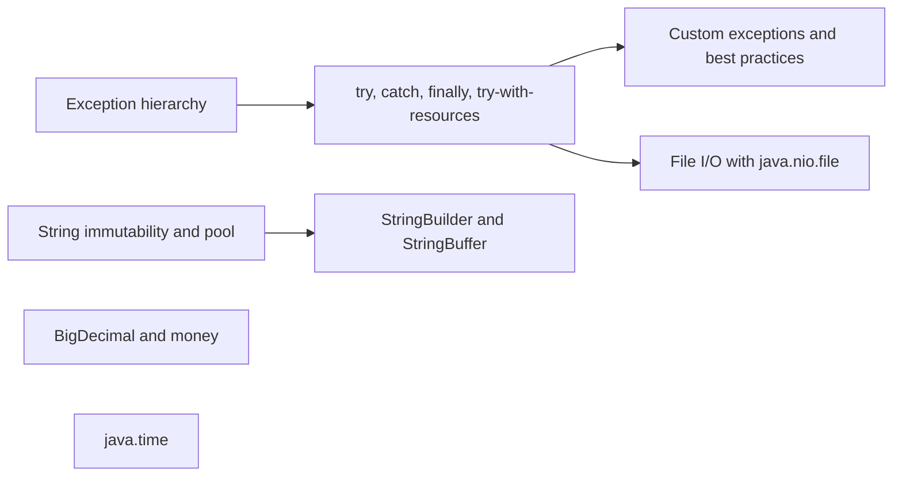
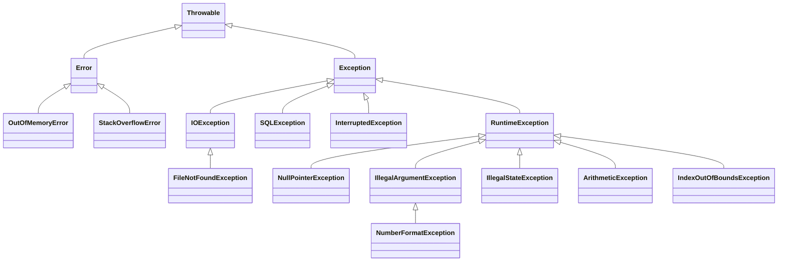
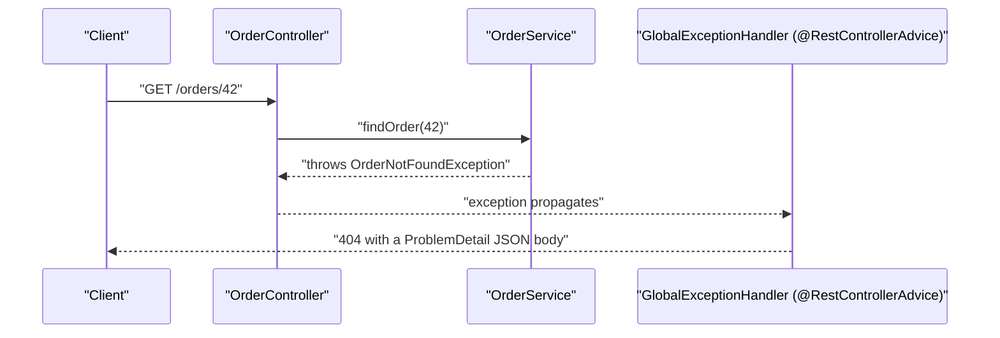

@@ 1 | MODULE | Phase 3 — Exceptions, Strings and Core APIs (Beginner) | Exception handling, String internals, BigDecimal, java.time and file I/O | MUST
# Phase 3: Exceptions, Strings and Core APIs (Beginner)

This phase covers how Java reports and handles errors, and the core library classes you use every day: `String`, `StringBuilder`, `BigDecimal`, the `java.time` API and file I/O with `java.nio.file`. Exception design matters a lot in Spring Boot: `@Transactional` rolls back only for certain exceptions, and a good API turns exceptions into clean HTTP error responses.



**Prerequisites:** Phases 1 and 2 (classes, inheritance, immutability).

**The 5 questions from this phase that come up most often**
1. Checked vs unchecked exceptions: what is the difference and when do you use each?
2. Does `finally` always run? What if `return` is in both try and finally?
3. Why is `String` immutable, and what is the String pool?
4. `String` vs `StringBuilder` vs `StringBuffer`.
5. Why not use `double` for money?

@@ 2 | MODULE | Exceptions | Hierarchy, handling, resources and designing your own exceptions | MUST
# Exceptions

**Shared analogy: a fire-alarm system in a building.** An exception is the alarm going off. `throw` pulls the alarm. `try` marks a floor that has a plan; `catch` is the fire team on that floor; if there is no team, the alarm travels up floor by floor (the call stack) until someone handles it or the whole building is evacuated (the program crashes). `finally` is the rule "close the fire doors whatever happens". Checked exceptions are alarms the building code says you must plan for; unchecked ones are mistakes in the building itself.

@@ 3 | TOPIC | Exception Hierarchy: Checked vs Unchecked | Throwable, Error, Exception, RuntimeException and when the compiler forces handling | MUST
# Exception Hierarchy: Checked vs Unchecked

**Level: Beginner | Phase 3 | Priority: MUST | Since: Java 1.0**

> **30-second interview answer:** Everything throwable extends `Throwable`, which has two branches: `Error` for serious JVM problems you should not catch (like `OutOfMemoryError`), and `Exception`. Checked exceptions are subclasses of `Exception` but not of `RuntimeException`; the compiler forces you to catch or declare them with `throws` (for example `IOException`). Unchecked exceptions are `RuntimeException` and its subclasses (like `NullPointerException`, `IllegalArgumentException`) and usually signal programming bugs; the compiler does not force handling. Spring prefers unchecked exceptions and rolls back transactions on them by default.

## 1. Concept in Simple Words
### Analogy
Problems on a road trip.

| Road trip | Java |
|---|---|
| "The bridge might be closed: have a detour plan" — the map makes you plan | Checked exception: the compiler forces a plan |
| You forgot to put fuel in: your own mistake | Unchecked exception (`RuntimeException`): a bug |
| An earthquake destroys the road | `Error`: not something to recover from |
| Telling the passenger "I may need to detour" | Declaring `throws IOException` |

### What it is


| Kind | Extends | Compiler forces handling? | Typical cause | Examples |
|---|---|---|---|---|
| Checked | `Exception` (not Runtime) | Yes: catch or `throws` | External conditions you can anticipate | `IOException`, `SQLException`, `InterruptedException` |
| Unchecked | `RuntimeException` | No | Programming bugs, invalid arguments, bad state | `NullPointerException`, `IllegalArgumentException`, `ClassCastException` |
| Error | `Error` | No | JVM or environment failure | `OutOfMemoryError`, `StackOverflowError`, `NoClassDefFoundError` |

**Handle or declare rule:** a method that can throw a checked exception must either catch it or list it in its `throws` clause.

### Why it exists
Java's designers wanted the compiler to make sure recoverable failures (a missing file, a network drop) are not silently ignored. Bugs (null dereference, wrong index) cannot sensibly be "planned for" everywhere, so they are unchecked.

## 2. How It Works
**What happens when an exception is thrown:**
```text
main() calls placeOrder() calls charge() calls parseAmount("abc")

parseAmount throws NumberFormatException
   -> no catch in parseAmount: frame is popped
   -> no catch in charge: frame is popped
   -> placeOrder has catch (IllegalArgumentException e): matches (superclass)
      -> handler runs, program continues after the try/catch

If no frame catches it: the thread dies, the JVM prints the stack trace,
and if it was the main thread with no other non-daemon threads, the program exits with code 1.
```

**The stack trace** records where the exception was created and every call on the way:
```text
java.lang.NumberFormatException: For input string: "abc"
    at java.base/java.lang.Integer.parseInt(Integer.java:661)
    at Shop.parseAmount(Shop.java:12)        <- your code, read from here
    at Shop.charge(Shop.java:8)
    at Shop.main(Shop.java:4)
```
Read from the top: the first line of *your* code is usually the culprit.

**The modern debate:** many languages (Kotlin, C#) have no checked exceptions. Checked exceptions do not work well with lambdas (`Function` cannot throw `IOException`). Spring wraps checked JDBC exceptions into its unchecked `DataAccessException` hierarchy for that reason.

## 3. Code Example
### Code
```java
import java.io.FileNotFoundException;
import java.io.FileReader;
import java.io.IOException;
import java.util.List;

public class HierarchyDemo {

    // Checked: must be declared because it may be thrown
    static String readFirstChar(String path) throws IOException {
        try (FileReader r = new FileReader(path)) {   // FileReader throws FileNotFoundException
            return String.valueOf((char) r.read());
        }
    }

    // Unchecked: no declaration needed
    static int parsePositive(String text) {
        int n = Integer.parseInt(text);               // may throw NumberFormatException
        if (n <= 0) throw new IllegalArgumentException("must be positive: " + n);
        return n;
    }

    static void classify(Throwable t) {
        String kind = (t instanceof Error) ? "Error"
                : (t instanceof RuntimeException) ? "unchecked"
                : "checked";
        System.out.println(t.getClass().getSimpleName() + " -> " + kind);
    }

    public static void main(String[] args) {
        // 1. Checked exception: compiler forces this try/catch (or throws on main)
        try {
            readFirstChar("does-not-exist.txt");
        } catch (FileNotFoundException e) {           // more specific first
            System.out.println("file missing: " + e.getMessage().contains("does-not-exist.txt"));
        } catch (IOException e) {
            System.out.println("other I/O problem");
        }

        // 2. Unchecked exceptions
        for (String input : List.of("5", "-3", "abc")) {
            try {
                System.out.println("parsed " + parsePositive(input));
            } catch (NumberFormatException e) {       // subclass of IllegalArgumentException: catch first
                System.out.println("not a number: " + input);
            } catch (IllegalArgumentException e) {
                System.out.println("rejected: " + e.getMessage());
            }
        }

        // 3. Classifying common throwables
        classify(new IOException());
        classify(new InterruptedException());
        classify(new NullPointerException());
        classify(new IllegalStateException());
        classify(new StackOverflowError());

        // 4. Errors exist but you rarely catch them
        try {
            recurse(0);
        } catch (StackOverflowError e) {
            System.out.println("caught StackOverflowError (demo only, do not do this in real code)");
        }

        // 5. Helpful NullPointerException messages (Java 14+)
        try {
            String s = null;
            s.length();
        } catch (NullPointerException e) {
            System.out.println(e.getMessage());
        }
    }

    static int recurse(int n) { return recurse(n + 1); }
}
```

### Walkthrough
- `readFirstChar` declares `throws IOException` because `FileReader` may throw `FileNotFoundException` (a checked `IOException`). Without the declaration it would not compile.
- `main` must catch it. The more specific `FileNotFoundException` is caught first; putting `IOException` first would make the second catch unreachable, a compile error.
- `parsePositive` throws unchecked exceptions without any declaration. `NumberFormatException` extends `IllegalArgumentException`, so it must come first.
- `classify` shows which branch each throwable belongs to. `InterruptedException` is checked.
- Since Java 14, `NullPointerException` messages say exactly what was null ("helpful NPE messages").

### Output
```text
file missing: true
parsed 5
rejected: must be positive: -3
not a number: abc
IOException -> checked
InterruptedException -> checked
NullPointerException -> unchecked
IllegalStateException -> unchecked
StackOverflowError -> Error
caught StackOverflowError (demo only, do not do this in real code)
Cannot invoke "String.length()" because "<local1>" is null
```
(The local variable name shows as `"s"` if the class was compiled with `-g` debug info; with the single-file launcher it shows `"<local1>"`.)

### Compare
| Checked | Unchecked |
|---|---|
| Compiler enforces handling | No enforcement |
| Recoverable, external conditions | Bugs, invalid input, invalid state |
| Clutters lambdas and APIs | Works smoothly with lambdas |
| Spring `@Transactional` does NOT roll back by default | Rolls back by default |

## 4. Interview Questions
**Basic**
1. **What is the difference between checked and unchecked exceptions?**
   Checked exceptions extend `Exception` but not `RuntimeException`, and the compiler forces catch-or-declare. Unchecked exceptions extend `RuntimeException` and are not checked by the compiler.
2. **What is the difference between `Error` and `Exception`?**
   `Error` signals serious problems in the JVM or environment that applications should not try to handle. `Exception` signals conditions a program may handle.
3. **Name three checked and three unchecked exceptions.**
   Checked: `IOException`, `SQLException`, `InterruptedException`. Unchecked: `NullPointerException`, `IllegalArgumentException`, `ArrayIndexOutOfBoundsException`.

**Follow-up**
4. **Why must specific catch blocks come before general ones?**
   A general catch first would also catch the specific type, making the later block unreachable, which the compiler rejects.
5. **Should you catch `Throwable` or `Exception` broadly?**
   Generally no. Catching `Throwable` also swallows `Error`s like `OutOfMemoryError`. Broad catches belong only at boundaries (a top-level handler that logs and returns 500).
6. **Why does Spring prefer unchecked exceptions?**
   They keep method signatures clean, work with lambdas and proxies, and Spring rolls back transactions on them by default. Spring translates checked SQL exceptions into unchecked `DataAccessException`s.

**Tricky / scenario**
7. **Is `NumberFormatException` checked?**
   No. It extends `IllegalArgumentException`, which extends `RuntimeException`.
8. **A `@Transactional` method throws a checked exception after inserting rows. Are the rows rolled back?**
   No, by default Spring only rolls back on unchecked exceptions and errors. Use `@Transactional(rollbackFor = Exception.class)` or throw an unchecked exception.

**What the interviewer is really testing:** whether you can design error handling on purpose, including the Spring rollback consequence.

## 5. Pitfalls & Best Practices
### Common mistakes
| Mistake | What goes wrong | Fix |
|---|---|---|
| `catch (Exception e) {}` (empty) | Errors disappear silently | Handle, log with context, or rethrow |
| Catching `Throwable` | Swallows JVM errors | Catch specific types |
| Using exceptions for normal control flow | Slow and confusing | Use return values or `Optional` |
| Throwing checked exceptions from a `@Transactional` method and expecting rollback | Data partially saved | `rollbackFor` or unchecked exceptions |

### Best practices
- Use unchecked exceptions for programming errors and business-rule violations in Spring apps.
- Use checked exceptions only when the caller can realistically recover (and in low-level libraries).
- Read stack traces from the top and look for the first line of your own code.

### Compare with
| Exception | Means |
|---|---|
| `IllegalArgumentException` | The caller passed a bad argument |
| `IllegalStateException` | The object is in the wrong state for this call |
| `UnsupportedOperationException` | The operation is not supported (e.g. unmodifiable list) |
| `NullPointerException` | Something was null; prefer `Objects.requireNonNull` early with a message |

## 6. Hands-on Exercise
Write `static int safeDivide(String a, String b)` that parses two numbers and divides them. Handle three failures with separate catch blocks and messages: not a number, division by zero, and null input. Decide for each whether it is checked or unchecked, and add a comment.

<details><summary>Solution</summary>

```java
public class SafeDivide {
    static String safeDivide(String a, String b) {
        try {
            int x = Integer.parseInt(a);     // NumberFormatException (unchecked)
            int y = Integer.parseInt(b);
            return String.valueOf(x / y);    // ArithmeticException (unchecked)
        } catch (NumberFormatException e) {
            return "not a number";           // also thrown for null input by parseInt
        } catch (ArithmeticException e) {
            return "cannot divide by zero";
        }
    }

    public static void main(String[] args) {
        System.out.println(safeDivide("10", "2"));   // 5
        System.out.println(safeDivide("10", "x"));   // not a number
        System.out.println(safeDivide("10", "0"));   // cannot divide by zero
        System.out.println(safeDivide(null, "1"));   // not a number
    }
}
```
All three are unchecked: they come from bad input or arithmetic bugs, so the compiler does not force the handling. `Integer.parseInt(null)` throws `NumberFormatException`, not `NullPointerException`.
</details>

## 7. Recall
Q: Which class is the root of all Java exceptions and errors?
A: `Throwable`.

Q: How do you tell whether a Java exception is checked?
A: It extends `Exception` but not `RuntimeException`.

Q: Is `InterruptedException` checked or unchecked?
A: Checked.

Q: By default, does Spring `@Transactional` roll back on checked exceptions?
A: No, only on unchecked exceptions and errors, unless `rollbackFor` says otherwise.

Q: Why must a catch for `FileNotFoundException` come before `IOException`?
A: Otherwise the specific catch is unreachable, which is a compile error.

**Related:** [[try, catch, finally and try-with-resources]] · [[Custom Exceptions and Best Practices]] · [[@Transactional and Propagation]]

@@ 3 | TOPIC | try, catch, finally and try-with-resources | Handling flow, multi-catch, finally rules, AutoCloseable and suppressed exceptions | MUST
# try, catch, finally and try-with-resources

**Level: Beginner | Phase 3 | Priority: MUST | Since: Java 1.0 (multi-catch and try-with-resources Java 7, effectively final resources Java 9)**

> **30-second interview answer:** Code that may fail goes in `try`; `catch` blocks handle specific exceptions; `finally` always runs, whether the try succeeded, threw, or returned, except if the JVM halts. Try-with-resources automatically closes any `AutoCloseable` declared in its header, in reverse order, even when exceptions occur; if closing also throws, that exception is attached as "suppressed" to the main one. Multi-catch (`catch (A | B e)`) handles several types in one block.

## 1. Concept in Simple Words
### Analogy
Borrowing a library book.

| Library | Java |
|---|---|
| Reading the book (may go wrong: you spill coffee) | `try` block |
| The plan if coffee is spilled | `catch` block |
| Returning the book no matter what happened | `finally` |
| A smart library card that returns the book automatically when you leave | try-with-resources |
| Two problems: coffee spilled AND the return slot jammed | Main exception plus a suppressed exception |

### What it is
```text
try {
    risky code
} catch (SpecificException e) {
    handle
} catch (OtherA | OtherB e) {     // multi-catch: e is effectively final
    handle both
} finally {
    always runs (cleanup)
}

try (var in = Files.newBufferedReader(path);     // resources declared here
     var out = Files.newBufferedWriter(target)) {
    use them
}                                                 // closed automatically: out first, then in
```
- A `try` needs at least one `catch` or a `finally`, unless it is try-with-resources.
- **`AutoCloseable`:** an interface with one method, `close()`. Files, streams, JDBC connections and many locks implement it.
- **Suppressed exceptions:** retrieved with `e.getSuppressed()`.

### Why it exists
Before Java 7, closing resources correctly needed nested try/finally blocks with null checks, and exceptions from `close()` could hide the original error. Try-with-resources fixes both.

## 2. How It Works
**When does `finally` run?**
| Situation | finally runs? |
|---|---|
| try completes normally | yes |
| try throws, catch handles it | yes, after the catch |
| try throws, no matching catch | yes, then the exception continues up |
| try or catch executes `return` | yes, before the method actually returns |
| `System.exit()` called in try | no |
| JVM crash or the machine loses power | no |
| Thread is a daemon and the JVM exits | not guaranteed |

**Return values and finally:**
```text
int f() {
    int x = 1;
    try { return x; }      // return value 1 is saved
    finally { x = 99; }    // changes x, but not the saved return value  -> returns 1
}

int g() {
    try { return 1; }
    finally { return 2; }  // overrides the return AND swallows any exception -> returns 2
}
```
Never `return` from `finally`: it silently discards exceptions.

**What try-with-resources compiles to** (simplified):
```text
Resource r = open();
Throwable primary = null;
try {
    body
} catch (Throwable t) {
    primary = t; throw t;
} finally {
    if (primary != null) {
        try { r.close(); } catch (Throwable c) { primary.addSuppressed(c); }
    } else {
        r.close();
    }
}
```

## 3. Code Example
### Code
```java
import java.io.BufferedReader;
import java.io.IOException;
import java.io.StringReader;

public class TryDemo {

    // A resource that announces opening and closing
    static class Connection implements AutoCloseable {
        private final String name;
        private final boolean failOnClose;

        Connection(String name, boolean failOnClose) {
            this.name = name;
            this.failOnClose = failOnClose;
            System.out.println("open " + name);
        }

        void query(boolean fail) {
            System.out.println("query on " + name);
            if (fail) throw new IllegalStateException("query failed on " + name);
        }

        @Override
        public void close() {
            System.out.println("close " + name);
            if (failOnClose) throw new IllegalStateException("close failed on " + name);
        }
    }

    static int finallyDoesNotChangeReturn() {
        int x = 1;
        try {
            return x;
        } finally {
            x = 99;                     // too late: the return value is already saved
            System.out.println("finally ran, x=" + x);
        }
    }

    @SuppressWarnings("finally")
    static int finallyOverridesReturn() {
        try {
            throw new RuntimeException("lost!");
        } finally {
            return 2;                   // swallows the exception: never do this
        }
    }

    public static void main(String[] args) throws IOException {
        // 1. Normal flow with try-with-resources: closed in reverse order
        try (Connection a = new Connection("A", false);
             Connection b = new Connection("B", false)) {
            a.query(false);
            b.query(false);
        }

        System.out.println("---");
        // 2. Body fails AND close fails: close exception becomes suppressed
        try (Connection c = new Connection("C", true)) {
            c.query(true);
        } catch (IllegalStateException e) {
            System.out.println("caught: " + e.getMessage());
            for (Throwable s : e.getSuppressed()) {
                System.out.println("suppressed: " + s.getMessage());
            }
        }

        System.out.println("---");
        // 3. Multi-catch
        for (String input : new String[]{"12", "x", null}) {
            try {
                System.out.println("length of number " + Integer.parseInt(input.trim()));
            } catch (NumberFormatException | NullPointerException e) {
                System.out.println("bad input (" + e.getClass().getSimpleName() + ")");
            } finally {
                System.out.println("finally for " + input);
            }
        }

        System.out.println("---");
        // 4. finally and return
        System.out.println("returned " + finallyDoesNotChangeReturn());
        System.out.println("returned " + finallyOverridesReturn());

        // 5. Java 9: an effectively final resource declared outside
        BufferedReader reader = new BufferedReader(new StringReader("line one\nline two"));
        try (reader) {
            System.out.println("read: " + reader.readLine());
        }
    }
}
```

### Walkthrough
- Part 1: both connections open in order A, B and close in reverse order B, A, automatically.
- Part 2: the query throws, then `close()` throws too. The query exception is the one you catch; the close exception is attached as suppressed instead of hiding it.
- Part 3: multi-catch handles two unrelated exceptions in one block. `finally` runs for every input.
- Part 4: `finally` changes `x` but the saved return value stays 1. Returning from `finally` discards the thrown exception entirely and returns 2.
- Part 5: since Java 9, an effectively final variable can be used as a resource.

### Output
```text
open A
open B
query on A
query on B
close B
close A
---
open C
query on C
close C
caught: query failed on C
suppressed: close failed on C
---
length of number 12
finally for 12
bad input (NumberFormatException)
finally for x
bad input (NullPointerException)
finally for null
---
finally ran, x=99
returned 1
returned 2
read: line one
```

### Compare
| Old try/finally cleanup | try-with-resources |
|---|---|
| Manual `close()` in finally, null checks | Automatic close |
| An exception in close can hide the original | Close exceptions are suppressed and kept |
| Easy to forget | Compiler-enforced for `AutoCloseable` |
| Many nested blocks for several resources | One header, reverse-order closing |

## 4. Interview Questions
**Basic**
1. **Does `finally` always execute?**
   Yes, whether try completes, throws or returns, except when the JVM stops (for example `System.exit` or a crash).
2. **What is try-with-resources?**
   A try statement that declares `AutoCloseable` resources in its header and closes them automatically at the end, in reverse order.
3. **Can you have try without catch?**
   Yes, with a `finally`, or as try-with-resources.

**Follow-up**
4. **What are suppressed exceptions?**
   When the body throws and `close()` also throws, the close exception is added to the primary exception with `addSuppressed` instead of replacing it; read them with `getSuppressed()`.
5. **What does multi-catch require?**
   The types must not be subclasses of each other, and the catch variable is implicitly final.
6. **In what order are resources closed?**
   In reverse order of declaration, like unwinding a stack.

**Tricky / scenario**
7. **What does a method return if try returns 1 and finally returns 2?**
   2, and any exception from try is lost. Returning from finally is a well-known anti-pattern.
8. **A JDBC connection pool runs out of connections in production. What is the most likely code bug?**
   Connections are not closed on error paths. Using try-with-resources (or Spring's `JdbcTemplate`, which manages it) fixes the leak.

**What the interviewer is really testing:** precise control-flow knowledge and safe resource handling, which prevents real production leaks.

## 5. Pitfalls & Best Practices
### Common mistakes
| Mistake | What goes wrong | Fix |
|---|---|---|
| `return` or `throw` inside finally | Original exception lost | Only cleanup in finally |
| Closing resources manually | Leaks on error paths | try-with-resources |
| Catching and only printing `e.printStackTrace()` | Lost in console, no context | Log with a logger and context, or rethrow |
| Very large try blocks | Unclear which line can fail | Wrap only the risky statements |

### Best practices
- Always use try-with-resources for files, streams, sockets, JDBC objects and locks wrapped in `AutoCloseable`.
- Catch the most specific exception you can handle; let the rest propagate.
- When rethrowing, wrap with context and keep the cause: `throw new OrderException("order 42", e);`.

### Compare with
| Construct | Use for |
|---|---|
| `catch` | Recover or translate an exception |
| `finally` | Cleanup that is not an `AutoCloseable` |
| try-with-resources | Anything `AutoCloseable` |

## 6. Hands-on Exercise
Write a class `Timer` that implements `AutoCloseable`: it records the start time in its constructor and prints `"<label> took N ms"` when closed. Use it in try-with-resources around a loop that sums 1 to 10 million. Then make the loop throw an exception halfway and show that the timer still prints.

<details><summary>Solution</summary>

```java
public class TimerDemo {
    static class Timer implements AutoCloseable {
        private final String label;
        private final long start = System.nanoTime();
        Timer(String label) { this.label = label; }
        @Override public void close() {
            long ms = (System.nanoTime() - start) / 1_000_000;
            System.out.println(label + " took " + ms + " ms");
        }
    }

    public static void main(String[] args) {
        try (Timer t = new Timer("sum")) {
            long sum = 0;
            for (int i = 1; i <= 10_000_000; i++) sum += i;
            System.out.println("sum = " + sum);   // 50000005000000
        }
        try (Timer t = new Timer("failing loop")) {
            for (int i = 0; i < 10; i++) {
                if (i == 5) throw new IllegalStateException("boom at " + i);
            }
        } catch (IllegalStateException e) {
            System.out.println("caught " + e.getMessage()); // printed AFTER "failing loop took ..."
        }
    }
}
```
The timer's `close()` runs before the catch block, so its message prints first.
</details>

## 7. Recall
Q: When does `finally` not run?
A: When the JVM stops first, for example `System.exit()` or a crash.

Q: In what order does try-with-resources close resources?
A: In reverse order of declaration.

Q: What happens to an exception thrown by `close()` when the try body already threw?
A: It is added to the primary exception as a suppressed exception.

Q: What does a method return if both try and finally have return statements?
A: The value from finally; any exception from try is lost.

Q: Which interface must a resource implement for try-with-resources?
A: `AutoCloseable` (or its sub-interface `Closeable`).

**Related:** [[Exception Hierarchy: Checked vs Unchecked]] · [[File I/O with java.nio.file]] · [[Connection Pooling with HikariCP]]

@@ 3 | TOPIC | Custom Exceptions and Best Practices | Designing exception classes, wrapping causes, logging and mapping to HTTP | MUST
# Custom Exceptions and Best Practices

**Level: Beginner | Phase 3 | Priority: MUST | Since: Java 1.0 (exception chaining Java 1.4)**

> **30-second interview answer:** Create a custom exception when callers need to react to a specific failure or when the name adds meaning, for example `OrderNotFoundException`. In Spring apps, extend `RuntimeException`, provide constructors with a message and a cause, and include useful context like the id. Always keep the original cause when wrapping (exception chaining), log an exception once at the boundary, never swallow it, and map exceptions to HTTP responses in a global `@RestControllerAdvice`.

## 1. Concept in Simple Words
### Analogy
Hospital triage labels.

| Hospital | Java |
|---|---|
| A generic note "patient unwell" | `throw new RuntimeException("error")` |
| A specific label "broken left arm, fell from ladder" | `OrderNotFoundException("Order 42 not found")` |
| Attaching the X-ray to the label | Keeping the cause: `new X(msg, cause)` |
| Writing the incident in the logbook once, at reception | Log once at the boundary |
| Different departments for different labels | Mapping exception types to HTTP status codes |

### What it is
```text
public class OrderNotFoundException extends RuntimeException {
    public OrderNotFoundException(long id) {
        super("Order " + id + " not found");
    }
}
```
- **Unchecked custom exception:** extends `RuntimeException`. The usual choice in Spring.
- **Checked custom exception:** extends `Exception`. Use when the caller must and can recover.
- **Exception chaining:** `new PaymentException("charge failed", ioException)` keeps the original as `getCause()`; the stack trace prints "Caused by: ...".
- **Exception hierarchy for a domain:** a base `OrderHubException` with subclasses `NotFoundException`, `BusinessRuleException`, and so on.

### Why it exists
Specific types let callers and global handlers react differently (404 vs 409 vs 500). Good messages with context save hours of debugging.

## 2. How It Works
**Wrapping keeps the whole story:**
```text
com.orderhub.PaymentException: Charging order 42 failed
    at PaymentService.charge(PaymentService.java:30)
    ...
Caused by: java.net.SocketTimeoutException: Read timed out
    at ...HttpClient.send(...)
```

**Exception flow in a Spring Boot request** (covered fully in Phase 11):


**Performance note:** creating an exception captures the stack trace, which costs microseconds. That is fine for real failures, but do not use exceptions for normal control flow in hot loops. For very frequent "expected" exceptions, you can disable the stack trace via the protected constructor `super(msg, null, false, false)`.

## 3. Code Example
### Code
```java
import java.util.HashMap;
import java.util.Map;

public class CustomExceptionsDemo {

    // Base exception for the application domain
    static class OrderHubException extends RuntimeException {
        OrderHubException(String message) { super(message); }
        OrderHubException(String message, Throwable cause) { super(message, cause); }
    }

    // Specific types: callers and handlers can react differently
    static class OrderNotFoundException extends OrderHubException {
        private final long orderId;
        OrderNotFoundException(long orderId) {
            super("Order " + orderId + " not found");
            this.orderId = orderId;
        }
        long getOrderId() { return orderId; }
    }

    static class InsufficientStockException extends OrderHubException {
        InsufficientStockException(String sku, int requested, int available) {
            super("Not enough stock for " + sku + ": requested " + requested + ", available " + available);
        }
    }

    static class PaymentFailedException extends OrderHubException {
        PaymentFailedException(long orderId, Throwable cause) {
            super("Payment for order " + orderId + " failed", cause);   // keep the cause
        }
    }

    static final Map<Long, String> ORDERS = new HashMap<>(Map.of(1L, "Book"));
    static final Map<String, Integer> STOCK = new HashMap<>(Map.of("BOOK", 2));

    static String findOrder(long id) {
        String order = ORDERS.get(id);
        if (order == null) throw new OrderNotFoundException(id);
        return order;
    }

    static void reserve(String sku, int qty) {
        int available = STOCK.getOrDefault(sku, 0);
        if (qty > available) throw new InsufficientStockException(sku, qty, available);
        STOCK.put(sku, available - qty);
    }

    static void pay(long orderId) {
        try {
            callPaymentProvider();                              // low-level failure
        } catch (java.io.IOException e) {
            throw new PaymentFailedException(orderId, e);       // translate and wrap
        }
    }

    static void callPaymentProvider() throws java.io.IOException {
        throw new java.net.SocketTimeoutException("Read timed out");
    }

    // A tiny "global handler" like @RestControllerAdvice: maps exceptions to HTTP codes
    static String handle(Runnable action) {
        try {
            action.run();
            return "200 OK";
        } catch (OrderNotFoundException e) {
            return "404 " + e.getMessage();
        } catch (InsufficientStockException e) {
            return "409 " + e.getMessage();
        } catch (OrderHubException e) {
            return "502 " + e.getMessage() + " (cause: " + e.getCause().getClass().getSimpleName() + ")";
        } catch (RuntimeException e) {
            return "500 Internal error";                         // never leak details for unknown errors
        }
    }

    public static void main(String[] args) {
        System.out.println(handle(() -> findOrder(1)));
        System.out.println(handle(() -> findOrder(99)));
        System.out.println(handle(() -> reserve("BOOK", 5)));
        System.out.println(handle(() -> pay(1)));
        System.out.println(handle(() -> { throw new NullPointerException("bug"); }));

        try {
            pay(7);
        } catch (PaymentFailedException e) {
            System.out.println("message: " + e.getMessage());
            System.out.println("cause  : " + e.getCause());
        }
    }
}
```

### Walkthrough
- `OrderHubException` is the base for all domain errors, so a handler can catch the whole family.
- `OrderNotFoundException` stores the id as a field as well as in the message, so handlers can use it.
- `InsufficientStockException` builds a message with all the context needed to debug.
- `pay` translates a low-level checked `IOException` into a domain exception and **keeps it as the cause**.
- `handle` mimics a Spring `@RestControllerAdvice`: the most specific types first, then the base type, then a generic 500 that does not leak internal details.

### Output
```text
200 OK
404 Order 99 not found
409 Not enough stock for BOOK: requested 5, available 2
502 Payment for order 1 failed (cause: SocketTimeoutException)
500 Internal error
message: Payment for order 7 failed
cause  : java.net.SocketTimeoutException: Read timed out
```

### Compare
| Bad | Good |
|---|---|
| `throw new RuntimeException("error")` | `throw new OrderNotFoundException(id)` |
| `catch (Exception e) { throw new MyException("failed"); }` | `throw new MyException("Charging order 42 failed", e);` |
| Log and rethrow at every layer | Log once at the boundary |
| Return null on failure | Throw a meaningful exception or return `Optional` |

## 4. Interview Questions
**Basic**
1. **How do you create a custom exception?**
   Extend `RuntimeException` (unchecked) or `Exception` (checked), and provide constructors that accept a message and a cause.
2. **When should you create a custom exception?**
   When callers or handlers need to react to that failure specifically, or the name makes the failure clearer than a generic exception.
3. **What is exception chaining?**
   Wrapping a lower-level exception as the cause of a higher-level one (`new X(msg, cause)`), so the full story appears in the stack trace.

**Follow-up**
4. **Checked or unchecked for custom exceptions in Spring?**
   Usually unchecked: cleaner signatures, works with lambdas, and triggers transaction rollback by default.
5. **Why is "log and rethrow" an anti-pattern?**
   The same error is logged several times at different layers, cluttering logs. Log once where it is handled (usually a global handler).
6. **What should an error response to an API client contain?**
   A status code, a stable error code or type, a human message, and maybe a trace id, but no stack traces or internal details. Spring supports RFC 9457 `ProblemDetail`.

**Tricky / scenario**
7. **A teammate catches `Exception` and throws `new RuntimeException(e.getMessage())`. What is lost?**
   The original exception type and its stack trace. Pass the exception itself as the cause.
8. **Should you throw exceptions for validation failures in a service?**
   For rule violations, yes (a specific unchecked exception mapped to 400 or 409). For "not found" lookups, either throw or return `Optional`, but be consistent across the codebase.

**What the interviewer is really testing:** practical error-handling design in real services, not just syntax.

## 5. Pitfalls & Best Practices
### Common mistakes
| Mistake | What goes wrong | Fix |
|---|---|---|
| Losing the cause when wrapping | Root cause invisible | `super(message, cause)` |
| Swallowing exceptions | Silent data problems | Handle or rethrow |
| One generic `BusinessException` with an int code | Handlers become switch statements | Specific subclasses |
| Exposing stack traces to API clients | Security leak | Generic message plus a trace id |

### Best practices
- Name exceptions after the problem: `OrderNotFoundException`, `PaymentDeclinedException`.
- Include identifiers and values in messages, never passwords or card numbers.
- Map exceptions to HTTP centrally in `@RestControllerAdvice` (Phase 11).

### Compare with
| Status | Typical exception |
|---|---|
| 400 Bad Request | Validation failure |
| 404 Not Found | `XxxNotFoundException` |
| 409 Conflict | Business rule or optimistic lock conflict |
| 500 Internal Server Error | Unexpected bug |
| 502 or 503 | Downstream service failure |

## 6. Hands-on Exercise
Create `InvalidCouponException` (unchecked) with fields `code` and `reason`, and a method `applyCoupon(String code, double total)` that throws it if the code is unknown (`"reason: unknown"`), expired (`"SPRING20"` is expired) or if the total is below 50 for `"SAVE10"`. Print the messages for three failing calls and one success.

<details><summary>Solution</summary>

```java
public class CouponDemo {
    static class InvalidCouponException extends RuntimeException {
        private final String code;
        private final String reason;
        InvalidCouponException(String code, String reason) {
            super("Coupon " + code + " rejected: " + reason);
            this.code = code;
            this.reason = reason;
        }
        String getCode() { return code; }
        String getReason() { return reason; }
    }

    static double applyCoupon(String code, double total) {
        return switch (code) {
            case "SAVE10" -> {
                if (total < 50) throw new InvalidCouponException(code, "minimum total is 50");
                yield total * 0.9;
            }
            case "SPRING20" -> throw new InvalidCouponException(code, "expired");
            default -> throw new InvalidCouponException(code, "unknown");
        };
    }

    public static void main(String[] args) {
        String[][] calls = {{"SAVE10", "80"}, {"SAVE10", "20"}, {"SPRING20", "100"}, {"FREE", "10"}};
        for (String[] c : calls) {
            try {
                System.out.println("total " + applyCoupon(c[0], Double.parseDouble(c[1])));
            } catch (InvalidCouponException e) {
                System.out.println(e.getMessage());
            }
        }
    }
}
```
Output:
```text
total 72.0
Coupon SAVE10 rejected: minimum total is 50
Coupon SPRING20 rejected: expired
Coupon FREE rejected: unknown
```
</details>

## 7. Recall
Q: What should a custom unchecked exception in a Spring app extend?
A: `RuntimeException`.

Q: Why pass the original exception as the cause when wrapping?
A: To keep its type and stack trace, shown as "Caused by" in logs.

Q: Why is "log and rethrow" at every layer bad?
A: The same error is logged many times; log once at the boundary.

Q: Where do Spring apps usually map exceptions to HTTP responses?
A: In a global `@RestControllerAdvice` class.

Q: What should an API error response not contain?
A: Stack traces or internal details.

**Related:** [[Exception Hierarchy: Checked vs Unchecked]] · [[Global Exception Handling and ProblemDetail]] · [[Logging with SLF4J, Logback and MDC]]
