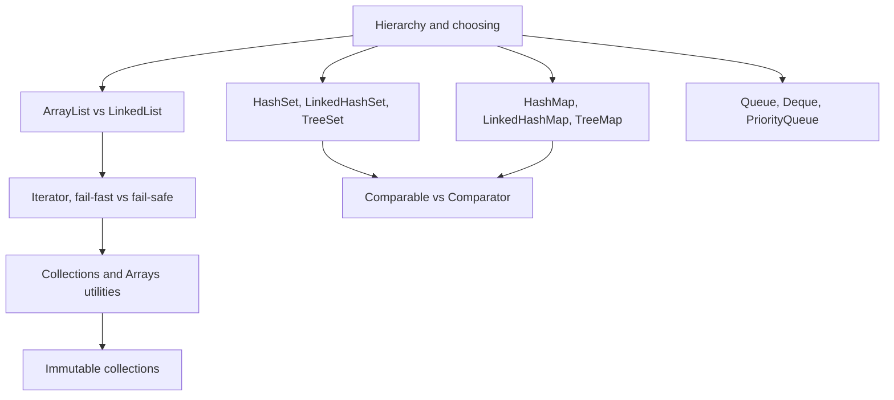
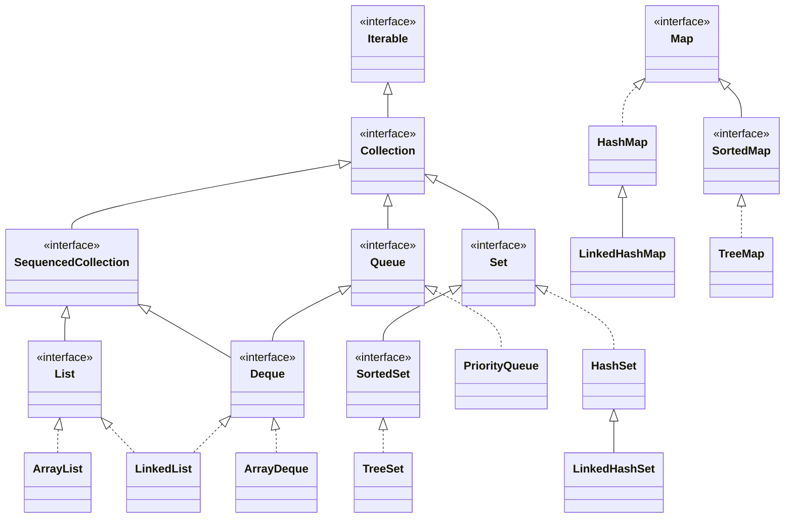

@@ 1 | MODULE | Phase 4 — Collections Framework (Beginner) | List, Set, Map, Queue, iteration, sorting and immutable collections | MUST
# Phase 4: Collections Framework (Beginner)

The Collections Framework is the set of interfaces and classes for storing groups of objects: lists, sets, maps and queues. You will use it in every Java program, and interviewers love it because choosing the right collection shows you understand time complexity. Internals (how `HashMap` really works) come in Phase 8; this phase is about using them correctly.



**Prerequisites:** Phase 2 (equals and hashCode, interfaces) and Phase 1 (arrays).

**The 5 questions from this phase that come up most often**
1. ArrayList vs LinkedList: which is faster for what?
2. HashMap vs LinkedHashMap vs TreeMap.
3. What is fail-fast iteration and `ConcurrentModificationException`?
4. Comparable vs Comparator.
5. `List.of` vs `Collections.unmodifiableList` vs `Arrays.asList`.

@@ 2 | MODULE | Overview | The interfaces, their contracts and how to pick one | MUST
# Overview

**Shared analogy: storage furniture.** A `List` is a numbered bookshelf (order matters, duplicates allowed). A `Set` is a guest list (no duplicates). A `Map` is a coat check: you hand in a ticket (key) and get your coat (value). A `Queue` is the line at a counter. Choosing a collection is choosing the furniture that matches how you will look things up.

@@ 3 | TOPIC | Collections Hierarchy and Choosing a Collection | Collection, List, Set, Queue, Map, Big-O of each implementation and a decision guide | MUST
# Collections Hierarchy and Choosing a Collection

**Level: Beginner | Phase 4 | Priority: MUST | Since: Java 1.2 (Collections Framework), sequenced collections Java 21**

> **30-second interview answer:** The framework is built on interfaces: `Collection` with sub-interfaces `List` (ordered, indexed, duplicates allowed), `Set` (no duplicates) and `Queue`/`Deque` (processing order); `Map` is separate and stores key-value pairs. Common implementations: `ArrayList`, `LinkedList`, `HashSet`, `LinkedHashSet`, `TreeSet`, `HashMap`, `LinkedHashMap`, `TreeMap`, `ArrayDeque`, `PriorityQueue`. You choose by the operations you need: index access, uniqueness, key lookup, ordering, and their Big-O cost. Declare variables with the interface type.

## 1. Concept in Simple Words
### Analogy
Furniture for different storage needs.

| Furniture | Collection |
|---|---|
| Numbered bookshelf: slot 0, 1, 2, duplicates fine | `List` |
| Guest list at a party: each name once | `Set` |
| Alphabetical guest list | `TreeSet` (sorted set) |
| Coat check: ticket → coat | `Map` |
| The line at a bank counter | `Queue` (FIFO) |
| A stack of plates | `Deque` used as a stack (LIFO) |
| Hospital emergency room: most urgent first | `PriorityQueue` |

### What it is

- `Map` does **not** extend `Collection`: it works with pairs, not single elements. Views give you collections: `keySet()`, `values()`, `entrySet()`.
- **Java 21 sequenced collections:** `SequencedCollection`, `SequencedSet` and `SequencedMap` add `getFirst()`, `getLast()`, `addFirst()`, `addLast()`, `removeFirst()`, `removeLast()` and `reversed()` to ordered collections.
- Legacy classes from Java 1.0: `Vector`, `Stack`, `Hashtable` (synchronized, avoid in new code).

### Why it exists
Before the framework, Java had a few unrelated classes with different method names. Common interfaces mean algorithms (sorting, searching) and your own code work with any implementation.

## 2. How It Works
**Big-O of common operations** (n = number of elements):
| Implementation | get by index | contains / get by key | add | remove | Order |
|---|---|---|---|---|---|
| `ArrayList` | O(1) | O(n) | O(1) amortized at end | O(n) | Insertion |
| `LinkedList` | O(n) | O(n) | O(1) at ends | O(1) at ends, O(n) by value | Insertion |
| `HashSet` | - | O(1) average | O(1) | O(1) | None |
| `LinkedHashSet` | - | O(1) | O(1) | O(1) | Insertion |
| `TreeSet` | - | O(log n) | O(log n) | O(log n) | Sorted |
| `HashMap` | - | O(1) average | O(1) | O(1) | None |
| `LinkedHashMap` | - | O(1) | O(1) | O(1) | Insertion (or access) |
| `TreeMap` | - | O(log n) | O(log n) | O(log n) | Sorted by key |
| `ArrayDeque` | - | O(n) | O(1) at ends | O(1) at ends | FIFO or LIFO |
| `PriorityQueue` | - | O(n) | O(log n) | O(log n) for the head | Heap order |

**Decision guide**
```text
Need key -> value lookup?
    yes -> Map:  sorted keys? TreeMap.  insertion order? LinkedHashMap.  else HashMap.
    no  -> Need uniqueness?
        yes -> Set:  sorted? TreeSet.  insertion order? LinkedHashSet.  else HashSet.
        no  -> Processing order (FIFO, LIFO, priority)?
            yes -> FIFO or LIFO: ArrayDeque.  by priority: PriorityQueue.
            no  -> List: ArrayList (almost always).
Many threads? -> concurrent versions (Phase 8 and 9): ConcurrentHashMap, CopyOnWriteArrayList, BlockingQueue.
```

## 3. Code Example
### Code
```java
import java.util.ArrayDeque;
import java.util.ArrayList;
import java.util.Collection;
import java.util.Deque;
import java.util.HashMap;
import java.util.HashSet;
import java.util.LinkedHashMap;
import java.util.LinkedHashSet;
import java.util.List;
import java.util.Map;
import java.util.PriorityQueue;
import java.util.Queue;
import java.util.Set;
import java.util.TreeMap;
import java.util.TreeSet;

public class HierarchyTour {
    public static void main(String[] args) {
        List<String> input = List.of("pear", "apple", "fig", "apple", "kiwi");

        // List: order kept, duplicates allowed, index access
        List<String> list = new ArrayList<>(input);
        System.out.println("List          : " + list + " get(1)=" + list.get(1));

        // Sets: duplicates removed, different orders
        Set<String> hash = new HashSet<>(input);
        Set<String> linked = new LinkedHashSet<>(input);
        Set<String> tree = new TreeSet<>(input);
        System.out.println("HashSet size  : " + hash.size() + " (order not guaranteed)");
        System.out.println("LinkedHashSet : " + linked);
        System.out.println("TreeSet       : " + tree);

        // Maps: word -> length
        Map<String, Integer> hashMap = new HashMap<>();
        Map<String, Integer> linkedMap = new LinkedHashMap<>();
        Map<String, Integer> treeMap = new TreeMap<>();
        for (String w : input) {
            hashMap.put(w, w.length());
            linkedMap.put(w, w.length());
            treeMap.put(w, w.length());
        }
        System.out.println("LinkedHashMap : " + linkedMap);
        System.out.println("TreeMap       : " + treeMap);
        System.out.println("HashMap get   : apple=" + hashMap.get("apple"));

        // Queue (FIFO) and Deque as a stack (LIFO)
        Queue<String> queue = new ArrayDeque<>(input);
        System.out.println("Queue poll    : " + queue.poll() + ", then " + queue.peek());
        Deque<String> stack = new ArrayDeque<>();
        for (String w : input) stack.push(w);
        System.out.println("Stack pop     : " + stack.pop());

        // PriorityQueue: smallest first (natural order)
        Queue<String> pq = new PriorityQueue<>(input);
        StringBuilder order = new StringBuilder();
        while (!pq.isEmpty()) order.append(pq.poll()).append(' ');
        System.out.println("PriorityQueue : " + order.toString().trim());

        // Java 21 sequenced collections
        System.out.println("getFirst/Last : " + list.getFirst() + " / " + list.getLast());
        System.out.println("reversed      : " + list.reversed());

        // Program to interfaces: the same method works for any Collection
        System.out.println("count A-words : " + countStartingWithA(list) + " " + countStartingWithA(tree));
    }

    static long countStartingWithA(Collection<String> words) {
        return words.stream().filter(w -> w.startsWith("a")).count();
    }
}
```

### Walkthrough
- The `ArrayList` keeps both "apple"s in insertion order and supports `get(index)`.
- The three sets remove the duplicate. `HashSet` order is unspecified (do not print it in tests), `LinkedHashSet` keeps insertion order, `TreeSet` sorts.
- The maps differ the same way: `LinkedHashMap` keeps insertion order, `TreeMap` sorts keys.
- `ArrayDeque` works as a FIFO queue (`poll` takes from the head) and as a LIFO stack (`push` and `pop` at the head).
- `PriorityQueue` always polls the smallest element: alphabetical order for strings.
- `getFirst`, `getLast` and `reversed` come from Java 21 `SequencedCollection`.
- `countStartingWithA` accepts any `Collection`, so it works with both a list and a set.

### Output
```text
List          : [pear, apple, fig, apple, kiwi] get(1)=apple
HashSet size  : 4 (order not guaranteed)
LinkedHashSet : [pear, apple, fig, kiwi]
TreeSet       : [apple, fig, kiwi, pear]
LinkedHashMap : {pear=4, apple=5, fig=3, kiwi=4}
TreeMap       : {apple=5, fig=3, kiwi=4, pear=4}
HashMap get   : apple=5
Queue poll    : pear, then apple
Stack pop     : kiwi
PriorityQueue : apple apple fig kiwi pear
getFirst/Last : pear / kiwi
reversed      : [kiwi, apple, fig, apple, pear]
count A-words : 2 1
```

### Compare
| Interface | Duplicates | Order | Lookup by |
|---|---|---|---|
| `List` | Yes | Index order | Index |
| `Set` | No | Depends on implementation | Element |
| `Queue` / `Deque` | Yes | Processing order | Head or tail |
| `Map` | Keys unique, values may repeat | Depends on implementation | Key |

## 4. Interview Questions
**Basic**
1. **What are the main interfaces of the Collections Framework?**
   `Collection` with `List`, `Set`, `Queue` and `Deque`, plus `Map` as a separate hierarchy (and `SortedSet`, `SortedMap`, `NavigableMap`, and the Java 21 sequenced interfaces).
2. **Why does `Map` not extend `Collection`?**
   A map stores key-value pairs; `Collection` methods like `add(E)` do not fit. Maps offer collection views instead: `keySet`, `values`, `entrySet`.
3. **List vs Set?**
   List keeps order and allows duplicates with index access; Set forbids duplicates.

**Follow-up**
4. **Which collection would you use to keep unique items in insertion order?**
   `LinkedHashSet`.
5. **Why declare `List<String> list = new ArrayList<>()` instead of `ArrayList<String> list`?**
   Programming to the interface lets you change the implementation without changing callers, and keeps APIs flexible.
6. **What are sequenced collections?**
   Java 21 interfaces that give ordered collections and maps uniform methods for first and last elements and a reversed view.

**Tricky / scenario**
7. **You need fast lookup of users by email and also iteration in sign-up order. Which collection?**
   `LinkedHashMap<String, User>`: O(1) lookup and insertion-order iteration.
8. **Is `Vector` or `Hashtable` a good choice for thread safety?**
   No. They lock every method (slow) and compound actions are still not atomic. Use `ConcurrentHashMap`, `CopyOnWriteArrayList` or `Collections.synchronizedList` deliberately.

**What the interviewer is really testing:** matching data structures to access patterns using Big-O, the core of efficient code.

## 5. Pitfalls & Best Practices
### Common mistakes
| Mistake | What goes wrong | Fix |
|---|---|---|
| `list.contains(x)` in a loop over a big list | O(n²) | Put items in a `HashSet` first |
| Relying on `HashMap` or `HashSet` iteration order | Order changes between versions and sizes | `LinkedHashMap` or `TreeMap` |
| Using `Stack` and `Vector` | Synchronized overhead, odd API | `ArrayDeque` and `ArrayList` |
| Returning `null` for "no results" | `NullPointerException` in callers | Return an empty collection |

### Best practices
- Declare with interfaces (`List`, `Map`), instantiate with the implementation.
- Default choices: `ArrayList`, `HashMap`, `HashSet`, `ArrayDeque`.
- Pre-size big collections when the size is known: `new ArrayList<>(10_000)`, `HashMap.newHashMap(10_000)` (Java 19).

### Compare with
| Need | Pick |
|---|---|
| Fast index access | `ArrayList` |
| Uniqueness, fast contains | `HashSet` |
| Sorted unique | `TreeSet` |
| Key lookup | `HashMap` |
| Sorted keys, range queries | `TreeMap` |
| Queue or stack | `ArrayDeque` |
| Top-k, scheduling | `PriorityQueue` |

## 6. Hands-on Exercise
Given a list of page visits `["home", "cart", "home", "product", "cart", "home"]`, print: (1) the unique pages in first-visit order, (2) the unique pages alphabetically, (3) a map of page → visit count in first-visit order, (4) the most recent 3 visits using a `Deque`.

<details><summary>Solution</summary>

```java
import java.util.*;

public class Visits {
    public static void main(String[] args) {
        List<String> visits = List.of("home", "cart", "home", "product", "cart", "home");

        System.out.println(new LinkedHashSet<>(visits));   // [home, cart, product]
        System.out.println(new TreeSet<>(visits));         // [cart, home, product]

        Map<String, Integer> counts = new LinkedHashMap<>();
        for (String v : visits) counts.merge(v, 1, Integer::sum);
        System.out.println(counts);                        // {home=3, cart=2, product=1}

        Deque<String> recent = new ArrayDeque<>();
        for (String v : visits) {
            recent.addLast(v);
            if (recent.size() > 3) recent.removeFirst();   // keep only the last 3
        }
        System.out.println(recent);                        // [product, cart, home]
    }
}
```
</details>

## 7. Recall
Q: Does `Map` extend `Collection` in Java?
A: No; it is a separate hierarchy with collection views.

Q: Which Set implementation keeps insertion order?
A: `LinkedHashSet`.

Q: What is the time complexity of `contains` on a `TreeSet`?
A: O(log n).

Q: Which methods did Java 21 sequenced collections add?
A: `getFirst`, `getLast`, `addFirst`, `addLast`, `removeFirst`, `removeLast` and `reversed`.

Q: Which class should replace `Stack` for LIFO use?
A: `ArrayDeque`.

**Related:** [[ArrayList vs LinkedList]] · [[HashMap, LinkedHashMap and TreeMap]] · [[HashMap Internals]]

@@ 2 | MODULE | Lists, sets and maps | The everyday implementations and when each wins | MUST
# Lists, sets and maps

**Shared analogy: a train, a chain of paper clips, a guest list and a coat check.** An `ArrayList` is a train of numbered carriages: jump to carriage 50 instantly, but inserting a carriage in the middle means shifting the rest. A `LinkedList` is a chain of paper clips: easy to clip in anywhere you already hold, slow to find the 50th clip. Sets and maps come in three flavours each: hash (fast, no order), linked (fast, insertion order) and tree (sorted, a little slower).

@@ 3 | TOPIC | ArrayList vs LinkedList | Internal structure, Big-O, memory, cache behaviour and why ArrayList almost always wins | MUST
# ArrayList vs LinkedList

**Level: Beginner | Phase 4 | Priority: MUST | Since: Java 1.2**

> **30-second interview answer:** `ArrayList` is backed by a resizable array: O(1) random access and amortized O(1) appends, but O(n) inserts and removes in the middle because elements shift. `LinkedList` is a doubly linked list: O(1) insert and remove at the ends or at an iterator position, but O(n) access by index, and each element costs an extra node object with two pointers. In practice `ArrayList` is faster for almost everything because of contiguous memory and CPU caches; for queue or stack behaviour use `ArrayDeque` rather than `LinkedList`.

## 1. Concept in Simple Words
### Analogy
A train versus a paper-clip chain.

| Real world | Java |
|---|---|
| Train carriages numbered 0, 1, 2 in a row | `ArrayList`: one contiguous array |
| Walk straight to carriage 50 | `get(50)` in O(1) |
| Adding a carriage in the middle: shift every carriage after it | `add(index, e)` O(n) |
| When the train is full, a longer train is built and everyone moves | Capacity growth (copy) |
| Paper clips hooked to the one before and after | `LinkedList`: nodes with prev and next |
| To find the 50th clip, count from one end | `get(50)` O(n) |
| Hook a new clip where your fingers already are | `iterator.add(e)` O(1) |

### What it is
- **`ArrayList`:** fields `Object[] elementData` and `int size`. Default capacity becomes 10 on the first add, then grows by 50% (`newCapacity = old + old/2`).
- **`LinkedList`:** fields `first`, `last`, `size`; each `Node` has `item`, `prev`, `next`. Implements both `List` and `Deque`.
- Both allow duplicates and nulls, keep insertion order, and are not thread-safe.

### Why it exists
Both data structures are classic computer science: arrays for indexed access, linked lists for cheap splicing. Java offers both under the same `List` interface so you can choose.

## 2. How It Works
```text
ArrayList: [ A | B | C | D | _ | _ ]   size 4, capacity 6
add(1, X): shift B, C, D right -> [ A | X | B | C | D | _ ]   O(n)
get(2):    elementData[2]                                     O(1)

LinkedList: null <- [A] <-> [B] <-> [C] <-> [D] -> null
            first                            last
add(1, X): walk to index 1 (O(n)), then relink 4 pointers (O(1))
get(2):    walk from the nearer end           O(n/2)
```

| Operation | ArrayList | LinkedList |
|---|---|---|
| `get(i)`, `set(i)` | O(1) | O(n) |
| `add(e)` at end | O(1) amortized | O(1) |
| `add(0, e)` at start | O(n) | O(1) |
| `add(i, e)` in middle | O(n) shift | O(n) walk plus O(1) link |
| `remove(i)` | O(n) | O(n) walk plus O(1) unlink |
| `iterator.remove()` | O(n) shift | O(1) |
| Memory per element | One reference (4 or 8 bytes) | Node object: header plus 3 references (about 24 to 40 bytes) |

**Why ArrayList usually wins anyway:** CPUs load memory in cache lines (64 bytes). Walking an array reads neighbouring elements for free; walking a linked list jumps to random places in the heap, causing cache misses. Even an O(n) array shift (`System.arraycopy`, a very fast native copy) often beats the linked list's O(n) pointer chase.

## 3. Code Example
### Code
```java
import java.util.ArrayList;
import java.util.Iterator;
import java.util.LinkedList;
import java.util.List;
import java.util.ListIterator;

public class ListsDemo {
    static long time(Runnable r) {
        long start = System.nanoTime();
        r.run();
        return (System.nanoTime() - start) / 1_000_000;
    }

    public static void main(String[] args) {
        int n = 100_000;
        List<Integer> array = new ArrayList<>();
        List<Integer> linked = new LinkedList<>();
        for (int i = 0; i < n; i++) { array.add(i); linked.add(i); }

        // 1. Random access: ArrayList O(1), LinkedList O(n)
        long arrayGet = time(() -> { long s = 0; for (int i = 0; i < n; i += 10) s += array.get(i); });
        long linkedGet = time(() -> { long s = 0; for (int i = 0; i < n; i += 10) s += linked.get(i); });
        System.out.println("random get: ArrayList faster? " + (arrayGet < linkedGet));

        // 2. Insert at the front: LinkedList O(1), ArrayList O(n)
        List<Integer> a2 = new ArrayList<>(array), l2 = new LinkedList<>(linked);
        long arrayFront = time(() -> { for (int i = 0; i < 20_000; i++) a2.add(0, i); });
        long linkedFront = time(() -> { for (int i = 0; i < 20_000; i++) l2.add(0, i); });
        System.out.println("add at front: LinkedList faster? " + (linkedFront < arrayFront));

        // 3. Removing while iterating: use the iterator (works for both)
        List<Integer> evens = new ArrayList<>(List.of(1, 2, 3, 4, 5, 6));
        Iterator<Integer> it = evens.iterator();
        while (it.hasNext()) if (it.next() % 2 != 0) it.remove();
        System.out.println("iterator remove: " + evens);
        List<Integer> evens2 = new LinkedList<>(List.of(1, 2, 3, 4, 5, 6));
        evens2.removeIf(x -> x % 2 != 0);            // simplest way (Java 8)
        System.out.println("removeIf       : " + evens2);

        // 4. ListIterator: insert while walking (O(1) per insert in LinkedList)
        List<String> words = new LinkedList<>(List.of("a", "c", "e"));
        ListIterator<String> li = words.listIterator();
        while (li.hasNext()) {
            String w = li.next();
            if (w.equals("a")) li.add("b");           // inserts after "a"
            if (w.equals("c")) li.add("d");
        }
        System.out.println("listIterator add: " + words);

        // 5. LinkedList as a Deque (but ArrayDeque is usually better)
        LinkedList<String> deque = new LinkedList<>();
        deque.addFirst("middle"); deque.addFirst("first"); deque.addLast("last");
        System.out.println("deque          : " + deque + " peekLast=" + deque.peekLast());

        // 6. ArrayList capacity tips
        List<String> sized = new ArrayList<>(1_000);  // avoids repeated growth
        ((ArrayList<String>) sized).ensureCapacity(2_000);
        ((ArrayList<String>) sized).trimToSize();     // shrink to current size (0 here)
        System.out.println("sized empty    : " + sized.isEmpty());

        // 7. subList is a VIEW, not a copy
        List<Integer> nums = new ArrayList<>(List.of(1, 2, 3, 4, 5));
        List<Integer> view = nums.subList(1, 4);       // [2, 3, 4]
        view.set(0, 99);
        System.out.println("after view.set : " + nums);
        view.clear();                                  // removes 99, 3, 4 from nums
        System.out.println("after clear    : " + nums);
    }
}
```

### Walkthrough
- Part 1: `linked.get(i)` walks from an end every call, so 10,000 random gets on 100,000 elements is much slower than the array.
- Part 2: inserting at index 0 shifts every element in an `ArrayList`; the linked list just relinks the head.
- Part 3: removing during iteration must go through `iterator.remove()` or `removeIf`; calling `list.remove` inside a for-each loop throws `ConcurrentModificationException`.
- Part 4: `ListIterator.add` inserts at the current position; this is where `LinkedList` truly shines.
- Part 5: `LinkedList` implements `Deque`, so it has `addFirst`, `peekLast`, and so on.
- Part 6: pre-sizing avoids repeated array copying.
- Part 7: `subList` returns a view backed by the original list: changes go both ways.

### Output
```text
random get: ArrayList faster? true
add at front: LinkedList faster? true
iterator remove: [2, 4, 6]
removeIf       : [2, 4, 6]
listIterator add: [a, b, c, d, e]
deque          : [first, middle, last] peekLast=last
sized empty    : true
after view.set : [1, 99, 3, 4, 5]
after clear    : [1, 5]
```

### Compare
| | ArrayList | LinkedList | ArrayDeque |
|---|---|---|---|
| Structure | Resizable array | Doubly linked nodes | Circular array |
| Index access | O(1) | O(n) | Not supported |
| Add or remove at ends | End O(1), start O(n) | O(1) | O(1) |
| Memory | Compact | Heavy (node per element) | Compact |
| Nulls | Allowed | Allowed | Not allowed |
| Best use | Default list | Rare: splicing with iterators | Queues and stacks |

## 4. Interview Questions
**Basic**
1. **ArrayList vs LinkedList?**
   ArrayList uses a resizable array with O(1) index access and O(n) middle inserts; LinkedList uses linked nodes with O(1) end operations and O(n) index access. ArrayList is the default choice.
2. **How does ArrayList grow?**
   When full, it allocates a new array about 1.5 times larger and copies the elements. The default first capacity is 10.
3. **Is ArrayList thread-safe?**
   No. Use `Collections.synchronizedList`, `CopyOnWriteArrayList`, or external locking.

**Follow-up**
4. **Why is LinkedList often slower than ArrayList even for inserts?**
   Finding the position is O(n) pointer chasing with cache misses, and each node allocation costs memory and GC time; array shifts use fast native copying of contiguous memory.
5. **What is amortized O(1) for `ArrayList.add`?**
   Most adds are O(1); occasional resizes copy everything, but because capacity grows geometrically, the average cost per add stays constant.
6. **What is `subList` and what is the trap?**
   A view of a range of the original list. Changes write through, and structurally modifying the original list afterwards makes the view throw `ConcurrentModificationException`.

**Tricky / scenario**
7. **When would you actually choose LinkedList?**
   Rarely: when you insert and remove at positions you already hold via a `ListIterator` in a long list. For queues and stacks, `ArrayDeque` is better.
8. **`list.remove(i)` inside `for (int i = 0; i < list.size(); i++)` skips elements. Why?**
   After removing index i, the next element shifts into i, and the loop moves on to i + 1. Iterate backwards, use an iterator, or `removeIf`.

**What the interviewer is really testing:** whether you know Big-O and the practical reality of memory and caches, not just the textbook table.

## 5. Pitfalls & Best Practices
### Common mistakes
| Mistake | What goes wrong | Fix |
|---|---|---|
| `linkedList.get(i)` in a loop | O(n²) | Use an iterator or an ArrayList |
| Removing inside for-each | `ConcurrentModificationException` | `removeIf` or `Iterator.remove` |
| Keeping a `subList` and changing the parent | `ConcurrentModificationException` | Copy: `new ArrayList<>(list.subList(a, b))` |
| Huge ArrayList grown one element at a time | Repeated copying | Pre-size |

### Best practices
- Default to `ArrayList`.
- Use `ArrayDeque` for queue and stack behaviour.
- Use `List.of` for fixed lists and `new ArrayList<>(List.of(...))` when you need to modify.

### Compare with
| Situation | Choice |
|---|---|
| Read-heavy, index access | ArrayList |
| Queue, stack, sliding window | ArrayDeque |
| Many inserts at known iterator positions | LinkedList |
| Many threads, mostly reads | CopyOnWriteArrayList |

## 6. Hands-on Exercise
Write `static List<Integer> removeDuplicatesKeepOrder(List<Integer> input)` without using a Set for output order (but you may use a `HashSet` for "seen"). Then write `static void removeAllNegatives(List<Integer> list)` in place in two ways: iterator and `removeIf`.

<details><summary>Solution</summary>

```java
import java.util.*;

public class ListExercises {
    static List<Integer> removeDuplicatesKeepOrder(List<Integer> input) {
        Set<Integer> seen = new HashSet<>();
        List<Integer> result = new ArrayList<>();
        for (Integer x : input) {
            if (seen.add(x)) result.add(x);     // add returns false if already seen
        }
        return result;
    }

    static void removeNegativesIterator(List<Integer> list) {
        Iterator<Integer> it = list.iterator();
        while (it.hasNext()) if (it.next() < 0) it.remove();
    }

    public static void main(String[] args) {
        System.out.println(removeDuplicatesKeepOrder(List.of(3, 1, 3, 2, 1))); // [3, 1, 2]
        List<Integer> a = new ArrayList<>(List.of(5, -1, 2, -7, 0));
        removeNegativesIterator(a);
        System.out.println(a);                                               // [5, 2, 0]
        List<Integer> b = new ArrayList<>(List.of(5, -1, 2, -7, 0));
        b.removeIf(x -> x < 0);
        System.out.println(b);                                               // [5, 2, 0]
    }
}
```
</details>

## 7. Recall
Q: What is the time complexity of `get(i)` on a LinkedList?
A: O(n).

Q: By how much does an ArrayList grow when full?
A: About 50% (new capacity = old + old / 2).

Q: Which class is preferred over LinkedList for queues and stacks?
A: `ArrayDeque`.

Q: Is `subList` a copy or a view?
A: A view backed by the original list.

Q: Why is ArrayList often faster than LinkedList in practice?
A: Contiguous memory is cache-friendly and needs no per-element node objects.

**Related:** [[Collections Hierarchy and Choosing a Collection]] · [[Iterator and Fail-Fast vs Fail-Safe]] · [[Queue, Deque and PriorityQueue]]

@@ 3 | TOPIC | HashSet, LinkedHashSet and TreeSet | Uniqueness via equals/hashCode or compareTo, ordering and navigable operations | MUST
# HashSet, LinkedHashSet and TreeSet

**Level: Beginner | Phase 4 | Priority: MUST | Since: Java 1.2 (LinkedHashSet Java 1.4, NavigableSet Java 6)**

> **30-second interview answer:** A `Set` stores unique elements. `HashSet` is backed by a `HashMap` (elements are keys), gives O(1) average operations and no ordering; uniqueness depends on `equals` and `hashCode`. `LinkedHashSet` adds a linked list to keep insertion order. `TreeSet` is backed by a red-black tree (`TreeMap`), keeps elements sorted with O(log n) operations, decides uniqueness with `compareTo` or a `Comparator`, and offers navigation methods like `floor`, `ceiling`, `headSet` and `first`.

## 1. Concept in Simple Words
### Analogy
Three kinds of guest lists.

| Guest list | Set |
|---|---|
| Names thrown in a box: instant check "is Ann in?", no order | `HashSet` |
| A sign-in sheet: no repeats, in arrival order | `LinkedHashSet` |
| An alphabetical register: always sorted, can ask "who comes right after M?" | `TreeSet` |
| Deciding "same guest?" by name and ID card | `equals` and `hashCode` (hash sets) |
| Deciding "same guest?" by alphabetical position | `compareTo` (tree set) |

### What it is
| | HashSet | LinkedHashSet | TreeSet |
|---|---|---|---|
| Backed by | HashMap | LinkedHashMap | TreeMap (red-black tree) |
| Order | None | Insertion | Sorted (natural or Comparator) |
| add, remove, contains | O(1) average | O(1) average | O(log n) |
| Uniqueness by | `equals` + `hashCode` | `equals` + `hashCode` | `compareTo` / `compare` returning 0 |
| null allowed | One null | One null | No (throws `NullPointerException` with natural order) |
| Extra API | - | Sequenced methods | `first`, `last`, `floor`, `ceiling`, `lower`, `higher`, `headSet`, `tailSet`, `subSet`, `descendingSet`, `pollFirst` |

`add` returns `false` when the element is already present, which is handy for "seen before?" checks.

### Why it exists
Removing duplicates and checking membership are extremely common. The three implementations trade speed for ordering guarantees.

## 2. How It Works
```text
HashSet.add(e)  ->  internal HashMap.put(e, PRESENT)   (PRESENT is a shared dummy Object)
                    true if the key was new, false if it already existed

TreeSet.add(e)  ->  walk the red-black tree comparing with compareTo:
                         m
                       /   \
                      d     t        add("p"): p > m -> right; p < t -> left; insert
                     / \   /
                    a   g p
                    rebalance (rotations, recolouring) keeps height about log2(n)
```

**Consistency with equals:** a `TreeSet` treats two elements as the same if `compare` returns 0, even if `equals` says they differ. With a case-insensitive comparator, "Apple" and "apple" are duplicates in a `TreeSet` but not in a `HashSet`. Comparators should be "consistent with equals" unless you want this deliberately.

## 3. Code Example
### Code
```java
import java.util.Comparator;
import java.util.HashSet;
import java.util.LinkedHashSet;
import java.util.List;
import java.util.NavigableSet;
import java.util.Set;
import java.util.TreeSet;

public class SetsDemo {
    record Product(String sku, String name) { }   // record: equals/hashCode generated

    public static void main(String[] args) {
        List<String> tags = List.of("java", "spring", "java", "sql", "docker", "spring");

        // 1. Three orderings
        Set<String> hash = new HashSet<>(tags);
        Set<String> linked = new LinkedHashSet<>(tags);
        Set<String> tree = new TreeSet<>(tags);
        System.out.println("hash contains sql: " + hash.contains("sql") + ", size " + hash.size());
        System.out.println("linked: " + linked);
        System.out.println("tree  : " + tree);

        // 2. add() tells you whether the element was new
        Set<String> seen = new HashSet<>();
        for (String t : tags) {
            if (!seen.add(t)) System.out.println("duplicate: " + t);
        }

        // 3. Uniqueness uses equals and hashCode
        Set<Product> products = new HashSet<>();
        products.add(new Product("B1", "Book"));
        products.add(new Product("B1", "Book"));   // equal record: not added
        System.out.println("products: " + products.size());

        // 4. Set operations: union, intersection, difference
        Set<String> backend = new TreeSet<>(List.of("java", "spring", "sql"));
        Set<String> devops = new TreeSet<>(List.of("docker", "sql", "linux"));
        Set<String> union = new TreeSet<>(backend);        union.addAll(devops);
        Set<String> common = new TreeSet<>(backend);       common.retainAll(devops);
        Set<String> onlyBackend = new TreeSet<>(backend);  onlyBackend.removeAll(devops);
        System.out.println("union=" + union + " common=" + common + " onlyBackend=" + onlyBackend);

        // 5. NavigableSet: range and nearest queries
        NavigableSet<Integer> prices = new TreeSet<>(List.of(5, 12, 20, 35, 50));
        System.out.println("first/last       : " + prices.first() + "/" + prices.last());
        System.out.println("floor(25)        : " + prices.floor(25));     // greatest <= 25
        System.out.println("ceiling(25)      : " + prices.ceiling(25));   // smallest >= 25
        System.out.println("higher(20)       : " + prices.higher(20));    // strictly greater
        System.out.println("headSet(20)      : " + prices.headSet(20));   // < 20
        System.out.println("subSet(10,40)    : " + prices.subSet(10, true, 40, true));
        System.out.println("descending       : " + prices.descendingSet());

        // 6. Comparator decides uniqueness in a TreeSet
        Set<String> caseless = new TreeSet<>(String.CASE_INSENSITIVE_ORDER);
        caseless.addAll(List.of("Apple", "apple", "BANANA"));
        Set<String> exact = new HashSet<>(List.of("Apple", "apple", "BANANA"));
        System.out.println("caseless tree: " + caseless + " vs hash size " + exact.size());

        // 7. Custom order: by length, then alphabetically (tie-breaker keeps both)
        Set<String> byLength = new TreeSet<>(Comparator.comparingInt(String::length)
                                                       .thenComparing(Comparator.naturalOrder()));
        byLength.addAll(List.of("kiwi", "fig", "plum", "banana"));
        System.out.println("byLength: " + byLength);

        // 8. TreeSet rejects null
        try {
            new TreeSet<String>().add(null);
        } catch (NullPointerException e) {
            System.out.println("TreeSet.add(null): NullPointerException");
        }
    }
}
```

### Walkthrough
- Part 1: the same input gives three iteration orders. Never rely on `HashSet` order.
- Part 2: `add` returning `false` detects duplicates in one call.
- Part 3: the record's generated `equals` and `hashCode` make two identical products one element.
- Part 4: `addAll`, `retainAll` and `removeAll` implement union, intersection and difference. Copy first because they modify the set.
- Part 5: `floor`, `ceiling`, `higher` and the range views answer "nearest" and "between" questions in O(log n), which a HashSet cannot do.
- Part 6: with a case-insensitive comparator, "Apple" and "apple" compare as 0, so the TreeSet keeps only the first.
- Part 7: comparing only by length would drop "kiwi" or "plum" (both length 4); `thenComparing` breaks ties.
- Part 8: natural ordering cannot compare null.

### Output
```text
hash contains sql: true, size 4
linked: [java, spring, sql, docker]
tree  : [docker, java, spring, sql]
duplicate: java
duplicate: spring
products: 1
union=[docker, java, linux, spring, sql] common=[sql] onlyBackend=[java, spring]
first/last       : 5/50
floor(25)        : 20
ceiling(25)      : 35
higher(20)       : 35
headSet(20)      : [5, 12]
subSet(10,40)    : [12, 20, 35]
descending       : [50, 35, 20, 12, 5]
caseless tree: [Apple, BANANA] vs hash size 3
byLength: [fig, kiwi, plum, banana]
TreeSet.add(null): NullPointerException
```

### Compare
| Need | Set |
|---|---|
| Fastest membership checks | HashSet |
| Unique plus first-seen order | LinkedHashSet |
| Sorted, range queries, nearest value | TreeSet |
| Enum elements | EnumSet (fastest of all) |

## 4. Interview Questions
**Basic**
1. **How does HashSet ensure uniqueness?**
   It stores elements as keys in an internal HashMap; `hashCode` picks the bucket and `equals` checks for an existing equal key.
2. **HashSet vs LinkedHashSet vs TreeSet?**
   No order and O(1); insertion order and O(1); sorted and O(log n).
3. **Can a Set contain null?**
   HashSet and LinkedHashSet allow one null; TreeSet with natural ordering does not.

**Follow-up**
4. **How does TreeSet decide two elements are duplicates?**
   When `compareTo` (or the comparator's `compare`) returns 0, regardless of `equals`.
5. **What happens if you add mutable objects to a HashSet and then change them?**
   Their hash changes, so `contains` and `remove` fail to find them, and duplicates can appear.
6. **What is `NavigableSet`?**
   A sorted set with navigation methods: floor, ceiling, lower, higher, range views and descending views. TreeSet implements it.

**Tricky / scenario**
7. **You add `new Product("B1")` twice to a HashSet of a class that only overrides `equals`. Size?**
   Usually 2: without a matching `hashCode`, the two objects land in different buckets.
8. **Given millions of price points, how do you find the nearest price at or below a target quickly?**
   Put them in a `TreeSet` (or sort an array and binary search) and call `floor(target)` in O(log n).

**What the interviewer is really testing:** whether you connect uniqueness to equals/hashCode or compareTo and pick by ordering needs.

## 5. Pitfalls & Best Practices
### Common mistakes
| Mistake | What goes wrong | Fix |
|---|---|---|
| Custom class without equals/hashCode in a HashSet | Duplicates stored | Override both or use a record |
| Comparator that ignores fields | TreeSet silently drops elements | Add tie-breakers with `thenComparing` |
| Mutating elements inside a set | Lost elements | Use immutable elements |
| Printing a HashSet in tests | Flaky order | Compare as sets, or use TreeSet or LinkedHashSet |

### Best practices
- Use sets for membership checks instead of `list.contains`.
- Use `Set.of` for fixed sets of constants (immutable, rejects duplicates at creation).
- Use `EnumSet` for sets of enum values.

### Compare with
| Operation | Code |
|---|---|
| Union | `a.addAll(b)` |
| Intersection | `a.retainAll(b)` |
| Difference | `a.removeAll(b)` |
| Subset check | `a.containsAll(b)` |

## 6. Hands-on Exercise
Given two lists of user ids who visited on Monday `[1, 2, 3, 4]` and Tuesday `[3, 4, 5]`, print: users who came both days, users who came only on Monday, all users sorted, and the smallest id greater than 3 among all users.

<details><summary>Solution</summary>

```java
import java.util.*;

public class VisitorSets {
    public static void main(String[] args) {
        Set<Integer> mon = new HashSet<>(List.of(1, 2, 3, 4));
        Set<Integer> tue = new HashSet<>(List.of(3, 4, 5));

        Set<Integer> both = new TreeSet<>(mon);   both.retainAll(tue);
        Set<Integer> onlyMon = new TreeSet<>(mon); onlyMon.removeAll(tue);
        TreeSet<Integer> all = new TreeSet<>(mon); all.addAll(tue);

        System.out.println(both);            // [3, 4]
        System.out.println(onlyMon);         // [1, 2]
        System.out.println(all);             // [1, 2, 3, 4, 5]
        System.out.println(all.higher(3));   // 4
    }
}
```
</details>

## 7. Recall
Q: What backs a `HashSet` internally?
A: A `HashMap` whose keys are the set elements.

Q: How does `TreeSet` decide two elements are equal?
A: When `compareTo` or the comparator returns 0.

Q: What does `Set.add` return if the element already exists?
A: false.

Q: What does `TreeSet.floor(x)` return?
A: The greatest element less than or equal to x, or null.

Q: Which Set keeps insertion order?
A: `LinkedHashSet`.

**Related:** [[equals() and hashCode() Contract]] · [[Comparable vs Comparator]] · [[TreeMap and Red-Black Trees]]
