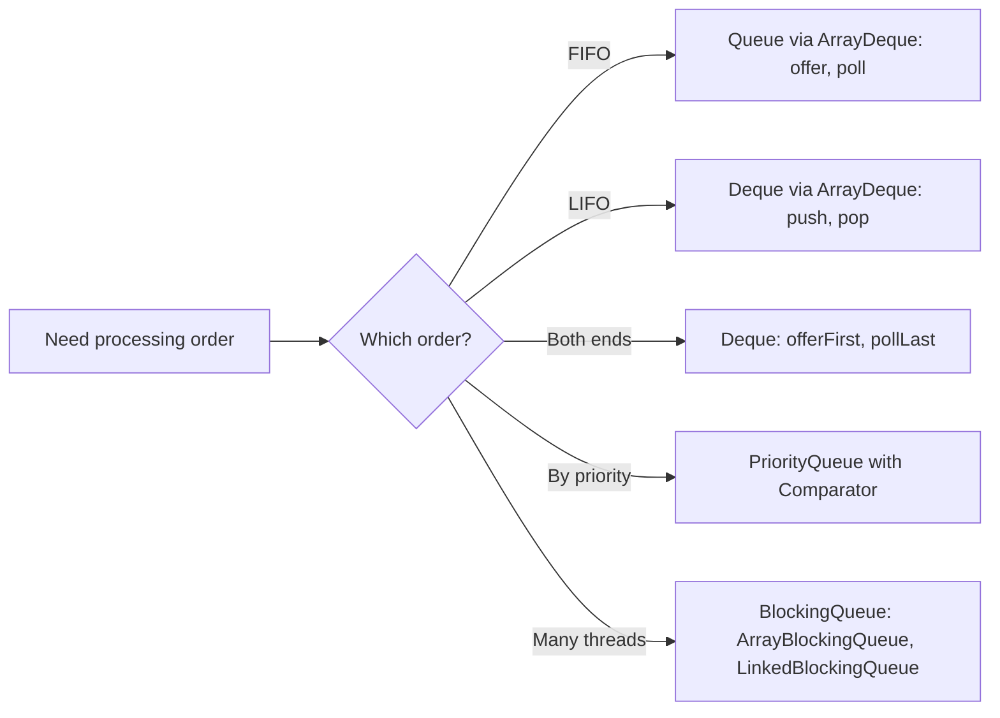

@@ 3 | TOPIC | HashMap, LinkedHashMap and TreeMap | Key-value storage, ordering guarantees, null rules, the modern Map API and navigable key queries | MUST
# HashMap, LinkedHashMap and TreeMap

**Level: Beginner | Phase 4 | Priority: MUST | Since: Java 1.2 (LinkedHashMap Java 1.4, NavigableMap Java 6, merge/compute Java 8, SequencedMap Java 21)**

> **30-second interview answer:** A `Map` stores unique keys, each mapped to one value. `HashMap` uses an array of buckets chosen by the key's `hashCode`, giving O(1) average `get` and `put` with no ordering guarantee; it allows one null key. `LinkedHashMap` is a `HashMap` plus a doubly linked list through the entries, so it iterates in insertion order (or access order, which makes it a simple LRU cache). `TreeMap` is a red-black tree that keeps keys sorted, costs O(log n) per operation, rejects null keys with natural ordering, and offers navigation like `floorKey`, `ceilingEntry`, `headMap` and `firstKey`. Pick HashMap by default, LinkedHashMap for predictable order, TreeMap for sorted keys or range queries.

## 1. Concept in Simple Words
### Analogy
Three ways to run a coat check.

| Coat check | Map |
|---|---|
| You hand over a coat and get ticket number 42 | `put(key, value)`: the ticket is the key, the coat the value |
| Each ticket number is used once; a new coat on the same ticket replaces the old one | Keys are unique; `put` on an existing key replaces the value and returns the old one |
| Attendant hashes the ticket number to pick one of 16 hooks: very fast, hooks in no particular order | `HashMap` |
| Same hooks, plus a logbook listing tickets in the order coats arrived | `LinkedHashMap` |
| Coats hung strictly by ticket number along one long rail; you can ask "the nearest ticket below 50" | `TreeMap` |
| Two tickets landing on the same hook share it | Hash collision, stored in the same bucket |

### What it is
- **Map:** an object that maps keys to values. A key appears at most once. `Map` is not a `Collection`; it gives you three collection views: `keySet()`, `values()`, `entrySet()`.
- **Entry:** one key-value pair, `Map.Entry<K, V>`, with `getKey()`, `getValue()` and `setValue()`.
- **Hashing:** turning the key into an int with `hashCode()`, then into a bucket index. Two keys are the same key when `equals` returns true, so keys need a correct `equals` and `hashCode` (Phase 2).
- **Natural ordering:** the order defined by the key's `compareTo` (`Comparable`); a `TreeMap` can use a `Comparator` instead.

| | HashMap | LinkedHashMap | TreeMap |
|---|---|---|---|
| Structure | Array of buckets (lists or small trees) | HashMap plus doubly linked list of entries | Red-black tree |
| Iteration order | None (do not rely on it) | Insertion order, or access order | Sorted by key |
| get, put, remove | O(1) average | O(1) average | O(log n) |
| Null key | One allowed | One allowed | Not with natural ordering |
| Null values | Allowed | Allowed | Allowed |
| Key requirement | `equals` + `hashCode` | `equals` + `hashCode` | `Comparable` or a `Comparator` |
| Extra API | - | `removeEldestEntry`, sequenced methods | `NavigableMap`: `floorKey`, `ceilingKey`, `headMap`, `tailMap`, `subMap`, `firstEntry`, `pollFirstEntry`, `descendingMap` |

### Why it exists
Programs constantly look things up by an identifier: user by email, product by SKU, count by word. Scanning a list is O(n); a map makes it O(1) or O(log n). The three implementations exist because sometimes you also need order (to print a report in a stable order, or to build a cache) or sorting (to answer "which price band does 85 fall into?").

## 2. How It Works
```text
HashMap (capacity 16)
  put("fox", 1):
    h = "fox".hashCode()            -> spread bits: h ^ (h >>> 16)
    index = h & (16 - 1)            -> e.g. 5
    bucket[5] empty -> store Node(hash, "fox", 1, next=null)
  put("dog", 1) lands on index 5 too (collision):
    walk bucket 5: hash equal and equals("dog")?  no -> append Node   (list becomes a tree after 8 nodes, Java 8)
  size > capacity * 0.75 (load factor) -> resize to 32 and redistribute

LinkedHashMap: same buckets, plus  head <-> [the] <-> [quick] <-> [fox] <-> tail
               iteration walks the linked list, not the buckets

TreeMap:                 lazy
                       /      \
                    fox        quick
                   /   \           \
                 dog   jumps        the
  get("over"): compare with each node from the root, go left or right: O(log n)
```

How `get(key)` finds the value in a `HashMap`, step by step:
1. Compute `key.hashCode()` and spread the bits.
2. Pick the bucket with `hash & (capacity - 1)`.
3. Walk the bucket comparing the stored hash first (cheap), then `equals`.
4. Return the value, or `null` if no key matches.

This is why a key whose `hashCode` changes after insertion is "lost": step 2 now picks a different bucket. The full internals (resizing, treeification, the spreading function) are in [[HashMap Internals]] (Phase 8).

**The modern Map API (Java 8+)** replaces many "check then put" patterns:

| Method | What it does |
|---|---|
| `getOrDefault(k, d)` | Value or a default when the key is absent |
| `putIfAbsent(k, v)` | Put only if absent; returns the existing value or null |
| `merge(k, v, fn)` | If absent put v, else put `fn(old, v)`; perfect for counting |
| `computeIfAbsent(k, fn)` | If absent compute and store `fn(k)`; perfect for "map of lists" |
| `computeIfPresent(k, fn)` | Recompute only if present; returning null removes the key |
| `compute(k, fn)` | Always recompute from key and old value |
| `forEach((k, v) -> ...)` | Iterate pairs |
| `replaceAll((k, v) -> ...)` | Transform every value |

## 3. Code Example
### Code
```java
import java.util.ArrayList;
import java.util.HashMap;
import java.util.LinkedHashMap;
import java.util.List;
import java.util.Map;
import java.util.NavigableMap;
import java.util.SequencedMap;
import java.util.TreeMap;

public class MapsDemo {
    public static void main(String[] args) {
        String text = "the quick fox jumps over the lazy dog the end";
        String[] words = text.split(" ");

        // 1. Counting with merge (HashMap: fastest, order not guaranteed)
        Map<String, Integer> counts = new HashMap<>();
        for (String w : words) counts.merge(w, 1, Integer::sum);
        System.out.println("count(the)      : " + counts.get("the"));
        System.out.println("count(cat)      : " + counts.get("cat") + ", default " + counts.getOrDefault("cat", 0));
        System.out.println("distinct words  : " + counts.size());

        // 2. Same data, two predictable orders
        SequencedMap<String, Integer> linked = new LinkedHashMap<>();
        Map<String, Integer> sorted = new TreeMap<>();
        for (String w : words) {
            linked.merge(w, 1, Integer::sum);
            sorted.merge(w, 1, Integer::sum);
        }
        System.out.println("LinkedHashMap   : " + linked);
        System.out.println("TreeMap         : " + sorted);

        // 3. put returns the old value; putIfAbsent keeps the existing one
        Map<String, String> capitals = new HashMap<>();
        System.out.println("put new         : " + capitals.put("France", "Lyon"));
        System.out.println("put replace     : " + capitals.put("France", "Paris"));
        System.out.println("putIfAbsent     : " + capitals.putIfAbsent("France", "Nice"));
        System.out.println("France          : " + capitals.get("France"));

        // 4. computeIfAbsent builds a "map of lists" (a multimap)
        Map<String, List<String>> byLetter = new TreeMap<>();
        for (String fruit : List.of("apple", "avocado", "banana", "blueberry", "cherry")) {
            byLetter.computeIfAbsent(fruit.substring(0, 1), k -> new ArrayList<>()).add(fruit);
        }
        System.out.println("grouped         : " + byLetter);

        // 5. Iterate entries (key and value together, no second lookup)
        StringBuilder sb = new StringBuilder();
        for (Map.Entry<String, List<String>> e : byLetter.entrySet()) {
            sb.append(e.getKey()).append(':').append(e.getValue().size()).append(' ');
        }
        System.out.println("entrySet        : " + sb.toString().trim());

        // 6. TreeMap navigation: grade bands
        NavigableMap<Integer, String> grades = new TreeMap<>(Map.of(90, "A", 80, "B", 70, "C", 60, "D", 0, "F"));
        System.out.println("grade for 85    : " + grades.floorEntry(85).getValue());
        System.out.println("grade for 60    : " + grades.floorEntry(60).getValue());
        System.out.println("first/last key  : " + grades.firstKey() + "/" + grades.lastKey());
        System.out.println("headMap(70)     : " + grades.headMap(70));
        System.out.println("descending      : " + grades.descendingMap());

        // 7. LinkedHashMap in access order with a size limit = LRU cache
        Map<String, Integer> lru = new LinkedHashMap<>(16, 0.75f, true) {
            @Override
            protected boolean removeEldestEntry(Map.Entry<String, Integer> eldest) {
                return size() > 3;
            }
        };
        lru.put("a", 1);
        lru.put("b", 2);
        lru.put("c", 3);
        lru.get("a");        // "a" becomes the most recently used
        lru.put("d", 4);     // over capacity: evicts the least recently used, "b"
        System.out.println("LRU keys        : " + lru.keySet());

        // 8. Null keys: HashMap allows one, TreeMap (natural order) does not
        Map<String, Integer> withNull = new HashMap<>();
        withNull.put(null, 0);
        System.out.println("HashMap null key: " + withNull.get(null));
        try {
            new TreeMap<String, Integer>().put(null, 0);
        } catch (NullPointerException e) {
            System.out.println("TreeMap null key: NullPointerException");
        }

        // 9. Java 21 SequencedMap methods
        System.out.println("first/last entry: " + linked.firstEntry() + " / " + linked.lastEntry());
    }
}
```

### Walkthrough
- **Part 1:** `merge(w, 1, Integer::sum)` means "put 1 if absent, otherwise add 1 to the old value". `get` on a missing key returns `null`, which is why `getOrDefault` exists. "the" appears three times; there are 8 distinct words.
- **Part 2:** the same counting into a `LinkedHashMap` keeps first-seen order; the `TreeMap` sorts keys alphabetically. The variable type `SequencedMap` (Java 21) gives access to `firstEntry` and `lastEntry` in part 9.
- **Part 3:** `put` returns the previous value (`null` the first time, then "Lyon"). `putIfAbsent` does nothing because "France" exists, and returns the current value "Paris".
- **Part 4:** `computeIfAbsent` creates the list only the first time a letter appears, then `.add` appends to the list stored in the map. This replaces five lines of `if (!map.containsKey(k)) map.put(k, new ArrayList<>())`.
- **Part 5:** iterating `entrySet()` gives both key and value; iterating `keySet()` and calling `get` would do a second lookup per key.
- **Part 6:** `floorEntry(85)` returns the entry with the greatest key less than or equal to 85, which is 80 → "B". `headMap(70)` is all keys strictly below 70. These are O(log n) and impossible with a `HashMap`.
- **Part 7:** the three-argument constructor with `true` switches to access order: every `get` moves the entry to the end. `removeEldestEntry` runs after each `put`; returning true removes the head (the least recently used).
- **Part 8:** `HashMap` stores the null key in bucket 0. `TreeMap` must call `compareTo` on the key, so a null key throws `NullPointerException`.
- **Part 9:** `firstEntry` and `lastEntry` come from `SequencedMap`; an `Entry` prints as `key=value`.

### Output
```text
count(the)      : 3
count(cat)      : null, default 0
distinct words  : 8
LinkedHashMap   : {the=3, quick=1, fox=1, jumps=1, over=1, lazy=1, dog=1, end=1}
TreeMap         : {dog=1, end=1, fox=1, jumps=1, lazy=1, over=1, quick=1, the=3}
put new         : null
put replace     : Lyon
putIfAbsent     : Paris
France          : Paris
grouped         : {a=[apple, avocado], b=[banana, blueberry], c=[cherry]}
entrySet        : a:2 b:2 c:1
grade for 85    : B
grade for 60    : D
first/last key  : 0/90
headMap(70)     : {0=F, 60=D}
descending      : {90=A, 80=B, 70=C, 60=D, 0=F}
LRU keys        : [c, a, d]
HashMap null key: 0
TreeMap null key: NullPointerException
first/last entry: the=3 / end=1
```

### Compare
The old "check then act" way versus the modern Map API:

| Task | Old way (Java 7) | Modern way (Java 8+) |
|---|---|---|
| Count words | `Integer c = m.get(w); m.put(w, c == null ? 1 : c + 1);` | `m.merge(w, 1, Integer::sum);` |
| Map of lists | `if (!m.containsKey(k)) m.put(k, new ArrayList<>()); m.get(k).add(v);` | `m.computeIfAbsent(k, x -> new ArrayList<>()).add(v);` |
| Default value | `m.containsKey(k) ? m.get(k) : 0` | `m.getOrDefault(k, 0)` |
| Iterate pairs | `for (K k : m.keySet()) use(k, m.get(k));` | `m.forEach((k, v) -> use(k, v));` |

## 4. Interview Questions
**Basic**
1. **HashMap vs LinkedHashMap vs TreeMap?**
   All three map unique keys to values. HashMap is a hash table with O(1) average operations and no order. LinkedHashMap adds a linked list for insertion or access order at almost the same speed. TreeMap is a red-black tree with sorted keys and O(log n) operations plus navigation methods.
2. **Can a HashMap have null keys and values?**
   Yes: one null key and any number of null values. `TreeMap` with natural ordering throws `NullPointerException` for a null key, and `Map.of` and `ConcurrentHashMap` reject nulls entirely.
3. **What does `put` return?**
   The previous value for that key, or `null` if the key was absent (or was mapped to null). This lets you detect overwrites without a separate `containsKey` call.

**Follow-up**
4. **Why must keys implement `equals` and `hashCode` consistently?**
   `hashCode` picks the bucket and `equals` confirms the match inside it. If equal keys had different hash codes, they would land in different buckets and the map would store "duplicates" and fail lookups.
5. **What happens if you mutate a key after putting it in a HashMap?**
   Its hash code changes, so `get` searches the wrong bucket and returns null even though the entry is still inside. Use immutable keys such as `String`, `Integer`, records or enums.
6. **How do you build an LRU cache with the JDK?**
   Extend `LinkedHashMap` with the constructor `(capacity, 0.75f, true)` for access order and override `removeEldestEntry` to return `size() > max`. It is not thread-safe; wrap it or use a caching library for concurrent use.
7. **How do you iterate a map efficiently?**
   Over `entrySet()` (or `forEach`) to get key and value together. Iterating `keySet()` and calling `get` costs an extra lookup per key, which matters for a TreeMap (O(log n) each).

**Tricky / scenario**
8. **You print a HashMap in a unit test and it passes locally but fails on CI. Why?**
   HashMap iteration order depends on hash codes, capacity and JDK version, so it is not a contract. Compare maps with `assertEquals(expectedMap, actual)` (map equality ignores order) or use a LinkedHashMap or TreeMap when order matters.
9. **A `TreeMap<String, Integer>` built with `String.CASE_INSENSITIVE_ORDER` gets `put("Java", 1)` then `put("JAVA", 2)`. What is in it?**
   One entry, `{Java=2}`. The comparator says the keys are equal (compare returns 0), so the value is replaced but the original key object stays.
10. **You need to find which tax band an income falls into among 10 thresholds, millions of times a second. What do you use?**
    A `TreeMap<BigDecimal, Band>` (or `NavigableMap`) and `floorEntry(income)`, which is O(log n) and needs no loop over the thresholds.

**What the interviewer is really testing:** whether you can tie each map to its data structure, explain why keys need `equals`/`hashCode` or `compareTo`, and use the modern API instead of clumsy check-then-put code.

## 5. Pitfalls & Best Practices
### Common mistakes
| Mistake | What goes wrong | Fix |
|---|---|---|
| Mutable object as a key, then changing it | Entry becomes unreachable, memory leak | Immutable keys (String, records, enums) |
| `map.get(k) + 1` when the key may be missing | `NullPointerException` on unboxing | `merge` or `getOrDefault` |
| `containsKey` then `get` then `put` | Three lookups, and a race under concurrency | `merge`, `compute`, `computeIfAbsent` |
| Relying on HashMap order in output or tests | Flaky tests, order changes across JDKs | LinkedHashMap or TreeMap, or compare as maps |
| Comparator inconsistent with equals in a TreeMap | Distinct keys silently merged | Add tie-breakers with `thenComparing` |
| Modifying the map while iterating `keySet()` | `ConcurrentModificationException` | `entrySet().removeIf(...)` or an iterator |

### Best practices
- Default to `HashMap`; choose `LinkedHashMap` when output order matters (JSON responses, reports) and `TreeMap` when keys must be sorted or you need range queries.
- Pre-size when you know the number of entries: `HashMap.newHashMap(1_000)` (Java 19) sizes for 1,000 entries without resizing; `new HashMap<>(1_000)` sets capacity, not expected size.
- Use `EnumMap` when keys are enum constants: an array inside, faster and ordered.
- For concurrency use `ConcurrentHashMap`, never a plain `HashMap` shared between threads (Phase 8).
- Use `Map.of` and `Map.copyOf` for fixed lookup tables (immutable, null-hostile, fail on duplicate keys).

### Compare with
| | HashMap | Hashtable | ConcurrentHashMap | TreeMap |
|---|---|---|---|---|
| Thread-safe | No | Yes (locks every method) | Yes (fine-grained, CAS) | No |
| Null key or values | Yes | No | No | Values only |
| Order | None | None | None | Sorted |
| Use today | Default | Never (legacy) | Shared between threads | Sorted keys |

## 6. Hands-on Exercise
You receive order lines as strings `"customer,product,quantity"`: `"ann,pen,2"`, `"bob,book,1"`, `"ann,book,3"`, `"cid,pen,5"`, `"bob,pen,1"`. Write a program that prints:
1. Total quantity per customer, in the order customers first appear.
2. The set of products per customer, customers sorted alphabetically.
3. The product with the highest total quantity.
4. For a quantity band table `{1=SMALL, 3=MEDIUM, 5=LARGE}`, the band of each line (use `floorEntry`).

Acceptance criteria: use `merge` for totals, `computeIfAbsent` for grouping, and no `containsKey` calls.

<details><summary>Solution</summary>

```java
import java.util.*;

public class OrderLines {
    public static void main(String[] args) {
        List<String> lines = List.of("ann,pen,2", "bob,book,1", "ann,book,3", "cid,pen,5", "bob,pen,1");

        Map<String, Integer> perCustomer = new LinkedHashMap<>();
        Map<String, Set<String>> productsByCustomer = new TreeMap<>();
        Map<String, Integer> perProduct = new HashMap<>();
        NavigableMap<Integer, String> bands = new TreeMap<>(Map.of(1, "SMALL", 3, "MEDIUM", 5, "LARGE"));

        for (String line : lines) {
            String[] p = line.split(",");
            String customer = p[0], product = p[1];
            int qty = Integer.parseInt(p[2]);
            perCustomer.merge(customer, qty, Integer::sum);
            productsByCustomer.computeIfAbsent(customer, k -> new TreeSet<>()).add(product);
            perProduct.merge(product, qty, Integer::sum);
            System.out.println(line + " -> " + bands.floorEntry(qty).getValue());
        }

        System.out.println(perCustomer);          // {ann=5, bob=2, cid=5}
        System.out.println(productsByCustomer);   // {ann=[book, pen], bob=[book, pen], cid=[pen]}

        String best = null;
        int bestQty = -1;
        for (Map.Entry<String, Integer> e : perProduct.entrySet()) {
            if (e.getValue() > bestQty) { best = e.getKey(); bestQty = e.getValue(); }
        }
        System.out.println(best + "=" + bestQty); // pen=8
    }
}
```
The band lines print `ann,pen,2 -> SMALL`, `bob,book,1 -> SMALL`, `ann,book,3 -> MEDIUM`, `cid,pen,5 -> LARGE`, `bob,pen,1 -> SMALL`. `floorEntry(2)` finds key 1 because 2 is between 1 and 3.
</details>

## 7. Recall
Q: Which Map implementation keeps keys sorted, and what is its time complexity?
A: `TreeMap`, a red-black tree with O(log n) get, put and remove.

Q: How many null keys does a `HashMap` allow?
A: One (any number of null values).

Q: What does `map.merge(key, 1, Integer::sum)` do?
A: Puts 1 if the key is absent, otherwise replaces the value with old + 1.

Q: How do you turn a `LinkedHashMap` into an LRU cache?
A: Use the constructor with `accessOrder = true` and override `removeEldestEntry` to return `size() > max`.

Q: What does `TreeMap.floorEntry(k)` return?
A: The entry with the greatest key less than or equal to k, or null if none.

Q: Why is a mutable `HashMap` key dangerous?
A: Changing it changes its hash code, so lookups search the wrong bucket and the entry is lost.

**Related:** [[HashSet, LinkedHashSet and TreeSet]] · [[HashMap Internals]] · [[LinkedHashMap and LRU Cache]] · [[equals() and hashCode() Contract]]

@@ 3 | TOPIC | Queue, Deque and PriorityQueue | FIFO queues, stacks with ArrayDeque, the throw vs return-null methods and heap-based priority ordering | MUST
# Queue, Deque and PriorityQueue

**Level: Beginner | Phase 4 | Priority: MUST | Since: Java 5 (Queue, PriorityQueue), Java 6 (Deque, ArrayDeque), Java 21 (SequencedCollection)**

> **30-second interview answer:** A `Queue` holds elements for processing, usually first-in-first-out: `offer` adds at the tail, `poll` removes from the head, `peek` looks at the head. Each operation has two forms: one that throws (`add`, `remove`, `element`) and one that returns a special value (`offer`, `poll`, `peek`). A `Deque` (double-ended queue) adds and removes at both ends, so it works as a queue or a stack; `ArrayDeque` is the recommended implementation for both and replaces `Stack` and `LinkedList`. `PriorityQueue` is a binary min-heap: `poll` always returns the smallest element by natural order or a `Comparator`, in O(log n), but iteration order is not sorted.

## 1. Concept in Simple Words
### Analogy
Three kinds of lines.

| Real world | Java |
|---|---|
| The line at a bakery: join at the back, served from the front | `Queue` (FIFO) with `offer` and `poll` |
| A stack of plates: put on top, take from top | `Deque` used as a stack: `push` and `pop` |
| A train platform with doors at both ends | `Deque`: `offerFirst`, `offerLast`, `pollFirst`, `pollLast` |
| Hospital emergency room: most urgent patient first, not first arrival | `PriorityQueue` |
| Triage nurse who only guarantees who is next, not the full order | Heap: the head is the minimum, the rest is only partly ordered |
| "Is anyone waiting?" without calling them in | `peek` |

### What it is
- **Queue:** interface for holding elements before processing. Most queues are FIFO (first in, first out); `PriorityQueue` orders by priority instead.
- **Deque** (pronounced "deck"): a double-ended queue. Used from one end it is a stack (LIFO, last in first out); from both ends it is a queue.
- **ArrayDeque:** a resizable circular array. O(1) at both ends, no index access, no nulls, not thread-safe.
- **PriorityQueue:** a binary heap stored in an array. The smallest element (by `compareTo` or a `Comparator`) is always at index 0.
- **Heap:** a complete binary tree where every parent is less than or equal to its children. The minimum is at the root, but siblings are not sorted.

The two method families:

| Operation | Throws an exception on failure | Returns a special value |
|---|---|---|
| Insert at tail | `add(e)` (`IllegalStateException` if full) | `offer(e)` returns false if full |
| Remove head | `remove()` (`NoSuchElementException` if empty) | `poll()` returns null if empty |
| Look at head | `element()` (`NoSuchElementException` if empty) | `peek()` returns null if empty |

Deque stack methods: `push(e)` = `addFirst(e)`, `pop()` = `removeFirst()`, `peek()` = `peekFirst()`.

### Why it exists
Many problems are about order of processing: print jobs, breadth-first search, undo history, task scheduling, "top k" questions, rate limiting windows. Before Java 5 people used `Vector`-based `Stack` (synchronized, odd API, extends `Vector` so you can insert in the middle of a "stack") or hand-rolled lists. The queue interfaces give a clear contract, and `ArrayDeque` and `PriorityQueue` give efficient implementations.

## 2. How It Works
```text
ArrayDeque: circular array, head and tail indexes wrap around
  capacity 8:  [ _ | _ | C | D | E | _ | _ | _ ]
                       head      tail
  offerLast(F): write at tail, tail++              -> O(1)
  offerFirst(B): head-- (wraps to index 7 if 0)    -> O(1)
  full -> double the array and copy

PriorityQueue (min-heap) of 1, 2, 3, 5, 8 stored in an array:
  array: [1, 2, 8, 5, 3]          tree view:        1
                                                   /  \
  parent of i = (i - 1) / 2                       2    8
  children of i = 2i + 1, 2i + 2                 / \
                                                5   3
  offer(e): put at the end, "sift up" while smaller than parent   O(log n)
  poll():   take root, move last element to root, "sift down"     O(log n)
  peek():   array[0]                                              O(1)
  toString / iterator: array order [1, 2, 8, 5, 3], NOT sorted
```



## 3. Code Example
### Code
```java
import java.util.ArrayDeque;
import java.util.ArrayList;
import java.util.Collections;
import java.util.Comparator;
import java.util.Deque;
import java.util.List;
import java.util.NoSuchElementException;
import java.util.PriorityQueue;
import java.util.Queue;

public class QueuesDemo {
    record Task(String name, int priority) { }

    static <T> List<T> drain(Queue<T> q) {
        List<T> out = new ArrayList<>();
        while (!q.isEmpty()) out.add(q.poll());
        return out;
    }

    public static void main(String[] args) {
        // 1. FIFO queue: offer at the tail, poll from the head
        Queue<String> line = new ArrayDeque<>();
        line.offer("Ann");
        line.offer("Bob");
        line.offer("Cid");
        System.out.println("peek            : " + line.peek());
        System.out.println("poll            : " + line.poll() + ", left " + line);

        // 2. Empty queue: poll returns null, remove throws
        Queue<String> empty = new ArrayDeque<>();
        System.out.println("poll on empty   : " + empty.poll());
        try {
            empty.remove();
        } catch (NoSuchElementException e) {
            System.out.println("remove on empty : NoSuchElementException");
        }

        // 3. Deque as a stack (LIFO)
        Deque<Integer> stack = new ArrayDeque<>();
        stack.push(1);
        stack.push(2);
        stack.push(3);
        System.out.println("stack           : " + stack + ", pop " + stack.pop());

        // 4. Deque used from both ends
        Deque<String> d = new ArrayDeque<>();
        d.offerFirst("b");
        d.offerFirst("a");
        d.offerLast("c");
        System.out.println("deque           : " + d + " first=" + d.peekFirst() + " last=" + d.peekLast());

        // 5. PriorityQueue: min-heap by default, max-heap with reverseOrder
        PriorityQueue<Integer> minHeap = new PriorityQueue<>(List.of(5, 1, 8, 3, 2));
        System.out.println("min-heap polls  : " + drain(minHeap));
        PriorityQueue<Integer> maxHeap = new PriorityQueue<>(Comparator.reverseOrder());
        maxHeap.addAll(List.of(5, 1, 8, 3, 2));
        System.out.println("max-heap polls  : " + drain(maxHeap));

        // 6. Custom objects: lowest priority number first, then by name
        PriorityQueue<Task> tasks = new PriorityQueue<>(
                Comparator.comparingInt(Task::priority).thenComparing(Task::name));
        tasks.add(new Task("email", 3));
        tasks.add(new Task("deploy", 1));
        tasks.add(new Task("backup", 2));
        tasks.add(new Task("alert", 1));
        StringBuilder order = new StringBuilder();
        while (!tasks.isEmpty()) order.append(tasks.poll().name()).append(' ');
        System.out.println("tasks by prio   : " + order.toString().trim());

        // 7. Top 3 largest scores with a min-heap of size 3: O(n log 3)
        int[] scores = {42, 17, 99, 63, 8, 75, 51};
        PriorityQueue<Integer> top = new PriorityQueue<>();
        for (int s : scores) {
            top.offer(s);
            if (top.size() > 3) top.poll();          // drop the smallest of the four
        }
        List<Integer> top3 = new ArrayList<>(top);
        top3.sort(Collections.reverseOrder());
        System.out.println("top 3           : " + top3);

        // 8. ArrayDeque rejects null (null is its "empty" signal for poll)
        try {
            new ArrayDeque<String>().offer(null);
        } catch (NullPointerException e) {
            System.out.println("ArrayDeque null : NullPointerException");
        }
    }
}
```

### Walkthrough
- **Part 1:** `peek` shows "Ann" without removing; `poll` removes "Ann", so the queue prints `[Bob, Cid]`. String concatenation evaluates left to right, so `poll()` runs before `line` is printed.
- **Part 2:** this is the throw versus return-null pair. Use `poll`, `peek` and `offer` when empty or full is a normal situation; use `remove` and `element` when empty would be a bug.
- **Part 3:** `push` adds at the head, so iteration (and `toString`) shows `[3, 2, 1]`, top first. `pop` then removes 3.
- **Part 4:** `offerFirst` and `offerLast` work at opposite ends, giving `[a, b, c]`.
- **Part 5:** each `poll` removes the current minimum, so draining a heap yields sorted order: 1, 2, 3, 5, 8. With `Comparator.reverseOrder()` the head is the maximum.
- **Part 6:** the comparator orders by priority number, then by name to break ties, so "alert" comes before "deploy" (both priority 1).
- **Part 7:** the classic "top k" trick: keep a min-heap of size k; whenever it grows past k, remove the smallest. What remains are the k largest. The heap's own order is not sorted, so we copy and sort for printing.
- **Part 8:** `ArrayDeque` uses null internally to mean "no element", so it forbids storing null. `LinkedList` allows nulls, which makes `poll() == null` ambiguous.

### Output
```text
peek            : Ann
poll            : Ann, left [Bob, Cid]
poll on empty   : null
remove on empty : NoSuchElementException
stack           : [3, 2, 1], pop 3
deque           : [a, b, c] first=a last=c
min-heap polls  : [1, 2, 3, 5, 8]
max-heap polls  : [8, 5, 3, 2, 1]
tasks by prio   : alert deploy backup email
top 3           : [99, 75, 63]
ArrayDeque null : NullPointerException
```

### Compare
| | `Stack` (legacy) | `LinkedList` | `ArrayDeque` | `PriorityQueue` |
|---|---|---|---|---|
| Order | LIFO | FIFO or LIFO | FIFO or LIFO | Smallest first |
| Backed by | Synchronized `Vector` | Linked nodes | Circular array | Binary heap array |
| Ends O(1) | Top only | Yes | Yes | Head peek O(1), poll O(log n) |
| Nulls | Allowed | Allowed | Not allowed | Not allowed |
| Verdict | Avoid | Only if you need `List` too | Default queue and stack | Priority, scheduling, top k |

## 4. Interview Questions
**Basic**
1. **What is the difference between `offer`/`poll`/`peek` and `add`/`remove`/`element`?**
   They do the same job, but the first group returns a special value (false or null) on failure while the second throws (`IllegalStateException` or `NoSuchElementException`). Use the returning forms when an empty or full queue is a normal condition.
2. **Queue vs Deque?**
   A Queue normally inserts at the tail and removes at the head. A Deque supports insertion and removal at both ends, so it can act as a FIFO queue or a LIFO stack.
3. **How does PriorityQueue order its elements?**
   By natural ordering (`Comparable`) or a `Comparator` given to the constructor; the head is always the smallest element. It is a binary min-heap, so `offer` and `poll` are O(log n) and `peek` is O(1).

**Follow-up**
4. **Why is `ArrayDeque` preferred over `Stack` and `LinkedList`?**
   `Stack` extends the synchronized `Vector`, paying locking costs and exposing index methods that break the stack idea. `LinkedList` allocates a node per element and has poor cache locality. `ArrayDeque` is a compact circular array with O(1) operations at both ends.
5. **If you iterate or print a PriorityQueue, is the output sorted?**
   No. Iteration follows the internal heap array, which only guarantees parent less than or equal to child. To get sorted order, `poll` repeatedly or copy to a list and sort.
6. **How do you make a max-heap in Java?**
   Pass a reversing comparator: `new PriorityQueue<>(Comparator.reverseOrder())`, or `Comparator.comparing(Task::priority).reversed()` for objects.

**Tricky / scenario**
7. **Find the k largest elements of a stream of millions of numbers with limited memory.**
   Keep a min-heap of size k; for each number, offer it and poll if the size exceeds k. Memory is O(k) and time O(n log k). At the end the heap holds the k largest, with the smallest of them at the head.
8. **Why does `ArrayDeque` throw on `offer(null)`?**
   `poll` and `peek` return null to signal "empty", and the implementation uses null slots internally. Allowing null elements would make that signal ambiguous.
9. **Several threads produce jobs and several consume them. Is ArrayDeque fine?**
   No; it is not thread-safe and has no way to wait for elements. Use a `BlockingQueue` such as `ArrayBlockingQueue` or `LinkedBlockingQueue` with `put` and `take`, which block when full or empty (Phase 9).

**What the interviewer is really testing:** whether you pick `ArrayDeque` over legacy classes, understand heap behaviour (head is ordered, the rest is not), and can apply a heap to "top k" problems.

## 5. Pitfalls & Best Practices
### Common mistakes
| Mistake | What goes wrong | Fix |
|---|---|---|
| Using `Stack` or `Vector` | Synchronization overhead, can insert in the middle | `Deque<T> stack = new ArrayDeque<>()` |
| Printing a PriorityQueue expecting sorted output | Heap order looks random | `poll` in a loop, or sort a copy |
| Calling `remove()` on a possibly empty queue | `NoSuchElementException` | `poll()` and check for null |
| Comparator `(a, b) -> a.priority - b.priority` | Integer overflow for large values | `Comparator.comparingInt(Task::priority)` |
| Changing an element's priority field while it is in the heap | Heap order is broken, wrong element polled | Remove, update, re-insert (or use immutable elements) |
| Sharing ArrayDeque between threads | Lost or duplicated elements | `BlockingQueue` or `ConcurrentLinkedQueue` |

### Best practices
- Declare by the interface you use: `Queue<T>` for FIFO, `Deque<T>` for stacks and both-end use.
- Use `ArrayDeque` for BFS, sliding windows, undo stacks and bracket matching.
- Use `PriorityQueue` for scheduling, merging k sorted lists, Dijkstra and top-k problems; give it a `Comparator` built with `Comparator.comparing` and `thenComparing`.
- Pass an initial capacity for large queues to avoid repeated growth.
- Note that `PriorityQueue.remove(Object)` and `contains` are O(n), because the heap is not searchable.

### Compare with
| Need | Pick |
|---|---|
| Single-threaded FIFO | `ArrayDeque` |
| Stack | `ArrayDeque` with `push` and `pop` |
| Priority order | `PriorityQueue` |
| Producer-consumer between threads | `ArrayBlockingQueue` or `LinkedBlockingQueue` |
| Non-blocking concurrent queue | `ConcurrentLinkedQueue` |
| Delayed jobs | `DelayQueue` |

## 6. Hands-on Exercise
Build a tiny support-ticket desk:
1. Tickets are records `Ticket(int id, String severity, String title)` where severity is `HIGH`, `MEDIUM` or `LOW`.
2. Process tickets so that HIGH comes before MEDIUM before LOW, and within the same severity the lower id (older) comes first.
3. Keep an "undo" stack of processed ticket ids and undo the last two.
4. Also write `static boolean balanced(String s)` that checks brackets `()[]{}` using a `Deque`.

Acceptance criteria: use `PriorityQueue` with a `Comparator`, `ArrayDeque` for both stacks, no `Stack` class, and print the processing order.

<details><summary>Solution</summary>

```java
import java.util.*;

public class TicketDesk {
    record Ticket(int id, String severity, String title) { }

    static int rank(String severity) {
        return switch (severity) {
            case "HIGH" -> 0;
            case "MEDIUM" -> 1;
            default -> 2;
        };
    }

    static boolean balanced(String s) {
        Deque<Character> stack = new ArrayDeque<>();
        for (char c : s.toCharArray()) {
            switch (c) {
                case '(' -> stack.push(')');
                case '[' -> stack.push(']');
                case '{' -> stack.push('}');
                case ')', ']', '}' -> {
                    if (stack.isEmpty() || stack.pop() != c) return false;
                }
                default -> { }
            }
        }
        return stack.isEmpty();
    }

    public static void main(String[] args) {
        PriorityQueue<Ticket> desk = new PriorityQueue<>(
                Comparator.comparingInt((Ticket t) -> rank(t.severity())).thenComparingInt(Ticket::id));
        desk.add(new Ticket(4, "LOW", "Typo on page"));
        desk.add(new Ticket(2, "HIGH", "Checkout down"));
        desk.add(new Ticket(5, "HIGH", "Login slow"));
        desk.add(new Ticket(1, "MEDIUM", "Wrong invoice"));

        Deque<Integer> processed = new ArrayDeque<>();
        while (!desk.isEmpty()) {
            Ticket t = desk.poll();
            processed.push(t.id());
            System.out.println("processing " + t.id() + " " + t.severity());
        }
        // processing 2 HIGH, 5 HIGH, 1 MEDIUM, 4 LOW

        System.out.println("undo " + processed.pop());   // undo 4
        System.out.println("undo " + processed.pop());   // undo 1

        System.out.println(balanced("{[()]}"));  // true
        System.out.println(balanced("([)]"));    // false
    }
}
```
The lambda parameter type `(Ticket t)` is written out because `comparingInt(...).thenComparingInt(...)` cannot infer it from the chain alone.
</details>

## 7. Recall
Q: In a Java `Queue`, what is the difference between `poll()` and `remove()` on an empty queue?
A: `poll()` returns null; `remove()` throws `NoSuchElementException`.

Q: Which class should you use as a stack in modern Java?
A: `ArrayDeque`, with `push`, `pop` and `peek`.

Q: What data structure backs `PriorityQueue` and what are its costs?
A: A binary min-heap in an array: `offer` and `poll` O(log n), `peek` O(1).

Q: Is iterating a `PriorityQueue` sorted?
A: No; only the head is guaranteed to be the minimum.

Q: How do you get the k largest elements with a `PriorityQueue`?
A: Keep a min-heap of size k and poll whenever its size exceeds k.

Q: Why does `ArrayDeque` reject null elements?
A: Null is the "empty" signal returned by `poll` and `peek`, so storing null would be ambiguous.

**Related:** [[ArrayList vs LinkedList]] · [[Comparable vs Comparator]] · [[Concurrent Collections and BlockingQueue]]
