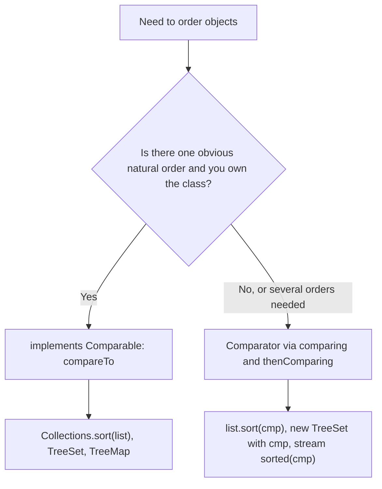
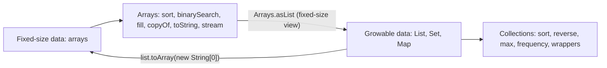

@@ 2 | MODULE | Working with collections | Iterating safely, sorting with Comparable and Comparator, utility classes and immutability | MUST
# Working with collections

**Shared analogy: running a library.** Knowing the furniture (lists, sets, maps) is not enough; you also need house rules. The **iterator** is the librarian walking the shelves, who gets confused if someone moves books mid-walk (fail-fast) unless she works from a photocopy of the catalogue (fail-safe). **Comparable** is the default shelving rule printed on every book ("by title"), while a **Comparator** is a temporary rule for one display ("by publication year"). **Collections** and **Arrays** are the toolbox in the back room: sort, search, fill, reverse. **Immutable collections** are the glass display case: visitors can look but not rearrange.

The four topics answer the questions that follow every "which collection?" question: how do I loop and remove safely, how do I sort by anything, which helpers save me code, and how do I hand a collection to someone without letting them change it.

@@ 3 | TOPIC | Iterator and Fail-Fast vs Fail-Safe | How iteration works, ConcurrentModificationException, safe removal and snapshot iterators | MUST
# Iterator and Fail-Fast vs Fail-Safe

**Level: Beginner | Phase 4 | Priority: MUST | Since: Java 1.2 (Iterator), Java 5 (for-each, concurrent collections), Java 8 (removeIf, forEach)**

> **30-second interview answer:** An `Iterator` walks a collection with `hasNext()` and `next()` and can safely delete the current element with `remove()`; the enhanced for loop uses one behind the scenes. Iterators of ordinary collections like `ArrayList` and `HashMap` are **fail-fast**: they keep a modification counter (`modCount`) and throw `ConcurrentModificationException` if the collection is structurally changed by anything other than the iterator itself. Iterators of concurrent collections are **fail-safe** (more precisely, snapshot or weakly consistent): `CopyOnWriteArrayList` iterates a copy and `ConcurrentHashMap` tolerates concurrent changes, so they never throw. To remove while looping, use `iterator.remove()` or `removeIf`.

## 1. Concept in Simple Words
### Analogy
A librarian doing a stock check, walking the shelves with a clipboard.

| Library | Java |
|---|---|
| Librarian walking shelf by shelf: "any more books? next book" | `hasNext()` and `next()` |
| She notes the shelf's "change counter" when she starts | Iterator copies `modCount` into `expectedModCount` |
| Someone else removes a book mid-walk; she notices the counter changed and stops with an alarm | Fail-fast: `ConcurrentModificationException` |
| She removes a damaged book herself and updates her own note | `iterator.remove()` keeps counts in sync |
| She works from a photocopy of the catalogue, so shelf changes do not disturb her | Fail-safe snapshot: `CopyOnWriteArrayList` |
| She walks a busy shelf that is being restocked and simply sees some new books, some not | Weakly consistent: `ConcurrentHashMap` |

### What it is
- **`Iterable<T>`:** anything that can produce an `Iterator`; implementing it makes a class usable in a for-each loop.
- **`Iterator<T>`:** `hasNext()`, `next()`, optional `remove()`, and `forEachRemaining(action)` (Java 8).
- **`ListIterator<T>`:** for lists; also walks backwards (`hasPrevious`, `previous`), gives indexes and supports `add` and `set`.
- **Structural modification:** a change in size (add, remove, clear). Replacing a value with `set` is not structural.
- **Fail-fast:** best-effort detection of concurrent modification by throwing `ConcurrentModificationException` (CME). It is a bug detector, not a thread-safety guarantee; it happens in single-threaded code too.
- **Fail-safe:** the term interviewers use for iterators that do not throw because they work on a snapshot (`CopyOnWriteArrayList`, `CopyOnWriteArraySet`) or are weakly consistent (`ConcurrentHashMap`, `ConcurrentLinkedQueue`). The JDK docs call them "snapshot" and "weakly consistent".

### Why it exists
Iterators give one uniform way to walk any collection without knowing its structure (array, linked nodes, hash buckets, tree). Fail-fast behaviour exists because silently continuing after a structural change can skip elements, visit elements twice or read stale array slots; failing loudly and early is safer than returning wrong results.

## 2. How It Works
What the compiler does with a for-each loop:
```java
// You write:
for (String n : names) { System.out.println(n); }

// The compiler generates:
for (Iterator<String> it = names.iterator(); it.hasNext(); ) {
    String n = it.next();
    System.out.println(n);
}
```

Inside `ArrayList`'s iterator:
```text
ArrayList fields:  elementData[], size, modCount (incremented by add, remove, clear)
Iterator fields:   cursor (next index), lastRet, expectedModCount = modCount at creation

next():   if (modCount != expectedModCount) throw ConcurrentModificationException
          return elementData[cursor++]
hasNext(): return cursor != size            <- no modCount check here!
it.remove(): ArrayList.remove(lastRet); cursor = lastRet; expectedModCount = modCount
```

```mermaid
sequenceDiagram
    participant Loop as "for-each loop"
    participant It as "Iterator"
    participant List as "ArrayList"
    Loop->>It: "hasNext()"
    It-->>Loop: "true"
    Loop->>It: "next()"
    It->>List: "check modCount == expected"
    It-->>Loop: "Bob"
    Loop->>List: "remove(Bob): modCount++"
    Loop->>It: "hasNext()"
    It-->>Loop: "true (cursor != size)"
    Loop->>It: "next()"
    It->>List: "modCount != expected"
    It-->>Loop: "throw ConcurrentModificationException"
```

**The famous trap:** because `hasNext()` only compares `cursor != size`, removing the second-to-last element makes `cursor == size`, the loop ends quietly, no exception is thrown, and the last element is never visited.

**Fail-safe internals:**
- `CopyOnWriteArrayList`: every write copies the whole array; an iterator holds a reference to the array that existed when it was created. It never throws, never sees later writes, and its `remove()` is unsupported.
- `ConcurrentHashMap`: iterators walk the live table without locking; they may or may not see changes made after creation, and never throw CME.

## 3. Code Example
### Code
```java
import java.util.ArrayList;
import java.util.ConcurrentModificationException;
import java.util.Iterator;
import java.util.List;
import java.util.ListIterator;
import java.util.Map;
import java.util.TreeMap;
import java.util.concurrent.ConcurrentHashMap;
import java.util.concurrent.CopyOnWriteArrayList;

public class IteratorDemo {
    public static void main(String[] args) {
        // 1. Explicit iterator
        List<String> names = new ArrayList<>(List.of("Ann", "Bob", "Cid", "Dan"));
        Iterator<String> it = names.iterator();
        StringBuilder sb = new StringBuilder();
        while (it.hasNext()) sb.append(it.next()).append(' ');
        System.out.println("iterated        : " + sb.toString().trim());

        // 2. Fail-fast: removing through the list inside for-each
        try {
            for (String n : names) {
                if (n.equals("Bob")) names.remove(n);
            }
        } catch (ConcurrentModificationException e) {
            System.out.println("for-each remove : ConcurrentModificationException");
        }

        // 3. The trap: removing the second-to-last element does NOT throw
        List<String> trap = new ArrayList<>(List.of("Ann", "Bob", "Cid"));
        for (String n : trap) {
            if (n.equals("Bob")) trap.remove(n);   // loop ends early, "Cid" never visited
        }
        System.out.println("no exception    : " + trap);

        // 4. Safe removal: Iterator.remove and removeIf
        List<String> safe = new ArrayList<>(List.of("Ann", "Bob", "Cid", "Dan"));
        Iterator<String> it2 = safe.iterator();
        while (it2.hasNext()) {
            if (it2.next().startsWith("B")) it2.remove();
        }
        System.out.println("iterator.remove : " + safe);
        safe.removeIf(n -> n.startsWith("D"));
        System.out.println("removeIf        : " + safe);

        // 5. Fail-safe snapshot: CopyOnWriteArrayList
        List<String> cow = new CopyOnWriteArrayList<>(List.of("a", "b", "c"));
        for (String s : cow) {
            if (s.equals("a")) cow.add("d");       // iterator keeps walking the old array
        }
        System.out.println("COW after loop  : " + cow);

        // 6. Weakly consistent: ConcurrentHashMap allows removal while iterating
        Map<String, Integer> chm = new ConcurrentHashMap<>(Map.of("x", 1, "y", 2, "z", 3));
        for (String k : chm.keySet()) {
            if (k.equals("y")) chm.remove(k);
        }
        System.out.println("CHM size        : " + chm.size());

        // 7. Removing map entries safely
        Map<String, Integer> stock = new TreeMap<>(Map.of("apple", 0, "pear", 4, "fig", 0));
        stock.entrySet().removeIf(e -> e.getValue() == 0);
        System.out.println("in stock        : " + stock);

        // 8. ListIterator walking backwards (names is [Ann, Cid, Dan] after part 2)
        ListIterator<String> li = names.listIterator(names.size());
        StringBuilder back = new StringBuilder();
        while (li.hasPrevious()) back.append(li.previous()).append(' ');
        System.out.println("backwards       : " + back.toString().trim());

        // 9. ListIterator.set replaces in place (not structural, no CME)
        ListIterator<String> up = names.listIterator();
        while (up.hasNext()) up.set(up.next().toUpperCase());
        System.out.println("set in place    : " + names);
    }
}
```

### Walkthrough
- **Part 1:** the manual form of a for-each loop.
- **Part 2:** removing "Bob" via `names.remove` bumps `modCount`; the next `next()` call sees the mismatch and throws. The removal itself already happened, so `names` is now `[Ann, Cid, Dan]`.
- **Part 3:** with three elements, removing the middle one leaves size 2 while the cursor is already 2, so `hasNext()` returns false. No exception, but "Cid" was skipped. This is why "it did not throw" does not mean "it is correct".
- **Part 4:** `Iterator.remove` deletes the element last returned by `next` and resynchronises the counters. `removeIf` (Java 8) does the same in one line and is the preferred style.
- **Part 5:** the for-each loop iterates the array as it was at the start (a, b, c), so adding "d" neither throws nor causes an infinite loop.
- **Part 6:** `ConcurrentHashMap` iterators never throw CME; the removal succeeds and the map has two entries.
- **Part 7:** `entrySet().removeIf` is the cleanest way to filter a map in place.
- **Part 8:** `listIterator(size)` starts after the last element, so `previous()` walks backwards.
- **Part 9:** `set` replaces values without changing the size, so it is allowed during iteration.

### Output
```text
iterated        : Ann Bob Cid Dan
for-each remove : ConcurrentModificationException
no exception    : [Ann, Cid]
iterator.remove : [Ann, Cid, Dan]
removeIf        : [Ann, Cid]
COW after loop  : [a, b, c, d]
CHM size        : 2
in stock        : {pear=4}
backwards       : Dan Cid Ann
set in place    : [ANN, CID, DAN]
```

### Compare
| | Fail-fast | Fail-safe (snapshot) | Weakly consistent |
|---|---|---|---|
| Examples | `ArrayList`, `HashMap`, `HashSet`, `TreeMap` | `CopyOnWriteArrayList`, `CopyOnWriteArraySet` | `ConcurrentHashMap`, `ConcurrentLinkedQueue` |
| Modify during iteration | Throws CME (best effort) | Allowed, not seen by the iterator | Allowed, may or may not be seen |
| Memory cost | None | Full copy on every write | None |
| `iterator.remove()` | Supported | Unsupported | Supported |
| Use | Single-threaded code | Read-mostly lists shared by threads (listeners) | Shared maps and queues |

## 4. Interview Questions
**Basic**
1. **What is an Iterator and why use it?**
   An object that walks a collection one element at a time with `hasNext` and `next`, independent of the collection's internal structure. It is the only safe way to remove elements while looping (other than `removeIf`), and every for-each loop uses one.
2. **What is the difference between fail-fast and fail-safe iterators?**
   Fail-fast iterators throw `ConcurrentModificationException` when the collection is structurally modified outside the iterator. Fail-safe iterators work on a snapshot or tolerate concurrent changes, so they never throw but may not reflect the latest data.
3. **How do you remove elements from a list while iterating?**
   Use `iterator.remove()` or `list.removeIf(predicate)`. Calling `list.remove` inside a for-each loop throws CME (or silently skips elements).

**Follow-up**
4. **How does fail-fast detection work?**
   Each collection has a `modCount` incremented on structural changes. The iterator stores the value at creation and compares it in `next()`; a mismatch means someone else changed the collection, so it throws.
5. **Is CME only a multithreading problem?**
   No. The most common cause is single-threaded code modifying a collection inside its own for-each loop. In multithreaded code it is only best-effort and cannot be relied on to detect races.
6. **What is the cost of `CopyOnWriteArrayList`?**
   Every add, set or remove copies the entire array, O(n) per write. It suits collections that are read very often and changed rarely, like event listener lists.

**Tricky / scenario**
7. **This code removes "Bob" from `[Ann, Bob, Cid]` inside a for-each loop and does not throw. Is it correct?**
   It "works" by accident: after removal, `cursor == size`, so `hasNext()` returns false and the loop ends without visiting "Cid". If "Cid" also needed removal, it would be missed. Use `removeIf`.
8. **Does `list.set(i, x)` inside a for-each loop throw CME?**
   No, because replacing an element is not a structural modification and does not change `modCount` in `ArrayList`. Adding or removing does.
9. **A web app intermittently throws CME from a shared `HashMap`. What do you do?**
   The map is being modified by one thread while another iterates it, which is also a data race that can corrupt the map. Replace it with `ConcurrentHashMap` (or confine it to one thread); do not "fix" it by catching CME.

**What the interviewer is really testing:** whether you know how for-each really works, can explain `modCount`, and know the safe removal idioms and concurrent alternatives.

## 5. Pitfalls & Best Practices
### Common mistakes
| Mistake | What goes wrong | Fix |
|---|---|---|
| `list.remove(x)` inside for-each | CME or silently skipped elements | `removeIf` or `Iterator.remove` |
| `map.remove(k)` while iterating `keySet()` | CME | `map.entrySet().removeIf(...)` or `keySet().removeIf(...)` |
| Calling `it.remove()` twice without `next()` | `IllegalStateException` | One `remove` per `next` |
| Catching CME as a "fix" | Hidden data races and corruption | Use proper concurrent collections |
| Using `CopyOnWriteArrayList` for write-heavy data | O(n) copy per write, GC pressure | `ConcurrentLinkedQueue` or locking |
| Index loop with `remove(i)` going forward | Skips the element after each removal | Iterate backwards or use `removeIf` |

### Best practices
- Prefer `removeIf`, `replaceAll` and streams over manual iterator code.
- Collect changes in a separate list and apply them after the loop when logic is complex.
- Never share a non-thread-safe collection between threads; treat CME in multithreaded code as a symptom of a race.
- Implement `Iterable<T>` on your own container classes so they work with for-each.

### Compare with
| Way to loop | Can remove? | Notes |
|---|---|---|
| for-each | No | Cleanest for read-only loops |
| `Iterator` | Yes, `it.remove()` | Explicit, verbose |
| `ListIterator` | Yes, plus `add` and `set` | Lists only, both directions |
| Index loop | Yes, carefully (backwards) | O(n²) on LinkedList |
| `removeIf` | Yes | Best for filtering in place |
| `forEach(lambda)` | No | Same CME rules as for-each |

## 6. Hands-on Exercise
Write a `Playlist` class that implements `Iterable<String>` over an internal `ArrayList`. Add:
1. `removeShorterThan(int seconds)` given a parallel map of song to duration, using `removeIf`.
2. A method `skipExplicit(Set<String> explicit)` that removes explicit songs using an explicit `Iterator`.
3. Show that a for-each loop over the playlist works, and that modifying the playlist inside that loop throws CME.

Acceptance criteria: the for-each loop compiles because `Playlist` is `Iterable`; the CME is caught and printed.

<details><summary>Solution</summary>

```java
import java.util.*;

public class Playlist implements Iterable<String> {
    private final List<String> songs = new ArrayList<>();
    private final Map<String, Integer> durations = new HashMap<>();

    void add(String song, int seconds) {
        songs.add(song);
        durations.put(song, seconds);
    }

    void removeShorterThan(int seconds) {
        songs.removeIf(s -> durations.get(s) < seconds);
    }

    void skipExplicit(Set<String> explicit) {
        Iterator<String> it = songs.iterator();
        while (it.hasNext()) {
            if (explicit.contains(it.next())) it.remove();
        }
    }

    @Override
    public Iterator<String> iterator() {
        return songs.iterator();
    }

    public static void main(String[] args) {
        Playlist p = new Playlist();
        p.add("Intro", 30);
        p.add("Anthem", 240);
        p.add("Rage", 200);
        p.add("Ballad", 300);

        p.removeShorterThan(60);
        p.skipExplicit(Set.of("Rage"));
        for (String s : p) System.out.println(s);   // Anthem, Ballad

        try {
            for (String s : p) p.add(s + " (live)", 250);
        } catch (ConcurrentModificationException e) {
            System.out.println("CME caught");
        }
    }
}
```
Adding inside the loop changes the list's size, so the next `next()` call throws.
</details>

## 7. Recall
Q: What exception does a fail-fast iterator throw when the collection is modified during iteration?
A: `ConcurrentModificationException`.

Q: Which field does `ArrayList` use to detect concurrent modification?
A: `modCount`, compared with the iterator's `expectedModCount` in `next()`.

Q: What are two safe ways to remove elements from a list while looping?
A: `Iterator.remove()` and `Collection.removeIf(predicate)`.

Q: Why does a `CopyOnWriteArrayList` iterator never throw CME?
A: It iterates a snapshot of the array taken when the iterator was created.

Q: Why can removing the second-to-last element in a for-each loop avoid CME?
A: `hasNext()` only checks `cursor != size`, which becomes false, so the loop ends early and skips the last element.

**Related:** [[ArrayList vs LinkedList]] · [[ConcurrentModificationException]] · [[Concurrent Collections and BlockingQueue]]

@@ 3 | TOPIC | Comparable vs Comparator | Natural ordering with compareTo, custom orders with Comparator factories, chaining, nulls and consistency with equals | MUST
# Comparable vs Comparator

**Level: Beginner | Phase 4 | Priority: MUST | Since: Java 1.2 (both interfaces), Java 8 (Comparator.comparing, thenComparing, reversed, nullsFirst)**

> **30-second interview answer:** `Comparable<T>` defines a class's **natural ordering** through one method, `compareTo(T other)`, implemented inside the class itself (`String`, `Integer`, `LocalDate` do this). `Comparator<T>` is a separate object with `compare(T a, T b)` that defines **any other ordering** without touching the class. Both return a negative number, zero or a positive number for less than, equal, or greater than. Since Java 8 you build comparators with `Comparator.comparing(...)`, chain them with `thenComparing`, flip them with `reversed()` and handle nulls with `nullsFirst`/`nullsLast`. Sorted collections like `TreeSet` and `TreeMap` treat a comparison result of 0 as "duplicate".

## 1. Concept in Simple Words
### Analogy
Shelving books in a library.

| Library | Java |
|---|---|
| Every book has a default shelving rule printed inside the cover: by title | `Comparable`: `compareTo` lives in the class |
| A curator builds a temporary display "by year, newest first" without reprinting books | `Comparator`: ordering defined outside the class |
| "By author, then by title for the same author" | `thenComparing` chain |
| "Same rule, opposite direction" | `reversed()` |
| Books with no year go at the end of the display | `nullsLast` |
| Two books judged "same position" by the rule share one slot on a strict display | `TreeSet` drops elements whose comparison is 0 |

### What it is
- **`Comparable<T>`** (`java.lang`): `int compareTo(T o)`. One per class; defines the natural order used by `Collections.sort(list)`, `TreeSet`, `TreeMap`, `Arrays.sort(objects)`.
- **`Comparator<T>`** (`java.util`): `int compare(T a, T b)`. A functional interface, so it can be a lambda or method reference. Unlimited orderings per class, usable for classes you cannot change.
- **The contract** (both): sign of `compare(a, b)` is the opposite of `compare(b, a)`; it is transitive (a > b and b > c means a > c); and ideally `compare(a, b) == 0` exactly when `a.equals(b)` ("consistent with equals").

Key `Comparator` factory and default methods:

| Method | Meaning |
|---|---|
| `Comparator.comparing(Employee::name)` | Compare by an extracted `Comparable` key |
| `Comparator.comparingInt(Employee::salary)` | Same for an int key, without boxing |
| `.thenComparing(Employee::name)` | Tie-breaker when the first comparison is 0 |
| `.thenComparing(key, Comparator.reverseOrder())` | Tie-breaker with its own direction |
| `.reversed()` | Flip the whole chain built so far |
| `Comparator.naturalOrder()` and `reverseOrder()` | Natural ascending or descending |
| `Comparator.nullsFirst(c)` and `nullsLast(c)` | Wrap another comparator to tolerate null |

### Why it exists
Sorting and sorted collections need a way to ask "which of these two comes first?". Putting one answer in the class (natural order) covers the common case; a separate comparator covers every other business rule (sort products by price, then by rating, descending) and classes you do not own, like a third-party DTO.

## 2. How It Works
```text
compare(a, b) result:
   < 0   a comes before b
   = 0   a and b rank equally (a TreeSet or TreeMap treats them as the same element)
   > 0   a comes after b

Comparator.comparing(Employee::dept).thenComparing(Employee::salary, reverseOrder())
   compare(maya, zoe):
      step 1: "Eng".compareTo("Eng") = 0     -> tie, go to the next comparator
      step 2: reverseOrder: compare(120, 95) -> negative (120 before 95)
      result: maya before zoe
```



**Sorting algorithm facts:** `List.sort` and `Collections.sort` on objects use TimSort, a stable merge sort (equal elements keep their previous relative order) running in O(n log n). `Arrays.sort` on primitives uses dual-pivot quicksort, which is not stable, but stability does not matter for primitives.

## 3. Code Example
### Code
```java
import java.util.ArrayList;
import java.util.Arrays;
import java.util.Collections;
import java.util.Comparator;
import java.util.List;
import java.util.Map;
import java.util.TreeMap;

public class SortingDemo {
    // Natural order: by name
    record Employee(String name, String dept, int salary) implements Comparable<Employee> {
        @Override
        public int compareTo(Employee other) {
            return name.compareTo(other.name);
        }
    }

    static String names(List<Employee> list) {
        return list.stream().map(Employee::name).toList().toString();
    }

    public static void main(String[] args) {
        List<Employee> staff = new ArrayList<>(List.of(
                new Employee("Maya", "Eng", 120),
                new Employee("Ali", "Sales", 80),
                new Employee("Zoe", "Eng", 95),
                new Employee("Ben", "Sales", 80),
                new Employee("Kim", "HR", 70)));

        // 1. Natural order (Comparable)
        Collections.sort(staff);
        System.out.println("by name      : " + names(staff));

        // 2. Comparator by salary (stable: Ali stays before Ben)
        staff.sort(Comparator.comparingInt(Employee::salary));
        System.out.println("by salary    : " + names(staff));

        // 3. Salary descending, then name ascending
        staff.sort(Comparator.comparingInt(Employee::salary).reversed()
                             .thenComparing(Employee::name));
        System.out.println("salary desc  : " + names(staff));

        // 4. Department ascending, then salary descending
        staff.sort(Comparator.comparing(Employee::dept)
                             .thenComparing(Employee::salary, Comparator.reverseOrder()));
        System.out.println("dept, salary : " + names(staff));

        // 5. Null handling
        List<String> withNulls = new ArrayList<>(Arrays.asList("pear", null, "apple"));
        withNulls.sort(Comparator.nullsLast(Comparator.naturalOrder()));
        System.out.println("nullsLast    : " + withNulls);

        // 6. The subtraction trap: overflow gives the wrong sign
        Comparator<Integer> broken = (a, b) -> a - b;
        Comparator<Integer> correct = Integer::compare;
        System.out.println("broken       : " + broken.compare(Integer.MAX_VALUE, -1));
        System.out.println("correct      : " + correct.compare(Integer.MAX_VALUE, -1));

        // 7. A comparator decides key equality in a TreeMap
        Map<String, Integer> caseless = new TreeMap<>(String.CASE_INSENSITIVE_ORDER);
        caseless.put("Java", 1);
        caseless.put("JAVA", 2);
        System.out.println("caseless map : " + caseless);

        // 8. Length, then reverse alphabetical
        List<String> words = new ArrayList<>(List.of("banana", "fig", "cherry", "kiwi"));
        words.sort(Comparator.comparingInt(String::length)
                             .thenComparing(Comparator.<String>reverseOrder()));
        System.out.println("words        : " + words);
    }
}
```

### Walkthrough
- **Record with `Comparable`:** the record implements `compareTo` by name, delegating to `String.compareTo` (which is itself a natural ordering). `Collections.sort(staff)` uses it.
- **Part 2:** `comparingInt` extracts the int salary with no boxing. TimSort is stable, so Ali and Ben (both 80) stay in their previous order (Ali first, from the name sort).
- **Part 3:** `reversed()` flips only what is to its left: salary descending. `thenComparing(Employee::name)` added after it stays ascending.
- **Part 4:** for a descending tie-breaker, pass a second comparator to `thenComparing(key, Comparator.reverseOrder())` instead of calling `reversed()` (which would flip the department order too).
- **Part 5:** natural ordering cannot compare null; `nullsLast` wraps it and puts nulls at the end.
- **Part 6:** `Integer.MAX_VALUE - (-1)` overflows to `Integer.MIN_VALUE`, a negative number claiming MAX_VALUE is smaller than -1. `Integer.compare` never overflows.
- **Part 7:** the comparator says "Java" and "JAVA" are equal, so the second `put` replaces the value but keeps the original key object.
- **Part 8:** the explicit type witness `Comparator.<String>reverseOrder()` helps the compiler; equal lengths 6 are ordered cherry before banana.

### Output
```text
by name      : [Ali, Ben, Kim, Maya, Zoe]
by salary    : [Kim, Ali, Ben, Zoe, Maya]
salary desc  : [Maya, Zoe, Ali, Ben, Kim]
dept, salary : [Maya, Zoe, Kim, Ali, Ben]
nullsLast    : [apple, pear, null]
broken       : -2147483648
correct      : 1
caseless map : {Java=2}
words        : [fig, kiwi, cherry, banana]
```

### Compare
The pre-Java-8 way versus the modern way:

| Task | Old (anonymous class) | Modern |
|---|---|---|
| Sort by salary | `new Comparator<Employee>() { public int compare(Employee a, Employee b) { return Integer.compare(a.salary(), b.salary()); } }` | `Comparator.comparingInt(Employee::salary)` |
| Then by name | Nested if on the first result | `.thenComparing(Employee::name)` |
| Descending | Swap a and b by hand | `.reversed()` |
| Nulls | Manual null checks | `Comparator.nullsLast(...)` |

| | Comparable | Comparator |
|---|---|---|
| Package | `java.lang` | `java.util` |
| Method | `compareTo(T o)` | `compare(T a, T b)` |
| Where | Inside the class | Separate object or lambda |
| How many | One natural order | Any number |
| Classes you do not own | Not possible | Possible |
| Used by | `Collections.sort(list)`, `TreeSet()` | `list.sort(cmp)`, `new TreeSet<>(cmp)`, `stream.sorted(cmp)` |

## 4. Interview Questions
**Basic**
1. **Comparable vs Comparator?**
   `Comparable` is implemented by the class itself and defines one natural order through `compareTo`. `Comparator` is an external strategy with `compare(a, b)`, allowing many different orders and sorting classes you cannot modify. Both return negative, zero or positive.
2. **What does `compareTo` return?**
   A negative int if this object is less than the argument, zero if equal in ordering, and a positive int if greater. Only the sign matters, not the magnitude.
3. **How do you sort a list in descending order?**
   `list.sort(Comparator.reverseOrder())` for naturally ordered elements, or `Comparator.comparing(key).reversed()` for a key.

**Follow-up**
4. **What does "consistent with equals" mean and why care?**
   `compare(a, b) == 0` should hold exactly when `a.equals(b)`. Sorted collections use the comparator, not `equals`, for identity, so an inconsistent comparator makes a `TreeSet` drop elements that `equals` considers different, and `TreeSet` and `HashSet` disagree on the same data.
5. **Why is `(a, b) -> a - b` a bad comparator?**
   Subtraction overflows for large values of opposite sign, giving the wrong sign and corrupting sort order (sometimes TimSort even throws "Comparison method violates its general contract"). Use `Integer.compare` or `Comparator.comparingInt`.
6. **Is Java's object sort stable, and why does it matter?**
   Yes, `List.sort` uses TimSort, which keeps equal elements in their existing order. That lets you sort by a secondary key first and then by a primary key, and keeps UI lists from shuffling equal rows.

**Tricky / scenario**
7. **`comparing(Employee::dept).reversed().thenComparing(Employee::name)`: which parts are descending?**
   Only the department. `reversed()` applies to the chain built so far; the `thenComparing` added afterwards stays ascending.
8. **You put employees into a `TreeSet` with `comparingInt(Employee::salary)` and two people earn the same. What happens?**
   The second one is not added because the comparator returns 0, so the set considers them duplicates. Add tie-breakers like `.thenComparing(Employee::id)`.
9. **A class from a library does not implement Comparable, but you need a `TreeMap` keyed by it. What do you do?**
   Pass a `Comparator` to the `TreeMap` constructor, built from its getters with `Comparator.comparing(...)`. Without a comparator, the first `put` throws `ClassCastException`.

**What the interviewer is really testing:** whether you can write correct, readable sort logic with the Java 8 comparator API and understand how comparators affect sorted collections.

## 5. Pitfalls & Best Practices
### Common mistakes
| Mistake | What goes wrong | Fix |
|---|---|---|
| `return a.value - b.value;` | Overflow, wrong order, contract violation | `Integer.compare(a.value, b.value)` |
| Comparator without tie-breakers in a TreeSet | Elements silently lost | `.thenComparing(...)` down to a unique key |
| Misplaced `reversed()` | Wrong fields descending | Use `thenComparing(key, reverseOrder())` for one key |
| Natural ordering with null elements | `NullPointerException` | `nullsFirst` or `nullsLast` |
| Comparing `Double` with subtraction cast to int | 0.3 and 0.7 compare equal | `Double.compare` or `comparingDouble` |
| `compareTo` inconsistent with `equals` (like `BigDecimal`) | `TreeSet` and `HashSet` disagree | Know it, choose the set deliberately |

### Best practices
- Implement `Comparable` only when there is one obvious natural order (ids, dates, versions); use comparators for business sorting.
- Build comparators from method references; keep them as `static final` constants when reused (`static final Comparator<Product> BY_PRICE = ...`).
- Use primitive specializations (`comparingInt`, `comparingLong`, `comparingDouble`) to avoid boxing.
- In databases-backed apps, sort in SQL (`ORDER BY`) when possible; sort in Java when the data is already in memory.

### Compare with
| Need | Code |
|---|---|
| Natural ascending | `list.sort(null)` or `Collections.sort(list)` |
| Natural descending | `list.sort(Comparator.reverseOrder())` |
| By field | `Comparator.comparing(Person::name)` |
| Multi-field | `comparing(A).thenComparing(B)` |
| Case-insensitive strings | `String.CASE_INSENSITIVE_ORDER` |
| Stream sorting | `stream.sorted(cmp)` |

## 6. Hands-on Exercise
Create a record `Product(String sku, String name, BigDecimal price, double rating)` and a list of at least five products. Then:
1. Make `Product` implement `Comparable` by `sku` (natural order).
2. Sort by price ascending, then rating descending, then name.
3. Build a `TreeSet<Product>` using a comparator on `name` only, and show what happens when two products share a name; then fix it with a tie-breaker.
4. Find the cheapest product with `Collections.min` and a comparator.

Acceptance criteria: no subtraction in comparators; `BigDecimal` compared with `compareTo` (via `Comparator.comparing`).

<details><summary>Solution</summary>

```java
import java.math.BigDecimal;
import java.util.*;

public class ProductSorting {
    record Product(String sku, String name, BigDecimal price, double rating) implements Comparable<Product> {
        @Override
        public int compareTo(Product o) { return sku.compareTo(o.sku); }
    }

    public static void main(String[] args) {
        List<Product> products = new ArrayList<>(List.of(
                new Product("P3", "Mouse", new BigDecimal("25.00"), 4.5),
                new Product("P1", "Keyboard", new BigDecimal("45.00"), 4.7),
                new Product("P5", "Mouse", new BigDecimal("25.00"), 4.8),
                new Product("P2", "Monitor", new BigDecimal("180.00"), 4.6),
                new Product("P4", "Cable", new BigDecimal("5.00"), 4.0)));

        Collections.sort(products);
        System.out.println(products.stream().map(Product::sku).toList());   // [P1, P2, P3, P4, P5]

        products.sort(Comparator.comparing(Product::price)
                .thenComparing(Product::rating, Comparator.reverseOrder())
                .thenComparing(Product::name));
        System.out.println(products.stream().map(Product::sku).toList());   // [P4, P5, P3, P1, P2]

        Set<Product> byNameOnly = new TreeSet<>(Comparator.comparing(Product::name));
        byNameOnly.addAll(products);
        System.out.println(byNameOnly.size());                               // 4: one "Mouse" lost

        Set<Product> fixed = new TreeSet<>(Comparator.comparing(Product::name).thenComparing(Product::sku));
        fixed.addAll(products);
        System.out.println(fixed.size());                                    // 5

        Product cheapest = Collections.min(products, Comparator.comparing(Product::price));
        System.out.println(cheapest.name());                                 // Cable
    }
}
```
Both mice cost 25.00, so the rating tie-breaker puts P5 (4.8) before P3 (4.5).
</details>

## 7. Recall
Q: What single method does `Comparable` declare?
A: `int compareTo(T other)`.

Q: What does a `Comparator` let you do that `Comparable` cannot?
A: Define many orderings outside the class, including for classes you cannot modify.

Q: Why should a comparator never use `a - b`?
A: Integer overflow can produce the wrong sign.

Q: In a chain `comparing(x).reversed().thenComparing(y)`, which key is descending?
A: Only x; `reversed()` flips the chain built before it.

Q: What does a `TreeSet` do with two elements whose comparator returns 0?
A: Treats them as duplicates and keeps only the first.

Q: Is `List.sort` stable in Java?
A: Yes, it uses TimSort, a stable merge sort.

**Related:** [[HashSet, LinkedHashSet and TreeSet]] · [[Queue, Deque and PriorityQueue]] · [[Lambdas and Functional Interfaces]]

@@ 3 | TOPIC | Collections and Arrays Utility Classes | Sorting, searching, filling, copying, wrappers and the Arrays.asList trap | SHOULD
# Collections and Arrays Utility Classes

**Level: Beginner | Phase 4 | Priority: SHOULD | Since: Java 1.2 (most methods), Java 5 (Arrays.toString, deepToString), Java 8 (Arrays.stream, parallelSort), Java 9 (Arrays.mismatch, compare)**

> **30-second interview answer:** `java.util.Arrays` and `java.util.Collections` are utility classes full of static helper methods. `Arrays` works on arrays: `sort`, `binarySearch`, `fill`, `copyOf`, `copyOfRange`, `equals`, `deepEquals`, `toString`, `deepToString`, `stream` and `asList`. `Collections` works on collections: `sort`, `reverse`, `shuffle`, `swap`, `max`, `min`, `frequency`, `nCopies`, `addAll`, `emptyList`, plus wrappers like `unmodifiableList` and `synchronizedList`. The classic trap is `Arrays.asList`: it returns a fixed-size list backed by the array, so `set` writes through but `add` and `remove` throw `UnsupportedOperationException`.

## 1. Concept in Simple Words
### Analogy
The toolbox in a workshop's back room.

| Workshop | Java |
|---|---|
| A toolbox for planks (fixed length, no stretching) | `Arrays` (arrays have fixed size) |
| A toolbox for boxes of items that can grow | `Collections` |
| Sanding every plank in order | `Arrays.sort` |
| Painting a plank one colour end to end | `Arrays.fill` |
| Cutting a new plank from part of an old one | `Arrays.copyOfRange` |
| Putting a glass cover over a box: you can look, not touch | `Collections.unmodifiableList` |
| A sticker that turns a plank into a "box", but you still cannot make it longer | `Arrays.asList` |

### What it is
- **Utility class:** a `final` class with a private constructor and only static methods. You never create an `Arrays` or `Collections` object.
- **Binary search:** find an element in a sorted array by repeatedly halving the range, O(log n). Returns the index, or `-(insertionPoint) - 1` when absent, so a negative result tells you where it would go.
- **Wrapper (decorator):** an object that wraps another collection and changes its behaviour, such as rejecting writes or adding locking.

| `Arrays` method | Purpose |
|---|---|
| `toString(a)`, `deepToString(a2d)` | Readable printing (an array's own `toString` prints `[I@1b6d3586`) |
| `sort(a)`, `sort(a, from, to)`, `sort(objs, cmp)` | Sort; primitives use dual-pivot quicksort, objects use TimSort |
| `parallelSort(a)` | Sort large arrays using the fork-join pool |
| `binarySearch(a, key)` | O(log n) search in a sorted array |
| `fill(a, v)` | Set every slot |
| `copyOf(a, len)`, `copyOfRange(a, from, to)` | New array, padded with defaults if longer |
| `equals(a, b)`, `deepEquals(a, b)`, `hashCode(a)` | Content comparison (arrays use identity otherwise) |
| `asList(T...)` | Fixed-size list view backed by the array |
| `stream(a)` | Stream, `IntStream` for `int[]` |
| `mismatch(a, b)`, `compare(a, b)` | First differing index, lexicographic comparison (Java 9) |

| `Collections` method | Purpose |
|---|---|
| `sort(list)`, `sort(list, cmp)` | Same as `list.sort` |
| `reverse`, `shuffle`, `swap`, `rotate` | Reorder in place |
| `max`, `min` (optionally with a comparator) | O(n) scan |
| `frequency(c, x)`, `disjoint(a, b)` | Counting, "no common elements?" |
| `binarySearch(list, key)` | Sorted lists only |
| `nCopies(n, x)` | Immutable list of n identical elements |
| `addAll(c, elems...)` | Add several elements at once |
| `emptyList()`, `emptyMap()`, `singletonList(x)` | Shared immutable instances |
| `unmodifiableList/Set/Map(c)` | Read-only view |
| `synchronizedList/Set/Map(c)` | Thread-safe wrapper with one lock |

### Why it exists
Arrays have no methods beyond `length` and `clone()`, and the collection interfaces keep their method count small. Common algorithms (sorting, searching, shuffling) are written once in these utility classes and work for any array or any `List`, instead of being repeated in every implementation.

## 2. How It Works
```text
Arrays.binarySearch([1, 3, 5, 7, 9], 4):
   low=0 high=4 mid=2 -> 5 > 4  -> high=1
   low=0 high=1 mid=0 -> 1 < 4  -> low=1
   low=1 high=1 mid=1 -> 3 < 4  -> low=2
   low > high: not found, insertion point = 2  -> return -(2) - 1 = -3

Arrays.asList(arr):
   List view  ---->  the same String[] arr in memory
   view.set(0, "z")  -> arr[0] = "z"           (write-through)
   view.add("d")     -> UnsupportedOperationException (array cannot grow)

Collections.unmodifiableList(list):
   wrapper.add(x)  -> throws UnsupportedOperationException
   wrapper.get(i)  -> list.get(i)               (reads pass through, changes to list are visible)
```



## 3. Code Example
### Code
```java
import java.util.ArrayList;
import java.util.Arrays;
import java.util.Collections;
import java.util.List;
import java.util.TreeSet;
import java.util.Random;

public class UtilitiesDemo {
    public static void main(String[] args) {
        // ---------- Arrays ----------
        int[] nums = {5, 3, 9, 1, 7};
        System.out.println("toString       : " + Arrays.toString(nums));
        Arrays.sort(nums);
        System.out.println("sorted         : " + Arrays.toString(nums));
        System.out.println("binarySearch 7 : " + Arrays.binarySearch(nums, 7));
        System.out.println("binarySearch 4 : " + Arrays.binarySearch(nums, 4));

        int[] filled = new int[4];
        Arrays.fill(filled, 7);
        System.out.println("fill           : " + Arrays.toString(filled));
        System.out.println("copyOf 7       : " + Arrays.toString(Arrays.copyOf(nums, 7)));
        System.out.println("copyOfRange    : " + Arrays.toString(Arrays.copyOfRange(nums, 1, 3)));

        int[] a = {1, 2};
        int[] b = {1, 2};
        System.out.println("equals vs ==   : " + Arrays.equals(a, b) + " vs " + (a == b));
        int[][] grid = {{1, 2}, {3, 4}};
        System.out.println("deepToString   : " + Arrays.deepToString(grid));
        System.out.println("stream sum     : " + Arrays.stream(nums).sum());

        // Arrays.asList: fixed-size view backed by the array
        String[] arr = {"b", "a", "c"};
        List<String> view = Arrays.asList(arr);
        view.set(0, "z");
        System.out.println("write-through  : arr[0]=" + arr[0]);
        try {
            view.add("d");
        } catch (UnsupportedOperationException e) {
            System.out.println("asList add     : UnsupportedOperationException");
        }

        // ---------- Collections ----------
        List<Integer> list = new ArrayList<>(List.of(4, 2, 8, 6));
        Collections.sort(list);
        System.out.println("sort           : " + list);
        Collections.reverse(list);
        System.out.println("reverse        : " + list);
        System.out.println("max/min        : " + Collections.max(list) + "/" + Collections.min(list));
        Collections.swap(list, 0, 3);
        System.out.println("swap 0,3       : " + list);
        Collections.shuffle(list, new Random(42));
        System.out.println("shuffle keeps  : " + new TreeSet<>(list));
        System.out.println("frequency of a : " + Collections.frequency(List.of("a", "b", "a"), "a"));
        System.out.println("nCopies        : " + Collections.nCopies(3, "ab"));

        List<String> letters = new ArrayList<>();
        Collections.addAll(letters, "x", "y", "z");
        System.out.println("addAll         : " + letters);
        System.out.println("list binSearch : " + Collections.binarySearch(List.of(10, 20, 30), 20));
        System.out.println("disjoint       : " + Collections.disjoint(List.of(1, 2), List.of(3, 4)));

        List<Integer> readOnly = Collections.unmodifiableList(list);
        try {
            readOnly.add(1);
        } catch (UnsupportedOperationException e) {
            System.out.println("unmodifiable   : UnsupportedOperationException");
        }
        List<Integer> sync = Collections.synchronizedList(new ArrayList<>());
        sync.add(1);
        System.out.println("synchronized   : " + sync);

        // Converting back: list to array
        String[] back = letters.toArray(new String[0]);
        System.out.println("toArray length : " + back.length);
    }
}
```

### Walkthrough
- **toString:** printing an `int[]` directly shows a type code and hash; `Arrays.toString` shows the contents.
- **binarySearch:** after sorting to `[1, 3, 5, 7, 9]`, 7 is at index 3; 4 is missing and would be inserted at index 2, so the result is -3. Binary search on an unsorted array gives undefined results.
- **copyOf:** asking for length 7 pads with zeros; `copyOfRange(nums, 1, 3)` copies indexes 1 and 2 (the end is exclusive).
- **equals vs ==:** arrays inherit identity `equals` from `Object`; `Arrays.equals` compares contents. For nested arrays use `deepEquals`.
- **asList:** the list is a view: `set` changes the original array, and size-changing operations throw.
- **Collections:** `sort`, `reverse`, `swap` change the list in place. `shuffle` with a seeded `Random` is reproducible; printing as a `TreeSet` shows the elements are unchanged.
- **binarySearch on a list:** works on sorted lists; returns index 1 for 20.
- **Wrappers:** `unmodifiableList` blocks writes through the wrapper; `synchronizedList` makes each method thread-safe (iteration still needs `synchronized (sync) { ... }`).
- **toArray(new String[0]):** the idiomatic way to get a typed array back; the JVM allocates the right size.

### Output
```text
toString       : [5, 3, 9, 1, 7]
sorted         : [1, 3, 5, 7, 9]
binarySearch 7 : 3
binarySearch 4 : -3
fill           : [7, 7, 7, 7]
copyOf 7       : [1, 3, 5, 7, 9, 0, 0]
copyOfRange    : [3, 5]
equals vs ==   : true vs false
deepToString   : [[1, 2], [3, 4]]
stream sum     : 25
write-through  : arr[0]=z
asList add     : UnsupportedOperationException
sort           : [2, 4, 6, 8]
reverse        : [8, 6, 4, 2]
max/min        : 8/2
swap 0,3       : [2, 6, 4, 8]
shuffle keeps  : [2, 4, 6, 8]
frequency of a : 2
nCopies        : [ab, ab, ab]
addAll         : [x, y, z]
list binSearch : 1
disjoint       : true
unmodifiable   : UnsupportedOperationException
synchronized   : [1]
toArray length : 3
```

### Compare
| Task | Older utility style | Modern alternative |
|---|---|---|
| Sort a list | `Collections.sort(list)` | `list.sort(null)` or `list.sort(cmp)` (Java 8) |
| Fixed list of values | `Arrays.asList("a", "b")` | `List.of("a", "b")` (Java 9, truly immutable) |
| Empty list | `Collections.emptyList()` | `List.of()` |
| Read-only copy | `Collections.unmodifiableList(new ArrayList<>(x))` | `List.copyOf(x)` (Java 10) |
| Sum an int array | Manual loop | `Arrays.stream(a).sum()` |
| Thread-safe list | `Collections.synchronizedList` | `CopyOnWriteArrayList` for read-mostly data |

## 4. Interview Questions
**Basic**
1. **What is the difference between `Arrays` and `Collections`?**
   Both are utility classes with static methods. `Arrays` operates on arrays (sort, search, fill, copy, print, convert to list or stream); `Collections` operates on collection objects (sort, reverse, shuffle, min, max, and wrapper factories).
2. **How do you print the contents of an array?**
   `Arrays.toString(arr)` for one dimension and `Arrays.deepToString(arr)` for nested arrays. `System.out.println(arr)` prints something like `[I@6d06d69c`, the type and identity hash.
3. **How do you compare two arrays for equal contents?**
   `Arrays.equals(a, b)` (or `deepEquals` for multi-dimensional arrays). `a.equals(b)` and `a == b` both compare references.

**Follow-up**
4. **What does `Arrays.asList` return and what are its limits?**
   A fixed-size `List` view backed by the original array. `set` writes through to the array, but `add`, `remove` and `clear` throw `UnsupportedOperationException`. Wrap it in `new ArrayList<>(...)` for a growable list.
5. **What does `Arrays.binarySearch` return for a missing key?**
   `-(insertionPoint) - 1`, a negative number encoding where the key would go. The array must already be sorted, or the result is undefined.
6. **Which sorting algorithms does Java use?**
   Dual-pivot quicksort for primitive arrays (fast, not stable) and TimSort for objects and lists (stable, O(n log n), very fast on partly sorted data).

**Tricky / scenario**
7. **What does `Arrays.asList(new int[]{1, 2, 3}).size()` return?**
   1. Generics cannot hold primitives, so the whole `int[]` becomes a single element of a `List<int[]>`. Use `Arrays.stream(arr).boxed().toList()` or an `Integer[]`.
8. **Is a `Collections.synchronizedList` safe to iterate from several threads?**
   Each method call is synchronized, but iteration is many calls, so you must hold the lock manually: `synchronized (list) { for (...) }`. Otherwise you can get `ConcurrentModificationException`.
9. **Is `Collections.unmodifiableList(list)` immutable?**
   No, it is a read-only view. Anyone holding the original `list` can still change it, and the view shows those changes. For a true snapshot use `List.copyOf`.

**What the interviewer is really testing:** practical knowledge of the standard toolbox and awareness of the view-versus-copy traps (`asList`, unmodifiable wrappers).

## 5. Pitfalls & Best Practices
### Common mistakes
| Mistake | What goes wrong | Fix |
|---|---|---|
| `Arrays.asList(...).add(x)` | `UnsupportedOperationException` | `new ArrayList<>(Arrays.asList(...))` |
| `Arrays.asList(intArray)` | A list with one element (the array) | `Arrays.stream(intArray).boxed().toList()` |
| `binarySearch` on unsorted data | Wrong or random results | Sort first, or use a `HashSet` |
| `System.out.println(array)` | Prints `[I@...` | `Arrays.toString` |
| `arr1.equals(arr2)` | Compares references | `Arrays.equals` |
| Assuming `unmodifiableList` is a snapshot | Sees later changes | `List.copyOf` |

### Best practices
- Prefer `List.of`, `Set.of`, `Map.of` and `List.copyOf` over `Arrays.asList` and `Collections.unmodifiable*` for new code.
- Use `list.toArray(new T[0])` or `list.toArray(T[]::new)` (Java 11) to convert lists to arrays.
- Use `Arrays.fill` and `Arrays.copyOf` instead of manual loops; they are clearer and often intrinsified by the JIT.
- Keep `Collections.shuffle(list, new Random(seed))` for reproducible tests.

### Compare with
| Need | Pick |
|---|---|
| Truly immutable list | `List.of` or `List.copyOf` |
| Read-only view of a list you keep changing | `Collections.unmodifiableList` |
| List view over an existing array | `Arrays.asList` |
| Growable list from values | `new ArrayList<>(List.of(...))` |

## 6. Hands-on Exercise
Given the scores array `int[] scores = {88, 72, 95, 60, 72, 100, 85}`:
1. Print it, sort it, and print the median (middle element after sorting).
2. Use `binarySearch` to check whether 85 and 90 exist; print the insertion point for 90.
3. Convert the array to a `List<Integer>` you can modify, add 77, and print the frequency of 72.
4. Return a read-only view of the list from a method and show that the caller cannot add to it.

Acceptance criteria: use `Arrays.toString`, `Arrays.sort`, `Arrays.binarySearch`, `Collections.frequency` and `Collections.unmodifiableList`.

<details><summary>Solution</summary>

```java
import java.util.*;

public class ScoreTools {
    static List<Integer> readOnly(List<Integer> scores) {
        return Collections.unmodifiableList(scores);
    }

    public static void main(String[] args) {
        int[] scores = {88, 72, 95, 60, 72, 100, 85};
        System.out.println(Arrays.toString(scores));           // [88, 72, 95, 60, 72, 100, 85]
        Arrays.sort(scores);
        System.out.println(Arrays.toString(scores));           // [60, 72, 72, 85, 88, 95, 100]
        System.out.println("median " + scores[scores.length / 2]);   // median 85

        System.out.println(Arrays.binarySearch(scores, 85));   // 3
        int r = Arrays.binarySearch(scores, 90);
        System.out.println("90 insertion point " + (-r - 1)); // 90 insertion point 5

        List<Integer> list = new ArrayList<>(Arrays.stream(scores).boxed().toList());
        list.add(77);
        System.out.println(Collections.frequency(list, 72));   // 2

        List<Integer> view = readOnly(list);
        try {
            view.add(1);
        } catch (UnsupportedOperationException e) {
            System.out.println("read-only");
        }
    }
}
```
`-r - 1` decodes the negative result back into the insertion point.
</details>

## 7. Recall
Q: What does `Arrays.asList` return?
A: A fixed-size list view backed by the array: `set` writes through, `add` and `remove` throw.

Q: What does `Arrays.binarySearch` return when the key is missing?
A: `-(insertionPoint) - 1`.

Q: How do you print a two-dimensional array's contents?
A: `Arrays.deepToString(array)`.

Q: Which algorithm does Java use to sort object lists, and is it stable?
A: TimSort, which is stable.

Q: Is `Collections.unmodifiableList` a copy or a view?
A: A read-only view; changes to the underlying list are visible through it.

**Related:** [[Arrays]] · [[Immutable and Unmodifiable Collections]] · [[Comparable vs Comparator]]
