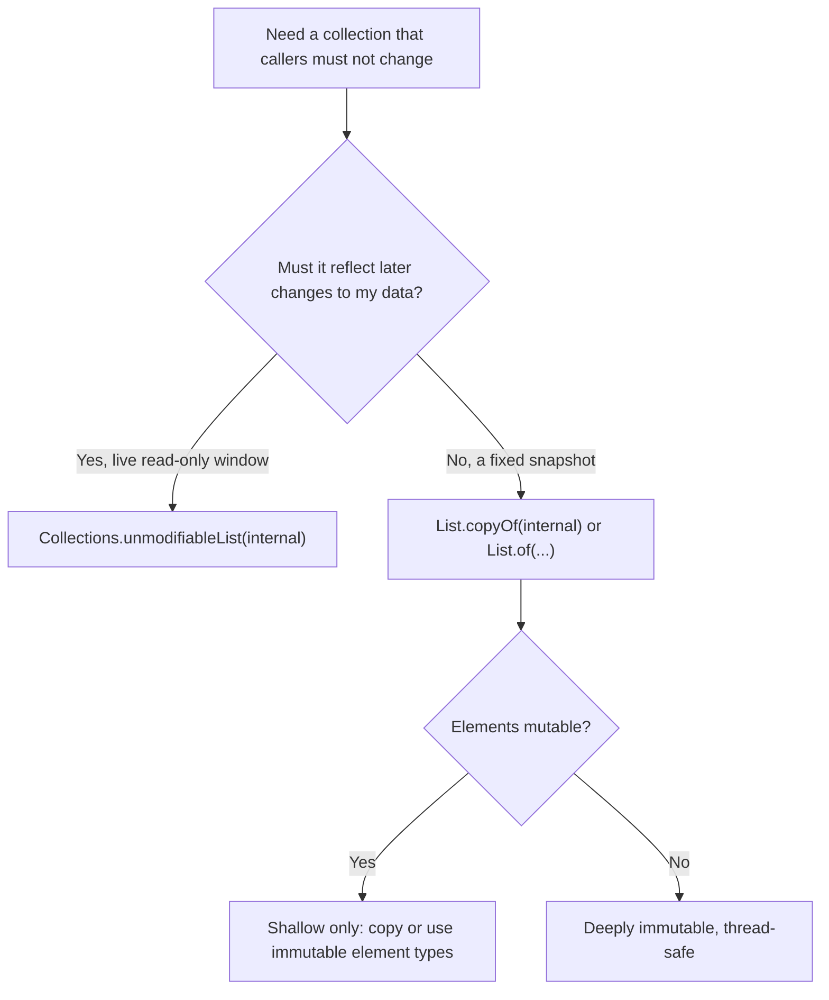

@@ 3 | TOPIC | Immutable and Unmodifiable Collections | List.of vs Collections.unmodifiableList vs Arrays.asList, copyOf snapshots, shallow immutability and defensive copies | MUST
# Immutable and Unmodifiable Collections

**Level: Beginner | Phase 4 | Priority: MUST | Since: Java 1.2 (Collections.unmodifiable*), Java 9 (List.of, Set.of, Map.of), Java 10 (copyOf, Collectors.toUnmodifiableList), Java 16 (Stream.toList)**

> **30-second interview answer:** An **unmodifiable view** (`Collections.unmodifiableList(list)`) blocks changes through the wrapper, but the original list can still change and the view shows it. An **immutable collection** (`List.of`, `Set.of`, `Map.of`, `List.copyOf`, `Stream.toList()`) can never change after creation: every mutator throws `UnsupportedOperationException`. The Java 9 factories also reject null elements and `Set.of`/`Map.of` reject duplicates. `Arrays.asList` is neither: it is fixed-size but `set` works and writes through to the array. All of these are **shallow**: the elements themselves can still be mutable. Use `List.copyOf` for defensive copies in constructors and getters.

## 1. Concept in Simple Words
### Analogy
Three ways to show a museum collection.

| Museum | Java |
|---|---|
| A live CCTV feed of the storeroom: you cannot touch anything, but you see staff moving items | Unmodifiable view: `Collections.unmodifiableList` |
| A sealed glass case filled once and locked forever | Immutable: `List.of`, `List.copyOf` |
| A fixed set of display stands: you can swap the item on a stand but cannot add stands | `Arrays.asList`: fixed size, `set` allowed |
| A sealed case containing a clock that still ticks | Shallow immutability: the list is fixed, mutable elements inside can still change |
| Photographing the storeroom before handing over the photo | Defensive copy with `List.copyOf` |

### What it is
- **Mutable:** you can add, remove and replace elements (`ArrayList`, `HashMap`).
- **Unmodifiable:** the reference you hold cannot be used to change the collection. It may still change through another reference.
- **Immutable:** no one can change it, ever. The JDK calls these "unmodifiable collections" in the `List.of` docs, but because no backing mutable collection exists, they are effectively immutable (for their structure).
- **Shallow vs deep:** a collection is shallowly immutable if its structure is fixed. It is deeply immutable only if its elements are immutable too (strings, records of immutable fields, `LocalDate`).
- **Defensive copy:** copying incoming or outgoing collections so callers cannot change an object's internal state behind its back.

| | `List.of` / `List.copyOf` | `Collections.unmodifiableList` | `Arrays.asList` | `Stream.toList()` | `Collectors.toList()` |
|---|---|---|---|---|---|
| Add or remove | Throws | Throws | Throws | Throws | Allowed (ArrayList today, not guaranteed) |
| `set` | Throws | Throws | Allowed, writes through | Throws | Allowed |
| Sees changes to a source | No | Yes | Yes (the array) | No | No |
| Null elements | Rejected | Allowed | Allowed | Allowed | Allowed |
| Since | Java 9 / 10 | Java 1.2 | Java 1.2 | Java 16 | Java 8 |

### Why it exists
Shared mutable state is a top source of bugs: a method that returns its internal list lets any caller corrupt it; a list shared between threads can be changed mid-read. Immutable collections are automatically thread-safe, safe to cache, safe to use as map keys and safe to return from getters. Before Java 9 the only option was the verbose wrap-a-copy idiom `Collections.unmodifiableList(new ArrayList<>(list))`.

## 2. How It Works
```text
Collections.unmodifiableList(source):
   view ---- delegates reads ----> source (ArrayList)
   view.add(x)  -> throw UnsupportedOperationException
   source.add(x) -> allowed, and view.get(...) now shows x

List.of("a", "b", "c"):
   ImmutableCollections.ListN { final Object[] elements = {"a", "b", "c"} }
   no reference to any mutable list exists
   add, remove, set, sort, clear -> throw UnsupportedOperationException
   contains(null) -> NullPointerException (null-hostile)

List.copyOf(list):
   if list is already an immutable List.of list -> returns the same instance
   otherwise -> copies into a new immutable list (rejects nulls)
```



## 3. Code Example
### Code
```java
import java.util.ArrayList;
import java.util.Arrays;
import java.util.Collections;
import java.util.List;
import java.util.Map;
import java.util.Set;

public class ImmutableDemo {
    // Defensive copy in a record's compact constructor
    record Order(String id, List<String> lines) {
        Order {
            lines = List.copyOf(lines);   // snapshot, immutable, rejects nulls
        }
    }

    public static void main(String[] args) {
        // 1. Java 9 factories are immutable and null-hostile
        List<String> fixed = List.of("a", "b", "c");
        try {
            fixed.add("d");
        } catch (UnsupportedOperationException e) {
            System.out.println("List.of add          : UnsupportedOperationException");
        }
        try {
            List.of("a", null);
        } catch (NullPointerException e) {
            System.out.println("List.of null element : NullPointerException");
        }
        try {
            fixed.contains(null);
        } catch (NullPointerException e) {
            System.out.println("contains(null)       : NullPointerException");
        }
        try {
            Set.of("x", "x");
        } catch (IllegalArgumentException e) {
            System.out.println("Set.of duplicate     : IllegalArgumentException");
        }

        // 2. Unmodifiable VIEW: sees changes to the source
        List<String> source = new ArrayList<>(List.of("x", "y"));
        List<String> view = Collections.unmodifiableList(source);
        source.add("z");
        System.out.println("view sees change     : " + view);

        // 3. copyOf SNAPSHOT: does not see later changes
        List<String> snapshot = List.copyOf(source);
        source.add("w");
        System.out.println("copyOf snapshot      : " + snapshot);

        // 4. Arrays.asList: set works, add does not
        List<String> asList = Arrays.asList("p", "q");
        asList.set(0, "P");
        System.out.println("Arrays.asList set    : " + asList);
        try {
            asList.add("r");
        } catch (UnsupportedOperationException e) {
            System.out.println("Arrays.asList add    : UnsupportedOperationException");
        }

        // 5. Shallow immutability: the elements can still change
        List<StringBuilder> builders = List.of(new StringBuilder("pen"));
        builders.get(0).append("cil");
        System.out.println("element mutated      : " + builders);

        // 6. Defensive copy protects the record from its caller
        List<String> input = new ArrayList<>(List.of("book"));
        Order order = new Order("o-1", input);
        input.add("hacked");
        System.out.println("order lines          : " + order.lines());
        try {
            order.lines().add("more");
        } catch (UnsupportedOperationException e) {
            System.out.println("order.lines().add    : UnsupportedOperationException");
        }

        // 7. Map factories
        Map<String, Integer> codes = Map.ofEntries(Map.entry("one", 1), Map.entry("two", 2));
        System.out.println("Map.ofEntries get    : " + codes.get("two"));

        // 8. Stream.toList (Java 16) is unmodifiable
        List<Integer> doubled = List.of(1, 2, 3).stream().map(x -> x * 2).toList();
        try {
            doubled.add(8);
        } catch (UnsupportedOperationException e) {
            System.out.println("Stream.toList add    : UnsupportedOperationException");
        }

        // 9. copyOf of an already immutable list returns the same object
        System.out.println("copyOf same instance : " + (List.copyOf(fixed) == fixed));
    }
}
```

### Walkthrough
- **Part 1:** every mutator on `List.of` throws. The factories reject null elements at creation, and even `contains(null)` throws because these lists are null-hostile. `Set.of` with duplicates throws `IllegalArgumentException` (a programming error caught early).
- **Part 2:** the unmodifiable wrapper delegates reads to `source`, so adding "z" to `source` is visible through `view`.
- **Part 3:** `List.copyOf` takes a snapshot when called; adding "w" later does not affect it.
- **Part 4:** `Arrays.asList` is fixed-size; replacing an element is fine, growing is not.
- **Part 5:** `List.of` fixes which objects are in the list, not their state. The `StringBuilder` inside changes freely.
- **Part 6:** the compact constructor replaces the incoming list with an immutable copy, so the caller's later `input.add("hacked")` has no effect and nobody can add through the getter.
- **Part 7:** `Map.ofEntries` builds immutable maps of any size; `Map.of` has overloads for up to 10 pairs.
- **Part 8:** `Stream.toList()` returns an unmodifiable list (unlike `Collectors.toList()`, which today returns an `ArrayList`).
- **Part 9:** `List.copyOf` is cheap when given an immutable list: it returns the same instance instead of copying.

### Output
```text
List.of add          : UnsupportedOperationException
List.of null element : NullPointerException
contains(null)       : NullPointerException
Set.of duplicate     : IllegalArgumentException
view sees change     : [x, y, z]
copyOf snapshot      : [x, y, z]
Arrays.asList set    : [P, q]
Arrays.asList add    : UnsupportedOperationException
element mutated      : [pencil]
order lines          : [book]
order.lines().add    : UnsupportedOperationException
Map.ofEntries get    : 2
Stream.toList add    : UnsupportedOperationException
copyOf same instance : true
```

### Compare
Returning internal state from a class:

| Approach | Code | Problem |
|---|---|---|
| Wrong | `return items;` | Caller can modify internal state |
| Old-school | `return Collections.unmodifiableList(items);` | Read-only, but caller sees later internal changes (often fine) |
| Snapshot | `return List.copyOf(items);` | Safe and fixed; costs a copy per call unless already immutable |
| Best for immutable classes | Copy once in the constructor with `List.copyOf`, return the field directly | No per-call cost |

## 4. Interview Questions
**Basic**
1. **What is the difference between unmodifiable and immutable collections?**
   An unmodifiable collection is a read-only view: you cannot change it through that reference, but the backing collection can still change and the view reflects it. An immutable collection has no backing mutable collection, so its contents can never change after creation.
2. **`List.of` vs `Arrays.asList`?**
   `List.of` is fully immutable and rejects nulls. `Arrays.asList` is a fixed-size view of an array: `set` is allowed and writes through, nulls are allowed, and only size changes throw.
3. **What happens when you call `add` on `List.of(1, 2)`?**
   It throws `UnsupportedOperationException`. All mutators, including `set`, `remove`, `sort` and `clear`, throw.

**Follow-up**
4. **Why do the Java 9 factories reject null?**
   Null elements cause ambiguous results (`get` returning null, `contains(null)`) and bugs; rejecting them at creation fails fast. It also lets the implementations be simpler and more compact.
5. **What is shallow immutability?**
   The collection's structure is fixed, but the element objects may be mutable. A `List.of(new StringBuilder())` cannot gain or lose elements, yet the builder inside can change. Deep immutability needs immutable element types.
6. **How do you make a class with a list field immutable?**
   Make the field `private final`, copy the incoming list with `List.copyOf` in the constructor, never expose a mutable reference, and use immutable element types. With records, do the copy in the compact constructor.

**Tricky / scenario**
7. **A service returns `Collections.unmodifiableList(cache)` and a caller iterates it while another thread refreshes the cache. What can happen?**
   The view is not a snapshot, so the caller may see a half-updated list or get `ConcurrentModificationException`. Return `List.copyOf(cache)` or swap in a new immutable list atomically on refresh.
8. **`Map.of("a", 1, "a", 2)`: what happens?**
   `IllegalArgumentException` for the duplicate key at creation time. `HashMap.put` would silently replace the value instead.
9. **Is `Collectors.toList()` immutable?**
   No guarantee either way; today it returns an `ArrayList`, so it is mutable. Use `Stream.toList()` (Java 16) or `Collectors.toUnmodifiableList()` (Java 10) when you want an unmodifiable result.

**What the interviewer is really testing:** whether you understand view versus copy, can protect a class's internal state, and know the Java 9+ factory rules (no nulls, no duplicates).

## 5. Pitfalls & Best Practices
### Common mistakes
| Mistake | What goes wrong | Fix |
|---|---|---|
| Returning the internal mutable list from a getter | Callers corrupt object state | Copy in the constructor, return immutable |
| Thinking `unmodifiableList` is a snapshot | Callers see later changes or CME | `List.copyOf` |
| `List.of(...)` then calling `add` in later code | `UnsupportedOperationException` at runtime | `new ArrayList<>(List.of(...))` when you need to modify |
| Passing a list containing null to `List.copyOf` | `NullPointerException` | Filter nulls first or keep a mutable list |
| Assuming immutable means deeply immutable | Mutable elements still change | Use immutable element types (records, String) |
| Sorting a list returned by `Stream.toList()` | `UnsupportedOperationException` | `stream.sorted()` before `toList()`, or copy |

### Best practices
- Use `List.of`, `Set.of`, `Map.of` for constants and test data.
- Copy at the boundary: in constructors (`List.copyOf`) for incoming data, so getters can return the field directly.
- Prefer `Stream.toList()` for stream results you do not intend to modify.
- In Spring services, return immutable lists from methods so callers cannot mutate cached data.
- Document whether a method returns a live view or a snapshot.

### Compare with
| Factory | Mutable? | Nulls | Duplicates |
|---|---|---|---|
| `new ArrayList<>()` | Yes | Yes | Yes |
| `List.of(...)` | No | No | Yes (lists allow duplicates) |
| `Set.of(...)` | No | No | Throws |
| `Map.of(...)` | No | No | Throws on duplicate key |
| `Collections.emptyList()` | No | - | - |
| `Collections.singletonList(x)` | No | Allows one null | - |

## 6. Hands-on Exercise
Create an immutable `Team` class (not a record) with a `String name` and a `List<String> members`:
1. The constructor copies the incoming list defensively.
2. `members()` returns a list callers cannot modify.
3. `withMember(String m)` returns a new `Team` with the member added (the original stays unchanged).
4. Prove with a `main` method that changing the original input list, or trying to add through `members()`, does not change the team.

Acceptance criteria: the class is `final`, fields are `private final`, and no mutable reference escapes.

<details><summary>Solution</summary>

```java
import java.util.*;

public final class Team {
    private final String name;
    private final List<String> members;

    public Team(String name, List<String> members) {
        this.name = Objects.requireNonNull(name);
        this.members = List.copyOf(members);            // immutable snapshot
    }

    public String name() { return name; }

    public List<String> members() { return members; }  // already immutable, safe to return

    public Team withMember(String m) {
        List<String> next = new ArrayList<>(members);
        next.add(m);
        return new Team(name, next);
    }

    @Override
    public String toString() { return name + members; }

    public static void main(String[] args) {
        List<String> input = new ArrayList<>(List.of("Ann", "Bob"));
        Team t = new Team("Core", input);
        input.add("Eve");                               // no effect on t
        System.out.println(t);                          // Core[Ann, Bob]

        try {
            t.members().add("Mallory");
        } catch (UnsupportedOperationException e) {
            System.out.println("cannot modify members");
        }

        Team bigger = t.withMember("Cid");
        System.out.println(bigger);                     // Core[Ann, Bob, Cid]
        System.out.println(t);                          // Core[Ann, Bob]
    }
}
```
"Wither" methods like `withMember` are how immutable objects represent change: they return a new object.
</details>

## 7. Recall
Q: What is the difference between `Collections.unmodifiableList` and `List.copyOf`?
A: `unmodifiableList` is a read-only view that reflects changes to the source; `copyOf` is an immutable snapshot.

Q: Do `List.of`, `Set.of` and `Map.of` accept null elements?
A: No, they throw `NullPointerException`.

Q: What does `Set.of("a", "a")` do?
A: Throws `IllegalArgumentException` for the duplicate element.

Q: Which operations does a list from `Arrays.asList` support?
A: Reads and `set` (writing through to the array); not `add` or `remove`.

Q: What is shallow immutability in Java collections?
A: The collection's structure cannot change, but mutable elements inside it still can.

Q: Is the list returned by `Stream.toList()` modifiable?
A: No, it is unmodifiable (Java 16).

**Related:** [[Immutable Class Design]] · [[Collections and Arrays Utility Classes]] · [[Records]]

@@ 3 | TOPIC | Practice — Coding drill: Collections | Ten interview tasks on choosing and using lists, sets, maps, queues and comparators | MUST
# Coding drill: Collections

Ten tasks of the kind asked in screening rounds and live-coding interviews. Each one is mostly about picking the right collection. Say the Big-O out loud when you solve it; interviewers listen for that.

## 1. Two Sum with a HashMap
Given `int[] nums` and `target`, return the indexes of the two numbers that add up to target. `[2, 7, 11, 15]`, target 9 → `[0, 1]`.

Hint: remember each number's index as you go; look up `target - x`.

<details><summary>Solution</summary>

```java
import java.util.HashMap;
import java.util.Map;

static int[] twoSum(int[] nums, int target) {
    Map<Integer, Integer> seen = new HashMap<>();          // value -> index
    for (int i = 0; i < nums.length; i++) {
        Integer j = seen.get(target - nums[i]);
        if (j != null) return new int[]{j, i};
        seen.put(nums[i], i);
    }
    throw new IllegalArgumentException("no solution");
}
```
One pass, O(n) time and O(n) space, versus O(n²) for two nested loops. The map lookup replaces the inner loop.
</details>

## 2. Top k frequent words
`["java", "spring", "java", "sql", "spring", "java"]`, k = 2 → `[java, spring]`. Ties broken alphabetically.

Hint: count with `merge`, then sort the entries with a comparator.

<details><summary>Solution</summary>

```java
import java.util.*;

static List<String> topK(List<String> words, int k) {
    Map<String, Integer> counts = new HashMap<>();
    for (String w : words) counts.merge(w, 1, Integer::sum);

    List<Map.Entry<String, Integer>> entries = new ArrayList<>(counts.entrySet());
    entries.sort(Map.Entry.<String, Integer>comparingByValue().reversed()
            .thenComparing(Map.Entry.comparingByKey()));

    List<String> result = new ArrayList<>();
    for (int i = 0; i < k && i < entries.size(); i++) result.add(entries.get(i).getKey());
    return result;
}
```
O(n + m log m) where m is the number of distinct words. For huge m and small k, use a min-heap of size k instead (O(m log k)).
</details>

## 3. Group anagrams
`["eat", "tea", "tan", "ate", "nat", "bat"]` → `[[eat, tea, ate], [tan, nat], [bat]]`.

Hint: anagrams share the same sorted letters; use that as a map key.

<details><summary>Solution</summary>

```java
import java.util.*;

static Collection<List<String>> groupAnagrams(List<String> words) {
    Map<String, List<String>> groups = new LinkedHashMap<>();   // keep first-seen group order
    for (String w : words) {
        char[] chars = w.toCharArray();
        Arrays.sort(chars);
        groups.computeIfAbsent(new String(chars), k -> new ArrayList<>()).add(w);
    }
    return groups.values();
}
```
The key "aet" collects eat, tea and ate. `LinkedHashMap` makes the output order predictable for tests.
</details>

## 4. First duplicate
Return the first element that appears a second time while scanning left to right. `[3, 1, 4, 1, 5, 3]` → 1.

Hint: `Set.add` returns false for a repeat.

<details><summary>Solution</summary>

```java
import java.util.*;

static Optional<Integer> firstDuplicate(List<Integer> items) {
    Set<Integer> seen = new HashSet<>();
    for (Integer x : items) {
        if (!seen.add(x)) return Optional.of(x);
    }
    return Optional.empty();
}
```
Returns 1, because 1 repeats at index 3, before 3 repeats at index 5. O(n).
</details>

## 5. LRU cache with LinkedHashMap
Implement `LruCache<K, V>` with a capacity; `get` marks an entry as recently used; inserting beyond capacity evicts the least recently used.

Hint: access-order constructor plus `removeEldestEntry`.

<details><summary>Solution</summary>

```java
import java.util.LinkedHashMap;
import java.util.Map;

class LruCache<K, V> extends LinkedHashMap<K, V> {
    private final int capacity;

    LruCache(int capacity) {
        super(16, 0.75f, true);          // true = access order
        this.capacity = capacity;
    }

    @Override
    protected boolean removeEldestEntry(Map.Entry<K, V> eldest) {
        return size() > capacity;
    }
}
// LruCache<String, Integer> c = new LruCache<>(2);
// c.put("a", 1); c.put("b", 2); c.get("a"); c.put("c", 3);  -> keys [a, c]
```
O(1) get and put. Not thread-safe; for concurrent use wrap it with `Collections.synchronizedMap` or use a caching library like Caffeine. Phase 8 builds one from scratch with a hash map and a doubly linked list.
</details>

## 6. Sort a map by value
Given `{"apple"=3, "kiwi"=7, "fig"=3}`, produce a `LinkedHashMap` ordered by value descending, then key ascending: `{kiwi=7, apple=3, fig=3}`.

Hint: sort the entry list, then insert into a `LinkedHashMap` to keep that order.

<details><summary>Solution</summary>

```java
import java.util.*;

static Map<String, Integer> sortByValue(Map<String, Integer> map) {
    List<Map.Entry<String, Integer>> entries = new ArrayList<>(map.entrySet());
    entries.sort(Map.Entry.<String, Integer>comparingByValue(Comparator.reverseOrder())
            .thenComparing(Map.Entry.comparingByKey()));
    Map<String, Integer> result = new LinkedHashMap<>();
    for (Map.Entry<String, Integer> e : entries) result.put(e.getKey(), e.getValue());
    return result;
}
```
A `TreeMap` cannot sort by value because it orders by key; a `LinkedHashMap` preserves whatever order you insert.
</details>

## 7. Kth largest element
`[3, 2, 1, 5, 6, 4]`, k = 2 → 5.

Hint: a min-heap that never holds more than k elements.

<details><summary>Solution</summary>

```java
import java.util.PriorityQueue;

static int kthLargest(int[] nums, int k) {
    PriorityQueue<Integer> heap = new PriorityQueue<>();   // min-heap
    for (int n : nums) {
        heap.offer(n);
        if (heap.size() > k) heap.poll();                  // drop the smallest
    }
    return heap.peek();                                    // smallest of the k largest
}
```
O(n log k) time, O(k) space. Sorting the array would be O(n log n).
</details>

## 8. Invert a map with repeated values
`{"ann"="Eng", "bob"="Sales", "cid"="Eng"}` → `{Eng=[ann, cid], Sales=[bob]}` with sorted keys and sorted names.

Hint: `computeIfAbsent` with a `TreeSet`.

<details><summary>Solution</summary>

```java
import java.util.*;

static Map<String, Set<String>> invert(Map<String, String> personToDept) {
    Map<String, Set<String>> deptToPeople = new TreeMap<>();
    personToDept.forEach((person, dept) ->
            deptToPeople.computeIfAbsent(dept, d -> new TreeSet<>()).add(person));
    return deptToPeople;
}
```
A plain `put(dept, person)` would overwrite; grouping into a collection keeps every person.
</details>

## 9. Sliding window maximum
For `[1, 3, -1, -3, 5, 3, 6, 7]` and window size 3, output `[3, 3, 5, 5, 6, 7]`.

Hint: keep a `Deque` of indexes whose values are in decreasing order.

<details><summary>Solution</summary>

```java
import java.util.ArrayDeque;
import java.util.Deque;

static int[] maxSlidingWindow(int[] nums, int k) {
    int[] result = new int[nums.length - k + 1];
    Deque<Integer> dq = new ArrayDeque<>();                 // indexes, values decreasing
    for (int i = 0; i < nums.length; i++) {
        if (!dq.isEmpty() && dq.peekFirst() <= i - k) dq.pollFirst();       // out of window
        while (!dq.isEmpty() && nums[dq.peekLast()] < nums[i]) dq.pollLast(); // smaller, useless
        dq.offerLast(i);
        if (i >= k - 1) result[i - k + 1] = nums[dq.peekFirst()];
    }
    return result;
}
```
Each index enters and leaves the deque at most once, so the whole thing is O(n). The head is always the maximum of the current window.
</details>

## 10. Predict the output: Set of mutable keys and Arrays.asList
```java
List<Integer> fixed = Arrays.asList(1, 2, 3);
fixed.set(0, 9);
System.out.println(fixed);

Set<List<Integer>> set = new HashSet<>();
List<Integer> key = new ArrayList<>(List.of(1));
set.add(key);
key.add(2);
System.out.println(set.contains(key) + " " + set.size());

List<String> names = new ArrayList<>(List.of("a", "b", "c", "d"));
for (String n : names) {
    if (n.equals("c")) names.remove(n);
}
System.out.println(names);
```

<details><summary>Solution</summary>

```text
[9, 2, 3]
false 1
[a, b, d]
```
- `Arrays.asList` allows `set`, so the first line prints `[9, 2, 3]`.
- The list's `hashCode` changed after it was added (it depends on its contents), so `contains` looks in the wrong bucket and returns false, although the set still holds one element. Never mutate objects used as hash keys.
- Removing "c" (the second-to-last element) leaves `cursor == size`, so the loop exits without a `ConcurrentModificationException` and "d" is never visited. It prints `[a, b, d]`.
</details>

@@ 3 | TOPIC | Practice — Phase 4 review: Collections | Cheat sheet, top 10 questions and rapid-fire flashcards for Phase 4 | MUST
# Phase 4 review: Collections

## Cheat sheet

| Idea | Remember |
|---|---|
| Hierarchy | `Collection` → `List`, `Set`, `Queue`/`Deque`; `Map` is separate |
| Default picks | `ArrayList`, `HashMap`, `HashSet`, `ArrayDeque` |
| ArrayList | Resizable array, O(1) get, amortized O(1) append, grows 50% |
| LinkedList | Doubly linked nodes, O(n) get, rarely the right choice |
| Hash sets and maps | O(1) average, need `equals` + `hashCode`, no order |
| Linked variants | Same speed, insertion order (LinkedHashMap can do access order: LRU) |
| Tree variants | O(log n), sorted, need `Comparable` or `Comparator`, navigation methods |
| Nulls | HashMap one null key; TreeMap no null key; ArrayDeque, PriorityQueue, `List.of` no nulls |
| Queue methods | `offer`/`poll`/`peek` return special values; `add`/`remove`/`element` throw |
| Stack | `ArrayDeque` with `push`/`pop`, never `Stack` |
| PriorityQueue | Min-heap, head ordered, iteration not sorted, O(log n) offer and poll |
| Fail-fast | `modCount` check in `next()`, throws `ConcurrentModificationException` |
| Fail-safe | `CopyOnWriteArrayList` snapshot, `ConcurrentHashMap` weakly consistent |
| Safe removal | `removeIf`, `Iterator.remove`, `entrySet().removeIf` |
| Comparable | `compareTo` inside the class, one natural order |
| Comparator | External, `comparing`, `thenComparing`, `reversed`, `nullsLast` |
| Sorting | TimSort for objects (stable), dual-pivot quicksort for primitives |
| `Arrays.asList` | Fixed-size view, `set` writes through, `add` throws |
| Unmodifiable vs immutable | View that reflects changes vs fixed snapshot |
| `List.of` | Immutable, no nulls; `Set.of`/`Map.of` reject duplicates |

### Key code snippets
```java
// Counting and grouping with the modern Map API
Map<String, Integer> counts = new HashMap<>();
for (String w : words) counts.merge(w, 1, Integer::sum);

Map<String, List<String>> byDept = new TreeMap<>();
for (Employee e : staff) byDept.computeIfAbsent(e.dept(), k -> new ArrayList<>()).add(e.name());
```

```java
// Sorting with comparators
staff.sort(Comparator.comparing(Employee::dept)
        .thenComparing(Employee::salary, Comparator.reverseOrder())
        .thenComparing(Employee::name));
```

```java
// Queue, stack and heap
Queue<String> queue = new ArrayDeque<>();   queue.offer("a"); queue.poll();
Deque<Integer> stack = new ArrayDeque<>();  stack.push(1);    stack.pop();
PriorityQueue<Integer> maxHeap = new PriorityQueue<>(Comparator.reverseOrder());
```

```java
// Safe removal and LRU
list.removeIf(x -> x < 0);
map.entrySet().removeIf(e -> e.getValue() == 0);
Map<String, Integer> lru = new LinkedHashMap<>(16, 0.75f, true) {
    protected boolean removeEldestEntry(Map.Entry<String, Integer> e) { return size() > 100; }
};
```

```java
// Immutability and defensive copies
record Order(String id, List<String> lines) {
    Order { lines = List.copyOf(lines); }
}
List<Integer> result = stream.map(x -> x * 2).toList();   // unmodifiable
```

```java
// TreeMap navigation
NavigableMap<Integer, String> bands = new TreeMap<>(Map.of(0, "F", 60, "D", 70, "C", 80, "B", 90, "A"));
String grade = bands.floorEntry(85).getValue();            // "B"
```

## The 10 most likely interview questions

1. **ArrayList vs LinkedList?** Array with O(1) index access vs linked nodes with O(1) end operations; ArrayList wins in practice thanks to cache locality and lower memory.
2. **HashMap vs LinkedHashMap vs TreeMap?** No order and O(1); insertion or access order and O(1); sorted keys and O(log n) with navigation.
3. **How does a HashSet guarantee uniqueness?** It is a HashMap underneath; `hashCode` picks the bucket and `equals` confirms duplicates.
4. **What is fail-fast iteration?** Iterators check `modCount` and throw `ConcurrentModificationException` on outside structural changes; fix with `removeIf` or `Iterator.remove`.
5. **Fail-fast vs fail-safe?** Throw on modification vs iterate a snapshot or weakly consistent view (`CopyOnWriteArrayList`, `ConcurrentHashMap`).
6. **Comparable vs Comparator?** Natural order inside the class vs any number of external orders built with `Comparator.comparing`.
7. **Why not use `a - b` in a comparator?** Integer overflow flips the sign; use `Integer.compare`.
8. **`List.of` vs `Collections.unmodifiableList` vs `Arrays.asList`?** Immutable and null-free vs read-only view vs fixed-size array-backed view where `set` works.
9. **Which class should you use as a stack or queue?** `ArrayDeque`; `Stack` is synchronized legacy and `LinkedList` is memory-heavy.
10. **How do you find the top k elements efficiently?** A min-heap `PriorityQueue` of size k: O(n log k) time and O(k) memory.

## Rapid-fire flashcards

Q: Which collection keeps unique elements in insertion order?
A: `LinkedHashSet`.

Q: What is the average time complexity of `HashMap.get`?
A: O(1).

Q: What does `TreeMap.ceilingKey(k)` return?
A: The smallest key greater than or equal to k, or null.

Q: What is the default ordering of a `PriorityQueue<Integer>`?
A: Smallest first (a min-heap).

Q: What does `queue.peek()` return on an empty `ArrayDeque`?
A: null.

Q: Does `list.set(i, x)` inside a for-each loop throw `ConcurrentModificationException`?
A: No, replacing an element is not a structural modification.

Q: What does `Map.of("a", 1, "a", 2)` throw?
A: `IllegalArgumentException` for the duplicate key.

Q: Is the result of `Collectors.toList()` guaranteed to be mutable?
A: No guarantee; use `Collectors.toCollection(ArrayList::new)` if you need mutability.

Q: How do you get a typed array from a `List<String>`?
A: `list.toArray(new String[0])` or `list.toArray(String[]::new)`.

Q: Why must `HashMap` keys be immutable?
A: If a key's hash code changes after insertion, lookups search the wrong bucket and the entry is lost.
