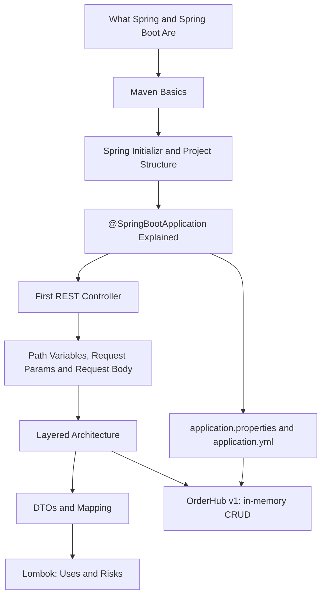
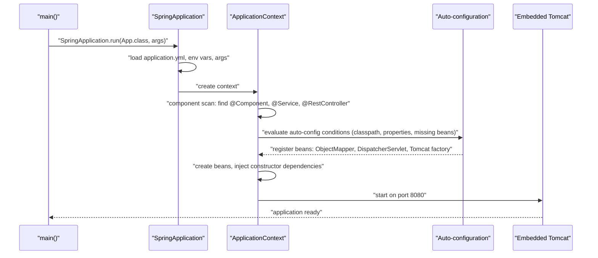
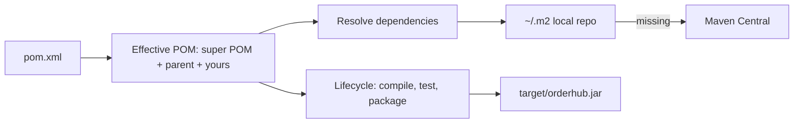
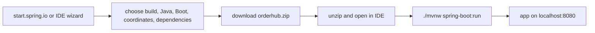

@@ 1 | MODULE | Phase 5 — Spring Boot Foundations (Beginner) | What Spring Boot is, Maven, project structure, the first REST API, configuration, layers, DTOs and Lombok | MUST
# Phase 5: Spring Boot Foundations (Beginner)

This phase takes you from "I know Java" to "I can build and explain a small REST API with Spring Boot". You will learn what Spring and Spring Boot actually do for you, how Maven builds the project, what each generated file is for, what `@SpringBootApplication` hides, how to write controllers that read path variables, query parameters and JSON bodies, how configuration files work, and how to split code into controller, service and repository layers with DTOs at the edge. You also start **OrderHub**, the running project of this guide: by the end of the phase it has in-memory CRUD for products.

Interviewers care because almost every Java backend job today is a Spring Boot job. Beginner rounds always include "What is Spring Boot and how is it different from Spring?", "What does `@SpringBootApplication` do?" and "Walk me through what happens when a request hits your controller". Clear answers here signal you can be productive from week one. The deep internals (how the container really works, proxies, auto-configuration classes) come in Phases 10 and 18; this phase builds the mental model they rest on.



**Prerequisites:** Phase 2 (classes, interfaces, records, encapsulation), Phase 3 (exceptions, `BigDecimal`), Phase 4 (`List`, `Map`, `ConcurrentHashMap` idea). You need JDK 21, Maven (or the Maven wrapper), an IDE and `curl` or an HTTP client (setup in Phase 0).

**The 5 questions from this phase that come up most often**
1. What is the difference between Spring and Spring Boot?
2. What does `@SpringBootApplication` do?
3. `@Controller` vs `@RestController`, and `@PathVariable` vs `@RequestParam`?
4. Why split an application into controller, service and repository layers?
5. Why use DTOs instead of returning domain objects or entities directly?

@@ 2 | MODULE | First steps | What Spring Boot is, how Maven builds it and what a generated project contains | MUST
# First steps

**Shared analogy: moving into a furnished flat.** Plain Java is an empty plot of land: you can build anything, but you lay every pipe yourself. The **Spring Framework** is a building contractor that connects the pipes and wires between rooms for you (dependency injection). **Spring Boot** is a fully furnished flat from that contractor: the kitchen (web server), heating (JSON conversion) and locks (sensible defaults) are already installed, and you just move your furniture (business code) in. **Maven** is the moving company's checklist and delivery truck: it fetches every box you listed (dependencies) and runs the same steps every time (compile, test, package). **Spring Initializr** is the brochure where you tick the rooms you want, and `@SpringBootApplication` is the front-door key that switches everything on.

The four topics in this group answer: what am I using, how is it built, what did the generator give me, and what happens when I press run.

@@ 3 | TOPIC | What Spring and Spring Boot Are | IoC container, dependency injection, the Spring ecosystem, and what Boot adds: starters, auto-configuration, embedded server | MUST
# What Spring and Spring Boot Are

**Level: Beginner | Phase 5 | Priority: MUST | Since: Spring Framework 1.0 (2004), Spring Boot 1.0 (2014); baseline Spring Boot 3.5 on Spring Framework 6.2 and Java 17+ (we use Java 21); Boot 4 / Framework 7 released November 2025**

> **30-second interview answer:** The Spring Framework is a Java framework whose core is an **IoC container**: instead of my classes creating their own dependencies with `new`, Spring creates the objects (called **beans**), wires them together through constructors (**dependency injection**) and manages their lifecycle. On top of that core Spring offers modules for web (Spring MVC), data access, transactions, security and more. **Spring Boot** is an opinionated layer on top of Spring that removes setup work: **starters** bring a tested set of dependencies, **auto-configuration** creates the usual beans based on what is on the classpath and in your properties, and an **embedded server** (Tomcat by default) lets the app run as a plain `java -jar`. Spring is the engine; Boot is the engine pre-installed in a car with sensible defaults.

## 1. Concept in Simple Words
### Analogy
Building a restaurant.

| Restaurant | Spring |
|---|---|
| A chef who must grow vegetables, build the oven and hire waiters before cooking | Plain Java: every class creates its own dependencies with `new` |
| A restaurant manager who hires staff and hands each chef the tools they need | Spring IoC container: creates beans and injects dependencies |
| The chef says "I need a knife and an oven" on their job application | Constructor parameters declare dependencies |
| Staff list kept by the manager | `ApplicationContext`, the registry of beans |
| A franchise kit: kitchen installed, menu template, suppliers pre-arranged | Spring Boot: starters, auto-configuration, embedded server |
| You can still swap the oven if you want a different brand | Your own beans override Boot's defaults |
| The restaurant opens with one switch | `SpringApplication.run(...)` |

### What it is
- **Spring Framework:** a set of libraries for building Java applications. Its core is the container plus modules: Spring MVC (web), Spring WebFlux (reactive web), JDBC and transactions, AOP, testing support.
- **IoC (Inversion of Control):** a design principle where a framework, not your code, controls object creation and the flow between components. "Don't call us, we'll call you."
- **DI (Dependency Injection):** the main IoC technique. A class receives its collaborators (through its constructor) instead of creating them. This makes classes easy to test (pass a fake) and easy to change.
- **Bean:** any object created and managed by the Spring container. You mark classes with `@Component`, `@Service`, `@Repository` or `@RestController`, or declare them with `@Bean` methods.
- **ApplicationContext:** the container itself. It reads configuration, creates beans in the right order, injects them and destroys them at shutdown.
- **Spring Boot:** a project that makes Spring applications quick to start and production-ready by default:
  - **Starters:** dependency bundles such as `spring-boot-starter-web` (Spring MVC, Jackson for JSON, embedded Tomcat) with versions that work together.
  - **Auto-configuration:** conditional configuration classes that create beans only when needed ("Jackson is on the classpath and you have not defined an `ObjectMapper`, so I will create one").
  - **Embedded server:** Tomcat, Jetty or Undertow inside your jar; no separate application server to install.
  - **Externalized configuration:** `application.yml`, environment variables and command-line arguments.
  - **Production features:** Actuator health checks and metrics (Phase 21).
- **Spring ecosystem:** Spring Data (repositories), Spring Security, Spring Cloud (microservices), Spring Batch, Spring AI, and more, all integrating with Boot.

### Why it exists
In early-2000s enterprise Java (J2EE), you wrote heavy EJB components, XML deployment descriptors and deployed to big application servers. Spring (2004) showed that plain Java objects plus dependency injection were simpler and more testable. But Spring itself then needed a lot of configuration: XML or Java config for the web layer, JSON converters, data sources, transaction managers, and you still deployed a WAR to an external Tomcat. Spring Boot (2014) removed that boilerplate with defaults and auto-configuration, so a working REST service is one class plus one dependency.

## 2. How It Works
What happens when you run a Spring Boot application:



Then, for every HTTP request:
```text
HTTP GET /greet?name=Ann
   -> Tomcat thread receives the request
   -> DispatcherServlet (the front controller, auto-configured by Boot)
   -> finds the @GetMapping("/greet") method on GreetingController
   -> converts query param "name" to a String argument
   -> calls the method; the controller calls GreetingService (injected by Spring)
   -> return value converted to JSON by Jackson (HttpMessageConverter)
   -> HTTP 200 with body {"message":"Hello, Ann!"}
```

**Spring vs Spring Boot, layer by layer:**
```text
+-----------------------------------------------------------+
| Your code: controllers, services, repositories            |
+-----------------------------------------------------------+
| Spring Boot: starters, auto-config, embedded server,      |
|              externalized config, Actuator                |
+-----------------------------------------------------------+
| Spring Framework: IoC container, MVC, transactions, AOP   |
+-----------------------------------------------------------+
| Java 21 + JVM                                             |
+-----------------------------------------------------------+
```

## 3. Code Example
### Code
First, the problem Spring solves, in plain Java (manual wiring):
```java
import java.time.LocalTime;

public class ManualWiring {
    interface Clock { LocalTime now(); }

    static class SystemClock implements Clock {
        public LocalTime now() { return LocalTime.of(9, 30); }   // fixed for a predictable demo
    }

    static class GreetingService {
        private final Clock clock;
        GreetingService(Clock clock) { this.clock = clock; }     // dependency passed in

        String greet(String name) {
            String part = clock.now().getHour() < 12 ? "morning" : "afternoon";
            return "Good " + part + ", " + name + "!";
        }
    }

    public static void main(String[] args) {
        // Without Spring, main() must build the whole object graph by hand, in the right order
        Clock clock = new SystemClock();
        GreetingService service = new GreetingService(clock);
        System.out.println(service.greet("Ann"));
    }
}
```

The same idea as a Spring Boot web application (Maven project with `spring-boot-starter-web`):

`pom.xml` (the important parts; full file in [[Maven Basics: pom.xml, Lifecycle and Scopes]]):
```xml
<parent>
    <groupId>org.springframework.boot</groupId>
    <artifactId>spring-boot-starter-parent</artifactId>
    <version>3.5.0</version>
</parent>

<properties>
    <java.version>21</java.version>
</properties>

<dependencies>
    <dependency>
        <groupId>org.springframework.boot</groupId>
        <artifactId>spring-boot-starter-web</artifactId>
    </dependency>
</dependencies>
```

`src/main/java/com/orderhub/OrderHubApplication.java`:
```java
package com.orderhub;

import org.springframework.boot.SpringApplication;
import org.springframework.boot.autoconfigure.SpringBootApplication;

@SpringBootApplication                     // config + auto-configuration + component scan
public class OrderHubApplication {
    public static void main(String[] args) {
        SpringApplication.run(OrderHubApplication.class, args);   // starts the container and Tomcat
    }
}
```

`src/main/java/com/orderhub/greeting/GreetingClock.java`:
```java
package com.orderhub.greeting;

import java.time.LocalTime;
import org.springframework.stereotype.Component;

@Component                                 // Spring creates one instance (a singleton bean)
public class GreetingClock {
    public LocalTime now() {
        return LocalTime.now();
    }
}
```

`src/main/java/com/orderhub/greeting/GreetingService.java`:
```java
package com.orderhub.greeting;

import org.springframework.stereotype.Service;

@Service
public class GreetingService {
    private final GreetingClock clock;

    // Single constructor: Spring injects the GreetingClock bean automatically (no @Autowired needed)
    public GreetingService(GreetingClock clock) {
        this.clock = clock;
    }

    public String greet(String name) {
        String part = clock.now().getHour() < 12 ? "morning" : "afternoon";
        return "Good " + part + ", " + name + "!";
    }
}
```

`src/main/java/com/orderhub/greeting/GreetingController.java`:
```java
package com.orderhub.greeting;

import java.util.Map;
import org.springframework.web.bind.annotation.GetMapping;
import org.springframework.web.bind.annotation.RequestParam;
import org.springframework.web.bind.annotation.RestController;

@RestController                            // methods return data (JSON), not HTML views
public class GreetingController {
    private final GreetingService service;

    public GreetingController(GreetingService service) {
        this.service = service;
    }

    @GetMapping("/greet")
    public Map<String, String> greet(@RequestParam(defaultValue = "world") String name) {
        return Map.of("message", service.greet(name));    // Jackson turns the Map into JSON
    }
}
```

`src/main/resources/application.yml`:
```yaml
spring:
  application:
    name: orderhub
server:
  port: 8080
```

### Walkthrough
- **ManualWiring:** the service does not create its clock; it receives it. That is dependency injection done by hand. In a real application with hundreds of classes, `main` would become a huge, fragile wiring method. Spring automates exactly this step.
- **pom.xml:** the parent manages versions of every Spring and third-party library; the single web starter brings Spring MVC, Jackson and embedded Tomcat.
- **OrderHubApplication:** `@SpringBootApplication` turns on component scanning of `com.orderhub` and its sub-packages, plus auto-configuration. `SpringApplication.run` creates the `ApplicationContext` and starts Tomcat.
- **GreetingClock, GreetingService, GreetingController:** the stereotype annotations mark them as beans. During startup Spring sees that `GreetingController` needs a `GreetingService`, which needs a `GreetingClock`, and creates them in that order. You never write `new GreetingService(...)`.
- **`@GetMapping` and `@RequestParam`:** Spring MVC maps `GET /greet` to the method and fills `name` from the query string (default "world").
- **application.yml:** externalized configuration; Boot reads it automatically.

### Output
Manual wiring program:
```text
Good morning, Ann!
```

Starting the Spring Boot app with `./mvnw spring-boot:run` (key log lines, trimmed):
```text
  .   ____          _            __ _ _
 /\\ / ___'_ __ _ _(_)_ __  __ _ \ \ \ \
( ( )\___ | '_ | '_| | '_ \/ _` | \ \ \ \
 \\/  ___)| |_)| | | | | || (_| |  ) ) ) )
  '  |____| .__|_| |_|_| |_\__, | / / / /
 =========|_|==============|___/=/_/_/_/
 :: Spring Boot ::                (v3.5.0)

INFO  --- [orderhub] [main] com.orderhub.OrderHubApplication : Starting OrderHubApplication using Java 21
INFO  --- [orderhub] [main] o.s.b.w.embedded.tomcat.TomcatWebServer : Tomcat initialized with port 8080 (http)
INFO  --- [orderhub] [main] o.s.b.w.embedded.tomcat.TomcatWebServer : Tomcat started on port 8080 (http) with context path '/'
INFO  --- [orderhub] [main] com.orderhub.OrderHubApplication : Started OrderHubApplication in 1.412 seconds (process running for 1.698)
```

Calling the endpoint (before noon):
```http
GET /greet?name=Ann HTTP/1.1
Host: localhost:8080

HTTP/1.1 200
Content-Type: application/json

{"message":"Good morning, Ann!"}
```

### Compare
| | Plain Java | Spring Framework (no Boot) | Spring Boot |
|---|---|---|---|
| Object creation | `new` everywhere, manual wiring | Container creates and injects beans | Same container |
| Web setup | Write a server or use servlets by hand | Configure `DispatcherServlet`, converters, deploy WAR | Auto-configured, embedded Tomcat |
| Dependency versions | Choose and align yourself | Choose and align yourself | Managed by the Boot parent and starters |
| Configuration | Your own property loading | XML or Java config classes | `application.yml` plus auto-config |
| Run | `java Main` | Deploy to an external server | `java -jar app.jar` |
| Production features | Build yourself | Add libraries yourself | Actuator starter |

## 4. Interview Questions
**Basic**
1. **What is Spring Framework?**
   A Java framework built around an IoC container that creates and wires application objects (beans) through dependency injection. It also provides modules for web applications, data access, transactions, security integration, messaging and testing, all designed to work with plain Java objects.
2. **What is Spring Boot and how is it different from Spring?**
   Spring Boot is built on Spring and removes configuration work. It adds starters (curated dependency sets), auto-configuration (beans created automatically based on the classpath and properties), an embedded server so the app runs with `java -jar`, externalized configuration and production features like Actuator. Spring gives the capabilities; Boot gives sensible defaults and packaging.
3. **What are IoC and dependency injection?**
   Inversion of Control means the framework controls object creation and lifecycle instead of your code. Dependency injection is how Spring does it: a class declares what it needs (usually as constructor parameters) and the container supplies those objects. This decouples classes and makes them easy to unit test with fakes.

**Follow-up**
4. **What is a bean?**
   An object whose lifecycle is managed by the Spring container. Beans are found through component scanning of classes annotated with `@Component` and its specializations, or declared with `@Bean` methods in `@Configuration` classes. By default each bean is a singleton within the context.
5. **What does a starter contain?**
   A starter is a mostly empty jar whose `pom` lists dependencies that belong together. `spring-boot-starter-web` brings `spring-webmvc`, Jackson, validation-ready support and `spring-boot-starter-tomcat`. Versions come from Boot's dependency management, so you rarely write a version number.
6. **How does auto-configuration decide what to create?**
   Auto-configuration classes are ordinary `@Configuration` classes guarded by conditions such as `@ConditionalOnClass` (a library is on the classpath), `@ConditionalOnProperty` and `@ConditionalOnMissingBean` (you have not defined your own). If you define your own bean, Boot backs off. Running with `--debug` prints which conditions matched.

**Tricky / scenario**
7. **Does Spring Boot replace Spring Framework?**
   No. Boot uses Spring Framework underneath; every Boot app is a Spring app. Boot only automates configuration, dependency management and packaging, and you can still configure anything manually.
8. **A teammate says "Spring Boot is slow and magic". How do you respond?**
   The "magic" is explicit conditional configuration you can inspect with the conditions report (`--debug`) or the Actuator `conditions` endpoint, and you can override any default by defining your own bean or property. Startup cost is mostly classpath scanning and bean creation; for very fast startup there are options like lazy initialization, AOT and GraalVM native images (Phase 18).
9. **What changed in Spring Boot 3 that interviewers ask about?**
   Boot 3 (Spring Framework 6) requires Java 17+, moved from `javax.*` to `jakarta.*` packages (Jakarta EE 9+), added native image support and Micrometer observation. Boot 4 (Framework 7, November 2025) moves further to Jakarta EE 11, Jackson 3, modularized auto-configuration and null-safety annotations (JSpecify).

**What the interviewer is really testing:** whether you understand the container and dependency injection as the core idea, and can explain Boot's value without calling it magic.

## 5. Pitfalls & Best Practices
### Common mistakes
| Mistake | What goes wrong | Fix |
|---|---|---|
| Creating services with `new` inside controllers | Not a bean: no injection, no transactions, hard to test | Inject through the constructor |
| Thinking Boot and Spring are different frameworks | Confusing interview answers | Boot is configuration and packaging on top of Spring |
| Adding many starters "just in case" | Unwanted auto-config (for example a DataSource demanding a database URL) | Add only what you use |
| Writing versions for Boot-managed dependencies | Version conflicts at runtime | Let the parent or BOM manage versions |
| Mixing `javax.*` and `jakarta.*` imports in Boot 3 | `ClassNotFoundException` or annotations ignored | Use `jakarta.*` only |

### Best practices
- Use constructor injection with `final` fields; with one constructor no `@Autowired` is needed.
- Keep the main class in the root package (`com.orderhub`) so scanning covers every feature package.
- Start from Spring Initializr with the current Boot release; upgrade regularly (each Boot minor version gets about 13 months of open-source support).
- Learn to read the startup log and the conditions report; they explain the "magic".

### Compare with
| | Spring Boot | Jakarta EE (application server) | Quarkus | Micronaut |
|---|---|---|---|---|
| DI style | Runtime reflection plus AOT option | CDI, runtime | Build-time DI | Compile-time DI |
| Startup | About 1 to 3 seconds typical | Server already running, deploy WARs | Very fast, native-first | Very fast |
| Ecosystem | Largest | Standard specs | Growing | Growing |
| Job market | Dominant | Legacy enterprise | Niche | Niche |

## 6. Hands-on Exercise
Start **OrderHub**. Using the code above as a template, create the project skeleton and a health-style endpoint:
1. `com.orderhub.OrderHubApplication` with `@SpringBootApplication`.
2. A `@Service` called `com.orderhub.info.AppInfoService` that returns the app name and the start time (an `Instant` captured in the constructor).
3. A `@RestController` `com.orderhub.info.AppInfoController` exposing `GET /api/info` that returns `{"name":"orderhub","startedAt":"..."}`.
4. Prove dependency injection: the controller must not contain the word `new` for the service.

Acceptance criteria: `curl localhost:8080/api/info` returns HTTP 200 with JSON containing both fields; the service is injected through a constructor.

<details><summary>Solution</summary>

```java
package com.orderhub.info;

import java.time.Instant;
import org.springframework.stereotype.Service;

@Service
public class AppInfoService {
    private final Instant startedAt = Instant.now();   // created once: the bean is a singleton

    public String name() { return "orderhub"; }

    public Instant startedAt() { return startedAt; }
}
```

```java
package com.orderhub.info;

import java.util.LinkedHashMap;
import java.util.Map;
import org.springframework.web.bind.annotation.GetMapping;
import org.springframework.web.bind.annotation.RequestMapping;
import org.springframework.web.bind.annotation.RestController;

@RestController
@RequestMapping("/api")
public class AppInfoController {
    private final AppInfoService info;

    public AppInfoController(AppInfoService info) {   // injected by Spring
        this.info = info;
    }

    @GetMapping("/info")
    public Map<String, Object> info() {
        Map<String, Object> body = new LinkedHashMap<>();   // keeps field order in JSON
        body.put("name", info.name());
        body.put("startedAt", info.startedAt());
        return body;
    }
}
```

```http
GET /api/info HTTP/1.1
Host: localhost:8080

HTTP/1.1 200
Content-Type: application/json

{"name":"orderhub","startedAt":"2026-11-24T09:30:12.345678Z"}
```
Boot configures Jackson's Java time module, so the `Instant` is written as an ISO-8601 string.
</details>

## 7. Recall
Q: What is the core of the Spring Framework?
A: The IoC container, which creates beans and wires them together with dependency injection.

Q: What three things does Spring Boot add on top of Spring?
A: Starters for dependencies, auto-configuration of beans, and an embedded server (plus externalized config and Actuator).

Q: What is dependency injection in Spring?
A: The container passes a class its collaborators (usually via the constructor) instead of the class creating them with `new`.

Q: When does Spring Boot auto-configuration back off?
A: When its conditions fail, for example when you define your own bean of that type (`@ConditionalOnMissingBean`).

Q: Which Java version and package namespace does Spring Boot 3 require?
A: Java 17 or later and `jakarta.*` instead of `javax.*`.

**Related:** [[@SpringBootApplication Explained]] · [[IoC and Dependency Injection]] · [[Auto-Configuration Internals]]

@@ 3 | TOPIC | Maven Basics: pom.xml, Lifecycle and Scopes | Coordinates, the pom, dependency management with the Boot parent, build lifecycle phases, dependency scopes and the wrapper | MUST
# Maven Basics: pom.xml, Lifecycle and Scopes

**Level: Beginner | Phase 5 | Priority: MUST | Since: Maven 2 (2005), Maven 3.x current (3.9 line), Maven Wrapper bundled by Spring Initializr; Spring Boot 3.5 requires Maven 3.6.3+**

> **30-second interview answer:** Maven is a build tool that uses a declarative `pom.xml` to describe a project: its coordinates (`groupId:artifactId:version`), its dependencies, and its plugins. Maven downloads dependencies, including transitive ones, from Maven Central into the local `~/.m2` repository. Builds follow a fixed **lifecycle** of phases (`validate`, `compile`, `test`, `package`, `verify`, `install`, `deploy`); running one phase runs all earlier ones. **Scopes** control where a dependency is visible: `compile` (default, everywhere), `provided` (compile but not packaged), `runtime` (not needed to compile), `test` (tests only). In Spring Boot, the `spring-boot-starter-parent` manages versions and the `spring-boot-maven-plugin` builds an executable fat jar.

## 1. Concept in Simple Words
### Analogy
A recipe card and a kitchen routine.

| Kitchen | Maven |
|---|---|
| The recipe card listing ingredients and steps | `pom.xml` (Project Object Model) |
| A unique product code on the finished dish: brand, dish name, edition | Coordinates `groupId:artifactId:version` |
| Ingredients ordered from a central wholesaler | Dependencies downloaded from Maven Central |
| Your home pantry where delivered ingredients are kept | Local repository `~/.m2/repository` |
| "Flour" automatically brings "yeast" because the flour mix needs it | Transitive dependencies |
| A fixed routine: wash, chop, cook, plate, serve | Lifecycle phases: validate, compile, test, package, install |
| Asking for "plate" means all earlier steps happen first | Running `mvn package` runs compile and test first |
| Ingredients only for tasting, not served | `test` scope |
| Cutlery the restaurant already provides | `provided` scope |
| A franchise rule book fixing which supplier versions to use | `spring-boot-starter-parent` dependency management |

### What it is
- **POM (`pom.xml`):** XML file at the project root describing the project. Maven combines it with a built-in "super POM" and any parent POM into the **effective POM** (`mvn help:effective-pom`).
- **Coordinates:** `groupId` (organization, reverse domain: `com.orderhub`), `artifactId` (project name: `orderhub`), `version` (`0.0.1-SNAPSHOT`). `SNAPSHOT` means "work in progress, may change"; releases are fixed.
- **Packaging:** `jar` (default) or `war`; for Spring Boot, `jar`.
- **Dependency:** another artifact your code needs. **Transitive dependency:** a dependency of your dependency, pulled in automatically. Conflicts are solved by "nearest wins" in the tree.
- **Repository:** local (`~/.m2`) and remote (Maven Central, or a company Nexus/Artifactory).
- **Plugin and goal:** all actual work is done by plugins (compiler, surefire for tests, jar). A goal is one task of a plugin (`compiler:compile`). Lifecycle phases are bound to plugin goals.
- **Lifecycles:** `clean` (delete `target/`), `default` (build), `site` (reports).

Default lifecycle phases (the ones you use):

| Phase | What happens | Plugin goal bound by default |
|---|---|---|
| `validate` | Check the POM is correct | - |
| `compile` | Compile `src/main/java` into `target/classes` | `compiler:compile` |
| `test-compile` | Compile `src/test/java` | `compiler:testCompile` |
| `test` | Run unit tests | `surefire:test` |
| `package` | Build the jar in `target/` | `jar:jar` (plus Boot `repackage`) |
| `verify` | Run integration tests and checks | `failsafe:verify` if configured |
| `install` | Copy the jar to `~/.m2` for other local projects | `install:install` |
| `deploy` | Upload to a remote repository | `deploy:deploy` |

Dependency scopes:

| Scope | Compile main code | Run tests | Packaged in the app | Example |
|---|---|---|---|---|
| `compile` (default) | Yes | Yes | Yes | `spring-boot-starter-web` |
| `provided` | Yes | Yes | No (the environment provides it) | Servlet API when deploying a WAR, Lombok |
| `runtime` | No | Yes | Yes | JDBC driver `postgresql` |
| `test` | No | Yes | No | `spring-boot-starter-test` |
| `system` | Yes | Yes | No | Local jar path (avoid) |
| `import` | Only in `dependencyManagement` with type `pom` | - | - | Importing a BOM like `spring-cloud-dependencies` |

### Why it exists
Before Maven (and its predecessor Ant), every project had its own build scripts and a `lib/` folder of jars copied by hand, with unknown versions and conflicts. Maven standardized the project layout (`src/main/java`, `src/test/java`), the build steps and dependency resolution, so any Java developer can clone any Maven project and run `mvn package`. Gradle is the main alternative (Groovy or Kotlin build scripts, faster incremental builds); Spring Initializr supports both, and interviews usually expect Maven basics.

## 2. How It Works
```text
mvn clean package
  clean lifecycle:   pre-clean -> clean (delete target/)
  default lifecycle: validate -> compile -> test-compile -> test -> package
                                                                    |
                            spring-boot-maven-plugin:repackage  <---+
                            target/orderhub-0.0.1-SNAPSHOT.jar  (executable fat jar)

Dependency resolution for spring-boot-starter-web (no version written):
  pom.xml: <parent> spring-boot-starter-parent 3.5.0
             -> extends spring-boot-dependencies 3.5.0 (a BOM: hundreds of managed versions)
  Maven looks in ~/.m2/repository -> missing? download from Maven Central -> cache it
  then reads that artifact's own pom and repeats for its dependencies (transitive)
```



**The fat jar:** Spring Boot's `repackage` goal puts your classes in `BOOT-INF/classes`, all dependency jars in `BOOT-INF/lib`, and a launcher (`org.springframework.boot.loader.launch.JarLauncher`) as the `Main-Class`. That is why `java -jar orderhub.jar` works without a classpath.

**Maven Wrapper (`mvnw`, `mvnw.cmd`, `.mvn/wrapper/`):** scripts that download the exact Maven version the project expects, so nobody needs Maven installed and every machine and CI server uses the same version.

## 3. Code Example
### Code
`pom.xml` for OrderHub:
```xml
<?xml version="1.0" encoding="UTF-8"?>
<project xmlns="http://maven.apache.org/POM/4.0.0"
         xmlns:xsi="http://www.w3.org/2001/XMLSchema-instance"
         xsi:schemaLocation="http://maven.apache.org/POM/4.0.0 https://maven.apache.org/xsd/maven-4.0.0.xsd">
    <modelVersion>4.0.0</modelVersion>

    <!-- Inherit plugin config and dependency versions from Spring Boot -->
    <parent>
        <groupId>org.springframework.boot</groupId>
        <artifactId>spring-boot-starter-parent</artifactId>
        <version>3.5.0</version>
        <relativePath/> <!-- look up the parent in the repository, not in ../pom.xml -->
    </parent>

    <!-- Coordinates of this project -->
    <groupId>com.orderhub</groupId>
    <artifactId>orderhub</artifactId>
    <version>0.0.1-SNAPSHOT</version>
    <name>orderhub</name>
    <description>Order management backend</description>

    <properties>
        <java.version>21</java.version>  <!-- used by the parent to set the compiler release -->
    </properties>

    <dependencies>
        <!-- compile scope (default): Spring MVC, Jackson, embedded Tomcat -->
        <dependency>
            <groupId>org.springframework.boot</groupId>
            <artifactId>spring-boot-starter-web</artifactId>
        </dependency>

        <!-- runtime scope: needed when the app runs, not to compile it (used from Phase 12) -->
        <dependency>
            <groupId>org.postgresql</groupId>
            <artifactId>postgresql</artifactId>
            <scope>runtime</scope>
        </dependency>

        <!-- test scope: JUnit 5, AssertJ, Mockito, Spring Test; never packaged -->
        <dependency>
            <groupId>org.springframework.boot</groupId>
            <artifactId>spring-boot-starter-test</artifactId>
            <scope>test</scope>
        </dependency>
    </dependencies>

    <build>
        <plugins>
            <!-- Builds the executable fat jar and provides mvn spring-boot:run -->
            <plugin>
                <groupId>org.springframework.boot</groupId>
                <artifactId>spring-boot-maven-plugin</artifactId>
            </plugin>
        </plugins>
    </build>
</project>
```

A plain class under `src/main/java/com/orderhub/pricing/PriceCalculator.java`:
```java
package com.orderhub.pricing;

import java.math.BigDecimal;
import java.math.RoundingMode;

public class PriceCalculator {
    public BigDecimal totalWithTax(BigDecimal net, int quantity, BigDecimal taxRate) {
        BigDecimal gross = net.multiply(BigDecimal.valueOf(quantity));
        return gross.add(gross.multiply(taxRate)).setScale(2, RoundingMode.HALF_UP);
    }
}
```

Its unit test under `src/test/java/com/orderhub/pricing/PriceCalculatorTest.java` (compiles only because `spring-boot-starter-test` is on the test classpath):
```java
package com.orderhub.pricing;

import static org.assertj.core.api.Assertions.assertThat;

import java.math.BigDecimal;
import org.junit.jupiter.api.Test;

class PriceCalculatorTest {
    @Test
    void addsTaxAndRounds() {
        PriceCalculator calc = new PriceCalculator();
        assertThat(calc.totalWithTax(new BigDecimal("9.99"), 3, new BigDecimal("0.20")))
                .isEqualByComparingTo("35.96");
    }
}
```

Commands:
```bash
./mvnw -v                         # Maven version used by the wrapper
./mvnw clean package              # delete target/, compile, test, build the jar
./mvnw test                       # compile and run tests only
./mvnw clean package -DskipTests  # build without running tests (still compiles them)
./mvnw spring-boot:run            # run the app from sources
java -jar target/orderhub-0.0.1-SNAPSHOT.jar
./mvnw dependency:tree            # show direct and transitive dependencies
./mvnw help:effective-pom         # the full POM after inheritance
```

### Walkthrough
- **parent:** inherits `spring-boot-dependencies`, a bill of materials (BOM) listing compatible versions of Spring, Jackson, Tomcat, JUnit, PostgreSQL driver and hundreds more. That is why the dependencies have no `<version>`.
- **coordinates:** identify the jar this project produces: `target/orderhub-0.0.1-SNAPSHOT.jar`.
- **`java.version`:** the parent passes it to the compiler plugin as `--release 21`.
- **Scopes:** the web starter is needed everywhere; the PostgreSQL driver only at runtime (code talks to JDBC interfaces); the test starter only for tests.
- **spring-boot-maven-plugin:** hooks the `repackage` goal into `package` to make the fat jar and adds `spring-boot:run`.
- **PriceCalculator and its test:** `src/main/java` goes into the jar; `src/test/java` is compiled and run by the `test` phase but never packaged. If the test fails, `package` stops: the build is protected by tests.
- **Commands:** `-DskipTests` skips running tests (`-Dmaven.test.skip=true` would also skip compiling them).

### Output
`./mvnw clean package` (trimmed):
```text
[INFO] Scanning for projects...
[INFO] ---------------------------< com.orderhub:orderhub >---------------------------
[INFO] Building orderhub 0.0.1-SNAPSHOT
[INFO] --- clean:3.4.1:clean (default-clean) @ orderhub ---
[INFO] --- compiler:3.14.0:compile (default-compile) @ orderhub ---
[INFO] Compiling 3 source files with javac [debug parameters release 21] to target\classes
[INFO] --- surefire:3.5.3:test (default-test) @ orderhub ---
[INFO] Tests run: 1, Failures: 0, Errors: 0, Skipped: 0
[INFO] --- jar:3.4.2:jar (default-jar) @ orderhub ---
[INFO] --- spring-boot:3.5.0:repackage (repackage) @ orderhub ---
[INFO] Replacing main artifact with repackaged archive
[INFO] BUILD SUCCESS
```

`./mvnw dependency:tree` (trimmed to the first levels):
```text
[INFO] com.orderhub:orderhub:jar:0.0.1-SNAPSHOT
[INFO] +- org.springframework.boot:spring-boot-starter-web:jar:3.5.0:compile
[INFO] |  +- org.springframework.boot:spring-boot-starter:jar:3.5.0:compile
[INFO] |  +- org.springframework.boot:spring-boot-starter-json:jar:3.5.0:compile
[INFO] |  |  \- com.fasterxml.jackson.core:jackson-databind:jar:2.19.0:compile
[INFO] |  +- org.springframework.boot:spring-boot-starter-tomcat:jar:3.5.0:compile
[INFO] |  |  \- org.apache.tomcat.embed:tomcat-embed-core:jar:10.1.41:compile
[INFO] |  +- org.springframework:spring-web:jar:6.2.7:compile
[INFO] |  \- org.springframework:spring-webmvc:jar:6.2.7:compile
[INFO] +- org.postgresql:postgresql:jar:42.7.5:runtime
[INFO] \- org.springframework.boot:spring-boot-starter-test:jar:3.5.0:test
```
Exact patch versions depend on the Boot release you use; the structure is what matters.

### Compare
| | Maven | Gradle |
|---|---|---|
| Build file | `pom.xml` (declarative XML) | `build.gradle(.kts)` (Groovy or Kotlin script) |
| Model | Fixed lifecycle of phases | Task graph |
| Speed | Good | Faster incremental builds and build cache |
| Learning curve | Lower, very predictable | Higher, more flexible |
| Spring Boot support | Parent POM plus plugin | `org.springframework.boot` plugin plus dependency management plugin |
| Wrapper | `mvnw` | `gradlew` |

## 4. Interview Questions
**Basic**
1. **What is Maven and what is the `pom.xml`?**
   Maven is a build and dependency management tool. The `pom.xml` declares the project's coordinates, dependencies, plugins and build settings; Maven uses it to download libraries, compile, test and package the project in a standard way.
2. **What are Maven coordinates?**
   `groupId`, `artifactId` and `version` uniquely identify an artifact, for example `org.springframework.boot:spring-boot-starter-web:3.5.0`. Packaging and classifier can extend them.
3. **Name the main phases of the default lifecycle.**
   `validate`, `compile`, `test`, `package`, `verify`, `install`, `deploy`. Running a phase executes every phase before it, so `mvn install` also compiles, tests and packages.

**Follow-up**
4. **Explain the dependency scopes.**
   `compile` is visible everywhere and packaged; `provided` is needed to compile but supplied by the runtime environment so it is not packaged; `runtime` is not needed to compile but needed to run (JDBC drivers); `test` is only for compiling and running tests. `import` is used to import a BOM into `dependencyManagement`.
5. **What is a transitive dependency and how are conflicts resolved?**
   A dependency of one of your dependencies, added automatically. If two paths bring different versions, Maven picks the one nearest to your project in the tree ("nearest wins"), and if equal depth, the first declared. You can force a version with `dependencyManagement` or remove one with `<exclusions>`.
6. **What does `spring-boot-starter-parent` give you?**
   Managed versions for all Boot-supported libraries (via `spring-boot-dependencies`), sensible plugin configuration (compiler release, resource filtering, surefire) and UTF-8 encoding. If your company already has a parent POM, import `spring-boot-dependencies` as a BOM with `<scope>import</scope>` instead.

**Tricky / scenario**
7. **Your app fails at runtime with `NoSuchMethodError` from a library, but it compiled fine. What do you check?**
   Probably two versions of the same library on the classpath, with an older one winning. Run `mvn dependency:tree -Dverbose` (or `-Dincludes=groupId:artifactId`) to find who pulls the old version, then fix it with `dependencyManagement` or an exclusion. Avoid overriding versions that Boot manages unless necessary.
8. **What is the difference between `mvn package` and `mvn install`?**
   `package` builds the jar in `target/`. `install` additionally copies it into `~/.m2/repository` so other local projects can depend on it. Neither uploads anything; `deploy` does.
9. **Why commit the Maven Wrapper?**
   It pins the Maven version and downloads it automatically, so builds are reproducible on every developer machine and CI agent without installing Maven.

**What the interviewer is really testing:** whether you can read a POM, explain lifecycle and scopes, and debug dependency conflicts, which you will do weekly in a real job.

## 5. Pitfalls & Best Practices
### Common mistakes
| Mistake | What goes wrong | Fix |
|---|---|---|
| Hard-coding versions of Boot-managed libraries | Incompatible versions, runtime errors | Remove the version; let the BOM manage it |
| Test libraries in compile scope | Bigger jar, test code leaking into production | `<scope>test</scope>` |
| Running `-Dmaven.test.skip=true` routinely | Broken tests unnoticed | Fix tests; skip only in emergencies |
| Depending on `SNAPSHOT` versions of third-party libraries in production | Builds change without code changes | Use released versions |
| Forgetting `spring-boot-maven-plugin` | `java -jar` says "no main manifest attribute" | Add the plugin |
| Copying jars into a `lib/` folder | Unknown versions, no transitive resolution | Declare dependencies in the POM |

### Best practices
- Commit `mvnw`, `mvnw.cmd` and `.mvn/wrapper/` and always build with the wrapper.
- Keep the POM small and readable; group dependencies by purpose with comments.
- Use `dependency:tree` and `dependency:analyze` regularly to find unused or conflicting dependencies.
- In multi-module projects, put shared versions in the parent's `dependencyManagement`.
- In CI run `./mvnw -B verify` (batch mode, no interactive output).

### Compare with
| Command | Effect |
|---|---|
| `mvn compile` | Compile main code |
| `mvn test` | Compile and run tests |
| `mvn package` | Build the jar |
| `mvn verify` | Package plus integration tests and checks |
| `mvn install` | Put the jar in the local repository |
| `mvn clean` | Delete `target/` |

## 6. Hands-on Exercise
For OrderHub:
1. Write the `pom.xml` with Boot 3.5, Java 21, `spring-boot-starter-web`, `spring-boot-starter-actuator`, and `spring-boot-starter-test` in test scope.
2. Add a plain class `com.orderhub.pricing.DiscountPolicy` with `BigDecimal apply(BigDecimal amount, int percent)` and a JUnit test for it.
3. Make the test fail on purpose, run `./mvnw package`, and observe that no jar is produced; then fix it.
4. Run `./mvnw dependency:tree` and find which artifact brings `jackson-databind` into the project.

Acceptance criteria: `./mvnw clean package` ends with `BUILD SUCCESS` and `java -jar target/orderhub-0.0.1-SNAPSHOT.jar` starts the app; `GET /actuator/health` returns `{"status":"UP"}`.

<details><summary>Solution</summary>

Dependencies section:
```xml
<dependencies>
    <dependency>
        <groupId>org.springframework.boot</groupId>
        <artifactId>spring-boot-starter-web</artifactId>
    </dependency>
    <dependency>
        <groupId>org.springframework.boot</groupId>
        <artifactId>spring-boot-starter-actuator</artifactId>
    </dependency>
    <dependency>
        <groupId>org.springframework.boot</groupId>
        <artifactId>spring-boot-starter-test</artifactId>
        <scope>test</scope>
    </dependency>
</dependencies>
```

```java
package com.orderhub.pricing;

import java.math.BigDecimal;
import java.math.RoundingMode;

public class DiscountPolicy {
    public BigDecimal apply(BigDecimal amount, int percent) {
        if (percent < 0 || percent > 100) throw new IllegalArgumentException("percent must be 0..100");
        BigDecimal factor = BigDecimal.valueOf(100 - percent).movePointLeft(2);   // 15 -> 0.85
        return amount.multiply(factor).setScale(2, RoundingMode.HALF_UP);
    }
}
```

```java
package com.orderhub.pricing;

import static org.assertj.core.api.Assertions.assertThat;
import static org.assertj.core.api.Assertions.assertThatThrownBy;

import java.math.BigDecimal;
import org.junit.jupiter.api.Test;

class DiscountPolicyTest {
    private final DiscountPolicy policy = new DiscountPolicy();

    @Test
    void appliesPercentDiscount() {
        assertThat(policy.apply(new BigDecimal("200.00"), 15)).isEqualByComparingTo("170.00");
    }

    @Test
    void rejectsInvalidPercent() {
        assertThatThrownBy(() -> policy.apply(BigDecimal.TEN, 120))
                .isInstanceOf(IllegalArgumentException.class);
    }
}
```

```bash
./mvnw clean package
java -jar target/orderhub-0.0.1-SNAPSHOT.jar
curl localhost:8080/actuator/health
```
```json
{"status":"UP"}
```
`jackson-databind` comes through `spring-boot-starter-web` → `spring-boot-starter-json`. With a failing test, the build stops at the `test` phase with `BUILD FAILURE` and the `package` phase never runs.
</details>

## 7. Recall
Q: What are the three Maven coordinates?
A: `groupId`, `artifactId` and `version`.

Q: Which Maven scope should a JDBC driver usually have?
A: `runtime`: not needed to compile, needed to run.

Q: What does `mvn package` run before packaging?
A: All earlier default lifecycle phases: validate, compile, test-compile and test.

Q: Why do Spring Boot dependencies in the POM usually have no version?
A: Versions are managed by `spring-boot-starter-parent` through the `spring-boot-dependencies` BOM.

Q: What does `spring-boot-maven-plugin` add to a Maven build?
A: The `repackage` goal that builds an executable fat jar, plus `spring-boot:run`.

Q: How does Maven resolve two versions of the same transitive dependency?
A: Nearest definition in the dependency tree wins (first declared on a tie); override with `dependencyManagement`.

**Related:** [[Spring Initializr and Project Structure]] · [[What Spring and Spring Boot Are]] · [[Writing a Custom Starter]]

@@ 3 | TOPIC | Spring Initializr and Project Structure | Generating a project, every generated file explained, standard Maven layout, package-by-feature and running the app | MUST
# Spring Initializr and Project Structure

**Level: Beginner | Phase 5 | Priority: MUST | Since: Spring Initializr at start.spring.io (2014); standard Maven layout since Maven 2**

> **30-second interview answer:** Spring Initializr (start.spring.io, also built into IntelliJ and VS Code) generates a ready-to-run Spring Boot project from a few choices: build tool, Java version, Boot version, coordinates and dependencies. It produces the Maven wrapper, a `pom.xml` with the Boot parent and selected starters, a main class annotated with `@SpringBootApplication` in the root package, an `application.properties` file, and a context-loads test. The code follows the standard Maven layout: `src/main/java`, `src/main/resources`, `src/test/java`. I keep the main class in the root package so component scanning finds everything, and I organize code by feature (`product`, `order`) rather than by layer.

## 1. Concept in Simple Words
### Analogy
Ordering a flat-pack desk kit.

| Flat-pack kit | Spring Initializr project |
|---|---|
| An order form where you tick size, colour and extras | start.spring.io form: Maven, Java 21, Boot 3.5, dependencies |
| The box arrives with labelled compartments | Standard folders: `src/main/java`, `src/main/resources`, `src/test/java` |
| The instruction booklet | `HELP.md` and the `pom.xml` |
| A screwdriver included in the box, so you need no tools of your own | Maven wrapper `mvnw` |
| The main frame everything attaches to | The `@SpringBootApplication` class in the root package |
| A quick "does it stand up?" check | `contextLoads()` test |
| Drawers grouped by what they store, not by colour | Package by feature: `product`, `order`, `customer` |

### What it is
- **Spring Initializr:** a web service and UI that generates project archives. Options: project type (Maven or Gradle), language (Java, Kotlin, Groovy), Spring Boot version, group, artifact, name, package name, packaging (jar or war), Java version, and dependencies (starters).
- **Standard layout:** Maven's convention over configuration; tools know where to find code without being told.
- **Root package:** the package of the main class (`com.orderhub`). Component scanning starts there and includes sub-packages.
- **Package by feature:** grouping classes by business capability (`com.orderhub.product` contains the controller, service, repository and DTOs for products) instead of by technical layer (`controllers`, `services`).

### Why it exists
Setting up a Spring project by hand means choosing compatible versions, writing a POM, the main class and folder structure, and getting all of it right before writing any business code. Initializr does it in seconds with known-good versions, and gives every Spring project the same recognizable shape, so new team members feel at home.

## 2. How It Works
Generated project (Maven, Java 21, dependencies Web and Actuator):
```text
orderhub/
├── .gitignore
├── .gitattributes
├── .mvn/
│   └── wrapper/
│       └── maven-wrapper.properties   <- which Maven version to download
├── HELP.md                            <- links to guides for the chosen dependencies
├── mvnw                               <- wrapper script (macOS, Linux)
├── mvnw.cmd                           <- wrapper script (Windows)
├── pom.xml                            <- parent, coordinates, starters, Boot plugin
└── src/
    ├── main/
    │   ├── java/
    │   │   └── com/orderhub/
    │   │       └── OrderHubApplication.java   <- @SpringBootApplication + main()
    │   └── resources/
    │       ├── application.properties          <- configuration (we switch to .yml)
    │       ├── static/                         <- static files served as-is (css, js, images)
    │       └── templates/                      <- server-side templates (Thymeleaf), unused for APIs
    └── test/
        └── java/
            └── com/orderhub/
                └── OrderHubApplicationTests.java  <- @SpringBootTest contextLoads()
```

Where things go at build time:
```text
src/main/java       --compile-->  target/classes          --package--> BOOT-INF/classes in the jar
src/main/resources  --copy----->  target/classes (same classpath root)
src/test/java       --compile-->  target/test-classes     (never packaged)
```

Recommended structure for OrderHub as it grows (package by feature):
```text
com.orderhub
├── OrderHubApplication.java
├── product/
│   ├── ProductController.java
│   ├── ProductService.java
│   ├── ProductRepository.java
│   ├── Product.java
│   └── dto/  CreateProductRequest.java, ProductResponse.java
├── order/      (Phase 12)
├── customer/   (Phase 12)
└── common/     shared exceptions, config, utilities
```



## 3. Code Example
### Code
Generating the project from the command line (same as the website form):
```bash
curl https://start.spring.io/starter.zip \
  -d type=maven-project \
  -d language=java \
  -d bootVersion=3.5.0 \
  -d groupId=com.orderhub \
  -d artifactId=orderhub \
  -d name=OrderHub \
  -d packageName=com.orderhub \
  -d javaVersion=21 \
  -d dependencies=web,actuator \
  -o orderhub.zip
unzip orderhub.zip -d orderhub && cd orderhub
```

Generated `src/main/java/com/orderhub/OrderHubApplication.java`:
```java
package com.orderhub;

import org.springframework.boot.SpringApplication;
import org.springframework.boot.autoconfigure.SpringBootApplication;

@SpringBootApplication
public class OrderHubApplication {

    public static void main(String[] args) {
        SpringApplication.run(OrderHubApplication.class, args);
    }

}
```

Generated `src/test/java/com/orderhub/OrderHubApplicationTests.java`:
```java
package com.orderhub;

import org.junit.jupiter.api.Test;
import org.springframework.boot.test.context.SpringBootTest;

@SpringBootTest                 // starts the full application context for the test
class OrderHubApplicationTests {

    @Test
    void contextLoads() {       // passes if every bean can be created and wired
    }

}
```

Generated `src/main/resources/application.properties`, which we rename to `application.yml` and extend:
```yaml
spring:
  application:
    name: orderhub
management:
  endpoints:
    web:
      exposure:
        include: health,info
```

A first feature class in the right place, `src/main/java/com/orderhub/product/ProductController.java`:
```java
package com.orderhub.product;

import java.util.List;
import org.springframework.web.bind.annotation.GetMapping;
import org.springframework.web.bind.annotation.RequestMapping;
import org.springframework.web.bind.annotation.RestController;

@RestController
@RequestMapping("/api/products")
public class ProductController {

    @GetMapping
    public List<String> names() {
        return List.of("Keyboard", "Mouse");   // placeholder until we add the service layer
    }
}
```

A static file, `src/main/resources/static/index.html`, served at `/` automatically:
```xml
<!DOCTYPE html>
<html>
  <body><h1>OrderHub API</h1><p>Try /api/products</p></body>
</html>
```

Running it:
```bash
./mvnw spring-boot:run            # Windows: mvnw.cmd spring-boot:run
./mvnw test                       # runs contextLoads()
```

### Walkthrough
- **curl to start.spring.io:** the same REST API the website and IDE wizards use. `name=OrderHub` produces the class name `OrderHubApplication`; `packageName` sets the root package.
- **OrderHubApplication:** lives in `com.orderhub`, so scanning covers `com.orderhub.product` and every future package.
- **OrderHubApplicationTests:** a smoke test. If a bean cannot be created (missing dependency, bad configuration), this test fails in the build instead of in production.
- **application.yml:** sets the app name and exposes two Actuator endpoints over HTTP.
- **ProductController in `com.orderhub.product`:** a sub-package of the root, so it is found. If you created it in `com.shop.product` instead, Spring would never see it and `/api/products` would return 404.
- **static/index.html:** Boot's web auto-configuration serves `classpath:/static/` at the root URL.

### Output
```bash
curl -s localhost:8080/api/products
curl -s localhost:8080/actuator/health
curl -s localhost:8080/
```
```text
["Keyboard","Mouse"]
{"status":"UP"}
<!DOCTYPE html>
<html>
  <body><h1>OrderHub API</h1><p>Try /api/products</p></body>
</html>
```

`./mvnw test` (trimmed):
```text
[INFO] Running com.orderhub.OrderHubApplicationTests
INFO  --- [orderhub] [main] com.orderhub.OrderHubApplicationTests : Started OrderHubApplicationTests in 1.903 seconds
[INFO] Tests run: 1, Failures: 0, Errors: 0, Skipped: 0
[INFO] BUILD SUCCESS
```

### Compare
| Package by layer | Package by feature |
|---|---|
| `controller/ProductController`, `controller/OrderController` | `product/ProductController`, `order/OrderController` |
| `service/ProductService`, `service/OrderService` | `product/ProductService`, `order/OrderService` |
| Everything must be `public` to cross packages | Can use package-private classes inside a feature |
| A change touches many packages | A change stays inside one feature package |
| Hard to split into microservices later | Each feature is a candidate service (Phase 20) |

## 4. Interview Questions
**Basic**
1. **What is Spring Initializr?**
   A project generator (start.spring.io, also integrated into IntelliJ, VS Code and the Spring CLI) that creates a Spring Boot project with chosen build tool, Java and Boot versions, coordinates and starters. It gives a working skeleton with known-compatible versions.
2. **Describe the standard project structure.**
   `src/main/java` for application code, `src/main/resources` for configuration and static files, `src/test/java` for tests, `pom.xml` and the Maven wrapper at the root. Resources end up on the classpath next to compiled classes.
3. **What files does Initializr generate?**
   The POM, the Maven wrapper (`mvnw`, `mvnw.cmd`, `.mvn/wrapper`), the main application class, `application.properties`, a `contextLoads` test, `HELP.md` and `.gitignore`.

**Follow-up**
4. **Why must the main class be in the root package?**
   `@SpringBootApplication` scans its own package and sub-packages for components. Classes in sibling or parent packages are not found, so their beans are missing and endpoints return 404 or injection fails.
5. **What is the purpose of `contextLoads()`?**
   It starts the whole Spring context in a test; if any bean fails to be created or configured, the test fails. It is a cheap safety net against broken wiring and configuration.
6. **Package by feature or by layer: what do you prefer and why?**
   By feature: everything for "product" lives together, changes stay local, classes can be package-private, and features are easier to extract into separate modules or services. By layer is common in tutorials but scales poorly.

**Tricky / scenario**
7. **You added a controller but every request to it returns 404 and there is no error at startup. What is the likely cause?**
   The controller is outside the scanned packages (for example `com.example.web` while the main class is in `com.orderhub`), or it lacks `@RestController`. Move it under the root package or set `scanBasePackages`, and check the startup log or `/actuator/mappings`.
8. **What are `static/` and `templates/` for in an API project?**
   `static/` is served directly (useful for a simple landing page or OpenAPI assets); `templates/` is for server-side rendering engines like Thymeleaf. A pure REST API usually leaves both empty.
9. **Jar or war packaging for a new Spring Boot service?**
   Jar: it embeds the server and runs with `java -jar`, which suits containers. War is only for deploying into an existing external servlet container, which is rare for new projects.

**What the interviewer is really testing:** whether you can navigate a Spring Boot codebase confidently and explain why the structure matters (scanning, testing, maintainability).

## 5. Pitfalls & Best Practices
### Common mistakes
| Mistake | What goes wrong | Fix |
|---|---|---|
| Main class in a sub-package like `com.orderhub.app` | Beans in `com.orderhub.product` are not scanned | Keep it in the root package |
| Selecting JPA in Initializr without a database configured | Startup fails: "Failed to configure a DataSource" | Add the dependency only when you configure a database |
| Deleting the wrapper files | Builds depend on locally installed Maven versions | Commit and use `mvnw` |
| Putting config files under `src/main/java` | Not copied to the classpath | Use `src/main/resources` |
| Removing the `contextLoads` test | Wiring errors found only at deployment | Keep it, it is cheap |

### Best practices
- Generate new projects with the latest Boot patch release and Java LTS.
- Switch to `application.yml` early if your team prefers it (pick one format, not both).
- Use package by feature; add a `common` or `shared` package for cross-cutting code.
- Add a `README.md` with "how to run" and keep `HELP.md` or delete it.
- Keep `.gitignore` entries for `target/` and IDE files.

### Compare with
| Way to create a project | When |
|---|---|
| start.spring.io website | Quick start, any IDE |
| IntelliJ "New Project → Spring Boot" | Same service, inside the IDE |
| `curl start.spring.io/starter.zip` | Scripts, automation, templates |
| Copy an internal template repository | Companies with standard parents and security config |

## 6. Hands-on Exercise
Generate OrderHub yourself:
1. Use start.spring.io (or curl) with Maven, Java 21, Boot 3.5.x, group `com.orderhub`, artifact `orderhub`, name `OrderHub`, dependencies Web and Actuator.
2. Convert `application.properties` to `application.yml` with `spring.application.name=orderhub` and `server.port=8080`.
3. Create the packages `com.orderhub.product` and `com.orderhub.common`.
4. Add `com.orderhub.common.PingController` with `GET /api/ping` returning the plain text `pong`.
5. Deliberately create `com.example.misplaced.HiddenController` with `GET /api/hidden`, observe the 404, then explain why.

Acceptance criteria: `./mvnw test` passes; `/api/ping` returns `pong`; `/api/hidden` returns 404 and you can explain it.

<details><summary>Solution</summary>

```yaml
spring:
  application:
    name: orderhub
server:
  port: 8080
```

```java
package com.orderhub.common;

import org.springframework.web.bind.annotation.GetMapping;
import org.springframework.web.bind.annotation.RestController;

@RestController
public class PingController {
    @GetMapping("/api/ping")
    public String ping() {
        return "pong";          // a String return value is written as text/plain
    }
}
```

```java
package com.example.misplaced;

import org.springframework.web.bind.annotation.GetMapping;
import org.springframework.web.bind.annotation.RestController;

@RestController
public class HiddenController {          // never scanned: com.example is not under com.orderhub
    @GetMapping("/api/hidden")
    public String hidden() { return "you will not see this"; }
}
```

```http
GET /api/ping HTTP/1.1

HTTP/1.1 200
Content-Type: text/plain;charset=UTF-8

pong
```

```http
GET /api/hidden HTTP/1.1

HTTP/1.1 404
Content-Type: application/json

{"timestamp":"2026-11-24T09:41:07.512+00:00","status":404,"error":"Not Found","path":"/api/hidden"}
```
Component scanning starts at `com.orderhub` (the main class's package). `com.example.misplaced` is outside that tree, so the controller is never registered and no handler matches.
</details>

## 7. Recall
Q: What does Spring Initializr generate?
A: A ready-to-run Boot project: POM, Maven wrapper, main class, `application.properties`, a `contextLoads` test, `HELP.md` and `.gitignore`.

Q: Where do configuration files go in a Spring Boot Maven project?
A: `src/main/resources`.

Q: Why should the `@SpringBootApplication` class sit in the root package?
A: Component scanning covers its package and sub-packages only.

Q: What does the generated `contextLoads()` test verify?
A: That the whole application context starts and every bean can be created and wired.

Q: What is "package by feature"?
A: Grouping classes by business capability (product, order) instead of by technical layer (controllers, services).

**Related:** [[Maven Basics: pom.xml, Lifecycle and Scopes]] · [[@SpringBootApplication Explained]] · [[Layered Architecture: Controller, Service, Repository]]
