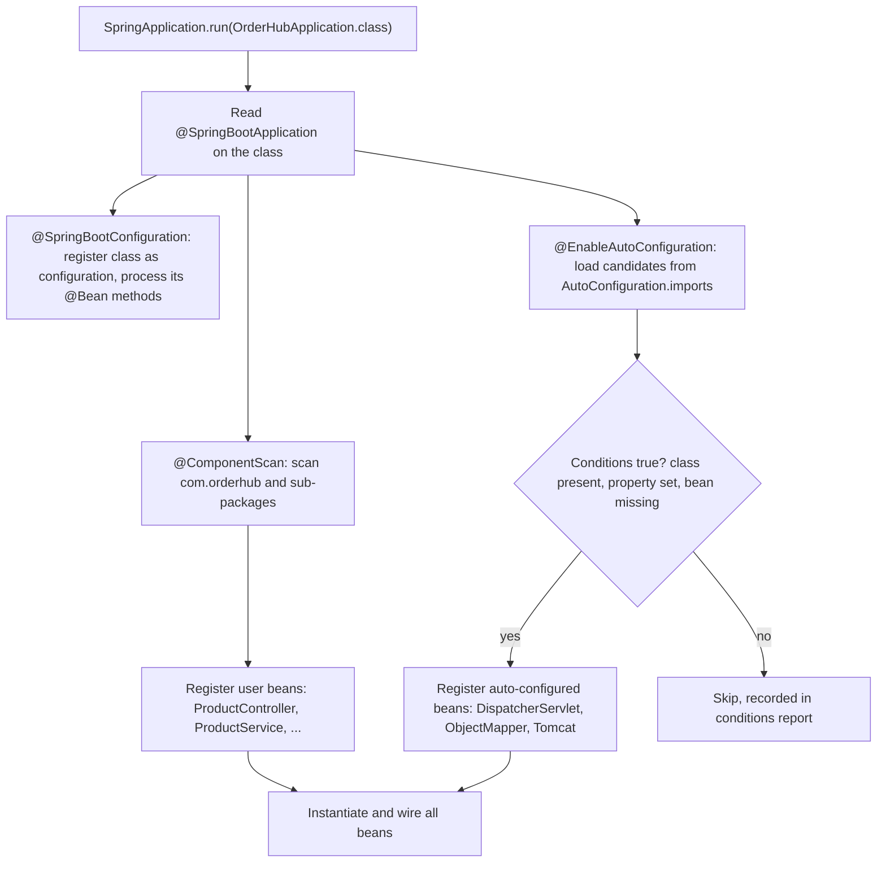
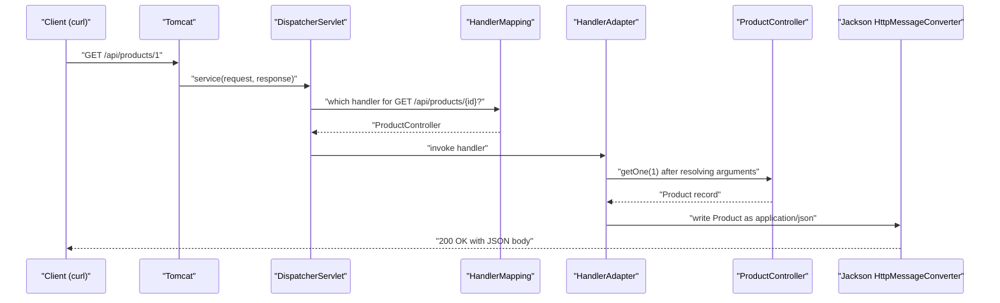
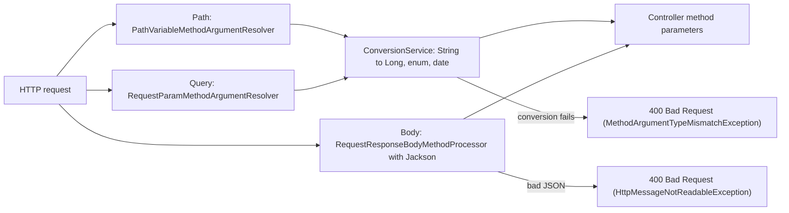

@@ 3 | TOPIC | @SpringBootApplication Explained | The three annotations inside it, component scanning rules, auto-configuration with conditions, exclusions and the conditions report | MUST
# @SpringBootApplication Explained

**Level: Beginner | Phase 5 | Priority: MUST | Since: Spring Boot 1.2 (@SpringBootApplication), @SpringBootConfiguration Boot 1.4; auto-configuration registered in `META-INF/spring/...AutoConfiguration.imports` since Boot 2.7**

> **30-second interview answer:** `@SpringBootApplication` is a convenience annotation that combines three others. `@SpringBootConfiguration` marks the class as a configuration class (a specialised `@Configuration`), so it can declare `@Bean` methods. `@ComponentScan` scans the class's package and all sub-packages for `@Component`, `@Service`, `@Repository`, `@Controller` and `@Configuration` classes. `@EnableAutoConfiguration` loads Boot's auto-configuration classes, each guarded by conditions like `@ConditionalOnClass` and `@ConditionalOnMissingBean`, so beans such as the `DispatcherServlet`, Jackson's `ObjectMapper` and embedded Tomcat are created only when relevant and only if I have not defined my own. I can exclude auto-configurations with `exclude` and see every decision with `--debug`.

## 1. Concept in Simple Words
### Analogy
The master switch in a smart house.

| Smart house | Spring Boot |
|---|---|
| One master switch at the front door | `@SpringBootApplication` on the main class |
| It turns on three circuits | Three meta-annotations |
| Circuit 1: the house's own blueprint, where you can add custom fittings | `@SpringBootConfiguration`: your `@Bean` methods |
| Circuit 2: walking every room of this floor and the floors below to find appliances | `@ComponentScan` from the main class's package downward |
| Circuit 3: a smart installer who fits a heater only if the house has gas and no heater yet | `@EnableAutoConfiguration` with conditions |
| You already brought your own heater, so the installer skips it | `@ConditionalOnMissingBean`: your bean wins |
| Telling the installer "never fit a security alarm" | `exclude = SecurityAutoConfiguration.class` |
| The installer's written report of what was fitted and why | Conditions evaluation report (`--debug`) |

### What it is
```java
@Target(ElementType.TYPE)
@Retention(RetentionPolicy.RUNTIME)
@Documented
@Inherited
@SpringBootConfiguration
@EnableAutoConfiguration
@ComponentScan(excludeFilters = { @Filter(type = FilterType.CUSTOM, classes = TypeExcludeFilter.class),
        @Filter(type = FilterType.CUSTOM, classes = AutoConfigurationExcludeFilter.class) })
public @interface SpringBootApplication {
    Class<?>[] exclude() default {};
    String[] excludeName() default {};
    String[] scanBasePackages() default {};
    Class<?>[] scanBasePackageClasses() default {};
    boolean proxyBeanMethods() default true;
}
```
(Simplified from the Spring Boot source; attributes are aliases for the inner annotations.)

- **Meta-annotation:** an annotation placed on another annotation; Spring treats the outer one as if all inner ones were present.
- **`@SpringBootConfiguration`:** itself annotated with `@Configuration`. There should be exactly one per application; Boot's tests use it to find the configuration to start.
- **`@ComponentScan`:** with no packages given, scans the package of the annotated class. The exclude filters stop it from picking up auto-configuration classes as normal components.
- **`@EnableAutoConfiguration`:** imports `AutoConfigurationImportSelector`, which reads the list of candidate classes from `META-INF/spring/org.springframework.boot.autoconfigure.AutoConfiguration.imports` in every jar (about 150 in Boot's own autoconfigure jar), then filters them by their conditions.
- **Condition annotations:** `@ConditionalOnClass`, `@ConditionalOnMissingClass`, `@ConditionalOnBean`, `@ConditionalOnMissingBean`, `@ConditionalOnProperty`, `@ConditionalOnWebApplication`, `@ConditionalOnResource`.

### Why it exists
Before Boot 1.2, every main class carried three annotations (`@Configuration`, `@EnableAutoConfiguration`, `@ComponentScan`). Since almost every app needs all three, Boot merged them into one. Auto-configuration itself exists so that adding a starter is enough to get working infrastructure, while still letting you replace any piece.

## 2. How It Works


**Order matters:** user configuration is processed first, auto-configuration last (it is a "deferred import"). That is what makes `@ConditionalOnMissingBean` work: by the time Boot asks "is there already an `ObjectMapper`?", your bean is already registered.

A real auto-configuration, simplified (Jackson):
```java
import com.fasterxml.jackson.databind.ObjectMapper;
import org.springframework.boot.autoconfigure.AutoConfiguration;
import org.springframework.boot.autoconfigure.condition.ConditionalOnClass;
import org.springframework.boot.autoconfigure.condition.ConditionalOnMissingBean;
import org.springframework.context.annotation.Bean;
import org.springframework.context.annotation.Primary;
import org.springframework.http.converter.json.Jackson2ObjectMapperBuilder;

@AutoConfiguration
@ConditionalOnClass(ObjectMapper.class)                  // only if Jackson is on the classpath
public class JacksonAutoConfiguration {

    @Bean
    @Primary
    @ConditionalOnMissingBean                            // back off if the user defined one
    ObjectMapper jacksonObjectMapper(Jackson2ObjectMapperBuilder builder) {
        return builder.createXmlMapper(false).build();
    }
}
```

Scanning rule illustrated:
```text
com.orderhub.OrderHubApplication          <- scanning starts here
com.orderhub.product.ProductService       <- found (sub-package)
com.orderhub.common.web.PingController    <- found (deeper sub-package)
com.orderhubextra.Tool                    <- NOT found (different package, despite the prefix)
com.example.Other                         <- NOT found
```

## 3. Code Example
### Code
`src/main/java/com/orderhub/OrderHubApplication.java`:
```java
package com.orderhub;

import java.time.Clock;
import java.util.Arrays;
import org.springframework.boot.CommandLineRunner;
import org.springframework.boot.SpringApplication;
import org.springframework.boot.autoconfigure.SpringBootApplication;
import org.springframework.boot.autoconfigure.jdbc.DataSourceAutoConfiguration;
import org.springframework.context.ApplicationContext;
import org.springframework.context.annotation.Bean;

// exclude: we have a JDBC driver on the classpath for later phases but no database yet
@SpringBootApplication(exclude = DataSourceAutoConfiguration.class)
public class OrderHubApplication {

    public static void main(String[] args) {
        SpringApplication.run(OrderHubApplication.class, args);
    }

    // Allowed because @SpringBootApplication includes @SpringBootConfiguration (a @Configuration)
    @Bean
    Clock clock() {
        return Clock.systemUTC();
    }

    // Runs once after the context has started: inspect what was created
    @Bean
    CommandLineRunner inspectBeans(ApplicationContext ctx) {
        return args -> {
            System.out.println("Bean count > 100       : " + (ctx.getBeanDefinitionCount() > 100));
            System.out.println("Has productService     : " + ctx.containsBean("productService"));
            System.out.println("Has clock              : " + ctx.containsBean("clock"));
            System.out.println("Has dispatcherServlet  : " + ctx.containsBean("dispatcherServlet"));
            System.out.println("Has jacksonObjectMapper: " + ctx.containsBean("jacksonObjectMapper"));
            System.out.println("Has dataSource         : " + ctx.containsBean("dataSource"));
            System.out.println("Has outsideTool        : " + Arrays.asList(ctx.getBeanDefinitionNames()).contains("outsideTool"));
        };
    }
}
```

`src/main/java/com/orderhub/product/ProductService.java` (inside the scanned tree):
```java
package com.orderhub.product;

import java.time.Clock;
import java.time.Instant;
import org.springframework.stereotype.Service;

@Service                                  // bean name defaults to "productService"
public class ProductService {
    private final Clock clock;

    public ProductService(Clock clock) {  // receives the Clock bean from the main class
        this.clock = clock;
    }

    public Instant now() {
        return clock.instant();
    }
}
```

`src/main/java/com/tools/OutsideTool.java` (outside the scanned tree):
```java
package com.tools;

import org.springframework.stereotype.Component;

@Component("outsideTool")
public class OutsideTool {               // never registered: com.tools is not under com.orderhub
}
```

`src/main/resources/application.yml`:
```yaml
spring:
  application:
    name: orderhub
  main:
    banner-mode: off            # quieter console for the demo
```

Run with the conditions report:
```bash
./mvnw spring-boot:run -Dspring-boot.run.arguments=--debug
```

### Walkthrough
- **`exclude = DataSourceAutoConfiguration.class`:** without a database URL, a JDBC driver on the classpath would make Boot try to configure a `DataSource` and fail. Excluding it switches that auto-configuration off entirely. The property form is `spring.autoconfigure.exclude`.
- **`@Bean Clock clock()`:** the main class is a configuration class, so it can define beans. Injecting a `Clock` makes time testable later (pass a fixed clock in tests).
- **`CommandLineRunner`:** a callback Boot calls after startup; handy for one-off checks or seeding demo data.
- **`ProductService`:** found by scanning because `com.orderhub.product` is under `com.orderhub`. Its default bean name is the class name with a lower-case first letter.
- **`OutsideTool`:** has `@Component` but lives in `com.tools`, so scanning never sees it. Fix with `@SpringBootApplication(scanBasePackages = {"com.orderhub", "com.tools"})` or, better, move it.
- **`dispatcherServlet` and `jacksonObjectMapper`:** created by auto-configuration because the web starter put Spring MVC and Jackson on the classpath.
- **`--debug`:** prints the conditions evaluation report: positive matches, negative matches and exclusions.

### Output
Runner output:
```text
Bean count > 100       : true
Has productService     : true
Has clock              : true
Has dispatcherServlet  : true
Has jacksonObjectMapper: true
Has dataSource         : false
Has outsideTool        : false
```

Conditions report with `--debug` (heavily trimmed):
```text
============================
CONDITIONS EVALUATION REPORT
============================

Positive matches:
-----------------
   DispatcherServletAutoConfiguration matched:
      - @ConditionalOnClass found required class 'org.springframework.web.servlet.DispatcherServlet' (OnClassCondition)
      - found 'session' scope (OnWebApplicationCondition)

   JacksonAutoConfiguration.JacksonObjectMapperConfiguration#jacksonObjectMapper matched:
      - @ConditionalOnMissingBean (types: com.fasterxml.jackson.databind.ObjectMapper; SearchStrategy: all) did not find any beans (OnBeanCondition)

Negative matches:
-----------------
   MongoAutoConfiguration:
      Did not match:
         - @ConditionalOnClass did not find required class 'com.mongodb.client.MongoClient' (OnClassCondition)

Exclusions:
-----------
    org.springframework.boot.autoconfigure.jdbc.DataSourceAutoConfiguration
```

### Compare
| Written as | Equivalent |
|---|---|
| `@SpringBootApplication` | `@SpringBootConfiguration` + `@EnableAutoConfiguration` + `@ComponentScan` |
| `@SpringBootApplication(exclude = X.class)` | `@EnableAutoConfiguration(exclude = X.class)` or property `spring.autoconfigure.exclude=...X` |
| `@SpringBootApplication(scanBasePackages = "a.b")` | `@ComponentScan("a.b")` |
| Boot 1.1 and earlier style | Three separate annotations on the main class |

## 4. Interview Questions
**Basic**
1. **What does `@SpringBootApplication` do?**
   It combines `@SpringBootConfiguration` (the class is a configuration source that can declare `@Bean` methods), `@ComponentScan` (scan this package and sub-packages for components) and `@EnableAutoConfiguration` (apply Boot's conditional auto-configurations). It is placed on the main class.
2. **Which packages does component scanning cover by default?**
   The package of the class annotated with `@SpringBootApplication` and all its sub-packages. Anything else must be added with `scanBasePackages` or imported explicitly.
3. **How do you disable a specific auto-configuration?**
   `@SpringBootApplication(exclude = DataSourceAutoConfiguration.class)`, `excludeName` for classes not on the classpath, or the property `spring.autoconfigure.exclude`.

**Follow-up**
4. **How does auto-configuration know what to configure?**
   Boot reads candidate classes listed in `META-INF/spring/org.springframework.boot.autoconfigure.AutoConfiguration.imports`. Each is a configuration class guarded by conditions on classes, beans, properties and application type; only those whose conditions pass contribute beans.
5. **How do you override a bean that Boot auto-configures?**
   Define your own bean of the same type. Most auto-configured beans use `@ConditionalOnMissingBean`, and user configuration is processed before auto-configuration, so Boot backs off. Often a property (for example `spring.jackson.*`) is enough without a custom bean.
6. **How can you see which auto-configurations were applied?**
   Start with `--debug` (or `debug=true`) to print the conditions evaluation report, or expose the Actuator `conditions` endpoint.

**Tricky / scenario**
7. **Can you have two classes annotated with `@SpringBootApplication`?**
   It compiles, but tests that search for `@SpringBootConfiguration` find ambiguity and fail, and if one is in a sub-package of the other, scanning registers the second as a configuration too, duplicating work. Keep exactly one.
8. **After adding `spring-boot-starter-data-jpa`, the app fails with "Failed to configure a DataSource: 'url' attribute is not specified". Why?**
   The starter put JPA and JDBC on the classpath, so `DataSourceAutoConfiguration` tried to create a `DataSource` and found no URL and no embedded database. Configure `spring.datasource.url`, add an embedded database like H2 for development, or exclude the auto-configuration until you need it.
9. **Your class `com.orderhubtools.Helper` is not picked up although the main class is in `com.orderhub`. Why?**
   Scanning is by package hierarchy, not string prefix: `com.orderhubtools` is a sibling of `com.orderhub`, not a sub-package.

**What the interviewer is really testing:** whether you can open the "magic box" and explain scanning, conditional auto-configuration and how to override or debug it.

## 5. Pitfalls & Best Practices
### Common mistakes
| Mistake | What goes wrong | Fix |
|---|---|---|
| Main class in a deep package | Beans in sibling packages missing, 404s | Root package |
| Adding `@ComponentScan("com.orderhub.web")` next to `@SpringBootApplication` | Replaces the default scan, other packages lost | Use `scanBasePackages` with all packages, or remove |
| Defining beans with the same name as auto-configured ones | Bean override error (overriding disabled by default since Boot 2.1) | Use a different name or rely on `@ConditionalOnMissingBean` by type |
| Using `exclude` to hide a misconfiguration | Feature silently missing | Configure it properly |
| Large business logic in the main class | Untestable, cluttered | Keep the main class tiny |

### Best practices
- One `@SpringBootApplication` class, in the root package, containing only `main` and maybe a few infrastructure `@Bean`s.
- Prefer properties over custom beans to tune auto-configured components.
- Learn to read the conditions report; it answers "why is this bean (not) here?".
- Put infrastructure beans in dedicated `@Configuration` classes (`com.orderhub.common.config`) as the app grows.

### Compare with
| Annotation | Role |
|---|---|
| `@Configuration` | Class with `@Bean` methods |
| `@SpringBootConfiguration` | `@Configuration` that tests discover as the main configuration |
| `@ComponentScan` | Find annotated classes in packages |
| `@EnableAutoConfiguration` | Apply conditional auto-configuration |
| `@Import(X.class)` | Register specific configuration classes explicitly |

## 6. Hands-on Exercise
In OrderHub:
1. Add a `CommandLineRunner` bean that prints how many beans exist and whether `dispatcherServlet` is present.
2. Define your own `ObjectMapper` bean in `com.orderhub.common.config.JsonConfig` that enables pretty printing (`SerializationFeature.INDENT_OUTPUT`), and prove Boot backed off by checking the conditions report.
3. Create `com.orderhubtools.Helper` with `@Component` and show it is not loaded; then fix it with `scanBasePackages`.
4. Exclude `DataSourceAutoConfiguration` using the property instead of the annotation attribute.

Acceptance criteria: JSON responses are pretty-printed; the conditions report lists `jacksonObjectMapper` under negative matches with "found beans of type ObjectMapper"; the helper bean exists after the fix.

<details><summary>Solution</summary>

```java
package com.orderhub.common.config;

import com.fasterxml.jackson.databind.ObjectMapper;
import com.fasterxml.jackson.databind.SerializationFeature;
import com.fasterxml.jackson.datatype.jsr310.JavaTimeModule;
import org.springframework.context.annotation.Bean;
import org.springframework.context.annotation.Configuration;

@Configuration
public class JsonConfig {

    @Bean
    public ObjectMapper objectMapper() {
        return new ObjectMapper()
                .registerModule(new JavaTimeModule())                       // Instant, LocalDate support
                .disable(SerializationFeature.WRITE_DATES_AS_TIMESTAMPS)
                .enable(SerializationFeature.INDENT_OUTPUT);
    }
}
```

```java
package com.orderhub;

import org.springframework.boot.CommandLineRunner;
import org.springframework.boot.SpringApplication;
import org.springframework.boot.autoconfigure.SpringBootApplication;
import org.springframework.context.ApplicationContext;
import org.springframework.context.annotation.Bean;

@SpringBootApplication(scanBasePackages = {"com.orderhub", "com.orderhubtools"})
public class OrderHubApplication {
    public static void main(String[] args) {
        SpringApplication.run(OrderHubApplication.class, args);
    }

    @Bean
    CommandLineRunner report(ApplicationContext ctx) {
        return args -> System.out.println("beans=" + ctx.getBeanDefinitionCount()
                + " dispatcherServlet=" + ctx.containsBean("dispatcherServlet")
                + " helper=" + ctx.containsBean("helper"));
    }
}
```

```yaml
spring:
  autoconfigure:
    exclude: org.springframework.boot.autoconfigure.jdbc.DataSourceAutoConfiguration
```

Conditions report excerpt:
```text
Negative matches:
   JacksonAutoConfiguration.JacksonObjectMapperConfiguration#jacksonObjectMapper:
      Did not match:
         - @ConditionalOnMissingBean (types: com.fasterxml.jackson.databind.ObjectMapper; SearchStrategy: all) found beans of type 'com.fasterxml.jackson.databind.ObjectMapper' objectMapper (OnBeanCondition)
```
A simpler alternative for pretty printing is the property `spring.jackson.serialization.indent-output: true`, which keeps Boot's own `ObjectMapper` and its other defaults. Prefer properties when they exist.
</details>

## 7. Recall
Q: Which three annotations does `@SpringBootApplication` combine?
A: `@SpringBootConfiguration`, `@EnableAutoConfiguration` and `@ComponentScan`.

Q: Which packages does `@SpringBootApplication` scan by default?
A: The annotated class's package and all its sub-packages.

Q: How do you exclude an auto-configuration in Spring Boot?
A: `@SpringBootApplication(exclude = X.class)` or the property `spring.autoconfigure.exclude`.

Q: Why does defining your own `ObjectMapper` bean disable Boot's default one?
A: The auto-configured bean is guarded by `@ConditionalOnMissingBean`, and user beans are registered before auto-configuration runs.

Q: How do you print Spring Boot's auto-configuration decisions?
A: Run with `--debug` to get the conditions evaluation report.

**Related:** [[What Spring and Spring Boot Are]] · [[Auto-Configuration Internals]] · [[Conditional Beans]] · [[Stereotype Annotations]]

@@ 2 | MODULE | Your first API | Controllers, request data, configuration, layers, DTOs and Lombok for a first REST service | MUST
# Your first API

**Shared analogy: a restaurant.** The **controller** is the waiter: takes the order at the table (HTTP request), checks it is readable, passes it to the kitchen and brings back the plate (JSON response). Where the order details come from matters: the table number is in the address (`@PathVariable`), preferences like "no onions" are optional notes (`@RequestParam`), and a full written order is handed over on paper (`@RequestBody`). The **service** is the chef who applies the recipes (business rules), the **repository** is the pantry (data storage), and **DTOs** are the menu and the plated dish: customers never see the raw ingredients' supplier prices. The **configuration file** is the restaurant's settings board (opening hours, port). **Lombok** is a label printer that saves writing the same labels (getters, constructors) by hand, handy but you must know what it prints.

By the end of this group OrderHub v1 has a full in-memory product API.

@@ 3 | TOPIC | First REST Controller | @RestController vs @Controller, @GetMapping, how DispatcherServlet routes a request and how Jackson writes JSON | MUST
# First REST Controller

**Level: Beginner | Phase 5 | Priority: MUST | Since: Spring 4.0 (@RestController), Spring 4.3 (@GetMapping and friends); Spring Framework 6.2 baseline**

> **30-second interview answer:** A REST controller is a class annotated with `@RestController`, which is `@Controller` plus `@ResponseBody`: every handler method's return value is written directly into the HTTP response body, usually as JSON via Jackson, instead of being treated as a view name. Methods are mapped to URLs and HTTP methods with `@RequestMapping` or its shortcuts `@GetMapping`, `@PostMapping`, `@PutMapping`, `@PatchMapping` and `@DeleteMapping`. Behind the scenes, the `DispatcherServlet` receives every request, finds the matching handler method through `HandlerMapping`, calls it, and uses an `HttpMessageConverter` to serialize the result. Returning `ResponseEntity` gives full control over status code and headers.

## 1. Concept in Simple Words
### Analogy
A hotel reception desk.

| Hotel | Spring MVC |
|---|---|
| Every guest enters through one front door to one receptionist | `DispatcherServlet` (front controller pattern) |
| The receptionist checks a directory: "room service → extension 12" | `HandlerMapping`: URL + HTTP method → controller method |
| The staff member who handles that request | Your `@GetMapping` method |
| A translator who writes the answer in the guest's language | `HttpMessageConverter` (Jackson for JSON) |
| A note on the reply: "urgent", "delivered" | Status code and headers (`ResponseEntity`) |
| A concierge who hands you a brochure instead of an answer | Classic `@Controller` returning a view name (HTML page) |

### What it is
- **REST endpoint:** a URL plus HTTP method that clients call, for example `GET /api/products`. Full REST design rules are in [[REST Principles, HTTP Methods and Status Codes]] (Phase 11).
- **`@Controller`:** marks a Spring MVC controller bean. By default, a returned `String` is a view name resolved to a template.
- **`@ResponseBody`:** "write the return value into the response body". On a class, it applies to all methods.
- **`@RestController`:** `@Controller` + `@ResponseBody`, the standard for JSON APIs.
- **`@RequestMapping`:** maps URLs; at class level it sets a common prefix like `/api/products`.
- **`@GetMapping`, `@PostMapping`, ...:** shortcuts for `@RequestMapping(method = ...)`.
- **Jackson:** the JSON library Boot auto-configures. It turns objects into JSON using getters or record components, and JSON into objects.
- **`ResponseEntity<T>`:** a return type wrapping body, status and headers.

### Why it exists
The Servlet API (Java's low-level web standard) forces you to parse URLs, read raw streams and write strings by hand in one big `doGet` method. Spring MVC lets you write small annotated methods with typed parameters and return plain objects; the framework handles routing, conversion and errors.

## 2. How It Works


What Spring does behind the annotations:
1. At startup, `RequestMappingHandlerMapping` scans every `@Controller` bean and builds a registry of mappings (URL pattern, HTTP method, consumes/produces).
2. Per request, the `DispatcherServlet` asks the mapping for the best match. No match means 404; a URL match with the wrong method means 405 Method Not Allowed.
3. `RequestMappingHandlerAdapter` resolves each parameter with argument resolvers (path variables, query params, body).
4. The return value goes to a return-value handler. With `@ResponseBody`, it picks a converter based on the `Accept` header and the return type: Jackson for objects, a string converter for `String`.
5. Exceptions go to exception resolvers; by default Boot's `/error` endpoint renders a JSON error body.

**Content negotiation:** for an object return value, Jackson writes `application/json`. A plain `String` return value is written as `text/plain`.

## 3. Code Example
### Code
`src/main/java/com/orderhub/product/Product.java`:
```java
package com.orderhub.product;

import java.math.BigDecimal;

// A record: immutable, with accessors that Jackson uses as JSON properties
public record Product(Long id, String sku, String name, BigDecimal price, int stock) {
}
```

`src/main/java/com/orderhub/product/ProductController.java`:
```java
package com.orderhub.product;

import java.math.BigDecimal;
import java.util.List;
import java.util.Map;
import org.springframework.http.HttpStatus;
import org.springframework.http.ResponseEntity;
import org.springframework.web.bind.annotation.GetMapping;
import org.springframework.web.bind.annotation.PathVariable;
import org.springframework.web.bind.annotation.RequestMapping;
import org.springframework.web.bind.annotation.RestController;

@RestController                        // = @Controller + @ResponseBody
@RequestMapping("/api/products")       // common prefix for all methods
public class ProductController {

    // Hard-coded data for now; the service and repository layers arrive two topics later
    private final List<Product> products = List.of(
            new Product(1L, "KB-01", "Keyboard", new BigDecimal("45.00"), 10),
            new Product(2L, "MS-01", "Mouse", new BigDecimal("25.00"), 0));

    // GET /api/products -> JSON array
    @GetMapping
    public List<Product> list() {
        return products;
    }

    // GET /api/products/1 -> one product, or 404 with ResponseEntity
    @GetMapping("/{id}")
    public ResponseEntity<Product> getOne(@PathVariable Long id) {
        return products.stream()
                .filter(p -> p.id().equals(id))
                .findFirst()
                .map(ResponseEntity::ok)                          // 200 with body
                .orElse(ResponseEntity.notFound().build());       // 404 without body
    }

    // GET /api/products/count -> {"count":2}; more specific than /{id}, so it wins
    @GetMapping("/count")
    public Map<String, Integer> count() {
        return Map.of("count", products.size());
    }

    // GET /api/products/ping -> plain text
    @GetMapping("/ping")
    public String ping() {
        return "products-ok";
    }

    // Custom status and header
    @GetMapping("/in-stock")
    public ResponseEntity<List<Product>> inStock() {
        List<Product> available = products.stream().filter(p -> p.stock() > 0).toList();
        return ResponseEntity.status(HttpStatus.OK)
                .header("X-Total-Count", String.valueOf(available.size()))
                .body(available);
    }
}
```

`src/main/resources/application.yml`:
```yaml
spring:
  application:
    name: orderhub
  jackson:
    default-property-inclusion: non_null   # omit null fields from JSON
```

### Walkthrough
- **`Product` record:** Jackson (2.12+) serializes records using their component names: `id`, `sku`, `name`, `price`, `stock`. `BigDecimal` becomes a JSON number.
- **`@RequestMapping("/api/products")`:** every method path is relative to this prefix.
- **`list()`:** returning a `List` gives a JSON array; no manual JSON code.
- **`getOne`:** `@PathVariable Long id` takes `{id}` from the URL and converts it to `Long`. `ResponseEntity.ok(body)` gives 200; `notFound().build()` gives 404 with an empty body.
- **`/count` vs `/{id}`:** Spring prefers the more specific pattern (a literal segment beats a variable), so `/count` is not treated as an id.
- **`ping()`:** a `String` return value goes through `StringHttpMessageConverter`, so the content type is `text/plain`.
- **`inStock()`:** shows setting a header and status explicitly with the `ResponseEntity` builder.

### Output
```http
GET /api/products HTTP/1.1
Host: localhost:8080

HTTP/1.1 200
Content-Type: application/json

[{"id":1,"sku":"KB-01","name":"Keyboard","price":45.00,"stock":10},{"id":2,"sku":"MS-01","name":"Mouse","price":25.00,"stock":0}]
```

```http
GET /api/products/1 HTTP/1.1

HTTP/1.1 200
Content-Type: application/json

{"id":1,"sku":"KB-01","name":"Keyboard","price":45.00,"stock":10}
```

```http
GET /api/products/99 HTTP/1.1

HTTP/1.1 404
Content-Length: 0
```

```http
GET /api/products/count HTTP/1.1

HTTP/1.1 200
Content-Type: application/json

{"count":2}
```

```http
GET /api/products/ping HTTP/1.1

HTTP/1.1 200
Content-Type: text/plain;charset=UTF-8

products-ok
```

```http
GET /api/products/in-stock HTTP/1.1

HTTP/1.1 200
X-Total-Count: 1
Content-Type: application/json

[{"id":1,"sku":"KB-01","name":"Keyboard","price":45.00,"stock":10}]
```

```http
DELETE /api/products/1 HTTP/1.1

HTTP/1.1 405
Allow: GET
Content-Type: application/json

{"timestamp":"2026-11-24T10:02:11.104+00:00","status":405,"error":"Method Not Allowed","path":"/api/products/1"}
```

### Compare
| | `@Controller` | `@RestController` |
|---|---|---|
| Return value meaning | View name (template) unless the method has `@ResponseBody` | Response body |
| Typical output | HTML via Thymeleaf | JSON |
| Annotation composition | `@Component` | `@Controller` + `@ResponseBody` |
| Use | Server-rendered web pages | REST APIs |

| Return type | What the client gets |
|---|---|
| Object or record | 200 + JSON |
| `List<T>` | 200 + JSON array |
| `String` | 200 + text/plain |
| `ResponseEntity<T>` | Your status, headers and body |
| `void` | 200 with an empty body |

## 4. Interview Questions
**Basic**
1. **What is the difference between `@Controller` and `@RestController`?**
   `@RestController` is `@Controller` plus `@ResponseBody`, so return values are serialized into the response body (JSON) rather than resolved as view names. Use `@RestController` for APIs and `@Controller` for server-rendered pages.
2. **What does `@RequestMapping` do, and what are its shortcuts?**
   It maps a URL pattern (and optionally HTTP method, headers, content types) to a class or method. `@GetMapping`, `@PostMapping`, `@PutMapping`, `@PatchMapping` and `@DeleteMapping` are shortcuts with the method fixed.
3. **How does an object become JSON?**
   Spring MVC picks an `HttpMessageConverter` for the return type and the client's `Accept` header; for objects that is `MappingJackson2HttpMessageConverter`, which uses Jackson's `ObjectMapper` to write getters or record components as JSON fields.

**Follow-up**
4. **What is the `DispatcherServlet`?**
   The single front controller servlet that Boot registers automatically. It receives every request, finds the handler through `HandlerMapping`, invokes it through a `HandlerAdapter`, converts the result and delegates errors to exception resolvers.
5. **When would you return `ResponseEntity`?**
   When you need to control the status code (201, 204, 404) or headers (`Location`, caching, custom headers). For simple 200 responses, returning the object is cleaner.
6. **What happens if no handler matches, or the path matches but the method does not?**
   No match gives 404 Not Found; a path match with the wrong HTTP method gives 405 Method Not Allowed with an `Allow` header. Boot renders both through its `/error` JSON.

**Tricky / scenario**
7. **You return a `String` from a `@Controller` (not `@RestController`) and get a 404 or "Circular view path" error. Why?**
   In a plain `@Controller`, a `String` is a view name; Spring looks for a template with that name and fails. Add `@ResponseBody` or use `@RestController`.
8. **Both `/api/products/{id}` and `/api/products/count` exist. Which handles `/api/products/count`?**
   The literal `/count` mapping, because Spring ranks patterns by specificity: fewer variables and wildcards win.
9. **Are controller beans thread-safe?**
   A controller is a singleton shared by all request threads. It is safe as long as it holds no mutable state; keep request data in local variables and parameters, and inject only thread-safe collaborators.

**What the interviewer is really testing:** whether you can trace a request through `DispatcherServlet` to your method and back, rather than just knowing annotation names.

## 5. Pitfalls & Best Practices
### Common mistakes
| Mistake | What goes wrong | Fix |
|---|---|---|
| `@Controller` returning objects without `@ResponseBody` | View resolution errors | `@RestController` |
| Mutable fields in a controller (counters, lists) | Race conditions between request threads | Stateless controllers; state in services with thread-safe structures |
| Returning `null` for "not found" | 200 with empty body, confusing clients | 404 via `ResponseEntity.notFound()` or an exception |
| Business logic inside controllers | Hard to test and reuse | Move it to a service |
| Class without getters returned as JSON | Jackson fails: "No serializer found" | Use records or add getters |

### Best practices
- Prefix APIs with `/api` and use plural nouns (`/api/products`).
- Keep controllers thin: parse input, call a service, map the result.
- Return records or DTOs, never internal objects with sensitive fields (see [[DTOs and Mapping]]).
- Use `ResponseEntity` only where status or headers vary.
- Check `/actuator/mappings` (when exposed) to list every registered endpoint.

### Compare with
| Approach | Use |
|---|---|
| Spring MVC `@RestController` | Default, blocking, servlet-based |
| Spring WebFlux `@RestController` | Reactive, returns `Mono` or `Flux` (Phase 22) |
| Functional endpoints (`RouterFunction`) | Routes defined in code instead of annotations |
| Raw servlet | Never for new code |

## 6. Hands-on Exercise
Extend OrderHub's `ProductController`:
1. Add `GET /api/products/cheapest` returning the product with the lowest price.
2. Add `GET /api/products/{id}/available` returning `{"id":1,"available":true}` based on stock, or 404 if the id does not exist.
3. Add `GET /api/products/version` returning plain text `v1`.

Acceptance criteria: correct content types (JSON vs text), 404 for unknown ids, and no `/cheapest` or `/version` request is treated as an id.

<details><summary>Solution</summary>

```java
package com.orderhub.product;

import java.math.BigDecimal;
import java.util.Comparator;
import java.util.List;
import java.util.Map;
import org.springframework.http.ResponseEntity;
import org.springframework.web.bind.annotation.GetMapping;
import org.springframework.web.bind.annotation.PathVariable;
import org.springframework.web.bind.annotation.RequestMapping;
import org.springframework.web.bind.annotation.RestController;

@RestController
@RequestMapping("/api/products")
public class ProductController {
    private final List<Product> products = List.of(
            new Product(1L, "KB-01", "Keyboard", new BigDecimal("45.00"), 10),
            new Product(2L, "MS-01", "Mouse", new BigDecimal("25.00"), 0));

    @GetMapping("/cheapest")
    public ResponseEntity<Product> cheapest() {
        return products.stream()
                .min(Comparator.comparing(Product::price))
                .map(ResponseEntity::ok)
                .orElse(ResponseEntity.noContent().build());   // 204 if the list is empty
    }

    @GetMapping("/{id}/available")
    public ResponseEntity<Map<String, Object>> available(@PathVariable Long id) {
        return products.stream()
                .filter(p -> p.id().equals(id))
                .findFirst()
                .map(p -> ResponseEntity.ok(Map.<String, Object>of("id", p.id(), "available", p.stock() > 0)))
                .orElse(ResponseEntity.notFound().build());
    }

    @GetMapping("/version")
    public String version() {
        return "v1";
    }
}
```

```http
GET /api/products/cheapest HTTP/1.1

HTTP/1.1 200
Content-Type: application/json

{"id":2,"sku":"MS-01","name":"Mouse","price":25.00,"stock":0}
```

```http
GET /api/products/2/available HTTP/1.1

HTTP/1.1 200
Content-Type: application/json

{"id":2,"available":false}
```
(`Map.of` does not guarantee key order, so the two fields may appear in either order; use a `LinkedHashMap` or a record when order matters.)
</details>

## 7. Recall
Q: What two annotations does `@RestController` combine?
A: `@Controller` and `@ResponseBody`.

Q: Which component receives every HTTP request in Spring MVC?
A: The `DispatcherServlet` (front controller).

Q: What converts a returned object into JSON in Spring Boot?
A: Jackson, through `MappingJackson2HttpMessageConverter`.

Q: What status does Spring MVC return when the path matches but the HTTP method does not?
A: 405 Method Not Allowed.

Q: When should a controller method return `ResponseEntity`?
A: When it must control the status code or headers, such as 201, 204, 404 or a `Location` header.

**Related:** [[Path Variables, Request Params and Request Body]] · [[@RestController and Request Mapping Deep Dive]] · [[DispatcherServlet Request Lifecycle]]

@@ 3 | TOPIC | Path Variables, Request Params and Request Body | Reading data from the URL path, the query string and the JSON body, with defaults, optional values, type conversion and 400 errors | MUST
# Path Variables, Request Params and Request Body

**Level: Beginner | Phase 5 | Priority: MUST | Since: Spring 3.0 (@PathVariable, @RequestBody), Spring 2.5 (@RequestParam); records as request bodies with Jackson 2.12+**

> **30-second interview answer:** Spring MVC fills handler method parameters from different parts of the request. `@PathVariable` reads a segment of the URL path, like the `42` in `/api/products/42`, and identifies a resource. `@RequestParam` reads query-string parameters like `?minPrice=10&page=2`, typically for filtering, sorting and paging; they can be optional with `required = false`, `defaultValue` or `Optional`. `@RequestBody` deserializes the request body (JSON) into an object with Jackson, used for POST, PUT and PATCH. Spring converts strings to the declared types and returns 400 Bad Request when a required value is missing, cannot be converted, or the JSON is malformed.

## 1. Concept in Simple Words
### Analogy
Sending a parcel.

| Parcel | HTTP request |
|---|---|
| The street address: identifies exactly which house | Path variable: `/api/products/42` identifies product 42 |
| Sticky notes on the box: "leave at door", "fragile", optional | Query parameters: `?inStock=true&sort=price` |
| The contents inside the box | Request body: the JSON product to create |
| A wrong address that cannot exist ("house number banana") | Type mismatch → 400 Bad Request |
| An empty box when contents were required | Missing body → 400 |
| A note with "default: leave at door" printed on it | `defaultValue` |

### What it is
- **Path variable:** a placeholder in the mapping, `@GetMapping("/{id}")`, bound with `@PathVariable Long id`. Part of the resource's identity; always required by default.
- **Request parameter:** `name=value` pairs after `?` in the URL (or form fields). Bound with `@RequestParam`. Required by default unless `required = false`, `defaultValue` is set, or the type is `Optional<T>`.
- **Request body:** the payload of the request; for JSON, `Content-Type: application/json`. Bound with `@RequestBody`; Jackson creates the object. Only one `@RequestBody` per method.
- **Type conversion:** Spring's `ConversionService` converts strings to `int`, `Long`, `BigDecimal`, `boolean`, enums, `LocalDate` (with `@DateTimeFormat` or ISO format), lists (`?tag=a&tag=b`).
- **Parameter names:** Spring matches `@PathVariable Long id` to `{id}` using the compiled parameter name; Boot's Maven parent compiles with `-parameters`, so names work. Otherwise write `@PathVariable("id")`.

| | `@PathVariable` | `@RequestParam` | `@RequestBody` |
|---|---|---|---|
| Source | URL path segment | Query string or form data | Body (JSON) |
| Typical use | Identify a resource | Filter, sort, page, options | Create or update data |
| Required by default | Yes | Yes | Yes |
| Example | `/products/42` | `/products?minPrice=10` | `{"name":"Mouse"}` |
| Typical HTTP methods | All | Mostly GET | POST, PUT, PATCH |

### Why it exists
Each kind of data has a natural place in HTTP. Mapping them to typed Java parameters removes parsing code (`request.getParameter("id")`, `Long.parseLong`, reading the input stream, JSON parsing) and gives consistent error handling for bad input.

## 2. How It Works
```text
POST /api/products/search/electronics?minPrice=10&inStock=true HTTP/1.1
Content-Type: application/json

{"keywords": ["wireless", "usb"]}

@PostMapping("/search/{category}")
search(@PathVariable String category,                 <- "electronics" (path)
       @RequestParam BigDecimal minPrice,              <- "10" converted to BigDecimal (query)
       @RequestParam(defaultValue = "false") boolean inStock,   <- "true" (query)
       @RequestBody SearchRequest body)                <- JSON -> record via Jackson (body)
```



Errors Spring raises automatically (all rendered as 400 by default):

| Situation | Exception |
|---|---|
| Required query param missing | `MissingServletRequestParameterException` |
| `?minPrice=abc` for a `BigDecimal` | `MethodArgumentTypeMismatchException` |
| `/products/abc` for a `Long` id | `MethodArgumentTypeMismatchException` |
| Malformed or missing JSON body | `HttpMessageNotReadableException` |
| Wrong `Content-Type` for a body | 415 Unsupported Media Type (`HttpMediaTypeNotSupportedException`) |

## 3. Code Example
### Code
`src/main/java/com/orderhub/product/Category.java`:
```java
package com.orderhub.product;

public enum Category { ELECTRONICS, BOOKS, OFFICE }
```

`src/main/java/com/orderhub/product/Product.java`:
```java
package com.orderhub.product;

import java.math.BigDecimal;

public record Product(Long id, String sku, String name, Category category, BigDecimal price, int stock) {
}
```

`src/main/java/com/orderhub/product/NewProduct.java` (the JSON body for creation):
```java
package com.orderhub.product;

import java.math.BigDecimal;

public record NewProduct(String sku, String name, Category category, BigDecimal price, int stock) {
}
```

`src/main/java/com/orderhub/product/ProductController.java`:
```java
package com.orderhub.product;

import java.math.BigDecimal;
import java.net.URI;
import java.util.ArrayList;
import java.util.Comparator;
import java.util.List;
import java.util.Optional;
import java.util.concurrent.CopyOnWriteArrayList;
import java.util.concurrent.atomic.AtomicLong;
import org.springframework.http.ResponseEntity;
import org.springframework.web.bind.annotation.GetMapping;
import org.springframework.web.bind.annotation.PathVariable;
import org.springframework.web.bind.annotation.PostMapping;
import org.springframework.web.bind.annotation.RequestBody;
import org.springframework.web.bind.annotation.RequestMapping;
import org.springframework.web.bind.annotation.RequestParam;
import org.springframework.web.bind.annotation.RestController;

@RestController
@RequestMapping("/api/products")
public class ProductController {

    // Temporary in-controller storage (thread-safe); moves to a repository in the next topics
    private final List<Product> products = new CopyOnWriteArrayList<>(List.of(
            new Product(1L, "KB-01", "Keyboard", Category.ELECTRONICS, new BigDecimal("45.00"), 10),
            new Product(2L, "MS-01", "Mouse", Category.ELECTRONICS, new BigDecimal("25.00"), 0),
            new Product(3L, "BK-01", "Clean Code", Category.BOOKS, new BigDecimal("38.50"), 4)));
    private final AtomicLong nextId = new AtomicLong(4);

    // 1. Path variable: GET /api/products/3
    @GetMapping("/{id}")
    public ResponseEntity<Product> byId(@PathVariable Long id) {
        return products.stream().filter(p -> p.id().equals(id)).findFirst()
                .map(ResponseEntity::ok)
                .orElse(ResponseEntity.notFound().build());
    }

    // 2. Two path variables, one with an explicit name: GET /api/products/category/BOOKS/sku/BK-01
    @GetMapping("/category/{cat}/sku/{sku}")
    public ResponseEntity<Product> byCategoryAndSku(@PathVariable("cat") Category category,
                                                    @PathVariable String sku) {
        return products.stream()
                .filter(p -> p.category() == category && p.sku().equals(sku))
                .findFirst()
                .map(ResponseEntity::ok)
                .orElse(ResponseEntity.notFound().build());
    }

    // 3. Optional query params: GET /api/products?category=ELECTRONICS&minPrice=30&inStock=true&sort=price
    @GetMapping
    public List<Product> search(@RequestParam(required = false) Category category,
                                @RequestParam Optional<BigDecimal> minPrice,
                                @RequestParam(defaultValue = "false") boolean inStock,
                                @RequestParam(defaultValue = "id") String sort) {
        List<Product> result = new ArrayList<>();
        for (Product p : products) {
            if (category != null && p.category() != category) continue;
            if (minPrice.isPresent() && p.price().compareTo(minPrice.get()) < 0) continue;
            if (inStock && p.stock() == 0) continue;
            result.add(p);
        }
        Comparator<Product> order = switch (sort) {
            case "price" -> Comparator.comparing(Product::price);
            case "name" -> Comparator.comparing(Product::name);
            default -> Comparator.comparing(Product::id);
        };
        result.sort(order);
        return result;
    }

    // 4. Required query param plus multi-valued param: GET /api/products/by-skus?sku=KB-01&sku=BK-01
    @GetMapping("/by-skus")
    public List<Product> bySkus(@RequestParam("sku") List<String> skus) {
        return products.stream().filter(p -> skus.contains(p.sku())).toList();
    }

    // 5. Request body: POST /api/products with JSON
    @PostMapping
    public ResponseEntity<Product> create(@RequestBody NewProduct body) {
        Product saved = new Product(nextId.getAndIncrement(), body.sku(), body.name(),
                body.category(), body.price(), body.stock());
        products.add(saved);
        return ResponseEntity.created(URI.create("/api/products/" + saved.id())).body(saved);  // 201
    }
}
```

### Walkthrough
- **`byId`:** `{id}` in the mapping, `@PathVariable Long id` in the method. "3" becomes `3L`; "abc" causes a 400 before the method runs.
- **`byCategoryAndSku`:** the variable name `cat` differs from the parameter name, so it is given explicitly. Spring converts "BOOKS" to the enum constant; an unknown value like "TOYS" is a 400.
- **`search`:** three ways to make a param optional: `required = false` (null when absent, so use a wrapper type, not `boolean`), `Optional<BigDecimal>`, and `defaultValue` (which also implies not required). All filters are combinable.
- **`bySkus`:** repeated `sku` parameters bind to a `List<String>`; `?sku=KB-01,BK-01` also works (comma-separated).
- **`create`:** Jackson reads the JSON body into the `NewProduct` record using its canonical constructor. `ResponseEntity.created(uri)` returns 201 with a `Location` header pointing at the new resource.
- **Thread safety:** the list is a `CopyOnWriteArrayList` and the id an `AtomicLong`, because a controller is a singleton used by many request threads at once.

### Output
```http
GET /api/products/3 HTTP/1.1

HTTP/1.1 200
Content-Type: application/json

{"id":3,"sku":"BK-01","name":"Clean Code","category":"BOOKS","price":38.50,"stock":4}
```

```http
GET /api/products/category/BOOKS/sku/BK-01 HTTP/1.1

HTTP/1.1 200
Content-Type: application/json

{"id":3,"sku":"BK-01","name":"Clean Code","category":"BOOKS","price":38.50,"stock":4}
```

```http
GET /api/products?category=ELECTRONICS&minPrice=30&sort=price HTTP/1.1

HTTP/1.1 200
Content-Type: application/json

[{"id":1,"sku":"KB-01","name":"Keyboard","category":"ELECTRONICS","price":45.00,"stock":10}]
```

```http
GET /api/products?inStock=true&sort=price HTTP/1.1

HTTP/1.1 200
Content-Type: application/json

[{"id":3,"sku":"BK-01","name":"Clean Code","category":"BOOKS","price":38.50,"stock":4},{"id":1,"sku":"KB-01","name":"Keyboard","category":"ELECTRONICS","price":45.00,"stock":10}]
```

```http
GET /api/products/by-skus?sku=KB-01&sku=BK-01 HTTP/1.1

HTTP/1.1 200
Content-Type: application/json

[{"id":1,"sku":"KB-01","name":"Keyboard","category":"ELECTRONICS","price":45.00,"stock":10},{"id":3,"sku":"BK-01","name":"Clean Code","category":"BOOKS","price":38.50,"stock":4}]
```

```http
POST /api/products HTTP/1.1
Content-Type: application/json

{"sku":"PN-01","name":"Pen","category":"OFFICE","price":1.99,"stock":100}

HTTP/1.1 201
Location: /api/products/4
Content-Type: application/json

{"id":4,"sku":"PN-01","name":"Pen","category":"OFFICE","price":1.99,"stock":100}
```

Errors:
```http
GET /api/products/abc HTTP/1.1

HTTP/1.1 400
Content-Type: application/json

{"timestamp":"2026-11-24T10:20:44.018+00:00","status":400,"error":"Bad Request","path":"/api/products/abc"}
```

```http
GET /api/products/by-skus HTTP/1.1

HTTP/1.1 400
Content-Type: application/json

{"timestamp":"2026-11-24T10:20:51.330+00:00","status":400,"error":"Bad Request","path":"/api/products/by-skus"}
```

```http
POST /api/products HTTP/1.1
Content-Type: application/json

{"sku":"PN-02", "price": "cheap"}

HTTP/1.1 400
Content-Type: application/json

{"timestamp":"2026-11-24T10:21:03.775+00:00","status":400,"error":"Bad Request","path":"/api/products"}
```

```http
POST /api/products HTTP/1.1
Content-Type: text/plain

hello

HTTP/1.1 415
Content-Type: application/json

{"timestamp":"2026-11-24T10:21:10.402+00:00","status":415,"error":"Unsupported Media Type","path":"/api/products"}
```
Boot hides the exception message by default (`server.error.include-message: never`); Phase 11 replaces these bodies with `ProblemDetail` responses.

### Compare
| Design choice | Good | Poor |
|---|---|---|
| Identify a product | `GET /api/products/42` | `GET /api/products?id=42` |
| Filter a list | `GET /api/products?category=BOOKS` | `GET /api/products/category-books` (one endpoint per filter) |
| Create | `POST /api/products` with a JSON body | `GET /api/products/create?name=Pen&price=1.99` |
| Paging | `?page=0&size=20` | `/api/products/page/0/size/20` |

## 4. Interview Questions
**Basic**
1. **`@PathVariable` vs `@RequestParam`?**
   `@PathVariable` binds a segment of the URL path and identifies a specific resource (`/orders/7`). `@RequestParam` binds query-string or form parameters, used for optional filters, sorting and paging (`/orders?status=PAID`).
2. **What does `@RequestBody` do?**
   It tells Spring to deserialize the HTTP request body into the parameter object using an `HttpMessageConverter`, Jackson for JSON. The client must send a matching `Content-Type`, typically `application/json`.
3. **How do you make a request parameter optional?**
   `@RequestParam(required = false)` (value is null when absent), `defaultValue = "..."` (also makes it optional), or declare the parameter as `Optional<T>`.

**Follow-up**
4. **What happens when the client sends `/products/abc` for a `Long` id?**
   Conversion fails with `MethodArgumentTypeMismatchException`, the method is never called, and the client gets 400 Bad Request. A global exception handler can customize the body (Phase 11).
5. **Can a method have two `@RequestBody` parameters?**
   No. The body is a stream that can be read once and maps to one object. Wrap both parts in one request DTO.
6. **Why does `@RequestParam(required = false) boolean flag` fail when the param is absent?**
   Absent means null, and a primitive `boolean` cannot be null, so Spring throws an `IllegalStateException`. Use `Boolean`, `Optional<Boolean>` or `defaultValue = "false"`.

**Tricky / scenario**
7. **A client sends JSON with an extra field your record does not have. What happens?**
   Spring Boot configures Jackson with `FAIL_ON_UNKNOWN_PROPERTIES` disabled, so unknown fields are ignored and the request succeeds. Missing fields become null or default values (0 for `int`), which is why validation (Phase 11) matters.
8. **Your `@PathVariable Long id` works in the IDE but fails in a build with "Name for argument of type Long not specified". Why?**
   The code was compiled without the `-parameters` flag (for example, a non-Boot parent), so the parameter name is unknown at runtime. Use `@PathVariable("id")` or enable `-parameters` in the compiler plugin. Spring 6.1 removed the old bytecode-based name discovery, making this more visible.
9. **Should a search with 15 optional filters use query params or a POST body?**
   Query params for a normal GET search: they are cacheable, bookmarkable and idempotent. Use a POST body only when filters are too large or complex for a URL (URLs have practical length limits around a few kilobytes), and document it as a search operation.

**What the interviewer is really testing:** whether you choose the right place for each piece of input, know what is required by default, and understand the 400 and 415 errors clients will see.

## 5. Pitfalls & Best Practices
### Common mistakes
| Mistake | What goes wrong | Fix |
|---|---|---|
| Primitive type for an optional param | `IllegalStateException` when absent | Wrapper type, `Optional` or `defaultValue` |
| Forgetting `@RequestBody` on a POST parameter | Fields all null (Spring binds query params instead) | Add `@RequestBody` |
| Client sends a form or text instead of JSON | 415 Unsupported Media Type | `Content-Type: application/json` |
| Putting ids in query params and filters in the path | Confusing, uncacheable API | Ids in path, filters in query |
| Binding request JSON straight to a domain object with an `id` | Client can set ids or internal fields (over-posting) | A dedicated request DTO (see [[DTOs and Mapping]]) |
| Expecting a missing JSON field to fail | Becomes null or 0 silently | Bean Validation (Phase 11) |

### Best practices
- Use records for request bodies: immutable, concise, Jackson-friendly.
- Keep query parameters lowercase camelCase (`minPrice`) and consistent across endpoints.
- Return 201 with a `Location` header from create endpoints.
- Validate early and centralize error responses (Phase 11).
- Never trust client input; filters on enums and numbers get type-checked for free by conversion.

### Compare with
| Annotation | Reads |
|---|---|
| `@PathVariable` | URL path segment |
| `@RequestParam` | Query string or form field |
| `@RequestBody` | Body, via message converter |
| `@RequestHeader` | HTTP header, for example `@RequestHeader("X-Request-Id")` |
| `@CookieValue` | Cookie |
| `@ModelAttribute` | Several query or form params bound into one object |

## 6. Hands-on Exercise
Add to OrderHub's product controller:
1. `GET /api/products/price-range?min=10&max=50` where `max` is optional (no upper limit when absent) and `min` defaults to 0.
2. `PUT /api/products/{id}/stock` with body `{"stock": 25}` that replaces the stock and returns the updated product, or 404.
3. `GET /api/products/{id}` must accept an optional header `X-Currency`; if it is `EUR`, return the price multiplied by 0.92 (rounded to 2 decimals) in the response.

Acceptance criteria: missing `max` works; `/api/products/abc/stock` returns 400; an unknown id returns 404; `PUT` without a body returns 400.

<details><summary>Solution</summary>

```java
package com.orderhub.product;

import java.math.BigDecimal;
import java.math.RoundingMode;
import java.util.List;
import java.util.Optional;
import java.util.concurrent.CopyOnWriteArrayList;
import org.springframework.http.ResponseEntity;
import org.springframework.web.bind.annotation.*;

@RestController
@RequestMapping("/api/products")
public class ProductController {
    record StockUpdate(int stock) { }

    private final List<Product> products = new CopyOnWriteArrayList<>(List.of(
            new Product(1L, "KB-01", "Keyboard", Category.ELECTRONICS, new BigDecimal("45.00"), 10),
            new Product(2L, "MS-01", "Mouse", Category.ELECTRONICS, new BigDecimal("25.00"), 0)));

    @GetMapping("/price-range")
    public List<Product> priceRange(@RequestParam(defaultValue = "0") BigDecimal min,
                                    @RequestParam Optional<BigDecimal> max) {
        return products.stream()
                .filter(p -> p.price().compareTo(min) >= 0)
                .filter(p -> max.map(m -> p.price().compareTo(m) <= 0).orElse(true))
                .toList();
    }

    @PutMapping("/{id}/stock")
    public ResponseEntity<Product> updateStock(@PathVariable Long id, @RequestBody StockUpdate body) {
        for (int i = 0; i < products.size(); i++) {
            Product p = products.get(i);
            if (p.id().equals(id)) {
                Product updated = new Product(p.id(), p.sku(), p.name(), p.category(), p.price(), body.stock());
                products.set(i, updated);                     // records are immutable: replace
                return ResponseEntity.ok(updated);
            }
        }
        return ResponseEntity.notFound().build();
    }

    @GetMapping("/{id}")
    public ResponseEntity<Product> byId(@PathVariable Long id,
                                        @RequestHeader(value = "X-Currency", defaultValue = "USD") String currency) {
        return products.stream().filter(p -> p.id().equals(id)).findFirst()
                .map(p -> "EUR".equals(currency)
                        ? new Product(p.id(), p.sku(), p.name(), p.category(),
                                p.price().multiply(new BigDecimal("0.92")).setScale(2, RoundingMode.HALF_UP), p.stock())
                        : p)
                .map(ResponseEntity::ok)
                .orElse(ResponseEntity.notFound().build());
    }
}
```

```http
PUT /api/products/2/stock HTTP/1.1
Content-Type: application/json

{"stock": 25}

HTTP/1.1 200
Content-Type: application/json

{"id":2,"sku":"MS-01","name":"Mouse","category":"ELECTRONICS","price":25.00,"stock":25}
```

```http
GET /api/products/1 HTTP/1.1
X-Currency: EUR

HTTP/1.1 200
Content-Type: application/json

{"id":1,"sku":"KB-01","name":"Keyboard","category":"ELECTRONICS","price":41.40,"stock":10}
```
45.00 × 0.92 = 41.4000, rounded to scale 2 gives 41.40.
</details>

## 7. Recall
Q: Which Spring annotation binds a URL path segment like the 42 in `/products/42`?
A: `@PathVariable`.

Q: What are three ways to make a `@RequestParam` optional?
A: `required = false`, a `defaultValue`, or declaring the parameter as `Optional<T>`.

Q: What does `@RequestBody` use to turn JSON into a Java object?
A: An `HttpMessageConverter`, Jackson's in Spring Boot.

Q: What HTTP status does Spring return when a path variable cannot be converted to its type?
A: 400 Bad Request.

Q: What status does a POST with the wrong `Content-Type` get?
A: 415 Unsupported Media Type.

Q: How many `@RequestBody` parameters can a handler method have?
A: One.

**Related:** [[First REST Controller]] · [[DTOs and Mapping]] · [[Bean Validation]] · [[REST Principles, HTTP Methods and Status Codes]]
