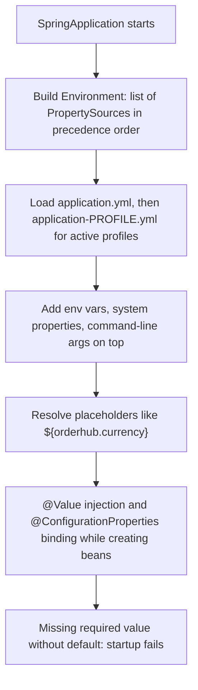
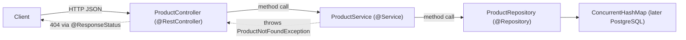
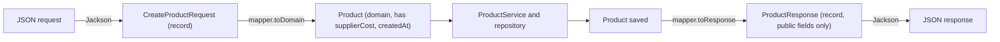

@@ 3 | TOPIC | application.properties and application.yml | Properties vs YAML syntax, common Boot settings, custom properties with @Value, profiles, relaxed binding and the override order | MUST
# application.properties and application.yml

**Level: Beginner | Phase 5 | Priority: MUST | Since: Spring Boot 1.0 (externalized configuration), multi-document properties files and `spring.config.activate.on-profile` Boot 2.4, `spring.config.import` Boot 2.4**

> **30-second interview answer:** Spring Boot reads configuration from `application.properties` or `application.yml` in `src/main/resources`, plus profile-specific files like `application-dev.yml`, environment variables, and command-line arguments. Properties use flat `key=value` lines; YAML expresses the same keys as an indented hierarchy. Boot uses these for its own settings (`server.port`, `spring.datasource.url`, `logging.level.*`) and you can add custom keys like `orderhub.low-stock-threshold`, read with `@Value("${...}")` or bound to a typed class with `@ConfigurationProperties`. Sources have a fixed precedence: command-line arguments override environment variables, which override profile files, which override the default file, so the same jar runs with different settings in each environment.

## 1. Concept in Simple Words
### Analogy
The settings of a coffee machine in an office chain.

| Coffee machine | Spring Boot configuration |
|---|---|
| Factory default settings printed in the manual | Boot's built-in defaults (port 8080) |
| The settings card shipped inside the machine | `application.yml` in the jar |
| A per-office card: "London office: stronger coffee" | Profile file `application-prod.yml` |
| The office manager's sticker on the machine | Environment variable `SERVER_PORT=9090` |
| Pressing a button for this one cup | Command-line argument `--server.port=9091` |
| The most specific instruction wins | Property source precedence |
| The same machine model in every office, only cards differ | Same jar in dev, test, prod; config differs |

### What it is
- **Property:** a named configuration value such as `server.port=8080`. Names are dot-separated, lower-case, kebab-case words: `orderhub.low-stock-threshold`.
- **`application.properties`:** flat text, one `key=value` per line, `#` comments.
- **`application.yml`:** YAML (a human-friendly data format): nesting by indentation (spaces only, never tabs), `key: value` with a space after the colon, lists with `-`.
- **Externalized configuration:** keeping settings outside code so the same build runs everywhere (the Twelve-Factor App principle "store config in the environment").
- **Profile:** a named set of configuration (`dev`, `test`, `prod`) activated with `spring.profiles.active`. File `application-dev.yml` is loaded only when `dev` is active and overrides the default file. Profiles are covered in depth in [[Profiles and Environment-Specific Config]].
- **`@Value("${key:default}")`:** injects one property into a field or constructor parameter, with an optional default after the colon.
- **`@ConfigurationProperties(prefix = "orderhub")`:** binds a group of properties to a typed class (records work), the recommended way for more than one or two values (Phase 10).
- **Relaxed binding:** `orderhub.low-stock-threshold`, `orderhub.lowStockThreshold` and the environment variable `ORDERHUB_LOWSTOCKTHRESHOLD` (or `ORDERHUB_LOW_STOCK_THRESHOLD` for `@ConfigurationProperties`) all map to the same property.

Common Boot properties:

| Property | Meaning | Default |
|---|---|---|
| `server.port` | HTTP port (0 = random) | 8080 |
| `server.servlet.context-path` | URL prefix for the whole app | empty |
| `spring.application.name` | App name (logs, tracing, discovery) | none |
| `spring.profiles.active` | Active profiles | none (`default`) |
| `logging.level.<package>` | Log level per package | INFO |
| `spring.jackson.*` | JSON settings | Boot defaults |
| `spring.datasource.url`, `username`, `password` | Database connection (Phase 12) | none |
| `server.error.include-message` | Include exception messages in error JSON | never |
| `management.endpoints.web.exposure.include` | Actuator endpoints over HTTP | health |

### Why it exists
Hard-coding ports, URLs and passwords means rebuilding the app for every environment and leaking secrets into source control. Externalized configuration lets operators change behaviour without touching code: a database URL in production comes from an environment variable or a secret store, while developers use local defaults.

## 2. How It Works
Precedence, highest first (simplified; later items are overridden by earlier ones):
```text
1. Command-line arguments              --server.port=9091
2. SPRING_APPLICATION_JSON             inline JSON in an env variable
3. Java system properties              -Dserver.port=9090
4. OS environment variables            SERVER_PORT=9092
5. Profile-specific files outside the jar   ./config/application-prod.yml
6. Profile-specific files inside the jar    classpath:application-prod.yml
7. Default files outside the jar            ./application.yml, ./config/application.yml
8. Default files inside the jar             classpath:application.yml
9. @PropertySource on @Configuration classes
10. Default values                       @Value("${x:default}") or Boot's own defaults
```



The same configuration in both formats:
```properties
spring.application.name=orderhub
server.port=8080
logging.level.com.orderhub=DEBUG
orderhub.currency=USD
orderhub.low-stock-threshold=5
orderhub.allowed-origins[0]=http://localhost:3000
orderhub.allowed-origins[1]=https://shop.example.com
```

```yaml
spring:
  application:
    name: orderhub
server:
  port: 8080
logging:
  level:
    com.orderhub: DEBUG
orderhub:
  currency: USD
  low-stock-threshold: 5
  allowed-origins:
    - http://localhost:3000
    - https://shop.example.com
```

**Multi-document file:** one `application.yml` can hold several documents separated by `---`; a document with `spring.config.activate.on-profile: prod` applies only to that profile.

## 3. Code Example
### Code
`src/main/resources/application.yml`:
```yaml
spring:
  application:
    name: orderhub
  profiles:
    active: dev                      # default profile for local runs; override in other environments
server:
  port: 8080
  error:
    include-message: always          # show exception messages in error JSON (fine for learning)
logging:
  level:
    root: INFO
orderhub:
  currency: USD
  low-stock-threshold: 5
  support-email: support@orderhub.example
  welcome: "Welcome to ${spring.application.name}"   # placeholders can reference other properties
```

`src/main/resources/application-dev.yml` (loaded only when the `dev` profile is active):
```yaml
server:
  port: 8081
logging:
  level:
    com.orderhub: DEBUG
orderhub:
  low-stock-threshold: 2
```

`src/main/resources/application-prod.yml`:
```yaml
server:
  port: 8080
orderhub:
  support-email: ${SUPPORT_EMAIL}    # must come from the environment in production
```

`src/main/java/com/orderhub/config/ConfigInfoController.java`:
```java
package com.orderhub.config;

import java.util.Arrays;
import java.util.LinkedHashMap;
import java.util.Map;
import org.slf4j.Logger;
import org.slf4j.LoggerFactory;
import org.springframework.beans.factory.annotation.Value;
import org.springframework.core.env.Environment;
import org.springframework.web.bind.annotation.GetMapping;
import org.springframework.web.bind.annotation.RestController;

@RestController
public class ConfigInfoController {
    private static final Logger log = LoggerFactory.getLogger(ConfigInfoController.class);

    private final String currency;
    private final int lowStockThreshold;
    private final String welcome;
    private final String region;
    private final Environment env;

    // Constructor injection of single values with @Value
    public ConfigInfoController(@Value("${orderhub.currency}") String currency,
                                @Value("${orderhub.low-stock-threshold}") int lowStockThreshold,
                                @Value("${orderhub.welcome}") String welcome,
                                @Value("${orderhub.region:eu-west}") String region,   // default if missing
                                Environment env) {
        this.currency = currency;
        this.lowStockThreshold = lowStockThreshold;
        this.welcome = welcome;
        this.region = region;
        this.env = env;
        log.debug("Config loaded: currency={}, threshold={}", currency, lowStockThreshold);
    }

    @GetMapping("/api/config")
    public Map<String, Object> config() {
        Map<String, Object> body = new LinkedHashMap<>();
        body.put("profiles", Arrays.asList(env.getActiveProfiles()));
        body.put("port", env.getProperty("server.port"));
        body.put("currency", currency);
        body.put("lowStockThreshold", lowStockThreshold);
        body.put("welcome", welcome);
        body.put("region", region);
        return body;
    }
}
```

Running with overrides:
```bash
# 1. Default run: profile dev from application.yml
./mvnw spring-boot:run

# 2. Packaged jar, profile prod, values from environment and arguments
export SUPPORT_EMAIL=help@orderhub.example
export ORDERHUB_CURRENCY=EUR
java -jar target/orderhub-0.0.1-SNAPSHOT.jar --spring.profiles.active=prod --orderhub.low-stock-threshold=10
```

### Walkthrough
- **application.yml:** sets the defaults. `spring.profiles.active: dev` means local runs use the dev profile unless something with higher precedence overrides it.
- **Placeholder `${spring.application.name}`:** resolved when read, giving "Welcome to orderhub".
- **application-dev.yml:** overrides only what differs: port 8081, debug logging for `com.orderhub`, threshold 2. Everything else is inherited from the default file.
- **application-prod.yml:** `${SUPPORT_EMAIL}` has no default, so the app refuses to start in prod if the variable is missing. Failing fast is better than running with a wrong value.
- **`@Value` on constructor parameters:** values are converted to the parameter type (`int` here). `${orderhub.region:eu-west}` uses "eu-west" because the property is not defined anywhere.
- **`Environment`:** Spring's view of all property sources; useful for reading profiles or a property dynamically.
- **Second run:** `ORDERHUB_CURRENCY=EUR` overrides the file through relaxed binding; the command-line argument sets the threshold to 10, beating both files.

### Output
First run (dev profile), startup log excerpt:
```text
INFO  --- [orderhub] [main] com.orderhub.OrderHubApplication : The following 1 profile is active: "dev"
DEBUG --- [orderhub] [main] c.orderhub.config.ConfigInfoController : Config loaded: currency=USD, threshold=2
INFO  --- [orderhub] [main] o.s.b.w.embedded.tomcat.TomcatWebServer : Tomcat started on port 8081 (http) with context path '/'
```

```http
GET /api/config HTTP/1.1
Host: localhost:8081

HTTP/1.1 200
Content-Type: application/json

{"profiles":["dev"],"port":"8081","currency":"USD","lowStockThreshold":2,"welcome":"Welcome to orderhub","region":"eu-west"}
```

Second run (prod profile, env vars and argument):
```http
GET /api/config HTTP/1.1
Host: localhost:8080

HTTP/1.1 200
Content-Type: application/json

{"profiles":["prod"],"port":"8080","currency":"EUR","lowStockThreshold":10,"welcome":"Welcome to orderhub","region":"eu-west"}
```

Prod run without `SUPPORT_EMAIL` set (only if some bean reads `orderhub.support-email`):
```text
APPLICATION FAILED TO START
Description:
Failed to bind properties under 'orderhub.support-email' ... Could not resolve placeholder 'SUPPORT_EMAIL' in value "${SUPPORT_EMAIL}"
```

### Compare
| | `.properties` | `.yml` |
|---|---|---|
| Syntax | Flat `a.b.c=value` | Indented hierarchy |
| Lists | `list[0]=x`, `list[1]=y` | `- x` items |
| Repetition of prefixes | High | Low |
| Risk | Typos in long keys | Indentation errors, tabs not allowed |
| Multiple documents | `#---` separator (Boot 2.4+) | `---` separator |
| `@PropertySource` support | Yes | No (YAML not supported by `@PropertySource` by default) |

| | `@Value` | `@ConfigurationProperties` |
|---|---|---|
| Granularity | One value | A group under a prefix |
| Type safety | Conversion per value | Typed class or record, nested objects |
| Relaxed binding | Limited | Full |
| Validation | No | Yes with `@Validated` |
| Best for | One-off values | Application settings (Phase 10) |

## 4. Interview Questions
**Basic**
1. **What is the difference between `application.properties` and `application.yml`?**
   They hold the same configuration in different formats: properties is flat `key=value`, YAML is hierarchical with indentation and native lists. Boot supports both; if both define a key, `.properties` wins, so pick one format per project.
2. **How do you change the port of a Spring Boot app?**
   Set `server.port` in the configuration file, as an environment variable `SERVER_PORT`, or as `--server.port=9090` on the command line. `server.port=0` picks a random free port, useful in tests.
3. **How do you read a custom property in code?**
   With `@Value("${orderhub.currency}")` on a field or constructor parameter, optionally with a default `${key:default}`, or by binding a group to a class with `@ConfigurationProperties(prefix = "orderhub")`.

**Follow-up**
4. **What is the precedence order of configuration sources?**
   From highest: command-line arguments, system properties, environment variables, profile-specific files (outside the jar then inside), default files (outside then inside), `@PropertySource`, defaults. More specific and more external sources override packaged ones.
5. **What are profiles and how do you activate them?**
   Named groups of configuration; `application-{profile}.yml` loads when the profile is active. Activate with `spring.profiles.active=prod` in any property source (commonly an environment variable `SPRING_PROFILES_ACTIVE` or a command-line argument).
6. **What is relaxed binding?**
   Boot maps different spellings of a property name to the same key: kebab-case in files, camelCase, and upper-case with underscores in environment variables (`ORDERHUB_CURRENCY` for `orderhub.currency`). This lets containers configure apps with environment variables.

**Tricky / scenario**
7. **The app works locally but in Kubernetes it still uses the dev database. What do you check?**
   Which profile is active (startup log line "The following profiles are active"), whether `spring.profiles.active: dev` is hard-coded in the packaged `application.yml`, and whether the environment variables (`SPRING_PROFILES_ACTIVE`, `SPRING_DATASOURCE_URL`) are actually set in the pod. Avoid committing a default active profile that points at real resources.
8. **Where should passwords and API keys live?**
   Not in the committed config files. Use placeholders resolved from environment variables or a secret manager (Kubernetes secrets, Vault, cloud secret stores), and keep only harmless local defaults in the repo.
9. **`@Value("${orderhub.timeout}")` fails with "Could not resolve placeholder". Why and how do you fix it?**
   No property source defines the key in the active profiles (or it is misspelled). Add it to the right file, set it in the environment, or provide a default with `${orderhub.timeout:5s}`.

**What the interviewer is really testing:** whether you can configure one artifact for many environments safely and debug "why is this value wrong?" using the precedence rules.

## 5. Pitfalls & Best Practices
### Common mistakes
| Mistake | What goes wrong | Fix |
|---|---|---|
| Tabs or wrong indentation in YAML | Startup fails or keys silently land in the wrong place | Spaces only, validate with the IDE |
| Both `.properties` and `.yml` in the project | Confusing overrides | One format |
| Secrets committed in `application.yml` | Credential leaks | `${ENV_VAR}` placeholders and a secret store |
| Hard-coded `spring.profiles.active: dev` in the jar | Prod runs with dev settings | Set the profile per environment |
| `@Value` in many classes for related settings | Scattered, untyped configuration | `@ConfigurationProperties` record |
| Unquoted special values in YAML (`on`, `yes`, `08`) | Parsed as booleans or octal | Quote them: `"on"`, `"08"` |

### Best practices
- Keep sensible local defaults in `application.yml`; put environment differences in profile files or environment variables.
- Prefix custom properties with your app name (`orderhub.*`) to avoid clashes.
- Fail fast on missing required production values (no defaults for secrets and URLs).
- Use `@ConfigurationProperties` with validation for anything beyond trivial values (Phase 10).
- Inspect effective values with the Actuator `env` and `configprops` endpoints (secured) when debugging.

### Compare with
| Source | Typical use |
|---|---|
| `application.yml` in the jar | Defaults for all environments |
| `application-{profile}.yml` | Per-environment differences |
| Environment variables | Containers, CI, secrets injected by the platform |
| Command-line args | One-off overrides, scripts |
| Config server or Kubernetes ConfigMap | Centralized config for many services (Phase 20) |

## 6. Hands-on Exercise
Make OrderHub configurable:
1. Add `orderhub.store-name`, `orderhub.currency` and `orderhub.max-page-size` (default 50) to `application.yml`.
2. Create `application-dev.yml` (port 8081, `max-page-size: 5`) and `application-test.yml` (port 0).
3. Expose `GET /api/store` returning store name, currency and max page size, read with `@Value`.
4. Run the jar with `--spring.profiles.active=dev` and then with the environment variable `ORDERHUB_CURRENCY=GBP`, and show the changed responses.

Acceptance criteria: values change without recompiling; a missing `orderhub.store-name` makes startup fail with a clear message.

<details><summary>Solution</summary>

```yaml
# application.yml
spring:
  application:
    name: orderhub
orderhub:
  store-name: OrderHub Demo Store
  currency: USD
  max-page-size: 50
```

```yaml
# application-dev.yml
server:
  port: 8081
orderhub:
  max-page-size: 5
```

```yaml
# application-test.yml
server:
  port: 0
```

```java
package com.orderhub.config;

import java.util.LinkedHashMap;
import java.util.Map;
import org.springframework.beans.factory.annotation.Value;
import org.springframework.web.bind.annotation.GetMapping;
import org.springframework.web.bind.annotation.RestController;

@RestController
public class StoreController {
    private final String storeName;
    private final String currency;
    private final int maxPageSize;

    public StoreController(@Value("${orderhub.store-name}") String storeName,       // no default: required
                           @Value("${orderhub.currency:USD}") String currency,
                           @Value("${orderhub.max-page-size:50}") int maxPageSize) {
        this.storeName = storeName;
        this.currency = currency;
        this.maxPageSize = maxPageSize;
    }

    @GetMapping("/api/store")
    public Map<String, Object> store() {
        Map<String, Object> body = new LinkedHashMap<>();
        body.put("storeName", storeName);
        body.put("currency", currency);
        body.put("maxPageSize", maxPageSize);
        return body;
    }
}
```

```bash
java -jar target/orderhub-0.0.1-SNAPSHOT.jar --spring.profiles.active=dev
curl -s localhost:8081/api/store
ORDERHUB_CURRENCY=GBP java -jar target/orderhub-0.0.1-SNAPSHOT.jar
curl -s localhost:8080/api/store
```
```text
{"storeName":"OrderHub Demo Store","currency":"USD","maxPageSize":5}
{"storeName":"OrderHub Demo Store","currency":"GBP","maxPageSize":50}
```
Removing `orderhub.store-name` produces `Could not resolve placeholder 'orderhub.store-name'` and the context fails to start.
</details>

## 7. Recall
Q: Where does Spring Boot look for `application.yml` by default?
A: On the classpath root (`src/main/resources`) and in `./` and `./config/` next to the jar.

Q: Which wins in Spring Boot: an environment variable or a value in `application.yml`?
A: The environment variable (and command-line arguments beat both).

Q: How do you give `@Value` a default value?
A: `@Value("${key:defaultValue}")`.

Q: When is `application-dev.yml` loaded?
A: Only when the `dev` profile is active, and it overrides the default file.

Q: Which environment variable sets `orderhub.currency` through relaxed binding?
A: `ORDERHUB_CURRENCY`.

Q: Why should secrets not be stored in `application.yml`?
A: The file is committed and packaged in the jar; secrets belong in environment variables or a secret manager.

**Related:** [[@Value vs @ConfigurationProperties]] · [[Profiles and Environment-Specific Config]] · [[@SpringBootApplication Explained]]

@@ 3 | TOPIC | Layered Architecture: Controller, Service, Repository | Responsibilities of each layer, dependency direction, constructor injection, an in-memory repository and exceptions mapped to HTTP status | MUST
# Layered Architecture: Controller, Service, Repository

**Level: Beginner | Phase 5 | Priority: MUST | Since: classic n-tier design; Spring stereotypes `@Service` and `@Repository` since Spring 2.0/2.5; `@ResponseStatus` since Spring 3.0**

> **30-second interview answer:** A Spring Boot application is usually split into three layers. The **controller** (`@RestController`) handles HTTP: it reads input, calls the service and turns the result into a response, with no business rules. The **service** (`@Service`) holds the business logic and use cases, such as "a SKU must be unique" or "stock cannot go negative", and is where transactions will live. The **repository** (`@Repository`) hides data storage behind methods like `findById` and `save`. Dependencies point one way, controller → service → repository, injected through constructors. This separation makes each layer testable on its own, keeps HTTP and database details out of business code, and lets me swap the in-memory store for JPA later without touching controllers.

## 1. Concept in Simple Words
### Analogy
A restaurant again, now with the kitchen visible.

| Restaurant | Layer |
|---|---|
| Waiter: takes orders, speaks to guests, never cooks | Controller: HTTP in, HTTP out |
| Chef: knows recipes and rules ("no fish after 10 pm", "dish needs 3 eggs") | Service: business logic |
| Pantry and storekeeper: fetch and store ingredients, never decide menus | Repository: data access |
| The waiter never walks into the pantry | Controllers do not call repositories directly |
| Replace the pantry with a bigger warehouse; chef and waiter unchanged | Swap the in-memory repository for JPA |
| Chef shouts "we are out of truffles!" and the waiter politely tells the guest | Service throws `ProductNotFoundException`, mapped to 404 |

### What it is
- **Layer:** a group of classes with one kind of responsibility that only talks to the layer below it.
- **Controller layer:** request mapping, input binding, choosing status codes, mapping to and from DTOs. No business decisions.
- **Service layer:** use cases (`createProduct`, `adjustStock`), validation of business rules, orchestration of several repositories, transactions (Phase 12), calling other services.
- **Repository layer:** CRUD and queries against a store (memory now, database later). Returns domain objects, knows nothing about HTTP.
- **Domain model:** the core objects (`Product`) used by service and repository.
- **`@Service`, `@Repository`:** specializations of `@Component`. `@Repository` additionally enables translation of persistence exceptions into Spring's `DataAccessException` hierarchy.
- **`@ResponseStatus`:** on an exception class, tells Spring MVC which HTTP status to return when it escapes a controller.

### Why it exists
Without layers, controllers grow into "god classes" that parse JSON, enforce rules and run SQL in one method. That code cannot be unit tested without HTTP and a database, rules are duplicated between endpoints, and changing the database means editing every controller. Layers are the simplest form of **separation of concerns**: each class has one reason to change.

## 2. How It Works


Request flow for `POST /api/products`:
```text
1. Controller: bind JSON to NewProduct, call service.create(newProduct)
2. Service:    rule "SKU must be unique" -> repository.existsBySku(sku)?
               rule "price must be positive"
               build Product, call repository.save(product)
3. Repository: assign id with AtomicLong, put into ConcurrentHashMap, return saved Product
4. Service:    return Product
5. Controller: return 201 Created + Location header + JSON body
```

How Spring wires it at startup:
```text
Component scan finds: ProductRepository, ProductService, ProductController
ProductController(ProductService)  needs ProductService
ProductService(ProductRepository)  needs ProductRepository
-> creation order: ProductRepository, ProductService, ProductController (all singletons)
```

Dependency rule: upper layers know lower layers, never the reverse. A repository must not import anything from the web layer, and a service should not use `HttpServletRequest` or `ResponseEntity`.

## 3. Code Example
### Code
`src/main/java/com/orderhub/product/Product.java`:
```java
package com.orderhub.product;

import java.math.BigDecimal;

public record Product(Long id, String sku, String name, BigDecimal price, int stock) {

    public Product withId(Long newId) {
        return new Product(newId, sku, name, price, stock);
    }

    public Product withStock(int newStock) {
        return new Product(id, sku, name, price, newStock);
    }
}
```

`src/main/java/com/orderhub/product/ProductRepository.java`:
```java
package com.orderhub.product;

import java.util.Comparator;
import java.util.List;
import java.util.Map;
import java.util.Optional;
import java.util.concurrent.ConcurrentHashMap;
import java.util.concurrent.atomic.AtomicLong;
import org.springframework.stereotype.Repository;

@Repository
public class ProductRepository {
    private final Map<Long, Product> store = new ConcurrentHashMap<>();   // thread-safe: singleton bean
    private final AtomicLong sequence = new AtomicLong(0);

    public Product save(Product product) {
        Product toSave = product.id() == null ? product.withId(sequence.incrementAndGet()) : product;
        store.put(toSave.id(), toSave);
        return toSave;
    }

    public Optional<Product> findById(Long id) {
        return Optional.ofNullable(store.get(id));
    }

    public List<Product> findAll() {
        return store.values().stream().sorted(Comparator.comparing(Product::id)).toList();
    }

    public boolean existsBySku(String sku) {
        return store.values().stream().anyMatch(p -> p.sku().equalsIgnoreCase(sku));
    }

    public boolean deleteById(Long id) {
        return store.remove(id) != null;
    }
}
```

`src/main/java/com/orderhub/product/ProductNotFoundException.java`:
```java
package com.orderhub.product;

import org.springframework.http.HttpStatus;
import org.springframework.web.bind.annotation.ResponseStatus;

@ResponseStatus(HttpStatus.NOT_FOUND)               // escaping a controller -> 404
public class ProductNotFoundException extends RuntimeException {
    public ProductNotFoundException(Long id) {
        super("Product " + id + " not found");
    }
}
```

`src/main/java/com/orderhub/product/DuplicateSkuException.java`:
```java
package com.orderhub.product;

import org.springframework.http.HttpStatus;
import org.springframework.web.bind.annotation.ResponseStatus;

@ResponseStatus(HttpStatus.CONFLICT)                // -> 409
public class DuplicateSkuException extends RuntimeException {
    public DuplicateSkuException(String sku) {
        super("SKU " + sku + " already exists");
    }
}
```

`src/main/java/com/orderhub/product/ProductService.java`:
```java
package com.orderhub.product;

import java.math.BigDecimal;
import java.util.List;
import org.springframework.stereotype.Service;

@Service
public class ProductService {
    private final ProductRepository repository;

    public ProductService(ProductRepository repository) {   // constructor injection
        this.repository = repository;
    }

    public List<Product> findAll() {
        return repository.findAll();
    }

    public Product findById(Long id) {
        return repository.findById(id).orElseThrow(() -> new ProductNotFoundException(id));
    }

    public Product create(String sku, String name, BigDecimal price, int stock) {
        if (repository.existsBySku(sku)) throw new DuplicateSkuException(sku);           // business rule
        if (price.signum() <= 0) throw new IllegalArgumentException("price must be positive");
        return repository.save(new Product(null, sku, name, price, stock));
    }

    public Product adjustStock(Long id, int delta) {
        Product current = findById(id);
        int newStock = current.stock() + delta;
        if (newStock < 0) throw new IllegalArgumentException("stock cannot go negative");  // business rule
        return repository.save(current.withStock(newStock));
    }

    public void delete(Long id) {
        if (!repository.deleteById(id)) throw new ProductNotFoundException(id);
    }
}
```

`src/main/java/com/orderhub/product/ProductController.java`:
```java
package com.orderhub.product;

import java.math.BigDecimal;
import java.net.URI;
import java.util.List;
import org.springframework.http.ResponseEntity;
import org.springframework.web.bind.annotation.DeleteMapping;
import org.springframework.web.bind.annotation.GetMapping;
import org.springframework.web.bind.annotation.PatchMapping;
import org.springframework.web.bind.annotation.PathVariable;
import org.springframework.web.bind.annotation.PostMapping;
import org.springframework.web.bind.annotation.RequestBody;
import org.springframework.web.bind.annotation.RequestMapping;
import org.springframework.web.bind.annotation.RequestParam;
import org.springframework.web.bind.annotation.RestController;

@RestController
@RequestMapping("/api/products")
public class ProductController {
    record NewProduct(String sku, String name, BigDecimal price, int stock) { }

    private final ProductService service;

    public ProductController(ProductService service) {
        this.service = service;
    }

    @GetMapping
    public List<Product> list() {
        return service.findAll();
    }

    @GetMapping("/{id}")
    public Product get(@PathVariable Long id) {
        return service.findById(id);                 // 404 thrown by the service if missing
    }

    @PostMapping
    public ResponseEntity<Product> create(@RequestBody NewProduct body) {
        Product saved = service.create(body.sku(), body.name(), body.price(), body.stock());
        return ResponseEntity.created(URI.create("/api/products/" + saved.id())).body(saved);
    }

    @PatchMapping("/{id}/stock")
    public Product adjustStock(@PathVariable Long id, @RequestParam int delta) {
        return service.adjustStock(id, delta);
    }

    @DeleteMapping("/{id}")
    public ResponseEntity<Void> delete(@PathVariable Long id) {
        service.delete(id);
        return ResponseEntity.noContent().build();   // 204
    }
}
```

`src/main/resources/application.yml`:
```yaml
spring:
  application:
    name: orderhub
server:
  error:
    include-message: always      # show our exception messages in the default error JSON
```

### Walkthrough
- **Product:** an immutable record with "wither" methods; changing stock creates a new object, which is safe to share between threads.
- **ProductRepository:** stores products in a `ConcurrentHashMap` because the singleton bean is called from many request threads at once. `AtomicLong.incrementAndGet` hands out unique ids without locks. The methods mirror what Spring Data JPA will generate later (`save`, `findById`, `findAll`, `existsBy...`, `deleteById`), so the swap in Phase 12 is painless.
- **Exceptions with `@ResponseStatus`:** the service just throws exceptions and never builds HTTP responses; when an exception escapes the controller, Spring MVC reads the annotation on its class and sets 404 or 409. Phase 11 replaces this with a global `@RestControllerAdvice` and `ProblemDetail`.
- **ProductService:** all rules live here: unique SKU, positive price, non-negative stock. A unit test can construct `new ProductService(new ProductRepository())` without Spring or HTTP.
- **ProductController:** only maps HTTP to service calls and chooses status codes (201, 204). `NewProduct` is a nested request record for now; the next topic moves this to proper DTOs.
- **IllegalArgumentException:** not annotated, so it currently becomes a 500; Phase 11 maps it to 400. This is shown deliberately below.

### Output
```http
POST /api/products HTTP/1.1
Content-Type: application/json

{"sku":"KB-01","name":"Keyboard","price":45.00,"stock":10}

HTTP/1.1 201
Location: /api/products/1
Content-Type: application/json

{"id":1,"sku":"KB-01","name":"Keyboard","price":45.00,"stock":10}
```

```http
POST /api/products HTTP/1.1
Content-Type: application/json

{"sku":"kb-01","name":"Another keyboard","price":50.00,"stock":1}

HTTP/1.1 409
Content-Type: application/json

{"timestamp":"2026-11-24T11:02:41.211+00:00","status":409,"error":"Conflict","message":"SKU kb-01 already exists","path":"/api/products"}
```

```http
PATCH /api/products/1/stock?delta=-3 HTTP/1.1

HTTP/1.1 200
Content-Type: application/json

{"id":1,"sku":"KB-01","name":"Keyboard","price":45.00,"stock":7}
```

```http
GET /api/products/42 HTTP/1.1

HTTP/1.1 404
Content-Type: application/json

{"timestamp":"2026-11-24T11:03:10.580+00:00","status":404,"error":"Not Found","message":"Product 42 not found","path":"/api/products/42"}
```

```http
PATCH /api/products/1/stock?delta=-100 HTTP/1.1

HTTP/1.1 500
Content-Type: application/json

{"timestamp":"2026-11-24T11:03:30.902+00:00","status":500,"error":"Internal Server Error","message":"stock cannot go negative","path":"/api/products/1/stock"}
```

```http
DELETE /api/products/1 HTTP/1.1

HTTP/1.1 204
```

### Compare
| Fat controller (wrong) | Layered (right) |
|---|---|
| Controller holds the `Map`, checks SKU uniqueness, computes stock | Controller calls `service.create(...)` |
| Rules duplicated in every endpoint that creates products | One rule in one service method |
| Tests need MockMvc for every rule | Plain unit tests for the service |
| Switching to a database means editing controllers | Only the repository changes |
| HTTP details leak everywhere | HTTP stays in the controller |

## 4. Interview Questions
**Basic**
1. **What are the responsibilities of the controller, service and repository layers?**
   The controller handles HTTP concerns: mapping, input binding, status codes and response shape. The service implements business logic and use cases, enforcing rules and coordinating repositories, and is where transactions belong. The repository encapsulates data access and storage.
2. **What is the difference between `@Component`, `@Service` and `@Repository`?**
   All three register a bean through scanning. `@Service` and `@Repository` are specializations that document the role; `@Repository` also enables exception translation from persistence-specific exceptions to Spring's `DataAccessException`.
3. **Why should a controller not call a repository directly?**
   Business rules would end up in controllers, duplicated and untestable without HTTP; it also couples the web layer to storage details. Going through a service keeps one place for rules and transactions.

**Follow-up**
4. **Where do transactions belong and why?**
   On service methods, because a use case often spans several repository calls that must succeed or fail together. Controllers are too high (HTTP concerns) and repositories too low (one operation each). This is covered in [[@Transactional and Propagation]].
5. **How do you unit test a service?**
   Construct it with a fake or mocked repository (Mockito in Phase 13) and call its methods directly; no Spring context or web server is needed. Constructor injection makes this trivial.
6. **Why is the in-memory repository using `ConcurrentHashMap` and `AtomicLong`?**
   Beans are singletons shared by all request threads. A plain `HashMap` and `long` counter would suffer race conditions: lost updates, duplicate ids or a corrupted map.

**Tricky / scenario**
7. **Is it always wrong for a service to return `ResponseEntity`?**
   Yes in practice: it ties business logic to HTTP and makes the service unusable from a scheduler, a message listener or another service. Services return domain results or throw exceptions; controllers translate.
8. **A teammate wants to put a `findByEmail` call directly in a controller "because it is just a read". Your view?**
   Even reads often grow rules (visibility, permissions, mapping), and consistency matters for maintenance. A thin pass-through service method costs little and keeps the boundary clear. Some teams allow simple reads for pure query endpoints (CQRS style), but it should be a deliberate team rule.
9. **What are alternatives to strict layering?**
   Hexagonal architecture (ports and adapters) puts the domain at the center with interfaces for persistence and web adapters around it; vertical slices organize by use case. Both still separate HTTP, business logic and storage, just with different boundaries.

**What the interviewer is really testing:** whether you can place code in the right layer, explain why, and show the testability and maintainability benefits.

## 5. Pitfalls & Best Practices
### Common mistakes
| Mistake | What goes wrong | Fix |
|---|---|---|
| Business rules in controllers | Duplication, untestable logic | Move rules into services |
| Services depending on web types (`HttpServletRequest`, `ResponseEntity`) | Services unusable outside HTTP | Pass plain values, return domain objects |
| Field injection with `@Autowired` | Hidden dependencies, hard to test | Constructor injection with `final` fields |
| Non-thread-safe state in singleton beans | Race conditions under load | Stateless beans or concurrent structures |
| Returning `null` from services | `NullPointerException` in controllers | `Optional` from repositories, exceptions from services |
| Circular dependencies between services | Startup failure | Extract shared logic into a third component |

### Best practices
- Controllers are thin: one service call per endpoint is a good rule of thumb.
- Name service methods after use cases (`placeOrder`, `adjustStock`), not CRUD verbs only.
- Throw specific exceptions from services; map them to HTTP centrally (Phase 11).
- Keep repositories free of business decisions; they answer questions, they do not make choices.
- Package by feature, with the three layers inside each feature package.

### Compare with
| Style | Structure | When |
|---|---|---|
| Classic layered | Controller → Service → Repository | Most CRUD-heavy business apps |
| Hexagonal (ports and adapters) | Domain core with interfaces, adapters for web and DB | Complex domains, many integrations |
| Vertical slice | One package per use case with its own handler | Large apps with independent features |
| Transaction script in controller | Everything in one method | Throwaway prototypes only |

## 6. Hands-on Exercise
Add a **customer** feature to OrderHub following the same layering:
1. `Customer(Long id, String email, String name)` record.
2. `CustomerRepository` (in-memory, `ConcurrentHashMap`) with `save`, `findById`, `findByEmail`, `findAll`.
3. `CustomerService` with rules: email must be unique (case-insensitive) and contain `@`; throw `CustomerNotFoundException` (404) and `DuplicateEmailException` (409).
4. `CustomerController` with `GET /api/customers`, `GET /api/customers/{id}`, `POST /api/customers` (201 + Location).
5. Write a plain unit test (no Spring) proving the duplicate-email rule.

Acceptance criteria: the controller contains no `if` statements about business rules; the service test runs without starting Spring.

<details><summary>Solution</summary>

```java
package com.orderhub.customer;

public record Customer(Long id, String email, String name) {
    public Customer withId(Long newId) { return new Customer(newId, email, name); }
}
```

```java
package com.orderhub.customer;

import java.util.*;
import java.util.concurrent.ConcurrentHashMap;
import java.util.concurrent.atomic.AtomicLong;
import org.springframework.stereotype.Repository;

@Repository
public class CustomerRepository {
    private final Map<Long, Customer> store = new ConcurrentHashMap<>();
    private final AtomicLong seq = new AtomicLong();

    public Customer save(Customer c) {
        Customer saved = c.id() == null ? c.withId(seq.incrementAndGet()) : c;
        store.put(saved.id(), saved);
        return saved;
    }

    public Optional<Customer> findById(Long id) { return Optional.ofNullable(store.get(id)); }

    public Optional<Customer> findByEmail(String email) {
        return store.values().stream().filter(c -> c.email().equalsIgnoreCase(email)).findFirst();
    }

    public List<Customer> findAll() {
        return store.values().stream().sorted(Comparator.comparing(Customer::id)).toList();
    }
}
```

```java
package com.orderhub.customer;

import org.springframework.http.HttpStatus;
import org.springframework.web.bind.annotation.ResponseStatus;

public final class CustomerExceptions {
    private CustomerExceptions() { }

    @ResponseStatus(HttpStatus.NOT_FOUND)
    public static class CustomerNotFoundException extends RuntimeException {
        public CustomerNotFoundException(Long id) { super("Customer " + id + " not found"); }
    }

    @ResponseStatus(HttpStatus.CONFLICT)
    public static class DuplicateEmailException extends RuntimeException {
        public DuplicateEmailException(String email) { super("Email " + email + " already registered"); }
    }
}
```

```java
package com.orderhub.customer;

import com.orderhub.customer.CustomerExceptions.CustomerNotFoundException;
import com.orderhub.customer.CustomerExceptions.DuplicateEmailException;
import java.util.List;
import org.springframework.stereotype.Service;

@Service
public class CustomerService {
    private final CustomerRepository repository;

    public CustomerService(CustomerRepository repository) { this.repository = repository; }

    public Customer register(String email, String name) {
        if (email == null || !email.contains("@")) throw new IllegalArgumentException("invalid email");
        if (repository.findByEmail(email).isPresent()) throw new DuplicateEmailException(email);
        return repository.save(new Customer(null, email.toLowerCase(), name));
    }

    public Customer findById(Long id) {
        return repository.findById(id).orElseThrow(() -> new CustomerNotFoundException(id));
    }

    public List<Customer> findAll() { return repository.findAll(); }
}
```

```java
package com.orderhub.customer;

import java.net.URI;
import java.util.List;
import org.springframework.http.ResponseEntity;
import org.springframework.web.bind.annotation.*;

@RestController
@RequestMapping("/api/customers")
public class CustomerController {
    record NewCustomer(String email, String name) { }

    private final CustomerService service;

    public CustomerController(CustomerService service) { this.service = service; }

    @GetMapping
    public List<Customer> list() { return service.findAll(); }

    @GetMapping("/{id}")
    public Customer get(@PathVariable Long id) { return service.findById(id); }

    @PostMapping
    public ResponseEntity<Customer> register(@RequestBody NewCustomer body) {
        Customer c = service.register(body.email(), body.name());
        return ResponseEntity.created(URI.create("/api/customers/" + c.id())).body(c);
    }
}
```

```java
package com.orderhub.customer;

import static org.assertj.core.api.Assertions.assertThatThrownBy;

import org.junit.jupiter.api.Test;

class CustomerServiceTest {
    private final CustomerService service = new CustomerService(new CustomerRepository());   // no Spring

    @Test
    void rejectsDuplicateEmailIgnoringCase() {
        service.register("ann@example.com", "Ann");
        assertThatThrownBy(() -> service.register("ANN@example.com", "Ann again"))
                .isInstanceOf(CustomerExceptions.DuplicateEmailException.class)
                .hasMessageContaining("already registered");
    }
}
```
The test builds the service with `new`: because dependencies come through the constructor, no container is required.
</details>

## 7. Recall
Q: What belongs in the service layer of a Spring Boot app?
A: Business rules and use cases, orchestration of repositories, and transactions.

Q: What does `@Repository` add beyond `@Component`?
A: It marks the data-access role and enables translation of persistence exceptions into Spring's `DataAccessException` hierarchy.

Q: In which direction should dependencies between layers point?
A: Controller → service → repository, never the reverse.

Q: How does `@ResponseStatus(HttpStatus.NOT_FOUND)` on an exception class work?
A: When that exception escapes a controller method, Spring MVC sets the response status to 404.

Q: Why must an in-memory repository bean use thread-safe structures?
A: Beans are singletons called concurrently by many request threads.

**Related:** [[DTOs and Mapping]] · [[Stereotype Annotations]] · [[Constructor vs Setter vs Field Injection]] · [[Global Exception Handling and ProblemDetail]]

@@ 3 | TOPIC | DTOs and Mapping | Why APIs use request and response DTOs, records as DTOs, manual mappers, MapStruct and avoiding over-posting and leaking internals | MUST
# DTOs and Mapping

**Level: Beginner | Phase 5 | Priority: MUST | Since: DTO pattern from Martin Fowler's PoEAA (2002); records as DTOs since Java 16; MapStruct 1.0 (2015), current 1.6**

> **30-second interview answer:** A DTO (Data Transfer Object) is a simple object that defines exactly what crosses the API boundary, separate from the domain model or JPA entity. I use request DTOs (`CreateProductRequest`) for incoming JSON and response DTOs (`ProductResponse`) for outgoing JSON, usually as Java records. This stops clients from setting fields they should not (over-posting, like `id` or `createdAt`), hides internal data (cost prices, password hashes, lazy JPA relations), and lets the domain change without breaking the API contract. Mapping between DTOs and domain objects happens in a mapper class, either hand-written or generated at compile time by MapStruct, and is called from the controller or service edge.

## 1. Concept in Simple Words
### Analogy
A restaurant menu and order slip.

| Restaurant | DTOs |
|---|---|
| The kitchen's full recipe card: supplier, cost per portion, secret ingredients | Domain object or entity: `Product` with `supplierCost` |
| The menu shown to guests: name, description, price | Response DTO: `ProductResponse` |
| The order slip guests fill in: dish and quantity, not the price or the table's bill number | Request DTO: `CreateProductRequest` without `id` |
| The waiter copying the slip into the kitchen's system | Mapper: request DTO → domain |
| The kitchen can change suppliers without reprinting menus | Domain changes do not break the API |
| A guest writing "price: 0.01" on the slip is ignored | Over-posting prevented |

### What it is
- **DTO:** an object whose only job is carrying data between processes or layers. No business logic, often immutable. In Java 16+, records are ideal DTOs.
- **Request DTO:** the shape of incoming data for one operation. Create and update often differ (`CreateProductRequest` requires a SKU; `UpdateProductRequest` may not allow changing it).
- **Response DTO:** the shape of outgoing data, possibly combining or formatting fields (`inStock` boolean derived from stock).
- **Mapper:** code converting between DTOs and domain objects. Hand-written (a small `@Component` class or static methods) or generated by **MapStruct**, an annotation processor that writes plain mapping code at compile time.
- **Over-posting (mass assignment):** a client sends fields it should not control (`"id": 1`, `"role": "ADMIN"`, `"price": 0`) and the server binds them blindly to the domain object.
- **API contract:** the agreed request and response shapes; changing it can break clients.

### Why it exists
Returning domain objects or JPA entities directly seems faster at first, but causes real problems: internal fields leak (password hashes, costs), every refactor of the domain changes the JSON and breaks mobile apps, lazy-loaded JPA relations cause exceptions or huge recursive JSON, and clients can overwrite protected fields. DTOs make the boundary explicit and stable.

## 2. How It Works


Where mapping happens: in the controller (simple apps, keeps services DTO-free) or at the service boundary (services accept and return DTOs, common when the same use case serves several clients). Pick one convention per project. In OrderHub, controllers map, so services work with domain objects.

```text
Field flow for "create product":
  JSON field      Request DTO        Domain Product        Response DTO      JSON field
  sku       ->    sku          ->    sku              ->   sku          ->   sku
  name      ->    name         ->    name             ->   name         ->   name
  price     ->    price        ->    price            ->   price        ->   price
  stock     ->    stock        ->    stock            ->   inStock      ->   inStock (derived)
  id (sent) ->    (no field: ignored)  id assigned by repository -> id  ->   id
  -              -                   supplierCost (internal)   (not mapped)
  -              -                   createdAt (internal)      createdAt ->   createdAt
```

**MapStruct in one paragraph:** you write an interface with methods like `ProductResponse toResponse(Product p)`; at compile time the annotation processor generates `ProductMapperImpl` with plain getter/constructor calls (no reflection at runtime, so it is fast and type-safe). Unmapped target properties produce compile warnings or errors, which catches forgotten fields.

## 3. Code Example
### Code
`src/main/java/com/orderhub/product/Product.java` (domain, now with internal fields):
```java
package com.orderhub.product;

import java.math.BigDecimal;
import java.time.Instant;

public record Product(Long id, String sku, String name, BigDecimal price, int stock,
                      BigDecimal supplierCost, Instant createdAt) {

    public Product withId(Long newId) {
        return new Product(newId, sku, name, price, stock, supplierCost, createdAt);
    }

    public Product withDetails(String newName, BigDecimal newPrice, int newStock) {
        return new Product(id, sku, newName, newPrice, newStock, supplierCost, createdAt);
    }
}
```

`src/main/java/com/orderhub/product/dto/CreateProductRequest.java`:
```java
package com.orderhub.product.dto;

import java.math.BigDecimal;

// No id, no createdAt: the client cannot set them
public record CreateProductRequest(String sku, String name, BigDecimal price, int stock, BigDecimal supplierCost) {
}
```

`src/main/java/com/orderhub/product/dto/UpdateProductRequest.java`:
```java
package com.orderhub.product.dto;

import java.math.BigDecimal;

// SKU is immutable after creation, so it is not part of the update contract
public record UpdateProductRequest(String name, BigDecimal price, int stock) {
}
```

`src/main/java/com/orderhub/product/dto/ProductResponse.java`:
```java
package com.orderhub.product.dto;

import java.math.BigDecimal;
import java.time.Instant;

// Public view: no supplierCost; inStock derived for client convenience
public record ProductResponse(Long id, String sku, String name, BigDecimal price, int stock,
                              boolean inStock, Instant createdAt) {
}
```

`src/main/java/com/orderhub/product/ProductMapper.java`:
```java
package com.orderhub.product;

import com.orderhub.product.dto.CreateProductRequest;
import com.orderhub.product.dto.ProductResponse;
import java.time.Clock;
import java.time.Instant;
import org.springframework.stereotype.Component;

@Component
public class ProductMapper {
    private final Clock clock;

    public ProductMapper(Clock clock) {          // Clock bean declared in the main class
        this.clock = clock;
    }

    public Product toDomain(CreateProductRequest req) {
        return new Product(null, req.sku().trim().toUpperCase(), req.name().trim(), req.price(),
                req.stock(), req.supplierCost(), Instant.now(clock));
    }

    public ProductResponse toResponse(Product p) {
        return new ProductResponse(p.id(), p.sku(), p.name(), p.price(), p.stock(),
                p.stock() > 0, p.createdAt());
    }
}
```

`src/main/java/com/orderhub/product/ProductService.java` (works only with domain objects):
```java
package com.orderhub.product;

import java.math.BigDecimal;
import java.util.List;
import org.springframework.stereotype.Service;

@Service
public class ProductService {
    private final ProductRepository repository;

    public ProductService(ProductRepository repository) {
        this.repository = repository;
    }

    public Product create(Product product) {
        if (repository.existsBySku(product.sku())) throw new DuplicateSkuException(product.sku());
        return repository.save(product);
    }

    public Product update(Long id, String name, BigDecimal price, int stock) {
        Product current = findById(id);
        return repository.save(current.withDetails(name, price, stock));
    }

    public Product findById(Long id) {
        return repository.findById(id).orElseThrow(() -> new ProductNotFoundException(id));
    }

    public List<Product> findAll() {
        return repository.findAll();
    }
}
```

`src/main/java/com/orderhub/product/ProductController.java`:
```java
package com.orderhub.product;

import com.orderhub.product.dto.CreateProductRequest;
import com.orderhub.product.dto.ProductResponse;
import com.orderhub.product.dto.UpdateProductRequest;
import java.net.URI;
import java.util.List;
import org.springframework.http.ResponseEntity;
import org.springframework.web.bind.annotation.GetMapping;
import org.springframework.web.bind.annotation.PathVariable;
import org.springframework.web.bind.annotation.PostMapping;
import org.springframework.web.bind.annotation.PutMapping;
import org.springframework.web.bind.annotation.RequestBody;
import org.springframework.web.bind.annotation.RequestMapping;
import org.springframework.web.bind.annotation.RestController;

@RestController
@RequestMapping("/api/products")
public class ProductController {
    private final ProductService service;
    private final ProductMapper mapper;

    public ProductController(ProductService service, ProductMapper mapper) {
        this.service = service;
        this.mapper = mapper;
    }

    @GetMapping
    public List<ProductResponse> list() {
        return service.findAll().stream().map(mapper::toResponse).toList();
    }

    @GetMapping("/{id}")
    public ProductResponse get(@PathVariable Long id) {
        return mapper.toResponse(service.findById(id));
    }

    @PostMapping
    public ResponseEntity<ProductResponse> create(@RequestBody CreateProductRequest request) {
        Product saved = service.create(mapper.toDomain(request));
        return ResponseEntity.created(URI.create("/api/products/" + saved.id()))
                .body(mapper.toResponse(saved));
    }

    @PutMapping("/{id}")
    public ProductResponse update(@PathVariable Long id, @RequestBody UpdateProductRequest request) {
        return mapper.toResponse(service.update(id, request.name(), request.price(), request.stock()));
    }
}
```

The same mapper with MapStruct (alternative; add `org.mapstruct:mapstruct` and the `mapstruct-processor` annotation processor):
```java
package com.orderhub.product;

import com.orderhub.product.dto.ProductResponse;
import org.mapstruct.Mapper;
import org.mapstruct.Mapping;

@Mapper(componentModel = "spring")          // generated class is a Spring bean
public interface ProductMapStructMapper {

    @Mapping(target = "inStock", expression = "java(product.stock() > 0)")
    ProductResponse toResponse(Product product);   // supplierCost has no target: simply not mapped
}
```

```xml
<!-- pom.xml additions for MapStruct -->
<dependency>
    <groupId>org.mapstruct</groupId>
    <artifactId>mapstruct</artifactId>
    <version>1.6.3</version>
</dependency>

<build>
    <plugins>
        <plugin>
            <groupId>org.apache.maven.plugins</groupId>
            <artifactId>maven-compiler-plugin</artifactId>
            <configuration>
                <annotationProcessorPaths>
                    <path>
                        <groupId>org.mapstruct</groupId>
                        <artifactId>mapstruct-processor</artifactId>
                        <version>1.6.3</version>
                    </path>
                </annotationProcessorPaths>
            </configuration>
        </plugin>
    </plugins>
</build>
```

### Walkthrough
- **Domain `Product`:** now carries `supplierCost` (confidential) and `createdAt` (server-controlled). These must not be writable by clients, and `supplierCost` must never be returned.
- **`CreateProductRequest`:** no `id` or `createdAt` components. If a client sends `"id": 999`, Jackson ignores the unknown field, so the server always assigns ids. `supplierCost` is accepted on create (an admin screen sends it) but never echoed back.
- **`UpdateProductRequest`:** a separate contract; SKU cannot be changed, so it is simply absent.
- **`ProductResponse`:** the public view, with a derived `inStock` flag and no cost.
- **`ProductMapper`:** a small bean doing normalization (trim, upper-case SKU) and setting `createdAt` from an injected `Clock` (testable time). Mapping code is boring on purpose: easy to read and debug.
- **Service:** accepts and returns domain objects; it does not know about DTOs, so it can be reused by a future message listener.
- **Controller:** the only place that touches DTOs: request → domain on the way in, domain → response on the way out.
- **MapStruct:** generates `ProductMapStructMapperImpl` at compile time; the `expression` computes `inStock`. Use it when you have many large mappings; hand-written mappers are fine for a handful.

### Output
```http
POST /api/products HTTP/1.1
Content-Type: application/json

{"id":999,"sku":" kb-01 ","name":"Keyboard ","price":45.00,"stock":10,"supplierCost":21.30,"createdAt":"2000-01-01T00:00:00Z"}

HTTP/1.1 201
Location: /api/products/1
Content-Type: application/json

{"id":1,"sku":"KB-01","name":"Keyboard","price":45.00,"stock":10,"inStock":true,"createdAt":"2026-11-24T11:30:05.123456Z"}
```

```http
PUT /api/products/1 HTTP/1.1
Content-Type: application/json

{"name":"Mechanical Keyboard","price":79.00,"stock":0,"sku":"HACKED"}

HTTP/1.1 200
Content-Type: application/json

{"id":1,"sku":"KB-01","name":"Mechanical Keyboard","price":79.00,"stock":0,"inStock":false,"createdAt":"2026-11-24T11:30:05.123456Z"}
```
The client's `id`, `createdAt` and `sku` attempts were ignored, and `supplierCost` never appears in any response.

### Compare
| Returning the domain or entity directly | Using DTOs |
|---|---|
| Internal fields (cost, password hash) leak | Only chosen fields are exposed |
| Clients can set `id`, `createdAt`, `role` (over-posting) | Request DTO has only allowed fields |
| Renaming a domain field breaks every client | Mapper absorbs the change |
| JPA lazy relations cause `LazyInitializationException` or recursive JSON | Response DTO is a flat, loaded snapshot |
| Less code at first | A few extra small classes |

| Mapping option | Pros | Cons |
|---|---|---|
| Hand-written mapper | Explicit, no dependencies, easy debugging | Boilerplate for big objects |
| MapStruct | Generated at compile time, fast, compile-time checks | Annotation processor setup, learning curve |
| ModelMapper (reflection) | Very little code | Runtime reflection, silent mismatches, slower |
| Static factory on the DTO (`ProductResponse.from(p)`) | Simple, close to the DTO | DTO now depends on the domain class |

## 4. Interview Questions
**Basic**
1. **What is a DTO and why use one?**
   A Data Transfer Object is a simple carrier of data across a boundary, like the API. It decouples the external contract from the internal model, so internal fields stay hidden, clients cannot set protected fields, and the domain can change without breaking clients.
2. **Why are records good DTOs?**
   They are concise, immutable, have value-based `equals`, `hashCode` and `toString`, and Jackson supports them for both serialization and deserialization. There is nothing to forget, like a missing getter.
3. **Should a request DTO and a response DTO be the same class?**
   Usually not. Requests should exclude server-controlled fields (`id`, timestamps) and responses may include derived or server-generated fields. Separate classes per operation keep each contract precise.

**Follow-up**
4. **What is over-posting and how do DTOs prevent it?**
   A client sends extra fields (such as `"role":"ADMIN"` or `"price":0`) that get bound onto a domain object. With a request DTO that only contains allowed fields, extra JSON properties are ignored and never reach the domain.
5. **Where should mapping happen: controller or service?**
   Either is defensible; be consistent. Mapping in controllers keeps services reusable with domain types; mapping in services lets services expose a stable API to several adapters. Never let JPA entities leave the transaction boundary as JSON.
6. **How does MapStruct work and why is it preferred over reflection-based mappers?**
   It is an annotation processor that generates plain Java mapping implementations at compile time from interfaces. There is no runtime reflection, errors such as unmapped targets are reported during the build, and the generated code is debuggable.

**Tricky / scenario**
7. **You return a JPA `Order` entity from a controller and get `LazyInitializationException` or an infinite JSON loop. What is going on?**
   Jackson walks the entity's relations after the transaction is closed, triggering lazy loading without a session, or follows bidirectional references (order → customer → orders) forever. Return a response DTO built inside the transaction with exactly the data needed.
8. **A mobile app depends on the field `productName`, but you want to rename the domain field to `title`. How?**
   Keep `productName` in the response DTO and change only the mapper. If the API must change, version it or add the new field alongside the old one and deprecate it (Phase 11).
9. **Isn't a DTO for every endpoint a lot of duplication?**
   Some, but each class is a tiny record and the duplication is intentional: it decouples contracts that change for different reasons. Share DTOs only when operations truly have the same shape, and use MapStruct when mapping code grows large.

**What the interviewer is really testing:** whether you understand API boundaries, security (over-posting, data leaks) and maintainability, not just how to write a record.

## 5. Pitfalls & Best Practices
### Common mistakes
| Mistake | What goes wrong | Fix |
|---|---|---|
| Returning entities or domain objects as JSON | Data leaks, lazy-loading errors, brittle API | Response DTOs |
| One DTO for create, update and response | Clients can send `id`, unclear rules | Separate request and response DTOs |
| Business logic inside mappers | Rules hidden in the wrong place | Mappers only convert; services decide |
| Forgetting to map a new field | Data silently missing in responses | MapStruct with `unmappedTargetPolicy = ERROR`, or tests |
| Reflection mappers matching by similar names | Wrong fields copied silently | Explicit mapping |
| DTOs with setters and no validation | Partially filled, inconsistent objects | Records plus Bean Validation (Phase 11) |

### Best practices
- Use records for DTOs, one per operation where shapes differ (`Create...Request`, `Update...Request`, `...Response`).
- Put DTOs in a `dto` sub-package of the feature.
- Keep mappers small and side-effect free (time comes from an injected `Clock`).
- Add Bean Validation annotations to request DTOs (Phase 11), never to response DTOs.
- Document DTOs with OpenAPI (springdoc, Phase 11); they are your public contract.

### Compare with
| Object | Purpose | Lives where |
|---|---|---|
| Request DTO | Incoming data for one operation | Web boundary |
| Response DTO | Outgoing data | Web boundary |
| Domain object | Business state and rules | Service and domain |
| JPA entity | Persistence mapping (Phase 12) | Repository and transaction |
| Value object | Small immutable concept (`Money`, `Email`) | Domain |

## 6. Hands-on Exercise
Apply DTOs to the OrderHub **customer** feature:
1. The domain `Customer` gains `passwordHash` and `createdAt`.
2. Create `RegisterCustomerRequest(String email, String name, String password)` and `CustomerResponse(Long id, String email, String name, Instant memberSince)`.
3. Write `CustomerMapper` that turns the request into a domain object (store the password as a fake hash: `"hash:" + password.hashCode()` for now; Phase 14 uses BCrypt) and the domain into the response.
4. Update the controller so `passwordHash` never appears in JSON, and a client-sent `"id"` or `"createdAt"` is ignored.

Acceptance criteria: `POST /api/customers` returns 201 with `memberSince` and without any password field; `GET /api/customers` returns a list of `CustomerResponse`.

<details><summary>Solution</summary>

```java
package com.orderhub.customer;

import java.time.Instant;

public record Customer(Long id, String email, String name, String passwordHash, Instant createdAt) {
    public Customer withId(Long newId) { return new Customer(newId, email, name, passwordHash, createdAt); }
}
```

```java
package com.orderhub.customer.dto;

public record RegisterCustomerRequest(String email, String name, String password) { }
```

```java
package com.orderhub.customer.dto;

import java.time.Instant;

public record CustomerResponse(Long id, String email, String name, Instant memberSince) { }
```

```java
package com.orderhub.customer;

import com.orderhub.customer.dto.CustomerResponse;
import com.orderhub.customer.dto.RegisterCustomerRequest;
import java.time.Clock;
import java.time.Instant;
import org.springframework.stereotype.Component;

@Component
public class CustomerMapper {
    private final Clock clock;

    public CustomerMapper(Clock clock) { this.clock = clock; }

    public Customer toDomain(RegisterCustomerRequest req) {
        String fakeHash = "hash:" + req.password().hashCode();     // placeholder until BCrypt in Phase 14
        return new Customer(null, req.email().trim().toLowerCase(), req.name().trim(), fakeHash, Instant.now(clock));
    }

    public CustomerResponse toResponse(Customer c) {
        return new CustomerResponse(c.id(), c.email(), c.name(), c.createdAt());
    }
}
```

```java
package com.orderhub.customer;

import com.orderhub.customer.dto.CustomerResponse;
import com.orderhub.customer.dto.RegisterCustomerRequest;
import java.net.URI;
import java.util.List;
import org.springframework.http.ResponseEntity;
import org.springframework.web.bind.annotation.*;

@RestController
@RequestMapping("/api/customers")
public class CustomerController {
    private final CustomerService service;
    private final CustomerMapper mapper;

    public CustomerController(CustomerService service, CustomerMapper mapper) {
        this.service = service;
        this.mapper = mapper;
    }

    @GetMapping
    public List<CustomerResponse> list() {
        return service.findAll().stream().map(mapper::toResponse).toList();
    }

    @PostMapping
    public ResponseEntity<CustomerResponse> register(@RequestBody RegisterCustomerRequest request) {
        Customer saved = service.register(mapper.toDomain(request));   // service now accepts a Customer
        return ResponseEntity.created(URI.create("/api/customers/" + saved.id()))
                .body(mapper.toResponse(saved));
    }
}
```

```http
POST /api/customers HTTP/1.1
Content-Type: application/json

{"id":7,"email":"Ann@Example.com","name":"Ann","password":"s3cret","createdAt":"1999-01-01T00:00:00Z"}

HTTP/1.1 201
Location: /api/customers/1
Content-Type: application/json

{"id":1,"email":"ann@example.com","name":"Ann","memberSince":"2026-11-24T11:45:00.512Z"}
```
`CustomerService.register` changes its signature to `register(Customer candidate)`, checks the email rules on `candidate.email()` and saves it.
</details>

## 7. Recall
Q: What is a DTO in a Spring Boot REST API?
A: A simple object, usually a record, that defines exactly what data crosses the API boundary, separate from the domain model or entity.

Q: What is over-posting?
A: A client sending fields it should not control (like `id` or `role`) that get bound to the domain object; request DTOs prevent it.

Q: Why should JPA entities not be returned directly as JSON?
A: They leak internal fields, can trigger lazy-loading exceptions or infinite recursion, and tie the API to the database model.

Q: How does MapStruct generate mappers?
A: As an annotation processor that writes plain Java implementations of mapper interfaces at compile time.

Q: Why use separate create and update request DTOs?
A: The operations allow different fields (for example SKU is set on create but immutable on update), so each contract stays precise.

**Related:** [[Layered Architecture: Controller, Service, Repository]] · [[Records]] · [[Lombok: Uses and Risks]] · [[Projections and DTO Queries]]
