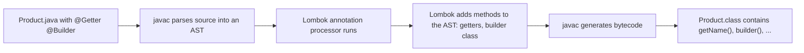

@@ 3 | TOPIC | Lombok: Uses and Risks | What Lombok generates at compile time, the useful annotations, @Data pitfalls with JPA, records as an alternative and team rules | NICE
# Lombok: Uses and Risks

**Level: Beginner | Phase 5 | Priority: NICE | Since: Project Lombok 0.9 (2009), current 1.18.x; works with Java 21; on JDK 23+ annotation processors must be configured explicitly (Spring Initializr does this for you)**

> **30-second interview answer:** Lombok is a compile-time annotation processor that generates boilerplate code such as getters, setters, constructors, `equals`, `hashCode`, `toString`, builders and loggers from annotations like `@Getter`, `@RequiredArgsConstructor`, `@Builder` and `@Slf4j`. It modifies the compiler's syntax tree, so the generated methods exist in the bytecode but not in the source. It is popular in Spring projects (for example `@RequiredArgsConstructor` for constructor injection and `@Slf4j` for logging), but it has risks: `@Data` on JPA entities generates `equals`, `hashCode` and `toString` that can break with lazy relations and cause recursion, it hides what code exists, it needs IDE and build support, and it depends on compiler internals. Since Java 16, records replace much of it for DTOs.

## 1. Concept in Simple Words
### Analogy
A label printer in an office.

| Office | Lombok |
|---|---|
| Writing the same "Name / Phone / Email" labels by hand for every folder | Writing getters, setters and constructors manually |
| A label printer that prints them when you press a button | Annotations like `@Getter`, `@Setter` |
| Labels appear on the folder, but the order sheet only says "print labels" | Methods exist in bytecode, not in your `.java` file |
| A "print everything" button that also prints labels you did not want on a confidential folder | `@Data` generating `toString` with sensitive or lazy fields |
| If the printer brand stops making cartridges, every folder process is stuck | Dependency on javac internals and Lombok updates for new JDKs |
| New office furniture with labels built in | Records: language-level, no tool needed |

### What it is
- **Annotation processor:** a plugin for `javac` that runs during compilation. Most processors (like MapStruct) only generate new files; Lombok goes further and modifies the classes being compiled, using internal compiler APIs.
- **Scope:** Lombok is needed only at compile time (`<optional>true</optional>` or `provided` scope); nothing from it is required at runtime.
- **IDE plugin:** IntelliJ bundles Lombok support; without it, the IDE shows errors for "missing" getters.

Most used annotations:

| Annotation | Generates |
|---|---|
| `@Getter`, `@Setter` | Accessors for fields (class or field level) |
| `@NoArgsConstructor`, `@AllArgsConstructor` | Constructors |
| `@RequiredArgsConstructor` | Constructor for `final` and `@NonNull` fields: perfect for Spring constructor injection |
| `@ToString` | `toString`; `@ToString.Exclude` to skip fields |
| `@EqualsAndHashCode` | `equals` and `hashCode`; `onlyExplicitlyIncluded = true` with `@EqualsAndHashCode.Include` |
| `@Data` | `@Getter` + `@Setter` + `@RequiredArgsConstructor` + `@ToString` + `@EqualsAndHashCode` |
| `@Value` | Immutable class: all fields `private final`, getters, all-args constructor, `equals`, `hashCode`, `toString`, class `final` |
| `@Builder` | Builder pattern: `Product.builder().name("x").price(p).build()` |
| `@Slf4j` | `private static final org.slf4j.Logger log = LoggerFactory.getLogger(...)` |
| `@NonNull` | Null check at the start of methods and constructors |
| `@SneakyThrows` | Throws checked exceptions without declaring them (avoid) |

### Why it exists
Before records (Java 16), a simple data class with five fields needed about 80 lines of getters, constructors, `equals`, `hashCode` and `toString`. That code is noisy, and keeping `equals`, `hashCode` and `toString` in sync when fields change is error-prone. Lombok removes it with one or two annotations.

## 2. How It Works


```text
Source (what you write)              Bytecode (what exists after compiling)
-------------------------------      -------------------------------------------
@Getter @RequiredArgsConstructor     public final class ProductService {
@Service                                 private final ProductRepository repository;
public class ProductService {            public ProductService(ProductRepository r) {...}
    private final ProductRepository      public ProductRepository getRepository() {...}
        repository;                   }
}
```

**Build setup (Spring Boot):** Initializr adds Lombok as an optional dependency and, in recent versions, lists it under `annotationProcessorPaths` of the compiler plugin, because starting with JDK 23 javac no longer runs processors found on the classpath unless told to. It also excludes Lombok from the Boot fat jar.

## 3. Code Example
### Code
`pom.xml` additions:
```xml
<dependency>
    <groupId>org.projectlombok</groupId>
    <artifactId>lombok</artifactId>
    <optional>true</optional>   <!-- compile-time only, not passed to other modules -->
</dependency>

<build>
    <plugins>
        <plugin>
            <groupId>org.apache.maven.plugins</groupId>
            <artifactId>maven-compiler-plugin</artifactId>
            <configuration>
                <annotationProcessorPaths>
                    <path>
                        <groupId>org.projectlombok</groupId>
                        <artifactId>lombok</artifactId>
                    </path>
                </annotationProcessorPaths>
            </configuration>
        </plugin>
        <plugin>
            <groupId>org.springframework.boot</groupId>
            <artifactId>spring-boot-maven-plugin</artifactId>
            <configuration>
                <excludes>
                    <exclude>
                        <groupId>org.projectlombok</groupId>
                        <artifactId>lombok</artifactId>
                    </exclude>
                </excludes>
            </configuration>
        </plugin>
    </plugins>
</build>
```

A mutable domain class with safe Lombok choices, `src/main/java/com/orderhub/supplier/Supplier.java`:
```java
package com.orderhub.supplier;

import java.util.ArrayList;
import java.util.List;
import lombok.AllArgsConstructor;
import lombok.Builder;
import lombok.EqualsAndHashCode;
import lombok.Getter;
import lombok.NoArgsConstructor;
import lombok.Setter;
import lombok.ToString;
import org.springframework.lang.NonNull;

@Getter
@Setter
@NoArgsConstructor
@AllArgsConstructor
@Builder
@ToString(onlyExplicitlyIncluded = true)            // print only what we choose
@EqualsAndHashCode(onlyExplicitlyIncluded = true)   // identity by a stable business key
public class Supplier {
    private Long id;

    @EqualsAndHashCode.Include
    @ToString.Include
    @NonNull
    private String code;                             // stable business key

    @ToString.Include
    private String name;

    private String bankAccount;                      // sensitive: never in toString

    @Builder.Default
    private List<String> productSkus = new ArrayList<>();   // without @Builder.Default the builder sets null
}
```

An immutable value class, `src/main/java/com/orderhub/supplier/SupplierContact.java`:
```java
package com.orderhub.supplier;

import lombok.Value;
import lombok.With;
import org.springframework.lang.Nullable;

@Value      // final class, private final fields, getters, all-args constructor, equals/hashCode/toString
@With       // withEmail(...) returns a copy with one field changed
public class SupplierContact {
    String email;
    @Nullable String phone;
}
```

A service using constructor injection and logging, `src/main/java/com/orderhub/supplier/SupplierService.java`:
```java
package com.orderhub.supplier;

import java.util.List;
import java.util.Map;
import java.util.concurrent.ConcurrentHashMap;
import java.util.concurrent.atomic.AtomicLong;
import lombok.RequiredArgsConstructor;
import lombok.extern.slf4j.Slf4j;
import org.springframework.stereotype.Service;

@Slf4j                      // generates: private static final Logger log = LoggerFactory.getLogger(SupplierService.class)
@Service
@RequiredArgsConstructor    // generates a constructor for the final field: Spring injects through it
public class SupplierService {
    private final SupplierCodeNormalizer normalizer;
    private final Map<Long, Supplier> store = new ConcurrentHashMap<>();   // initialized, so not a constructor param
    private final AtomicLong seq = new AtomicLong();

    public Supplier register(String code, String name, String bankAccount) {
        Supplier supplier = Supplier.builder()
                .id(seq.incrementAndGet())
                .code(normalizer.normalize(code))
                .name(name)
                .bankAccount(bankAccount)
                .build();
        store.put(supplier.getId(), supplier);
        log.info("Registered supplier {}", supplier);   // toString shows only code and name
        return supplier;
    }

    public List<Supplier> findAll() {
        return List.copyOf(store.values());
    }
}
```

`src/main/java/com/orderhub/supplier/SupplierCodeNormalizer.java`:
```java
package com.orderhub.supplier;

import org.springframework.stereotype.Component;

@Component
public class SupplierCodeNormalizer {
    public String normalize(String code) {
        return code.trim().toUpperCase();
    }
}
```

What `@RequiredArgsConstructor` and `@Slf4j` produce for `SupplierService` (delombok view, `./mvnw lombok:delombok` or IntelliJ "Delombok"):
```java
package com.orderhub.supplier;

import java.util.Map;
import java.util.concurrent.ConcurrentHashMap;
import java.util.concurrent.atomic.AtomicLong;
import org.slf4j.Logger;
import org.slf4j.LoggerFactory;
import org.springframework.stereotype.Service;

@Service
public class SupplierService {
    private static final Logger log = LoggerFactory.getLogger(SupplierService.class);
    private final SupplierCodeNormalizer normalizer;
    private final Map<Long, Supplier> store = new ConcurrentHashMap<>();
    private final AtomicLong seq = new AtomicLong();

    public SupplierService(SupplierCodeNormalizer normalizer) {   // only the uninitialized final field
        this.normalizer = normalizer;
    }
    // register(...) and findAll() unchanged
}
```

The record alternative for DTOs (no Lombok needed):
```java
package com.orderhub.supplier.dto;

public record SupplierResponse(Long id, String code, String name) {
}
```

### Walkthrough
- **POM:** `optional` keeps Lombok off the runtime classpath of consumers; `annotationProcessorPaths` makes javac run it (mandatory on JDK 23+); the Boot plugin exclusion keeps it out of the fat jar.
- **Supplier:** `@Getter`/`@Setter` remove accessors. `onlyExplicitlyIncluded` on `@ToString` and `@EqualsAndHashCode` is the key safety choice: `bankAccount` never appears in logs, and equality uses the stable `code` instead of every mutable field. `@Builder.Default` keeps the list initializer when using the builder.
- **SupplierContact:** `@Value` is Lombok's immutable class (similar to a record but a regular class); `@With` adds copy methods. In new code, a record is usually simpler.
- **SupplierService:** `@RequiredArgsConstructor` creates a constructor for `final` fields that are not initialized, which Spring uses for injection: the same as writing it by hand. `@Slf4j` creates the logger.
- **Delombok view:** shows exactly what exists after compilation. Use it to answer "what does this annotation really do?" and before removing Lombok from a project.
- **Record DTO:** for pure data carriers, the language feature replaces `@Value`/`@Data` with no tool at all.

### Output
```http
POST /api/suppliers HTTP/1.1
Content-Type: application/json

{"code":" acme ","name":"ACME Parts","bankAccount":"DE89 3704 0044 0532 0130 00"}

HTTP/1.1 201
Content-Type: application/json

{"id":1,"code":"ACME","name":"ACME Parts"}
```
Log line from `SupplierService` (no bank account, thanks to `onlyExplicitlyIncluded`):
```text
INFO  --- [orderhub] [nio-8080-exec-1] c.orderhub.supplier.SupplierService : Registered supplier Supplier(code=ACME, name=ACME Parts)
```
With a plain `@Data` instead, the same log line would print `Supplier(id=1, code=ACME, name=ACME Parts, bankAccount=DE89 3704 0044 0532 0130 00, productSkus=[])`, leaking sensitive data into logs.

### Compare
| Need | Plain Java | Lombok | Record (Java 16+) |
|---|---|---|---|
| Immutable DTO | Many lines | `@Value` | `record X(...)` (best) |
| Constructor injection | Write the constructor | `@RequiredArgsConstructor` | Not applicable (services are not records) |
| Logger | One line by hand | `@Slf4j` | Not applicable |
| Builder | Hand-written builder class | `@Builder` | Not built in (write a static factory or builder) |
| Mutable JPA entity | Getters and setters by hand | `@Getter @Setter`, no `@Data` | Not allowed (JPA entities cannot be records) |
| Tooling needed | None | Lombok plugin and processor | None |

## 4. Interview Questions
**Basic**
1. **What is Lombok and how does it work?**
   A library that generates boilerplate code during compilation through an annotation processor. It modifies the compiler's abstract syntax tree so the class files contain getters, constructors, `equals`, `hashCode`, `toString`, builders or loggers that are not in the source.
2. **What does `@Data` generate?**
   Getters for all fields, setters for non-final fields, a required-args constructor, `toString`, and `equals` and `hashCode` over all non-static, non-transient fields. It is shorthand for five annotations.
3. **What is `@RequiredArgsConstructor` used for in Spring?**
   It generates a constructor taking every `final` (and `@NonNull`) uninitialized field, which Spring uses for constructor injection, so services can declare `private final` dependencies without writing the constructor.

**Follow-up**
4. **Why is `@Data` dangerous on JPA entities?**
   Its `equals` and `hashCode` use all fields, including the generated id (which changes on persist, breaking sets) and lazy collections (triggering loading or `LazyInitializationException`). Its `toString` follows relations, which can recurse infinitely between bidirectional entities and load half the database. Use `@Getter`, `@Setter` and hand-written or explicitly scoped `equals`/`hashCode` instead.
5. **`@Value` (Lombok) vs a Java record?**
   Both create immutable data classes with value equality. A record is a language feature with no tooling, supports pattern matching and has a fixed canonical form; Lombok `@Value` is a regular class that can extend nothing but can have `@Builder` and `@With` easily. For new DTOs, records are the default.
6. **What does `@Builder.Default` fix?**
   Without it, a field initializer like `= new ArrayList<>()` is ignored by the builder, so `build()` leaves the field null. `@Builder.Default` makes the builder use the initializer when the field is not set.

**Tricky / scenario**
7. **After upgrading the JDK, the project fails to compile with "cannot find symbol getName()" everywhere. What happened?**
   Lombok was not run: either the Lombok version does not support the new JDK (it uses internal compiler APIs and needs updates for each release), or on JDK 23+ annotation processing is no longer implicit and `annotationProcessorPaths` or `-proc:full` is missing. Upgrade Lombok and configure the processor path.
8. **Would you use Lombok in a new project?**
   A balanced answer: use records for DTOs and value objects, and if the team uses Lombok, limit it to low-risk annotations (`@Getter`, `@RequiredArgsConstructor`, `@Slf4j`, `@Builder`) with a `lombok.config` that forbids risky ones like `@Data` on entities and `@SneakyThrows`. Avoiding it entirely is also fine; modern IDEs generate code and records cover most cases.
9. **Does Lombok slow down the application at runtime?**
   No. All code is generated at compile time and Lombok is not on the runtime classpath. The costs are build and tooling complexity, not runtime performance.

**What the interviewer is really testing:** whether you know what the annotations generate and can explain the trade-offs, especially the JPA entity pitfalls, instead of using `@Data` everywhere.

## 5. Pitfalls & Best Practices
### Common mistakes
| Mistake | What goes wrong | Fix |
|---|---|---|
| `@Data` on JPA entities | Broken sets, lazy-loading exceptions, recursive `toString` | `@Getter @Setter` plus explicit `equals`/`hashCode` on a stable key |
| `@ToString` including sensitive fields | Passwords, tokens or bank data in logs | `onlyExplicitlyIncluded` or `@ToString.Exclude` |
| `@Builder` with field initializers but no `@Builder.Default` | Fields silently null | `@Builder.Default` |
| `@AllArgsConstructor` on classes with many same-typed fields | Arguments swapped without compiler errors | Builder or records with clear names |
| `@SneakyThrows` | Checked exceptions escape undeclared, surprising callers | Handle or wrap exceptions explicitly |
| Upgrading the JDK without upgrading Lombok | Compilation breaks | Keep Lombok current; configure the processor path |

### Best practices
- Prefer records for DTOs, request and response bodies, and value objects.
- Keep a `lombok.config` at the project root, for example `lombok.data.flagUsage = error` and `lombok.anyConstructor.addConstructorProperties = false`, to enforce team rules.
- Use `@RequiredArgsConstructor` with `private final` fields for Spring beans if the team uses Lombok.
- Use delombok when debugging or reviewing what code exists.
- Never rely on Lombok-generated `equals` for mutable objects stored in hash-based collections.

### Compare with
| Annotation | Safe for JPA entities? | Notes |
|---|---|---|
| `@Getter`, `@Setter` | Yes | Common choice |
| `@NoArgsConstructor` | Yes (JPA needs one; can be `access = PROTECTED`) | |
| `@ToString` | Only with exclusions for relations | Risk of recursion and lazy loading |
| `@EqualsAndHashCode` | Only with an explicit stable key | Default uses all fields |
| `@Data` | No | Combines the risky ones |
| `@Builder` | With care (needs all-args and no-args constructors) | |

## 6. Hands-on Exercise
In OrderHub, introduce Lombok carefully:
1. Add Lombok to the POM with the processor path.
2. Refactor `ProductService` and `ProductController` to use `@RequiredArgsConstructor` (remove the hand-written constructors) and `@Slf4j` (log each created product at INFO).
3. Create a mutable `Warehouse` class (`id`, `code`, `city`, `managerPhone`) with Lombok where `toString` excludes `managerPhone` and equality uses only `code`.
4. Keep all DTOs as records.
5. Write a short `lombok.config` that makes `@Data` a compile error.

Acceptance criteria: the app compiles and behaves exactly as before; the log line for a new product appears; `Warehouse.toString()` does not contain the phone number.

<details><summary>Solution</summary>

```java
package com.orderhub.product;

import java.util.List;
import lombok.RequiredArgsConstructor;
import lombok.extern.slf4j.Slf4j;
import org.springframework.stereotype.Service;

@Slf4j
@Service
@RequiredArgsConstructor
public class ProductService {
    private final ProductRepository repository;

    public Product create(Product product) {
        if (repository.existsBySku(product.sku())) throw new DuplicateSkuException(product.sku());
        Product saved = repository.save(product);
        log.info("Created product id={} sku={}", saved.id(), saved.sku());
        return saved;
    }

    public Product findById(Long id) {
        return repository.findById(id).orElseThrow(() -> new ProductNotFoundException(id));
    }

    public List<Product> findAll() {
        return repository.findAll();
    }
}
```

```java
package com.orderhub.warehouse;

import lombok.EqualsAndHashCode;
import lombok.Getter;
import lombok.NoArgsConstructor;
import lombok.Setter;
import lombok.ToString;
import org.springframework.lang.NonNull;

@Getter
@Setter
@NoArgsConstructor
@ToString
@EqualsAndHashCode(onlyExplicitlyIncluded = true)
public class Warehouse {
    private Long id;

    @EqualsAndHashCode.Include
    @NonNull
    private String code;

    private String city;

    @ToString.Exclude
    private String managerPhone;
}
```

```properties
# lombok.config at the project root
config.stopBubbling = true
lombok.data.flagUsage = error
lombok.sneakyThrows.flagUsage = error
```

```text
INFO  --- [orderhub] [nio-8080-exec-3] com.orderhub.product.ProductService : Created product id=3 sku=PN-01
Warehouse(id=1, code=BER-1, city=Berlin)
```
`ProductController` gets the same treatment: `@RequiredArgsConstructor` with `private final ProductService service;` and `private final ProductMapper mapper;`.
</details>

## 7. Recall
Q: When does Lombok generate code?
A: At compile time, through an annotation processor that modifies the compiler's syntax tree.

Q: Which Lombok annotation creates a constructor for all `final` fields, useful for Spring injection?
A: `@RequiredArgsConstructor`.

Q: Why should `@Data` not be used on JPA entities?
A: Its all-field `equals`/`hashCode` and `toString` break with generated ids and lazy relations and can recurse infinitely.

Q: What replaces Lombok `@Value` for DTOs in modern Java?
A: Records (Java 16+).

Q: What does Lombok's `@Builder.Default` do?
A: Makes the builder use the field's initializer value when the field is not set, instead of null or zero.

**Related:** [[Records]] · [[DTOs and Mapping]] · [[Constructor vs Setter vs Field Injection]] · [[Entity Mapping]]

@@ 3 | TOPIC | Practice — Coding drill: Build OrderHub v1 (in-memory CRUD) | Twelve tasks that build the complete in-memory product API with layers, DTOs, configuration and errors | MUST
# Coding drill: Build OrderHub v1 (in-memory CRUD)

Build the first version of **OrderHub** from scratch: a product catalogue REST API with in-memory storage, proper layers, DTOs, configuration and sensible HTTP status codes. Each task builds on the previous one. Try each task yourself, then compare with the solution. When you finish, you can say in an interview: "I built a layered Spring Boot REST API with full CRUD, filtering, error handling and configuration."

Final API:

| Method and path | Purpose | Success status |
|---|---|---|
| `GET /api/products?q=&minPrice=&maxPrice=&inStock=` | List with optional filters | 200 |
| `GET /api/products/{id}` | One product | 200, or 404 |
| `POST /api/products` | Create | 201 + `Location`, or 409 duplicate SKU, 400 invalid |
| `PUT /api/products/{id}` | Replace name, price, stock | 200, or 404 |
| `PATCH /api/products/{id}/stock?delta=-2` | Adjust stock | 200, or 400 if it would go negative |
| `DELETE /api/products/{id}` | Delete | 204, or 404 |
| `GET /api/products/low-stock` | Products at or below the configured threshold | 200 |

Package layout:
```text
com.orderhub
├── OrderHubApplication.java
├── common/  ClockConfig.java, DemoDataLoader.java
└── product/
    ├── Product.java, ProductRepository.java, ProductService.java, ProductController.java, ProductMapper.java
    ├── ProductNotFoundException.java, DuplicateSkuException.java, InvalidProductException.java
    └── dto/  CreateProductRequest.java, UpdateProductRequest.java, ProductResponse.java
```

## 1. Project skeleton
Create the Maven project (Boot 3.5, Java 21, Web and Actuator), the main class, and `application.yml` with app name, port 8080, error messages included, and a custom `orderhub.inventory.low-stock-threshold` of 5.

Hint: Initializr, then rename `application.properties` to `.yml`.

<details><summary>Solution</summary>

```xml
<parent>
    <groupId>org.springframework.boot</groupId>
    <artifactId>spring-boot-starter-parent</artifactId>
    <version>3.5.0</version>
    <relativePath/>
</parent>
<groupId>com.orderhub</groupId>
<artifactId>orderhub</artifactId>
<version>0.0.1-SNAPSHOT</version>
<properties>
    <java.version>21</java.version>
</properties>
<dependencies>
    <dependency>
        <groupId>org.springframework.boot</groupId>
        <artifactId>spring-boot-starter-web</artifactId>
    </dependency>
    <dependency>
        <groupId>org.springframework.boot</groupId>
        <artifactId>spring-boot-starter-actuator</artifactId>
    </dependency>
    <dependency>
        <groupId>org.springframework.boot</groupId>
        <artifactId>spring-boot-starter-test</artifactId>
        <scope>test</scope>
    </dependency>
</dependencies>
<build>
    <plugins>
        <plugin>
            <groupId>org.springframework.boot</groupId>
            <artifactId>spring-boot-maven-plugin</artifactId>
        </plugin>
    </plugins>
</build>
```

```yaml
spring:
  application:
    name: orderhub
server:
  port: 8080
  error:
    include-message: always
orderhub:
  inventory:
    low-stock-threshold: 5
```

```java
package com.orderhub;

import org.springframework.boot.SpringApplication;
import org.springframework.boot.autoconfigure.SpringBootApplication;

@SpringBootApplication
public class OrderHubApplication {
    public static void main(String[] args) {
        SpringApplication.run(OrderHubApplication.class, args);
    }
}
```

```java
package com.orderhub.common;

import java.time.Clock;
import org.springframework.context.annotation.Bean;
import org.springframework.context.annotation.Configuration;

@Configuration
public class ClockConfig {
    @Bean
    public Clock clock() {
        return Clock.systemUTC();      // inject time so tests can use Clock.fixed(...)
    }
}
```
The main class stays tiny; infrastructure beans go into `common`.
</details>

## 2. Domain model
Write the immutable `Product` record with `id`, `sku`, `name`, `price` (`BigDecimal`), `stock`, `createdAt` (`Instant`), plus "wither" methods for id, details and stock.

Hint: records cannot be changed, so withers return new instances.

<details><summary>Solution</summary>

```java
package com.orderhub.product;

import java.math.BigDecimal;
import java.time.Instant;

public record Product(Long id, String sku, String name, BigDecimal price, int stock, Instant createdAt) {

    public Product withId(Long newId) {
        return new Product(newId, sku, name, price, stock, createdAt);
    }

    public Product withDetails(String newName, BigDecimal newPrice, int newStock) {
        return new Product(id, sku, newName, newPrice, newStock, createdAt);
    }

    public Product withStock(int newStock) {
        return new Product(id, sku, name, price, newStock, createdAt);
    }
}
```
Immutability makes the objects safe to share across request threads and impossible to change by accident through a reference held elsewhere.
</details>

## 3. DTOs
Create `CreateProductRequest(sku, name, price, stock)`, `UpdateProductRequest(name, price, stock)` and `ProductResponse(id, sku, name, price, stock, inStock, createdAt)`.

Hint: requests never contain `id` or `createdAt`.

<details><summary>Solution</summary>

```java
package com.orderhub.product.dto;

import java.math.BigDecimal;

public record CreateProductRequest(String sku, String name, BigDecimal price, Integer stock) { }
```

```java
package com.orderhub.product.dto;

import java.math.BigDecimal;

public record UpdateProductRequest(String name, BigDecimal price, Integer stock) { }
```

```java
package com.orderhub.product.dto;

import java.math.BigDecimal;
import java.time.Instant;

public record ProductResponse(Long id, String sku, String name, BigDecimal price, int stock,
                              boolean inStock, Instant createdAt) { }
```
`Integer` (not `int`) in requests lets the service detect a missing `stock` field (null) instead of silently treating it as 0. Phase 11 replaces the manual checks with Bean Validation.
</details>

## 4. Exceptions mapped to status codes
Create `ProductNotFoundException` (404), `DuplicateSkuException` (409) and `InvalidProductException` (400).

Hint: `@ResponseStatus` on each exception class.

<details><summary>Solution</summary>

```java
package com.orderhub.product;

import org.springframework.http.HttpStatus;
import org.springframework.web.bind.annotation.ResponseStatus;

@ResponseStatus(HttpStatus.NOT_FOUND)
public class ProductNotFoundException extends RuntimeException {
    public ProductNotFoundException(Long id) { super("Product " + id + " not found"); }
}
```

```java
package com.orderhub.product;

import org.springframework.http.HttpStatus;
import org.springframework.web.bind.annotation.ResponseStatus;

@ResponseStatus(HttpStatus.CONFLICT)
public class DuplicateSkuException extends RuntimeException {
    public DuplicateSkuException(String sku) { super("SKU " + sku + " already exists"); }
}
```

```java
package com.orderhub.product;

import org.springframework.http.HttpStatus;
import org.springframework.web.bind.annotation.ResponseStatus;

@ResponseStatus(HttpStatus.BAD_REQUEST)
public class InvalidProductException extends RuntimeException {
    public InvalidProductException(String message) { super(message); }
}
```
Unchecked exceptions keep service signatures clean. In Phase 11 a single `@RestControllerAdvice` produces `ProblemDetail` bodies for all of them.
</details>

## 5. In-memory repository
Write `ProductRepository` with `save`, `findById`, `findAll` (sorted by id), `findBySku`, `deleteById`, using a `ConcurrentHashMap` and `AtomicLong`.

Hint: the bean is a singleton shared by all request threads.

<details><summary>Solution</summary>

```java
package com.orderhub.product;

import java.util.Comparator;
import java.util.List;
import java.util.Map;
import java.util.Optional;
import java.util.concurrent.ConcurrentHashMap;
import java.util.concurrent.atomic.AtomicLong;
import org.springframework.stereotype.Repository;

@Repository
public class ProductRepository {
    private final Map<Long, Product> store = new ConcurrentHashMap<>();
    private final AtomicLong sequence = new AtomicLong();

    public Product save(Product product) {
        Product toSave = product.id() == null ? product.withId(sequence.incrementAndGet()) : product;
        store.put(toSave.id(), toSave);
        return toSave;
    }

    public Optional<Product> findById(Long id) {
        return Optional.ofNullable(store.get(id));
    }

    public Optional<Product> findBySku(String sku) {
        return store.values().stream().filter(p -> p.sku().equalsIgnoreCase(sku)).findFirst();
    }

    public List<Product> findAll() {
        return store.values().stream().sorted(Comparator.comparing(Product::id)).toList();
    }

    public boolean deleteById(Long id) {
        return store.remove(id) != null;
    }
}
```
The method names match Spring Data conventions, so Phase 12 can replace this class with an interface extending `JpaRepository` with almost no service changes. (The SKU check in the service is check-then-act and not atomic; a database unique constraint fixes that properly in Phase 12.)
</details>

## 6. Mapper
Write `ProductMapper` that normalizes input (trim, upper-case SKU), sets `createdAt` from the injected `Clock`, and builds `ProductResponse` with `inStock = stock > 0`.

Hint: keep it free of business rules.

<details><summary>Solution</summary>

```java
package com.orderhub.product;

import com.orderhub.product.dto.CreateProductRequest;
import com.orderhub.product.dto.ProductResponse;
import java.time.Clock;
import java.time.Instant;
import org.springframework.stereotype.Component;

@Component
public class ProductMapper {
    private final Clock clock;

    public ProductMapper(Clock clock) {
        this.clock = clock;
    }

    public Product toDomain(CreateProductRequest req) {
        String sku = req.sku() == null ? null : req.sku().trim().toUpperCase();
        String name = req.name() == null ? null : req.name().trim();
        int stock = req.stock() == null ? -1 : req.stock();      // -1 makes the service reject a missing stock
        return new Product(null, sku, name, req.price(), stock, Instant.now(clock));
    }

    public ProductResponse toResponse(Product p) {
        return new ProductResponse(p.id(), p.sku(), p.name(), p.price(), p.stock(), p.stock() > 0, p.createdAt());
    }
}
```
</details>

## 7. Service with business rules
Write `ProductService` with `search`, `findById`, `create`, `update`, `adjustStock`, `delete` and `lowStock`. Rules: SKU required and unique; name required; price greater than 0; stock 0 or more; stock never negative after adjustment. Read the low-stock threshold with `@Value`.

Hint: one private `validate` method shared by create and update.

<details><summary>Solution</summary>

```java
package com.orderhub.product;

import java.math.BigDecimal;
import java.util.List;
import org.springframework.beans.factory.annotation.Value;
import org.springframework.stereotype.Service;

@Service
public class ProductService {
    private final ProductRepository repository;
    private final int lowStockThreshold;

    public ProductService(ProductRepository repository,
                          @Value("${orderhub.inventory.low-stock-threshold:5}") int lowStockThreshold) {
        this.repository = repository;
        this.lowStockThreshold = lowStockThreshold;
    }

    public List<Product> search(String q, BigDecimal minPrice, BigDecimal maxPrice, Boolean inStock) {
        return repository.findAll().stream()
                .filter(p -> q == null || p.name().toLowerCase().contains(q.toLowerCase())
                        || p.sku().equalsIgnoreCase(q))
                .filter(p -> minPrice == null || p.price().compareTo(minPrice) >= 0)
                .filter(p -> maxPrice == null || p.price().compareTo(maxPrice) <= 0)
                .filter(p -> inStock == null || (p.stock() > 0) == inStock)
                .toList();
    }

    public Product findById(Long id) {
        return repository.findById(id).orElseThrow(() -> new ProductNotFoundException(id));
    }

    public Product create(Product candidate) {
        if (candidate.sku() == null || candidate.sku().isBlank()) throw new InvalidProductException("sku is required");
        validate(candidate.name(), candidate.price(), candidate.stock());
        if (repository.findBySku(candidate.sku()).isPresent()) throw new DuplicateSkuException(candidate.sku());
        return repository.save(candidate);
    }

    public Product update(Long id, String name, BigDecimal price, Integer stock) {
        Product current = findById(id);
        int newStock = stock == null ? -1 : stock;
        String trimmed = name == null ? null : name.trim();
        validate(trimmed, price, newStock);
        return repository.save(current.withDetails(trimmed, price, newStock));
    }

    public Product adjustStock(Long id, int delta) {
        Product current = findById(id);
        int newStock = current.stock() + delta;
        if (newStock < 0) {
            throw new InvalidProductException("stock cannot go below 0 (current " + current.stock() + ", delta " + delta + ")");
        }
        return repository.save(current.withStock(newStock));
    }

    public void delete(Long id) {
        if (!repository.deleteById(id)) throw new ProductNotFoundException(id);
    }

    public List<Product> lowStock() {
        return repository.findAll().stream().filter(p -> p.stock() <= lowStockThreshold).toList();
    }

    private void validate(String name, BigDecimal price, int stock) {
        if (name == null || name.isBlank()) throw new InvalidProductException("name is required");
        if (price == null || price.signum() <= 0) throw new InvalidProductException("price must be greater than 0");
        if (stock < 0) throw new InvalidProductException("stock is required and must be 0 or more");
    }
}
```
Every rule lives here, so a unit test can cover all of them with `new ProductService(new ProductRepository(), 5)`.
</details>

## 8. Controller: list and get
Write the controller's `GET /api/products` with optional `q`, `minPrice`, `maxPrice`, `inStock`, and `GET /api/products/{id}`.

Hint: wrapper types for optional parameters so absent means null.

<details><summary>Solution</summary>

```java
package com.orderhub.product;

import com.orderhub.product.dto.CreateProductRequest;
import com.orderhub.product.dto.ProductResponse;
import com.orderhub.product.dto.UpdateProductRequest;
import java.math.BigDecimal;
import java.net.URI;
import java.util.List;
import org.springframework.http.ResponseEntity;
import org.springframework.web.bind.annotation.*;

@RestController
@RequestMapping("/api/products")
public class ProductController {
    private final ProductService service;
    private final ProductMapper mapper;

    public ProductController(ProductService service, ProductMapper mapper) {
        this.service = service;
        this.mapper = mapper;
    }

    @GetMapping
    public List<ProductResponse> list(@RequestParam(required = false) String q,
                                      @RequestParam(required = false) BigDecimal minPrice,
                                      @RequestParam(required = false) BigDecimal maxPrice,
                                      @RequestParam(required = false) Boolean inStock) {
        return service.search(q, minPrice, maxPrice, inStock).stream().map(mapper::toResponse).toList();
    }

    @GetMapping("/{id}")
    public ProductResponse get(@PathVariable Long id) {
        return mapper.toResponse(service.findById(id));
    }

    // Tasks 9 and 10 add the remaining methods to this class
}
```
</details>

## 9. Controller: create, update, delete
Add `POST` (201 + `Location`), `PUT /{id}` (200) and `DELETE /{id}` (204).

Hint: `ResponseEntity.created(uri)` and `ResponseEntity.noContent()`.

<details><summary>Solution</summary>

```java
    @PostMapping
    public ResponseEntity<ProductResponse> create(@RequestBody CreateProductRequest request) {
        Product saved = service.create(mapper.toDomain(request));
        return ResponseEntity.created(URI.create("/api/products/" + saved.id()))
                .body(mapper.toResponse(saved));
    }

    @PutMapping("/{id}")
    public ProductResponse update(@PathVariable Long id, @RequestBody UpdateProductRequest request) {
        return mapper.toResponse(service.update(id, request.name(), request.price(), request.stock()));
    }

    @DeleteMapping("/{id}")
    public ResponseEntity<Void> delete(@PathVariable Long id) {
        service.delete(id);
        return ResponseEntity.noContent().build();
    }
```
`PUT` replaces the editable fields as a whole, which is why all three are required. Partial updates are a `PATCH` concern (Phase 11).
</details>

## 10. Stock adjustment and low-stock report
Add `PATCH /api/products/{id}/stock?delta=` and `GET /api/products/low-stock`. Make sure `/low-stock` is not captured by `/{id}`.

Hint: a literal path segment is more specific than a variable.

<details><summary>Solution</summary>

```java
    @PatchMapping("/{id}/stock")
    public ProductResponse adjustStock(@PathVariable Long id, @RequestParam int delta) {
        return mapper.toResponse(service.adjustStock(id, delta));
    }

    @GetMapping("/low-stock")
    public List<ProductResponse> lowStock() {
        return service.lowStock().stream().map(mapper::toResponse).toList();
    }
```
Spring ranks `/low-stock` above `/{id}`, so the literal wins. Without that rule, "low-stock" would fail conversion to `Long` and return 400.
</details>

## 11. Demo data for the dev profile
Seed three products at startup, but only when the `dev` profile is active, without touching production.

Hint: a `CommandLineRunner` bean with `@Profile("dev")`.

<details><summary>Solution</summary>

```java
package com.orderhub.common;

import com.orderhub.product.Product;
import com.orderhub.product.ProductService;
import java.math.BigDecimal;
import java.time.Clock;
import java.time.Instant;
import org.springframework.boot.CommandLineRunner;
import org.springframework.context.annotation.Profile;
import org.springframework.stereotype.Component;

@Component
@Profile("dev")
public class DemoDataLoader implements CommandLineRunner {
    private final ProductService service;
    private final Clock clock;

    public DemoDataLoader(ProductService service, Clock clock) {
        this.service = service;
        this.clock = clock;
    }

    @Override
    public void run(String... args) {
        Instant now = Instant.now(clock);
        service.create(new Product(null, "KB-01", "Keyboard", new BigDecimal("45.00"), 10, now));
        service.create(new Product(null, "MS-01", "Mouse", new BigDecimal("25.00"), 3, now));
        service.create(new Product(null, "MN-27", "Monitor 27 inch", new BigDecimal("219.00"), 0, now));
    }
}
```

```bash
./mvnw spring-boot:run -Dspring-boot.run.profiles=dev
```
Going through the service means seed data obeys the same rules as API data.
</details>

## 12. Exercise the API end to end
Write a `requests.http` file (IntelliJ HTTP client or VS Code REST Client) covering every endpoint, and an automated smoke test that starts the app on a random port and creates then fetches a product.

Hint: `@SpringBootTest(webEnvironment = RANDOM_PORT)` and `TestRestTemplate`.

<details><summary>Solution</summary>

```http
### List with filters
GET http://localhost:8080/api/products?q=key&inStock=true

### Create
POST http://localhost:8080/api/products
Content-Type: application/json

{"sku":"pn-01","name":"Pen","price":1.99,"stock":100}

### Duplicate SKU -> 409
POST http://localhost:8080/api/products
Content-Type: application/json

{"sku":"PN-01","name":"Another pen","price":2.49,"stock":5}

### Update
PUT http://localhost:8080/api/products/4
Content-Type: application/json

{"name":"Gel Pen","price":2.29,"stock":80}

### Adjust stock (too much -> 400)
PATCH http://localhost:8080/api/products/2/stock?delta=-10

### Low stock
GET http://localhost:8080/api/products/low-stock

### Delete
DELETE http://localhost:8080/api/products/4
```

```java
package com.orderhub.product;

import static org.assertj.core.api.Assertions.assertThat;

import com.orderhub.product.dto.CreateProductRequest;
import com.orderhub.product.dto.ProductResponse;
import java.math.BigDecimal;
import org.junit.jupiter.api.Test;
import org.springframework.beans.factory.annotation.Autowired;
import org.springframework.boot.test.context.SpringBootTest;
import org.springframework.boot.test.web.client.TestRestTemplate;
import org.springframework.http.HttpStatus;
import org.springframework.http.ResponseEntity;

@SpringBootTest(webEnvironment = SpringBootTest.WebEnvironment.RANDOM_PORT)
class ProductApiSmokeTest {

    @Autowired
    TestRestTemplate rest;          // pre-configured with the random port

    @Test
    void createThenFetch() {
        var request = new CreateProductRequest("tst-1", "Test item", new BigDecimal("9.99"), 2);
        ResponseEntity<ProductResponse> created = rest.postForEntity("/api/products", request, ProductResponse.class);
        assertThat(created.getStatusCode()).isEqualTo(HttpStatus.CREATED);
        assertThat(created.getHeaders().getLocation()).isNotNull();
        assertThat(created.getBody().sku()).isEqualTo("TST-1");

        ResponseEntity<ProductResponse> fetched =
                rest.getForEntity(created.getHeaders().getLocation(), ProductResponse.class);
        assertThat(fetched.getStatusCode()).isEqualTo(HttpStatus.OK);
        assertThat(fetched.getBody().inStock()).isTrue();
    }

    @Test
    void unknownIdIs404() {
        assertThat(rest.getForEntity("/api/products/999999", String.class).getStatusCode())
                .isEqualTo(HttpStatus.NOT_FOUND);
    }
}
```

Sample session against the dev profile:
```http
POST /api/products HTTP/1.1
Content-Type: application/json

{"sku":"pn-01","name":"Pen","price":1.99,"stock":100}

HTTP/1.1 201
Location: /api/products/4
Content-Type: application/json

{"id":4,"sku":"PN-01","name":"Pen","price":1.99,"stock":100,"inStock":true,"createdAt":"2026-11-24T12:00:01.204Z"}
```

```http
PATCH /api/products/2/stock?delta=-10 HTTP/1.1

HTTP/1.1 400
Content-Type: application/json

{"timestamp":"2026-11-24T12:00:09.870+00:00","status":400,"error":"Bad Request","message":"stock cannot go below 0 (current 3, delta -10)","path":"/api/products/2/stock"}
```

```http
GET /api/products/low-stock HTTP/1.1

HTTP/1.1 200
Content-Type: application/json

[{"id":2,"sku":"MS-01","name":"Mouse","price":25.00,"stock":3,"inStock":true,"createdAt":"2026-11-24T11:59:58.010Z"},{"id":3,"sku":"MN-27","name":"Monitor 27 inch","price":219.00,"stock":0,"inStock":false,"createdAt":"2026-11-24T11:59:58.010Z"}]
```
Phase 13 replaces this smoke test with focused slice tests (`@WebMvcTest`) and unit tests. What OrderHub v1 deliberately lacks, and which later phases add: Bean Validation and `ProblemDetail` errors (Phase 11), a real database with transactions (Phase 12), security (Phase 14).
</details>
