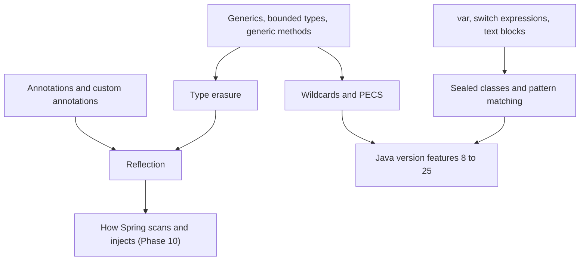
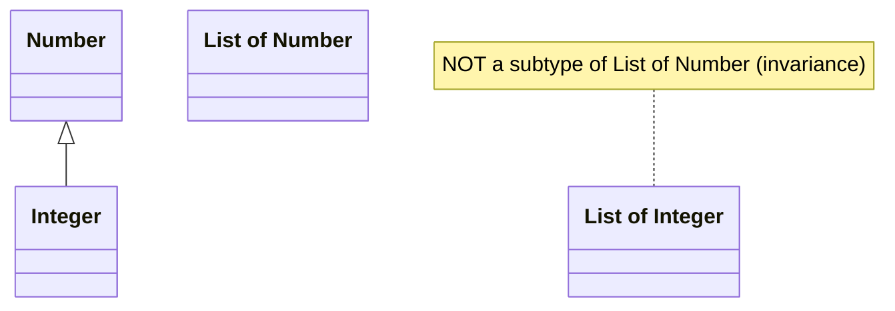
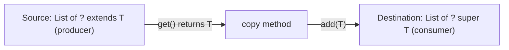
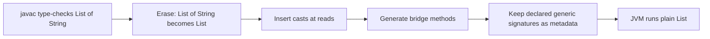

@@ 1 | MODULE | Phase 6 — Generics and Modern Language Features (Intermediate) | Generics, wildcards, erasure, annotations, reflection and the modern Java features from 8 to 25 | MUST
# Phase 6: Generics and Modern Language Features (Intermediate)

This phase opens the Intermediate level. You already write classes, collections and a small Spring Boot API; now you learn the language features that make that code type-safe and concise, and that Spring itself is built on. Generics give you compile-time type safety for containers and APIs (`List<Order>`, `Optional<Product>`, `ResponseEntity<OrderDto>`). Annotations and reflection are how Spring discovers your `@RestController` and `@Service` classes and injects dependencies. The modern Java features (`var`, switch expressions, text blocks, records, sealed classes, pattern matching) are what interviewers use to tell whether you have kept up since Java 8.

Interviewers care because these topics produce the classic trap questions: "Why can't I add an `Integer` to a `List<? extends Number>`?", "What is type erasure and why can't I write `new T()`?", "How does Spring find your annotations at runtime?", "What changed between Java 8, 11, 17 and 21?".



**Prerequisites:** Phase 2 (interfaces, inheritance, records, enums), Phase 3 (exceptions), Phase 4 (collections and `Comparator`), Phase 5 (you have seen `@RestController` and `@Service`; now you learn how annotations work).

**The 5 questions from this phase that come up most often**
1. What is type erasure, and what can you not do with generics because of it?
2. Explain `? extends T` vs `? super T` (PECS) with an example.
3. How do you create a custom annotation, and what do `@Retention` and `@Target` mean?
4. What are sealed classes, and how do they work with pattern matching for switch?
5. Name the most important features of Java 8, 11, 17 and 21.

@@ 2 | MODULE | Generics | Type parameters, bounds, wildcards and what erasure leaves at runtime | MUST
# Generics

**Shared analogy: labelled storage boxes.** A plain cardboard box (raw `Object`) holds anything, so every time you open it you must check what is inside and you might get a surprise. A box with a printed label "Books only" (`Box<Book>`) is checked at the warehouse door: the compiler refuses to put a shoe in it, and when you take something out you know it is a book. Bounds (`<T extends Number>`) are labels like "any kind of fruit". Wildcards decide whether you may only take things out of a box (`? extends`) or only put things in (`? super`). Type erasure is the fact that the labels are peeled off before the boxes leave the warehouse: at runtime every box is just a box.

- [[Generics, Bounded Types and Generic Methods]] — writing labelled boxes and methods.
- [[Wildcards and PECS]] — reading from and writing to boxes of unknown label.
- [[Type Erasure]] — why the labels do not exist at runtime.

@@ 3 | TOPIC | Generics, Bounded Types and Generic Methods | Type parameters on classes and methods, bounds, type inference and why generics replaced casts | MUST
# Generics, Bounded Types and Generic Methods

**Level: Intermediate | Phase 6 | Priority: MUST | Since: Java 5 (diamond operator Java 7, diamond with anonymous classes Java 9)**

> **30-second interview answer:** Generics let a class, interface or method take a type as a parameter, like `List<String>` or `<T> T max(List<T> list)`, so the compiler checks types and inserts casts for you. They turn runtime `ClassCastException` bugs into compile errors and remove manual casts. A bounded type parameter such as `<T extends Comparable<T>>` restricts which types are allowed and lets you call the bound's methods. Generics are a compile-time feature: they are erased at runtime.

## 1. Concept in Simple Words
### Analogy
A vending machine with a configurable slot.

| Vending machine | Generics |
|---|---|
| One machine design that can be set up for cans or for snack bags | A generic class `Machine<T>` |
| Setting it up: "this machine sells cans" | Choosing a type argument: `Machine<Can>` |
| The slot physically refuses a snack bag | The compiler rejects `add(snack)` |
| What comes out is always a can, no checking needed | `get()` returns `Can`, no cast |
| "This slot fits any bottle" | A bound: `<T extends Bottle>` |

### What it is
- **Type parameter:** a placeholder type in angle brackets, like `T` in `class Box<T>`. Convention: `T` type, `E` element, `K` key, `V` value, `R` result, `N` number.
- **Type argument:** the real type you plug in: `Box<String>`.
- **Parameterized type:** `Box<String>` as a whole.
- **Generic method:** a method with its own type parameters declared before the return type: `static <T> T first(List<T> list)`. It can live in a non-generic class.
- **Bounded type parameter:** `<T extends Number>` means T must be `Number` or a subtype. Multiple bounds: `<T extends Number & Comparable<T>>` (a class first, then interfaces, joined with `&`).
- **Type inference:** the compiler works out type arguments from context. The diamond `new ArrayList<>()` (Java 7) and `var` (Java 10) rely on it.
- **Raw type:** using a generic type without arguments (`List list`). It exists only for pre-Java-5 compatibility and switches off type checking.

### Why it exists
Before Java 5 a `List` held `Object`. You cast on every read, and a wrong element was only discovered at runtime, far away from where it was added:

```text
List orders = new ArrayList();
orders.add("not an order");           // compiles
Order o = (Order) orders.get(0);      // ClassCastException at runtime
```

Generics move the check to compile time, document intent in the signature, and let you write one algorithm (sort, max, cache) that works for many types safely.

## 2. How It Works
```text
Source you write                       What the compiler checks and generates
---------------------------------      ------------------------------------------------
Box<String> b = new Box<>();           infers Box<String> for the diamond
b.put("hi");                           checks: "hi" is a String          -> OK
b.put(42);                             checks: 42 is not a String        -> COMPILE ERROR
String s = b.get();                    erased get() returns Object;
                                       compiler inserts (String) cast    -> safe by construction
```

**Generic method type inference:**
```text
static <T extends Comparable<T>> T max(List<T> list)

max(List.of(3, 9, 4))
  1. argument type is List<Integer>      -> T = Integer
  2. check bound: Integer implements Comparable<Integer>  -> OK
  3. return type is Integer
max(List.of(new Object()))               -> COMPILE ERROR: Object is not Comparable
```

**Why the bound matters:** inside a method with plain `<T>`, you can only call `Object` methods on a `T`. With `<T extends Comparable<T>>` you can call `compareTo`. The bound is both a restriction for callers and a promise to the method body.

**Generics and inheritance (invariance):** `Integer` is a subtype of `Number`, but `List<Integer>` is **not** a subtype of `List<Number>`. If it were, you could pass a `List<Integer>` as a `List<Number>` and add a `Double` to it. Arrays are covariant (`Integer[]` is an `Object[]`) and pay for it with `ArrayStoreException` at runtime. Wildcards (next topic) are how you get flexibility safely.



**Static members:** a static field or method cannot use the class's type parameter `T`, because there is one static copy shared by `Box<String>` and `Box<Integer>`. A static method declares its own `<T>` instead.

## 3. Code Example
### Code
```java
import java.math.BigDecimal;
import java.util.ArrayList;
import java.util.List;
import java.util.Objects;
import java.util.function.Function;

public class GenericsDemo {

    // 1. A generic class: one Result type for any payload
    static final class Result<T> {
        private final T value;
        private final String error;

        private Result(T value, String error) { this.value = value; this.error = error; }

        static <T> Result<T> ok(T value) { return new Result<>(Objects.requireNonNull(value), null); }
        static <T> Result<T> fail(String error) { return new Result<>(null, error); }

        boolean isOk() { return error == null; }
        T get() {
            if (!isOk()) throw new IllegalStateException(error);
            return value;
        }

        // generic method on a generic class: maps T to R
        <R> Result<R> map(Function<T, R> mapper) {
            return isOk() ? ok(mapper.apply(value)) : fail(error);
        }

        @Override public String toString() { return isOk() ? "Ok(" + value + ")" : "Fail(" + error + ")"; }
    }

    // 2. A bounded generic method: T must be comparable to itself
    static <T extends Comparable<T>> T max(List<T> items) {
        if (items.isEmpty()) throw new IllegalArgumentException("empty list");
        T best = items.get(0);
        for (T item : items) {
            if (item.compareTo(best) > 0) best = item;   // compareTo allowed thanks to the bound
        }
        return best;
    }

    // 3. Bound on a class: only numeric amounts
    static <N extends Number> double sum(List<N> numbers) {
        double total = 0;
        for (N n : numbers) total += n.doubleValue();    // Number method allowed thanks to the bound
        return total;
    }

    // 4. Multiple bounds: a Number that is also Comparable
    static <T extends Number & Comparable<T>> T clamp(T value, T min, T max) {
        if (value.compareTo(min) < 0) return min;
        if (value.compareTo(max) > 0) return max;
        return value;
    }

    record Product(String name, BigDecimal price) { }

    static Result<Product> findProduct(String name) {
        return switch (name) {
            case "pen" -> Result.ok(new Product("pen", new BigDecimal("1.50")));
            case "book" -> Result.ok(new Product("book", new BigDecimal("12.00")));
            default -> Result.fail("no product " + name);
        };
    }

    public static void main(String[] args) {
        System.out.println(max(List.of(3, 9, 4)));
        System.out.println(max(List.of("pear", "apple", "plum")));
        System.out.println(sum(List.of(1, 2.5, 3L)));
        System.out.println(clamp(150, 0, 100));

        Result<BigDecimal> price = findProduct("book").map(Product::price);
        Result<BigDecimal> missing = findProduct("lamp").map(Product::price);
        System.out.println(price + " " + missing);

        // Raw type: compiles with a warning, fails at runtime
        @SuppressWarnings({"rawtypes", "unchecked"})
        List raw = new ArrayList<String>();
        raw.add(42);                                      // no compile error
        List<String> strings = raw;
        try {
            String s = strings.get(0);                    // hidden cast fails here
            System.out.println(s);
        } catch (ClassCastException e) {
            System.out.println("raw type bug: ClassCastException");
        }
    }
}
```

### Walkthrough
- `Result<T>` is a generic class. The static factories `ok` and `fail` declare their own `<T>` because static methods cannot use the class's `T`. `new Result<>(...)` uses the diamond.
- `map` is a generic method inside a generic class: it introduces `R`, so `Result<Product>` becomes `Result<BigDecimal>` without casts.
- `max` uses the bound `T extends Comparable<T>` so that `compareTo` can be called. It works for `Integer` and `String` because both are `Comparable` with themselves.
- `sum` uses `N extends Number`, giving access to `doubleValue()`. `List.of(1, 2.5, 3L)` is inferred as a list of a common supertype of `Integer`, `Double` and `Long` (a `Number & Comparable<...>` intersection), which satisfies the bound.
- `clamp` shows multiple bounds: `Number & Comparable<T>`.
- The raw-type block shows why raw types are dangerous: the compiler cannot help, and the failure appears at `strings.get(0)` where the compiler inserted a `(String)` cast.

### Output
```text
9
plum
6.5
100
Ok(12.00) Fail(no product lamp)
raw type bug: ClassCastException
```

### Compare
| Without generics (Java 1.4) | With generics (Java 5+) |
|---|---|
| `List orders = new ArrayList();` | `List<Order> orders = new ArrayList<>();` |
| `Order o = (Order) orders.get(0);` | `Order o = orders.get(0);` |
| Wrong element found at runtime, far away | Wrong element rejected at compile time |
| One `max(Object[])` with casts and `instanceof` | One `<T extends Comparable<T>> T max(List<T>)` |

## 4. Interview Questions
**Basic**
1. **What are generics and why were they added?**
   Generics let classes, interfaces and methods be parameterized by types. They give compile-time type checking, remove explicit casts, and allow type-safe reusable algorithms. Before Java 5, collections held `Object` and type errors appeared as `ClassCastException` at runtime.
2. **What is a generic method and how do you declare one?**
   A method with its own type parameters, declared before the return type: `public static <T> List<T> repeat(T item, int n)`. The compiler infers `T` from the arguments; you can also write it explicitly: `Util.<String>repeat("a", 3)`.
3. **What is a bounded type parameter?**
   A restriction on the type argument: `<T extends Number>` accepts `Number` and its subtypes and lets the body call `Number` methods. `extends` is used for both classes and interfaces in bounds, and multiple bounds are joined with `&`, class first.

**Follow-up**
4. **Is `List<Integer>` a subtype of `List<Number>`? Why not?**
   No, generics are invariant. If it were allowed, you could assign a `List<Integer>` to a `List<Number>` variable and add a `Double`, corrupting the list. Use `List<? extends Number>` when you only need to read numbers.
5. **Why can a static method not use the class type parameter?**
   The type parameter belongs to an instance (`Box<String>` vs `Box<Integer>`), but static members are shared by all parameterizations. A static method must declare its own type parameter, which is why factories look like `static <T> Box<T> of(T value)`.
6. **What is a raw type and why should you avoid it?**
   A generic type used without type arguments, such as `List`. It disables generic type checking, produces unchecked warnings, and lets wrong types in, so errors surface later as `ClassCastException`. It exists only for compatibility with pre-generics code.

**Tricky / scenario**
7. **Why is the signature `<T extends Comparable<? super T>>` used in `Collections.max` instead of `<T extends Comparable<T>>`?**
   Because a subclass may inherit `compareTo` from its parent: `class Apple extends Fruit implements Comparable<Fruit>`. `Apple` is not `Comparable<Apple>`, but it is `Comparable<? super Apple>`, so the looser bound accepts it. It is PECS applied to the comparator: the comparable consumes `T`.
8. **Can you use primitives as type arguments?**
   Not in Java 21: `List<int>` is illegal; you use wrappers like `List<Integer>`, paying for boxing. That is why there are specialized `IntStream` and `IntFunction` types. Project Valhalla aims to allow primitive-like value types in generics in a future release.
9. **What does this print and why: `List<String> a = new ArrayList<>(); List<Integer> b = new ArrayList<>(); System.out.println(a.getClass() == b.getClass());`?**
   `true`. Both are `ArrayList` at runtime because type arguments are erased; there is only one `ArrayList.class`.

**What the interviewer is really testing:** whether you understand that generics are a compile-time safety net (invariance, bounds, inference), and can read the bounded signatures in the JDK and Spring.

## 5. Pitfalls & Best Practices
### Common mistakes
| Mistake | What goes wrong | Fix |
|---|---|---|
| Using raw types (`List`, `Map`) | Type checks disabled, late `ClassCastException` | Always supply type arguments or the diamond |
| Expecting `List<Integer>` to be a `List<Number>` | Compile error, confusion | Use `List<? extends Number>` for read-only access |
| Declaring a generic method whose `T` is not used in parameters | `T` is inferred from the assignment target only, hiding unsafe casts | Tie `T` to a parameter, or take a `Class<T>` token |
| Overusing type parameters (`<A, B, C, D>`) | Unreadable API | Use generics where the type really varies; prefer concrete types otherwise |
| Suppressing unchecked warnings on a whole class | Real bugs hidden | Put `@SuppressWarnings("unchecked")` on the smallest scope with a comment |

### Best practices
- Program to generic interfaces in signatures: `List<Order>`, `Map<Long, Product>`.
- Use the diamond (`new HashMap<>()`) and keep type arguments in the declared type.
- Add bounds only when the body needs the bound's methods.
- Prefer generic methods for utilities (`static <T> ...`) over generic classes when no state is involved.
- Treat compiler "unchecked" warnings as errors unless you have proved the cast safe.
- In Spring you meet generics everywhere: `JpaRepository<Order, Long>`, `ResponseEntity<OrderDto>`, `ApplicationListener<OrderPlaced>`. Reading these signatures fluently is part of the job.

### Compare with
| Approach | Type safety | Casts | Works with primitives | Typical use |
|---|---|---|---|---|
| `Object` parameters | None at compile time | Manual | Via boxing | Legacy code |
| Generics | Compile time | Inserted by compiler | Via boxing | Collections, APIs, frameworks |
| Overloads per type | Compile time | None | Yes | Hot paths with primitives (`IntStream`) |
| Arrays (`T[]`) | Runtime check (covariant) | None | Yes | Low-level performance code |

## 6. Hands-on Exercise
OrderHub needs a small generic in-memory store before JPA arrives in Phase 12. Write `InMemoryRepository<T extends Identifiable<ID>, ID extends Comparable<ID>>` with `save(T)`, `findById(ID)` returning `Optional<T>`, and `findAll()` returning entities sorted by id. `Identifiable<ID>` is an interface with `ID id()`. Use it with a `Product` record (`Long` id) and a `Customer` record (`String` id).

Acceptance criteria:
- No casts in calling code.
- `findAll()` returns entities ordered by id.
- Saving an entity with an existing id replaces it.

<details><summary>Solution</summary>

```java
import java.util.List;
import java.util.Optional;
import java.util.TreeMap;

public class RepositoryExercise {

    interface Identifiable<ID> { ID id(); }

    static class InMemoryRepository<T extends Identifiable<ID>, ID extends Comparable<ID>> {
        private final TreeMap<ID, T> store = new TreeMap<>();   // sorted by id

        T save(T entity) {
            store.put(entity.id(), entity);                       // replaces on same id
            return entity;
        }

        Optional<T> findById(ID id) { return Optional.ofNullable(store.get(id)); }

        List<T> findAll() { return List.copyOf(store.values()); }
    }

    record Product(Long id, String name) implements Identifiable<Long> { }
    record Customer(String id, String email) implements Identifiable<String> { }

    public static void main(String[] args) {
        var products = new InMemoryRepository<Product, Long>();
        products.save(new Product(2L, "Book"));
        products.save(new Product(1L, "Pen"));
        products.save(new Product(2L, "Notebook"));          // replaces id 2

        var customers = new InMemoryRepository<Customer, String>();
        customers.save(new Customer("c-9", "ana@example.com"));

        Product p = products.findById(1L).orElseThrow();      // no cast
        System.out.println(p.name());
        System.out.println(products.findAll());
        System.out.println(customers.findById("c-1").isPresent());
    }
}
```
Output:
```text
Pen
[Product[id=1, name=Pen], Product[id=2, name=Notebook]]
false
```
The bound `T extends Identifiable<ID>` lets `save` call `entity.id()`, and `ID extends Comparable<ID>` lets the `TreeMap` sort keys. This is the same shape as Spring Data's `CrudRepository<T, ID>`.
</details>

## 7. Recall
Q: What problem do Java generics solve?
A: They move type errors from runtime `ClassCastException` to compile time and remove manual casts.

Q: How do you declare a generic method in Java?
A: Put the type parameter before the return type, for example `static <T> T first(List<T> list)`.

Q: What does a bounded type parameter like `<T extends Comparable<T>>` give you?
A: It restricts allowed type arguments and lets the method body call the bound's methods, here `compareTo`.

Q: Is `List<Integer>` a subtype of `List<Number>` in Java generics?
A: No; generics are invariant, otherwise you could add a `Double` to a list of integers.

Q: Why can a static method not use its class's generic type parameter?
A: Static members are shared across all parameterizations, so the static method must declare its own type parameter.

Q: What is a raw type in Java generics?
A: A generic type used without type arguments, which disables type checking and exists only for legacy compatibility.

**Related:** [[Wildcards and PECS]] · [[Type Erasure]] · [[Comparable vs Comparator]] · [[Collections Hierarchy and Choosing a Collection]]

@@ 3 | TOPIC | Wildcards and PECS | Unbounded, upper and lower bounded wildcards and the Producer Extends Consumer Super rule | SHOULD
# Wildcards and PECS

**Level: Intermediate | Phase 6 | Priority: SHOULD | Since: Java 5**

> **30-second interview answer:** A wildcard `?` stands for an unknown type argument. `List<? extends Number>` means "a list of some subtype of Number": you can read elements as `Number` but cannot add anything except `null`. `List<? super Integer>` means "a list of Integer or a supertype": you can add `Integer` values but reading gives you only `Object`. The rule PECS, Producer Extends Consumer Super, tells you which to use: if a parameter produces values for you, use `extends`; if it consumes values you give it, use `super`. `Collections.copy(List<? super T> dest, List<? extends T> src)` is the textbook example.

## 1. Concept in Simple Words
### Analogy
A fruit bowl and a compost bin.

| Kitchen | Wildcards |
|---|---|
| A bowl of "some kind of fruit" (maybe only apples, maybe only pears) | `List<? extends Fruit>` |
| You can always take out something and know it is a fruit | Reading gives `Fruit` |
| You cannot put a pear in, because it might be the apples-only bowl | `add` is rejected by the compiler |
| A bin that accepts "apples or anything more general" (an apple bin, a fruit bin, a food bin) | `List<? super Apple>` |
| You can always throw an apple in | `add(apple)` is allowed |
| When you pull something out, you only know it is "some thing" | Reading gives `Object` |

The bowl **produces** fruit for you (extends). The bin **consumes** apples from you (super).

### What it is
- **Unbounded wildcard** `List<?>`: a list of some unknown type. Read as `Object`; add only `null`. Use when the code does not care about the element type (`size()`, `clear()`, printing).
- **Upper-bounded wildcard** `List<? extends Number>`: unknown type that is `Number` or a subtype. Accepts `List<Integer>`, `List<Double>`, `List<Number>`. Read-only in practice.
- **Lower-bounded wildcard** `List<? super Integer>`: unknown type that is `Integer` or a supertype. Accepts `List<Integer>`, `List<Number>`, `List<Object>`. Write `Integer` values; reads are `Object`.
- **PECS:** Producer `extends`, Consumer `super` (Joshua Bloch, Effective Java). A parameter that is both read and written should be an exact type `List<T>`.
- **Wildcard capture:** the compiler gives the unknown type a temporary name (`capture#1 of ?`) to type-check expressions; a private generic helper method can "capture" it to write code that needs a name.

### Why it exists
Generics are invariant: a method `double sum(List<Number> list)` cannot accept a `List<Integer>`. Without wildcards you would need an overload per type or a raw type. Wildcards give flexible, still type-safe APIs, which is why almost every JDK collection method uses them (`addAll(Collection<? extends E>)`, `sort(Comparator<? super E>)`, `removeIf(Predicate<? super E>)`).

## 2. How It Works
```text
List<? extends Number> nums  can point to:  List<Number>, List<Integer>, List<Double>, ...
  Number n = nums.get(0);    OK   every possible list holds Numbers
  nums.add(1);               NO   it might be a List<Double>
  nums.add(null);            OK   null fits every type

List<? super Integer> sink   can point to:  List<Integer>, List<Number>, List<Object>
  sink.add(1);               OK   an Integer fits in all three
  Integer i = sink.get(0);   NO   it might be a List<Object> holding a String
  Object o = sink.get(0);    OK   everything is an Object
```



**Reading the JDK signatures:**
| Signature | Why |
|---|---|
| `boolean addAll(Collection<? extends E> c)` | `c` produces elements for this collection |
| `void sort(Comparator<? super E> c)` | the comparator consumes elements (a `Comparator<Object>` can sort strings) |
| `boolean removeIf(Predicate<? super E> filter)` | the predicate consumes elements |
| `static <T> void copy(List<? super T> dest, List<? extends T> src)` | src produces, dest consumes |
| `<R> Stream<R> map(Function<? super T, ? extends R> mapper)` | the function consumes T and produces R |

**Wildcard vs type parameter:** `void printAll(List<?> list)` and `<T> void printAll(List<T> list)` are equivalent for callers. Use a type parameter when you need to relate two things (the return type to the argument, or two parameters to each other); otherwise a wildcard is simpler. Never put wildcards in return types: callers would have to deal with `?` everywhere.

**Capture helper** (the standard trick to swap elements of a `List<?>`):
```text
static void swap(List<?> list, int i, int j) { swapHelper(list, i, j); }
private static <T> void swapHelper(List<T> list, int i, int j) {
    T tmp = list.get(i); list.set(i, list.get(j)); list.set(j, tmp);
}
```

## 3. Code Example
### Code
```java
import java.util.ArrayList;
import java.util.Comparator;
import java.util.List;
import java.util.function.Predicate;

public class WildcardsDemo {

    static class Product {
        final String name;
        final double price;
        Product(String name, double price) { this.name = name; this.price = price; }
        @Override public String toString() { return name; }
    }

    static class DigitalProduct extends Product {
        DigitalProduct(String name, double price) { super(name, price); }
    }

    // Producer: we only READ products -> ? extends
    static double totalPrice(List<? extends Product> products) {
        double total = 0;
        for (Product p : products) total += p.price;
        return total;
    }

    // Consumer: we only WRITE integers -> ? super
    static void addOrderIds(List<? super Integer> sink, int count) {
        for (int i = 1; i <= count; i++) sink.add(1000 + i);
    }

    // Both: src produces T, dest consumes T, the filter consumes T
    static <T> void copyMatching(List<? extends T> src, List<? super T> dest, Predicate<? super T> filter) {
        for (T item : src) {
            if (filter.test(item)) dest.add(item);
        }
    }

    // Unbounded: we do not care about the type
    static void printSize(List<?> list) {
        System.out.println("size=" + list.size() + " first=" + (list.isEmpty() ? "none" : list.get(0)));
    }

    // Capture helper: swap works on List<?>
    static void swap(List<?> list, int i, int j) { swapHelper(list, i, j); }
    private static <T> void swapHelper(List<T> list, int i, int j) {
        T tmp = list.get(i);
        list.set(i, list.get(j));
        list.set(j, tmp);
    }

    public static void main(String[] args) {
        List<DigitalProduct> ebooks = List.of(new DigitalProduct("ebook", 5.0), new DigitalProduct("course", 20.0));
        List<Product> mixed = List.of(new Product("pen", 1.5), new DigitalProduct("song", 1.0));

        System.out.println(totalPrice(ebooks));   // List<DigitalProduct> accepted
        System.out.println(totalPrice(mixed));    // List<Product> accepted

        List<Number> numbers = new ArrayList<>();
        List<Object> objects = new ArrayList<>();
        addOrderIds(numbers, 2);                  // List<Number> accepted
        addOrderIds(objects, 1);                  // List<Object> accepted
        System.out.println(numbers + " " + objects);

        // Predicate<Object> can filter DigitalProducts: consumer super
        Predicate<Object> notNull = o -> o != null;
        Predicate<Product> cheap = p -> p.price < 10;
        List<Product> result = new ArrayList<>();
        copyMatching(ebooks, result, cheap.and(notNull));
        System.out.println("cheap: " + result);

        // Comparator<Product> sorts a List<DigitalProduct>: sort takes Comparator<? super E>
        List<DigitalProduct> sorted = new ArrayList<>(ebooks);
        sorted.sort(Comparator.comparingDouble((Product p) -> p.price).reversed());
        System.out.println("sorted: " + sorted);

        List<String> names = new ArrayList<>(List.of("a", "b", "c"));
        swap(names, 0, 2);
        printSize(names);
        printSize(List.of());
    }
}
```

### Walkthrough
- `totalPrice(List<? extends Product>)` accepts a list of `Product` or any subclass. Inside, elements are read as `Product`. Adding would not compile.
- `addOrderIds(List<? super Integer>)` accepts `List<Integer>`, `List<Number>` and `List<Object>` because each can safely hold an `Integer`.
- `copyMatching` is a full PECS method: `src` is a producer, `dest` a consumer, and the `Predicate<? super T>` consumes items. That is why a `Predicate<Product>` (combined with a `Predicate<Object>`) can filter `DigitalProduct` items.
- `sorted.sort(...)` passes a `Comparator<Product>` to a `List<DigitalProduct>`, accepted because `List.sort` takes `Comparator<? super E>`.
- `swap` takes a `List<?>` and delegates to a generic helper that captures the unknown type as `T`, so `set` type-checks.

### Output
```text
25.0
2.5
[1001, 1002] [1001]
cheap: [ebook]
sorted: [course, ebook]
size=3 first=c
size=0 first=none
```

### Compare
| Signature | Accepts `List<Integer>`? | Accepts `List<Number>`? | Can read as | Can add |
|---|---|---|---|---|
| `List<Number>` | No | Yes | `Number` | `Number` values |
| `List<? extends Number>` | Yes | Yes | `Number` | only `null` |
| `List<? super Integer>` | Yes | Yes | `Object` | `Integer` values |
| `List<?>` | Yes | Yes | `Object` | only `null` |

## 4. Interview Questions
**Basic**
1. **What does `?` mean in generics?**
   It is a wildcard: an unknown type argument. `List<?>` is a list of some specific but unknown type. It lets a method accept many parameterizations while staying type-safe.
2. **What is the difference between `? extends T` and `? super T`?**
   `? extends T` is an upper bound: the type is `T` or a subtype, so you can read elements as `T` but not add. `? super T` is a lower bound: the type is `T` or a supertype, so you can add `T` values but reads give `Object`.
3. **What does PECS stand for?**
   Producer Extends, Consumer Super. If a parameterized argument supplies values to your method, declare it with `extends`; if it receives values from your method, use `super`. If it does both, use the exact type.

**Follow-up**
4. **Why can't you add an `Integer` to a `List<? extends Number>`?**
   The variable might point to a `List<Double>`, and the compiler cannot know which. Allowing the add would break the list's type safety, so only `null` is permitted.
5. **Why does `List.sort` take `Comparator<? super E>`?**
   So that a more general comparator can be reused: a `Comparator<Product>` or `Comparator<Object>` can order a `List<DigitalProduct>`. The comparator only consumes elements, which is the consumer case.
6. **When would you use a type parameter instead of a wildcard?**
   When you need to name the type to relate parts of the signature, such as returning the same type you received (`<T> T first(List<T>)`) or requiring two arguments to share a type. If the type appears only once, a wildcard is simpler.

**Tricky / scenario**
7. **Does this compile? `List<? extends Number> list = new ArrayList<Integer>(); list.add(list.get(0));`**
   No. `list.get(0)` returns a `Number`, but `add` expects the unknown captured type, not `Number`. Even re-adding an element read from the same list is rejected; a generic helper method that captures the type fixes it.
8. **Is `List<Object>` the same as `List<?>`?**
   No. `List<Object>` accepts only a `List<Object>` argument but lets you add anything. `List<?>` accepts a list of any type but lets you add only `null`. `List<?>` says "I do not know the type"; `List<Object>` says "the type is Object".
9. **Why should you not return a wildcard type from a public method?**
   Callers then hold a `List<? extends X>` they cannot add to and must reason about wildcards themselves. Wildcards belong in parameters to make APIs flexible; return concrete types.

**What the interviewer is really testing:** whether you can design flexible APIs and explain the compile errors that wildcards cause, rather than just memorizing the acronym.

## 5. Pitfalls & Best Practices
### Common mistakes
| Mistake | What goes wrong | Fix |
|---|---|---|
| Parameter `List<Product>` for a read-only method | Callers with `List<DigitalProduct>` cannot call it | Use `List<? extends Product>` |
| Using `? extends` on a parameter you write to | Compile error on `add` | Use `? super T` or the exact type |
| Wildcards in return types | Clumsy for every caller | Return concrete generic types |
| Thinking `List<?>` is the same as raw `List` | Raw type disables checks; `List<?>` keeps them | Prefer `List<?>` when type does not matter |
| Using `Comparator<T>` in a utility | Rejects reusable supertype comparators | Use `Comparator<? super T>` |

### Best practices
- Apply PECS to every public method that takes a generic collection, function or comparator.
- Functional interface parameters follow PECS too: `Function<? super T, ? extends R>`, `Predicate<? super T>`, `Consumer<? super T>`, `Supplier<? extends T>`.
- Keep wildcards out of fields and return types; keep them in parameters.
- Use the capture-helper pattern instead of casts when a `List<?>` must be modified.

### Compare with
| Feature | Arrays | Generics with wildcards |
|---|---|---|
| Variance | Covariant (`Integer[]` is an `Object[]`) | Invariant, opt-in variance with `?` |
| When errors appear | Runtime `ArrayStoreException` | Compile time |
| Write through supertype reference | Compiles, may fail at runtime | Rejected for `? extends` |

## 6. Hands-on Exercise
In OrderHub, write a utility class `OrderUtils` with:
1. `static BigDecimal total(Collection<? extends OrderLine> lines)` summing `price * quantity`.
2. `static <T> void moveIf(Collection<? extends T> from, Collection<? super T> to, Predicate<? super T> test)` copying matching items.
3. `static <T> T maxBy(Collection<? extends T> items, Comparator<? super T> cmp)`.

Acceptance criteria: `total` accepts a `List<DiscountedLine>` where `DiscountedLine extends OrderLine`; `moveIf` can move `DiscountedLine` items into a `List<Object>` using a `Predicate<OrderLine>`; `maxBy` uses a `Comparator<OrderLine>` on a `List<DiscountedLine>` and returns a `DiscountedLine`.

<details><summary>Solution</summary>

```java
import java.math.BigDecimal;
import java.util.ArrayList;
import java.util.Collection;
import java.util.Comparator;
import java.util.List;
import java.util.function.Predicate;

public class OrderUtils {

    static class OrderLine {
        final String sku; final BigDecimal price; final int quantity;
        OrderLine(String sku, String price, int quantity) {
            this.sku = sku; this.price = new BigDecimal(price); this.quantity = quantity;
        }
        BigDecimal subtotal() { return price.multiply(BigDecimal.valueOf(quantity)); }
        @Override public String toString() { return sku; }
    }

    static class DiscountedLine extends OrderLine {
        DiscountedLine(String sku, String price, int quantity) { super(sku, price, quantity); }
    }

    static BigDecimal total(Collection<? extends OrderLine> lines) {
        BigDecimal sum = BigDecimal.ZERO;
        for (OrderLine line : lines) sum = sum.add(line.subtotal());
        return sum;
    }

    static <T> void moveIf(Collection<? extends T> from, Collection<? super T> to, Predicate<? super T> test) {
        for (T item : from) if (test.test(item)) to.add(item);
    }

    static <T> T maxBy(Collection<? extends T> items, Comparator<? super T> cmp) {
        T best = null;
        for (T item : items) if (best == null || cmp.compare(item, best) > 0) best = item;
        if (best == null) throw new IllegalArgumentException("empty");
        return best;
    }

    public static void main(String[] args) {
        List<DiscountedLine> lines = List.of(
                new DiscountedLine("PEN", "1.50", 4),
                new DiscountedLine("BOOK", "12.00", 1));

        System.out.println(total(lines));

        List<Object> archive = new ArrayList<>();
        Predicate<OrderLine> bulk = l -> l.quantity > 1;
        moveIf(lines, archive, bulk);
        System.out.println(archive);

        Comparator<OrderLine> bySubtotal = Comparator.comparing(OrderLine::subtotal);
        DiscountedLine top = maxBy(lines, bySubtotal);   // T inferred as DiscountedLine
        System.out.println(top);
    }
}
```
Output:
```text
18.00
[PEN]
BOOK
```
`maxBy` returns `T`, so the caller gets `DiscountedLine` back without a cast, while still accepting a comparator for the supertype.
</details>

## 7. Recall
Q: What does PECS mean for Java wildcards?
A: Producer Extends, Consumer Super: use `? extends T` for parameters you read from and `? super T` for parameters you write to.

Q: What can you add to a `List<? extends Number>`?
A: Only `null`, because the list could be a list of any specific Number subtype.

Q: What type do you get when reading from a `List<? super Integer>`?
A: `Object`, because the list could be a `List<Object>`.

Q: Why does `Collections.copy` declare `List<? super T> dest, List<? extends T> src`?
A: The source produces T values and the destination consumes them, so it accepts the widest range of lists safely.

Q: What is the difference between `List<?>` and `List<Object>` in generics?
A: `List<?>` accepts a list of any type but allows only null to be added; `List<Object>` accepts only a `List<Object>` but allows adding anything.

**Related:** [[Generics, Bounded Types and Generic Methods]] · [[Type Erasure]] · [[Built-in Functional Interfaces]] · [[Comparable vs Comparator]]

@@ 3 | TOPIC | Type Erasure | How generics are compiled away, bridge methods, reifiable types and what you cannot do at runtime | SHOULD
# Type Erasure

**Level: Intermediate | Phase 6 | Priority: SHOULD | Since: Java 5**

> **30-second interview answer:** Type erasure means the compiler checks generic types and then removes them: `List<String>` and `List<Integer>` both become plain `List` in bytecode, type parameters are replaced by their bound (or `Object`), and casts are inserted where values are read. It was chosen so generic code stays binary-compatible with pre-Java-5 code. The consequences: you cannot write `new T()`, `new T[]`, `instanceof List<String>`, overload on `List<String>` vs `List<Integer>`, or use primitives as type arguments. To get the type at runtime you pass a `Class<T>` token or capture it in a subclass (super type token), which is what Jackson's `TypeReference` and Spring's `ParameterizedTypeReference` do.

## 1. Concept in Simple Words
### Analogy
Airport baggage labels.

| Airport | Type erasure |
|---|---|
| At check-in, staff verify your bag matches the label "Fragile, Electronics" | The compiler checks `List<Laptop>` |
| The label is removed before the bag goes onto the plane | Type arguments are erased from the bytecode |
| On the plane, every bag is just "a bag" | At runtime there is only `List` |
| At arrival, staff trust check-in and hand you the bag as electronics | The compiler-inserted cast at `get()` |
| A bag slipped in via a back door (no check-in) surprises you at arrival | Raw types and unchecked casts cause late `ClassCastException` |
| Writing the destination inside the bag itself | A `Class<T>` token carried at runtime |

### What it is
- **Erasure:** after type-checking, the compiler replaces each type parameter by its leftmost bound (`T` becomes `Object`; `T extends Comparable<T>` becomes `Comparable`) and deletes type arguments (`List<String>` becomes `List`).
- **Cast insertion:** where a generic value is used as a specific type, the compiler adds a `checkcast` instruction.
- **Bridge method:** a synthetic method the compiler generates so overriding still works after erasure.
- **Reifiable type:** a type fully available at runtime: primitives, non-generic classes, raw types, `List<?>`, arrays of reifiable types. `List<String>` is **not** reifiable.
- **Heap pollution:** a variable of a parameterized type refers to an object of a different parameterization, caused by raw types or unchecked casts.
- **Signature attribute:** erasure is not total. Declared generic types of fields, method parameters, return types and superclasses are kept as metadata in the class file and are readable by reflection. Only the type arguments of objects at runtime are gone.

### Why it exists
When generics arrived in Java 5, billions of lines of code and existing libraries used raw `List`. Sun chose erasure so that a `List<String>` compiled in Java 5 is the same `java.util.ArrayList` class a Java 1.4 library expects, and no new JVM was needed. C# chose the opposite (reified generics, separate runtime types), which required a new runtime and library split.

## 2. How It Works
```text
SOURCE                                         BYTECODE AFTER ERASURE (javap -c)
---------------------------------------        ---------------------------------------
class Box<T> {                                 class Box {
  private T value;                               private Object value;
  T get() { return value; }                      Object get() { return value; }
  void set(T v) { value = v; }                   void set(Object v) { value = v; }
}                                              }

class NumBox<T extends Number> {               class NumBox {
  T value;                                       Number value;          // leftmost bound
}                                              }

Box<String> b = new Box<>();                   Box b = new Box();
String s = b.get();                            String s = (String) b.get();   // checkcast
```

**Bridge methods:**
```text
class StringComparator implements Comparator<String> {
    public int compare(String a, String b) { ... }
}
After erasure Comparator has compare(Object, Object). The compiler adds:
    public int compare(Object a, Object b) {           // synthetic bridge
        return compare((String) a, (String) b);
    }
so code calling Comparator.compare(Object, Object) still reaches your method.
```



**What you cannot do, and why:**
| Not allowed | Reason |
|---|---|
| `new T()` | No `T` at runtime to instantiate |
| `new T[10]` or `new List<String>[10]` | Arrays check element types at runtime; the generic type is unknown |
| `obj instanceof List<String>` | Runtime only knows `List` (but `instanceof List<?>` is fine) |
| `List<String>.class` | Only one `List.class` exists |
| Overloading `m(List<String>)` and `m(List<Integer>)` | Both erase to `m(List)`: name clash |
| `static T field` | One static copy for all parameterizations |
| `catch (T e)` or a generic class extending `Throwable` | The catch needs a runtime type |
| `List<int>` | Erasure needs `Object`; primitives are not objects |

**Workarounds:**
- **Class token:** pass `Class<T> type`, then `type.getDeclaredConstructor().newInstance()` or `type.cast(obj)`.
- **Supplier:** pass `Supplier<T> factory` (`ArrayList::new`), the modern, reflection-free choice.
- **Super type token:** an anonymous subclass `new TypeReference<List<Order>>() {}` keeps `List<Order>` in its superclass signature, readable via `getGenericSuperclass()`. Jackson, Gson and Spring's `ParameterizedTypeReference` rely on this.

## 3. Code Example
### Code
```java
import java.lang.reflect.Method;
import java.lang.reflect.ParameterizedType;
import java.lang.reflect.Type;
import java.util.ArrayList;
import java.util.Comparator;
import java.util.List;
import java.util.function.Supplier;

public class TypeErasureDemo {

    // Super type token: the anonymous subclass remembers T in its class metadata
    abstract static class TypeRef<T> {
        final Type type;
        protected TypeRef() {
            ParameterizedType superType = (ParameterizedType) getClass().getGenericSuperclass();
            this.type = superType.getActualTypeArguments()[0];
        }
    }

    // Class token: create and check instances of T at runtime
    static <T> T create(Class<T> type) throws ReflectiveOperationException {
        return type.getDeclaredConstructor().newInstance();
    }

    // Supplier: no reflection needed
    static <T> List<T> filled(Supplier<T> factory, int n) {
        List<T> list = new ArrayList<>();
        for (int i = 0; i < n; i++) list.add(factory.get());
        return list;
    }

    static class ByLength implements Comparator<String> {
        @Override public int compare(String a, String b) { return Integer.compare(a.length(), b.length()); }
    }

    // Declared generic types survive as metadata
    static List<Integer> ids;

    public static void main(String[] args) throws Exception {
        List<String> strings = new ArrayList<>();
        List<Integer> numbers = new ArrayList<>();
        System.out.println("same class: " + (strings.getClass() == numbers.getClass()));

        // instanceof with a generic type argument does not compile; List<?> does
        Object o = strings;
        System.out.println("is a list: " + (o instanceof List<?>));

        // Heap pollution through an unchecked cast
        @SuppressWarnings("unchecked")
        List<Integer> polluted = (List<Integer>) (List<?>) new ArrayList<>(List.of("oops"));
        System.out.println("size still works: " + polluted.size());
        try {
            Integer first = polluted.get(0);           // compiler-inserted cast fails here
            System.out.println(first);
        } catch (ClassCastException e) {
            System.out.println("heap pollution detected late: ClassCastException");
        }

        StringBuilder sb = create(StringBuilder.class).append("built by class token");
        System.out.println(sb);
        System.out.println(filled(() -> "x", 3));

        TypeRef<List<String>> ref = new TypeRef<>() { };
        System.out.println("captured type: " + ref.type);

        System.out.println("field type: " + TypeErasureDemo.class.getDeclaredField("ids").getGenericType());

        for (Method m : ByLength.class.getDeclaredMethods()) {
            if (m.getName().equals("compare")) {
                System.out.println("compare(" + m.getParameterTypes()[0].getSimpleName() + ") bridge=" + m.isBridge());
            }
        }
    }
}
```

### Walkthrough
- `strings.getClass() == numbers.getClass()` is true: both are `ArrayList` at runtime.
- `o instanceof List<?>` compiles; `o instanceof List<String>` would be a compile error (since Java 16 it is allowed only when the compiler can prove it safe from the static type).
- The double cast through `List<?>` creates heap pollution: a list of strings referenced as `List<Integer>`. `size()` works because it does not touch elements; `get(0)` fails at the inserted cast, far from the real bug.
- `create(Class<T>)` uses a class token; `filled(Supplier<T>)` uses a factory, which is the simpler modern approach.
- `TypeRef` is a super type token: `new TypeRef<List<String>>() { }` creates an anonymous subclass whose generic superclass `TypeRef<List<String>>` is stored in the class file, so `getActualTypeArguments()` returns `java.util.List<java.lang.String>`.
- `getGenericType()` on the field shows declared generic types survive as metadata.
- `ByLength` has two `compare` methods in bytecode: yours with `String` parameters and a synthetic bridge with `Object` parameters. The order returned by `getDeclaredMethods()` is not guaranteed, so the two lines may appear in either order.

### Output
```text
same class: true
is a list: true
size still works: 1
heap pollution detected late: ClassCastException
built by class token
[x, x, x]
captured type: java.util.List<java.lang.String>
field type: java.util.List<java.lang.Integer>
compare(String) bridge=false
compare(Object) bridge=true
```

### Compare
| Java (erasure) | C# (reified generics) |
|---|---|
| One runtime class for all `List<T>` | Separate runtime type per `List<int>`, `List<string>` |
| No `new T()`, no `typeof(T)` | `new T()` with constraint, `typeof(T)` works |
| Primitives need boxing | `List<int>` stores ints directly |
| Binary compatible with pre-generics code | Required a new runtime and new collection library |

## 4. Interview Questions
**Basic**
1. **What is type erasure?**
   The compiler type-checks generic code and then removes type arguments, replacing type parameters with their bounds or `Object` and inserting casts. At runtime `List<String>` and `List<Integer>` are both just `List`.
2. **Why did Java choose erasure?**
   Backward compatibility: generic code compiled with Java 5 had to run with existing libraries and on the same JVM, and old raw-type code had to keep working. Erasure needed no JVM changes.
3. **Name three things you cannot do because of erasure.**
   `new T()`, creating generic arrays like `new T[n]`, and `instanceof List<String>`. You also cannot overload methods that differ only in type arguments, or use primitives as type arguments.

**Follow-up**
4. **What is a bridge method?**
   A synthetic method generated by the compiler to preserve polymorphism after erasure. If you implement `Comparator<String>`, your `compare(String, String)` is wrapped by a bridge `compare(Object, Object)` that casts and delegates. Stack traces sometimes show these bridges.
5. **If types are erased, how does Jackson deserialize JSON into `List<Order>`?**
   It uses a super type token: `new TypeReference<List<Order>>() {}` is an anonymous subclass, and the generic superclass with its type argument is stored in the class file, readable via reflection. Spring's `ParameterizedTypeReference` works the same way for `RestClient` and `RestTemplate`.
6. **What is heap pollution?**
   When a variable of a parameterized type refers to an object that is not of that type, for example via a raw type or an unchecked cast. The error shows up later as a `ClassCastException` at a compiler-inserted cast. Generic varargs can cause it, which is why `@SafeVarargs` exists.

**Tricky / scenario**
7. **Will these two methods compile in the same class: `void save(List<Order> o)` and `void save(List<Customer> c)`?**
   No. Both erase to `save(List)`, giving a "name clash: have the same erasure" error. Rename them or use different parameter types.
8. **Is erasure complete? Can reflection see generic types at all?**
   Declared types survive: field types, method parameter and return types, and the generic superclass are stored in the `Signature` attribute and returned by `getGenericType()` or `getGenericSuperclass()`. What is lost is the type argument of a particular object instance at runtime.
9. **Why does `T[] arr = (T[]) new Object[n];` work inside `ArrayList` but `toArray` needs an argument?**
   The cast is unchecked: inside the class `T[]` erases to `Object[]`, so nothing fails. But if that array escapes to a caller expecting `String[]`, a `ClassCastException` happens. That is why `toArray(new String[0])` or `toArray(String[]::new)` takes the runtime type from the caller.

**What the interviewer is really testing:** whether you understand the runtime reality behind generics, can explain the strange compile errors, and know the token workarounds frameworks use.

## 5. Pitfalls & Best Practices
### Common mistakes
| Mistake | What goes wrong | Fix |
|---|---|---|
| Expecting `instanceof List<String>` to work | Compile error | Check `instanceof List<?>` and validate elements |
| Overloading by generic argument | Name clash compile error | Use different method names |
| Unchecked casts to `List<T>` | Heap pollution, late `ClassCastException` | Validate elements or use typed APIs |
| Deserializing with `List.class` | Elements become `LinkedHashMap` in Jackson | Use `TypeReference` or `ParameterizedTypeReference` |
| Exposing an internal `(T[]) new Object[n]` array | `ClassCastException` in callers | Keep it private; accept `IntFunction<T[]>` from callers |

### Best practices
- Pass a `Supplier<T>` or `Class<T>` when code must create or check `T`.
- Use `TypeReference` (Jackson) and `ParameterizedTypeReference` (Spring) for generic response types, for example `restClient.get().uri("/orders").retrieve().body(new ParameterizedTypeReference<List<OrderDto>>() {})`.
- Mark safe generic varargs methods with `@SafeVarargs` (static, final or private methods only) after checking they do not store the array.
- Read `javap -c -p` output once to see erasure and bridge methods for yourself.

### Compare with
| Type | Reifiable? | Example |
|---|---|---|
| Primitive and non-generic class | Yes | `int`, `String` |
| Raw type | Yes | `List` |
| Unbounded wildcard | Yes | `List<?>` |
| Concrete parameterized type | No | `List<String>` |
| Type variable | No | `T` |

## 6. Hands-on Exercise
OrderHub caches typed values under string keys. Write `TypedCache` with `<T> void put(String key, T value)` and `<T> Optional<T> get(String key, Class<T> type)` that returns empty if the stored value is not of the requested type (no `ClassCastException`). Then write `<T> List<T> newList(Supplier<? extends List<T>> factory)` and show why `get(key, List.class)` cannot tell `List<String>` from `List<Integer>`.

Acceptance criteria:
- `get("price", BigDecimal.class)` returns the value; `get("price", String.class)` returns empty.
- No unchecked warnings except where justified with a comment.

<details><summary>Solution</summary>

```java
import java.math.BigDecimal;
import java.util.ArrayList;
import java.util.HashMap;
import java.util.LinkedList;
import java.util.List;
import java.util.Map;
import java.util.Optional;
import java.util.function.Supplier;

public class TypedCache {
    private final Map<String, Object> store = new HashMap<>();

    <T> void put(String key, T value) { store.put(key, value); }

    <T> Optional<T> get(String key, Class<T> type) {
        Object value = store.get(key);
        return type.isInstance(value) ? Optional.of(type.cast(value)) : Optional.empty();
    }

    static <T> List<T> newList(Supplier<? extends List<T>> factory) { return factory.get(); }

    public static void main(String[] args) {
        TypedCache cache = new TypedCache();
        cache.put("price", new BigDecimal("9.99"));
        cache.put("tags", List.of("new", "sale"));

        System.out.println(cache.get("price", BigDecimal.class));
        System.out.println(cache.get("price", String.class));

        // Erasure: the class token is only List, the element type is lost
        Optional<List> tags = cache.get("tags", List.class);
        System.out.println("tags present: " + tags.isPresent() + " (element type unknown at runtime)");

        List<String> a = newList(ArrayList::new);
        List<String> b = newList(LinkedList::new);
        a.add("x");
        System.out.println(a + " " + b.getClass().getSimpleName());
    }
}
```
Output:
```text
Optional[9.99]
Optional.empty
tags present: true (element type unknown at runtime)
[x] LinkedList
```
`Class.isInstance` and `Class.cast` give a checked cast, so a wrong type gives an empty result instead of a late `ClassCastException`. `List.class` is the raw type, which is the limit of class tokens; a super type token would be needed to keep `List<String>`.
</details>

## 7. Recall
Q: What does type erasure do to `List<String>` at runtime?
A: It becomes the raw `List`; type arguments are removed and casts are inserted where elements are read.

Q: Why can you not write `new T()` in a Java generic class?
A: Because of type erasure there is no runtime information about T; pass a `Class<T>` or `Supplier<T>` instead.

Q: What is a bridge method in Java generics?
A: A compiler-generated synthetic method that keeps overriding working after erasure, casting and delegating to the typed method.

Q: How do Jackson and Spring keep a generic type like `List<Order>` at runtime despite type erasure?
A: With a super type token: an anonymous subclass such as `new TypeReference<List<Order>>() {}` stores the type argument in its superclass signature.

Q: Why do `save(List<Order>)` and `save(List<Customer>)` clash under type erasure?
A: Both erase to `save(List)`, so they have the same signature in bytecode.

Q: What is heap pollution in Java generics?
A: A parameterized-type variable that refers to an object of a different parameterization, usually via raw types or unchecked casts.

**Related:** [[Generics, Bounded Types and Generic Methods]] · [[Wildcards and PECS]] · [[Reflection]] · [[RestClient, WebClient and HTTP Interfaces]]
