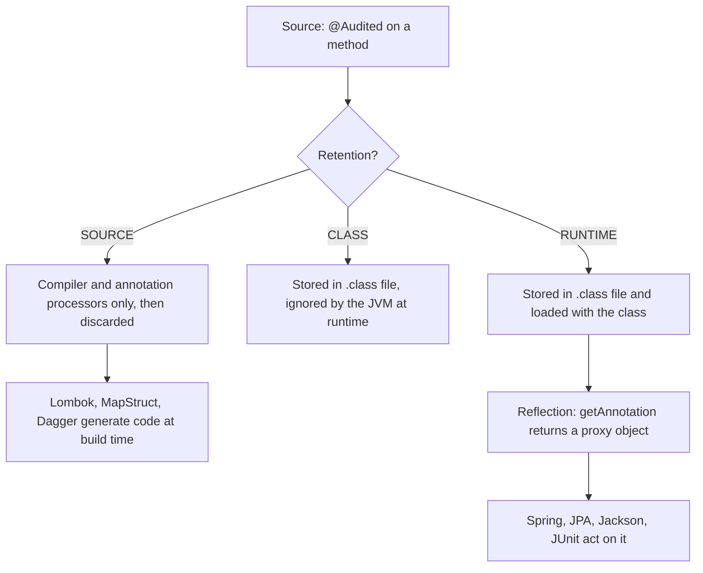
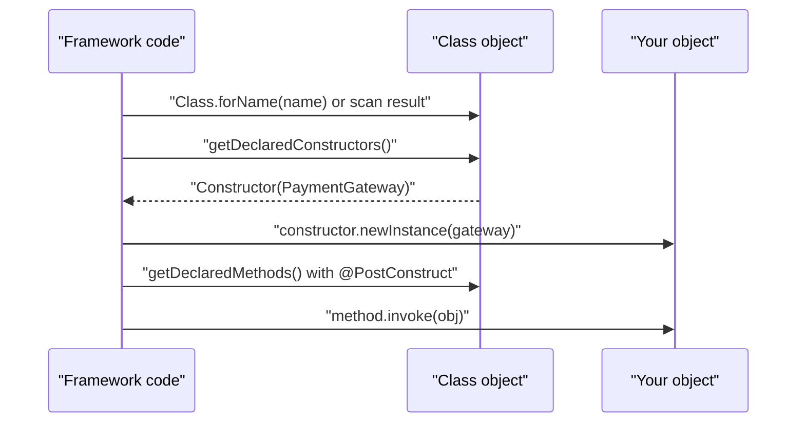
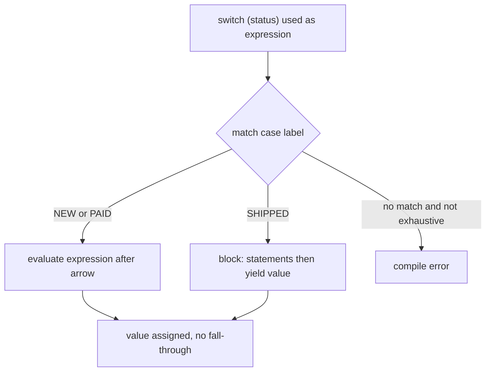

@@ 2 | MODULE | Metaprogramming | Code that describes and inspects code: annotations and reflection, the engine under Spring | MUST
# Metaprogramming

**Shared analogy: sticky notes and an X-ray machine.** Annotations are sticky notes you put on classes, methods and fields: "this is a service", "inject here", "run this in a transaction". The sticky note does nothing by itself. Reflection is the X-ray machine that lets a program look inside any class at runtime, read the sticky notes, list the fields and methods, and call them. Spring is the warehouse worker who walks through your code with the X-ray machine, reads every sticky note and acts on it: creates beans, injects dependencies, wraps methods in proxies.

- [[Annotations and Custom Annotations]] — writing and reading the sticky notes.
- [[Reflection]] — the X-ray machine, dynamic proxies, and its costs.

@@ 3 | TOPIC | Annotations and Custom Annotations | Built-in annotations, retention and target, writing your own and processing them at runtime or compile time | MUST
# Annotations and Custom Annotations

**Level: Intermediate | Phase 6 | Priority: MUST | Since: Java 5 (repeatable and type annotations Java 8)**

> **30-second interview answer:** An annotation is metadata attached to code, such as `@Override`, `@Deprecated` or Spring's `@Service`. It has no behaviour of its own; something must read it: the compiler, an annotation processor at build time (Lombok, MapStruct), or framework code at runtime via reflection (Spring, JPA, Jackson). You declare a custom one with `@interface`, choose where it can go with `@Target`, and how long it lives with `@Retention` (`SOURCE`, `CLASS`, `RUNTIME`). Only `RUNTIME` annotations are visible to reflection, which is why every Spring annotation uses it.

## 1. Concept in Simple Words
### Analogy
Luggage tags at an airport.

| Luggage tag | Annotation |
|---|---|
| A tag that says "Fragile" on a suitcase | `@Transactional` on a method |
| The tag does not protect the suitcase itself | An annotation has no behaviour |
| Baggage handlers read the tag and handle the bag carefully | Spring reads the annotation and adds a proxy |
| Tags only allowed on suitcases, not on passengers | `@Target(ElementType.METHOD)` |
| A paper tag torn off at check-in vs a tag that travels to the destination | `@Retention(SOURCE)` vs `@Retention(RUNTIME)` |
| Extra boxes on the tag: "Priority: high" | Annotation elements: `priority = "high"` |

### What it is
- **Annotation:** a marker starting with `@` placed on declarations (classes, methods, fields, parameters, packages, modules) and, since Java 8, on type uses (`List<@NonNull String>`).
- **Declaration:** `public @interface Audited { String action(); boolean logArgs() default false; }`. Elements look like methods with no parameters; allowed types are primitives, `String`, `Class`, enums, other annotations and arrays of these.
- **Single-element shortcut:** an element named `value` can be set without its name: `@Audited("CREATE")`.
- **Meta-annotations** (annotations on annotations):
  - `@Retention`: `SOURCE` (discarded by the compiler, e.g. `@Override`), `CLASS` (in the class file, not loaded at runtime; the default), `RUNTIME` (readable by reflection).
  - `@Target`: where it may appear: `TYPE`, `METHOD`, `FIELD`, `PARAMETER`, `CONSTRUCTOR`, `ANNOTATION_TYPE`, `TYPE_USE`, `RECORD_COMPONENT` (Java 16) and more.
  - `@Inherited`: a class annotation is inherited by subclasses (classes only, not interfaces or methods).
  - `@Documented`: shown in Javadoc.
  - `@Repeatable` (Java 8): the same annotation may appear several times, stored in a container annotation.
- **Built-ins:** `@Override`, `@Deprecated(since, forRemoval)`, `@SuppressWarnings`, `@FunctionalInterface`, `@SafeVarargs`.
- **Processing:** at compile time by an annotation processor (`javax.annotation.processing.Processor`) that can generate new source files, or at runtime by reflection (`method.getAnnotation(Audited.class)`).

### Why it exists
Before Java 5, frameworks were configured with long XML files (EJB deployment descriptors, early Spring `beans.xml`) or naming conventions. Configuration lived far from the code it described and broke silently on renames. Annotations put the metadata right on the code, checked by the compiler, while keeping behaviour in the framework.

## 2. How It Works


**What reflection returns:** `method.getAnnotation(Audited.class)` returns an instance of a JDK-generated proxy class implementing `Audited`. Calling `action()` on it returns the value you wrote. `isAnnotationPresent` checks existence.

**How Spring uses annotations (preview of Phase 10):**
```text
1. Component scanning reads class files under your base package (ASM, without loading classes)
   and finds @Component, or annotations meta-annotated with it (@Service, @RestController).
2. For each, it registers a BeanDefinition.
3. Bean post-processors read @Autowired, @Value, @PostConstruct by reflection.
4. Others create proxies for @Transactional, @Cacheable, @Async methods.
```

**Meta-annotations and composed annotations:** Spring looks for annotations "on annotations". `@Service` is itself annotated with `@Component`, so Spring treats every `@Service` class as a component. You can create your own composed annotation:

```java
// Spring composed annotation (requires Spring on the classpath)
import java.lang.annotation.ElementType;
import java.lang.annotation.Retention;
import java.lang.annotation.RetentionPolicy;
import java.lang.annotation.Target;
import org.springframework.stereotype.Service;
import org.springframework.transaction.annotation.Transactional;

@Target(ElementType.TYPE)
@Retention(RetentionPolicy.RUNTIME)
@Service
@Transactional(readOnly = true)
public @interface ReadOnlyService { }
```

Plain Java `getAnnotation` does **not** see meta-annotations; Spring's `AnnotatedElementUtils` and `MergedAnnotations` walk the hierarchy and also support `@AliasFor` to rename attributes.

**Repeatable annotation storage:**
```text
@Role("ADMIN") @Role("AUDITOR") class ReportService
compiles to:  @Roles({@Role("ADMIN"), @Role("AUDITOR")}) class ReportService
read with:    ReportService.class.getAnnotationsByType(Role.class)  -> 2 items
```

## 3. Code Example
### Code
```java
import java.lang.annotation.ElementType;
import java.lang.annotation.Repeatable;
import java.lang.annotation.Retention;
import java.lang.annotation.RetentionPolicy;
import java.lang.annotation.Target;
import java.lang.reflect.Field;
import java.lang.reflect.Method;
import java.util.ArrayList;
import java.util.Arrays;
import java.util.Comparator;
import java.util.List;

public class AnnotationsDemo {

    // 1. A field-level validation annotation, visible at runtime
    @Retention(RetentionPolicy.RUNTIME)
    @Target(ElementType.FIELD)
    @interface NotBlank {
        String message() default "must not be blank";
    }

    @Retention(RetentionPolicy.RUNTIME)
    @Target(ElementType.FIELD)
    @interface Range {
        int min() default 0;
        int max() default Integer.MAX_VALUE;
    }

    // 2. A repeatable class-level annotation plus its container
    @Retention(RetentionPolicy.RUNTIME)
    @Target(ElementType.TYPE)
    @Repeatable(Roles.class)
    @interface Role { String value(); }

    @Retention(RetentionPolicy.RUNTIME)
    @Target(ElementType.TYPE)
    @interface Roles { Role[] value(); }

    // 3. A method-level annotation with a single "value" element
    @Retention(RetentionPolicy.RUNTIME)
    @Target(ElementType.METHOD)
    @interface Audited { String value(); }

    // 4. A SOURCE-retention annotation: invisible at runtime
    @Retention(RetentionPolicy.SOURCE)
    @Target(ElementType.METHOD)
    @interface Draft { }

    @Role("ADMIN")
    @Role("SALES")
    static class CreateProductRequest {
        @NotBlank(message = "name is required")
        String name;

        @NotBlank
        String sku;

        @Range(min = 1, max = 1000)
        int stock;

        CreateProductRequest(String name, String sku, int stock) {
            this.name = name; this.sku = sku; this.stock = stock;
        }

        @Audited("PRODUCT_CREATED")
        public void submit() { }

        @Draft
        public void preview() { }
    }

    // A tiny validator: what Bean Validation (Hibernate Validator) does, much simplified
    static List<String> validate(Object target) throws IllegalAccessException {
        List<String> errors = new ArrayList<>();
        Field[] fields = target.getClass().getDeclaredFields();
        Arrays.sort(fields, Comparator.comparing(Field::getName));   // stable output order
        for (Field field : fields) {
            field.setAccessible(true);
            Object value = field.get(target);
            NotBlank notBlank = field.getAnnotation(NotBlank.class);
            if (notBlank != null && (value == null || value.toString().isBlank())) {
                errors.add(field.getName() + ": " + notBlank.message());
            }
            Range range = field.getAnnotation(Range.class);
            if (range != null) {
                int n = (int) value;
                if (n < range.min() || n > range.max()) {
                    errors.add(field.getName() + ": must be between " + range.min() + " and " + range.max());
                }
            }
        }
        return errors;
    }

    public static void main(String[] args) throws Exception {
        var request = new CreateProductRequest("", "PEN-1", 5000);
        System.out.println(validate(request));
        System.out.println(validate(new CreateProductRequest("Pen", "PEN-1", 10)));

        Role[] roles = CreateProductRequest.class.getAnnotationsByType(Role.class);
        System.out.println("roles: " + Arrays.stream(roles).map(Role::value).toList());

        Method submit = CreateProductRequest.class.getMethod("submit");
        Audited audited = submit.getAnnotation(Audited.class);
        System.out.println("audit action: " + audited.value());

        Method preview = CreateProductRequest.class.getMethod("preview");
        System.out.println("@Draft visible at runtime: " + preview.isAnnotationPresent(Draft.class));
    }
}
```

### Walkthrough
- `NotBlank` and `Range` are `RUNTIME` field annotations with default element values; `message = "name is required"` overrides the default for one field.
- `Role` is `@Repeatable(Roles.class)`. Writing `@Role` twice makes the compiler wrap both in `@Roles`, and `getAnnotationsByType(Role.class)` unwraps them.
- `Audited` has a single element named `value`, so it is written `@Audited("PRODUCT_CREATED")`.
- `validate` reads the annotations with reflection: it lists declared fields, makes them accessible, reads the value and applies each rule. This is the same idea as Jakarta Bean Validation in Phase 11, which Spring triggers with `@Valid`.
- `Draft` has `SOURCE` retention, so the compiler drops it and `isAnnotationPresent` is false at runtime. Forgetting `@Retention(RUNTIME)` is the number one custom annotation bug.

### Output
```text
[name: name is required, stock: must be between 1 and 1000]
[]
roles: [ADMIN, SALES]
audit action: PRODUCT_CREATED
@Draft visible at runtime: false
```

### Compare
| Configuration style | Example | Pros | Cons |
|---|---|---|---|
| XML descriptors (pre Java 5) | `<bean id="orderService" class="...">` | Change without recompiling | Far from code, breaks on rename, verbose |
| Annotations | `@Service class OrderService` | Next to code, compiler-checked | Couples code to framework types |
| Java config | `@Bean OrderService orderService()` | Full Java, refactor-safe | More code for simple cases |

## 4. Interview Questions
**Basic**
1. **What is an annotation in Java?**
   Metadata attached to program elements. It does not change behaviour by itself; the compiler, an annotation processor or runtime code reads it and acts. Examples: `@Override` for the compiler, `@Entity` for JPA, `@GetMapping` for Spring MVC.
2. **How do you create a custom annotation?**
   Declare it with `@interface`, add elements as parameterless methods with optional `default` values, and set meta-annotations: `@Target` for allowed locations and `@Retention(RetentionPolicy.RUNTIME)` if code must read it via reflection.
3. **What are the three retention policies?**
   `SOURCE` is discarded after compilation (`@Override`, Lombok's annotations). `CLASS` is kept in the class file but not available at runtime, and is the default. `RUNTIME` is available via reflection, required for Spring, JPA and Jackson.

**Follow-up**
4. **How does Spring find classes annotated with `@Service` if `@Service` is not `@Component`?**
   `@Service` is meta-annotated with `@Component`. Spring's annotation utilities search meta-annotations, so any annotation carrying `@Component` marks a candidate bean. You can build your own stereotype the same way.
5. **What is the difference between compile-time and runtime annotation processing?**
   Compile-time processors (Lombok, MapStruct, Dagger, Hibernate's metamodel generator) run inside javac and generate source or class files, with no runtime cost. Runtime processing uses reflection when the program runs (Spring, Jackson), which is flexible but costs startup time; that is why Spring AOT and GraalVM native images move work to build time.
6. **Is `@Transactional` on an interface method or class inherited?**
   Java's `@Inherited` only applies to class-level annotations inherited by subclasses. Spring goes further with its own lookup rules, but the recommendation is to annotate concrete classes or methods, because interface-based annotations do not work with class-based (CGLIB) proxies in all cases.

**Tricky / scenario**
7. **Your custom `@LogExecutionTime` annotation is ignored by your aspect. What are the likely causes?**
   Missing `@Retention(RUNTIME)`, so reflection cannot see it; the method is called from inside the same class (self-invocation bypasses the Spring proxy); the method is private or final, so the proxy cannot intercept it; or the class is not a Spring bean. Check retention first.
8. **Can an annotation element be of type `Object` or `List<String>`?**
   No. Elements may only be primitives, `String`, `Class`, enums, annotations and one-dimensional arrays of those. Values must be compile-time constants, so you cannot pass `new Object()` or a computed value.
9. **What does `@FunctionalInterface` actually do?**
   It asks the compiler to verify the interface has exactly one abstract method and documents the intent. An interface with one abstract method is usable with lambdas even without the annotation.

**What the interviewer is really testing:** that you know annotations are passive metadata, understand retention and target, and can explain how frameworks like Spring turn them into behaviour.

## 5. Pitfalls & Best Practices
### Common mistakes
| Mistake | What goes wrong | Fix |
|---|---|---|
| Forgetting `@Retention(RUNTIME)` | Reflection returns null, annotation silently ignored | Always set retention explicitly |
| No `@Target` | Annotation can be placed anywhere, confusing users | Restrict to the intended element types |
| Using `getAnnotation` to find meta-annotations | Composed annotations not detected | Use Spring `AnnotatedElementUtils` or walk meta-annotations |
| Putting business logic decisions in many annotation attributes | Hard-to-read "annotation programming" | Keep annotations declarative and simple |
| Expecting `@Inherited` to work on methods or interfaces | Annotation not found on subclass methods | Annotate the concrete method or use framework lookup |

### Best practices
- Prefer `RUNTIME` + narrow `@Target` for framework-style annotations, `SOURCE` for build-time tools.
- Give elements sensible defaults so the common case is just `@MyAnnotation`.
- Combine repeated annotation stacks into composed annotations (`@ReadOnlyService`) in Spring apps.
- Cache reflection lookups (annotation per method) if you read them on every call.
- Document what reads the annotation; a custom annotation without a processor or aspect does nothing.

### Compare with
| Annotation kind | Retention | Read by | Example |
|---|---|---|---|
| Compiler check | `SOURCE` | javac | `@Override`, `@FunctionalInterface` |
| Code generation | `SOURCE` or `CLASS` | Annotation processor | Lombok `@Getter`, MapStruct `@Mapper` |
| Framework metadata | `RUNTIME` | Reflection | `@Service`, `@Entity`, `@JsonProperty` |
| Type-use checks | `RUNTIME` or `CLASS` | Checker tools | `@NonNull` on a type use |

## 6. Hands-on Exercise
OrderHub wants a lightweight audit trail. Create a `@Audited(action = "...", logArgs = true)` method annotation and an `AuditRunner` that, given an object and a method name with arguments, invokes the method and prints `AUDIT action=... args=[...]` before the call only if the method has `@Audited`. Apply it to `OrderService.placeOrder(String customer, int items)` and leave `listOrders()` unannotated.

Acceptance criteria:
- The annotation has `RUNTIME` retention and `METHOD` target.
- `logArgs = false` prints the action without arguments.
- Calling the unannotated method prints no audit line.

<details><summary>Solution</summary>

```java
import java.lang.annotation.ElementType;
import java.lang.annotation.Retention;
import java.lang.annotation.RetentionPolicy;
import java.lang.annotation.Target;
import java.lang.reflect.Method;
import java.util.Arrays;

public class AuditRunner {

    @Retention(RetentionPolicy.RUNTIME)
    @Target(ElementType.METHOD)
    @interface Audited {
        String action();
        boolean logArgs() default false;
    }

    public static class OrderService {
        @Audited(action = "ORDER_PLACED", logArgs = true)
        public String placeOrder(String customer, Integer items) {
            return "order for " + customer + " with " + items + " items";
        }

        @Audited(action = "ORDER_CANCELLED")
        public String cancel(Integer orderId) { return "cancelled " + orderId; }

        public String listOrders() { return "3 orders"; }
    }

    static Object call(Object target, String methodName, Object... args) throws Exception {
        Class<?>[] types = Arrays.stream(args).map(Object::getClass).toArray(Class<?>[]::new);
        Method method = target.getClass().getMethod(methodName, types);
        Audited audited = method.getAnnotation(Audited.class);
        if (audited != null) {
            String argText = audited.logArgs() ? " args=" + Arrays.toString(args) : "";
            System.out.println("AUDIT action=" + audited.action() + argText);
        }
        return method.invoke(target, args);
    }

    public static void main(String[] args) throws Exception {
        OrderService service = new OrderService();
        System.out.println(call(service, "placeOrder", "ana", 3));
        System.out.println(call(service, "cancel", 42));
        System.out.println(call(service, "listOrders"));
    }
}
```
Output:
```text
AUDIT action=ORDER_PLACED args=[ana, 3]
order for ana with 3 items
AUDIT action=ORDER_CANCELLED
cancelled 42
3 orders
```
The parameters are declared as `Integer` because `getMethod` matches the runtime classes of the arguments exactly (an autoboxed `3` is an `Integer`, not an `int`). In Spring you would write this as an `@Around("@annotation(audited)")` aspect instead of a manual runner.
</details>

## 7. Recall
Q: What does an annotation do on its own in Java?
A: Nothing; it is metadata that the compiler, an annotation processor or reflection-based code must read and act on.

Q: Which retention policy must a custom annotation have for Spring or reflection to read it?
A: `RetentionPolicy.RUNTIME`.

Q: What does `@Target` control on a custom annotation?
A: The kinds of program elements where the annotation may be placed, such as TYPE, METHOD or FIELD.

Q: How does Spring treat `@Service` as a component?
A: `@Service` is meta-annotated with `@Component`, and Spring searches meta-annotations during scanning.

Q: What does `@Repeatable` do for an annotation?
A: It allows the annotation to appear multiple times on one element, stored in a container annotation and read with `getAnnotationsByType`.

Q: Which types may annotation elements have?
A: Primitives, String, Class, enums, other annotations and one-dimensional arrays of these.

**Related:** [[Reflection]] · [[Stereotype Annotations]] · [[Bean Validation]] · [[@SpringBootApplication Explained]]

@@ 3 | TOPIC | Reflection | Inspecting and invoking classes at runtime, dynamic proxies, performance, modules and how Spring uses it | SHOULD
# Reflection

**Level: Intermediate | Phase 6 | Priority: SHOULD | Since: Java 1.1 (dynamic proxies Java 1.3, MethodHandles Java 7, strong encapsulation Java 16/17)**

> **30-second interview answer:** Reflection is the API in `java.lang.reflect` that lets a program inspect classes at runtime (fields, methods, constructors, annotations, generic signatures) and use them dynamically: create instances, read and write fields, invoke methods, even private ones with `setAccessible(true)`. Frameworks depend on it: Spring creates beans and injects dependencies, JPA maps fields to columns, Jackson serializes objects, JUnit finds `@Test` methods. Dynamic proxies (`java.lang.reflect.Proxy`) build interface implementations at runtime, which is how Spring AOP adds transactions. The costs are speed, lost compile-time safety, and breaking encapsulation, now limited by the module system.

## 1. Concept in Simple Words
### Analogy
A master key and a building directory.

| Building | Reflection |
|---|---|
| The directory in the lobby lists every room and who works there | `Class.getDeclaredMethods()`, `getDeclaredFields()` |
| Normally you only enter rooms with an open door | Normal code calls only accessible members |
| The building manager's master key opens private offices | `setAccessible(true)` |
| Calling a room by reading its number from a note at runtime | `getMethod("place").invoke(obj)` |
| A receptionist who answers for any office and forwards calls | A dynamic proxy and its `InvocationHandler` |
| Some floors now have locks even the master key cannot open | The module system's strong encapsulation |

### What it is
- **`Class<?>` object:** the runtime description of a type. Get it with `Order.class`, `obj.getClass()` or `Class.forName("com.shop.Order")`.
- **Members:** `Field`, `Method`, `Constructor`, `RecordComponent` (Java 16), `Parameter`.
- `getMethods()` returns public methods including inherited ones; `getDeclaredMethods()` returns all methods declared in that class, any visibility, not inherited.
- **Invocation:** `method.invoke(target, args)`, `field.get(target)`, `field.set(target, value)`, `constructor.newInstance(args)`. Errors come wrapped: `InvocationTargetException` wraps the real exception thrown by the method.
- **`setAccessible(true)`:** suppresses Java access checks for private members. Blocked across module boundaries unless the package is `opens`.
- **Dynamic proxy:** `Proxy.newProxyInstance(loader, interfaces, handler)` returns an object implementing the interfaces; every call goes to `InvocationHandler.invoke(proxy, method, args)`.
- **MethodHandle (Java 7):** a faster, typed, JIT-friendly alternative in `java.lang.invoke`. Since Java 18 core reflection itself is reimplemented on method handles (JEP 416).

### Why it exists
Some programs cannot know the classes they work with when they are compiled: a framework written years before your `OrderService` existed must still create it, inject its dependencies and call its `@PostConstruct` method. Reflection lets generic infrastructure work with any user class discovered at runtime, from a class name in a config file or from annotations.

## 2. How It Works


**Dynamic proxy call flow:**
```text
OrderService service = (OrderService) Proxy.newProxyInstance(loader, {OrderService.class}, handler)

caller --> service.place("ana")
             |
             v
   $Proxy0.place("ana")                 (class generated at runtime)
             |
             v
   handler.invoke(proxy, Method place, ["ana"])
             |   before: start timer, begin transaction ...
             v
   method.invoke(realTarget, ["ana"])   --> real OrderServiceImpl.place
             |   after: commit, log time ...
             v
   return value to caller
```

**JDK proxy vs CGLIB:** JDK proxies only implement interfaces. Spring uses CGLIB (bytecode generation of a subclass) when a bean has no interface, and Spring Boot defaults to CGLIB proxies for everything (`spring.aop.proxy-target-class=true`). Subclass proxies cannot intercept `final` or `private` methods, and neither kind intercepts self-invocation (`this.otherMethod()`).

**Costs:**
| Cost | Detail |
|---|---|
| Speed | Lookups (`getMethod`) are slow; cache `Method` objects. Invocation is slower than direct calls, though the JIT narrows the gap after warm-up |
| Safety | Typos in names become runtime `NoSuchMethodException` instead of compile errors |
| Encapsulation | Private state can be changed, breaking invariants |
| Modules | Since Java 16 (JEP 396) and 17 (JEP 403), deep reflection into JDK internals is denied: `InaccessibleObjectException` unless `--add-opens` |
| Native images | GraalVM needs reflection metadata at build time; Spring AOT generates it |

## 3. Code Example
### Code
```java
import java.lang.reflect.Constructor;
import java.lang.reflect.Field;
import java.lang.reflect.InvocationHandler;
import java.lang.reflect.InvocationTargetException;
import java.lang.reflect.Method;
import java.lang.reflect.Proxy;
import java.lang.reflect.RecordComponent;
import java.util.HashMap;
import java.util.LinkedHashMap;
import java.util.Map;

public class ReflectionDemo {

    interface PaymentGateway { String charge(String customer, int cents); }

    public static class FakeGateway implements PaymentGateway {
        public String charge(String customer, int cents) {
            if (cents <= 0) throw new IllegalArgumentException("amount must be positive");
            return "charged " + customer + " " + cents;
        }
    }

    public static class OrderService {
        private final PaymentGateway gateway;
        private int placed;                                  // private state
        public OrderService(PaymentGateway gateway) { this.gateway = gateway; }
        public String place(String customer) { placed++; return gateway.charge(customer, 1999); }
    }

    record OrderDto(long id, String customer, int items) { }

    // 1. A toy DI container: constructor injection by parameter type
    static class MiniContainer {
        private final Map<Class<?>, Object> beans = new HashMap<>();

        <T> void register(Class<T> type, T instance) { beans.put(type, instance); }

        <T> T create(Class<T> type) throws ReflectiveOperationException {
            Constructor<?> ctor = type.getConstructors()[0];
            Object[] deps = new Object[ctor.getParameterCount()];
            Class<?>[] paramTypes = ctor.getParameterTypes();
            for (int i = 0; i < deps.length; i++) {
                deps[i] = beans.get(paramTypes[i]);          // look up dependency by type
            }
            return type.cast(ctor.newInstance(deps));
        }
    }

    // 2. A timing/logging proxy: the idea behind Spring AOP
    @SuppressWarnings("unchecked")
    static <T> T logging(Class<T> iface, T target) {
        InvocationHandler handler = (proxy, method, args) -> {
            System.out.println("-> " + method.getName() + " " + java.util.Arrays.toString(args));
            try {
                Object result = method.invoke(target, args);
                System.out.println("<- " + result);
                return result;
            } catch (InvocationTargetException e) {
                System.out.println("!! " + e.getCause().getMessage());
                throw e.getCause();                          // unwrap the real exception
            }
        };
        return (T) Proxy.newProxyInstance(iface.getClassLoader(), new Class<?>[]{iface}, handler);
    }

    // 3. Generic record-to-map, like a tiny JSON serializer
    static Map<String, Object> toMap(Record record) throws ReflectiveOperationException {
        Map<String, Object> map = new LinkedHashMap<>();
        for (RecordComponent rc : record.getClass().getRecordComponents()) {
            map.put(rc.getName(), rc.getAccessor().invoke(record));
        }
        return map;
    }

    public static void main(String[] args) throws Throwable {
        MiniContainer container = new MiniContainer();
        PaymentGateway gateway = logging(PaymentGateway.class, new FakeGateway());
        container.register(PaymentGateway.class, gateway);

        OrderService service = container.create(OrderService.class);
        service.place("ana");

        try {
            gateway.charge("bob", 0);
        } catch (IllegalArgumentException e) {
            System.out.println("caller got: " + e.getClass().getSimpleName());
        }

        Field placed = OrderService.class.getDeclaredField("placed");
        placed.setAccessible(true);                          // master key on a private field
        System.out.println("placed = " + placed.getInt(service));

        Method place = OrderService.class.getMethod("place", String.class);
        System.out.println("by name: " + place.invoke(service, "cara"));

        System.out.println(toMap(new OrderDto(7, "ana", 3)));
        System.out.println("proxy class is generated: " + Proxy.isProxyClass(gateway.getClass()));
    }
}
```

### Walkthrough
- `MiniContainer.create` is constructor injection in a dozen lines: find the public constructor, look up each parameter type in a map of registered beans, call `newInstance`. Spring's real container does this with bean definitions, qualifiers, scopes and cycles detection.
- `logging` builds a JDK dynamic proxy. Every interface call enters the lambda `InvocationHandler`, which prints, delegates with `method.invoke`, and unwraps `InvocationTargetException` so callers see the original `IllegalArgumentException`, not the reflection wrapper. Spring's transaction proxy has the same shape: begin, invoke, commit or roll back.
- `getDeclaredField("placed")` plus `setAccessible(true)` reads private state, which is legal here because the class is in our own unnamed module.
- `getMethod("place", String.class)` calls a method chosen by name at runtime.
- `toMap` uses `getRecordComponents()` (Java 16) to read any record generically, the way Jackson serializes records.

### Output
```text
-> charge [ana, 1999]
<- charged ana 1999
-> charge [bob, 0]
!! amount must be positive
caller got: IllegalArgumentException
placed = 1
-> charge [cara, 1999]
<- charged cara 1999
by name: charged cara 1999
{id=7, customer=ana, items=3}
proxy class is generated: true
```

### Compare
| Approach | Speed | Type safety | Access to private | Typical user |
|---|---|---|---|---|
| Direct call | Fastest | Compile time | No | Your code |
| Reflection (`Method.invoke`) | Slower, cache lookups | Runtime | Yes, within module rules | Spring, JPA, JUnit |
| `MethodHandle` | Near direct after JIT | Typed at creation | With a private lookup | JDK internals, lambdas |
| Generated code (annotation processor, AOT) | Direct | Compile time | No | MapStruct, Spring AOT, Micronaut |

## 4. Interview Questions
**Basic**
1. **What is reflection?**
   The ability of a program to inspect and use classes, methods, fields and constructors at runtime through `java.lang.reflect`. It lets code work with types unknown at compile time, such as creating an object from a class name or calling a method by name.
2. **What is the difference between `getMethods()` and `getDeclaredMethods()`?**
   `getMethods()` returns all public methods, including inherited ones. `getDeclaredMethods()` returns every method declared directly in that class regardless of visibility, but not inherited ones. The same split exists for fields and constructors.
3. **How does Spring use reflection?**
   To instantiate beans via constructors, inject dependencies into constructors, fields and setters, read annotations like `@Autowired`, `@Value` and `@Transactional`, call lifecycle methods, and build proxies. JPA uses it to read and write entity fields; Jackson uses it to serialize objects.

**Follow-up**
4. **What is a dynamic proxy and how does Spring AOP use it?**
   `Proxy.newProxyInstance` creates, at runtime, a class implementing given interfaces whose methods all delegate to an `InvocationHandler`. Spring wraps beans in such proxies (or CGLIB subclasses) to add behaviour around calls: transactions, caching, security, retries.
5. **Why is reflection slow, and how do frameworks deal with it?**
   Lookups search metadata and create objects; invocations need access checks and argument boxing, and they are harder for the JIT to inline. Frameworks cache `Method` and `Field` objects, use `MethodHandle`s, or generate code ahead of time (Spring AOT, annotation processors).
6. **What is `InvocationTargetException`?**
   The wrapper thrown by `Method.invoke` and `Constructor.newInstance` when the invoked code throws. The real exception is in `getCause()`; good framework code unwraps it so users see their own exception.

**Tricky / scenario**
7. **After upgrading from Java 11 to 17, a library fails with `InaccessibleObjectException`. Why?**
   Java 16 and 17 strongly encapsulate JDK internals: `setAccessible(true)` on non-public members of `java.*` packages is denied unless the package is opened. Upgrade the library, or as a stopgap add `--add-opens java.base/java.lang=ALL-UNNAMED`.
8. **Can reflection change a `private final` field?**
   For normal instance fields, `setAccessible(true)` lets `Field.set` change them, though the JIT may already have inlined constant values. For `static final` fields, record fields and hidden classes it throws `IllegalAccessException`. Relying on it is a sign of a design problem.
9. **Why does `@Transactional` not work when a method calls another method of the same bean?**
   The proxy sits in front of the bean. An internal `this.save()` call goes directly to the target object and never passes through the proxy, so no transaction advice runs. Move the method to another bean, or inject the proxy of itself.

**What the interviewer is really testing:** whether you understand what frameworks do behind annotations (instantiation, injection, proxies) and the real costs and limits of reflection.

## 5. Pitfalls & Best Practices
### Common mistakes
| Mistake | What goes wrong | Fix |
|---|---|---|
| Calling `getMethod` on every request | Slow hot path | Look up once and cache the `Method` |
| Not unwrapping `InvocationTargetException` | Callers see wrapper exceptions, logs hide the cause | Rethrow `e.getCause()` |
| Using reflection for ordinary business logic | Fragile, unsafe code | Use interfaces, polymorphism or lambdas |
| Deep reflection into JDK internals | Breaks on Java 17+ | Use public APIs or `--add-opens` temporarily |
| Matching `getMethod` with boxed types for primitive params | `NoSuchMethodException` | Pass `int.class` for `int` parameters |

### Best practices
- Treat reflection as an infrastructure tool for frameworks, test utilities and generic mappers, not application code.
- Cache metadata, prefer `MethodHandle` for hot paths, and consider code generation for performance-critical cases.
- Prefer public APIs; when you must open internals, document the `--add-opens` flag and plan its removal.
- In Spring apps, understand that `final` classes and methods, `private` methods and self-invocation are invisible to proxies.

### Compare with
| Proxy type | Requires | Can proxy | Limits |
|---|---|---|---|
| JDK dynamic proxy | An interface | Interface methods | No class-only methods |
| CGLIB or ByteBuddy subclass | Non-final class | Non-final, non-private methods | Not final classes or methods |
| Compile-time weaving (AspectJ) | AspectJ compiler or agent | Any method, even self-calls | Extra build tooling |

## 6. Hands-on Exercise
Build `CallCounter.wrap(Class<T> iface, T target)` that returns a dynamic proxy counting calls per method name, plus `report()` printing the counts sorted by name. Apply it to an OrderHub `InventoryClient` interface with `reserve(String sku, int qty)` and `release(String sku)`.

Acceptance criteria:
- Exceptions from the target reach the caller unwrapped.
- `toString`, `equals` and `hashCode` calls on the proxy are not counted.
- The report lists methods alphabetically.

<details><summary>Solution</summary>

```java
import java.lang.reflect.InvocationTargetException;
import java.lang.reflect.Proxy;
import java.util.Map;
import java.util.TreeMap;

public class CallCounter {
    private final Map<String, Integer> counts = new TreeMap<>();

    @SuppressWarnings("unchecked")
    <T> T wrap(Class<T> iface, T target) {
        return (T) Proxy.newProxyInstance(iface.getClassLoader(), new Class<?>[]{iface}, (proxy, method, args) -> {
            if (method.getDeclaringClass() != Object.class) {
                counts.merge(method.getName(), 1, Integer::sum);
            }
            try {
                return method.invoke(target, args);
            } catch (InvocationTargetException e) {
                throw e.getCause();
            }
        });
    }

    void report() { counts.forEach((name, n) -> System.out.println(name + " = " + n)); }

    interface InventoryClient {
        boolean reserve(String sku, int qty);
        void release(String sku);
    }

    static class StubInventory implements InventoryClient {
        public boolean reserve(String sku, int qty) {
            if (qty > 10) throw new IllegalStateException("not enough stock for " + sku);
            return true;
        }
        public void release(String sku) { }
    }

    public static void main(String[] args) {
        CallCounter counter = new CallCounter();
        InventoryClient client = counter.wrap(InventoryClient.class, new StubInventory());
        client.reserve("PEN", 2);
        client.reserve("BOOK", 1);
        client.release("PEN");
        try {
            client.reserve("LAMP", 50);
        } catch (IllegalStateException e) {
            System.out.println("caught: " + e.getMessage());
        }
        client.toString();   // not counted
        counter.report();
    }
}
```
Output:
```text
caught: not enough stock for LAMP
release = 1
reserve = 3
```
`method.getDeclaringClass() == Object.class` identifies `toString`, `equals` and `hashCode`, which proxies also route through the handler. The failed `reserve` is still counted because the count happens before the call.
</details>

## 7. Recall
Q: What is Java reflection used for in frameworks like Spring?
A: To instantiate classes, inject dependencies, read annotations, call lifecycle methods and build proxies for classes unknown at compile time.

Q: What is the difference between `getMethods()` and `getDeclaredMethods()` in reflection?
A: `getMethods()` returns public methods including inherited ones; `getDeclaredMethods()` returns all methods declared in the class itself, any visibility.

Q: What exception wraps an error thrown inside `Method.invoke`?
A: `InvocationTargetException`; the original exception is its cause.

Q: How does a JDK dynamic proxy work?
A: `Proxy.newProxyInstance` generates a class implementing the given interfaces and routes every call to an `InvocationHandler`.

Q: Why did reflective access to JDK internals start failing in Java 17?
A: Strong encapsulation (JEP 403) denies deep reflection into non-opened JDK packages unless `--add-opens` is used.

**Related:** [[Annotations and Custom Annotations]] · [[Type Erasure]] · [[IoC and Dependency Injection]] · [[@Transactional and Propagation]]

@@ 2 | MODULE | Modern Java | Concise, safer syntax added from Java 10 to 21 and what each LTS release brought | MUST
# Modern Java

**Shared analogy: renovating an old house.** Java 8 code still runs, like an old house that still stands, but each release since has added modern fittings: `var` is a label maker that writes obvious labels for you, switch expressions and text blocks are cleaner plumbing, sealed classes are a locked floor plan where you know every room, and pattern matching is a smart doorbell that recognizes who is at the door and opens the right door at once. Interviewers check whether you live in the renovated house or still in the 2014 version.

- [[var, Switch Expressions and Text Blocks]] — everyday syntax upgrades.
- [[Sealed Classes and Pattern Matching]] — closed hierarchies and data-oriented code.
- [[Java Version Features: 8 to 25]] — the release-by-release map interviewers ask about.

@@ 3 | TOPIC | var, Switch Expressions and Text Blocks | Local type inference, arrow switch with yield and exhaustiveness, and multi-line strings | MUST
# var, Switch Expressions and Text Blocks

**Level: Intermediate | Phase 6 | Priority: MUST | Since: var Java 10 (lambda parameters Java 11), switch expressions Java 14, text blocks Java 15**

> **30-second interview answer:** `var` (Java 10) lets the compiler infer a local variable's type from its initializer; the type is still static and fixed, it just is not written. Switch expressions (Java 14) use `case X ->` arrows with no fall-through, can return a value, use `yield` in block cases, and must be exhaustive. Text blocks (Java 15) are multi-line string literals in triple quotes that strip common indentation, perfect for JSON, SQL and HTML. All three reduce noise and remove classic bugs: missing `break`, forgotten switch cases, and escaped-quote soup.

## 1. Concept in Simple Words
### Analogy
A modern kitchen upgrade.

| Kitchen | Feature |
|---|---|
| A label maker that prints "SUGAR" when it sees you pouring sugar into the jar | `var` infers the type from the value; the jar is still a sugar jar forever |
| An old tap where water runs into the next sink unless you close a valve | Old switch fall-through without `break` |
| A new tap that fills exactly one glass and stops | Arrow cases: one branch runs, no fall-through |
| The dishwasher refusing to start until every slot is checked | Exhaustive switch expressions |
| A printed recipe card instead of a recipe dictated letter by letter | Text blocks instead of concatenated escaped strings |

### What it is
**`var`:**
- Local variables only (including `for` loops and try-with-resources), with an initializer. Not for fields, method parameters or return types.
- The inferred type is the static type of the initializer: `var list = new ArrayList<String>()` is `ArrayList<String>`, not `List<String>`.
- `var x = null;`, `var a = {1, 2};` and `var f = () -> 1;` do not compile: nothing to infer from.
- Java 11 allows `var` in lambda parameters so you can annotate them: `(@NonNull var s) -> s.length()`.
- `var` is a reserved type name, not a keyword: a variable named `var` still compiles.

**Switch expressions:**
- `case A, B -> expression;` with multiple labels per case, no fall-through, no `break`.
- Used as an expression: `int days = switch (month) { ... };`.
- `yield value;` returns a value from a block case `{ ... }`.
- Must be exhaustive: cover every enum constant (or sealed subtype), or add `default`. The compiler checks it.
- Arrow switch statements (not used as a value) also exist and also do not fall through.
- Java 21 adds pattern matching and `case null` (next topic).

**Text blocks:**
- Start with `"""` followed by a line break, end with `"""`.
- Incidental indentation (the common leading whitespace, decided by the least-indented line including the closing delimiter) is removed.
- Line endings are normalized to `\n`. Trailing spaces are stripped unless you use `\s`.
- `\` at the end of a line joins it with the next (no newline).
- Use `.formatted(...)` (Java 15) to fill placeholders.

### Why it exists
- Java was mocked for verbosity: `Map<String, List<OrderLine>> linesByCustomer = new HashMap<String, List<OrderLine>>();`. `var` removes the repetition when the type is obvious.
- The C-style `switch` caused bugs: forgotten `break`, no value result, no check that all cases are handled.
- Embedding JSON or SQL needed `"\"name\": \"" + name + "\",\n"` noise.

## 2. How It Works
```text
var at compile time
  var orders = new ArrayList<Order>();
        |   javac infers: ArrayList<Order>
        v
  bytecode is identical to: ArrayList<Order> orders = new ArrayList<Order>();
  (no runtime cost, no dynamic typing)
```

**Old switch vs switch expression:**
```text
OLD (statement, fall-through)           NEW (expression, arrows)
switch (status) {                       String label = switch (status) {
  case NEW:                                 case NEW, PAID -> "open";
  case PAID:                                case SHIPPED  -> "in transit";
    label = "open";                         case DELIVERED -> "done";
    break;                              };   // exhaustive: compiler checks all enum constants
  case SHIPPED:
    label = "in transit";    <- forget this break and DELIVERED's code runs too
  case DELIVERED:
    label = "done";
}
```



For enums, an exhaustive switch expression without `default` also gets a hidden default that throws `MatchException` (Java 21; `IncompatibleClassChangeError` before) if a new constant appears at runtime from a recompiled enum.

**Text block indentation:**
```text
String json = """
        {                   <- 8 spaces
          "id": 7           <- 10 spaces
        }                   <- 8 spaces
        """;                <- closing delimiter at 8 spaces
Common indentation = 8 -> removed. Result:
{
  "id": 7
}
(ends with \n because the closing """ is on its own line)
```

## 3. Code Example
### Code
```java
import java.util.ArrayList;
import java.util.LinkedHashMap;
import java.util.List;
import java.util.Map;

public class ModernSyntaxDemo {

    enum Status { NEW, PAID, SHIPPED, DELIVERED, CANCELLED }

    record Order(long id, String customer, Status status, int items) { }

    static String label(Status status) {
        return switch (status) {                 // exhaustive: no default needed for enums
            case NEW, PAID -> "open";
            case SHIPPED -> "in transit";
            case DELIVERED -> "done";
            case CANCELLED -> "closed";
        };
    }

    static int shippingCents(Order order) {
        return switch (order.status()) {
            case NEW, PAID -> {
                int base = 499;
                int extra = Math.max(0, order.items() - 3) * 100;
                yield base + extra;              // yield returns from a block case
            }
            case SHIPPED, DELIVERED, CANCELLED -> 0;
        };
    }

    static String oldStyle(int day) {
        String type = "";
        switch (day) {
            case 6:
                type = "Saturday";
                // missing break: falls through
            case 7:
                type = "weekend";
                break;
            default:
                type = "weekday";
        }
        return type;
    }

    public static void main(String[] args) {
        var orders = new ArrayList<Order>();     // inferred: ArrayList<Order>
        orders.add(new Order(1, "ana", Status.NEW, 5));
        orders.add(new Order(2, "bob", Status.SHIPPED, 1));
        orders.add(new Order(3, "cara", Status.PAID, 2));

        var countByLabel = new LinkedHashMap<String, Integer>();
        for (var order : orders) {               // var in an enhanced for loop
            countByLabel.merge(label(order.status()), 1, Integer::sum);
            System.out.println(order.id() + " " + label(order.status()) + " shipping=" + shippingCents(order));
        }
        System.out.println(countByLabel);

        System.out.println("old switch day 6: " + oldStyle(6));

        var first = orders.get(0);
        String json = """
                {
                  "id": %d,
                  "customer": "%s",
                  "status": "%s"
                }
                """.formatted(first.id(), first.customer(), first.status());
        System.out.print(json);

        String sql = """
                SELECT id, customer \
                FROM orders \
                WHERE status = 'PAID'""";
        System.out.println(sql);

        List<String> names = List.of("ana", "bob");
        Map<String, Integer> lengths = new LinkedHashMap<>();
        names.forEach((var n) -> lengths.put(n, n.length()));   // var in lambda (Java 11)
        System.out.println(lengths);
    }
}
```

### Walkthrough
- `label` is a switch expression over an enum that covers every constant, so no `default` is needed; adding a new `Status` constant would cause a compile error here, which is exactly what you want.
- `shippingCents` uses a block case with `yield` to compute a value in several statements.
- `oldStyle(6)` demonstrates the fall-through bug: case 6 sets "Saturday", falls into case 7 and overwrites it with "weekend".
- `var orders` is inferred as `ArrayList<Order>` because the diamond cannot be used with `var` without losing the type (`var list = new ArrayList<>()` gives `ArrayList<Object>`), so the type argument is written on the right.
- The JSON text block strips the shared 16-space indentation and ends with a newline because the closing `"""` is on its own line; `formatted` fills the placeholders. `System.out.print` avoids a double newline.
- The SQL text block uses `\` at line ends to join lines into one, and the closing `"""` directly after the text means no trailing newline.

### Output
```text
1 open shipping=699
2 in transit shipping=0
3 open shipping=499
{open=2, in transit=1}
old switch day 6: weekend
{
  "id": 1,
  "customer": "ana",
  "status": "NEW"
}
SELECT id, customer FROM orders WHERE status = 'PAID'
{ana=3, bob=3}
```

### Compare
| Old way | Modern way | Gain |
|---|---|---|
| `Map<String, List<Order>> m = new HashMap<String, List<Order>>();` | `var m = new HashMap<String, List<Order>>();` | Less repetition |
| `switch` statement with `break` and a mutable variable | `switch` expression with arrows | No fall-through, a value, exhaustiveness |
| `"{\n  \"id\": " + id + "\n}"` | Text block + `formatted` | Readable, copy-paste friendly |

## 4. Interview Questions
**Basic**
1. **What does `var` do? Is Java now dynamically typed?**
   `var` asks the compiler to infer a local variable's type from its initializer. The variable still has a fixed static type; assigning a value of another type later is a compile error. Bytecode is identical to writing the type explicitly.
2. **Where can you not use `var`?**
   Fields, method parameters, return types, variables without an initializer, `null` initializers, array initializers like `{1, 2}`, and lambdas or method references without a target type. It is for local variables, loop variables and try-with-resources only.
3. **What is the difference between a switch statement and a switch expression?**
   A switch expression produces a value, uses arrow cases without fall-through (or `yield` in blocks), and must be exhaustive. A classic switch statement performs actions, falls through without `break`, and does not need to cover every case.

**Follow-up**
4. **What is `yield` used for?**
   It returns a value from a block-bodied case of a switch expression: `case X -> { log(); yield 5; }`. It can also be used in old-style colon cases inside a switch expression. It is not a general keyword like `return`.
5. **What does "exhaustive" mean for a switch expression?**
   Every possible input must be handled: all enum constants, all permitted subtypes of a sealed type, or a `default`. The compiler checks this, so adding a new enum constant breaks compilation where it is not handled, rather than silently doing nothing.
6. **How does a text block handle indentation?**
   It removes incidental indentation: the minimum leading whitespace across all non-blank lines and the closing delimiter line. Moving the closing `"""` left adds indentation to the result. Trailing whitespace is stripped and line endings become `\n`.

**Tricky / scenario**
7. **What is the type of `list` in `var list = new ArrayList<>();`?**
   `ArrayList<Object>`. With no target type and no type argument, the diamond infers `Object`. Write `var list = new ArrayList<String>();` or declare `List<String> list = new ArrayList<>();`.
8. **Should you always use `var`?**
   No. Use it when the type is obvious from the right side (`new`, factory methods with clear names) or very long. Avoid it when it hides important information, like `var result = service.process();`, or when you want the variable typed as an interface (`var` would give the concrete `ArrayList`).
9. **Your team switched an enum switch statement to a switch expression without `default`. Later someone adds a constant in a library jar without recompiling your code. What happens?**
   Your code still runs, but if the new constant reaches the switch, the compiler-generated default throws `MatchException` (Java 21+; `IncompatibleClassChangeError` in earlier versions). Recompiling would instead fail with "the switch expression does not cover all possible input values", which is the point.

**What the interviewer is really testing:** whether you use modern syntax with judgement, know that `var` is still static typing, and understand why switch expressions are safer.

## 5. Pitfalls & Best Practices
### Common mistakes
| Mistake | What goes wrong | Fix |
|---|---|---|
| `var list = new ArrayList<>();` | Type becomes `ArrayList<Object>` | Write the type argument on the right |
| `var` with unclear method calls | Readers cannot tell the type | Spell out the type when it carries meaning |
| Adding `default` to an exhaustive enum switch expression | New constants silently go to default | Omit `default` to get compile-time exhaustiveness |
| Text block with closing `"""` on the last text line when a newline was expected | Missing final newline | Put the closing delimiter on its own line |
| Building SQL with `formatted` and user input | SQL injection | Use parameters (`?` or named) even inside text blocks |

### Best practices
- Use `var` for obvious types, long generic types and loop variables; keep explicit types for fields and public APIs (where `var` is not allowed anyway).
- Prefer switch expressions and arrow cases for all new code; let exhaustiveness work for you.
- Put SQL, JSON test fixtures and templates in text blocks; in Spring Data use them in `@Query("""...""")`.
- Keep the closing `"""` aligned with the content for zero extra indentation.

### Compare with
| Feature | Introduced | Replaces |
|---|---|---|
| `var` | Java 10 | Repeated explicit local types |
| `var` in lambda parameters | Java 11 | Untyped or fully typed lambda params when annotations are needed |
| Switch expressions | Java 14 (preview 12, 13) | Fall-through switch statements |
| Text blocks | Java 15 (preview 13, 14) | Concatenated escaped strings |
| Pattern matching for switch | Java 21 | `instanceof` chains |

## 6. Hands-on Exercise
In OrderHub, write `NotificationTemplates.render(Order order)` that returns an email body built with a text block, where the subject line comes from a switch expression over `Status`: NEW → "We received your order", PAID → "Payment confirmed", SHIPPED → "On its way" (and if items > 3, append " in several boxes", computed in a block with `yield`), DELIVERED → "Delivered", CANCELLED → "Order cancelled". Use `var` where it helps.

Acceptance criteria:
- No `default` branch; all constants covered.
- The body has no leading indentation.
- Output for a SHIPPED order with 5 items matches the expected text.

<details><summary>Solution</summary>

```java
public class NotificationTemplates {

    enum Status { NEW, PAID, SHIPPED, DELIVERED, CANCELLED }

    record Order(long id, String customer, Status status, int items) { }

    static String subject(Order order) {
        return switch (order.status()) {
            case NEW -> "We received your order";
            case PAID -> "Payment confirmed";
            case SHIPPED -> {
                var text = "On its way";
                yield order.items() > 3 ? text + " in several boxes" : text;
            }
            case DELIVERED -> "Delivered";
            case CANCELLED -> "Order cancelled";
        };
    }

    static String render(Order order) {
        return """
                Subject: %s
                Hello %s,
                your order #%d has %d item(s).
                -- OrderHub
                """.formatted(subject(order), order.customer(), order.id(), order.items());
    }

    public static void main(String[] args) {
        var order = new Order(42, "Ana", Status.SHIPPED, 5);
        System.out.print(render(order));
    }
}
```
Output:
```text
Subject: On its way in several boxes
Hello Ana,
your order #42 has 5 item(s).
-- OrderHub
```
</details>

## 7. Recall
Q: Does `var` make Java dynamically typed?
A: No; `var` infers a fixed static type at compile time from the initializer.

Q: What is the inferred type of `var list = new ArrayList<>();`?
A: `ArrayList<Object>`, because there is nothing to infer the element type from.

Q: What does `yield` do in a Java switch expression?
A: It returns a value from a block-bodied case.

Q: Why do switch expressions over enums often have no default branch?
A: Covering all constants makes the switch exhaustive, so the compiler flags any new constant that is not handled.

Q: How does a Java text block decide how much indentation to remove?
A: It removes the smallest common leading whitespace of the content lines and the closing delimiter line.

Q: In which Java versions did var, switch expressions and text blocks become standard?
A: var in Java 10, switch expressions in Java 14, text blocks in Java 15.

**Related:** [[Sealed Classes and Pattern Matching]] · [[Java Version Features: 8 to 25]] · [[Enums]] · [[Control Flow and Loops]]
