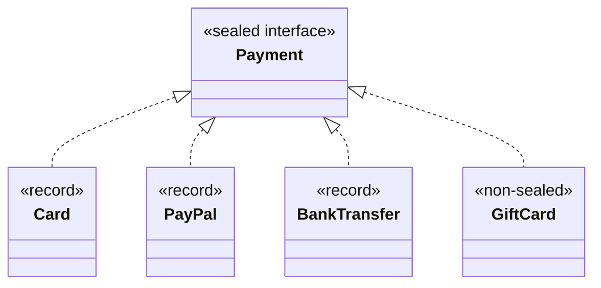
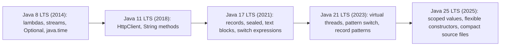

@@ 3 | TOPIC | Sealed Classes and Pattern Matching | sealed and permits, instanceof patterns, record patterns, switch patterns with guards and exhaustiveness | MUST
# Sealed Classes and Pattern Matching

**Level: Intermediate | Phase 6 | Priority: MUST | Since: sealed classes Java 17, pattern matching for instanceof Java 16, record patterns and pattern matching for switch Java 21, unnamed patterns `_` Java 22 (`Java 25+`)**

> **30-second interview answer:** A sealed class or interface lists exactly which classes may extend it, with `sealed ... permits A, B, C`; each permitted subclass must be `final`, `sealed` or `non-sealed`. That gives the compiler a closed set of subtypes. Pattern matching lets you test a type and bind a variable in one step: `if (obj instanceof Card c)`, and in Java 21 `switch` can match types and deconstruct records: `case Card(var number, var expiry) -> ...`, with `when` guards. Together they enable exhaustive switches with no `default`: if someone adds a new subtype, every switch that forgot it fails to compile. This is called data-oriented programming.

## 1. Concept in Simple Words
### Analogy
A parcel sorting desk at a post office.

| Post office | Java |
|---|---|
| The post office accepts only letters, parcels and registered mail: the list is printed on the wall | `sealed interface Mail permits Letter, Parcel, Registered` |
| No customer can invent a new mail type at the counter | Classes outside `permits` cannot extend it |
| The clerk looks at an item and immediately knows which tray it goes in | `switch (mail) { case Letter l -> ... }` |
| The clerk also reads the label while sorting: weight, destination | Record patterns: `case Parcel(var weight, var city)` |
| "Parcels over 20 kg go to the heavy tray" | A guard: `case Parcel p when p.weight() > 20` |
| A checklist that guarantees every tray has a rule | Exhaustiveness checking |

### What it is
**Sealed types (Java 17):**
- `sealed` class or interface + `permits` list of direct subtypes.
- Each permitted subtype must be `final` (no further subclasses), `sealed` (its own closed list) or `non-sealed` (open again).
- Permitted subtypes must be in the same module, or in the same package if in the unnamed module. If they are in the same source file, `permits` can be omitted.
- Records and enums are implicitly final, so they fit naturally as permitted subtypes.

**Pattern matching:**
- **Type pattern** (Java 16): `obj instanceof String s` tests and binds `s` in one step. The binding is in scope only where the test is definitely true (flow scoping): `if (!(obj instanceof String s)) return; s.length();` works.
- **Record pattern** (Java 21): `obj instanceof Point(int x, int y)` deconstructs a record by its components; nestable: `Line(Point(var x1, var y1), Point p2)`.
- **Pattern matching for switch** (Java 21): `case Circle c ->`, `case Rect(double w, double h) ->`, guards with `when`, and `case null ->`.
- **Exhaustiveness:** a pattern switch must cover all possibilities; with a sealed type, covering every permitted subtype is enough.
- **Dominance:** a more general pattern must come after more specific ones, otherwise the specific case is unreachable and the compiler rejects it.
- **Unnamed patterns and variables** (`_`, final in Java 22, `Java 25+`): `case Card(var number, _) ->` ignores components.

### Why it exists
Classic OOP puts behaviour in the class hierarchy (polymorphism). That is great when the set of operations is fixed and new types are added often. But often the reverse is true: the set of types is fixed (payment methods, API results, AST nodes, events) and you keep adding operations (fee calculation, risk check, JSON rendering). Before Java 17 you used `instanceof` chains with casts, which the compiler could not check for completeness, or the visitor pattern, which is verbose. Sealed types + pattern matching give type-safe, exhaustive "switch on type" with no casts.

## 2. How It Works


**How the compiler and JVM enforce sealing:**
```text
javac:   checks every class that extends Payment is in the permits list
         and is final, sealed or non-sealed.
.class:  Payment's class file gets a PermittedSubclasses attribute.
JVM:     refuses to load a class that extends Payment but is not listed
         (IncompatibleClassChangeError), so even hand-crafted bytecode cannot cheat.
```

**How a pattern switch runs:**
```text
switch (payment) {
  case null                          -> "no payment";           1. null checked first (otherwise NPE)
  case Card c when c.amount() > 1000 -> "manual review";        2. type test + guard
  case Card(var num, var amt)        -> "card " + num;          3. type test + deconstruct
  case PayPal p                      -> "paypal " + p.email();
  case BankTransfer b                -> "iban " + b.iban();
  case GiftCard g                    -> "gift";
}                                     no default: compiler knows all permitted types are covered
```
- Cases are tried top to bottom. Since Java 21 javac compiles this to an `invokedynamic` call to `SwitchBootstraps.typeSwitch`, which jumps efficiently to the first matching label, then evaluates guards.
- If a new class appears at runtime that the compiled switch does not know (separate compilation), a synthetic default throws `MatchException`.
- Without `case null`, a null selector throws `NullPointerException`, as switch always did.

**Flow scoping of pattern variables:**
```text
if (obj instanceof String s && s.length() > 3) { s in scope }   OK: && only evaluates right side if match
if (obj instanceof String s || s.isEmpty())                       ERROR: s not definitely bound
if (!(obj instanceof String s)) throw ...;  s.length();          OK after the if
```

## 3. Code Example
### Code
```java
import java.math.BigDecimal;
import java.util.List;

public class SealedPatternsDemo {

    // A closed set of payment methods
    sealed interface Payment permits Card, PayPal, BankTransfer, GiftCard { }

    record Card(String number, BigDecimal amount) implements Payment { }
    record PayPal(String email, BigDecimal amount) implements Payment { }
    record BankTransfer(String iban, BigDecimal amount) implements Payment { }

    // non-sealed: anyone may extend GiftCard again
    static non-sealed class GiftCard implements Payment {
        final String code;
        GiftCard(String code) { this.code = code; }
    }
    static class PromoGiftCard extends GiftCard {
        PromoGiftCard(String code) { super(code); }
    }

    // A nested sealed hierarchy for API results
    sealed interface Result<T> permits Ok, Err { }
    record Ok<T>(T value) implements Result<T> { }
    record Err<T>(String code, String message) implements Result<T> { }

    static final BigDecimal REVIEW_LIMIT = new BigDecimal("1000");

    // Exhaustive switch: no default, compiler checks all permitted subtypes
    static String describe(Payment payment) {
        return switch (payment) {
            case null -> "no payment";
            case Card c when c.amount().compareTo(REVIEW_LIMIT) > 0 -> "card needs manual review";
            case Card(String number, BigDecimal amount) -> "card ****" + number.substring(number.length() - 4) + " " + amount;
            case PayPal(var email, var amount) -> "paypal " + email + " " + amount;
            case BankTransfer b -> "transfer from " + b.iban();
            case PromoGiftCard p -> "promo gift card " + p.code;    // more specific first
            case GiftCard g -> "gift card " + g.code;
        };
    }

    static BigDecimal feePercent(Payment payment) {
        return switch (payment) {
            case Card c -> new BigDecimal("2.9");
            case PayPal p -> new BigDecimal("3.4");
            case BankTransfer b -> BigDecimal.ZERO;
            case GiftCard g -> BigDecimal.ZERO;
        };
    }

    static String render(Result<?> result) {
        return switch (result) {
            case Ok<?>(var value) -> "200 " + value;
            case Err<?>(var code, var message) when code.equals("NOT_FOUND") -> "404 " + message;
            case Err<?>(var code, var message) -> "400 " + code + ": " + message;
        };
    }

    // Old style for comparison: no compiler help if a type is forgotten
    static String oldDescribe(Object payment) {
        if (payment instanceof Card) {
            Card c = (Card) payment;                  // manual cast
            return "card " + c.number();
        } else if (payment instanceof PayPal) {
            return "paypal " + ((PayPal) payment).email();
        }
        return "unknown";                             // BankTransfer silently falls here
    }

    public static void main(String[] args) {
        List<Payment> payments = List.of(
                new Card("4111111111111111", new BigDecimal("49.99")),
                new Card("5500000000000004", new BigDecimal("2500.00")),
                new PayPal("ana@example.com", new BigDecimal("15.00")),
                new BankTransfer("DE89370400440532013000", new BigDecimal("300.00")),
                new GiftCard("GIFT-1"),
                new PromoGiftCard("PROMO-7"));

        for (Payment p : payments) {
            System.out.println(describe(p) + " (fee " + feePercent(p) + "%)");
        }
        System.out.println(describe(null));

        System.out.println(render(new Ok<>(List.of("order-1"))));
        System.out.println(render(new Err<>("NOT_FOUND", "order 9 not found")));
        System.out.println(render(new Err<>("INVALID", "quantity must be positive")));

        Object o = new BankTransfer("NL91ABNA0417164300", BigDecimal.TEN);
        System.out.println("old style: " + oldDescribe(o));

        if (o instanceof BankTransfer(var iban, var amount) && amount.signum() > 0) {
            System.out.println("instanceof record pattern: " + iban.substring(0, 2));
        }
    }
}
```

### Walkthrough
- `Payment` is sealed and permits four types. Three are records (implicitly final). `GiftCard` is `non-sealed`, so `PromoGiftCard` may extend it; the hierarchy is closed at the first level only.
- `describe` is a switch expression with patterns. `case null` handles null explicitly. The guarded `Card c when ...` must come before the unguarded `Card(...)` record pattern, otherwise it would be dominated and unreachable. `PromoGiftCard` must come before `GiftCard` for the same reason.
- `case Card(String number, BigDecimal amount)` deconstructs the record; `case PayPal(var email, var amount)` does the same with inferred types.
- `feePercent` has no `default` and still compiles because all permitted subtypes are covered (a `GiftCard` case also covers its subclasses). Adding a fifth permitted type, say `Crypto`, would make both switches fail to compile until handled.
- `render` switches over a generic sealed `Result`, combining record patterns and a guard.
- `oldDescribe` shows the pre-Java-16 style: casts after `instanceof`, and a forgotten type silently returns "unknown".
- The last `if` uses a record pattern in `instanceof` with `&&`, and the bindings are in scope inside the block.

### Output
```text
card ****1111 49.99 (fee 2.9%)
card needs manual review (fee 2.9%)
paypal ana@example.com 15.00 (fee 3.4%)
transfer from DE89370400440532013000 (fee 0%)
gift card GIFT-1 (fee 0%)
promo gift card PROMO-7 (fee 0%)
no payment
200 [order-1]
404 order 9 not found
400 INVALID: quantity must be positive
old style: unknown
instanceof record pattern: NL
```

### Compare
| `instanceof` chain (pre Java 16) | Visitor pattern | Sealed + pattern switch (Java 21) |
|---|---|---|
| Manual casts | No casts, double dispatch | No casts |
| Forgotten type compiles silently | New type forces new visitor method | New type forces every switch to be updated |
| Short but unsafe | Safe but verbose (accept/visit boilerplate) | Safe and short |
| Works on any type | Needs `accept` in every class | Needs sealed hierarchy for exhaustiveness |

## 4. Interview Questions
**Basic**
1. **What is a sealed class?**
   A class or interface that restricts which classes may directly extend or implement it, using `sealed` and `permits`. It gives a closed, known set of subtypes, checked by the compiler and the JVM. Final in Java 17.
2. **What modifiers must a permitted subclass have?**
   Exactly one of `final` (no more subclasses), `sealed` (its own restricted list) or `non-sealed` (open for extension). Records and enums are implicitly final.
3. **What is pattern matching for `instanceof`?**
   `if (obj instanceof Order o)` tests the type and binds a typed variable in one step, removing the cast. The variable is in scope only where the match is guaranteed (flow scoping). Final in Java 16.

**Follow-up**
4. **Why can a switch over a sealed interface omit `default`?**
   The compiler knows every permitted subtype, so if all are covered the switch is exhaustive. Omitting `default` is better: when a new subtype is added, every switch that misses it stops compiling, instead of falling into a generic default.
5. **What are record patterns?**
   Patterns that deconstruct a record into its components: `case Point(int x, int y)` binds `x` and `y`. They can be nested (`Line(Point(var a, var b), var end)`) and used in both `instanceof` and `switch`. Final in Java 21.
6. **What is a guard in a pattern switch?**
   A `when` clause after a pattern: `case Card c when c.amount() > 1000 ->`. The case matches only if the type matches and the boolean is true. Guarded cases must come before the unguarded case for the same type.

**Tricky / scenario**
7. **What happens if you pass `null` to a pattern switch with no `case null`?**
   It throws `NullPointerException`, just like a classic switch. Add `case null ->` (or `case null, default ->`) to handle it. `case null` is only allowed in switches using patterns or reference types.
8. **Why does this not compile? `case Payment p -> ...; case Card c -> ...;`**
   `Card` is a subtype of `Payment`, so the first case dominates the second, making it unreachable. The compiler rejects dominated labels; order cases from most specific to most general.
9. **When would you choose sealed types + switch over polymorphism (an abstract method per subclass)?**
   Polymorphism wins when you add new types often and operations are stable: each new class implements the methods. Sealed + switch wins when the types are stable but you keep adding operations (fees, rendering, validation) and want them outside the data classes, for example domain events, API results, or parsed commands.

**What the interviewer is really testing:** whether you know modern Java 17 and 21 idioms, understand exhaustiveness and dominance, and can choose between polymorphism and data-oriented design.

## 5. Pitfalls & Best Practices
### Common mistakes
| Mistake | What goes wrong | Fix |
|---|---|---|
| Adding `default` to a switch over a sealed type | New subtypes silently hit default | Leave it out and let exhaustiveness check |
| Putting the general case before the specific | Compile error: dominated label | Order specific, then guarded, then general |
| Forgetting `case null` | `NullPointerException` at runtime | Add `case null` or validate earlier |
| Permitted subclass in another package of the unnamed module | Compile error | Same package (or same named module) |
| Making a leaf `non-sealed` without reason | Exhaustiveness lost for that branch | Prefer `final` or records |

### Best practices
- Model closed domain concepts as sealed interfaces with record implementations: payment methods, order events (`OrderPlaced`, `OrderPaid`, `OrderCancelled`), service results.
- Use switch expressions without `default` over sealed types.
- Use record patterns to unpack data instead of calling accessors; use `var` in patterns when the type is obvious.
- Keep guards simple; move complex logic into methods.
- Jackson supports sealed hierarchies with `@JsonTypeInfo` and `@JsonSubTypes`, so they work for polymorphic API payloads in Spring.

### Compare with
| Feature | Closed set? | Extensible by others? | Carries data per variant? |
|---|---|---|---|
| Enum | Yes | No | Same fields for every constant |
| Sealed interface + records | Yes | No (unless `non-sealed`) | Different fields per variant |
| Abstract class | No | Yes | Yes |
| Final class | Single type | No | Yes |

## 6. Hands-on Exercise
Model OrderHub order events as a sealed interface `OrderEvent` with records `OrderPlaced(long orderId, String customer, BigDecimal total)`, `OrderPaid(long orderId, String paymentId)`, `OrderShipped(long orderId, String carrier, String tracking)` and `OrderCancelled(long orderId, String reason)`. Write `String notify(OrderEvent e)` returning an email subject, and `boolean needsRefund(OrderEvent e)` that is true only for a cancellation whose reason is not "payment failed".

Acceptance criteria:
- Both methods use switch expressions with record patterns and no `default`.
- Orders over 500 placed by any customer get the subject "Big order received" (use a guard).
- Adding a new event type would break compilation of both methods.

<details><summary>Solution</summary>

```java
import java.math.BigDecimal;
import java.util.List;

public class OrderEvents {

    sealed interface OrderEvent permits OrderPlaced, OrderPaid, OrderShipped, OrderCancelled { }
    record OrderPlaced(long orderId, String customer, BigDecimal total) implements OrderEvent { }
    record OrderPaid(long orderId, String paymentId) implements OrderEvent { }
    record OrderShipped(long orderId, String carrier, String tracking) implements OrderEvent { }
    record OrderCancelled(long orderId, String reason) implements OrderEvent { }

    static final BigDecimal BIG = new BigDecimal("500");

    static String notify(OrderEvent e) {
        return switch (e) {
            case OrderPlaced(var id, var customer, var total) when total.compareTo(BIG) > 0 -> "Big order received #" + id;
            case OrderPlaced(var id, var customer, var total) -> "Thanks " + customer + ", order #" + id + " received";
            case OrderPaid(var id, var paymentId) -> "Payment " + paymentId + " confirmed for #" + id;
            case OrderShipped(var id, var carrier, var tracking) -> "#" + id + " shipped with " + carrier + " (" + tracking + ")";
            case OrderCancelled(var id, var reason) -> "#" + id + " cancelled: " + reason;
        };
    }

    static boolean needsRefund(OrderEvent e) {
        return switch (e) {
            case OrderCancelled(var id, var reason) -> !reason.equals("payment failed");
            case OrderPlaced p -> false;
            case OrderPaid p -> false;
            case OrderShipped s -> false;
        };
    }

    public static void main(String[] args) {
        List<OrderEvent> events = List.of(
                new OrderPlaced(1, "Ana", new BigDecimal("80.00")),
                new OrderPlaced(2, "Bob", new BigDecimal("900.00")),
                new OrderPaid(1, "pay_123"),
                new OrderShipped(1, "DHL", "JD0001"),
                new OrderCancelled(2, "customer request"),
                new OrderCancelled(3, "payment failed"));
        for (OrderEvent e : events) {
            System.out.println(notify(e) + " refund=" + needsRefund(e));
        }
    }
}
```
Output:
```text
Thanks Ana, order #1 received refund=false
Big order received #2 refund=false
Payment pay_123 confirmed for #1 refund=false
#1 shipped with DHL (JD0001) refund=false
#2 cancelled: customer request refund=true
#3 cancelled: payment failed refund=false
```
In `Java 25+` you could write `case OrderPlaced _ -> false` with the unnamed pattern instead of naming an unused variable.
</details>

## 7. Recall
Q: What does the `sealed` modifier do in Java?
A: It restricts which classes may directly extend or implement a type to those listed in `permits`.

Q: Which modifiers can a permitted subclass of a sealed type have?
A: `final`, `sealed` or `non-sealed`; records and enums are implicitly final.

Q: Why can a switch over a sealed interface have no default branch?
A: The compiler knows all permitted subtypes, so covering them all makes the switch exhaustive.

Q: What does a record pattern like `case Point(int x, int y)` do?
A: It matches the record type and binds its components to variables in one step.

Q: What is a dominated case label in a pattern switch?
A: A case that can never match because an earlier, more general pattern already matches all its values; the compiler rejects it.

Q: What happens when a pattern switch receives null without `case null`?
A: It throws `NullPointerException`.

**Related:** [[Records]] · [[var, Switch Expressions and Text Blocks]] · [[Polymorphism: Overloading vs Overriding]] · [[Java Version Features: 8 to 25]]

@@ 3 | TOPIC | Java Version Features: 8 to 25 | What each release added, the four LTS milestones 8, 11, 17, 21 and the 25 LTS, and why Spring Boot 3 needs 17 | MUST
# Java Version Features: 8 to 25

**Level: Intermediate | Phase 6 | Priority: MUST | Since: Java 8 (2014) to Java 25 (September 2025)**

> **30-second interview answer:** Java 8 (2014) brought lambdas, streams, `Optional`, default methods and `java.time`. Java 9 added modules and `List.of`, Java 10 `var`, and Java 11 (LTS) the standard `HttpClient` and new `String` methods. Java 17 (LTS) finalized records, sealed classes, text blocks, switch expressions and pattern matching for `instanceof`, and it is the minimum for Spring Boot 3. Java 21 (LTS) added virtual threads, pattern matching for switch, record patterns and sequenced collections. Java 25 (LTS, `Java 25+`) finalized scoped values, flexible constructor bodies, compact source files and module imports. Since Java 10 there is a release every six months and an LTS every two years.

## 1. Concept in Simple Words
### Analogy
Phone operating system updates.

| Phone updates | Java releases |
|---|---|
| Small updates every few months with new features | A feature release every March and September (since Java 10) |
| Some versions are supported for years by the manufacturer | LTS releases: 8, 11, 17, 21, 25 |
| A feature appears first as "beta" in settings | Preview features (`--enable-preview`) and incubator modules |
| Old apps stop working when an old API is removed | Removed APIs (Java EE modules in 11, Nashorn in 15, Security Manager disabled in 24) |
| Your banking app requires at least OS version X | Spring Boot 3 requires Java 17 |

### What it is
- **Release cadence:** since Java 10 (March 2018), a feature release every six months. LTS every three years at first (11, 17), every two years since 17 (21, 25). Most companies run LTS versions.
- **LTS (Long-Term Support):** vendors (Oracle, Eclipse Temurin, Amazon Corretto, Azul, Microsoft, Red Hat) provide security updates for years.
- **JEP (JDK Enhancement Proposal):** the numbered design document for each feature, such as JEP 444 Virtual Threads.
- **Preview feature:** fully specified but not final; needs `--enable-preview` at compile and run time; may change or be withdrawn (String Templates were previewed in 21 and 22 and then withdrawn).
- **Incubator module:** an experimental API in a `jdk.incubator.*` module (the Vector API has been incubating since Java 16).

### Why it exists
Before Java 9 releases were feature-driven and slipped for years (Java 7 in 2011, 8 in 2014, 9 in 2017). The time-based model ships whatever is ready every six months, so features arrive steadily and previews get real feedback. Interviewers ask about versions to see whether you have moved beyond Java 8 idioms and whether you can plan an upgrade.

## 2. How It Works


**Release-by-release map (the ones interviewers ask about in bold):**

| Version | Year | Key features |
|---|---|---|
| **8 (LTS)** | 2014 | Lambdas, functional interfaces, method references, Streams, `Optional`, default and static interface methods, `java.time`, `CompletableFuture`, Metaspace replaces PermGen, `HashMap` bins become trees under collisions |
| 9 | 2017 | Module system (JPMS), JShell, `List.of`, `Set.of`, `Map.of`, private interface methods, `Stream.takeWhile`, `dropWhile`, `Optional.ifPresentOrElse`, G1 default GC, compact strings |
| 10 | 2018 | `var`, `List.copyOf`, `Collectors.toUnmodifiableList`, `Optional.orElseThrow()` |
| **11 (LTS)** | 2018 | Standard `HttpClient`, `String.isBlank`, `strip`, `lines`, `repeat`, `Files.readString` and `writeString`, `var` in lambda parameters, run a single source file with `java Hello.java`, `Predicate.not`; Java EE and CORBA modules removed |
| 12 | 2019 | `Collectors.teeing`, `String.indent` and `transform`, switch expressions preview |
| 14 | 2020 | Switch expressions final, helpful `NullPointerException` messages, records preview |
| 15 | 2020 | Text blocks final, ZGC and Shenandoah production-ready, hidden classes, Nashorn removed |
| 16 | 2021 | Records final, pattern matching for `instanceof` final, `Stream.toList()`, `Stream.mapMulti`, internals strongly encapsulated by default |
| **17 (LTS)** | 2021 | Sealed classes final, JDK internals strongly encapsulated (no `--illegal-access`), `RandomGenerator` API, Security Manager deprecated for removal. Baseline for Spring Boot 3 and Spring Framework 6 |
| 18 | 2022 | UTF-8 by default, simple web server `jwebserver`, `@snippet` in Javadoc |
| 19, 20 | 2022, 2023 | Previews of virtual threads, record patterns, structured concurrency, scoped values |
| **21 (LTS)** | 2023 | Virtual threads final, pattern matching for switch final, record patterns final, sequenced collections (`getFirst`, `getLast`, `reversed`), generational ZGC |
| 22 | 2024 | Unnamed variables and patterns `_`, Foreign Function and Memory API final, launch multi-file source programs |
| 23 | 2024 | Markdown documentation comments, generational mode default for ZGC |
| 24 | 2025 | Stream Gatherers final, virtual threads no longer pinned by `synchronized`, Class-File API final, ahead-of-time class loading and linking, Security Manager permanently disabled |
| **25 (LTS)** | 2025 | Scoped values final, flexible constructor bodies (statements before `super(...)`), compact source files and instance `main` methods, module import declarations, compact object headers, generational Shenandoah, AOT method profiling |

Java 26 (March 2026) and Java 27 (September 2026) are non-LTS feature releases; the next LTS is planned for Java 29 in September 2027. For interviews, know 8, 11, 17, 21 and 25.

**Spring and Java versions:**
```text
Spring Boot 2.x  -> Java 8+ (javax.* namespace)
Spring Boot 3.x  -> Java 17+ minimum, jakarta.* namespace, Java 21 virtual threads supported (Boot 3.2+:
                    spring.threads.virtual.enabled=true)
Spring Boot 4    -> Java 17+ minimum, Java 25 recommended, Spring Framework 7 (Boot 4)
```

**How to upgrade (a common scenario question):**
```text
1. Upgrade build tools and plugins (Maven compiler release flag, Surefire, Lombok, Mockito, ByteBuddy).
2. Compile with the new JDK but old --release; fix removed APIs (javax.xml.bind, Nashorn).
3. Run tests; watch for InaccessibleObjectException from libraries using deep reflection.
4. Switch --release to the new version; adopt features gradually (records for DTOs, switch expressions).
5. Re-check GC and JVM flags (removed: CMS in 14, -XX:MaxPermSize since 8).
```

## 3. Code Example
### Code
```java
import java.time.LocalDate;
import java.time.Month;
import java.util.ArrayList;
import java.util.LinkedHashMap;
import java.util.List;
import java.util.Map;
import java.util.Optional;
import java.util.SequencedMap;
import java.util.concurrent.Executors;
import java.util.concurrent.atomic.AtomicInteger;
import java.util.function.Predicate;
import java.util.stream.Collectors;
import java.util.stream.IntStream;
import java.util.stream.Stream;

public class JavaVersionsTour {

    record Order(long id, String customer, double total) { }                  // Java 16

    sealed interface Shape permits Circle, Square { }                          // Java 17
    record Circle(double r) implements Shape { }
    record Square(double side) implements Shape { }

    static double area(Shape s) {
        return switch (s) {                                                    // Java 21 pattern switch
            case Circle(double r) -> Math.PI * r * r;
            case Square(double side) -> side * side;
        };
    }

    public static void main(String[] args) throws Exception {
        // Java 8: lambdas, streams, Optional, java.time
        List<Order> orders = List.of(                                          // List.of: Java 9
                new Order(1, "ana", 120.0), new Order(2, "bob", 35.5), new Order(3, "ana", 60.0));
        double anaTotal = orders.stream().filter(o -> o.customer().equals("ana")).mapToDouble(Order::total).sum();
        System.out.println("8  stream sum: " + anaTotal);
        Optional<Order> big = orders.stream().filter(o -> o.total() > 100).findFirst();
        System.out.println("8  optional: " + big.map(Order::id).orElse(-1L));
        System.out.println("8  java.time: " + LocalDate.of(2024, Month.FEBRUARY, 28).plusDays(1));

        // Java 9: takeWhile
        System.out.println("9  takeWhile: " + Stream.of(1, 2, 3, 10, 4).takeWhile(n -> n < 5).toList());

        // Java 10: var and copyOf
        var copy = List.copyOf(new ArrayList<>(List.of("a", "b")));
        System.out.println("10 copyOf: " + copy);

        // Java 11: String methods, Predicate.not
        System.out.println("11 strings: [" + "  hi  ".strip() + "] " + "ab".repeat(3) + " " + "   ".isBlank());
        System.out.println("11 not: " + Stream.of("a", "", "b").filter(Predicate.not(String::isEmpty)).toList());

        // Java 12: Collectors.teeing (count and sum in one pass)
        String summary = orders.stream().collect(Collectors.teeing(
                Collectors.counting(), Collectors.summingDouble(Order::total), (n, sum) -> n + " orders, " + sum));
        System.out.println("12 teeing: " + summary);

        // Java 14: switch expression
        int month = 2;
        String quarter = switch (month) { case 1, 2, 3 -> "Q1"; case 4, 5, 6 -> "Q2"; default -> "H2"; };
        System.out.println("14 switch: " + quarter);

        // Java 15: text block
        String text = """
                multi
                line""";
        System.out.println("15 text block lines: " + text.lines().count());

        // Java 16: record, instanceof pattern, Stream.toList
        Object o = orders.get(1);
        if (o instanceof Order ord && ord.total() < 50) System.out.println("16 pattern: small order " + ord.id());

        // Java 17 + 21: sealed + pattern switch
        System.out.printf("17 sealed + 21 switch: %.2f%n", area(new Circle(1)) + area(new Square(2)));

        // Java 21: sequenced collections
        SequencedMap<String, Integer> stock = new LinkedHashMap<>(Map.of("pen", 10));
        stock.putFirst("book", 3);
        stock.putLast("lamp", 1);
        System.out.println("21 sequenced: first=" + stock.firstEntry() + " last=" + stock.lastEntry() + " reversed=" + stock.reversed());

        // Java 21: virtual threads (one per task)
        AtomicInteger done = new AtomicInteger();
        try (var executor = Executors.newVirtualThreadPerTaskExecutor()) {
            IntStream.range(0, 10_000).forEach(i -> executor.submit(done::incrementAndGet));
        }   // close() waits for all tasks
        System.out.println("21 virtual threads finished: " + done.get());
    }
}
```

### Walkthrough
- Each block is labelled with the version that introduced the feature, so the code is a quick tour you can say aloud in an interview.
- Java 8: a stream with `filter` and `mapToDouble`, an `Optional` from `findFirst`, and `java.time` handling the 2024 leap day correctly.
- Java 9 to 12: `takeWhile` stops at the first failing element (10), `List.copyOf` makes an immutable copy, Java 11 `String` helpers, and `Collectors.teeing` combines two collectors in a single pass.
- Java 14 to 16: switch expression with multiple labels, a text block, and pattern matching for `instanceof` combined with `&&`.
- Java 17 and 21: a sealed hierarchy switched with record patterns and no `default`.
- Java 21: `SequencedMap` adds `putFirst`, `putLast`, `firstEntry`, `lastEntry` and `reversed` to `LinkedHashMap`; `Executors.newVirtualThreadPerTaskExecutor` runs 10,000 tasks on cheap virtual threads, and try-with-resources waits for them.

### Output
```text
8  stream sum: 180.0
8  optional: 1
8  java.time: 2024-02-29
9  takeWhile: [1, 2, 3]
10 copyOf: [a, b]
11 strings: [hi] ababab true
11 not: [a, b]
12 teeing: 3 orders, 215.5
14 switch: Q1
15 text block lines: 2
16 pattern: small order 2
17 sealed + 21 switch: 7.14
21 sequenced: first=book=3 last=lamp=1 reversed={lamp=1, pen=10, book=3}
21 virtual threads finished: 10000
```

### Compare
| Task | Java 8 way | Modern way (version) |
|---|---|---|
| Immutable list | `Collections.unmodifiableList(Arrays.asList(...))` | `List.of(...)` (9) |
| DTO | Class with fields, constructor, equals, hashCode, toString | `record` (16) |
| Read a file | `new String(Files.readAllBytes(p), UTF_8)` | `Files.readString(p)` (11) |
| Last element | `list.get(list.size() - 1)` | `list.getLast()` (21) |
| Many blocking tasks | Bounded thread pool | Virtual threads (21) |
| Type switch | `instanceof` chain with casts | Pattern switch (21) |

## 4. Interview Questions
**Basic**
1. **What are the main features of Java 8?**
   Lambdas and functional interfaces, method references, the Stream API, `Optional`, default and static methods in interfaces, the `java.time` API, `CompletableFuture`, and Metaspace replacing PermGen. It changed Java from purely imperative to supporting a functional style.
2. **What does LTS mean, and which versions are LTS?**
   Long-Term Support: vendors provide updates for many years, so enterprises standardize on them. LTS versions are 8, 11, 17, 21 and 25. Non-LTS releases are supported only until the next release six months later.
3. **What did Java 17 finalize?**
   Sealed classes, plus everything finalized since 11: records, text blocks, switch expressions, pattern matching for `instanceof`, `Stream.toList()`, helpful NPE messages. It also strongly encapsulated JDK internals. Spring Boot 3 requires Java 17.

**Follow-up**
4. **What are the headline features of Java 21?**
   Virtual threads (JEP 444) for massive numbers of blocking tasks, pattern matching for switch (441), record patterns (440), sequenced collections (431) and generational ZGC (439). String templates were a preview and were later withdrawn.
5. **Why does Spring Boot 3 require Java 17?**
   Spring Framework 6 adopted Jakarta EE 9+ (`jakarta.*` packages) and set Java 17 as the baseline so it could use modern language features and APIs internally, rely on strong encapsulation, and support AOT and native images. Supporting Java 8 would have blocked those improvements.
6. **What is a preview feature?**
   A complete but not yet permanent language or JVM feature shipped to gather feedback. You must enable it with `--enable-preview` for both `javac` (with `--release`) and `java`. It can change between releases or be removed, so production code should avoid it.

**Tricky / scenario**
7. **Your company is on Java 11 and wants to move to 21. What breaks and what do you gain?**
   Risks: libraries using deep reflection fail under strong encapsulation (old Lombok, Mockito, ByteBuddy versions), removed APIs and flags, and Spring Boot 2 to 3 migration (`javax` to `jakarta`) if done together. Gains: records, sealed types, pattern matching, text blocks, virtual threads, better GCs (ZGC, G1 improvements) and lower memory use. Upgrade tools first, run tests on 21 with `--release 11`, then raise the release level.
8. **What changed in Java 24 for virtual threads, and why does it matter?**
   Before Java 24, a virtual thread blocking inside a `synchronized` block was pinned to its carrier platform thread, reducing scalability; the advice was to use `ReentrantLock`. JEP 491 in Java 24 removed most pinning, so `synchronized` code works well with virtual threads on Java 24+.
9. **What is new in Java 25 that a Spring developer would notice?**
   Scoped values are final (a safer alternative to `ThreadLocal` for virtual threads), flexible constructor bodies allow validation before `super(...)`, compact object headers can reduce heap use, and AOT improvements speed startup. Spring Boot 4 recommends Java 25.

**What the interviewer is really testing:** whether you write modern Java, know which version introduced what, and can reason about the risks and payoff of an upgrade.

## 5. Pitfalls & Best Practices
### Common mistakes
| Mistake | What goes wrong | Fix |
|---|---|---|
| Saying Java 8 introduced `var` or records | Signals outdated knowledge | `var` is 10, records 16 |
| Using preview features in production | Code breaks on the next JDK | Use only final features |
| Compiling with `-source` and `-target` instead of `--release` | Accidentally uses newer JDK APIs | Use `--release N` (Maven `maven.compiler.release`) |
| Upgrading JDK and Spring Boot major version at once without tests | Hard-to-isolate failures | Upgrade in steps with a green test suite |
| Running non-LTS JDKs in production without an upgrade plan | Security updates stop after six months | Stay on LTS or upgrade every release |

### Best practices
- Target the latest LTS your frameworks support (Java 21 for Spring Boot 3.5; Java 25 for Boot 4).
- Use a vendor build with long support (Temurin, Corretto, Zulu, Oracle) and keep patch updates current.
- Set the release in Maven: `<maven.compiler.release>21</maven.compiler.release>`.
- Adopt features where they reduce bugs: records for DTOs, switch expressions, `List.of`, pattern matching, virtual threads for blocking I/O.

### Compare with
| LTS | Released | Headline | Spring compatibility |
|---|---|---|---|
| 8 | 2014 | Lambdas and streams | Boot 2.x |
| 11 | 2018 | HttpClient, String API | Boot 2.x |
| 17 | 2021 | Records, sealed, text blocks | Boot 3.x minimum |
| 21 | 2023 | Virtual threads, pattern switch | Boot 3.2+ virtual threads |
| 25 | 2025 | Scoped values, flexible constructors | Boot 4 recommended |

## 6. Hands-on Exercise
Take this Java 8 style OrderHub code and modernize it, naming the version of each feature you use:

```java
import java.util.*;

public class LegacyReport {
    static class Line {
        private final String sku; private final int qty;
        Line(String sku, int qty) { this.sku = sku; this.qty = qty; }
        String getSku() { return sku; } int getQty() { return qty; }
    }
    static String classify(Object o) {
        if (o instanceof Line) {
            Line l = (Line) o;
            if (l.getQty() > 10) return "bulk " + l.getSku();
            return "single " + l.getSku();
        }
        return "unknown";
    }
    public static void main(String[] args) {
        List<Line> lines = Collections.unmodifiableList(Arrays.asList(new Line("PEN", 20), new Line("BOOK", 1)));
        for (Line l : lines) System.out.println(classify(l));
        System.out.println("last: " + lines.get(lines.size() - 1).getSku());
    }
}
```

Acceptance criteria: use a record, `List.of`, a pattern switch with a guard, `var`, and `getLast()`; same output.

<details><summary>Solution</summary>

```java
import java.util.List;

public class ModernReport {
    record Line(String sku, int qty) { }                               // Java 16

    static String classify(Object o) {
        return switch (o) {                                            // Java 21
            case Line l when l.qty() > 10 -> "bulk " + l.sku();
            case Line l -> "single " + l.sku();
            default -> "unknown";                                      // Object is not sealed
        };
    }

    public static void main(String[] args) {
        var lines = List.of(new Line("PEN", 20), new Line("BOOK", 1));  // var: 10, List.of: 9
        for (var l : lines) System.out.println(classify(l));
        System.out.println("last: " + lines.getLast().sku());           // Java 21
    }
}
```
Output:
```text
bulk PEN
single BOOK
last: BOOK
```
`default` is required here because `Object` is not a sealed type, so the switch cannot be exhaustive otherwise.
</details>

## 7. Recall
Q: Which Java versions are LTS releases?
A: 8, 11, 17, 21 and 25.

Q: Which Java version introduced lambdas, streams and `Optional`?
A: Java 8 (2014).

Q: What is the minimum Java version for Spring Boot 3?
A: Java 17.

Q: What are the headline features of Java 21?
A: Virtual threads, pattern matching for switch, record patterns and sequenced collections.

Q: In which Java versions did `var`, records and sealed classes become final?
A: `var` in Java 10, records in Java 16, sealed classes in Java 17.

Q: What are notable final features of Java 25?
A: Scoped values, flexible constructor bodies, compact source files with instance main methods, module import declarations and compact object headers.

**Related:** [[var, Switch Expressions and Text Blocks]] · [[Sealed Classes and Pattern Matching]] · [[Stream Pipeline: Lazy Evaluation]] · [[What Spring and Spring Boot Are]]

@@ 3 | TOPIC | Practice — Coding drill: Generics and modern Java | Eleven interview tasks on generics, wildcards, erasure, annotations, reflection and modern syntax | MUST
# Coding drill: Generics and modern Java

Eleven tasks in the style of screening rounds and live-coding interviews. Each one names the skill it tests. Write your answer before opening the solution; for predict-the-output tasks, write the output down first.

## 1. Generic Pair with map (generics basics)
Write an immutable `Pair<A, B>` record with `swap()` returning `Pair<B, A>` and `<C> Pair<A, C> mapSecond(Function<? super B, ? extends C> f)`.

**Hint:** records can be generic; the method declares its own type parameter.

<details><summary>Solution</summary>

```java
import java.util.function.Function;

public class PairDrill {
    record Pair<A, B>(A first, B second) {
        Pair<B, A> swap() { return new Pair<>(second, first); }

        <C> Pair<A, C> mapSecond(Function<? super B, ? extends C> f) {
            return new Pair<>(first, f.apply(second));
        }
    }

    public static void main(String[] args) {
        Pair<String, Integer> p = new Pair<>("pen", 3);
        System.out.println(p.swap());                       // Pair[first=3, second=pen]
        System.out.println(p.mapSecond(q -> q * 1.5));      // Pair[first=pen, second=4.5]
    }
}
```
The `Function<? super B, ? extends C>` parameter follows PECS: the function consumes a `B` and produces a `C`.
</details>

## 2. Bounded generic method (bounds)
Write `static <T extends Comparable<? super T>> int countGreater(Collection<? extends T> items, T threshold)`.

**Hint:** why `? super T` in the bound? Think of a class that inherits `compareTo` from its parent.

<details><summary>Solution</summary>

```java
import java.time.LocalDate;
import java.util.Collection;
import java.util.List;

public class CountGreaterDrill {
    static <T extends Comparable<? super T>> int countGreater(Collection<? extends T> items, T threshold) {
        int count = 0;
        for (T item : items) if (item.compareTo(threshold) > 0) count++;
        return count;
    }

    public static void main(String[] args) {
        System.out.println(countGreater(List.of(5, 12, 7, 20), 10));                          // 2
        System.out.println(countGreater(List.of("kiwi", "apple", "pear"), "banana"));        // 2
        // LocalDate implements Comparable<ChronoLocalDate>, not Comparable<LocalDate>:
        System.out.println(countGreater(List.of(LocalDate.of(2025, 1, 1), LocalDate.of(2026, 6, 1)),
                LocalDate.of(2025, 6, 1)));                                                    // 1
    }
}
```
`LocalDate` is the real-world proof: it implements `Comparable<ChronoLocalDate>`, so it fails `T extends Comparable<T>` but passes `T extends Comparable<? super T>`.
</details>

## 3. Fix the compile errors (PECS)
Why does each marked line fail, and how do you fix the signatures?

```java
static double sum(List<Number> nums) { ... }
static void fill(List<Integer> sink) { sink.add(1); }

List<Integer> ints = new ArrayList<>(List.of(1, 2));
List<Number> numbers = new ArrayList<>();
sum(ints);        // error 1
fill(numbers);    // error 2
```

<details><summary>Solution</summary>

```java
import java.util.ArrayList;
import java.util.List;

public class PecsDrill {
    static double sum(List<? extends Number> nums) {      // producer -> extends
        double total = 0;
        for (Number n : nums) total += n.doubleValue();
        return total;
    }

    static void fill(List<? super Integer> sink) {         // consumer -> super
        sink.add(1);
    }

    public static void main(String[] args) {
        List<Integer> ints = new ArrayList<>(List.of(1, 2));
        List<Number> numbers = new ArrayList<>();
        System.out.println(sum(ints));    // 3.0
        fill(numbers);
        System.out.println(numbers);      // [1]
    }
}
```
Error 1: `List<Integer>` is not a `List<Number>` (invariance). Error 2: `List<Number>` is not a `List<Integer>`. The method that reads gets `? extends Number`; the one that writes gets `? super Integer`.
</details>

## 4. Predict the output (erasure)
```java
List<String> a = new ArrayList<>();
List<Integer> b = new ArrayList<>();
System.out.println(a.getClass() == b.getClass());
System.out.println(a.getClass().getName());
System.out.println(a instanceof List<?>);
```
Also: does `void save(List<String> x) {}` plus `void save(List<Integer> x) {}` compile?

<details><summary>Solution</summary>

```text
true
java.util.ArrayList
true
```
Both lists are plain `ArrayList` at runtime because type arguments are erased. The overloads do not compile: both erase to `save(List)` ("name clash: ... have the same erasure").
</details>

## 5. Type-safe heterogeneous container (Class tokens)
Write `Preferences` storing values of different types keyed by their `Class`: `<T> void put(Class<T> type, T value)` and `<T> T get(Class<T> type)`, with no unchecked casts.

**Hint:** `Class.cast` performs a checked cast.

<details><summary>Solution</summary>

```java
import java.util.HashMap;
import java.util.Map;
import java.util.Objects;

public class Preferences {
    private final Map<Class<?>, Object> values = new HashMap<>();

    <T> void put(Class<T> type, T value) { values.put(Objects.requireNonNull(type), type.cast(value)); }

    <T> T get(Class<T> type) { return type.cast(values.get(type)); }

    public static void main(String[] args) {
        Preferences prefs = new Preferences();
        prefs.put(String.class, "dark-mode");
        prefs.put(Integer.class, 25);
        String theme = prefs.get(String.class);
        int pageSize = prefs.get(Integer.class);
        System.out.println(theme + " " + pageSize);   // dark-mode 25
    }
}
```
This is Joshua Bloch's "typesafe heterogeneous container". The key carries the type at runtime, working around erasure. The `type.cast` in `put` also blocks raw-type abuse.
</details>

## 6. Generic varargs and @SafeVarargs (erasure)
Write `static <T> List<T> listOf(T... items)` returning an unmodifiable list. Why does the compiler warn, and when is `@SafeVarargs` justified?

<details><summary>Solution</summary>

```java
import java.util.ArrayList;
import java.util.Collections;
import java.util.List;

public class VarargsDrill {
    @SafeVarargs                                   // allowed on static, final or private methods
    static <T> List<T> listOf(T... items) {
        List<T> list = new ArrayList<>(items.length);
        Collections.addAll(list, items);           // only reads the array, never stores or exposes it
        return Collections.unmodifiableList(list);
    }

    public static void main(String[] args) {
        List<List<String>> nested = listOf(List.of("a"), List.of("b", "c"));
        System.out.println(nested);                // [[a], [b, c]]
    }
}
```
A generic varargs parameter becomes an array `T[]`, but generic arrays cannot be created safely, so the compiler warns about possible heap pollution. `@SafeVarargs` is justified only if the method does not write into the array and does not let it escape (returning `items` itself would be unsafe).
</details>

## 7. Mini test runner (annotations and reflection)
Create a `@Check` annotation and a runner that invokes every `@Check` method of a class on a new instance, printing `PASS name` or `FAIL name: message`, sorted by method name.

**Hint:** the exception from the test is wrapped in `InvocationTargetException`.

<details><summary>Solution</summary>

```java
import java.lang.annotation.ElementType;
import java.lang.annotation.Retention;
import java.lang.annotation.RetentionPolicy;
import java.lang.annotation.Target;
import java.lang.reflect.InvocationTargetException;
import java.lang.reflect.Method;
import java.util.Arrays;
import java.util.Comparator;

public class MiniRunner {
    @Retention(RetentionPolicy.RUNTIME)
    @Target(ElementType.METHOD)
    @interface Check { }

    public static class PriceTests {
        @Check public void discountIsApplied() {
            if (90 != 100 * 90 / 100) throw new AssertionError("wrong discount");
        }
        @Check public void totalIsNeverNegative() {
            throw new AssertionError("total was -5");
        }
        public void helper() { }               // not a check
    }

    static void run(Class<?> testClass) throws ReflectiveOperationException {
        Object instance = testClass.getDeclaredConstructor().newInstance();
        Method[] methods = testClass.getDeclaredMethods();
        Arrays.sort(methods, Comparator.comparing(Method::getName));
        for (Method m : methods) {
            if (!m.isAnnotationPresent(Check.class)) continue;
            try {
                m.invoke(instance);
                System.out.println("PASS " + m.getName());
            } catch (InvocationTargetException e) {
                System.out.println("FAIL " + m.getName() + ": " + e.getCause().getMessage());
            }
        }
    }

    public static void main(String[] args) throws Exception {
        run(PriceTests.class);
    }
}
```
Output:
```text
PASS discountIsApplied
FAIL totalIsNeverNegative: total was -5
```
This is the core of JUnit: find annotated methods by reflection, create an instance, invoke, and report the unwrapped cause.
</details>

## 8. Refactor an instanceof chain (sealed + pattern switch)
Refactor this to a sealed hierarchy and an exhaustive switch expression:

```java
static double shippingCost(Object item) {
    if (item instanceof Book) return 2.0;
    else if (item instanceof Electronics) return ((Electronics) item).weightKg() * 3;
    else if (item instanceof Furniture) return 50.0;
    throw new IllegalArgumentException();
}
```

<details><summary>Solution</summary>

```java
public class ShippingDrill {
    sealed interface Item permits Book, Electronics, Furniture { }
    record Book(String title) implements Item { }
    record Electronics(String name, double weightKg) implements Item { }
    record Furniture(String name, boolean assembled) implements Item { }

    static double shippingCost(Item item) {
        return switch (item) {
            case Book b -> 2.0;
            case Electronics(var name, var weight) -> weight * 3;
            case Furniture f when f.assembled() -> 80.0;
            case Furniture f -> 50.0;
        };
    }

    public static void main(String[] args) {
        System.out.println(shippingCost(new Book("Dune")));                // 2.0
        System.out.println(shippingCost(new Electronics("TV", 12.5)));     // 37.5
        System.out.println(shippingCost(new Furniture("Desk", true)));     // 80.0
    }
}
```
The parameter type changes from `Object` to `Item`, the cast disappears, the impossible `throw` disappears, and a new item type forces this method to be updated at compile time.
</details>

## 9. Nested record patterns (expression evaluator)
Model arithmetic expressions as a sealed interface `Expr` with records `Num(int value)`, `Add(Expr left, Expr right)`, `Mul(Expr left, Expr right)`. Write `eval` and a `simplify` that turns `Mul(x, Num(1))` into `x` and `Add(x, Num(0))` into `x`.

<details><summary>Solution</summary>

```java
public class ExprDrill {
    sealed interface Expr permits Num, Add, Mul { }
    record Num(int value) implements Expr { }
    record Add(Expr left, Expr right) implements Expr { }
    record Mul(Expr left, Expr right) implements Expr { }

    static int eval(Expr e) {
        return switch (e) {
            case Num(var v) -> v;
            case Add(var l, var r) -> eval(l) + eval(r);
            case Mul(var l, var r) -> eval(l) * eval(r);
        };
    }

    static Expr simplify(Expr e) {
        return switch (e) {
            case Mul(var x, Num(var one)) when one == 1 -> simplify(x);   // nested record pattern
            case Add(var x, Num(var zero)) when zero == 0 -> simplify(x);
            case Add(var l, var r) -> new Add(simplify(l), simplify(r));
            case Mul(var l, var r) -> new Mul(simplify(l), simplify(r));
            case Num n -> n;
        };
    }

    public static void main(String[] args) {
        Expr e = new Add(new Mul(new Num(7), new Num(1)), new Num(0));
        System.out.println(eval(e));        // 7
        System.out.println(simplify(e));    // Num[value=7]
    }
}
```
Nested patterns (`Mul(var x, Num(var one))`) match the shape of a tree in one line; this is the classic showcase for Java 21 data-oriented programming.
</details>

## 10. Convert a fall-through switch (switch expressions)
This method has a bug. Find it and rewrite it as a switch expression.

```java
static int daysIn(String month) {
    int days = 0;
    switch (month) {
        case "FEB": days = 28;
        case "APR": case "JUN": case "SEP": case "NOV": days = 30; break;
        default: days = 31;
    }
    return days;
}
```

<details><summary>Solution</summary>

```java
public class DaysDrill {
    static int daysIn(String month) {
        return switch (month) {
            case "FEB" -> 28;
            case "APR", "JUN", "SEP", "NOV" -> 30;
            case "JAN", "MAR", "MAY", "JUL", "AUG", "OCT", "DEC" -> 31;
            default -> throw new IllegalArgumentException("unknown month " + month);
        };
    }

    public static void main(String[] args) {
        System.out.println(daysIn("FEB") + " " + daysIn("JUN") + " " + daysIn("DEC"));   // 28 30 31
    }
}
```
Bug: `"FEB"` has no `break`, so it falls through and returns 30. Arrow cases never fall through, and listing every valid month lets the `default` reject typos instead of silently returning 31.
</details>

## 11. Predict the output (var and text blocks)
```java
var list = new ArrayList<>();
list.add(1);
list.add("two");
System.out.println(list);

var s = """
    a
      b
    """;
System.out.println(s.length());
```

<details><summary>Solution</summary>

```text
[1, two]
6
```
`var list = new ArrayList<>()` infers `ArrayList<Object>`, so both adds compile. The text block removes the common 4-space indentation, giving `"a\n  b\n"`: `a`, newline, two spaces, `b`, newline = 6 characters.
</details>

@@ 3 | TOPIC | Practice — Phase 6 review: Generics and Modern Java | Cheat sheet, key snippets, top 10 questions and rapid-fire flashcards for Phase 6 | MUST
# Phase 6 review: Generics and Modern Java

## Cheat sheet

| Idea | Remember |
|---|---|
| Generics purpose | Compile-time type safety, no casts, reusable algorithms |
| Generic method | `static <T> T first(List<T> list)`: type parameter before return type |
| Bound | `<T extends Number & Comparable<T>>`: class first, then interfaces |
| Invariance | `List<Integer>` is not a `List<Number>` |
| `? extends T` | Read as T, cannot add (producer) |
| `? super T` | Add T, read as Object (consumer) |
| PECS | Producer Extends, Consumer Super; both means exact type |
| Erasure | Type args removed, bound or Object substituted, casts inserted |
| Not allowed | `new T()`, `new T[]`, `instanceof List<String>`, overload by type argument, `List<int>` |
| Workarounds | `Class<T>` token, `Supplier<T>`, super type token (`TypeReference`) |
| Annotation | Passive metadata; `@Retention(RUNTIME)` for reflection, `@Target` for placement |
| Meta-annotation | `@Service` carries `@Component`; Spring searches meta-annotations |
| Reflection | Inspect and invoke at runtime; cache lookups; unwrap `InvocationTargetException` |
| Dynamic proxy | `Proxy.newProxyInstance` + `InvocationHandler`; basis of Spring AOP |
| `var` | Local inference only, still static typing (Java 10) |
| Switch expression | Arrows, no fall-through, `yield`, exhaustive (Java 14) |
| Text block | Triple quotes, strips common indentation (Java 15) |
| Sealed | `sealed ... permits`; subclasses final, sealed or non-sealed (Java 17) |
| Pattern switch | Type and record patterns, `when` guards, `case null`, no default over sealed (Java 21) |
| LTS | 8, 11, 17, 21, 25; Boot 3 needs 17 |

### Key code snippets
```java
// Bounded generic method with PECS
static <T extends Comparable<? super T>> T max(Collection<? extends T> items) {
    Iterator<? extends T> it = items.iterator();
    T best = it.next();
    while (it.hasNext()) { T x = it.next(); if (x.compareTo(best) > 0) best = x; }
    return best;
}
```

```java
// Erasure workaround: class token and super type token
<T> T read(String json, Class<T> type) { return mapper.readValue(json, type); }
List<OrderDto> orders = mapper.readValue(json, new TypeReference<List<OrderDto>>() { });
List<OrderDto> fromApi = restClient.get().uri("/orders").retrieve()
        .body(new ParameterizedTypeReference<List<OrderDto>>() { });
```

```java
// Custom runtime annotation read by reflection
@Retention(RetentionPolicy.RUNTIME)
@Target(ElementType.METHOD)
public @interface Audited { String value(); }

Audited a = method.getAnnotation(Audited.class);
if (a != null) log.info("audit {}", a.value());
```

```java
// Dynamic proxy around an interface
PaymentGateway proxy = (PaymentGateway) Proxy.newProxyInstance(
        PaymentGateway.class.getClassLoader(), new Class<?>[]{PaymentGateway.class},
        (p, method, args) -> { long t = System.nanoTime(); try { return method.invoke(target, args); }
                               finally { System.out.println(method.getName() + " " + (System.nanoTime() - t)); } });
```

```java
// Sealed + record patterns + guard, exhaustive with no default
sealed interface Payment permits Card, PayPal { }
record Card(String number, BigDecimal amount) implements Payment { }
record PayPal(String email, BigDecimal amount) implements Payment { }

String describe(Payment p) {
    return switch (p) {
        case Card c when c.amount().compareTo(LIMIT) > 0 -> "review";
        case Card(var number, var amount) -> "card " + amount;
        case PayPal(var email, var amount) -> "paypal " + email;
    };
}
```

```java
// var, switch expression, text block
var totals = new LinkedHashMap<String, BigDecimal>();
String label = switch (status) { case NEW, PAID -> "open"; case SHIPPED -> "moving"; case DELIVERED -> "done"; };
String sql = """
        SELECT id, total FROM orders
        WHERE status = :status
        """;
```

## The 10 most likely interview questions

1. **What are generics and why use them?** Type parameters for classes and methods that give compile-time checks and remove casts.
2. **Is `List<Integer>` a `List<Number>`?** No, generics are invariant; use `List<? extends Number>` to read numbers.
3. **Explain PECS.** `? extends` for parameters you read from, `? super` for parameters you write to; e.g. `Collections.copy(List<? super T>, List<? extends T>)`.
4. **What is type erasure and its consequences?** Type arguments are removed after compilation; no `new T()`, no generic arrays, no `instanceof List<String>`, no overloading by type argument.
5. **How do frameworks get generic types at runtime?** Class tokens, and super type tokens from anonymous subclasses whose generic superclass is kept in metadata.
6. **How do you write a custom annotation?** `@interface` with elements, `@Target` and `@Retention(RUNTIME)`, then read it via reflection or an aspect.
7. **How does Spring use reflection and proxies?** Instantiates and injects beans by reflection; wraps beans in JDK or CGLIB proxies for `@Transactional`, `@Cacheable`, `@Async`.
8. **What does `var` do?** Infers a local variable's static type from the initializer; not dynamic typing; locals only.
9. **What are sealed classes and why pair them with pattern matching?** A closed set of subtypes, so switches can be exhaustive without default and break at compile time when a type is added.
10. **Main features of Java 8, 11, 17, 21?** 8: lambdas, streams, Optional, java.time. 11: HttpClient, String methods. 17: records, sealed, text blocks, switch expressions. 21: virtual threads, pattern switch, record patterns, sequenced collections.

## Rapid-fire flashcards

Q: What does `T` erase to in `class Box<T extends Number>`?
A: `Number`, the leftmost bound.

Q: Can a static field use a class's type parameter?
A: No; static members are shared by all parameterizations.

Q: What does `Collections.max` declare as its type bound?
A: `<T extends Object & Comparable<? super T>>`.

Q: What is the default retention policy of an annotation with no `@Retention`?
A: `RetentionPolicy.CLASS`: stored in the class file but not visible to reflection.

Q: Which method reads repeatable annotations?
A: `getAnnotationsByType(Annotation.class)`.

Q: What does `Method.isBridge()` identify?
A: A compiler-generated bridge method created because of type erasure.

Q: Which exception do you get from deep reflection into JDK internals on Java 17?
A: `InaccessibleObjectException`.

Q: What does `var x = null;` do?
A: It does not compile; there is no type to infer.

Q: Which keyword returns a value from a block case in a switch expression?
A: `yield`.

Q: Which release finalized virtual threads and pattern matching for switch?
A: Java 21.
