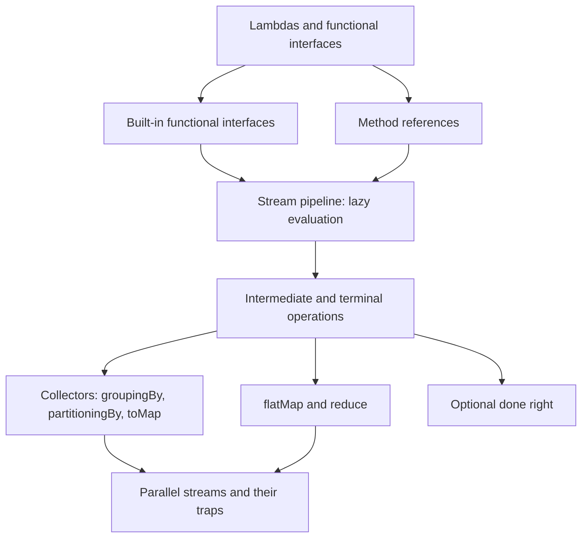
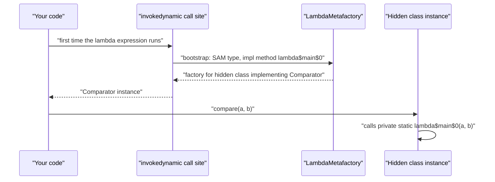
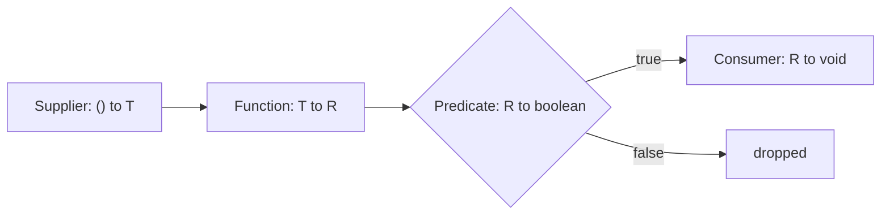
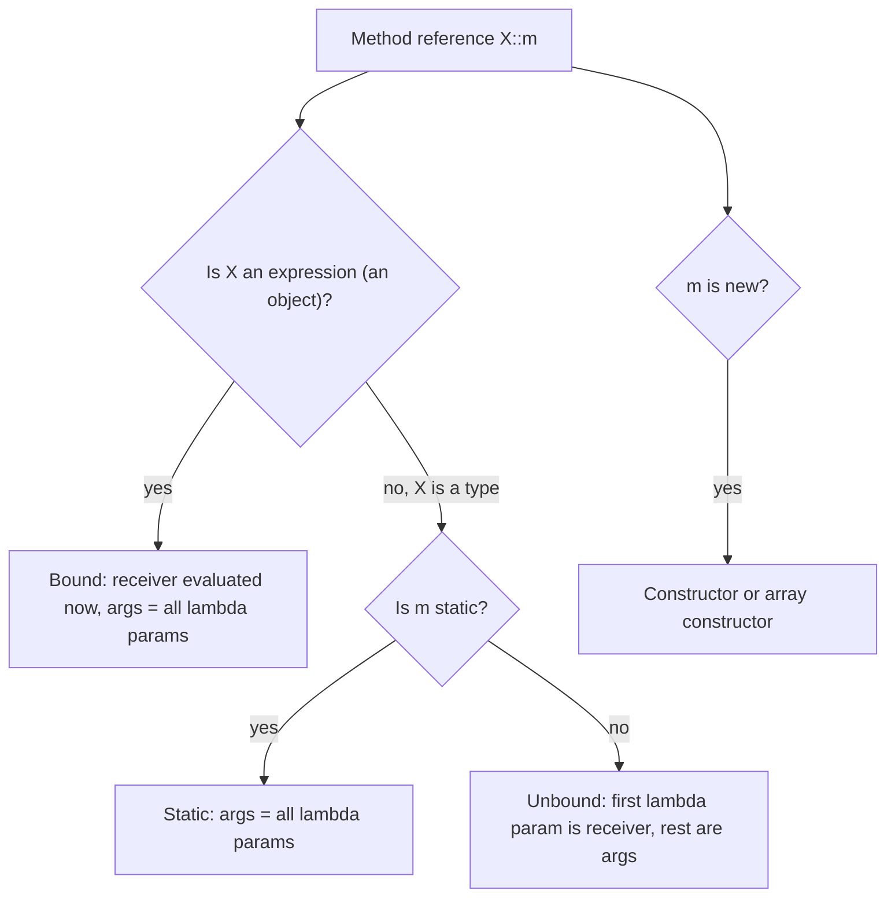

@@ 1 | MODULE | Phase 7 — Functional Java and Streams (Intermediate) | Lambdas, functional interfaces, method references, the Stream API, collectors, Optional and parallel streams | MUST
# Phase 7: Functional Java and Streams (Intermediate)

Java 8 added a functional style to the language: lambdas (small anonymous functions), functional interfaces (the types those functions have), method references (shortcuts for lambdas that just call a method) and the Stream API (declarative pipelines over collections). Ten years later this is how everyday Java code is written: Spring configuration uses lambdas (`http.authorizeHttpRequests(auth -> auth.anyRequest().authenticated())`), service code transforms lists of entities into DTOs with streams, and repositories return `Optional`.

Interviewers love this phase for two reasons. First, "write it with streams" is the most common live-coding request in Java interviews: group employees by department, find the second highest salary, count word frequencies. Second, the internals produce classic trap questions: "Why does nothing happen when I call `filter` without a terminal operation?", "Why can a lambda only use effectively final variables?", "Why is `Optional.get()` a code smell?", "When does a parallel stream make code slower?".



**Prerequisites:** Phase 2 (interfaces, default methods, anonymous classes, records), Phase 4 (collections, `Comparator`), Phase 6 (generics and wildcards: every stream signature uses `? super T` and `? extends R`).

**The 5 questions from this phase that come up most often**
1. What is a functional interface, and how do lambdas relate to it?
2. What is the difference between intermediate and terminal operations, and what does lazy evaluation mean?
3. Group a list of employees by department and compute the average salary per department.
4. `map` vs `flatMap`; `Optional.orElse` vs `orElseGet`.
5. When should you (not) use parallel streams?

@@ 2 | MODULE | Functional basics | Functions as values: lambdas, the standard function types and method reference shortcuts | MUST
# Functional basics

**Shared analogy: recipe cards.** Before Java 8 you could only hand someone a whole cook (an object of a class) to do a job. With lambdas you can hand over just a recipe card: "take an order, return its total". The functional interface is the card template that says what goes in and what comes out (`Function<Order, BigDecimal>`). The built-in functional interfaces are the standard card templates every kitchen already has (take something and return a yes or no, take nothing and produce something). A method reference is a card that just says "use the recipe on page 42" (`Order::total`) instead of writing it out again.

- [[Lambdas and Functional Interfaces]] — writing the recipe cards.
- [[Built-in Functional Interfaces]] — the standard templates in `java.util.function`.
- [[Method References]] — pointing at an existing recipe.

@@ 3 | TOPIC | Lambdas and Functional Interfaces | Lambda syntax, target typing, effectively final capture, this inside lambdas and how invokedynamic implements them | MUST
# Lambdas and Functional Interfaces

**Level: Intermediate | Phase 7 | Priority: MUST | Since: Java 8**

> **30-second interview answer:** A lambda is an anonymous function, written `(params) -> body`, that you can pass around as a value. Its type is always a functional interface: an interface with exactly one abstract method, such as `Runnable`, `Comparator<T>` or `Function<T, R>`; the lambda becomes the implementation of that method. Lambdas can capture local variables only if they are effectively final, and `this` inside a lambda means the enclosing object, not the lambda. They are compiled with `invokedynamic`, not as anonymous inner classes, so they are cheap to create.

## 1. Concept in Simple Words
### Analogy
A sticky note with instructions you hand to a colleague.

| Office | Java |
|---|---|
| A job description template: "receives one document, returns approved or rejected" | A functional interface: `Predicate<Document>` with one abstract method `test` |
| A sticky note: "approve if the amount is under 500" | A lambda: `d -> d.amount() < 500` |
| Hiring a full-time employee just to approve documents | An anonymous inner class with boilerplate |
| The note can mention "the budget on my desk", but only if nobody changes it later | Capturing effectively final local variables |
| "My" on the note means the person who wrote it, not the note | `this` in a lambda is the enclosing instance |

### What it is
- **Functional interface:** an interface with exactly one abstract method (SAM, single abstract method). Default and static methods do not count, nor do methods that override `Object` methods (`equals`, `toString`), which is why `Comparator` with its `equals` declaration is still functional. `@FunctionalInterface` asks the compiler to enforce it.
- **Lambda expression syntax:**
  - `() -> 42` (no parameters)
  - `x -> x * 2` (one parameter, parentheses optional)
  - `(a, b) -> a + b` (several parameters)
  - `(String s) -> s.length()` (explicit types), `(var s) -> s.length()` (Java 11)
  - `(a, b) -> { int sum = a + b; return sum; }` (block body needs `return` if it returns a value)
- **Target typing:** a lambda has no type of its own. The compiler infers it from the context (assignment, method parameter, return, cast). The same lambda `x -> x > 0` can be a `Predicate<Integer>` or an `IntPredicate`.
- **Capture:** a lambda may read local variables of the enclosing method only if they are final or effectively final (never reassigned after initialization). It can read and write fields freely.
- **Lexical scoping:** a lambda does not introduce a new scope for names. `this` refers to the enclosing instance, and you cannot declare a parameter with the same name as a local variable.
- **Checked exceptions:** a lambda can only throw checked exceptions the functional method declares. `Function.apply` declares none, so `path -> Files.readString(path)` does not compile as a `Function`.

### Why it exists
Before Java 8, passing behaviour meant an anonymous inner class: five lines of ceremony for one line of logic. That made callback-style APIs (sorting, event handlers, filters, thread tasks) painful, and kept Java from adding a library like streams. Lambdas make "code as data" concise, which enabled the Stream API, `CompletableFuture`, and the lambda-based configuration DSLs you see in Spring Security and Spring Integration.

## 2. How It Works
```text
Comparator<String> byLength = (a, b) -> Integer.compare(a.length(), b.length());

Compile time:
  1. Target type is Comparator<String>; its single abstract method is int compare(String, String).
  2. Lambda parameters a, b get type String; body must return int.
  3. The body is moved into a private static synthetic method in the same class:
        private static int lambda$main$0(String a, String b) { return Integer.compare(...); }
  4. At the lambda's location javac emits an invokedynamic instruction.

Run time (first execution only):
  5. invokedynamic calls LambdaMetafactory, which spins a small hidden class implementing
     Comparator and calling lambda$main$0.
  6. The call site is linked; later executions reuse it.
     Non-capturing lambdas return the SAME instance every time (a cached singleton).
     Capturing lambdas allocate a small object holding the captured values.
```



**Why effectively final?** Captured values are copied into the lambda object. If the local variable could change afterwards, the lambda and the method would see different values, and with multithreaded execution the copy could be stale. Java chose the simple rule: you may only capture values that never change, so the copy is always correct.

```text
int count = 0;
list.forEach(x -> count++);        // ERROR: count is not effectively final
int[] box = {0};
list.forEach(x -> box[0]++);       // compiles, but a hack and not thread-safe
long n = list.stream().count();    // the functional answer
```

**Lambda vs anonymous class:**
| Aspect | Lambda | Anonymous class |
|---|---|---|
| `this` | Enclosing instance | The anonymous object |
| New scope | No (cannot shadow locals) | Yes |
| Compiled to | Synthetic method + `invokedynamic` | A separate `Outer$1.class` file |
| Can implement | Only functional interfaces | Any interface or abstract class, several methods, state |
| Instance creation | Cached if non-capturing | New object each evaluation |

## 3. Code Example
### Code
```java
import java.math.BigDecimal;
import java.util.ArrayList;
import java.util.Comparator;
import java.util.List;
import java.util.function.Predicate;

public class LambdasDemo {

    record Order(long id, String customer, BigDecimal total, boolean express) { }

    // A custom functional interface
    @FunctionalInterface
    interface DiscountRule {
        BigDecimal apply(Order order);                      // the single abstract method

        default DiscountRule andThenCap(BigDecimal cap) {   // default methods are allowed
            return order -> apply(order).min(cap);
        }
    }

    private final String shopName = "OrderHub";

    void showThis() {
        Runnable lambda = () -> System.out.println("lambda this: " + this.shopName);
        Runnable anon = new Runnable() {
            @Override public void run() {
                System.out.println("anonymous this: " + this.getClass().getSimpleName().isEmpty());
            }
        };
        lambda.run();
        anon.run();
    }

    static List<Order> filter(List<Order> orders, Predicate<Order> rule) {
        List<Order> result = new ArrayList<>();
        for (Order o : orders) if (rule.test(o)) result.add(o);
        return result;
    }

    public static void main(String[] args) {
        List<Order> orders = List.of(
                new Order(1, "ana", new BigDecimal("120.00"), false),
                new Order(2, "bob", new BigDecimal("35.50"), true),
                new Order(3, "cara", new BigDecimal("860.00"), true));

        // 1. Old way: anonymous inner class
        Comparator<Order> byTotalOld = new Comparator<Order>() {
            @Override public int compare(Order a, Order b) { return a.total().compareTo(b.total()); }
        };
        // 2. Lambda: same behaviour, one line
        Comparator<Order> byTotal = (a, b) -> a.total().compareTo(b.total());
        List<Order> sorted = new ArrayList<>(orders);
        sorted.sort(byTotal.reversed());
        System.out.println("old and new agree: " + (byTotalOld.compare(orders.get(0), orders.get(1)) == byTotal.compare(orders.get(0), orders.get(1))));
        System.out.println("by total desc: " + sorted.stream().map(Order::id).toList());

        // 3. Capturing an effectively final local
        BigDecimal threshold = new BigDecimal("100");         // never reassigned
        List<Order> big = filter(orders, o -> o.total().compareTo(threshold) > 0);
        System.out.println("big: " + big.stream().map(Order::id).toList());
        // threshold = BigDecimal.ONE;   // would make the lambda above a compile error

        // 4. Same lambda text, different target types
        Predicate<Order> express = o -> o.express();
        Predicate<Order> expressAndBig = express.and(o -> o.total().compareTo(threshold) > 0);
        System.out.println("express and big: " + filter(orders, expressAndBig).stream().map(Order::id).toList());

        // 5. Custom functional interface with a default method
        DiscountRule tenPercent = o -> o.total().multiply(new BigDecimal("0.10"));
        DiscountRule capped = tenPercent.andThenCap(new BigDecimal("50"));
        for (Order o : orders) {
            System.out.println("order " + o.id() + " discount " + capped.apply(o));
        }

        // 6. Non-capturing lambdas are cached; capturing ones are new objects
        System.out.println("same instance: " + (supplier() == supplier()));
        System.out.println("capturing same instance: " + (capturing(1) == capturing(1)));

        new LambdasDemo().showThis();
    }

    static Runnable supplier() { return () -> { }; }
    static Runnable capturing(int x) { return () -> System.out.println(x); }
}
```

### Walkthrough
- `byTotalOld` and `byTotal` implement the same `Comparator<Order>`; the lambda replaces five lines of anonymous class.
- `threshold` is captured by the lambda in `filter`. It is effectively final; uncommenting the reassignment makes every lambda that captures it fail to compile ("local variables referenced from a lambda expression must be final or effectively final").
- `Predicate.and` combines lambdas; the result is another `Predicate`. Composition through default methods is a key part of functional interfaces.
- `DiscountRule` is a custom functional interface. It has one abstract method plus a default method that itself returns a lambda, which calls `apply` on the outer rule.
- `supplier()` returns a non-capturing lambda: the JVM hands back the same cached instance each time (current HotSpot behaviour, not a language guarantee). `capturing(1)` must allocate because it stores `x`.
- In `showThis`, `this` inside the lambda is the `LambdasDemo` instance (it can read `shopName`), while `this` inside the anonymous class is the anonymous object itself, whose simple class name is empty.

### Output
```text
old and new agree: true
by total desc: [3, 1, 2]
big: [1, 3]
express and big: [3]
order 1 discount 12.0000
order 2 discount 3.5500
order 3 discount 50
same instance: true
capturing same instance: false
lambda this: OrderHub
anonymous this: true
```

### Compare
| Java 7 | Java 8+ |
|---|---|
| `new Thread(new Runnable() { public void run() { work(); } }).start();` | `new Thread(() -> work()).start();` |
| `Collections.sort(list, new Comparator<Order>() { ... });` | `list.sort((a, b) -> a.total().compareTo(b.total()));` |
| Strategy pattern: one class per strategy | One lambda per strategy, stored in a map or passed in |

## 4. Interview Questions
**Basic**
1. **What is a lambda expression?**
   An anonymous function: parameters, an arrow and a body, such as `x -> x * 2`. It is used wherever a functional interface is expected, and the compiler turns it into an implementation of that interface's single abstract method.
2. **What is a functional interface?**
   An interface with exactly one abstract method. It may have any number of default and static methods, and abstract methods that match public `Object` methods do not count. Examples: `Runnable`, `Callable`, `Comparator`, `Function`, `Predicate`.
3. **Is `@FunctionalInterface` required?**
   No. Any interface with a single abstract method works with lambdas. The annotation documents intent and makes the compiler fail if someone adds a second abstract method.

**Follow-up**
4. **Why must captured local variables be effectively final?**
   The lambda receives a copy of the value. If the variable could change later, the copy and the original would disagree, and in concurrent code visibility would be unclear. Restricting capture to unchanging values keeps semantics simple. Fields are not restricted because the lambda captures `this` and reads the field through it.
5. **What does `this` mean inside a lambda?**
   The instance of the enclosing class, because lambdas are lexically scoped. In an anonymous inner class, `this` is the anonymous object. This is why lambdas can call the enclosing class's methods naturally.
6. **How are lambdas implemented by the JVM?**
   javac moves the body into a private synthetic method and emits an `invokedynamic` instruction. On first execution, `LambdaMetafactory` creates a hidden class implementing the functional interface that calls the synthetic method. Non-capturing lambdas are cached as singletons; no `.class` file per lambda is generated.

**Tricky / scenario**
7. **Does this compile? `int total = 0; orders.forEach(o -> total += o.qty());`**
   No, `total` is modified, so it is not effectively final. Fix it functionally: `int total = orders.stream().mapToInt(Order::qty).sum();`. Workarounds like a one-element array or `AtomicInteger` compile but hide side effects and break with parallel streams.
8. **How do you call a method that throws a checked exception inside a `map` lambda?**
   `Function.apply` does not declare checked exceptions, so you must handle it inside the lambda: catch and rethrow as an unchecked exception (`UncheckedIOException` for `IOException`), or write your own functional interface whose method declares the exception plus a wrapper that converts it.
9. **Can a lambda implement an abstract class with one abstract method?**
   No. Lambdas only target interfaces. For an abstract class you need an anonymous class or a subclass. This is one reason the JDK made most callback types interfaces.

**What the interviewer is really testing:** whether you understand lambdas as typed implementations of functional interfaces, the capture rules and their reason, and the difference from anonymous classes.

## 5. Pitfalls & Best Practices
### Common mistakes
| Mistake | What goes wrong | Fix |
|---|---|---|
| Mutating outer state from a lambda (array or `AtomicInteger` hacks) | Hidden side effects, races in parallel code | Return values and use `reduce`, `sum`, collectors |
| Long multi-line lambdas | Hard to read, test and debug | Extract a named method and use a method reference |
| Swallowing checked exceptions inside lambdas | Errors silently lost | Wrap in an unchecked exception with the cause |
| Relying on lambda identity (`==`) | Behaviour differs between JVMs | Never compare lambdas by identity |
| Adding a second abstract method to an interface used with lambdas | Every lambda breaks at compile time | Mark interfaces `@FunctionalInterface` |

### Best practices
- Keep lambdas short: one expression is ideal; more than three lines deserves a named method.
- Prefer the built-in functional interfaces; define your own only when a domain name helps (`DiscountRule`) or checked exceptions are needed.
- Use descriptive parameter names in longer lambdas (`order -> order.total()` rather than `x -> x.total()`).
- Avoid side effects in lambdas passed to streams; side effects belong in `forEach` at the end, if anywhere.
- Spring uses lambdas heavily: `SecurityFilterChain` DSL, `RestClient` status handlers, `TransactionTemplate.execute(status -> ...)`.

### Compare with
| Way to pass behaviour | Verbosity | State | `this` refers to | Since |
|---|---|---|---|---|
| Named class implementing an interface | High | Yes | The object | Java 1.0 |
| Anonymous inner class | Medium | Yes | The anonymous object | Java 1.1 |
| Lambda | Low | Only captured effectively final values | Enclosing instance | Java 8 |
| Method reference | Lowest | Like the referenced method | Enclosing instance | Java 8 |

## 6. Hands-on Exercise
OrderHub applies validation rules before saving an order. Create a functional interface `OrderRule` with `Optional<String> check(Order order)` (an error message or empty) and a default method `and(OrderRule other)` that runs both and returns the first error. Build three rules as lambdas: total must be positive, customer must not be blank, express orders must be at most 1000. Combine them and validate four orders.

Acceptance criteria:
- `OrderRule` is annotated `@FunctionalInterface`.
- The combined rule reports only the first failing rule's message.
- No anonymous classes.

<details><summary>Solution</summary>

```java
import java.math.BigDecimal;
import java.util.List;
import java.util.Optional;

public class OrderRules {

    record Order(long id, String customer, BigDecimal total, boolean express) { }

    @FunctionalInterface
    interface OrderRule {
        Optional<String> check(Order order);

        default OrderRule and(OrderRule other) {
            return order -> {
                Optional<String> first = this.check(order);
                return first.isPresent() ? first : other.check(order);
            };
        }
    }

    static final BigDecimal EXPRESS_LIMIT = new BigDecimal("1000");

    public static void main(String[] args) {
        OrderRule positive = o -> o.total().signum() > 0 ? Optional.empty() : Optional.of("total must be positive");
        OrderRule customer = o -> o.customer().isBlank() ? Optional.of("customer is required") : Optional.empty();
        OrderRule expressLimit = o -> o.express() && o.total().compareTo(EXPRESS_LIMIT) > 0
                ? Optional.of("express orders are limited to 1000")
                : Optional.empty();

        OrderRule all = positive.and(customer).and(expressLimit);

        List<Order> orders = List.of(
                new Order(1, "ana", new BigDecimal("50"), false),
                new Order(2, " ", new BigDecimal("50"), false),
                new Order(3, "bob", new BigDecimal("1500"), true),
                new Order(4, "", BigDecimal.ZERO, true));

        for (Order o : orders) {
            System.out.println(o.id() + ": " + all.check(o).orElse("OK"));
        }
    }
}
```
Output:
```text
1: OK
2: customer is required
3: express orders are limited to 1000
4: total must be positive
```
Order 4 breaks two rules, but `and` stops at the first one. Inside the default method, `this` refers to the rule on which `and` was called, because the lambda captures the enclosing instance.
</details>

## 7. Recall
Q: What is a functional interface in Java?
A: An interface with exactly one abstract method, which lambdas and method references can implement.

Q: Why can a Java lambda only capture effectively final local variables?
A: The lambda stores a copy of the value, so the variable must never change for the copy to stay correct.

Q: What does `this` refer to inside a lambda?
A: The enclosing class instance, because lambdas are lexically scoped, unlike anonymous classes.

Q: How does the JVM implement lambdas?
A: javac emits a private synthetic method and an `invokedynamic` call site; `LambdaMetafactory` creates a hidden class implementing the interface at first use.

Q: Can a lambda throw a checked exception from `Function.apply`?
A: No; `apply` declares no checked exceptions, so you must catch and wrap it or use a custom functional interface.

**Related:** [[Built-in Functional Interfaces]] · [[Method References]] · [[Nested, Inner and Anonymous Classes]] · [[Interface Default, Static and Private Methods]]

@@ 3 | TOPIC | Built-in Functional Interfaces | Function, Predicate, Consumer, Supplier, UnaryOperator, BinaryOperator, Bi variants, primitive specializations and composition | MUST
# Built-in Functional Interfaces

**Level: Intermediate | Phase 7 | Priority: MUST | Since: Java 8 (`java.util.function`), `Predicate.not` Java 11**

> **30-second interview answer:** `java.util.function` has 43 standard functional interfaces built around four shapes: `Function<T, R>` takes a T and returns an R, `Predicate<T>` takes a T and returns a boolean, `Consumer<T>` takes a T and returns nothing, and `Supplier<T>` takes nothing and returns a T. There are two-argument versions (`BiFunction`, `BiPredicate`, `BiConsumer`), same-type versions (`UnaryOperator<T>`, `BinaryOperator<T>`), and primitive specializations (`IntPredicate`, `ToIntFunction`, `IntBinaryOperator`) that avoid boxing. They compose with default methods: `andThen`, `compose`, `and`, `or`, `negate`.

## 1. Concept in Simple Words
### Analogy
Standard machines on a factory floor.

| Factory machine | Interface | Method |
|---|---|---|
| A converter: raw part in, finished part out | `Function<T, R>` | `R apply(T t)` |
| A quality gate: part in, pass or fail out | `Predicate<T>` | `boolean test(T t)` |
| A packing station: part in, nothing comes back | `Consumer<T>` | `void accept(T t)` |
| A dispenser: press the button, a new part comes out | `Supplier<T>` | `T get()` |
| A polisher: part in, same kind of part out | `UnaryOperator<T>` | `T apply(T t)` |
| A welder: two parts in, one part of the same kind out | `BinaryOperator<T>` | `T apply(T a, T b)` |
| Conveyor belts chaining machines together | Composition methods | `andThen`, `compose`, `and`, `or` |

### What it is
**The four core shapes:**
| Interface | Signature | Typical use |
|---|---|---|
| `Function<T, R>` | `R apply(T)` | `map`, converting entity to DTO |
| `Predicate<T>` | `boolean test(T)` | `filter`, validation rules |
| `Consumer<T>` | `void accept(T)` | `forEach`, side effects like logging |
| `Supplier<T>` | `T get()` | Lazy values: `orElseGet`, `Collectors.toCollection`, factories |

**Variants:**
- Two arguments: `BiFunction<T, U, R>`, `BiPredicate<T, U>`, `BiConsumer<T, U>` (`Map.forEach((k, v) -> ...)`). There is no `BiSupplier` (a supplier takes no arguments).
- Same type in and out: `UnaryOperator<T> extends Function<T, T>` (`List.replaceAll`), `BinaryOperator<T> extends BiFunction<T, T, T>` (`reduce`, `Map.merge`), with `BinaryOperator.minBy(comparator)` and `maxBy`.
- Primitive specializations, to avoid boxing `int` into `Integer`:
  - `IntFunction<R>`, `IntPredicate`, `IntConsumer`, `IntSupplier`, `IntUnaryOperator`, `IntBinaryOperator` (and `Long`, `Double` versions)
  - `ToIntFunction<T>`, `ToLongFunction<T>`, `ToDoubleFunction<T>` (object in, primitive out: `mapToInt`)
  - `IntToLongFunction`, `IntToDoubleFunction`, ... (primitive to primitive)
  - `ObjIntConsumer<T>`, `BooleanSupplier`
- Older functional interfaces outside the package: `Runnable` (nothing in, nothing out), `Callable<V>` (nothing in, V out, may throw `Exception`), `Comparator<T>`.

**Composition (default and static methods):**
- `Function`: `andThen(after)` (this first, then after), `compose(before)` (before first, then this), `Function.identity()`.
- `Predicate`: `and`, `or`, `negate`, `Predicate.isEqual(x)`, `Predicate.not(p)` (Java 11).
- `Consumer`: `andThen`.
- `UnaryOperator.identity()`, `BinaryOperator.minBy`, `maxBy`.

### Why it exists
Without a standard set, every library would define its own `Transformer`, `Filter`, `Callback` types, and a lambda written for one could not be passed to another. A shared vocabulary lets streams, `Optional`, `Map` methods, `CompletableFuture` and your own APIs all accept the same lambdas.

## 2. How It Works
```text
Function composition
  f = order -> order.total()          Function<Order, BigDecimal>
  g = total -> total.multiply(TAX)    Function<BigDecimal, BigDecimal>

  f.andThen(g)   = x -> g.apply(f.apply(x))     run f, then g     Order -> BigDecimal
  g.compose(f)   = x -> g.apply(f.apply(x))     same thing, read right to left

Predicate composition (short-circuit, left to right)
  isPaid.and(isBig).or(isVip)   = o -> (isPaid.test(o) && isBig.test(o)) || isVip.test(o)
  isPaid.negate()               = o -> !isPaid.test(o)
```



**Why primitive specializations matter:** `Function<Integer, Integer>` boxes every value into an `Integer` object (only -128 to 127 are cached). On a stream of a million numbers, `IntUnaryOperator` avoids a million allocations. That is why `Stream<T>` has `mapToInt(ToIntFunction<? super T>)` returning an `IntStream` with `sum()`, `average()` and `max()`.

**Where you meet them in the JDK and Spring:**
| API | Functional interface |
|---|---|
| `stream.filter(...)` | `Predicate<? super T>` |
| `stream.map(...)` | `Function<? super T, ? extends R>` |
| `stream.forEach(...)`, `list.forEach(...)` | `Consumer<? super T>` |
| `optional.orElseGet(...)`, `ThreadLocal.withInitial(...)` | `Supplier<? extends T>` |
| `map.computeIfAbsent(key, ...)` | `Function<? super K, ? extends V>` |
| `map.merge(key, value, ...)` | `BiFunction<? super V, ? super V, ? extends V>` |
| `list.replaceAll(...)` | `UnaryOperator<E>` |
| `stream.reduce(identity, ...)` | `BinaryOperator<T>` |
| `CompletableFuture.supplyAsync(...)` | `Supplier<U>` |
| Spring `ObjectProvider.getIfAvailable(...)` | `Supplier<T>` |

## 3. Code Example
### Code
```java
import java.math.BigDecimal;
import java.math.RoundingMode;
import java.util.ArrayList;
import java.util.List;
import java.util.Map;
import java.util.TreeMap;
import java.util.function.BiFunction;
import java.util.function.BinaryOperator;
import java.util.function.Consumer;
import java.util.function.Function;
import java.util.function.IntPredicate;
import java.util.function.Predicate;
import java.util.function.Supplier;
import java.util.function.ToIntFunction;
import java.util.function.UnaryOperator;

public class FunctionalInterfacesDemo {

    record Product(String sku, String category, BigDecimal price, int stock) { }

    static final BigDecimal VAT = new BigDecimal("1.20");

    public static void main(String[] args) {
        List<Product> products = List.of(
                new Product("PEN", "office", new BigDecimal("1.50"), 120),
                new Product("DESK", "furniture", new BigDecimal("199.00"), 0),
                new Product("LAMP", "furniture", new BigDecimal("35.00"), 8),
                new Product("NOTE", "office", new BigDecimal("3.25"), 0));

        // Predicate and composition
        Predicate<Product> inStock = p -> p.stock() > 0;
        Predicate<Product> furniture = p -> p.category().equals("furniture");
        Predicate<Product> outOfStock = Predicate.not(inStock);              // Java 11
        System.out.println("in stock furniture: " + skus(products, inStock.and(furniture)));
        System.out.println("out of stock or furniture: " + skus(products, outOfStock.or(furniture)));

        // Function, andThen and compose
        Function<Product, BigDecimal> price = Product::price;
        Function<BigDecimal, BigDecimal> withVat = p -> p.multiply(VAT).setScale(2, RoundingMode.HALF_UP);
        Function<Product, BigDecimal> grossPrice = price.andThen(withVat);
        Function<Product, BigDecimal> sameThing = withVat.compose(price);
        System.out.println("gross DESK: " + grossPrice.apply(products.get(1)) + " = " + sameThing.apply(products.get(1)));

        // UnaryOperator: same type in and out
        UnaryOperator<String> normalize = s -> s.strip().toUpperCase();
        List<String> codes = new ArrayList<>(List.of(" pen ", "lamp", " desk"));
        codes.replaceAll(normalize);
        System.out.println("normalized: " + codes);

        // BinaryOperator and BiFunction with Map.merge
        BinaryOperator<Integer> add = Integer::sum;
        Map<String, Integer> stockByCategory = new TreeMap<>();
        for (Product p : products) stockByCategory.merge(p.category(), p.stock(), add);
        System.out.println("stock by category: " + stockByCategory);

        BiFunction<BigDecimal, Integer, BigDecimal> lineTotal = (unit, qty) -> unit.multiply(BigDecimal.valueOf(qty));
        System.out.println("3 lamps: " + lineTotal.apply(new BigDecimal("35.00"), 3));

        BinaryOperator<Product> cheaper = BinaryOperator.minBy((a, b) -> a.price().compareTo(b.price()));
        System.out.println("cheaper of DESK and LAMP: " + cheaper.apply(products.get(1), products.get(2)).sku());

        // Consumer chaining
        List<String> audit = new ArrayList<>();
        Consumer<Product> log = p -> audit.add("seen " + p.sku());
        Consumer<Product> alert = p -> { if (p.stock() == 0) audit.add("ALERT " + p.sku()); };
        products.forEach(log.andThen(alert));
        System.out.println(audit);

        // Supplier: lazy creation
        Supplier<List<String>> listFactory = ArrayList::new;
        List<String> fresh = listFactory.get();
        fresh.add("created lazily");
        System.out.println(fresh);

        // Primitive specializations avoid boxing
        ToIntFunction<Product> stock = Product::stock;
        IntPredicate low = n -> n < 10;
        int lowCount = 0;
        for (Product p : products) if (low.test(stock.applyAsInt(p))) lowCount++;
        System.out.println("low stock products: " + lowCount);
    }

    static List<String> skus(List<Product> products, Predicate<? super Product> filter) {
        List<String> result = new ArrayList<>();
        for (Product p : products) if (filter.test(p)) result.add(p.sku());
        return result;
    }
}
```

### Walkthrough
- `inStock.and(furniture)` and `outOfStock.or(furniture)` build new predicates from small ones; `Predicate.not` reads better than `inStock.negate()` when used with method references (`Predicate.not(String::isBlank)`).
- `price.andThen(withVat)` and `withVat.compose(price)` are the same function: `andThen` reads left to right, `compose` right to left.
- `codes.replaceAll(normalize)` takes a `UnaryOperator<String>` because the result must be the same type as the element.
- `Map.merge` takes a `BiFunction`; passing the `BinaryOperator<Integer>` `Integer::sum` works because `BinaryOperator` extends `BiFunction`.
- `BinaryOperator.minBy` builds an operator from a comparator; it is what `reduce` uses to pick a minimum.
- `log.andThen(alert)` runs two consumers per element.
- `Supplier<List<String>>` delays creation until `get()` is called.
- `ToIntFunction` and `IntPredicate` work with `int` directly, with no `Integer` objects.

### Output
```text
in stock furniture: [LAMP]
out of stock or furniture: [DESK, LAMP, NOTE]
gross DESK: 238.80 = 238.80
normalized: [PEN, LAMP, DESK]
stock by category: {furniture=8, office=120}
3 lamps: 105.00
cheaper of DESK and LAMP: LAMP
[seen PEN, seen DESK, ALERT DESK, seen LAMP, seen NOTE, ALERT NOTE]
[created lazily]
low stock products: 3
```

### Compare
| Need | Interface | Not this |
|---|---|---|
| T to boolean | `Predicate<T>` | `Function<T, Boolean>` (boxing, no `and`/`or`) |
| T to T | `UnaryOperator<T>` | `Function<T, T>` (works, but less precise) |
| T to int | `ToIntFunction<T>` | `Function<T, Integer>` (boxing) |
| Nothing to T, may throw checked | `Callable<T>` | `Supplier<T>` (no checked exceptions) |
| Nothing to nothing | `Runnable` | `Supplier<Void>` |

## 4. Interview Questions
**Basic**
1. **Name the four core functional interfaces and their methods.**
   `Function<T, R>` with `R apply(T)`, `Predicate<T>` with `boolean test(T)`, `Consumer<T>` with `void accept(T)`, and `Supplier<T>` with `T get()`. Almost every other interface in `java.util.function` is a variant of these.
2. **What is the difference between `Function<T, T>` and `UnaryOperator<T>`?**
   `UnaryOperator<T>` extends `Function<T, T>`, so they behave the same. It states the intent "same type in and out" and is required by some APIs, such as `List.replaceAll(UnaryOperator<E>)`. Similarly, `BinaryOperator<T>` is a `BiFunction<T, T, T>`.
3. **Why do primitive specializations like `IntPredicate` exist?**
   Generics cannot use primitives, so `Predicate<Integer>` boxes each `int` into an `Integer`. Primitive specializations avoid that allocation and unboxing cost, which matters in hot loops and large streams.

**Follow-up**
4. **What is the difference between `andThen` and `compose` on `Function`?**
   `f.andThen(g)` applies f first and then g to its result; `f.compose(g)` applies g first and then f. `f.andThen(g)` equals `g.compose(f)`.
5. **What is the difference between `Supplier` and `Callable`?**
   Both take no arguments and return a value. `Callable.call()` declares `throws Exception` and is used with `ExecutorService.submit`; `Supplier.get()` cannot throw checked exceptions and is used with `Optional`, streams and `CompletableFuture.supplyAsync`.
6. **Why is there a `BiFunction` but no `TriFunction`?**
   The JDK provides only one and two argument versions to keep the API small. For three or more arguments you define your own functional interface or group arguments in a record.

**Tricky / scenario**
7. **Does `Predicate<Object> notNull = o -> o != null;` work as a filter on `Stream<String>`?**
   Yes. `filter` takes `Predicate<? super T>`, so a `Predicate<Object>` is accepted for a `Stream<String>`. That is PECS: the predicate consumes elements, so any supertype predicate works.
8. **What does `Function.identity()` return, and where is it useful?**
   A function that returns its input. It is used in `Collectors.toMap(Product::sku, Function.identity())` to map each element to itself as the value, and in `groupingBy(Function.identity(), counting())` to count duplicates.
9. **In a code review you see `Function<Order, Boolean> isPaid`. What do you suggest?**
   Use `Predicate<Order>`. It avoids boxing to `Boolean` (and possible null), states the intent, and gives `and`, `or` and `negate` for composition. It is also what `filter` and `removeIf` expect.

**What the interviewer is really testing:** fluency with the standard function types used in every stream and collection method, and awareness of boxing costs and composition.

## 5. Pitfalls & Best Practices
### Common mistakes
| Mistake | What goes wrong | Fix |
|---|---|---|
| `Function<T, Boolean>` instead of `Predicate<T>` | Boxing, possible null, no composition | Use `Predicate<T>` |
| `Function<Integer, Integer>` in numeric hot paths | Allocation per value | Use `IntUnaryOperator`, `IntStream` |
| Custom functional interface identical to a built-in one | Lambdas not interchangeable with JDK APIs | Reuse `java.util.function` types |
| Confusing `andThen` and `compose` order | Steps run in the wrong order | Prefer `andThen` and read left to right |
| `Consumer` with heavy side effects inside streams | Order and thread issues | Keep side effects at the end of the pipeline |

### Best practices
- Choose the most specific interface (`Predicate`, `UnaryOperator`, primitive versions).
- Accept functional parameters with PECS wildcards in your APIs: `Predicate<? super T>`, `Function<? super T, ? extends R>`.
- Name composed rules (`Predicate<Order> shippable = paid.and(inStock)`) to make business logic readable.
- Create your own interface when you need checked exceptions, more than two arguments, or a domain name that clarifies intent.

### Compare with
| Interface | Arguments | Returns | Checked exceptions | Package |
|---|---|---|---|---|
| `Runnable` | 0 | nothing | No | `java.lang` |
| `Callable<V>` | 0 | V | Yes | `java.util.concurrent` |
| `Supplier<T>` | 0 | T | No | `java.util.function` |
| `Consumer<T>` | 1 | nothing | No | `java.util.function` |
| `Function<T, R>` | 1 | R | No | `java.util.function` |
| `BiFunction<T, U, R>` | 2 | R | No | `java.util.function` |

## 6. Hands-on Exercise
OrderHub computes order prices through a configurable pipeline. Write `PricingPipeline` that builds a `Function<BigDecimal, BigDecimal>` from a list of `UnaryOperator<BigDecimal>` steps (apply a percentage discount, add a shipping fee, add VAT, round to 2 decimals) by chaining with `andThen`. Also write a `Predicate<BigDecimal> freeShipping` (subtotal at least 50) and use it to decide whether the shipping step is included. Use a `Supplier<List<UnaryOperator<BigDecimal>>>` to create the step list.

Acceptance criteria:
- A subtotal of 40.00 with 10% discount, 4.99 shipping and 20% VAT gives 49.19.
- A subtotal of 100.00 gets free shipping and gives 108.00.

<details><summary>Solution</summary>

```java
import java.math.BigDecimal;
import java.math.RoundingMode;
import java.util.ArrayList;
import java.util.List;
import java.util.function.Function;
import java.util.function.Predicate;
import java.util.function.Supplier;
import java.util.function.UnaryOperator;

public class PricingPipeline {

    static UnaryOperator<BigDecimal> discount(String percent) {
        BigDecimal factor = BigDecimal.ONE.subtract(new BigDecimal(percent).movePointLeft(2));
        return amount -> amount.multiply(factor);
    }

    static UnaryOperator<BigDecimal> addFee(String fee) {
        BigDecimal f = new BigDecimal(fee);
        return amount -> amount.add(f);
    }

    static final Predicate<BigDecimal> freeShipping = subtotal -> subtotal.compareTo(new BigDecimal("50")) >= 0;

    static Function<BigDecimal, BigDecimal> build(BigDecimal subtotal) {
        Supplier<List<UnaryOperator<BigDecimal>>> factory = ArrayList::new;
        List<UnaryOperator<BigDecimal>> steps = factory.get();
        steps.add(discount("10"));
        if (freeShipping.negate().test(subtotal)) steps.add(addFee("4.99"));
        steps.add(amount -> amount.multiply(new BigDecimal("1.20")));
        steps.add(amount -> amount.setScale(2, RoundingMode.HALF_UP));

        Function<BigDecimal, BigDecimal> pipeline = Function.identity();
        for (UnaryOperator<BigDecimal> step : steps) pipeline = pipeline.andThen(step);
        return pipeline;
    }

    public static void main(String[] args) {
        BigDecimal small = new BigDecimal("40.00");
        BigDecimal large = new BigDecimal("100.00");
        System.out.println(build(small).apply(small));
        System.out.println(build(large).apply(large));
    }
}
```
Output:
```text
49.19
108.00
```
40.00 × 0.90 = 36.00, + 4.99 = 40.99, × 1.20 = 49.188, rounded 49.19. 100.00 × 0.90 = 90.00, × 1.20 = 108.00. Starting from `Function.identity()` makes the fold work for any number of steps.
</details>

## 7. Recall
Q: What are the four core functional interfaces in `java.util.function`?
A: `Function<T, R>` (apply), `Predicate<T>` (test), `Consumer<T>` (accept) and `Supplier<T>` (get).

Q: What is the difference between `f.andThen(g)` and `f.compose(g)` for Java functions?
A: `andThen` runs f then g; `compose` runs g then f.

Q: Why use `IntPredicate` instead of `Predicate<Integer>`?
A: It works on primitive ints and avoids boxing each value into an Integer object.

Q: Which functional interface does `List.replaceAll` take?
A: `UnaryOperator<E>`, a function from the element type to the same type.

Q: What is the difference between `Supplier` and `Callable`?
A: Both return a value with no arguments, but `Callable.call` may throw checked exceptions and `Supplier.get` may not.

Q: What does `Predicate.not` do and when was it added?
A: It negates a predicate, convenient with method references such as `Predicate.not(String::isBlank)`; added in Java 11.

**Related:** [[Lambdas and Functional Interfaces]] · [[Method References]] · [[Wildcards and PECS]] · [[Intermediate and Terminal Operations]]

@@ 3 | TOPIC | Method References | The four kinds of method references, how they map to functional interfaces and when a lambda is clearer | MUST
# Method References

**Level: Intermediate | Phase 7 | Priority: MUST | Since: Java 8**

> **30-second interview answer:** A method reference is shorthand for a lambda that only calls an existing method, written with `::`. There are four kinds: static (`Integer::parseInt`), bound instance on a specific object (`System.out::println`, `order::isPaid`), unbound instance on an arbitrary object of a type (`String::toUpperCase`, where the first lambda parameter becomes the receiver), and constructor (`ArrayList::new`, `int[]::new`). Like lambdas, they need a target functional interface. A bound reference evaluates its receiver once, when the reference is created, which can differ from a lambda that evaluates it every call.

## 1. Concept in Simple Words
### Analogy
Speed-dial buttons on a phone.

| Phone | Method reference |
|---|---|
| Typing the full number every time | Writing a lambda `s -> s.toUpperCase()` |
| A speed-dial button labelled "Mum" | `String::toUpperCase` |
| A button for the company hotline (one fixed number for everyone) | Static reference `Integer::parseInt` |
| A button for "my manager" (a specific person chosen when the button was set up) | Bound reference `manager::approve` |
| A button "call the owner of this phone" that works with whatever phone you pick up | Unbound reference `Phone::callOwner` |
| A button that orders a brand-new phone | Constructor reference `Phone::new` |

### What it is
| Kind | Syntax | Equivalent lambda | Example target |
|---|---|---|---|
| Static method | `ClassName::staticMethod` | `(args) -> ClassName.staticMethod(args)` | `Function<String, Integer> f = Integer::parseInt;` |
| Bound instance method (specific object) | `object::method` | `(args) -> object.method(args)` | `Consumer<String> c = System.out::println;` |
| Unbound instance method (arbitrary object) | `ClassName::instanceMethod` | `(obj, args) -> obj.instanceMethod(args)` | `Function<String, String> f = String::toUpperCase;` |
| Constructor | `ClassName::new` | `(args) -> new ClassName(args)` | `Supplier<List<String>> s = ArrayList::new;` |
| Array constructor | `Type[]::new` | `n -> new Type[n]` | `IntFunction<String[]> g = String[]::new;` |

- **Unbound** references take the receiver as the first parameter: `BiFunction<String, String, Boolean> eq = String::equalsIgnoreCase;` means `(a, b) -> a.equalsIgnoreCase(b)`. `Comparator<String> c = String::compareTo;` works the same way.
- `this::method` and `super::method` are bound references to the current object.
- The compiler chooses the overload that fits the target type: `Integer::toString` is ambiguous as a `Function<Integer, String>` because both static `Integer.toString(int)` and instance `toString()` fit.

### Why it exists
Many lambdas only forward their arguments to a method: `x -> x.getName()`, `s -> Integer.parseInt(s)`, `() -> new ArrayList<>()`. Method references remove the noise and name the operation, so `orders.stream().map(Order::customer)` reads like a sentence.

## 2. How It Works
```text
Target: Function<Order, String>        single abstract method: String apply(Order)

Order::customer        unbound: apply(order)  -> order.customer()
                       first parameter (Order) becomes the receiver

Target: BiFunction<Order, Integer, Line>
Order::lineAt          unbound: apply(order, i) -> order.lineAt(i)

Target: Supplier<String>
order::customer        bound:   get() -> order.customer()     (order captured now)

Target: Function<String, Order>
Order::new             constructor: apply(s) -> new Order(s)  (picks the Order(String) constructor)
```



**Evaluation time of bound receivers:** `obj::method` evaluates `obj` immediately when the reference is created, and throws `NullPointerException` right then if it is null. The lambda `() -> obj.method()` evaluates `obj` every time it is called (and requires `obj` to be effectively final). If `obj` is an expression with side effects, such as `factory.create()::run`, the method reference calls `create()` once; the lambda would call it on every invocation.

**Implementation:** method references compile to the same `invokedynamic` + `LambdaMetafactory` mechanism as lambdas, but usually without a synthetic method: the metafactory points straight at the target method.

## 3. Code Example
### Code
```java
import java.math.BigDecimal;
import java.util.ArrayList;
import java.util.Arrays;
import java.util.Comparator;
import java.util.List;
import java.util.Map;
import java.util.TreeSet;
import java.util.function.BiFunction;
import java.util.function.Function;
import java.util.function.IntFunction;
import java.util.function.Supplier;
import java.util.stream.Collectors;

public class MethodReferencesDemo {

    record Customer(String name, String tier) {
        Customer(String name) { this(name, "STANDARD"); }   // used by Customer::new below
        boolean isVip() { return tier.equals("VIP"); }
    }

    static class PriceFormatter {
        private final String currency;
        PriceFormatter(String currency) { this.currency = currency; }
        String format(BigDecimal amount) { return currency + " " + amount; }
    }

    static int parseQuantity(String text) { return Integer.parseInt(text.strip()); }

    static int counter = 0;
    static PriceFormatter newFormatter() {
        counter++;
        return new PriceFormatter("EUR");
    }

    public static void main(String[] args) {
        // 1. Static method reference
        Function<String, Integer> parse = MethodReferencesDemo::parseQuantity;
        List<Integer> quantities = List.of(" 3", "10 ", "7").stream().map(parse).toList();
        System.out.println("quantities: " + quantities);

        // 2. Bound instance method reference (a specific object)
        PriceFormatter eur = new PriceFormatter("EUR");
        Function<BigDecimal, String> fmt = eur::format;
        System.out.println(fmt.apply(new BigDecimal("9.99")));

        // 3. Unbound instance method reference (receiver is the first parameter)
        Function<String, String> upper = String::toUpperCase;
        BiFunction<String, String, Boolean> sameIgnoringCase = String::equalsIgnoreCase;
        System.out.println(upper.apply("vip") + " " + sameIgnoringCase.apply("VIP", "vip"));

        // 4. Constructor references (overload chosen by target type)
        Function<String, Customer> newCustomer = Customer::new;          // Customer(String)
        BiFunction<String, String, Customer> newWithTier = Customer::new; // Customer(String, String)
        List<Customer> customers = new ArrayList<>(List.of("ana", "bob").stream().map(newCustomer).toList());
        customers.add(newWithTier.apply("cara", "VIP"));
        System.out.println(customers);

        // 5. Array constructor reference
        IntFunction<String[]> arrayMaker = String[]::new;
        String[] names = customers.stream().map(Customer::name).toArray(arrayMaker);
        System.out.println(Arrays.toString(names) + " length " + names.length);

        // 6. Method references in comparators and collectors
        customers.sort(Comparator.comparing(Customer::tier).thenComparing(Customer::name));
        Map<Boolean, TreeSet<String>> vip = customers.stream()
                .collect(Collectors.partitioningBy(Customer::isVip,
                        Collectors.mapping(Customer::name, Collectors.toCollection(TreeSet::new))));
        System.out.println("sorted: " + customers.stream().map(Customer::name).toList() + " vip: " + vip);

        // 7. Bound receiver evaluated once vs lambda evaluated each call
        Supplier<String> viaRef = newFormatter()::toString;       // newFormatter() runs now, once
        Supplier<String> viaLambda = () -> newFormatter().toString(); // runs on every get()
        int before = counter;
        viaRef.get(); viaRef.get();
        viaLambda.get(); viaLambda.get();
        System.out.println("formatter created: " + (counter - before) + " times after setup, " + counter + " total");

        // 8. Null receiver fails at creation time for a bound reference
        String missing = null;
        try {
            Supplier<Integer> len = missing::length;
            System.out.println(len.get());
        } catch (NullPointerException e) {
            System.out.println("NPE when the bound reference is created");
        }

        // Printing with a bound reference to System.out
        List.of("done").forEach(System.out::println);
    }
}
```

### Walkthrough
- `MethodReferencesDemo::parseQuantity` is a static reference; the stream passes each string as the argument.
- `eur::format` binds to one specific formatter object. `Function<BigDecimal, String>` fits because `format` takes a `BigDecimal` and returns `String`.
- `String::toUpperCase` as a `Function<String, String>` is unbound: the stream element becomes the receiver. `String::equalsIgnoreCase` as a `BiFunction` uses the first argument as receiver and the second as parameter.
- `Customer::new` resolves to different constructors depending on the target: one argument for `Function`, two for `BiFunction`.
- `String[]::new` creates a correctly typed array for `toArray`, avoiding `Object[]`.
- `Comparator.comparing(Customer::tier).thenComparing(Customer::name)` and `Collectors.mapping(Customer::name, ...)` are the most common real-world uses. `TreeSet::new` is a constructor reference used as a `Supplier` for the downstream collection.
- `newFormatter()::toString` calls `newFormatter()` once when the reference is created (that is during setup, before `before` is recorded); the lambda calls it on each `get()`, so two more creations happen afterwards, three in total.
- `missing::length` throws `NullPointerException` immediately at creation, before `get()` is called.

### Output
```text
quantities: [3, 10, 7]
EUR 9.99
VIP true
[Customer[name=ana, tier=STANDARD], Customer[name=bob, tier=STANDARD], Customer[name=cara, tier=VIP]]
[ana, bob, cara] length 3
sorted: [ana, bob, cara] vip: {false=[ana, bob], true=[cara]}
formatter created: 2 times after setup, 3 total
NPE when the bound reference is created
done
```

### Compare
| Lambda | Method reference | Better? |
|---|---|---|
| `s -> s.toUpperCase()` | `String::toUpperCase` | Reference |
| `o -> o.customer()` | `Order::customer` | Reference |
| `x -> System.out.println(x)` | `System.out::println` | Reference |
| `() -> new ArrayList<>()` | `ArrayList::new` | Reference |
| `o -> o.total().compareTo(LIMIT) > 0` | none | Lambda (logic, not just a call) |
| `s -> Integer.parseInt(s, 16)` | none (extra argument) | Lambda |

## 4. Interview Questions
**Basic**
1. **What is a method reference?**
   A compact form of a lambda that just calls one existing method, written `Target::method`. It needs a functional interface target type like any lambda and is compiled the same way.
2. **What are the four kinds of method references?**
   Static (`Math::abs`), bound instance on a particular object (`System.out::println`), unbound instance on an arbitrary object of a type (`String::length`), and constructor (`ArrayList::new`, also `int[]::new` for arrays).
3. **What is the difference between `String::length` and `str::length`?**
   `String::length` is unbound: it is a `Function<String, Integer>` (or `ToIntFunction<String>`) that takes the string as a parameter. `str::length` is bound to one specific string and is a `Supplier<Integer>` (or `IntSupplier`) with no parameters.

**Follow-up**
4. **How does the compiler decide which constructor `Customer::new` uses?**
   From the target functional interface's parameter types. As a `Supplier<Customer>` it needs a no-arg constructor, as a `Function<String, Customer>` a one-String constructor. If none or several match equally, it is a compile error.
5. **When is a lambda clearer than a method reference?**
   When the lambda does more than call one method (conditions, arithmetic, extra constant arguments), or when the reference would be ambiguous or obscure (`this::process` in a long class). Prefer whichever reads more clearly; references for simple forwarding, lambdas for logic.
6. **Why is `Integer::toString` ambiguous as a `Function<Integer, String>`?**
   Both the static method `Integer.toString(int)` and the instance method `toString()` (unbound, receiver is the parameter) match. The compiler cannot choose and reports an ambiguity; use a lambda or `String::valueOf`.

**Tricky / scenario**
7. **What is the difference between `Supplier<Foo> s = createFoo()::self;` and `Supplier<Foo> s = () -> createFoo().self();`?**
   The method reference evaluates `createFoo()` once, when `s` is created, and reuses that receiver for every `get()`. The lambda calls `createFoo()` on every `get()`. With side effects or expensive creation, the results differ.
8. **What happens with `String s = null; Runnable r = s::length;`?**
   A `NullPointerException` is thrown immediately when the method reference is evaluated, because bound receivers are null-checked at creation. A lambda `() -> s.length()` would throw only when run.
9. **Can a method reference refer to a method that throws a checked exception, such as `Files::readString` in `map`?**
   Not for `Function`, because `apply` declares no checked exceptions; it fails to compile with "unreported exception IOException". Wrap it in a lambda that catches and rethrows as `UncheckedIOException`, or use a custom functional interface.

**What the interviewer is really testing:** whether you can map each kind of reference to the lambda it replaces, especially the unbound receiver rule, and know the evaluation-time subtlety.

## 5. Pitfalls & Best Practices
### Common mistakes
| Mistake | What goes wrong | Fix |
|---|---|---|
| Confusing bound and unbound references | Wrong number of parameters, compile errors | Type name before `::` means unbound; object expression means bound |
| Ambiguous references like `Integer::toString` | Compile error | Use a lambda or a non-overloaded method |
| Bound reference on a possibly null object | Early `NullPointerException` | Check for null first or use a lambda |
| Forcing references for logic-heavy code | Need helper methods for one-off logic | Use a lambda when the logic is local and short |
| `toArray()` without an array constructor | Returns `Object[]` | Use `toArray(String[]::new)` |

### Best practices
- Use method references for getters (`Order::id`), constructors (`OrderDto::new`), and printing (`System.out::println`).
- Extract complex lambdas into well-named private methods and refer to them (`this::isEligibleForDiscount`), which also makes them testable.
- Build comparators from references: `Comparator.comparing(Order::createdAt).reversed()`.
- In mapping layers, a static factory reference such as `OrderDto::from` keeps service code clean.

### Compare with
| Form | Can contain logic | Receiver evaluated | Readability for simple calls |
|---|---|---|---|
| Anonymous class | Yes | Each call | Poor |
| Lambda | Yes | Each call | Good |
| Bound method reference | No | Once, at creation | Best |
| Unbound method reference | No | Each call (it is the parameter) | Best |

## 6. Hands-on Exercise
In OrderHub, convert `Order` entities to `OrderDto` records using only method references. Provide `OrderDto.from(Order)` (static), sort DTOs by status then id with `Comparator.comparing`, collect customer names into a `String[]`, and print each DTO with `System.out::println`. Then write a `Map<String, Function<String, String>>` of formatter commands (`"upper"`, `"lower"`, `"trim"`) using unbound references and apply them to `"  OrderHub  "`.

Acceptance criteria:
- No lambdas in the conversion, sorting and printing code.
- The command map uses unbound `String` method references.

<details><summary>Solution</summary>

```java
import java.util.Arrays;
import java.util.Comparator;
import java.util.LinkedHashMap;
import java.util.List;
import java.util.Map;
import java.util.function.Function;

public class DtoMapping {

    static class Order {
        private final long id; private final String customer; private final String status;
        Order(long id, String customer, String status) { this.id = id; this.customer = customer; this.status = status; }
        long getId() { return id; }
        String getCustomer() { return customer; }
        String getStatus() { return status; }
    }

    record OrderDto(long id, String customer, String status) {
        static OrderDto from(Order o) { return new OrderDto(o.getId(), o.getCustomer(), o.getStatus()); }
    }

    public static void main(String[] args) {
        List<Order> orders = List.of(
                new Order(3, "cara", "PAID"), new Order(1, "ana", "NEW"), new Order(2, "bob", "PAID"));

        List<OrderDto> dtos = orders.stream()
                .map(OrderDto::from)
                .sorted(Comparator.comparing(OrderDto::status).thenComparing(OrderDto::id))
                .toList();
        dtos.forEach(System.out::println);

        String[] customers = dtos.stream().map(OrderDto::customer).toArray(String[]::new);
        System.out.println(Arrays.toString(customers));

        Map<String, Function<String, String>> commands = new LinkedHashMap<>();
        commands.put("upper", String::toUpperCase);
        commands.put("lower", String::toLowerCase);
        commands.put("trim", String::strip);
        commands.forEach((name, fn) -> System.out.println(name + " -> [" + fn.apply("  OrderHub  ") + "]"));
    }
}
```
Output:
```text
OrderDto[id=1, customer=ana, status=NEW]
OrderDto[id=2, customer=bob, status=PAID]
OrderDto[id=3, customer=cara, status=PAID]
[ana, bob, cara]
upper -> [  ORDERHUB  ]
lower -> [  orderhub  ]
trim -> [OrderHub]
```
The final `forEach` uses a lambda because it combines two values into a message; that is a case where a method reference does not fit.
</details>

## 7. Recall
Q: What are the four kinds of Java method references?
A: Static (`Integer::parseInt`), bound instance (`obj::method`), unbound instance (`String::length`) and constructor (`ArrayList::new`).

Q: In an unbound method reference like `String::toUpperCase`, what becomes the receiver?
A: The first parameter of the functional interface method.

Q: When is the receiver of a bound method reference like `obj::method` evaluated?
A: Once, when the method reference is created; a null receiver throws immediately.

Q: How do you turn a stream into a typed array with a method reference?
A: `stream.toArray(String[]::new)`, an array constructor reference.

Q: Why is `Integer::toString` ambiguous as a `Function<Integer, String>`?
A: Both the static `toString(int)` and the unbound instance `toString()` match the target.

**Related:** [[Lambdas and Functional Interfaces]] · [[Built-in Functional Interfaces]] · [[Comparable vs Comparator]] · [[DTOs and Mapping]]
