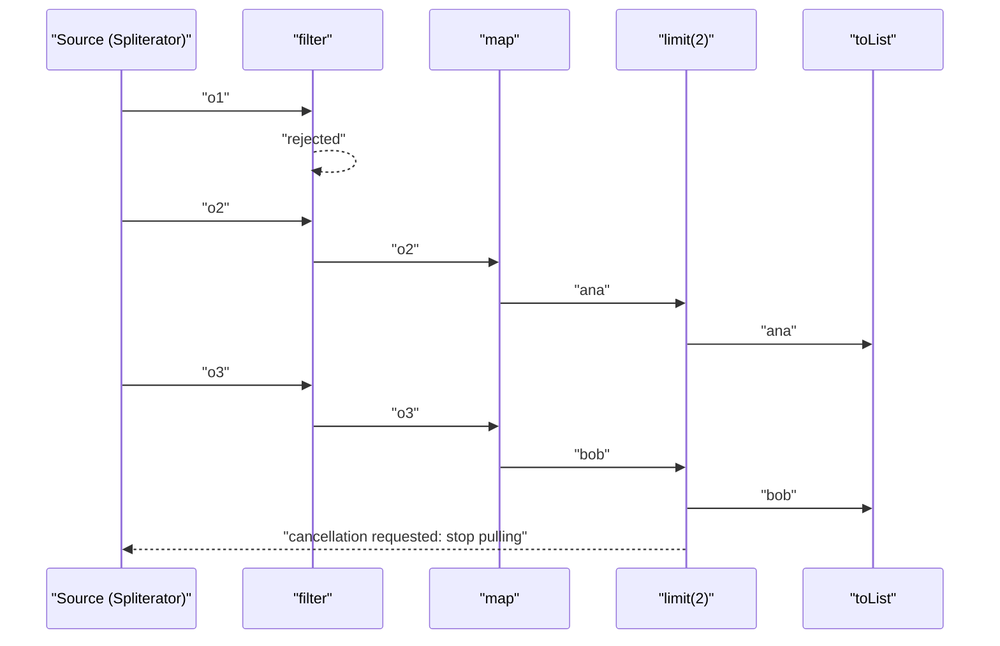
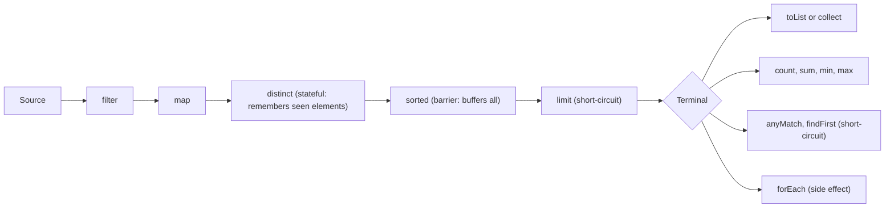
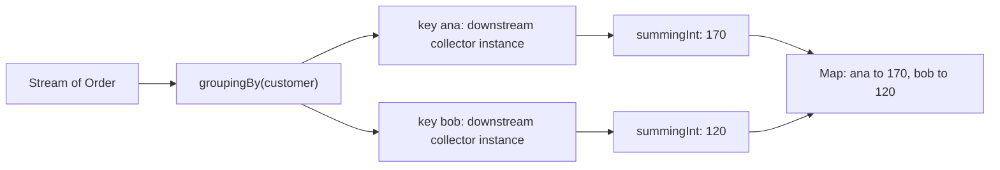

@@ 2 | MODULE | Streams | Declarative data pipelines: laziness, operations, collectors, flatMap, reduce, Optional and parallelism | MUST
# Streams

**Shared analogy: a factory assembly line.** A collection is a warehouse full of parts. A stream is an assembly line you set up in front of the warehouse: stations that inspect parts (`filter`), reshape them (`map`), unpack boxes into single parts (`flatMap`), sort them (`sorted`), and at the end a packing station that produces the final product (`collect`, `count`, `reduce`). Nothing moves until the packing station is switched on (laziness), each part travels down the whole line before the next one starts (vertical processing), and the line can stop early when it has enough (short-circuiting). An `Optional` is a box that may be empty, and a parallel stream is several identical lines working on parts of the warehouse at once.

- [[Stream Pipeline: Lazy Evaluation]] — how the line is built and when it runs.
- [[Intermediate and Terminal Operations]] — the stations and the packing step.
- [[Collectors: groupingBy, partitioningBy, toMap]] — packing results into maps and summaries.
- [[flatMap and Reduce]] — unpacking nested data and folding to one value.
- [[Optional Done Right]] — the maybe-empty box.
- [[Parallel Streams and Their Traps]] — several lines at once, and when that hurts.

@@ 3 | TOPIC | Stream Pipeline: Lazy Evaluation | Source, intermediate and terminal stages, laziness, vertical processing, short-circuiting and single use | MUST
# Stream Pipeline: Lazy Evaluation

**Level: Intermediate | Phase 7 | Priority: MUST | Since: Java 8 (`Stream.toList()` Java 16, Gatherers Java 24 `Java 25+`)**

> **30-second interview answer:** A stream pipeline has a source (a collection, array, generator or I/O), zero or more intermediate operations (`filter`, `map`, `sorted`) and exactly one terminal operation (`collect`, `forEach`, `count`). Intermediate operations are lazy: they only describe the work and return a new stream; nothing runs until the terminal operation is called. Elements then flow one at a time through the whole chain (vertical, not stage by stage), which lets short-circuiting operations like `findFirst` or `limit` stop early and makes infinite streams usable. A stream does not store data, does not modify its source, and can be consumed only once.

## 1. Concept in Simple Words
### Analogy
Ordering at a sandwich counter with a written order slip.

| Sandwich counter | Stream |
|---|---|
| The fridge with all ingredients | The source (a `List`) |
| Writing steps on the slip: "only whole-grain bread, add cheese, toast" | Intermediate operations: nothing is made yet |
| Handing the slip to the cook and saying "make it" | The terminal operation triggers execution |
| The cook takes one slice through every step before taking the next slice | Vertical (element-by-element) processing |
| "I only need two sandwiches" and the cook stops after two | Short-circuiting with `limit(2)` |
| You cannot hand in the same used slip twice | A stream can be consumed only once |
| The fridge is unchanged by reading the slip | Streams do not modify the source |

### What it is
- **Stream:** a sequence of elements supporting aggregate operations, from `java.util.stream`. It is not a data structure: it holds no elements, it pulls them from a source on demand.
- **Source:** `collection.stream()`, `Arrays.stream(array)`, `Stream.of(a, b)`, `IntStream.range(0, 10)`, `Stream.iterate(seed, next)`, `Stream.generate(supplier)`, `Files.lines(path)`, `String.chars()`, `Pattern.splitAsStream`.
- **Intermediate operation:** returns a new `Stream`, lazily. Stateless ones (`filter`, `map`, `peek`) handle each element alone; stateful ones (`sorted`, `distinct`) need to see other elements, and `sorted` must see all of them before emitting the first.
- **Terminal operation:** produces a result or side effect (`collect`, `toList`, `reduce`, `count`, `forEach`, `anyMatch`, `findFirst`, `min`) and closes the pipeline.
- **Laziness:** building the pipeline does no work.
- **Short-circuiting:** an operation that may finish without processing all elements: `limit`, `takeWhile` (intermediate); `findFirst`, `findAny`, `anyMatch`, `allMatch`, `noneMatch` (terminal).
- **Single use:** after a terminal operation, calling another operation on the same stream throws `IllegalStateException: stream has already been operated upon or closed`.
- **Non-interference:** you must not modify the source while the pipeline runs.

### Why it exists
Loops describe how to iterate (index, accumulator, temporary lists); streams describe what you want. Before Java 8, "names of the top three paid orders" needed a loop, a temporary list, a sort and another loop. A stream expresses it as one readable pipeline, avoids intermediate collections, can stop early, and can be parallelized by changing one call.

## 2. How It Works
```text
orders.stream()                     Head (source stage)
      .filter(o -> o.paid())        StatelessOp  --+
      .map(Order::customer)         StatelessOp    |  just linked stage objects, no work
      .limit(2)                     SliceOp      --+
      .toList();                    terminal: builds a chain of Sinks and pulls from the Spliterator

At toList():
  Spliterator.tryAdvance(o1) -> filter.accept(o1) -> paid? no  -> dropped
  Spliterator.tryAdvance(o2) -> filter.accept(o2) -> paid? yes -> map -> "ana" -> limit (1 of 2) -> list
  Spliterator.tryAdvance(o3) -> filter.accept(o3) -> paid? yes -> map -> "bob" -> limit (2 of 2) -> list
  limit signals cancellationRequested -> o4, o5 ... never read
```



**Vertical vs horizontal:** a naive implementation would filter the whole list into a new list, then map the whole list, then take two (horizontal). Streams instead fuse all stateless stages into one pass, element by element. A stateful stage like `sorted` is a barrier: it collects all upstream elements, sorts them, then pushes them downstream one by one.

**Spliterator and stream flags:** the source is a `Spliterator` ("splittable iterator") that can `tryAdvance` one element, `forEachRemaining`, and `trySplit` for parallelism. It reports characteristics such as `SIZED`, `ORDERED`, `DISTINCT`, `SORTED`, which the pipeline uses to optimize: `count()` on a `SIZED` source with no filter may skip traversal entirely (Java 9+), and `sorted()` on an already `SORTED` stream is a no-op.

**Infinite streams:** `Stream.iterate(1, n -> n * 2)` never ends on its own; it is fine because laziness plus `limit` or `takeWhile` stop it. `Stream.iterate(1, n -> n < 100, n -> n * 2)` (Java 9) has a built-in stop condition.

**Gatherers (`Java 25+`, final in Java 24):** `stream.gather(Gatherers.windowFixed(3))` adds custom intermediate operations (windows, scans, folds) the same way `collect` allows custom terminal operations.

## 3. Code Example
### Code
```java
import java.util.ArrayList;
import java.util.List;
import java.util.stream.IntStream;
import java.util.stream.Stream;

public class LazyPipelineDemo {

    record Order(long id, String customer, boolean paid, int total) { }

    public static void main(String[] args) {
        List<Order> orders = List.of(
                new Order(1, "ana", false, 50),
                new Order(2, "bob", true, 120),
                new Order(3, "cara", true, 80),
                new Order(4, "dan", true, 300),
                new Order(5, "eve", true, 20));

        // 1. Laziness: no terminal operation, nothing runs
        Stream<String> pipeline = orders.stream()
                .filter(o -> { System.out.println("filter " + o.id()); return o.paid(); })
                .map(o -> { System.out.println("map " + o.id()); return o.customer(); });
        System.out.println("pipeline built, nothing printed yet");

        // 2. Vertical processing + short-circuit: limit(2) stops after two matches
        List<String> firstTwo = pipeline.limit(2).toList();
        System.out.println("result: " + firstTwo);

        // 3. A stream can be used only once
        try {
            pipeline.count();
        } catch (IllegalStateException e) {
            System.out.println("reuse: " + e.getMessage());
        }

        // 4. sorted() is a barrier: all elements are pulled before the first is emitted
        System.out.println("--- sorted barrier");
        orders.stream()
                .peek(o -> System.out.println("pulled " + o.id()))
                .sorted((a, b) -> Integer.compare(b.total(), a.total()))
                .limit(1)
                .forEach(o -> System.out.println("top order " + o.id()));

        // 5. Infinite stream made finite by a short-circuiting op
        List<Integer> powers = Stream.iterate(1, n -> n * 2).limit(8).toList();
        System.out.println("powers: " + powers);
        System.out.println("iterate with condition: " + Stream.iterate(1, n -> n < 100, n -> n * 3).toList());

        // 6. Streams never modify the source
        List<Integer> source = new ArrayList<>(List.of(3, 1, 2));
        List<Integer> sortedCopy = source.stream().sorted().toList();
        System.out.println("source " + source + " sorted copy " + sortedCopy);

        // 7. anyMatch short-circuits on the first true
        boolean anyBig = IntStream.rangeClosed(1, 1_000_000)
                .peek(n -> { if (n > 3) throw new AssertionError("never reached"); })
                .anyMatch(n -> n == 3);
        System.out.println("anyMatch stopped early: " + anyBig);
    }
}
```

### Walkthrough
- Block 1 builds a pipeline with printing lambdas but no terminal operation. Nothing prints until block 2: the pipeline object only records the stages.
- Block 2 adds `limit(2)` and `toList()`. Output shows the vertical flow: order 1 is filtered out, order 2 goes through filter and map, order 3 likewise, then `limit` cancels and orders 4 and 5 are never read.
- Block 3 tries to reuse the consumed stream variable and gets `IllegalStateException`. Store a `Supplier<Stream<T>>` if you need to run the same pipeline twice.
- Block 4 shows that `sorted` must pull all five orders before emitting the largest, even though only one result is needed.
- Block 5: `Stream.iterate` is infinite; `limit(8)` and the three-argument `iterate` (Java 9) make it finite.
- Block 6: the source list stays `[3, 1, 2]`; `sorted()` works on the stream's elements.
- Block 7: `anyMatch` stops at 3, so the `peek` that would throw for 4 never runs.

### Output
```text
pipeline built, nothing printed yet
filter 1
filter 2
map 2
filter 3
map 3
result: [bob, cara]
reuse: stream has already been operated upon or closed
--- sorted barrier
pulled 1
pulled 2
pulled 3
pulled 4
pulled 5
top order 4
powers: [1, 2, 4, 8, 16, 32, 64, 128]
iterate with condition: [1, 3, 9, 27, 81]
source [3, 1, 2] sorted copy [1, 2, 3]
anyMatch stopped early: true
```

### Compare
| Imperative loop | Stream pipeline |
|---|---|
| Says how: index, temporary list, `break` | Says what: filter, map, limit |
| Eager: each step runs fully | Lazy: runs only on terminal op, element by element |
| Mutates accumulators | No mutation needed |
| Reusable (iterate the list again) | One-shot (create a new stream) |
| Easy to debug with breakpoints, checked exceptions fine | Harder to debug, checked exceptions awkward |

## 4. Interview Questions
**Basic**
1. **What is a stream in Java?**
   A sequence of elements from a source that supports declarative aggregate operations like filter, map and collect. It does not store data or modify its source, and it is consumed once by a terminal operation.
2. **What are the three parts of a stream pipeline?**
   A source (`list.stream()`, `Stream.of`, `IntStream.range`), zero or more intermediate operations that return streams, and one terminal operation that produces a result or side effect and triggers execution.
3. **What does lazy evaluation mean for streams?**
   Intermediate operations do no work when called; they only add a stage to the pipeline. Processing starts when a terminal operation runs, and then only as many elements as needed are pulled from the source.

**Follow-up**
4. **In what order are elements processed through `filter` then `map`?**
   Vertically: each element passes through filter, then map, then the next stages, before the next element is read. Stateless stages are fused into one pass; there are no intermediate collections.
5. **Why can a stream be consumed only once?**
   A stream is a one-shot view over a source traversal, backed by a spliterator that is used up. After the terminal operation, the pipeline is marked linked or consumed, and any further operation throws `IllegalStateException`. Create a new stream from the source, or keep a `Supplier<Stream<T>>`.
6. **What is a stateful intermediate operation?**
   One whose output for an element depends on other elements: `sorted`, `distinct`, `limit`, `skip`. `sorted` is a full barrier that buffers all elements; these operations cost memory and hurt parallel performance.

**Tricky / scenario**
7. **What does this print? `Stream.of("a", "b", "c").peek(System.out::println).map(String::toUpperCase);`**
   Nothing, because there is no terminal operation. The pipeline is built and discarded. This is a common bug when people use `peek` or `map` for side effects.
8. **Why might `peek` not print anything even with a terminal operation, like `List.of(1, 2, 3).stream().peek(System.out::println).count()`?**
   Since Java 9, `count()` can compute the size directly from a `SIZED` source without traversing, so `peek` is skipped. `peek` is meant for debugging, and side effects in it are not guaranteed to run.
9. **Is `Stream.generate(Math::random).sorted().limit(5).toList()` a good idea?**
   No, it never terminates. `sorted` is a barrier that waits for all elements of an infinite stream before emitting anything, so `limit` is never reached. Put `limit` before `sorted`.

**What the interviewer is really testing:** whether you understand when stream code actually runs, the order of processing, and the consequences of laziness, short-circuiting and stateful stages.

## 5. Pitfalls & Best Practices
### Common mistakes
| Mistake | What goes wrong | Fix |
|---|---|---|
| Pipeline without a terminal operation | Nothing happens | End with `toList`, `collect`, `forEach` or similar |
| Reusing a stream variable | `IllegalStateException` | Create a new stream or use a `Supplier<Stream<T>>` |
| `sorted()` or `distinct()` on an infinite stream | Hangs or runs out of memory | `limit` first |
| Relying on `peek` for business logic | May be skipped (for example by `count`) | Use `peek` only for debugging |
| Modifying the source collection inside the pipeline | `ConcurrentModificationException` or wrong results | Collect results into a new collection |
| Leaving `Files.lines` streams open | File handle leak | Use try-with-resources on I/O streams |

### Best practices
- Put cheap, selective `filter` steps early and stateful steps (`sorted`, `distinct`) late.
- Use `Stream.toList()` (Java 16) for an unmodifiable result list; use `collect(Collectors.toList())` only if you need a mutable list (and then prefer `toCollection(ArrayList::new)` to make it explicit).
- Keep lambdas in pipelines pure: no side effects except in a final `forEach`.
- Format pipelines one operation per line for readability and debuggable stack traces.
- Do not force streams where a simple loop is clearer, especially with checked exceptions or complex control flow.

### Compare with
| Concept | Stores data | Lazy | Reusable | Modifies source |
|---|---|---|---|---|
| Collection | Yes | No | Yes | Can |
| Iterator | No | Pulls on demand | No | Can (`remove`) |
| Stream | No | Yes | No | No |
| Reactive `Flux` (Phase 22) | No | Yes, push-based, async | Re-subscribable | No |

## 6. Hands-on Exercise
OrderHub logs every incoming order event. Given a list of 10 events (ids 1 to 10, every third one is a "FAILED" payment), write a pipeline that prints which elements are inspected and returns the ids of the first two failed events. Prove with printed output that events after the second failure are never inspected. Then show that the same pipeline with `sorted` by id descending before `limit` inspects all events.

Acceptance criteria:
- The first pipeline inspects exactly events 1 to 6.
- The second inspects all 10 before printing a result.

<details><summary>Solution</summary>

```java
import java.util.Comparator;
import java.util.List;
import java.util.stream.IntStream;

public class LazyEvents {
    record Event(int id, String status) { }

    public static void main(String[] args) {
        List<Event> events = IntStream.rangeClosed(1, 10)
                .mapToObj(i -> new Event(i, i % 3 == 0 ? "FAILED" : "OK"))
                .toList();

        List<Integer> firstFailed = events.stream()
                .peek(e -> System.out.print(e.id() + " "))
                .filter(e -> e.status().equals("FAILED"))
                .map(Event::id)
                .limit(2)
                .toList();
        System.out.println("-> " + firstFailed);

        List<Integer> lastFailed = events.stream()
                .peek(e -> System.out.print(e.id() + " "))
                .sorted(Comparator.comparingInt(Event::id).reversed())
                .filter(e -> e.status().equals("FAILED"))
                .map(Event::id)
                .limit(2)
                .toList();
        System.out.println("-> " + lastFailed);
    }
}
```
Output:
```text
1 2 3 4 5 6 -> [3, 6]
1 2 3 4 5 6 7 8 9 10 -> [9, 6]
```
The first pipeline stops after event 6 because `limit(2)` is satisfied. In the second, `sorted` is a barrier and must read every event before anything flows downstream.
</details>

## 7. Recall
Q: What are the three parts of a Java stream pipeline?
A: A source, zero or more lazy intermediate operations, and one terminal operation that triggers execution.

Q: What does lazy evaluation mean for Java streams?
A: Intermediate operations only describe work; nothing runs until a terminal operation is called.

Q: In what order does a stream process elements through `filter` and `map`?
A: Vertically: each element goes through all stages before the next element is read.

Q: What happens if you call a terminal operation on a stream that was already consumed?
A: It throws `IllegalStateException: stream has already been operated upon or closed`.

Q: Why is `sorted()` called a barrier in a stream pipeline?
A: It must receive all upstream elements before emitting the first one, so it defeats short-circuiting and needs memory.

Q: Which stream operations are short-circuiting?
A: `limit` and `takeWhile` (intermediate); `findFirst`, `findAny`, `anyMatch`, `allMatch`, `noneMatch` (terminal).

**Related:** [[Intermediate and Terminal Operations]] · [[Lambdas and Functional Interfaces]] · [[Parallel Streams and Their Traps]] · [[Iterator and Fail-Fast vs Fail-Safe]]

@@ 3 | TOPIC | Intermediate and Terminal Operations | filter, map, distinct, sorted, limit, skip, takeWhile, peek and the terminal ops collect, toList, reduce, count, match and find | MUST
# Intermediate and Terminal Operations

**Level: Intermediate | Phase 7 | Priority: MUST | Since: Java 8 (`takeWhile`, `dropWhile` Java 9, `toList`, `mapMulti` Java 16)**

> **30-second interview answer:** Intermediate operations transform a stream into another stream and are lazy: `filter`, `map`, `flatMap`, `distinct`, `sorted`, `limit`, `skip`, `peek`, `takeWhile`, `dropWhile`, and `mapToInt` to switch to primitive streams. Terminal operations produce a result or side effect and trigger the pipeline: `collect`, `toList`, `reduce`, `count`, `min`, `max`, `forEach`, `anyMatch`, `allMatch`, `noneMatch`, `findFirst`, `findAny`, `toArray`. Primitive streams (`IntStream`, `LongStream`, `DoubleStream`) add `sum`, `average`, `summaryStatistics` and avoid boxing.

## 1. Concept in Simple Words
### Analogy
An airport security line.

| Airport | Stream operation |
|---|---|
| Passengers without a boarding pass are turned away | `filter` |
| Each passenger puts belongings in a tray | `map` (passenger to tray) |
| Duplicate trays of the same family merged | `distinct` |
| Passengers lined up by boarding group | `sorted` |
| "Only the next 20 people" | `limit(20)` |
| "Skip the first 5, they are crew" | `skip(5)` |
| "Let people through while the gate is open, then stop" | `takeWhile` |
| A guard counting people as they pass, not stopping them | `peek` |
| At the end: count passengers, or ask "is anyone carrying liquids?" | Terminal `count`, `anyMatch` |

### What it is
**Intermediate (return a `Stream`, lazy):**
| Operation | Stateless or stateful | What it does |
|---|---|---|
| `filter(Predicate)` | Stateless | Keep matching elements |
| `map(Function)` | Stateless | Transform each element |
| `mapToInt`, `mapToLong`, `mapToDouble`, `mapToObj`, `boxed` | Stateless | Switch between object and primitive streams |
| `flatMap(Function to Stream)` | Stateless | One element to zero or more (next topics) |
| `mapMulti` (Java 16) | Stateless | Imperative flatMap with a consumer |
| `peek(Consumer)` | Stateless | Debug side effect, passes elements through |
| `distinct()` | Stateful | Remove duplicates using `equals` and `hashCode` |
| `sorted()`, `sorted(Comparator)` | Stateful, barrier | Natural order or comparator |
| `limit(n)`, `skip(n)` | Stateful, short-circuit for limit | First n, or drop first n |
| `takeWhile`, `dropWhile` (Java 9) | Stateful | Take or drop the prefix while the predicate holds |

**Terminal (trigger execution):**
| Operation | Returns | Notes |
|---|---|---|
| `toList()` (Java 16) | Unmodifiable `List` | Allows nulls |
| `collect(Collector)` | Anything | Collectors topic |
| `toArray()`, `toArray(String[]::new)` | Array | Typed with generator |
| `reduce(...)` | `T` or `Optional<T>` | Fold to one value |
| `count()` | `long` | |
| `min(Comparator)`, `max(Comparator)` | `Optional<T>` | |
| `findFirst()`, `findAny()` | `Optional<T>` | Short-circuit; `findAny` may be faster in parallel |
| `anyMatch`, `allMatch`, `noneMatch` | `boolean` | Short-circuit; on empty streams: false, true, true |
| `forEach`, `forEachOrdered` | `void` | `forEach` ignores order in parallel |
| `IntStream.sum()`, `average()`, `summaryStatistics()` | `int`, `OptionalDouble`, stats | Primitive streams only |

### Why it exists
A small, composable vocabulary covers almost every collection-processing task: select, transform, sort, slice, aggregate, search. Learning about 25 operations replaces countless hand-written loops, and each operation has a precise contract (ordering, laziness, statefulness) that the library can optimize.

## 2. How It Works


**What each stateful operation keeps in memory:**
```text
distinct()     a HashSet of elements seen so far (LinkedHashSet-like when ordered)
sorted()       an array of ALL elements, then Arrays.sort / List.sort
limit(n)       a counter; requests cancellation after n
skip(n)        a counter
takeWhile(p)   a flag: once p fails, stop (and cancel upstream)
dropWhile(p)   a flag: once p fails, pass everything from then on
```

**takeWhile vs filter:** `filter` checks every element; `takeWhile` stops at the first failure. On `[1, 2, 5, 1]` with `n < 3`: `filter` gives `[1, 2, 1]`, `takeWhile` gives `[1, 2]`, `dropWhile` gives `[5, 1]`.

**`toList()` vs `collect(Collectors.toList())`:**
| | `stream.toList()` (16) | `Collectors.toList()` | `Collectors.toUnmodifiableList()` (10) |
|---|---|---|---|
| Mutability | Unmodifiable | Mutable `ArrayList` in practice, not guaranteed | Unmodifiable |
| Nulls | Allowed | Allowed | `NullPointerException` |

**Match operations on empty streams:** `anyMatch` returns false (no element matches), `allMatch` returns true (vacuous truth: no element fails), `noneMatch` returns true. This surprises people in validation code: "all items valid" is true for an empty order.

## 3. Code Example
### Code
```java
import java.util.Comparator;
import java.util.IntSummaryStatistics;
import java.util.List;
import java.util.Optional;
import java.util.stream.Collectors;
import java.util.stream.IntStream;
import java.util.stream.Stream;

public class StreamOperationsDemo {

    record Product(String sku, String category, int priceCents, int stock) { }

    public static void main(String[] args) {
        List<Product> products = List.of(
                new Product("PEN", "office", 150, 120),
                new Product("DESK", "furniture", 19900, 2),
                new Product("LAMP", "furniture", 3500, 8),
                new Product("NOTE", "office", 325, 0),
                new Product("CHAIR", "furniture", 8900, 5),
                new Product("CLIP", "office", 50, 900));

        // filter + map + sorted + limit: top 3 most expensive in-stock SKUs
        List<String> top3 = products.stream()
                .filter(p -> p.stock() > 0)
                .sorted(Comparator.comparingInt(Product::priceCents).reversed())
                .limit(3)
                .map(Product::sku)
                .toList();
        System.out.println("top3: " + top3);

        // distinct + sorted natural order
        System.out.println("categories: " + products.stream().map(Product::category).distinct().sorted().toList());

        // skip + limit = pagination (page 2, size 2)
        System.out.println("page 2: " + products.stream().skip(2).limit(2).map(Product::sku).toList());

        // takeWhile / dropWhile vs filter on an ordered list
        List<Integer> readings = List.of(1, 2, 5, 1, 2);
        System.out.println("filter<3: " + readings.stream().filter(n -> n < 3).toList()
                + " takeWhile<3: " + readings.stream().takeWhile(n -> n < 3).toList()
                + " dropWhile<3: " + readings.stream().dropWhile(n -> n < 3).toList());

        // Primitive stream: sum, average, statistics without boxing
        int stockValue = products.stream().mapToInt(p -> p.priceCents() * p.stock()).sum();
        IntSummaryStatistics stats = products.stream().mapToInt(Product::priceCents).summaryStatistics();
        System.out.println("stock value cents: " + stockValue);
        System.out.println("price stats: min=" + stats.getMin() + " max=" + stats.getMax()
                + " avg=" + String.format("%.2f", stats.getAverage()) + " count=" + stats.getCount());

        // min / max / findFirst return Optional
        Optional<Product> cheapest = products.stream().min(Comparator.comparingInt(Product::priceCents));
        Optional<Product> firstOut = products.stream().filter(p -> p.stock() == 0).findFirst();
        System.out.println("cheapest: " + cheapest.map(Product::sku).orElse("none")
                + ", first out of stock: " + firstOut.map(Product::sku).orElse("none"));

        // match operations, including the empty-stream surprise
        System.out.println("any free: " + products.stream().anyMatch(p -> p.priceCents() == 0)
                + ", all priced: " + products.stream().allMatch(p -> p.priceCents() > 0)
                + ", none negative stock: " + products.stream().noneMatch(p -> p.stock() < 0));
        System.out.println("empty allMatch: " + Stream.<Product>empty().allMatch(p -> p.stock() > 100));

        // count, toArray, joining
        long officeCount = products.stream().filter(p -> p.category().equals("office")).count();
        String[] skus = products.stream().map(Product::sku).toArray(String[]::new);
        System.out.println("office count: " + officeCount + ", skus array length: " + skus.length);
        System.out.println(products.stream().map(Product::sku).collect(Collectors.joining(", ", "[", "]")));

        // IntStream helpers
        System.out.println("squares: " + IntStream.rangeClosed(1, 5).map(n -> n * n).boxed().toList());

        // toList() is unmodifiable
        try {
            top3.add("HACK");
        } catch (UnsupportedOperationException e) {
            System.out.println("toList() result is unmodifiable");
        }
    }
}
```

### Walkthrough
- `top3` filters out zero stock, sorts by price descending, keeps three, then maps to SKUs. Putting `map` after `limit` means only three elements get mapped.
- `distinct().sorted()` removes duplicate categories and orders them alphabetically.
- `skip(2).limit(2)` is offset pagination: the same idea Spring Data's `PageRequest.of(1, 2)` translates to SQL `OFFSET 2 LIMIT 2` in Phase 11.
- `takeWhile` stops at 5, `dropWhile` starts at 5, `filter` checks everything.
- `mapToInt` switches to an `IntStream` so `sum()` and `summaryStatistics()` work without boxing. Stock value: 150×120 + 19900×2 + 3500×8 + 325×0 + 8900×5 + 50×900 = 18000 + 39800 + 28000 + 0 + 44500 + 45000 = 175300.
- `min`, `findFirst` return `Optional`, unwrapped safely with `map` and `orElse`.
- `allMatch` on an empty stream is true: vacuous truth.
- `Collectors.joining` builds a string with delimiter, prefix and suffix.

### Output
```text
top3: [DESK, CHAIR, LAMP]
categories: [furniture, office]
page 2: [LAMP, NOTE]
filter<3: [1, 2, 1, 2] takeWhile<3: [1, 2] dropWhile<3: [5, 1, 2]
stock value cents: 175300
price stats: min=50 max=19900 avg=5470.83 count=6
cheapest: CLIP, first out of stock: NOTE
any free: false, all priced: true, none negative stock: true
empty allMatch: true
office count: 3, skus array length: 6
[PEN, DESK, LAMP, NOTE, CHAIR, CLIP]
squares: [1, 4, 9, 16, 25]
toList() result is unmodifiable
```

### Compare
| Need | Use | Avoid |
|---|---|---|
| Sum of a numeric property | `mapToInt(...).sum()` | `map(...).reduce(0, Integer::sum)` (boxing) |
| Exists check | `anyMatch(...)` | `filter(...).count() > 0` (no short-circuit) |
| First match | `filter(...).findFirst()` | `filter(...).toList().get(0)` (processes all, may throw) |
| Unmodifiable result | `toList()` | `collect(Collectors.toList())` then wrapping |
| Debugging | `peek` temporarily | `peek` for business logic |

## 4. Interview Questions
**Basic**
1. **What is the difference between intermediate and terminal operations?**
   Intermediate operations return a new stream and are lazy (`filter`, `map`, `sorted`). Terminal operations return a non-stream result or perform a side effect (`collect`, `count`, `forEach`) and trigger processing of the whole pipeline. A pipeline has exactly one terminal operation.
2. **What is the difference between `map` and `filter`?**
   `filter` keeps or drops each element based on a predicate, so the count can shrink but types stay the same. `map` transforms each element with a function, keeping the count but possibly changing the type.
3. **Why use `mapToInt` instead of `map`?**
   It returns an `IntStream` of primitives, avoiding boxing, and provides `sum`, `average`, `max` and `summaryStatistics`. A `Stream<Integer>` has no `sum()` method.

**Follow-up**
4. **What is the difference between `findFirst` and `findAny`?**
   `findFirst` returns the first element in encounter order; `findAny` may return any element, which lets parallel streams return whichever thread finds one first. On sequential streams they usually behave the same, but only `findFirst` guarantees it.
5. **What is the difference between `forEach` and `forEachOrdered`?**
   In parallel streams, `forEach` processes elements in any order for speed, while `forEachOrdered` respects encounter order at a performance cost. In sequential streams both follow encounter order.
6. **What is the difference between `takeWhile` and `filter`?**
   `filter` tests every element. `takeWhile` returns the longest prefix of elements matching the predicate and stops at the first failure, which is useful for sorted data and infinite streams.

**Tricky / scenario**
7. **What does `Stream.of().allMatch(x -> false)` return?**
   `true`. With no elements, there is no counterexample, so "all match" is vacuously true. `anyMatch` returns false and `noneMatch` true on an empty stream. Validate emptiness separately if it matters.
8. **Can you add to the list returned by `stream.toList()`?**
   No, it is unmodifiable and throws `UnsupportedOperationException`. `Collectors.toList()` currently returns an `ArrayList`, but that is not guaranteed by the spec; use `Collectors.toCollection(ArrayList::new)` when you need a mutable list.
9. **Why is `list.stream().filter(...).count() > 0` worse than `anyMatch`?**
   `count` must process every element, while `anyMatch` stops at the first match. It is also less readable. On large data or expensive predicates, short-circuiting matters.

**What the interviewer is really testing:** practical fluency with the core operations, their laziness and short-circuit behaviour, and choosing primitive streams and the right terminal operation.

## 5. Pitfalls & Best Practices
### Common mistakes
| Mistake | What goes wrong | Fix |
|---|---|---|
| `distinct()` on objects without `equals`/`hashCode` | Duplicates not removed | Implement them, use records, or map to a key first |
| Sorting before filtering | Sorting elements that are later dropped | Filter first, sort later |
| `filter(...).toList().get(0)` | `IndexOutOfBoundsException`, no short-circuit | `findFirst()` with `Optional` |
| Using `forEach` to add to an external list | Side effects, unsafe in parallel | `collect` or `toList` |
| Expecting `toList()` to be mutable | `UnsupportedOperationException` | `collect(Collectors.toCollection(ArrayList::new))` |

### Best practices
- Order: `filter` early, `map` to only what you need, `sorted`/`distinct` late, `limit` as early as semantics allow.
- Use primitive streams for numeric work and `summaryStatistics` for several aggregates in one pass.
- Prefer `anyMatch`/`noneMatch` for existence checks.
- In Spring services, do filtering in the database query, not in a stream over `findAll()`: streams work in memory.

### Compare with
| Operation pair | Difference |
|---|---|
| `map` vs `flatMap` | One to one vs one to many, flattened |
| `findFirst` vs `findAny` | Encounter order vs any element (faster in parallel) |
| `forEach` vs `forEachOrdered` | Unordered in parallel vs encounter order |
| `limit` vs `takeWhile` | By count vs by condition on a prefix |
| `toList()` vs `Collectors.toList()` | Unmodifiable vs mutable in practice |

## 6. Hands-on Exercise
OrderHub needs a product listing endpoint backed (for now) by an in-memory list. Write `ProductQuery.search(List<Product> all, String category, int page, int size)` returning SKUs of in-stock products in the category, sorted by price ascending then SKU, paginated (page starts at 0). Also write `boolean allPricesValid(List<Product>)` that returns false for an empty list, and `OptionalDouble averagePrice(List<Product>, String category)`.

Acceptance criteria:
- Uses `filter`, `sorted` with a combined comparator, `skip`, `limit`, `map`, `toList`.
- `allPricesValid(List.of())` is false.
- Average uses a primitive stream.

<details><summary>Solution</summary>

```java
import java.util.Comparator;
import java.util.List;
import java.util.OptionalDouble;

public class ProductQuery {
    record Product(String sku, String category, int priceCents, int stock) { }

    static List<String> search(List<Product> all, String category, int page, int size) {
        return all.stream()
                .filter(p -> p.category().equals(category))
                .filter(p -> p.stock() > 0)
                .sorted(Comparator.comparingInt(Product::priceCents).thenComparing(Product::sku))
                .skip((long) page * size)
                .limit(size)
                .map(Product::sku)
                .toList();
    }

    static boolean allPricesValid(List<Product> products) {
        return !products.isEmpty() && products.stream().allMatch(p -> p.priceCents() > 0);
    }

    static OptionalDouble averagePrice(List<Product> products, String category) {
        return products.stream().filter(p -> p.category().equals(category)).mapToInt(Product::priceCents).average();
    }

    public static void main(String[] args) {
        List<Product> all = List.of(
                new Product("PEN", "office", 150, 120), new Product("CLIP", "office", 50, 900),
                new Product("NOTE", "office", 325, 0), new Product("TAPE", "office", 150, 10),
                new Product("STAPLER", "office", 1200, 3), new Product("DESK", "furniture", 19900, 2));

        System.out.println(search(all, "office", 0, 2));
        System.out.println(search(all, "office", 1, 2));
        System.out.println(allPricesValid(List.of()) + " " + allPricesValid(all));
        System.out.println(averagePrice(all, "office") + " " + averagePrice(all, "garden"));
    }
}
```
Output:
```text
[CLIP, PEN]
[TAPE, STAPLER]
false true
OptionalDouble[375.0] OptionalDouble.empty
```
PEN and TAPE share a price of 150, so `thenComparing(Product::sku)` makes the order deterministic. The average includes NOTE (out of stock), (150 + 50 + 325 + 150 + 1200) / 5 = 375.0.
</details>

## 7. Recall
Q: What is the difference between intermediate and terminal stream operations?
A: Intermediate operations return a lazy stream; terminal operations produce a result or side effect and trigger the pipeline.

Q: What do `anyMatch`, `allMatch` and `noneMatch` return on an empty stream?
A: false, true and true.

Q: What is the difference between `takeWhile` and `filter` in streams?
A: `takeWhile` stops at the first element that fails the predicate; `filter` tests every element.

Q: Why use `mapToInt(...).sum()` instead of `reduce` on a `Stream<Integer>`?
A: It avoids boxing and gives direct numeric operations like sum, average and summaryStatistics.

Q: Is the list returned by `Stream.toList()` modifiable?
A: No, it is unmodifiable (and allows null elements).

Q: What is the difference between `findFirst` and `findAny` in a stream?
A: `findFirst` respects encounter order; `findAny` may return any element, which is faster in parallel.

**Related:** [[Stream Pipeline: Lazy Evaluation]] · [[Collectors: groupingBy, partitioningBy, toMap]] · [[flatMap and Reduce]] · [[Optional Done Right]]

@@ 3 | TOPIC | Collectors: groupingBy, partitioningBy, toMap | Grouping with downstream collectors, partitioning, toMap merge functions, joining, teeing and custom collectors | MUST
# Collectors: groupingBy, partitioningBy, toMap

**Level: Intermediate | Phase 7 | Priority: MUST | Since: Java 8 (`filtering`, `flatMapping` Java 9, `toUnmodifiable*` Java 10, `teeing` Java 12)**

> **30-second interview answer:** A `Collector` tells `collect` how to accumulate stream elements into a result. `groupingBy(classifier)` builds a `Map<K, List<T>>`, and a second "downstream" collector changes what each group becomes: `counting()`, `summingInt`, `averagingDouble`, `mapping`, `maxBy`, `toSet`, or another `groupingBy` for nested maps. `partitioningBy(predicate)` always produces a `Map<Boolean, ...>` with both `true` and `false` keys. `toMap(keyFn, valueFn)` throws `IllegalStateException` on duplicate keys unless you pass a merge function, and you pass a map supplier like `TreeMap::new` to control the map type.

## 1. Concept in Simple Words
### Analogy
Sorting mail in a post office.

| Post office | Collectors |
|---|---|
| Putting letters into pigeonholes by city | `groupingBy(Letter::city)` |
| Instead of keeping the letters, just counting them per pigeonhole | Downstream `counting()` |
| Keeping only the stamp from each letter in the pigeonhole | Downstream `mapping(Letter::stamp, toList())` |
| Inside each city pigeonhole, sub-dividing by street | Nested `groupingBy` |
| Two bins only: "domestic" and "international", both always present | `partitioningBy` |
| A key cabinet with exactly one key per hook, and a rule for when two keys claim the same hook | `toMap` with a merge function |
| Choosing a cabinet with hooks in alphabetical order | Map supplier `TreeMap::new` |

### What it is
A `Collector<T, A, R>` has four functions: `supplier` (create a mutable container `A`), `accumulator` (add an element), `combiner` (merge two containers, for parallel streams) and `finisher` (convert `A` into result `R`), plus characteristics (`IDENTITY_FINISH`, `UNORDERED`, `CONCURRENT`).

**Main collectors in `java.util.stream.Collectors`:**
| Collector | Result |
|---|---|
| `toList()`, `toSet()`, `toCollection(TreeSet::new)` | Collections |
| `toUnmodifiableList()`, `toUnmodifiableSet()`, `toUnmodifiableMap(...)` (Java 10) | Unmodifiable collections, nulls rejected |
| `joining()`, `joining(", ")`, `joining(", ", "[", "]")` | `String` |
| `counting()` | `Long` |
| `summingInt`, `summingLong`, `summingDouble` | Sum |
| `averagingInt`, `averagingDouble` | `Double` (0.0 when empty) |
| `summarizingInt` | `IntSummaryStatistics` |
| `minBy(cmp)`, `maxBy(cmp)` | `Optional<T>` |
| `mapping(fn, downstream)` | Transform before collecting |
| `filtering(pred, downstream)` (Java 9) | Filter inside each group, keeping empty groups |
| `flatMapping(fn, downstream)` (Java 9) | Flatten inside each group |
| `collectingAndThen(downstream, finisher)` | Post-process a result |
| `reducing(identity, op)` | General fold |
| `groupingBy(classifier)`, `groupingBy(classifier, downstream)`, `groupingBy(classifier, mapFactory, downstream)` | `Map<K, ...>` |
| `partitioningBy(pred)`, `partitioningBy(pred, downstream)` | `Map<Boolean, ...>` |
| `toMap(keyFn, valueFn)`, `toMap(keyFn, valueFn, merge)`, `toMap(keyFn, valueFn, merge, mapFactory)` | `Map<K, V>` |
| `teeing(c1, c2, merger)` (Java 12) | Combine two collectors in one pass |

### Why it exists
Reports and aggregations ("orders per customer", "revenue per month", "top product per category") are the bread and butter of backend code. Without collectors you write a `HashMap`, a loop, `computeIfAbsent`, null checks, and a second pass for averages. Collectors express the aggregation declaratively, compose like building blocks, and work in parallel thanks to the combiner.

## 2. How It Works
```text
orders.stream().collect(groupingBy(Order::customer, summingInt(Order::total)))

supplier:     new HashMap<String, int[]>()           (one mutable box per group)
accumulator:  for each order:
                 box = map.computeIfAbsent(order.customer(), k -> downstream.supplier().get())
                 downstream.accumulator().accept(box, order)        // box[0] += total
finisher:     replace each box with downstream.finisher().apply(box) // int[] -> Integer
result:       Map<String, Integer> {ana=170, bob=120}
```



**Rules to remember:**
- `groupingBy` returns a `HashMap` by default: no order guarantee. Pass `TreeMap::new` or `LinkedHashMap::new` as the map factory for sorted or insertion order.
- `groupingBy` rejects null keys (`NullPointerException: element cannot be mapped to a null key`).
- `partitioningBy` always contains both `false` and `true` keys, even if one list is empty; `groupingBy` on a boolean only contains keys that occurred.
- `toMap` without merge function throws `IllegalStateException: Duplicate key ... (attempted merging values ...)` on a duplicate key. It also throws `NullPointerException` if a value is null (it uses `Map.merge` internally).
- `filtering` vs `filter`: `stream.filter(...).collect(groupingBy(...))` drops groups that become empty; `groupingBy(k, filtering(...))` keeps them with empty lists.
- `averagingInt` returns 0.0 for an empty group, not an empty `Optional`.

## 3. Code Example
### Code
```java
import java.util.Comparator;
import java.util.IntSummaryStatistics;
import java.util.LinkedHashMap;
import java.util.List;
import java.util.Map;
import java.util.Optional;
import java.util.Set;
import java.util.TreeMap;
import java.util.function.Function;
import java.util.stream.Collectors;

import static java.util.stream.Collectors.averagingInt;
import static java.util.stream.Collectors.collectingAndThen;
import static java.util.stream.Collectors.counting;
import static java.util.stream.Collectors.filtering;
import static java.util.stream.Collectors.groupingBy;
import static java.util.stream.Collectors.joining;
import static java.util.stream.Collectors.mapping;
import static java.util.stream.Collectors.maxBy;
import static java.util.stream.Collectors.partitioningBy;
import static java.util.stream.Collectors.summingInt;
import static java.util.stream.Collectors.toMap;
import static java.util.stream.Collectors.toSet;

public class CollectorsDemo {

    record Order(long id, String customer, String city, String status, int total) { }

    public static void main(String[] args) {
        List<Order> orders = List.of(
                new Order(1, "ana", "Berlin", "PAID", 120),
                new Order(2, "bob", "Paris", "NEW", 35),
                new Order(3, "ana", "Berlin", "PAID", 50),
                new Order(4, "cara", "Paris", "CANCELLED", 300),
                new Order(5, "dan", "Berlin", "PAID", 80),
                new Order(6, "bob", "Paris", "PAID", 210));

        // 1. groupingBy with default downstream (toList), sorted keys via TreeMap
        Map<String, List<Long>> idsByCustomer = orders.stream()
                .collect(groupingBy(Order::customer, TreeMap::new, mapping(Order::id, Collectors.toList())));
        System.out.println("ids by customer: " + idsByCustomer);

        // 2. counting and summing per group
        Map<String, Long> countByStatus = orders.stream().collect(groupingBy(Order::status, TreeMap::new, counting()));
        Map<String, Integer> revenueByCity = orders.stream().collect(groupingBy(Order::city, TreeMap::new, summingInt(Order::total)));
        System.out.println("count by status: " + countByStatus);
        System.out.println("revenue by city: " + revenueByCity);

        // 3. average and max per group
        Map<String, Double> avgByCity = orders.stream().collect(groupingBy(Order::city, TreeMap::new, averagingInt(Order::total)));
        Map<String, Optional<Order>> biggestByCity = orders.stream()
                .collect(groupingBy(Order::city, TreeMap::new, maxBy(Comparator.comparingInt(Order::total))));
        System.out.println("avg by city: " + avgByCity);
        biggestByCity.forEach((city, o) -> System.out.println("biggest in " + city + ": " + o.map(Order::id).orElseThrow()));

        // 4. Nested grouping: city -> status -> count
        Map<String, Map<String, Long>> nested = orders.stream()
                .collect(groupingBy(Order::city, TreeMap::new, groupingBy(Order::status, TreeMap::new, counting())));
        System.out.println("nested: " + nested);

        // 5. partitioningBy: both keys always present
        Map<Boolean, Long> bigOrNot = orders.stream().collect(partitioningBy(o -> o.total() >= 100, counting()));
        Map<Boolean, List<Order>> huge = orders.stream().collect(partitioningBy(o -> o.total() > 1000));
        System.out.println("big or not: " + bigOrNot + ", huge keys: " + huge.keySet() + " true list: " + huge.get(true));

        // 6. filtering keeps empty groups; filter before grouping drops them
        Map<String, Set<String>> bigCustomersByStatus = orders.stream()
                .collect(groupingBy(Order::status, TreeMap::new, filtering(o -> o.total() > 100, mapping(Order::customer, toSet()))));
        System.out.println("customers with orders > 100 per status: " + bigCustomersByStatus);

        // 7. toMap: duplicate keys need a merge function
        try {
            orders.stream().collect(toMap(Order::customer, Order::total));
        } catch (IllegalStateException e) {
            System.out.println("toMap without merge: " + e.getMessage().substring(0, 17));
        }
        Map<String, Integer> totalByCustomer = orders.stream()
                .collect(toMap(Order::customer, Order::total, Integer::sum, LinkedHashMap::new));
        System.out.println("total by customer (insertion order): " + totalByCustomer);

        // 8. toMap with Function.identity: index by id
        Map<Long, Order> byId = orders.stream().collect(toMap(Order::id, Function.identity()));
        System.out.println("order 4 customer: " + byId.get(4L).customer());

        // 9. joining, collectingAndThen, summarizing
        String paidIds = orders.stream().filter(o -> o.status().equals("PAID"))
                .map(o -> String.valueOf(o.id())).collect(joining(",", "paid=[", "]"));
        List<String> unmodifiableCities = orders.stream().map(Order::city).distinct()
                .collect(collectingAndThen(Collectors.toList(), List::copyOf));
        IntSummaryStatistics stats = orders.stream().collect(Collectors.summarizingInt(Order::total));
        System.out.println(paidIds + " cities=" + unmodifiableCities + " sum=" + stats.getSum() + " max=" + stats.getMax());

        // 10. teeing (Java 12): two results in one pass
        String report = orders.stream().collect(Collectors.teeing(
                Collectors.counting(),
                summingInt(Order::total),
                (count, sum) -> count + " orders worth " + sum));
        System.out.println(report);
    }
}
```

### Walkthrough
- Example 1 uses the three-argument `groupingBy(classifier, mapFactory, downstream)`: `TreeMap::new` for sorted keys and `mapping(Order::id, toList())` to keep only ids.
- Example 2 shows the two most-asked downstream collectors, `counting()` (returns `Long`) and `summingInt`.
- Example 3: `averagingInt` returns a `Double`; `maxBy` returns `Optional<Order>` per group, since in general a downstream may see no elements.
- Example 4 nests `groupingBy` inside `groupingBy` to build a two-level report.
- Example 5: `partitioningBy` always has `false` and `true` keys, even when the `true` list is empty.
- Example 6 uses `filtering` inside the group. The `NEW` group keeps an empty set because Bob's 35 order is filtered inside the group rather than before grouping.
- Example 7: `toMap` with repeated customers throws `IllegalStateException` ("Duplicate key ana ..."). The merge function `Integer::sum` adds totals, and `LinkedHashMap::new` preserves first-seen order.
- Example 8: `Function.identity()` makes each order the value of its id key, a typical lookup index.
- Example 9: `joining` with prefix and suffix, `collectingAndThen` to make the result unmodifiable, and `summarizingInt` for several stats at once.
- Example 10: `teeing` merges two collectors' results in a single traversal.

### Output
```text
ids by customer: {ana=[1, 3], bob=[2, 6], cara=[4], dan=[5]}
count by status: {CANCELLED=1, NEW=1, PAID=4}
revenue by city: {Berlin=250, Paris=545}
avg by city: {Berlin=83.33333333333333, Paris=181.66666666666666}
biggest in Berlin: 1
biggest in Paris: 4
nested: {Berlin={PAID=3}, Paris={CANCELLED=1, NEW=1, PAID=1}}
big or not: {false=3, true=3}, huge keys: [false, true] true list: []
customers with orders > 100 per status: {CANCELLED=[cara], NEW=[], PAID=[bob, ana]}
toMap without merge: Duplicate key ana
total by customer (insertion order): {ana=170, bob=245, cara=300, dan=80}
order 4 customer: cara
paid=[1,3,5,6] cities=[Berlin, Paris] sum=795 max=300
6 orders worth 795
```

### Compare
| Task | Manual loop | Collector |
|---|---|---|
| Count per key | `map.merge(k, 1, Integer::sum)` in a loop | `groupingBy(k, counting())` |
| List per key | `map.computeIfAbsent(k, x -> new ArrayList<>()).add(v)` | `groupingBy(k)` |
| Sum per key | `map.merge(k, v, Integer::sum)` | `groupingBy(k, summingInt(...))` or `toMap(k, v, Integer::sum)` |
| Two buckets | Two lists and an `if` | `partitioningBy(pred)` |
| Index by id | Loop with `put`, silent overwrite on duplicates | `toMap(id, identity())`, fails loudly on duplicates |

## 4. Interview Questions
**Basic**
1. **What does `Collectors.groupingBy` return by default?**
   A `Map<K, List<T>>`, specifically a `HashMap` with `ArrayList` values, keyed by the classifier's result. Neither the key order nor the map type is guaranteed by the spec; use the overload with a map factory if you need them.
2. **What is a downstream collector?**
   The second collector passed to `groupingBy` or `partitioningBy` that decides what each group becomes instead of a list: `counting()`, `summingInt`, `averagingDouble`, `mapping`, `maxBy`, `toSet`, `joining` or another `groupingBy`.
3. **What is the difference between `groupingBy` and `partitioningBy`?**
   `partitioningBy` takes a predicate and always returns a map with exactly two keys, `true` and `false`, even when one group is empty. `groupingBy` takes any classifier function and only has keys that actually occurred.

**Follow-up**
4. **What happens with duplicate keys in `Collectors.toMap`?**
   The two-argument version throws `IllegalStateException: Duplicate key`. Provide a merge function as the third argument (`(a, b) -> a` to keep the first, `Integer::sum` to add) and optionally a map supplier as the fourth.
5. **How do you get a sorted result map from `groupingBy`?**
   Use `groupingBy(classifier, TreeMap::new, downstream)`. For insertion order use `LinkedHashMap::new`. Sorting by value (for example top customers by revenue) requires streaming over the result's `entrySet()` and sorting with `Map.Entry.comparingByValue()`.
6. **What is the difference between filtering before grouping and using `Collectors.filtering`?**
   Filtering before grouping removes elements, so a key whose elements are all filtered out disappears from the map. `Collectors.filtering` filters inside each group, so every key appears, possibly with an empty collection. Choose based on whether empty groups should be reported.

**Tricky / scenario**
7. **`toMap` throws `NullPointerException` even though there are no duplicate keys. Why?**
   `toMap` uses `Map.merge` internally, which rejects null values. If the value function returns null for any element, it fails. Filter out nulls, map to `Optional`, or collect with `HashMap::new` via `collect(HashMap::new, (m, x) -> m.put(...), Map::putAll)`.
8. **How would you find the most frequent word in a list?**
   Count with `groupingBy(Function.identity(), counting())`, then stream the entry set and take `max(Map.Entry.comparingByValue())`. Ties need a secondary comparator on the key for deterministic results.
9. **Your report groups 10 million orders by customer and runs out of memory. What could you do?**
   Use a downstream collector that aggregates instead of keeping all elements (`summingInt` instead of `toList`), push the aggregation into SQL (`GROUP BY` with a DTO projection), or stream from the database in chunks. Grouping into lists keeps every element in memory.

**What the interviewer is really testing:** whether you can write real reporting code with streams, including nested downstream collectors, and know the duplicate-key, null and ordering traps.

## 5. Pitfalls & Best Practices
### Common mistakes
| Mistake | What goes wrong | Fix |
|---|---|---|
| `toMap` without merge function on non-unique keys | `IllegalStateException: Duplicate key` | Add a merge function |
| Null values in `toMap` | `NullPointerException` | Filter nulls or use a different container |
| Expecting `groupingBy` result to be ordered | Random-looking key order | Pass `TreeMap::new` or `LinkedHashMap::new` |
| Grouping into lists only to count or sum later | Wasted memory, two passes | Use `counting()` or `summingInt` downstream |
| Null classifier result in `groupingBy` | `NullPointerException` | Map nulls to a default key like "UNKNOWN" |

### Best practices
- Static-import `Collectors.*` methods in reporting code for readability.
- Always think about ordering and map type of the result, especially if it is returned in an API response.
- Prefer aggregation in the database for large datasets; use collectors for in-memory data and post-processing.
- For "top N per group", group first, then stream each group's values with `sorted().limit(n)` inside `collectingAndThen`.
- Wrap complex collector chains in a well-named method (`revenueByCityAndMonth(orders)`).

### Compare with
| Collector | Keys | Empty groups | Duplicates |
|---|---|---|---|
| `groupingBy` | Any classifier result (not null) | Absent | Collected together |
| `partitioningBy` | `true` and `false` | Both always present | Collected together |
| `toMap` | Key function result | Not applicable | Error unless merge function |
| `toUnmodifiableMap` | Key function result | Not applicable | Error unless merge; nulls rejected |

## 6. Hands-on Exercise
For the OrderHub admin dashboard, given a list of `Order(id, customer, city, status, total, month)`, compute:
1. Revenue per month in month order, PAID orders only.
2. For each city, the customer with the highest single order total.
3. Number of orders per status, with every status of the enum present (even zero).
4. Top 2 customers by total spend as a `LinkedHashMap` in descending order.

Acceptance criteria: use `groupingBy` with map factories, `collectingAndThen`, `toMap` with merge, and sorting by value.

<details><summary>Solution</summary>

```java
import java.time.Month;
import java.util.Arrays;
import java.util.Comparator;
import java.util.EnumMap;
import java.util.LinkedHashMap;
import java.util.List;
import java.util.Map;
import java.util.TreeMap;
import java.util.stream.Collectors;

public class DashboardReport {
    enum Status { NEW, PAID, SHIPPED, CANCELLED }
    record Order(long id, String customer, String city, Status status, int total, Month month) { }

    public static void main(String[] args) {
        List<Order> orders = List.of(
                new Order(1, "ana", "Berlin", Status.PAID, 120, Month.JANUARY),
                new Order(2, "bob", "Paris", Status.NEW, 35, Month.JANUARY),
                new Order(3, "ana", "Berlin", Status.PAID, 50, Month.FEBRUARY),
                new Order(4, "cara", "Paris", Status.CANCELLED, 300, Month.FEBRUARY),
                new Order(5, "dan", "Berlin", Status.PAID, 180, Month.MARCH),
                new Order(6, "bob", "Paris", Status.PAID, 210, Month.MARCH));

        // 1. revenue per month (EnumMap keeps month order)
        Map<Month, Integer> revenueByMonth = orders.stream()
                .filter(o -> o.status() == Status.PAID)
                .collect(Collectors.groupingBy(Order::month, () -> new EnumMap<>(Month.class),
                        Collectors.summingInt(Order::total)));
        System.out.println(revenueByMonth);

        // 2. top customer per city by single order
        Map<String, String> topCustomerByCity = orders.stream()
                .collect(Collectors.groupingBy(Order::city, TreeMap::new,
                        Collectors.collectingAndThen(
                                Collectors.maxBy(Comparator.comparingInt(Order::total)),
                                o -> o.orElseThrow().customer())));
        System.out.println(topCustomerByCity);

        // 3. count per status with all statuses present
        Map<Status, Long> countByStatus = new EnumMap<>(Status.class);
        Arrays.stream(Status.values()).forEach(s -> countByStatus.put(s, 0L));
        countByStatus.putAll(orders.stream().collect(Collectors.groupingBy(Order::status, Collectors.counting())));
        System.out.println(countByStatus);

        // 4. top 2 spenders, descending
        Map<String, Integer> top2 = orders.stream()
                .collect(Collectors.toMap(Order::customer, Order::total, Integer::sum))
                .entrySet().stream()
                .sorted(Map.Entry.<String, Integer>comparingByValue().reversed()
                        .thenComparing(Map.Entry.comparingByKey()))
                .limit(2)
                .collect(Collectors.toMap(Map.Entry::getKey, Map.Entry::getValue, (a, b) -> a, LinkedHashMap::new));
        System.out.println(top2);
    }
}
```
Output:
```text
{JANUARY=120, FEBRUARY=50, MARCH=390}
{Berlin=dan, Paris=cara}
{NEW=1, PAID=4, SHIPPED=0, CANCELLED=1}
{cara=300, bob=245}
```
Ana spent 170, Bob 245, Cara 300, Dan 180. The explicit type witness `Map.Entry.<String, Integer>comparingByValue()` is needed because `.reversed()` breaks inference. The final `toMap` needs `LinkedHashMap::new` or the sorted order would be lost.
</details>

## 7. Recall
Q: What does `Collectors.groupingBy(classifier)` return by default?
A: A `HashMap` from each key to a `List` of the elements with that key, with no ordering guarantee.

Q: What is a downstream collector in `groupingBy`?
A: A second collector that decides what each group becomes, such as `counting()`, `summingInt` or `mapping`.

Q: How is `partitioningBy` different from `groupingBy`?
A: It splits by a predicate into a map that always has both `true` and `false` keys.

Q: What happens when `Collectors.toMap` meets a duplicate key without a merge function?
A: It throws `IllegalStateException: Duplicate key`.

Q: How do you get a sorted map out of `groupingBy`?
A: Use the overload with a map factory, for example `groupingBy(Order::city, TreeMap::new, counting())`.

Q: What does `Collectors.teeing` do?
A: It runs two collectors over the same stream in one pass and merges their results with a function (Java 12).

**Related:** [[Intermediate and Terminal Operations]] · [[flatMap and Reduce]] · [[HashMap, LinkedHashMap and TreeMap]] · [[Practice — Coding drill: Stream interview problems (25 tasks)]]
