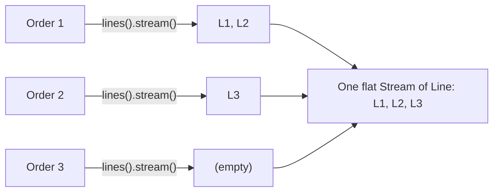
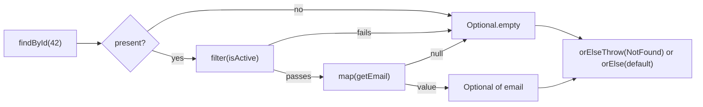
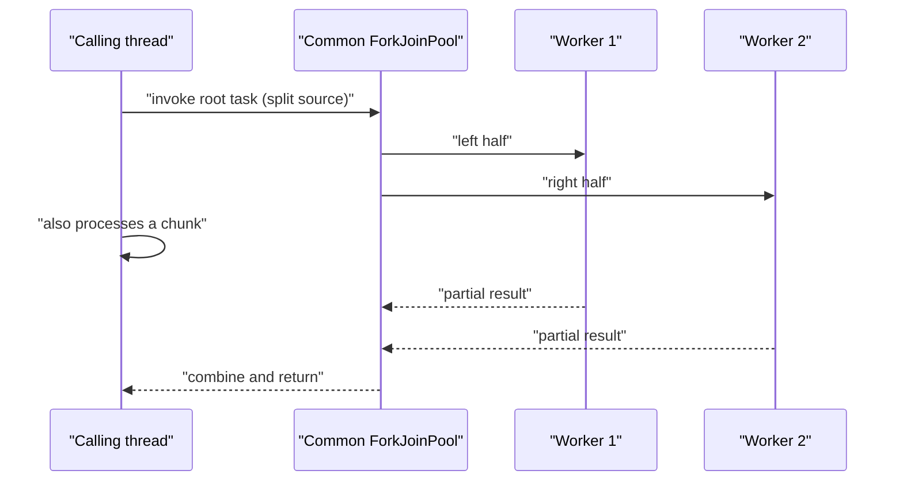

@@ 3 | TOPIC | flatMap and Reduce | Flattening nested data with flatMap and mapMulti, and folding a stream to one value with the three forms of reduce | MUST
# flatMap and Reduce

**Level: Intermediate | Phase 7 | Priority: MUST | Since: Java 8 (`mapMulti` Java 16, `Optional.stream` Java 9)**

> **30-second interview answer:** `map` turns each element into exactly one element; `flatMap` turns each element into a stream of zero or more elements and concatenates them into one flat stream, so a `Stream<Order>` whose orders each have a list of lines becomes a `Stream<OrderLine>` with `orders.stream().flatMap(o -> o.lines().stream())`. `reduce` folds all elements into a single value by repeatedly combining them: `reduce(identity, accumulator)` returns a value, `reduce(accumulator)` returns an `Optional` because the stream may be empty, and `reduce(identity, accumulator, combiner)` lets the result type differ from the element type and is used for parallel streams. The identity must be a neutral element and the operation associative.

## 1. Concept in Simple Words
### Analogy
Unpacking delivery boxes and counting money.

| Real life | Stream |
|---|---|
| A truck of boxes; each box holds several items | `Stream<Order>`, each with `List<OrderLine>` |
| Labelling each box with its weight: one label per box | `map`: one output per input |
| Opening every box and putting all items on one conveyor belt | `flatMap`: many outputs per input, flattened |
| An empty box adds nothing to the belt | `flatMap` to an empty stream drops the element |
| A cashier adding banknotes one by one into a running total | `reduce` with an accumulator |
| Starting the count at zero | The identity value |
| Two cashiers each count half, then add their totals | The combiner in parallel reduction |

### What it is
- **`flatMap(Function<T, Stream<R>>)`:** for each element, produce a stream; all those streams are concatenated in order. Primitive versions: `flatMapToInt`, and `IntStream.flatMap`.
- **`mapMulti(BiConsumer<T, Consumer<R>>)`** (Java 16): an imperative alternative: push zero or more results into the consumer. Cheaper than creating a small stream per element.
- **`Optional.stream()`** (Java 9): turns an `Optional` into a stream of zero or one element, so `flatMap(Optional::stream)` drops empty optionals.
- **`reduce(T identity, BinaryOperator<T> acc)`:** start from identity, combine each element. Returns `T` (identity on empty streams).
- **`reduce(BinaryOperator<T> acc)`:** no identity; returns `Optional<T>`, empty for an empty stream.
- **`reduce(U identity, BiFunction<U, ? super T, U> acc, BinaryOperator<U> combiner)`:** result type `U` can differ from `T`; the combiner merges partial results from parallel chunks.
- **Identity:** a value `i` such that `op(i, x) == x` for every x: 0 for addition, 1 for multiplication, `""` for concatenation, `BigDecimal.ZERO` for money sums.
- **Associativity:** `op(op(a, b), c) == op(a, op(b, c))`. Required so that parallel chunks can be combined in any grouping. Subtraction and averaging are not associative.

### Why it exists
Real data is nested: orders have lines, customers have addresses, sentences have words. Without `flatMap` you write nested loops that add into a shared list. And many results are "fold everything into one": total, max, product, concatenation. `reduce` is the general building block (`sum`, `max`, `count` are specialized reductions), and its strict contract (identity plus associativity) is what makes parallel execution correct.

## 2. How It Works
```text
map vs flatMap on orders with lines

orders:       [ O1{lines: L1, L2} , O2{lines: L3} , O3{lines: } ]

map(o -> o.lines())             -> Stream<List<Line>>  [ [L1, L2], [L3], [] ]      nested
flatMap(o -> o.lines().stream()) -> Stream<Line>        [ L1, L2, L3 ]              flat
```



**How reduce folds (sequential):**
```text
Stream: 3, 5, 2       reduce(0, Integer::sum)
  acc = 0 (identity)
  acc = 0 + 3 = 3
  acc = 3 + 5 = 8
  acc = 8 + 2 = 10    -> 10
```

**Parallel reduce with combiner:**
```text
Stream of words: "a", "bb", "ccc", "dddd"    reduce(0, (len, w) -> len + w.length(), Integer::sum)

thread 1: chunk ["a", "bb"]     0 + 1 = 1, 1 + 2 = 3
thread 2: chunk ["ccc", "dddd"] 0 + 3 = 3, 3 + 4 = 7
combiner: 3 + 7 = 10

Identity is used once PER CHUNK: a non-neutral identity (e.g. 10) would be added once per chunk,
giving different answers sequentially (20) and in parallel (30 with two chunks).
```

**reduce vs collect:** `reduce` is for immutable values (numbers, `BigDecimal`, `String` fragments): each step returns a new value. `collect` is mutable reduction: it accumulates into a container (`ArrayList`, `StringBuilder`, `HashMap`). Using `reduce` to build a list creates a new list per element (quadratic) or, if you mutate the identity, corrupts parallel results.

## 3. Code Example
### Code
```java
import java.math.BigDecimal;
import java.util.Arrays;
import java.util.List;
import java.util.Map;
import java.util.Optional;
import java.util.TreeMap;
import java.util.function.Function;
import java.util.stream.Collectors;
import java.util.stream.Stream;

public class FlatMapReduceDemo {

    record Line(String sku, int qty, BigDecimal unitPrice) {
        BigDecimal subtotal() { return unitPrice.multiply(BigDecimal.valueOf(qty)); }
    }
    record Order(long id, String customer, List<Line> lines, List<String> tags) { }

    static Optional<String> lookupEmail(String customer) {
        return customer.equals("bob") ? Optional.empty() : Optional.of(customer + "@example.com");
    }

    public static void main(String[] args) {
        List<Order> orders = List.of(
                new Order(1, "ana", List.of(new Line("PEN", 3, new BigDecimal("1.50")), new Line("BOOK", 1, new BigDecimal("12.00"))), List.of("gift", "express")),
                new Order(2, "bob", List.of(new Line("PEN", 10, new BigDecimal("1.50"))), List.of("bulk")),
                new Order(3, "cara", List.of(), List.of("express")));

        // 1. map gives nested lists; flatMap flattens
        List<List<Line>> nested = orders.stream().map(Order::lines).toList();
        List<Line> allLines = orders.stream().flatMap(o -> o.lines().stream()).toList();
        System.out.println("nested size " + nested.size() + ", flat size " + allLines.size());

        // 2. flatMap + groupingBy: units sold per SKU
        Map<String, Integer> unitsPerSku = orders.stream()
                .flatMap(o -> o.lines().stream())
                .collect(Collectors.groupingBy(Line::sku, TreeMap::new, Collectors.summingInt(Line::qty)));
        System.out.println("units per sku: " + unitsPerSku);

        // 3. Distinct tags across all orders
        System.out.println("tags: " + orders.stream().flatMap(o -> o.tags().stream()).distinct().sorted().toList());

        // 4. Words from sentences
        List<String> sentences = List.of("fast delivery", "great price fast");
        System.out.println("words: " + sentences.stream().flatMap(s -> Arrays.stream(s.split(" "))).distinct().toList());

        // 5. flatMap(Optional::stream) drops empties
        System.out.println("emails: " + orders.stream().map(Order::customer)
                .map(FlatMapReduceDemo::lookupEmail).flatMap(Optional::stream).toList());

        // 6. mapMulti (Java 16): emit one entry per unit for small quantities only
        List<String> labels = allLines.stream()
                .<String>mapMulti((line, sink) -> {
                    if (line.qty() <= 3) {
                        for (int i = 1; i <= line.qty(); i++) sink.accept(line.sku() + "#" + i);
                    }
                })
                .toList();
        System.out.println("labels: " + labels);

        // 7. reduce with identity: grand total as BigDecimal
        BigDecimal grandTotal = allLines.stream().map(Line::subtotal).reduce(BigDecimal.ZERO, BigDecimal::add);
        System.out.println("grand total: " + grandTotal);

        // 8. reduce without identity returns Optional
        Optional<Line> biggestLine = allLines.stream().reduce((a, b) -> a.subtotal().compareTo(b.subtotal()) >= 0 ? a : b);
        Optional<Integer> emptyMax = Stream.<Integer>empty().reduce(Integer::max);
        System.out.println("biggest line: " + biggestLine.map(Line::sku).orElse("none") + ", empty: " + emptyMax);

        // 9. Three-argument reduce: different result type (total characters of SKUs)
        int skuChars = allLines.stream().reduce(0, (sum, line) -> sum + line.sku().length(), Integer::sum);
        System.out.println("sku chars: " + skuChars);

        // 10. Wrong identity breaks parallel results
        int seq = Stream.of(1, 2, 3, 4).reduce(10, Integer::sum);
        int par = List.of(1, 2, 3, 4).parallelStream().reduce(10, Integer::sum);
        System.out.println("identity 10 sequential: " + seq + ", parallel: " + par + " (differs!)");

        // 11. Non-associative operation: subtraction
        int seqMinus = Stream.of(1, 2, 3, 4).reduce(0, (a, b) -> a - b);
        System.out.println("subtraction sequential: " + seqMinus + " (parallel result would be unpredictable)");

        // 12. Function composition by reduce
        Function<BigDecimal, BigDecimal> pipeline = Stream.<Function<BigDecimal, BigDecimal>>of(
                        x -> x.multiply(new BigDecimal("0.9")),
                        x -> x.add(new BigDecimal("5")))
                .reduce(Function.identity(), Function::andThen);
        System.out.println("pipeline(100): " + pipeline.apply(new BigDecimal("100")));
    }
}
```

### Walkthrough
- Example 1: `map(Order::lines)` produces a stream of lists (3 elements), `flatMap` produces a stream of lines (3 lines in total: two from order 1, one from order 2, none from order 3).
- Example 2 is the most common interview pattern: flatten, then group and aggregate. PEN appears in two orders (3 + 10).
- Examples 3 and 4 flatten tags and words; `distinct` removes duplicates after flattening.
- Example 5: `lookupEmail` returns `Optional`; `flatMap(Optional::stream)` keeps only present values, so Bob disappears.
- Example 6: `mapMulti` pushes several values per element without allocating a stream for each one. The explicit type witness `<String>` is often needed because the compiler cannot infer the output type.
- Example 7: summing `BigDecimal` with identity `BigDecimal.ZERO` and accumulator `BigDecimal::add`. Total = 4.50 + 12.00 + 15.00 = 31.50.
- Example 8: `reduce` without identity returns `Optional`, empty for an empty stream.
- Example 9: the three-argument form maps lines to an `int` result; the combiner `Integer::sum` is only used in parallel.
- Example 10: identity 10 is not neutral for addition. Sequentially it is added once (20); in parallel it is added once per chunk. With four elements the common fork-join split gives four leaf chunks, so the result is 50, but it depends on how the stream is split, which is exactly the bug.
- Example 11: subtraction is not associative; sequentially ((((0-1)-2)-3)-4) = -10, but parallel grouping would give other answers.
- Example 12: `reduce(Function.identity(), Function::andThen)` composes a list of functions into one.

### Output
```text
nested size 3, flat size 3
units per sku: {BOOK=1, PEN=13}
tags: [bulk, express, gift]
words: [fast, delivery, great, price]
emails: [ana@example.com, cara@example.com]
labels: [PEN#1, PEN#2, PEN#3, BOOK#1]
grand total: 31.50
biggest line: PEN, empty: Optional.empty
sku chars: 10
identity 10 sequential: 20, parallel: 50 (differs!)
subtraction sequential: -10 (parallel result would be unpredictable)
pipeline(100): 95.0
```

### Compare
| Need | Use | Not |
|---|---|---|
| One output per element | `map` | `flatMap` with single-element streams |
| Zero or more outputs per element | `flatMap` or `mapMulti` | Nested loops adding to a shared list |
| Sum of ints | `mapToInt(...).sum()` | `reduce(0, Integer::sum)` on boxed values |
| Sum of `BigDecimal` | `reduce(BigDecimal.ZERO, BigDecimal::add)` | `double` arithmetic |
| Build a list or map | `collect` | `reduce` with a mutable identity |
| Max or min | `max(comparator)` | Hand-written `reduce` (fine, but less clear) |

## 4. Interview Questions
**Basic**
1. **What is the difference between `map` and `flatMap`?**
   `map` applies a function that returns one value per element, so the stream keeps its size. `flatMap` applies a function that returns a stream per element and concatenates all of them into one stream, so nested structures such as lists of lists become flat.
2. **What does `reduce` do?**
   It combines all elements into a single result by repeatedly applying a binary operation, starting from an identity if given. Examples: sum, product, maximum, string concatenation, or composing functions.
3. **Why does `reduce(BinaryOperator)` return an `Optional`?**
   Without an identity there is nothing to return for an empty stream, so the result is `Optional.empty()`. With an identity, the identity is returned for an empty stream.

**Follow-up**
4. **What requirements must the reduce operation and identity meet?**
   The identity must be neutral (`op(identity, x) == x`), and the accumulator must be associative and stateless. Otherwise sequential and parallel results differ, because parallel streams apply the identity once per chunk and combine chunks in any grouping.
5. **When do you need the three-argument `reduce`?**
   When the result type differs from the element type, such as summing a property of objects into an `int`, and in parallel streams the combiner merges partial results. In practice `map` plus a two-argument `reduce`, or a collector, is often clearer.
6. **What is the difference between `reduce` and `collect`?**
   `reduce` is immutable reduction: each step creates a new value, good for numbers and `BigDecimal`. `collect` is mutable reduction into a container like a list, map or `StringBuilder`, which is efficient and safe in parallel because each thread has its own container.

**Tricky / scenario**
7. **What is wrong with `stream.reduce(new ArrayList<>(), (list, x) -> { list.add(x); return list; }, (a, b) -> { a.addAll(b); return a; })`?**
   It mutates the identity. In a parallel stream all chunks share the same identity list, so elements are added concurrently to one `ArrayList` (corruption) and then combined with themselves (duplicates). Use `collect(Collectors.toList())` or `toList()`.
8. **How do you get all distinct products ordered by any customer, given `List<Customer>` where each has `List<Order>` and each order has `List<Line>`?**
   Chain `flatMap`: `customers.stream().flatMap(c -> c.orders().stream()).flatMap(o -> o.lines().stream()).map(Line::sku).distinct().toList()`. Each `flatMap` removes one level of nesting.
9. **Why is summing money with `reduce(0.0, Double::sum)` a bug, and what does parallelism add to it?**
   `double` cannot represent decimal amounts exactly, so cents drift. Floating-point addition is also not strictly associative, so a parallel stream can produce slightly different totals each run. Use `BigDecimal` with `reduce(BigDecimal.ZERO, BigDecimal::add)` or sum integer cents.

**What the interviewer is really testing:** whether you can flatten nested domain data fluently and understand the identity and associativity contract that makes reduction correct, especially in parallel.

## 5. Pitfalls & Best Practices
### Common mistakes
| Mistake | What goes wrong | Fix |
|---|---|---|
| Using `map` where `flatMap` is needed | `Stream<List<T>>` instead of `Stream<T>` | `flatMap(list -> list.stream())` or `flatMap(List::stream)` |
| Non-neutral identity in `reduce` | Wrong results, different in parallel | Use the true identity (0, 1, ZERO, empty string) |
| Non-associative accumulator (subtraction, average) | Parallel results unpredictable | Restructure (sum and count, then divide) or use collectors |
| Building collections with `reduce` | Quadratic copying or corrupted shared state | Use `collect` |
| `flatMap` returning null | `NullPointerException` | Return `Stream.empty()` |

### Best practices
- Use `flatMap(Collection::stream)` style method references: `orders.stream().map(Order::lines).flatMap(List::stream)`.
- Prefer specialized reductions (`sum`, `max`, `count`, `Collectors.summingInt`) over hand-written `reduce` when they exist.
- Use `reduce(BigDecimal.ZERO, BigDecimal::add)` for money; never `double`.
- Consider `mapMulti` in hot paths that would otherwise create many tiny streams.
- In JPA code, remember that flattening lazy collections in a stream triggers loading per entity (the N+1 problem in Phase 12); fetch them with a join first.

### Compare with
| Operation | Input to output | Result |
|---|---|---|
| `map` | 1 to 1 | `Stream<R>` |
| `flatMap` | 1 to 0..n (as streams) | `Stream<R>` |
| `mapMulti` | 1 to 0..n (pushed to a consumer) | `Stream<R>` |
| `reduce` | n to 1 (immutable) | `T`, `Optional<T>` or `U` |
| `collect` | n to 1 (mutable container) | Any container |

## 6. Hands-on Exercise
OrderHub customers have orders, and orders have lines. Given `List<Customer>` (`Customer(String name, List<Order> orders)`, `Order(long id, List<Line> lines)`, `Line(String sku, int qty, BigDecimal unitPrice)`), compute:
1. The total revenue across all customers as `BigDecimal` with `reduce`.
2. The set of SKUs each customer bought, as a `TreeMap<String, Set<String>>`.
3. The single most expensive line across everything, as `Optional<Line>`, using `reduce` without identity.
4. The total quantity per SKU, using `flatMap` twice.

Acceptance criteria: no nested `for` loops; money in `BigDecimal`; deterministic output order.

<details><summary>Solution</summary>

```java
import java.math.BigDecimal;
import java.util.List;
import java.util.Map;
import java.util.Optional;
import java.util.Set;
import java.util.TreeMap;
import java.util.TreeSet;
import java.util.stream.Collectors;

public class NestedOrders {
    record Line(String sku, int qty, BigDecimal unitPrice) {
        BigDecimal subtotal() { return unitPrice.multiply(BigDecimal.valueOf(qty)); }
    }
    record Order(long id, List<Line> lines) { }
    record Customer(String name, List<Order> orders) { }

    public static void main(String[] args) {
        List<Customer> customers = List.of(
                new Customer("ana", List.of(
                        new Order(1, List.of(new Line("PEN", 2, new BigDecimal("1.50")), new Line("LAMP", 1, new BigDecimal("35.00")))),
                        new Order(2, List.of(new Line("PEN", 5, new BigDecimal("1.50")))))),
                new Customer("bob", List.of(
                        new Order(3, List.of(new Line("DESK", 1, new BigDecimal("199.00")))))),
                new Customer("cara", List.of()));

        BigDecimal revenue = customers.stream()
                .flatMap(c -> c.orders().stream())
                .flatMap(o -> o.lines().stream())
                .map(Line::subtotal)
                .reduce(BigDecimal.ZERO, BigDecimal::add);
        System.out.println("revenue: " + revenue);

        Map<String, Set<String>> skusByCustomer = customers.stream()
                .collect(Collectors.toMap(
                        Customer::name,
                        c -> c.orders().stream().flatMap(o -> o.lines().stream()).map(Line::sku)
                                .collect(Collectors.toCollection(TreeSet::new)),
                        (a, b) -> a,
                        TreeMap::new));
        System.out.println("skus by customer: " + skusByCustomer);

        Optional<Line> priciest = customers.stream()
                .flatMap(c -> c.orders().stream())
                .flatMap(o -> o.lines().stream())
                .reduce((a, b) -> a.subtotal().compareTo(b.subtotal()) >= 0 ? a : b);
        System.out.println("priciest line: " + priciest.map(Line::sku).orElse("none"));

        Map<String, Integer> qtyPerSku = customers.stream()
                .flatMap(c -> c.orders().stream())
                .flatMap(o -> o.lines().stream())
                .collect(Collectors.groupingBy(Line::sku, TreeMap::new, Collectors.summingInt(Line::qty)));
        System.out.println("qty per sku: " + qtyPerSku);
    }
}
```
Output:
```text
revenue: 244.50
skus by customer: {ana=[LAMP, PEN], bob=[DESK], cara=[]}
priciest line: DESK
qty per sku: {DESK=1, LAMP=1, PEN=7}
```
Revenue = 3.00 + 35.00 + 7.50 + 199.00 = 244.50. Cara has no orders but still appears with an empty set, because the outer stream is over customers, not lines.
</details>

## 7. Recall
Q: What is the difference between `map` and `flatMap` in Java streams?
A: `map` produces one element per input; `flatMap` produces a stream per input and concatenates them into one flat stream.

Q: Why does `Stream.reduce(BinaryOperator)` return an `Optional`?
A: Without an identity there is no result for an empty stream, so it returns `Optional.empty()`.

Q: What two properties must a stream `reduce` identity and operation have?
A: The identity must be neutral for the operation, and the operation must be associative (and stateless).

Q: When is the combiner of the three-argument `reduce` used?
A: To merge partial results from different chunks of a parallel stream; it also allows the result type to differ from the element type.

Q: How do you drop empty Optionals from a stream?
A: `flatMap(Optional::stream)` (Java 9).

Q: Why should you not build a list with `reduce`?
A: `reduce` is for immutable values; building collections needs mutable reduction with `collect`, otherwise you copy repeatedly or corrupt shared state in parallel.

**Related:** [[Intermediate and Terminal Operations]] · [[Collectors: groupingBy, partitioningBy, toMap]] · [[Parallel Streams and Their Traps]] · [[BigDecimal and Money]]

@@ 3 | TOPIC | Optional Done Right | What Optional is for, creating and unwrapping it, orElse vs orElseGet, map and flatMap, and the anti-patterns | MUST
# Optional Done Right

**Level: Intermediate | Phase 7 | Priority: MUST | Since: Java 8 (`or`, `ifPresentOrElse`, `stream` Java 9; `orElseThrow()` Java 10; `isEmpty` Java 11)**

> **30-second interview answer:** `Optional<T>` is a container that holds either one non-null value or nothing. It is meant as a return type for methods that may legitimately have no result, like `findById`, so callers are forced to handle the empty case instead of getting a surprise `NullPointerException`. You create it with `Optional.of`, `ofNullable` or `empty`, transform it with `map`, `flatMap` and `filter`, and unwrap it with `orElse`, `orElseGet`, `orElseThrow` or `ifPresentOrElse`. Don't call `get()` without checking, don't use `Optional` for fields, parameters or collections, and remember `orElse` always evaluates its argument while `orElseGet` is lazy.

## 1. Concept in Simple Words
### Analogy
A gift box that might be empty.

| Gift box | Optional |
|---|---|
| A box that either contains one present or is visibly empty | `Optional.of(value)` or `Optional.empty()` |
| The label on the box says "may be empty", so you check before celebrating | Return type `Optional<Order>` forces the caller to handle absence |
| "If there is a toy, wrap it in paper" without opening an empty box | `map` |
| "If empty, take the spare present from the cupboard" | `orElse(spare)` |
| "If empty, go to the shop and buy one" (only go if needed) | `orElseGet(() -> buy())` |
| "If empty, complain to the sender" | `orElseThrow(() -> new NotFoundException())` |
| Tearing the box open and shouting when it is empty | `get()` on an empty Optional: `NoSuchElementException` |
| Putting a box inside a box | `Optional<Optional<T>>`, fixed by `flatMap` |

### What it is
**Creating:**
- `Optional.of(value)`: value must not be null (throws `NullPointerException`).
- `Optional.ofNullable(value)`: empty if value is null.
- `Optional.empty()`: an empty Optional (a singleton).

**Transforming (return a new Optional):**
- `map(fn)`: apply fn if present; if fn returns null, the result is empty.
- `flatMap(fn)`: fn returns an `Optional`; avoids nesting.
- `filter(pred)`: keep the value only if it matches.
- `or(supplier)` (Java 9): if empty, use another `Optional` from the supplier.

**Unwrapping:**
| Method | When empty | Notes |
|---|---|---|
| `orElse(other)` | returns `other` | `other` is always evaluated |
| `orElseGet(supplier)` | calls supplier | Lazy, use for expensive defaults |
| `orElseThrow()` (Java 10) | `NoSuchElementException` | Same as `get()` but honest name |
| `orElseThrow(exceptionSupplier)` | throws your exception | The standard for "not found" |
| `ifPresent(consumer)` | does nothing | |
| `ifPresentOrElse(consumer, runnable)` (Java 9) | runs the runnable | |
| `get()` | `NoSuchElementException` | Avoid; discouraged in favour of `orElseThrow()` |
| `isPresent()`, `isEmpty()` (Java 11) | boolean | Prefer functional methods over `if (isPresent()) get()` |
| `stream()` (Java 9) | empty stream | For `flatMap(Optional::stream)` |

**Primitive versions:** `OptionalInt`, `OptionalLong`, `OptionalDouble` (returned by `IntStream.max()`, `average()`), with `getAsInt()` and `orElse`, but no `map` or `filter`.

### Why it exists
Tony Hoare called null references his "billion-dollar mistake". A method returning `Order` might return null, and nothing in the signature warns the caller. Java 8 added `Optional` (inspired by Guava and functional languages) specifically for stream results such as `findFirst` and `max`, where "no result" is normal. Brian Goetz, Java's language architect, described its intended use as "a limited mechanism for library method return types where there needed to be a clear way to represent 'no result'".

## 2. How It Works
```text
Optional<String> email = customerRepo.findById(id)      Optional<Customer>
        .filter(Customer::isActive)                      empty if inactive
        .map(Customer::getEmail)                         empty if email is null
        .map(String::toLowerCase);                       empty stays empty

Each step on an EMPTY Optional returns empty immediately, without calling the lambda:
Optional.empty().map(f) -> Optional.empty()    f never called
Like a chain of "if not null" checks, without the nesting.
```



**orElse vs orElseGet, the classic trap:**
```text
order.orElse(createDefaultOrder())        createDefaultOrder() runs ALWAYS (argument evaluated before the call)
order.orElseGet(() -> createDefaultOrder())  runs only if empty
```
If the default is a constant, `orElse` is fine. If it calls a database, creates objects or has side effects (like saving a new entity), `orElseGet` is mandatory.

**Memory and identity:** `Optional` is a regular object (an extra allocation per call; the JIT can often remove it by escape analysis). It is a value-based class: do not use `==`, synchronize on it, or rely on its identity. It is not `Serializable`, which is one reason not to use it for fields.

**Where Optional appears in Spring:**
```text
Spring Data:   Optional<Order> findById(Long id)          (CrudRepository)
               Optional<Order> findByNumber(String n)       (derived query, you choose Optional return)
Spring MVC:    @RequestParam Optional<String> sort         (supported, though @RequestParam(required = false) is more common)
               ResponseEntity.of(optional)                 -> 200 with body, or 404 when empty
Config:        ObjectProvider.getIfAvailable()             returns null, not Optional
```

## 3. Code Example
### Code
```java
import java.math.BigDecimal;
import java.util.List;
import java.util.Map;
import java.util.NoSuchElementException;
import java.util.Optional;

public class OptionalDemo {

    record Address(String city, String zip) { }
    record Customer(long id, String name, String email, Address address, boolean active) { }
    record Order(long id, long customerId, BigDecimal total) { }

    static class OrderNotFoundException extends RuntimeException {
        OrderNotFoundException(long id) { super("Order " + id + " not found"); }
    }

    static final Map<Long, Customer> CUSTOMERS = Map.of(
            1L, new Customer(1, "Ana", "ANA@EXAMPLE.COM", new Address("Berlin", "10115"), true),
            2L, new Customer(2, "Bob", null, null, true),
            3L, new Customer(3, "Cara", "cara@example.com", new Address("Paris", "75001"), false));

    static final Map<Long, Order> ORDERS = Map.of(
            10L, new Order(10, 1, new BigDecimal("99.90")),
            11L, new Order(11, 2, new BigDecimal("15.00")));

    // Repository-style methods return Optional
    static Optional<Customer> findCustomer(long id) { return Optional.ofNullable(CUSTOMERS.get(id)); }
    static Optional<Order> findOrder(long id) { return Optional.ofNullable(ORDERS.get(id)); }

    static int defaultsCreated = 0;
    static String expensiveDefault() { defaultsCreated++; return "guest@example.com"; }

    public static void main(String[] args) {
        // 1. map chain: each step may produce empty
        Optional<String> email = findCustomer(1).filter(Customer::active).map(Customer::email).map(String::toLowerCase);
        System.out.println("email 1: " + email.orElse("none"));
        System.out.println("email 2: " + findCustomer(2).map(Customer::email).orElse("none"));       // null email
        System.out.println("email 3: " + findCustomer(3).filter(Customer::active).map(Customer::email).orElse("inactive"));

        // 2. Deep navigation without null checks
        String city = findCustomer(2).map(Customer::address).map(Address::city).orElse("unknown city");
        System.out.println("city of 2: " + city);

        // 3. flatMap: the function itself returns Optional
        Optional<Customer> customerOfOrder = findOrder(10).flatMap(o -> findCustomer(o.customerId()));
        Optional<Optional<Customer>> nested = findOrder(10).map(o -> findCustomer(o.customerId()));
        System.out.println("customer of order 10: " + customerOfOrder.map(Customer::name).orElseThrow()
                + ", nested type is clumsy: " + nested.isPresent());

        // 4. orElseThrow with a domain exception (the Spring service pattern)
        try {
            Order missing = findOrder(99).orElseThrow(() -> new OrderNotFoundException(99));
            System.out.println(missing);
        } catch (OrderNotFoundException e) {
            System.out.println("caught: " + e.getMessage());
        }

        // 5. orElse evaluates eagerly, orElseGet lazily
        defaultsCreated = 0;
        findCustomer(1).map(Customer::email).orElse(expensiveDefault());
        System.out.println("orElse on present value still created defaults: " + defaultsCreated);
        defaultsCreated = 0;
        findCustomer(1).map(Customer::email).orElseGet(OptionalDemo::expensiveDefault);
        System.out.println("orElseGet on present value created defaults: " + defaultsCreated);

        // 6. ifPresentOrElse and or (Java 9)
        findCustomer(42).ifPresentOrElse(
                c -> System.out.println("found " + c.name()),
                () -> System.out.println("customer 42 missing, creating lead"));
        Customer fallback = findCustomer(42).or(() -> findCustomer(1)).orElseThrow();
        System.out.println("fallback customer: " + fallback.name());

        // 7. get() on empty throws
        try {
            findCustomer(42).get();
        } catch (NoSuchElementException e) {
            System.out.println("get() on empty: " + e.getMessage());
        }

        // 8. of(null) throws immediately; ofNullable does not
        try {
            Optional.of(CUSTOMERS.get(42L));
        } catch (NullPointerException e) {
            System.out.println("Optional.of(null) throws NPE");
        }

        // 9. Optional in streams: drop empties
        List<String> knownEmails = List.of(1L, 2L, 3L, 4L).stream()
                .map(OptionalDemo::findCustomer)
                .flatMap(Optional::stream)
                .map(Customer::email)
                .filter(e -> e != null)
                .toList();
        System.out.println("known emails: " + knownEmails);
    }
}
```

### Walkthrough
- Example 1 chains `filter` and `map`. Customer 2 has a null email: `map` turns the null into an empty Optional, so `orElse("none")` applies. Customer 3 is inactive, so `filter` empties it.
- Example 2 navigates `customer.address.city` safely; Bob has no address.
- Example 3 contrasts `flatMap` (gives `Optional<Customer>`) with `map` (gives the awkward `Optional<Optional<Customer>>`), because `findCustomer` already returns an `Optional`.
- Example 4 is the standard Spring service idiom: `repository.findById(id).orElseThrow(() -> new OrderNotFoundException(id))`, later mapped to a 404 by a `@RestControllerAdvice` (Phase 11).
- Example 5 proves `orElse` evaluates its argument even when the value is present (counter 1), while `orElseGet` does not (counter 0).
- Example 6: `ifPresentOrElse` handles both branches; `or` supplies an alternative `Optional`.
- Examples 7 and 8: `get()` on empty throws `NoSuchElementException("No value present")`, and `Optional.of(null)` throws `NullPointerException` right away.
- Example 9: `flatMap(Optional::stream)` drops the missing customer 4.

### Output
```text
email 1: ana@example.com
email 2: none
email 3: inactive
city of 2: unknown city
customer of order 10: Ana, nested type is clumsy: true
caught: Order 99 not found
orElse on present value still created defaults: 1
orElseGet on present value created defaults: 0
customer 42 missing, creating lead
fallback customer: Ana
get() on empty: No value present
Optional.of(null) throws NPE
known emails: [ANA@EXAMPLE.COM, cara@example.com]
```

### Compare
| Null checks | Optional |
|---|---|
| `Customer c = repo.find(id); if (c != null && c.getAddress() != null) { city = c.getAddress().getCity(); } else { city = "unknown"; }` | `repo.findById(id).map(Customer::address).map(Address::city).orElse("unknown")` |
| Nothing in the signature warns about null | `Optional<Customer>` in the signature documents absence |
| `if (o != null) return o; else throw new NotFound()` | `orElseThrow(NotFound::new)` |

## 4. Interview Questions
**Basic**
1. **What is `Optional` and why was it introduced?**
   A container that holds either a non-null value or nothing. It was introduced in Java 8 as a return type for methods that may have no result (like `findFirst` and `findById`), making absence explicit in the API and pushing callers to handle it instead of risking `NullPointerException`.
2. **What is the difference between `Optional.of` and `Optional.ofNullable`?**
   `of` requires a non-null value and throws `NullPointerException` immediately if given null; use it when null would be a bug. `ofNullable` returns an empty Optional for null; use it to wrap values that may legitimately be null, like results of legacy APIs or `Map.get`.
3. **What is the difference between `orElse` and `orElseGet`?**
   `orElse(value)` always evaluates its argument, even if the Optional is present. `orElseGet(supplier)` calls the supplier only when empty. Use `orElseGet` whenever the default is expensive or has side effects.

**Follow-up**
4. **When do you use `map` vs `flatMap` on an Optional?**
   `map` when the function returns a plain value (which may be null; null becomes empty). `flatMap` when the function itself returns an `Optional`, to avoid `Optional<Optional<T>>`. The same logic as streams.
5. **Why should you not use `Optional` for fields or method parameters?**
   It was designed for return types. As a field it adds an allocation, is not `Serializable`, and does not work well with JPA or many frameworks. As a parameter it forces callers to wrap values and still allows passing `null` for the Optional itself; overloads or nullable parameters with validation are clearer.
6. **Why is calling `get()` considered bad?**
   It throws `NoSuchElementException` when empty, so `if (opt.isPresent()) opt.get()` is just a verbose null check, and an unguarded `get()` is a hidden crash. Use `orElseThrow` with a meaningful exception, `orElse`, `map` or `ifPresent`. Java 10 added `orElseThrow()` as an honestly named replacement.

**Tricky / scenario**
7. **What is wrong with `return userRepository.findByEmail(email).orElse(userRepository.save(new User(email)));`?**
   `orElse` evaluates its argument eagerly, so a new user is saved even when one already exists, causing duplicates or a unique constraint violation. Use `orElseGet(() -> userRepository.save(new User(email)))`.
8. **Should a method returning a collection return `Optional<List<T>>`?**
   No. Return an empty list for "no results". `Optional<List<T>>` creates two ways to say nothing (empty Optional and empty list) and forces callers to unwrap twice.
9. **Can an `Optional` variable itself be null?**
   Technically yes, and that defeats its purpose: callers would need to null-check the Optional. A method returning `Optional` must never return null; return `Optional.empty()`.

**What the interviewer is really testing:** whether you use `Optional` as intended (return types, functional unwrapping, `orElseThrow` for not-found) and recognize the anti-patterns, especially the `orElse` eager-evaluation trap.

## 5. Pitfalls & Best Practices
### Common mistakes
| Mistake | What goes wrong | Fix |
|---|---|---|
| `opt.get()` without a check | `NoSuchElementException` | `orElseThrow(...)`, `orElse`, `map` |
| `orElse(expensiveCall())` | Call always runs, side effects happen | `orElseGet(() -> expensiveCall())` |
| `Optional` fields in entities or DTOs | Not serializable, framework problems | Nullable field plus an `Optional` getter if needed |
| `Optional<List<T>>` | Two kinds of empty | Return an empty list |
| Returning `null` from an `Optional` method | `NullPointerException` in callers | Return `Optional.empty()` |
| `if (opt.isPresent()) { x = opt.get(); }` | Verbose null check | `opt.ifPresent(...)` or `opt.map(...).orElse(...)` |

### Best practices
- Use `Optional` as a return type for single results that may be absent: `Optional<Order> findById(Long id)`.
- In services, convert absence into a domain exception right away: `orElseThrow(() -> new OrderNotFoundException(id))`.
- Use `ResponseEntity.of(optional)` in controllers for a quick 200-or-404.
- Use `OptionalInt` and friends for primitive results.
- Do not use Optional in hot inner loops if allocation matters, and never for collections, fields, parameters, or map values.

### Compare with
| Approach | Absence visible in type | Compiler help | Typical use |
|---|---|---|---|
| Return `null` | No | None | Legacy APIs, `Map.get` |
| `Optional<T>` | Yes | Forces unwrapping | Return values that may be absent |
| Empty collection | Yes (size 0) | Natural iteration | Multi-valued results |
| Throw exception | Yes (if documented) | None for unchecked | Absence is an error, not a normal case |
| Null-safety annotations (`@Nullable`, JSpecify) | Yes | Static analysis tools | Fields and parameters (Spring 7 uses JSpecify, `Boot 4`) |

## 6. Hands-on Exercise
Refactor this null-heavy OrderHub service method to use `Optional` with no `get()` and no `isPresent()`:

```java
String shippingLabel(long orderId) {
    Order order = orderRepo.find(orderId);           // may return null
    if (order == null) throw new IllegalArgumentException("no order " + orderId);
    Customer c = customerRepo.find(order.customerId()); // may return null
    if (c == null || c.address() == null) return "PICKUP AT STORE";
    String zip = c.address().zip();
    if (zip == null || zip.isBlank()) return "PICKUP AT STORE";
    return c.name().toUpperCase() + ", " + zip;
}
```

Acceptance criteria:
- Repositories return `Optional`.
- Missing order throws `OrderNotFoundException`.
- Same results for all cases.

<details><summary>Solution</summary>

```java
import java.util.Map;
import java.util.Optional;

public class ShippingLabels {
    record Address(String city, String zip) { }
    record Customer(long id, String name, Address address) { }
    record Order(long id, long customerId) { }

    static class OrderNotFoundException extends RuntimeException {
        OrderNotFoundException(long id) { super("no order " + id); }
    }

    static final Map<Long, Order> ORDERS = Map.of(1L, new Order(1, 10), 2L, new Order(2, 20), 3L, new Order(3, 99));
    static final Map<Long, Customer> CUSTOMERS = Map.of(
            10L, new Customer(10, "Ana", new Address("Berlin", "10115")),
            20L, new Customer(20, "Bob", new Address("Paris", " ")));

    static Optional<Order> findOrder(long id) { return Optional.ofNullable(ORDERS.get(id)); }
    static Optional<Customer> findCustomer(long id) { return Optional.ofNullable(CUSTOMERS.get(id)); }

    static String shippingLabel(long orderId) {
        Order order = findOrder(orderId).orElseThrow(() -> new OrderNotFoundException(orderId));
        Optional<Customer> customer = findCustomer(order.customerId());
        return customer
                .flatMap(c -> Optional.ofNullable(c.address())
                        .map(Address::zip)
                        .filter(zip -> !zip.isBlank())
                        .map(zip -> c.name().toUpperCase() + ", " + zip))
                .orElse("PICKUP AT STORE");
    }

    public static void main(String[] args) {
        System.out.println(shippingLabel(1));
        System.out.println(shippingLabel(2));
        System.out.println(shippingLabel(3));
        try {
            shippingLabel(4);
        } catch (OrderNotFoundException e) {
            System.out.println(e.getMessage());
        }
    }
}
```
Output:
```text
ANA, 10115
PICKUP AT STORE
PICKUP AT STORE
no order 4
```
`orElse` is fine here because the default is a constant string. The nested `flatMap` keeps access to `c` (the customer) while navigating to the zip code.
</details>

## 7. Recall
Q: What is Java's `Optional` intended for?
A: As a return type for methods that may have no result, making absence explicit instead of returning null.

Q: What is the difference between `Optional.orElse` and `orElseGet`?
A: `orElse` always evaluates its argument; `orElseGet` calls its supplier only when the Optional is empty.

Q: What does `Optional.of(null)` do?
A: It throws `NullPointerException` immediately; use `Optional.ofNullable` for values that may be null.

Q: When do you use `flatMap` instead of `map` on an Optional?
A: When the mapping function itself returns an `Optional`, to avoid `Optional<Optional<T>>`.

Q: Where should you not use `Optional`?
A: For fields, method parameters, collections or map values; return empty collections instead of `Optional<List<T>>`.

Q: What is the standard Spring service idiom for a missing entity with Optional?
A: `repository.findById(id).orElseThrow(() -> new NotFoundException(id))`.

**Related:** [[Intermediate and Terminal Operations]] · [[flatMap and Reduce]] · [[Repositories and Derived Queries]] · [[Global Exception Handling and ProblemDetail]]

@@ 3 | TOPIC | Parallel Streams and Their Traps | How parallel streams split work on the common ForkJoinPool, when they help, and the traps of shared state, ordering, blocking and small data | SHOULD
# Parallel Streams and Their Traps

**Level: Intermediate | Phase 7 | Priority: SHOULD | Since: Java 8**

> **30-second interview answer:** `parallelStream()` or `.parallel()` splits the source with its `Spliterator`, processes the chunks on the common `ForkJoinPool` (size: CPU cores minus one, plus the calling thread), and combines the partial results. It can speed up CPU-heavy work on large, easily splittable data like arrays and `ArrayList`. It is often slower for small data, `LinkedList` or `Stream.iterate` sources, ordered operations like `limit` and `findFirst`, and boxed values. The big traps are shared mutable state (race conditions), blocking I/O on the shared pool (starving everything else in the JVM), and relying on encounter order. In a web application, parallel streams are rarely the right tool.

## 1. Concept in Simple Words
### Analogy
Counting votes at an election.

| Election | Parallel stream |
|---|---|
| One clerk counting all ballots | A sequential stream |
| Splitting the ballot pile into stacks for several clerks | `Spliterator.trySplit` |
| The clerks are the town's shared pool of staff, also needed by other departments | The common `ForkJoinPool` |
| Each clerk counts their stack on their own tally sheet, then sheets are added | Partial results and the combiner |
| All clerks writing on one shared tally sheet at once | Shared mutable state: lost updates |
| Splitting is worthwhile for 100,000 ballots, silly for 10 | Overhead dominates small inputs |
| A clerk who leaves to make a phone call blocks a seat other departments needed | Blocking I/O in the common pool |
| Announcing results "in the order ballots were cast" forces waiting | Ordered operations cost extra |

### What it is
- **Parallel stream:** a stream whose operations may run on multiple threads. `collection.parallelStream()` or `stream.parallel()`; `sequential()` switches back (the last call wins for the whole pipeline).
- **Common ForkJoinPool:** a JVM-wide shared pool used by parallel streams and by `CompletableFuture` async methods without an executor. Default parallelism = `Runtime.getRuntime().availableProcessors() - 1`; the calling thread also takes part. Configurable with `-Djava.util.concurrent.ForkJoinPool.common.parallelism=N`.
- **Work stealing:** idle worker threads steal tasks from other workers' queues, balancing uneven chunks.
- **Splittability:** how cheaply a source splits in half. Excellent: arrays, `ArrayList`, `IntStream.range`. Good: `HashSet`, `HashMap` key sets, `TreeSet`. Poor: `LinkedList`, `Stream.iterate`, `BufferedReader.lines`, `Files.lines` (improved in newer JDKs but still limited).
- **Encounter order:** the order defined by the source. Ordered operations (`findFirst`, `limit`, `forEachOrdered`, `toList`) must preserve it, which costs coordination in parallel. `unordered()` relaxes it.
- **NQ model** (Brian Goetz's rule of thumb): parallelism pays off when N (number of elements) times Q (cost per element) is large, roughly above 10,000 simple operations' worth; measure to be sure.

### Why it exists
Multicore CPUs became standard around Java 8's design time, and Java wanted a way to use them for data processing without writing thread code. Because streams describe what to compute rather than how, the library can run the same pipeline in parallel by flipping one switch, using the fork/join framework from Java 7.

## 2. How It Works
```text
List of 8 elements, parallel().map(f).reduce(0, Integer::sum)

            [e1 e2 e3 e4 e5 e6 e7 e8]                trySplit
             /                     \
      [e1 e2 e3 e4]           [e5 e6 e7 e8]          trySplit again until chunks are small
       /        \               /        \
   [e1 e2]   [e3 e4]        [e5 e6]   [e7 e8]        leaf tasks run on worker threads
     |          |              |          |           map + reduce within the chunk
    r1         r2             r3         r4
      \        /                \        /
       r1 + r2                   r3 + r4             combiner
            \                     /
             (r1 + r2) + (r3 + r4)                   final result
```



**The traps:**
| Trap | Why it happens |
|---|---|
| Shared mutable state | Lambdas run on many threads; `list.add` into an `ArrayList` or `count++` races |
| Blocking I/O inside the pipeline | Common pool threads block; every other parallel stream and default `CompletableFuture` in the JVM waits |
| Small data | Splitting, scheduling and combining cost more than the work |
| Poorly splittable source | `LinkedList` must walk to split; `iterate` is inherently sequential |
| Ordered operations | `limit`, `findFirst`, `skip`, `sorted`, `forEachOrdered` must coordinate order |
| Boxing | `Stream<Integer>` allocates; use `IntStream` |
| Non-associative reduce or wrong identity | Results differ from sequential (previous topic) |
| Thread-local context | Spring's `SecurityContextHolder`, MDC logging context, and transaction-bound resources live in `ThreadLocal`s and are missing on pool threads |

**Running in a custom pool:** a known trick is `new ForkJoinPool(4).submit(() -> list.parallelStream()...).get()`; tasks forked from inside a ForkJoinPool worker stay in that pool. It isolates the work from the common pool, but it relies on an implementation detail; for I/O-bound work use an `ExecutorService` or virtual threads instead (Phase 9 and Phase 16).

## 3. Code Example
### Code
```java
import java.util.ArrayList;
import java.util.Collections;
import java.util.List;
import java.util.Set;
import java.util.concurrent.ConcurrentHashMap;
import java.util.concurrent.ForkJoinPool;
import java.util.stream.Collectors;
import java.util.stream.IntStream;

public class ParallelStreamsDemo {

    static boolean isPrime(int n) {
        if (n < 2) return false;
        for (int i = 2; (long) i * i <= n; i++) if (n % i == 0) return false;
        return true;
    }

    public static void main(String[] args) throws Exception {
        System.out.println("common pool parallelism > 0: " + (ForkJoinPool.commonPool().getParallelism() > 0));

        // 1. Correct parallel use: CPU-bound, large range, no shared state
        long seqCount = IntStream.rangeClosed(1, 2_000_000).filter(ParallelStreamsDemo::isPrime).count();
        long parCount = IntStream.rangeClosed(1, 2_000_000).parallel().filter(ParallelStreamsDemo::isPrime).count();
        System.out.println("primes sequential=" + seqCount + " parallel=" + parCount);

        // 2. Trap: shared mutable ArrayList
        List<Integer> unsafe = new ArrayList<>();
        try {
            IntStream.range(0, 100_000).parallel().forEach(unsafe::add);   // race condition
            System.out.println("unsafe list size correct: " + (unsafe.size() == 100_000));
        } catch (ArrayIndexOutOfBoundsException e) {
            System.out.println("unsafe list size correct: false");             // sometimes it even crashes
        }

        // Fixes: let the stream collect, or use a synchronized or concurrent target
        List<Integer> collected = IntStream.range(0, 100_000).parallel().boxed().toList();
        List<Integer> synced = Collections.synchronizedList(new ArrayList<>());
        IntStream.range(0, 100_000).parallel().forEach(synced::add);
        System.out.println("collected size: " + collected.size() + ", synchronized size: " + synced.size());

        // 3. toList keeps encounter order even in parallel; forEach does not
        List<Integer> ordered = IntStream.rangeClosed(1, 10).parallel().boxed().toList();
        System.out.println("parallel toList keeps order: " + ordered);
        StringBuilder forEachOrder = new StringBuilder();
        IntStream.rangeClosed(1, 10).parallel().forEachOrdered(n -> forEachOrder.append(n).append(' '));
        System.out.println("forEachOrdered: " + forEachOrder.toString().trim());

        // 4. Which threads did the work? (names vary, so we only count distinct threads)
        Set<String> threads = ConcurrentHashMap.newKeySet();
        IntStream.range(0, 10_000).parallel().forEach(i -> threads.add(Thread.currentThread().getName()));
        boolean usedPool = threads.stream().anyMatch(name -> name.startsWith("ForkJoinPool.commonPool-worker"));
        System.out.println("used common pool workers: " + usedPool + ", main took part: " + threads.contains("main"));

        // 5. Isolating work in a dedicated ForkJoinPool
        ForkJoinPool custom = new ForkJoinPool(2);
        try {
            long evens = custom.submit(() -> IntStream.range(0, 1_000).parallel().filter(n -> n % 2 == 0).count()).get();
            System.out.println("evens counted in custom pool: " + evens);
        } finally {
            custom.shutdown();
        }

        // 6. Concurrent grouping collector for parallel streams
        var byLastDigit = IntStream.range(0, 1_000).parallel().boxed()
                .collect(Collectors.groupingByConcurrent(n -> n % 10, Collectors.counting()));
        System.out.println("group of last digit 7: " + byLastDigit.get(7));
    }
}
```

### Walkthrough
- `getParallelism()` depends on the machine, so the code prints only whether it is positive.
- Example 1 counts primes up to two million: CPU-bound, cheap to split (`IntStream.rangeClosed`), no shared state, so the parallel version gives the same answer and on a multicore machine runs several times faster. There are 148,933 primes below two million.
- Example 2 adds to a plain `ArrayList` from many threads. The size is usually wrong and occasionally the `ArrayList` throws `ArrayIndexOutOfBoundsException` during an internal resize. Either way, the output line is "false" in practice. Collecting with `toList()` or using a synchronized list gives the correct 100,000; collecting is the idiomatic fix and does not need locks.
- Example 3: `toList()` preserves encounter order in parallel; `forEachOrdered` processes in order at the cost of waiting. Plain `forEach` would print in a different order each run.
- Example 4 records thread names: the work runs on common pool workers and also on the calling `main` thread.
- Example 5 runs a parallel stream inside a dedicated pool of 2, isolating it from the common pool.
- Example 6 uses `groupingByConcurrent`, which collects into a `ConcurrentHashMap` without merging per-thread maps; useful when order does not matter.

### Output
```text
common pool parallelism > 0: true
primes sequential=148933 parallel=148933
unsafe list size correct: false
collected size: 100000, synchronized size: 100000
parallel toList keeps order: [1, 2, 3, 4, 5, 6, 7, 8, 9, 10]
forEachOrdered: 1 2 3 4 5 6 7 8 9 10
used common pool workers: true, main took part: true
evens counted in custom pool: 500
group of last digit 7: 100
```
(The "unsafe" line is a race: it is false on practically every multicore run but is not guaranteed. On a single-core machine the common pool has parallelism 1 and results can differ.)

### Compare
| Situation | Parallel stream? | Better choice |
|---|---|---|
| CPU-heavy computation on 1 million array elements | Yes, measure first | Parallel stream with `IntStream` |
| 50 elements of simple mapping | No | Sequential stream |
| Calling a REST API or database per element | No | `ExecutorService`, `CompletableFuture` with a dedicated executor, or virtual threads |
| Inside a Spring MVC request handler | Usually no | Sequential, or async with a bounded executor |
| `LinkedList` or `Stream.iterate` source | No | Convert to `ArrayList` or use `IntStream.range` |
| Batch job crunching numbers on a dedicated machine | Often yes | Parallel stream or a custom ForkJoinPool |

## 4. Interview Questions
**Basic**
1. **How do you create a parallel stream, and what runs it?**
   `collection.parallelStream()` or `stream.parallel()`. The work is split by the source's `Spliterator` and executed as fork/join tasks on the common `ForkJoinPool`, with the calling thread also participating.
2. **What is the default size of the common ForkJoinPool?**
   `availableProcessors() - 1` worker threads, because the thread that starts the parallel operation also does work. It can be changed with the system property `java.util.concurrent.ForkJoinPool.common.parallelism`.
3. **Does a parallel stream preserve order?**
   Ordered terminal operations such as `toList()`, `collect(toList())`, `findFirst` and `forEachOrdered` preserve encounter order for ordered sources. `forEach` and `findAny` do not. Preserving order costs performance; `unordered()` lets the stream drop the constraint.

**Follow-up**
4. **When is a parallel stream faster than a sequential one?**
   With large data, expensive CPU-bound work per element, a source that splits well (arrays, `ArrayList`, ranges), primitive streams, no shared state, and few ordered or stateful operations. Always measure with a benchmark (JMH), because overhead can easily exceed gains.
5. **Why is blocking I/O inside a parallel stream dangerous in a server?**
   The common pool is shared by the entire JVM. If request threads run parallel streams that block on HTTP or database calls, all pool workers can end up waiting, and every other parallel stream and default-executor `CompletableFuture` in the application stalls. Use a dedicated executor or virtual threads for I/O.
6. **Why does `Collectors.toList()` work correctly in parallel while `forEach(list::add)` does not?**
   A collector gives each thread its own container through the supplier and merges them with the combiner, so there is no shared mutable state. `forEach(list::add)` makes all threads mutate one non-thread-safe `ArrayList`, causing lost updates or exceptions.

**Tricky / scenario**
7. **A developer added `.parallel()` to a stream that processes 20 orders and calls a pricing service for each. Response times got worse under load. Why?**
   Twenty elements are too few to benefit, and each element does a blocking remote call on the shared common pool. Under load, many requests compete for the same few pool threads, so requests queue behind each other. Use a bounded executor or virtual threads with `CompletableFuture`, or batch the pricing call.
8. **Inside a parallel stream, `SecurityContextHolder.getContext().getAuthentication()` returns null. Why?**
   Spring Security stores the context in a `ThreadLocal` on the request thread. Pool worker threads do not have it, so the lambda sees an empty context. The same applies to MDC logging context and transaction-bound resources such as the JPA `EntityManager`. Avoid parallel streams for such work or propagate context explicitly.
9. **Does `list.parallelStream().sequential().map(...).parallel().toList()` run in parallel?**
   Yes. `parallel()` and `sequential()` set a flag for the whole pipeline, and the last call wins. You cannot mix sequential and parallel stages in one pipeline.

**What the interviewer is really testing:** judgement: knowing that parallel streams are a narrow tool for CPU-bound bulk work, and recognizing the production traps (shared state, the common pool, blocking, thread locals).

## 5. Pitfalls & Best Practices
### Common mistakes
| Mistake | What goes wrong | Fix |
|---|---|---|
| Adding `.parallel()` by default | Slower code for small data, unpredictable bugs | Sequential by default; parallel only after measuring |
| Mutating shared collections or counters | Lost updates, exceptions | Use collectors, `reduce`, or concurrent structures |
| Blocking I/O in parallel streams | Common pool starvation across the JVM | Dedicated executor or virtual threads |
| Relying on `forEach` order | Random order | `forEachOrdered` or collect first |
| Using `ThreadLocal`-based context (security, MDC, transactions) | Missing context on worker threads | Keep such work sequential or propagate explicitly |
| Parallel `LinkedList` or `iterate` | Poor splitting, no speedup | Use arrays, `ArrayList`, `IntStream.range` |

### Best practices
- Default to sequential streams. Parallelize only CPU-bound bulk computations, and benchmark with JMH on production-like data and hardware.
- Keep lambdas stateless and side-effect free; use associative operations and correct identities.
- Prefer primitive streams and `unordered()` when order is irrelevant.
- For I/O fan-out in Spring applications, use `CompletableFuture` with a configured `ThreadPoolTaskExecutor`, or virtual threads (`spring.threads.virtual.enabled=true`, Boot 3.2+).
- Remember that a container's CPU limit affects `availableProcessors()` (Java 10+ is container-aware), so a pod limited to 1 CPU gets a common pool with parallelism 1.

### Compare with
| Tool | Best for | Thread source | Control |
|---|---|---|---|
| Parallel stream | CPU-bound bulk data processing | Common ForkJoinPool | Low |
| `ExecutorService` | Independent tasks, I/O with bounded concurrency | Your pool | High |
| `CompletableFuture` | Async composition of tasks | Common pool or your executor | High with an executor |
| Virtual threads (Java 21) | Many blocking I/O tasks | JVM-managed carriers | Simple, one thread per task |
| Fork/join directly | Custom recursive divide-and-conquer | A ForkJoinPool | Full |

## 6. Hands-on Exercise
OrderHub runs a nightly batch that computes a risk score for 2 million historical orders (pure CPU math, no I/O). Write `RiskBatch` that:
1. Computes `long totalScore` over `IntStream.range(0, 2_000_000)` with a CPU-heavy `score(int orderId)` function, both sequentially and in parallel, and checks that the results match.
2. Counts high-risk orders (score above a threshold) per bucket `orderId % 4` with a concurrent-safe collector.
3. Shows the wrong way (incrementing a shared `long[]` counter in `forEach`) next to the right way, and prints whether the wrong one matched.

Acceptance criteria: identical totals for sequential and parallel; no shared mutable state in the correct version; timing printed only as "parallel faster: true/false" since times vary.

<details><summary>Solution</summary>

```java
import java.util.Map;
import java.util.TreeMap;
import java.util.stream.Collectors;
import java.util.stream.IntStream;

public class RiskBatch {

    static int score(int orderId) {
        int x = orderId;
        for (int i = 0; i < 200; i++) {            // simulate CPU-heavy math
            x = (x * 31 + 7) % 1_000_003;
        }
        return x % 100;
    }

    public static void main(String[] args) {
        int n = 2_000_000;

        long t0 = System.nanoTime();
        long seq = IntStream.range(0, n).mapToLong(RiskBatch::score).sum();
        long t1 = System.nanoTime();
        long par = IntStream.range(0, n).parallel().mapToLong(RiskBatch::score).sum();
        long t2 = System.nanoTime();
        System.out.println("totals match: " + (seq == par));
        System.out.println("parallel faster: " + ((t2 - t1) < (t1 - t0)));

        Map<Integer, Long> highRiskByBucket = IntStream.range(0, n).parallel()
                .filter(id -> score(id) > 90)
                .boxed()
                .collect(Collectors.groupingByConcurrent(id -> id % 4, Collectors.counting()));
        long highRiskTotal = highRiskByBucket.values().stream().mapToLong(Long::longValue).sum();
        System.out.println("buckets: " + new TreeMap<>(highRiskByBucket).keySet() + ", high risk total: " + highRiskTotal);

        long[] wrongCounter = {0};
        IntStream.range(0, n).parallel().filter(id -> score(id) > 90).forEach(id -> wrongCounter[0]++);   // race
        long rightCount = IntStream.range(0, n).parallel().filter(id -> score(id) > 90).count();
        System.out.println("right count equals grouped total: " + (rightCount == highRiskTotal));
        System.out.println("wrong counter matched: " + (wrongCounter[0] == rightCount));
    }
}
```
Typical output on a multicore machine:
```text
totals match: true
parallel faster: true
buckets: [0, 1, 2, 3], high risk total: 180000
right count equals grouped total: true
wrong counter matched: false
```
The exact high-risk total depends only on the `score` function, so it is the same on every run. "parallel faster" and "wrong counter matched" depend on the machine: on a single-core container the parallel version is not faster, and the race may not show. That is exactly why you measure on real hardware.
</details>

## 7. Recall
Q: Which thread pool do Java parallel streams use by default?
A: The JVM-wide common `ForkJoinPool`, with parallelism of available processors minus one plus the calling thread.

Q: Why is adding to an `ArrayList` from a parallel stream's `forEach` wrong?
A: Multiple threads mutate a non-thread-safe list at once, causing lost elements or exceptions; collect with `toList()` instead.

Q: Why should parallel streams not perform blocking I/O in a server application?
A: They block threads of the shared common pool, starving every other parallel stream and default `CompletableFuture` in the JVM.

Q: Which stream sources split well for parallel processing?
A: Arrays, `ArrayList` and `IntStream.range`; `LinkedList` and `Stream.iterate` split poorly.

Q: Does `toList()` keep encounter order in a parallel stream?
A: Yes, ordered terminal operations preserve encounter order; `forEach` and `findAny` do not.

Q: Why might Spring's security context be missing inside a parallel stream?
A: It is stored in a `ThreadLocal` on the request thread, and the common pool's worker threads do not have it.

**Related:** [[flatMap and Reduce]] · [[Stream Pipeline: Lazy Evaluation]] · [[ExecutorService and Thread Pools]] · [[Future and CompletableFuture]]
