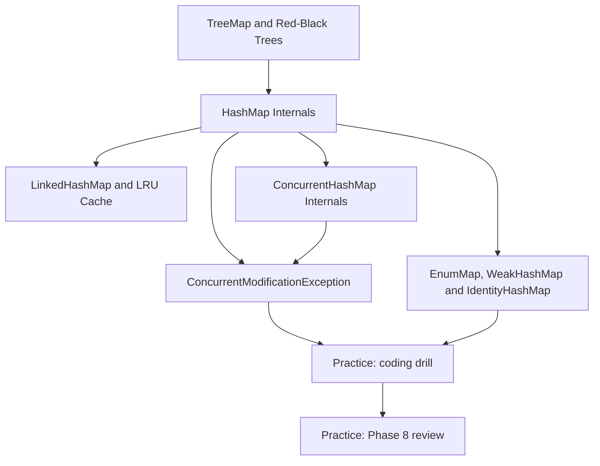
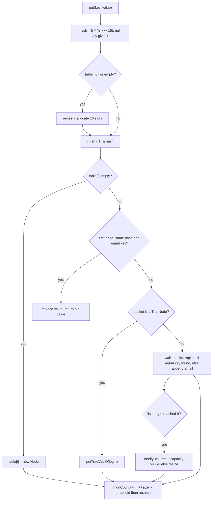
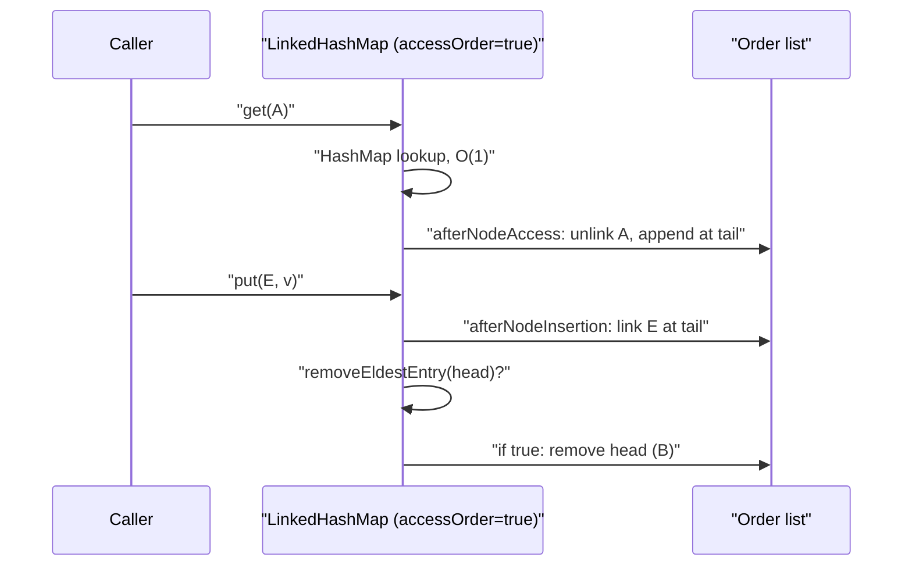

@@ 1 | MODULE | Phase 8 — Collections Internals (Intermediate) | How HashMap, LinkedHashMap, TreeMap and ConcurrentHashMap work inside, plus the edge cases interviewers love | MUST
# Phase 8: Collections Internals (Intermediate)

Phase 4 taught you how to *use* collections. This phase opens the box: how `HashMap` turns a key into a bucket, why it resizes, when a bucket becomes a red-black tree, how `LinkedHashMap` becomes an LRU cache in five lines, how `TreeMap` keeps keys sorted in O(log n), and how `ConcurrentHashMap` lets many threads write at once without one big lock. It ends with the edge cases that catch people out: `ConcurrentModificationException` and the special-purpose maps (`EnumMap`, `WeakHashMap`, `IdentityHashMap`).

Why interviewers care: "How does HashMap work internally?" is the single most asked Java interview question at the intermediate level. It is a perfect probe: a weak candidate says "it uses hashing", a good one explains buckets, `equals` and `hashCode`, and a strong one talks about hash spreading, load factor, resize splitting, treeification and why mutable keys are dangerous. The follow-ups (LRU cache, thread safety, CME) separate people who memorised a blog post from people who understand data structures.



**Prerequisites:** Phase 2 ([[equals() and hashCode() Contract]]), Phase 4 ([[HashMap, LinkedHashMap and TreeMap]], [[Iterator and Fail-Fast vs Fail-Safe]]), and a little Big-O. `ConcurrentHashMap` touches threads; Phase 9 covers them properly, so here you only need to know that two threads can run code at the same time.

**The 5 questions from this phase that come up most often**
1. How does `HashMap` work internally? Walk me through `put` and `get`.
2. What happens when two keys have the same hash code? What changed in Java 8?
3. How would you implement an LRU cache in Java?
4. How is `ConcurrentHashMap` different from `Hashtable` and `Collections.synchronizedMap`?
5. Why do you get `ConcurrentModificationException`, and how do you remove items while iterating?

@@ 2 | MODULE | Inside the maps | Hash tables, linked hash tables, red-black trees and lock-striped concurrent maps | MUST
# Inside the maps

**Shared analogy: a post office sorting room.** `HashMap` is a wall of numbered pigeonholes: a formula on the address (the hash) tells the clerk which hole to use, and if two letters land in the same hole they are stacked together. `LinkedHashMap` is the same wall plus a string that threads through the letters in arrival order, so you can also walk them first to last. `TreeMap` is not a wall at all but an alphabetised filing cabinet: slower to drop a letter in, but you can ask "what comes just before Smith?". `ConcurrentHashMap` is the pigeonhole wall staffed by many clerks at once, where each clerk only grabs the one hole they are working on instead of locking the whole room.

All four answer the same `Map` contract; they differ in how they find a slot, what order they keep, and how they behave when many threads touch them.

@@ 3 | TOPIC | HashMap Internals | Buckets, hash spreading, put and get flow, load factor, resize, treeification and mutable-key bugs | MUST
# HashMap Internals

**Level: Intermediate | Phase 8 | Priority: MUST | Since: Java 1.2 (treeification Java 8)**

> **30-second interview answer:** A `HashMap` is an array of buckets. To store a key it calls `hashCode()`, mixes the high bits into the low bits, and uses `(n - 1) & hash` to pick a bucket; keys that land in the same bucket form a linked list, and `equals()` finds the right one. When the number of entries passes capacity times load factor (16 x 0.75 = 12 by default), the array doubles and entries are split between their old index and old index plus old capacity. Since Java 8 a bucket with 8 or more entries in a table of at least 64 becomes a red-black tree, so the worst case is O(log n) instead of O(n).

## 1. Concept in Simple Words
### Analogy
A cloakroom with numbered hooks.

| Cloakroom | HashMap |
|---|---|
| The row of numbered hooks | The internal array (`table`) of buckets |
| A rule that turns a guest's name into a hook number | `hashCode()` plus spreading plus `(n - 1) & hash` |
| Two guests whose names map to the same hook hang coats on top of each other | A collision: several nodes in one bucket |
| Reading the name tag on each coat on that hook | Calling `equals()` on each key in the bucket |
| When the hooks get crowded, the manager installs a row twice as long and rehangs coats | Resize when size exceeds the threshold |
| A hook with a huge pile gets a small sorted rack instead | Treeification of a long bucket |
| A guest who changes their name after hanging their coat cannot find it | A mutable key whose hash changed after `put` |

### What it is
- **Bucket (bin):** one slot of the internal array `Node<K,V>[] table`. It holds `null`, a single node, the head of a linked list, or a `TreeNode` (red-black tree root).
- **Node:** an object with four fields: `final int hash`, `final K key`, `V value`, `Node<K,V> next`.
- **Capacity:** the length of the table. Always a power of two (16 by default). The table is created lazily on the first `put`.
- **Load factor:** how full the table may get before it grows (0.75 by default). **Threshold** = capacity x load factor.
- **Hash spreading:** `hash = h ^ (h >>> 16)`, which folds the upper 16 bits of `hashCode()` into the lower 16 so that keys differing only in high bits do not all land in the same bucket.
- **Treeification:** converting a long bucket into a red-black tree (`TREEIFY_THRESHOLD = 8`, only if capacity is at least `MIN_TREEIFY_CAPACITY = 64`; otherwise the map resizes instead). A tree shrinks back to a list at 6 entries (`UNTREEIFY_THRESHOLD`).

### Why it exists
Searching a list for a key is O(n). A hash table jumps straight to a small bucket, so `get` and `put` are O(1) on average. The design details (power-of-two capacity, spreading, load factor, trees) all exist to keep buckets short even when keys or hash codes are not ideal.

## 2. How It Works
**Memory layout** of a map with capacity 16 after a few puts:

```text
table (Node[16])
 index 0  -> null
 index 1  -> [hash=1, key=1, "one"] -> [hash=17, key=17, "seventeen"] -> null   (collision chain)
 index 2  -> null
 ...
 index 5  -> [hash=5, key=5, "five"] -> null
 ...
 index 10 -> TreeNode root (only if 8+ nodes here and capacity >= 64)
 index 15 -> null
size = 3, threshold = 12, modCount = 3
```

**`put(key, value)` step by step:**



**`get(key)`:** compute the same hash, jump to `table[(n - 1) & hash]`, check the first node (`hash == h && (key == k or key.equals(k))`), then walk the list or search the tree. The stored hash is compared first because comparing two ints is far cheaper than calling `equals`.

**Why `(n - 1) & hash` instead of `hash % n`:** when n is a power of two, `n - 1` is all ones in binary (15 = `0b1111`), so the AND keeps the low bits. It is a single CPU instruction and never negative. The price is that only the low bits matter, which is why spreading exists.

**Resize (doubling):** a new array of size 2n is allocated. Because the mask gains exactly one bit, each node either stays at index `i` or moves to `i + n`, depending on that one bit (`hash & oldCap`). Java 8 splits each chain into a "lo" list and a "hi" list and keeps their relative order. Java 7 reversed chains with head insertion, and two threads resizing at once could create a cycle and an infinite loop in `get`: the famous "HashMap 100% CPU" production bug. `HashMap` is still not thread-safe in Java 8+; it just fails differently (lost entries).

```text
capacity 16, mask 0b01111           capacity 32, mask 0b11111
key 1  hash 0b00001 -> index 1       index 1        (bit 16 is 0: stays)
key 17 hash 0b10001 -> index 1       index 17 = 1+16 (bit 16 is 1: moves)
key 33 hash 0b100001 -> index 1      index 1        (bit 16 is 0: stays)
```

**Tree bins:** in a tree bucket, nodes are ordered by hash, then by `compareTo` if the keys implement `Comparable` and are of the same class, then by a tie-breaker (`System.identityHashCode`). So making keys `Comparable` helps a badly hashed map; it is also why the Java 8 change defeated "hash flooding" denial-of-service attacks that sent thousands of colliding `String` keys.

**Big-O:** `get`, `put`, `remove` average O(1); worst case O(log n) with trees (O(n) before Java 8 or for non-comparable colliding keys in a tiny table). Iteration is O(capacity + size), so a huge, mostly empty map is slow to iterate.

## 3. Code Example
### Code
```java
import java.util.HashMap;
import java.util.Map;

public class HashMapInternalsDemo {

    // The same formula HashMap.hash() uses: fold the high 16 bits into the low 16
    static int spread(Object key) {
        int h;
        return key == null ? 0 : (h = key.hashCode()) ^ (h >>> 16);
    }

    // The same formula HashMap uses to choose a bucket
    static int bucketIndex(Object key, int capacity) {
        return spread(key) & (capacity - 1);
    }

    // Every instance has the same hash code: the worst possible key
    record BadKey(String name) {
        @Override
        public int hashCode() { return 42; }
    }

    // A key whose hash code changes when it is mutated
    static final class MutableKey {
        int id;
        MutableKey(int id) { this.id = id; }
        @Override
        public boolean equals(Object o) { return o instanceof MutableKey m && m.id == id; }
        @Override
        public int hashCode() { return Integer.hashCode(id); }
    }

    public static void main(String[] args) {
        // 1. Integer.hashCode() is the value itself, so bucket = value & (capacity - 1)
        for (int key : new int[] {1, 17, 33, 5}) {
            System.out.println("key " + key + " -> bucket " + bucketIndex(key, 16)
                    + " of 16, bucket " + bucketIndex(key, 32) + " of 32");
        }

        // 2. Keys that differ only in their high bits
        int a = 0x10000;   // 65536
        int b = 0x20000;   // 131072
        System.out.println("without spread: " + (a & 15) + " and " + (b & 15));
        System.out.println("with spread: " + bucketIndex(a, 16) + " and " + bucketIndex(b, 16));

        // 3. Resize thresholds with the default load factor
        int capacity = 16;
        float loadFactor = 0.75f;
        for (int i = 0; i < 3; i++) {
            System.out.println("capacity " + capacity + " threshold " + (int) (capacity * loadFactor));
            capacity *= 2;
        }

        // 4. Total collision: still correct, thanks to equals()
        Map<BadKey, Integer> bad = new HashMap<>();
        for (int i = 0; i < 5; i++) {
            bad.put(new BadKey("k" + i), i);
        }
        System.out.println("all in bucket " + bucketIndex(new BadKey("x"), 16)
                + ", size " + bad.size() + ", get k3 = " + bad.get(new BadKey("k3")));

        // 5. Mutating a key after insertion makes the entry unreachable
        Map<MutableKey, String> m = new HashMap<>();
        MutableKey k = new MutableKey(1);
        m.put(k, "first");
        k.id = 2;
        System.out.println("get(k) after mutation = " + m.get(k));
        System.out.println("get(new id 1) = " + m.get(new MutableKey(1)));
        System.out.println("containsValue(first) = " + m.containsValue("first") + ", size " + m.size());

        // 6. The null key always lives in bucket 0
        Map<String, Integer> withNull = new HashMap<>();
        withNull.put(null, 0);
        System.out.println("null key bucket " + bucketIndex(null, 16) + ", value " + withNull.get(null));
    }
}
```

### Walkthrough
- `spread` and `bucketIndex` copy the two lines of real `HashMap` code that decide where a key goes, so you can see the numbers.
- Part 1: keys 1, 17 and 33 all collide in a table of 16. After doubling to 32, key 17 moves to 17 (old index plus old capacity) while 1 and 33 stay: the resize split in action.
- Part 2: 65536 and 131072 have identical low 16 bits (all zero). Without spreading both go to bucket 0; after `h ^ (h >>> 16)` the high bits leak into the low bits and they separate.
- Part 3: the threshold is capacity x 0.75. The map resizes when `size` becomes larger than the threshold, that is on the 13th entry for a default map.
- Part 4: `BadKey` returns 42 for everyone, so every entry sits in bucket 10 (42 & 15). The map is still correct because lookups compare with `equals` (records generate it from `name`), just slow.
- Part 5: the entry was stored in bucket 1. After `k.id = 2`, `get(k)` looks in bucket 2 and finds nothing. `get(new MutableKey(1))` looks in bucket 1, finds the node, but `equals` compares id 1 with the mutated key's id 2 and fails. The value is still in the map (`containsValue` is true): a memory leak you can never remove by key.
- Part 6: `HashMap` allows one `null` key; its hash is defined as 0.

### Output
```text
key 1 -> bucket 1 of 16, bucket 1 of 32
key 17 -> bucket 1 of 16, bucket 17 of 32
key 33 -> bucket 1 of 16, bucket 1 of 32
key 5 -> bucket 5 of 16, bucket 5 of 32
without spread: 0 and 0
with spread: 1 and 2
capacity 16 threshold 12
capacity 32 threshold 24
capacity 64 threshold 48
all in bucket 10, size 5, get k3 = 3
get(k) after mutation = null
get(new id 1) = null
containsValue(first) = true, size 1
null key bucket 0, value 0
```

### Compare
| Java 7 HashMap | Java 8+ HashMap |
|---|---|
| Buckets are always linked lists | Lists become red-black trees at 8 nodes (table at least 64) |
| Worst case O(n) per lookup | Worst case O(log n) for comparable keys |
| Head insertion; concurrent resize could create a cycle (infinite loop) | Tail insertion, order-preserving lo/hi split; still unsafe across threads |
| More complex `hash()` with several shifts | One XOR of high and low halves |
| `new HashMap<>(n)` | Same, plus `HashMap.newHashMap(n)` (Java 19) that sizes for n entries without resizing |

## 4. Interview Questions
**Basic**
1. **How does `HashMap` store data internally?**
   In an array of buckets (`Node[] table`). Each node holds the hash, key, value and a `next` pointer. A key's bucket is `(n - 1) & spread(hashCode())`; collisions chain in a linked list, or a red-black tree once the bucket is long.
2. **Walk me through `put`.**
   Compute the spread hash, create the table on first use, find the bucket. If empty, place a new node. Otherwise compare against each node by hash then `equals`: replace the value if found, otherwise append at the tail (or insert into the tree). Increment `modCount` and size, and resize if size exceeds the threshold.
3. **What are the default capacity and load factor, and what do they mean?**
   Capacity 16 and load factor 0.75, so the map doubles when it holds more than 12 entries. 0.75 is a trade-off: lower wastes memory, higher makes collisions and longer chains more likely.

**Follow-up**
4. **Why must the capacity be a power of two?**
   So the bucket can be computed with a cheap bitmask `(n - 1) & hash` instead of a modulo, and so that a resize splits each bucket into exactly two: the same index or index plus old capacity, decided by one bit.
5. **Why does `HashMap` spread the hash with `h ^ (h >>> 16)`?**
   Because the mask uses only the low bits. Hash codes that differ only in their high bits (common for some numeric keys and floats) would all collide. XOR-ing the high half into the low half makes those bits count, at almost zero cost.
6. **What changed in Java 8, and why?**
   Long buckets (8 or more nodes, table at least 64) turn into red-black trees, cutting the worst case from O(n) to O(log n). It protects against poor `hashCode` implementations and hash-flooding attacks where an attacker sends many keys with the same hash.
7. **What happens if you override `equals` but not `hashCode`?**
   Two equal keys get different identity hash codes, land in different buckets, and `get` with an equal-but-different instance returns `null`. You end up with "duplicate" keys in the map. The contract requires equal objects to have equal hash codes.

**Tricky / scenario**
8. **We put an object in a `HashMap`, then changed one of its fields, and now `get` returns null but the entry is still there. Why?**
   The field took part in `hashCode`, so the new hash points to a different bucket, and even the old bucket's `equals` check fails. Keys must be immutable (or at least their hash-relevant fields must never change): use `String`, `Integer`, records or other value objects.
9. **We create `new HashMap<>(1000)` and insert 1000 entries. How many resizes happen?**
   One. The requested capacity is rounded up to 1024, so the threshold is 768, and inserting the 769th entry doubles the table to 2048 and rehashes everything. To hold 1000 entries without resizing you need `1000 / 0.75 + 1` capacity, which is exactly what `HashMap.newHashMap(1000)` (Java 19) or Guava's `Maps.newHashMapWithExpectedSize` computes.
10. **Is `HashMap` safe if one thread writes and others only read?**
    No. Without synchronization readers may see a half-built node, a stale table during resize, or miss writes forever (no happens-before relationship). Use `ConcurrentHashMap`, or publish an immutable map (`Map.copyOf`) through a `volatile` field.

**What the interviewer is really testing:** whether you can reason from the data structure (array, mask, chains, trees) to its behaviour: complexity, the equals and hashCode contract, resize costs and why mutable keys or concurrent writes break it.

## 5. Pitfalls & Best Practices
### Common mistakes
| Mistake | What goes wrong | Fix |
|---|---|---|
| Mutable fields used in `hashCode` of a key | Entry becomes unreachable, memory leak | Use immutable keys (records, `String`, `Long`) |
| Overriding `equals` without `hashCode` | Equal keys stored twice, `get` misses | Always override both, generate them together |
| `hashCode` returning a constant or a weak value | Every entry collides, performance collapses | Use `Objects.hash` or a record; include the same fields as `equals` |
| `new HashMap<>(expectedSize)` for a known size | One surprise resize at 75% | `HashMap.newHashMap(expectedSize)` (Java 19+) |
| Sharing a `HashMap` between threads | Lost writes, stale reads, infinite loops before Java 8 | `ConcurrentHashMap` or immutable snapshots |
| Relying on iteration order | Order changes after a resize or between JDK versions | `LinkedHashMap` or `TreeMap` when order matters |

### Best practices
- Prefer immutable value types as keys; records give you correct `equals` and `hashCode` for free.
- Pre-size maps whose final size you know, especially in hot loops that build large maps.
- Use the Java 8 map methods (`merge`, `computeIfAbsent`, `getOrDefault`) instead of get-check-put sequences; they are shorter and do one lookup.
- Do not tune the load factor unless a profiler tells you to; 0.75 is right for almost everything.
- Do not iterate a map that was once huge and is now nearly empty in a hot path: the table never shrinks. Copy it into a new map.

### Compare with
| Feature | HashMap | Hashtable | LinkedHashMap | TreeMap | ConcurrentHashMap |
|---|---|---|---|---|---|
| Ordering | None | None | Insertion or access | Sorted by key | None |
| `null` keys and values | One null key, null values | Neither | Like HashMap | No null key (natural order), null values | Neither |
| Thread-safe | No | Yes, one lock on every method | No | No | Yes, per-bin locking and CAS |
| get and put | O(1) average | O(1) average | O(1) average | O(log n) | O(1) average |
| Use today | Default choice | Legacy, avoid | Ordered or LRU | Sorted or range queries | Shared between threads |

## 6. Hands-on Exercise
Build a minimal `SimpleHashMap<K, V>` (the classic "implement a hash map" interview task) with `put`, `get`, `remove` and `size`. Requirements:
- Array of buckets with separate chaining (linked nodes), capacity a power of two starting at 4.
- Use the same hash spreading and `(n - 1) & hash` index formula as `HashMap`.
- Support a `null` key.
- Double the capacity when size exceeds 0.75 x capacity and rehash every node.
- `main` inserts 10 entries, overwrites one, removes one, and prints size, capacity and two lookups.

<details><summary>Solution</summary>

```java
import java.util.Objects;

public class SimpleHashMap<K, V> {

    private static final class Node<K, V> {
        final int hash;
        final K key;
        V value;
        Node<K, V> next;
        Node(int hash, K key, V value, Node<K, V> next) {
            this.hash = hash; this.key = key; this.value = value; this.next = next;
        }
    }

    private Node<K, V>[] table = newTable(4);
    private int size;

    @SuppressWarnings("unchecked")
    private static <K, V> Node<K, V>[] newTable(int n) { return (Node<K, V>[]) new Node[n]; }

    private static int hash(Object key) {
        int h;
        return key == null ? 0 : (h = key.hashCode()) ^ (h >>> 16);
    }

    public V put(K key, V value) {
        int h = hash(key);
        int i = h & (table.length - 1);
        for (Node<K, V> n = table[i]; n != null; n = n.next) {
            if (n.hash == h && Objects.equals(n.key, key)) {
                V old = n.value;
                n.value = value;          // replace, size unchanged
                return old;
            }
        }
        table[i] = new Node<>(h, key, value, table[i]);   // head insert is fine single-threaded
        if (++size > table.length * 3 / 4) resize();
        return null;
    }

    public V get(Object key) {
        int h = hash(key);
        for (Node<K, V> n = table[h & (table.length - 1)]; n != null; n = n.next) {
            if (n.hash == h && Objects.equals(n.key, key)) return n.value;
        }
        return null;
    }

    public V remove(Object key) {
        int h = hash(key);
        int i = h & (table.length - 1);
        Node<K, V> prev = null;
        for (Node<K, V> n = table[i]; n != null; prev = n, n = n.next) {
            if (n.hash == h && Objects.equals(n.key, key)) {
                if (prev == null) table[i] = n.next; else prev.next = n.next;
                size--;
                return n.value;
            }
        }
        return null;
    }

    private void resize() {
        Node<K, V>[] old = table;
        table = newTable(old.length * 2);
        for (Node<K, V> head : old) {
            for (Node<K, V> n = head; n != null; ) {
                Node<K, V> next = n.next;
                int i = n.hash & (table.length - 1);
                n.next = table[i];
                table[i] = n;
                n = next;
            }
        }
    }

    public int size() { return size; }
    public int capacity() { return table.length; }

    public static void main(String[] args) {
        SimpleHashMap<String, Integer> map = new SimpleHashMap<>();
        for (int i = 1; i <= 10; i++) map.put("k" + i, i);
        map.put("k3", 300);
        map.remove("k10");
        map.put(null, -1);
        System.out.println("size=" + map.size() + " capacity=" + map.capacity());
        System.out.println("k3=" + map.get("k3") + " k10=" + map.get("k10") + " null=" + map.get(null));
    }
}
```
Output:
```text
size=10 capacity=16
k3=300 k10=null null=-1
```
Capacity goes 4 to 8 on the 4th entry and 8 to 16 on the 7th; after that 10 entries stay under the threshold of 12. The real `HashMap` adds tail insertion, tree bins and the lo/hi split on resize, but the shape is the same.
</details>

## 7. Recall
Q: How does HashMap choose a bucket for a key?
A: It computes `h ^ (h >>> 16)` from `hashCode()` and then `(capacity - 1) & hash`, which works because the capacity is a power of two.

Q: When does a HashMap resize, and what happens to the entries?
A: When size exceeds capacity x load factor (12 for a default map); the table doubles and each entry stays at index i or moves to i + old capacity.

Q: What is HashMap treeification?
A: Since Java 8, a bucket with 8 or more nodes in a table of at least 64 becomes a red-black tree, making worst-case lookups O(log n); it turns back into a list at 6 nodes.

Q: Why are mutable keys dangerous in a HashMap?
A: If a field used by `hashCode` changes after `put`, lookups search the wrong bucket and the entry becomes unreachable but still occupies memory.

Q: Why does HashMap compare the stored hash before calling equals?
A: Comparing two ints is cheap and rules out most non-matching nodes without the cost of `equals`.

**Related:** [[equals() and hashCode() Contract]] · [[LinkedHashMap and LRU Cache]] · [[ConcurrentHashMap Internals]] · [[TreeMap and Red-Black Trees]]

@@ 3 | TOPIC | LinkedHashMap and LRU Cache | Insertion vs access order, the before and after links, removeEldestEntry, SequencedMap and building an LRU cache | SHOULD
# LinkedHashMap and LRU Cache

**Level: Intermediate | Phase 8 | Priority: SHOULD | Since: Java 1.4 (SequencedMap methods Java 21)**

> **30-second interview answer:** `LinkedHashMap` is a `HashMap` whose entries are also linked in a doubly linked list, so iteration follows insertion order, or access order if you pass `accessOrder = true`. In access order every `get` moves the entry to the tail, so the head is always the least recently used entry. Override `removeEldestEntry` to return `size() > capacity` and you have an LRU cache in a few lines, with O(1) get and put. For a thread-safe production cache I would use Caffeine instead.

## 1. Concept in Simple Words
### Analogy
A stack of magazines on a coffee table with a "recently read" habit.

| Coffee table | LinkedHashMap (access order) |
|---|---|
| The index card telling you where each magazine is | The hash table part: O(1) lookup by key |
| The physical stack, oldest at the bottom | The doubly linked list from head (eldest) to tail (newest) |
| After reading a magazine you put it on top | `get` moves the entry to the tail |
| The table only fits 3 magazines | The cache capacity |
| When a 4th arrives you throw out the bottom one | `removeEldestEntry` returns true and the head is removed |

### What it is
- **`LinkedHashMap<K,V>`:** extends `HashMap`. Its entry class adds two pointers, `before` and `after`, and the map keeps `head` and `tail` references.
- **Insertion order (default):** iteration follows the order keys were first inserted. Re-putting an existing key does not move it.
- **Access order:** created with `new LinkedHashMap<>(capacity, loadFactor, true)`. Both `get` and `put` of an existing key (plus `getOrDefault`, `compute`, `merge` and friends) move the entry to the tail.
- **`removeEldestEntry(Map.Entry eldest)`:** a protected hook called after every insertion. If it returns true, the head (eldest) entry is removed.
- **LRU (least recently used):** an eviction policy that removes the entry not used for the longest time.
- **`SequencedMap` (Java 21):** a new interface that `LinkedHashMap` implements, adding `firstEntry`, `lastEntry`, `pollFirstEntry`, `putFirst`, `putLast` and `reversed()`.

### Why it exists
`HashMap` iteration order looks random and can change after a resize. People needed predictable order (JSON output, config files, "keep the order the user gave") and a cheap LRU cache. Combining a hash table with a linked list gives both O(1) lookup and a stable order for a small memory cost (two extra references per entry).

## 2. How It Works
```text
hash table (for lookup)                     linked list (for order)
 [0] -> null                          head                                   tail
 [1] -> B                              |                                       |
 [2] -> null                           v                                       v
 [3] -> A -> D (collision chain)      [A] <-> [B] <-> [C] <-> [D]
 [4] -> C                          eldest = least recently used    newest = most recently used
```

The same entry objects are in both structures: the `next` field links bucket chains, `before` and `after` link the order list.



`HashMap` has three empty hook methods (`afterNodeAccess`, `afterNodeInsertion`, `afterNodeRemoval`) that `LinkedHashMap` overrides. That is the whole trick: no algorithm changes, just bookkeeping in the hooks.

**A gotcha:** in access-order mode, `get` is a *structural modification* (it increments `modCount`), so calling `get` while iterating throws `ConcurrentModificationException`, and two threads calling `get` concurrently can corrupt the list. Even reads need a lock.

**Building an LRU without `LinkedHashMap`** (often asked as a follow-up) uses exactly the same idea by hand: a `HashMap<K, Node>` for lookup plus your own doubly linked list with sentinel head and tail nodes. Both operations are O(1).

## 3. Code Example
### Code
```java
import java.util.LinkedHashMap;
import java.util.Map;

public class LruCacheDemo {

    // An LRU cache: access-ordered LinkedHashMap that evicts beyond a fixed capacity
    static final class LruCache<K, V> extends LinkedHashMap<K, V> {
        private final int capacity;

        LruCache(int capacity) {
            super(16, 0.75f, true);          // true = access order
            this.capacity = capacity;
        }

        @Override
        protected boolean removeEldestEntry(Map.Entry<K, V> eldest) {
            boolean evict = size() > capacity;
            if (evict) {
                System.out.println("  evicting " + eldest.getKey());
            }
            return evict;
        }
    }

    public static void main(String[] args) {
        // Insertion order: re-putting a key keeps its position
        LinkedHashMap<String, Integer> ordered = new LinkedHashMap<>();
        ordered.put("x", 1);
        ordered.put("y", 2);
        ordered.put("z", 3);
        System.out.println("insertion order: " + ordered);
        ordered.put("x", 10);
        System.out.println("after re-put x: " + ordered);

        // Access order with eviction
        LruCache<String, Integer> lru = new LruCache<>(3);
        lru.put("a", 1);
        lru.put("b", 2);
        lru.put("c", 3);
        System.out.println("lru after a, b, c: " + lru);
        lru.get("a");
        System.out.println("lru after get(a): " + lru);
        lru.put("d", 4);
        System.out.println("lru after put(d): " + lru);
        lru.put("c", 30);
        System.out.println("lru after put(c, 30): " + lru);

        // Java 21 SequencedMap methods
        System.out.println("first=" + lru.firstEntry() + " last=" + lru.lastEntry());
        System.out.println("reversed: " + lru.reversed());
    }
}
```

### Walkthrough
- `ordered` uses the default insertion order. Updating `x` changes its value but not its position.
- `LruCache` passes `true` as the third constructor argument for access order and overrides `removeEldestEntry`. The hook prints the evicted key so you can watch it work.
- After `get("a")`, `a` moves to the tail, so `b` is now the least recently used.
- `put("d")` makes the size 4, the hook sees `size() > 3` and evicts the head, `b`.
- `put("c", 30)` updates an existing key; in access order that counts as an access, so `c` moves to the tail.
- `firstEntry`, `lastEntry` and `reversed` come from `SequencedMap` (Java 21). They read the order list without counting as an access.

### Output
```text
insertion order: {x=1, y=2, z=3}
after re-put x: {x=10, y=2, z=3}
lru after a, b, c: {a=1, b=2, c=3}
lru after get(a): {b=2, c=3, a=1}
  evicting b
lru after put(d): {c=3, a=1, d=4}
lru after put(c, 30): {a=1, d=4, c=30}
first=a=1 last=c=30
reversed: {c=30, d=4, a=1}
```

### Compare
| Hand-rolled LRU (HashMap plus own list) | LinkedHashMap LRU | Caffeine cache |
|---|---|---|
| 60 or more lines, easy to get pointer bugs | About 10 lines | One builder call |
| Shows you understand the data structure (interview) | Idiomatic JDK answer | Production answer |
| Not thread-safe | Not thread-safe; even `get` mutates | Thread-safe, high concurrency |
| Pure LRU | Pure LRU | W-TinyLFU (better hit rate), expiry, stats, async loading |

## 4. Interview Questions
**Basic**
1. **What is the difference between `HashMap` and `LinkedHashMap`?**
   `LinkedHashMap` adds a doubly linked list across all entries, so iteration order is predictable (insertion or access order). Lookup is still O(1); the cost is two extra references per entry and slightly slower inserts.
2. **What is access order?**
   A mode chosen with the three-argument constructor where every read or update of a key moves it to the end of the iteration order. The first entry is then the least recently used.
3. **How do you implement an LRU cache with `LinkedHashMap`?**
   Extend it, call `super(capacity, 0.75f, true)` and override `removeEldestEntry` to return `size() > maxEntries`. The map evicts the head after each insertion that pushes it over the limit.

**Follow-up**
4. **Does re-inserting an existing key change its position?**
   In insertion order, no: the value is replaced and the position stays. In access order, yes: the `put` counts as an access and moves the entry to the tail.
5. **How would you build an LRU cache without `LinkedHashMap`?**
   A `HashMap<K, Node>` for O(1) lookup plus a doubly linked list of nodes with sentinel head and tail. On `get`, unlink the node and add it after head (or before tail). On `put`, add or move the node, and if size exceeds capacity remove the node at the LRU end and its map entry. Every step is O(1).
6. **Is your `LinkedHashMap` LRU thread-safe? How would you fix it?**
   No. Even `get` restructures the list. Wrap it with `Collections.synchronizedMap` (all access, including reads, goes through one lock) or, better, use Caffeine, which is built for concurrent caching.

**Tricky / scenario**
7. **Why does iterating an access-ordered `LinkedHashMap` and calling `get` on each key throw `ConcurrentModificationException`?**
   Because in access order `get` moves the entry and increments `modCount`, which is a structural modification. Iterate over `entrySet()` and use `entry.getValue()` instead of calling `get`.
8. **What does `SequencedMap` give you in Java 21?**
   A common interface for maps with a defined order (`LinkedHashMap`, `TreeMap`, `LinkedHashSet` has `SequencedSet`). You get `firstEntry`, `lastEntry`, `pollFirstEntry`, `pollLastEntry`, `putFirst`, `putLast` and a `reversed()` view without iterating manually.
9. **Your LRU cache has a 30% hit rate under a scan-heavy workload. Why might pure LRU be the problem?**
   A one-off scan of many keys pushes all the hot keys out (cache pollution). Frequency-aware policies such as LFU or Caffeine's W-TinyLFU keep popular entries and give much better hit rates for that pattern.

**What the interviewer is really testing:** whether you know the JDK already solves LRU in a few lines, can still build it from a hash map and a linked list, and know its thread-safety limits.

## 5. Pitfalls & Best Practices
### Common mistakes
| Mistake | What goes wrong | Fix |
|---|---|---|
| Forgetting the `true` access-order flag | Cache evicts by insertion order (FIFO), not LRU | Use `super(16, 0.75f, true)` |
| Calling `get` while iterating an access-ordered map | `ConcurrentModificationException` | Iterate `entrySet()` and read values from entries |
| Sharing the LRU map between threads unsynchronized | Corrupted links, lost entries, infinite loops | `Collections.synchronizedMap` or Caffeine |
| Doing slow work (I/O) inside `removeEldestEntry` | Every `put` becomes slow | Keep the hook trivial; hand off cleanup |
| Using an unbounded `HashMap` as a cache | Memory grows until `OutOfMemoryError` | Bound it with LRU or use a real cache with size limits |

### Best practices
- In interviews, give the `LinkedHashMap` answer first, then offer the hand-rolled version to show depth.
- In production, use Caffeine (or Spring's cache abstraction backed by Caffeine or Redis) for caches; it handles concurrency, expiry and metrics.
- Use `LinkedHashMap` (insertion order) whenever output order matters, such as building JSON responses or preserving the order of user input.
- Prefer `SequencedMap` methods (`firstEntry`, `reversed`) over manual iteration on Java 21.

### Compare with
| Map | Order | Lookup | Typical use |
|---|---|---|---|
| HashMap | None | O(1) | Default |
| LinkedHashMap (insertion) | Insertion order | O(1) | Predictable output, dedupe keeping order |
| LinkedHashMap (access) | Least to most recently used | O(1) | Simple single-threaded LRU |
| TreeMap | Sorted by key | O(log n) | Range queries, sorted output |
| Caffeine `Cache` | Policy-driven | O(1) | Concurrent production caching |

## 6. Hands-on Exercise
For OrderHub's product lookups, write a hand-rolled `LruCache<K, V>` without `LinkedHashMap`: a `HashMap<K, Node<K, V>>` plus a doubly linked list with sentinel `head` and `tail`. Acceptance criteria:
- `get(key)` returns the value or `null` and marks the key most recently used, in O(1).
- `put(key, value)` inserts or updates, marks the key most recently used, and evicts the least recently used key when size exceeds capacity, in O(1).
- `main` reproduces the LRU sequence from the code example (capacity 3: put a, b, c, get a, put d, put c) and prints keys from most to least recent.

<details><summary>Solution</summary>

```java
import java.util.ArrayList;
import java.util.HashMap;
import java.util.List;
import java.util.Map;

public class LruCache<K, V> {

    private static final class Node<K, V> {
        K key;
        V value;
        Node<K, V> prev, next;
        Node(K key, V value) { this.key = key; this.value = value; }
    }

    private final int capacity;
    private final Map<K, Node<K, V>> index = new HashMap<>();
    private final Node<K, V> head = new Node<>(null, null);   // most recent side
    private final Node<K, V> tail = new Node<>(null, null);   // least recent side

    public LruCache(int capacity) {
        this.capacity = capacity;
        head.next = tail;
        tail.prev = head;
    }

    public V get(K key) {
        Node<K, V> n = index.get(key);
        if (n == null) return null;
        unlink(n);
        addFirst(n);
        return n.value;
    }

    public void put(K key, V value) {
        Node<K, V> n = index.get(key);
        if (n != null) {
            n.value = value;
            unlink(n);
            addFirst(n);
            return;
        }
        n = new Node<>(key, value);
        index.put(key, n);
        addFirst(n);
        if (index.size() > capacity) {
            Node<K, V> lru = tail.prev;
            unlink(lru);
            index.remove(lru.key);
            System.out.println("evicted " + lru.key);
        }
    }

    private void unlink(Node<K, V> n) {
        n.prev.next = n.next;
        n.next.prev = n.prev;
    }

    private void addFirst(Node<K, V> n) {
        n.next = head.next;
        n.prev = head;
        head.next.prev = n;
        head.next = n;
    }

    public List<K> keysMostRecentFirst() {
        List<K> keys = new ArrayList<>();
        for (Node<K, V> n = head.next; n != tail; n = n.next) keys.add(n.key);
        return keys;
    }

    public static void main(String[] args) {
        LruCache<String, Integer> cache = new LruCache<>(3);
        cache.put("a", 1);
        cache.put("b", 2);
        cache.put("c", 3);
        cache.get("a");
        cache.put("d", 4);
        cache.put("c", 30);
        System.out.println(cache.keysMostRecentFirst());
    }
}
```
Output:
```text
evicted b
[c, d, a]
```
Sentinel nodes remove all the "is this the first or last node?" special cases, which is where most hand-written versions break.
</details>

## 7. Recall
Q: How does LinkedHashMap keep its iteration order?
A: Each entry has `before` and `after` pointers forming a doubly linked list across all entries, alongside the normal hash buckets.

Q: How do you turn LinkedHashMap into an LRU cache?
A: Use the constructor with `accessOrder = true` and override `removeEldestEntry` to return `size() > capacity`.

Q: In an access-ordered LinkedHashMap, why can `get` cause ConcurrentModificationException during iteration?
A: Because `get` moves the entry to the tail, which is a structural modification that increments `modCount`.

Q: What data structures make a hand-rolled LRU cache O(1)?
A: A hash map from key to node for lookup and a doubly linked list (with sentinels) for recency order.

Q: Which Java 21 interface gives LinkedHashMap `firstEntry`, `lastEntry` and `reversed()`?
A: `SequencedMap`.

**Related:** [[HashMap Internals]] · [[ConcurrentModificationException]] · [[HashMap, LinkedHashMap and TreeMap]] · [[Practice — Coding drill: Collections internals]]
