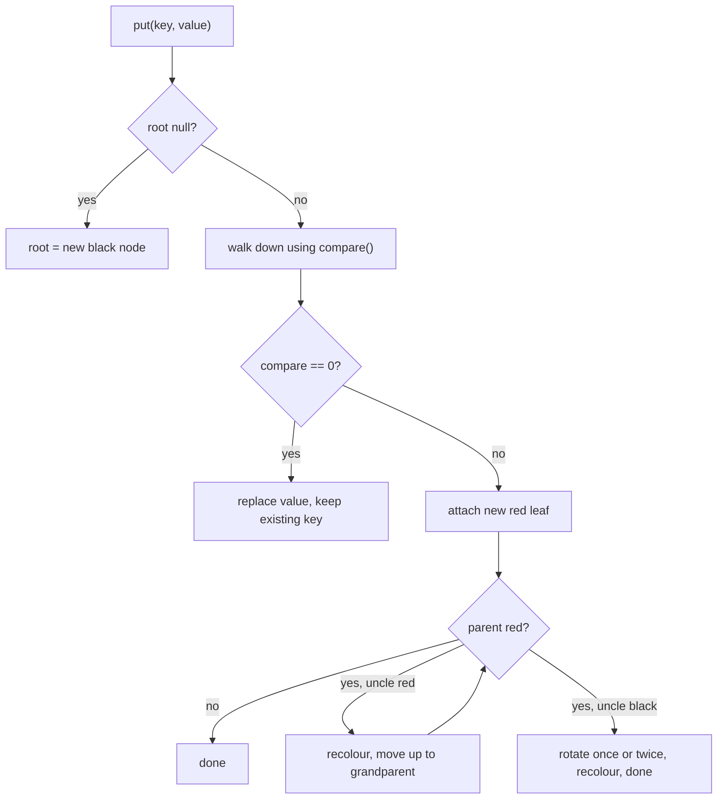
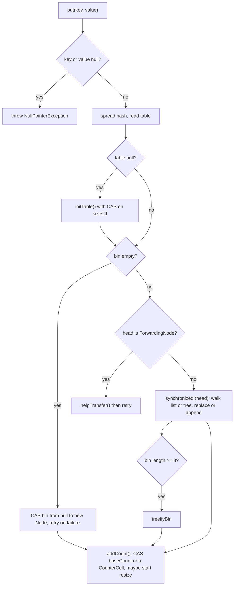

@@ 3 | TOPIC | TreeMap and Red-Black Trees | Sorted keys in a self-balancing BST, the red-black rules, NavigableMap range queries and comparator consistency | SHOULD
# TreeMap and Red-Black Trees

**Level: Intermediate | Phase 8 | Priority: SHOULD | Since: Java 1.2 (NavigableMap Java 6, SequencedMap Java 21)**

> **30-second interview answer:** `TreeMap` stores its entries in a red-black tree, a binary search tree that rebalances itself with recolouring and rotations so its height stays at most about 2 log n. That gives guaranteed O(log n) `get`, `put` and `remove`, keys always in sorted order, and navigation methods like `floorKey`, `ceilingKey`, `headMap` and `subMap`. Ordering comes from `Comparable` or a `Comparator`, and that ordering, not `equals`, decides whether two keys are the same.

## 1. Concept in Simple Words
### Analogy
A library card catalogue sorted alphabetically, with a librarian who keeps the drawers balanced.

| Card catalogue | TreeMap |
|---|---|
| Cards sorted A to Z | Keys kept in sorted order |
| "Go left if earlier in the alphabet, right if later" | Binary search tree navigation, O(log n) |
| The librarian reshuffles drawers so no drawer grows much deeper than the others | Red-black rebalancing (recolour and rotate) |
| "What is the last card before M?" | `floorKey` or `lowerKey` |
| "Give me every card from C to F" | `subMap("C", true, "F", true)` |
| The sorting rule printed on the drawer | The `Comparator` (or `Comparable`) |

### What it is
- **Binary search tree (BST):** every node's left subtree has smaller keys and its right subtree larger keys. Search walks down one path.
- **Red-black tree:** a BST where each node is coloured red or black and these rules hold:
  1. Every node is red or black.
  2. The root is black.
  3. A red node never has a red child (no two reds in a row).
  4. Every path from a node down to a null leaf passes through the same number of black nodes (the black height).
  Together, rules 3 and 4 mean the longest path is at most twice the shortest, so height is at most `2 log2(n + 1)`.
- **Rotation:** a local rearrangement of three nodes that keeps BST order but changes the shape (left rotation, right rotation).
- **`NavigableMap`:** the interface (Java 6) with `floorKey`, `ceilingKey`, `lowerKey`, `higherKey`, `headMap`, `tailMap`, `subMap`, `descendingMap`, `pollFirstEntry`, `pollLastEntry`.
- **Consistent with equals:** a comparator where `compare(a, b) == 0` exactly when `a.equals(b)`. `TreeMap` only uses `compare`.

### Why it exists
A plain BST degenerates into a linked list if keys arrive sorted (1, 2, 3, ...), giving O(n) operations. A hash map has no order at all. `TreeMap` gives sorted order and range queries with a guaranteed O(log n) worst case, which matters for things like price tiers, time windows and leaderboards.

## 2. How It Works
**Node layout:** each `TreeMap.Entry` has `key`, `value`, `left`, `right`, `parent` and a `boolean color`. That is more memory per entry than a `HashMap` node.

**Why balancing matters:** inserting 10, 20, 30 in order.

```text
Plain BST (degenerates)        Red-black tree after fix-up
   10                               20(B)
     \                             /     \
      20                       10(R)     30(R)
        \
         30                    height 2 instead of 3; with 1,000,000 sorted keys:
                               plain BST height 1,000,000, red-black at most about 40
```

**Insert algorithm:**
1. Walk down as in any BST using `compare(key, node.key)`. If a comparison returns 0, replace the value and stop (the key object already in the map is kept).
2. Attach a new **red** node as a leaf (red does not change any black height, so only rule 3 can break).
3. Fix up while the parent is red:
   - Uncle red: recolour parent and uncle black, grandparent red, move up to the grandparent.
   - Uncle black: one or two rotations around the grandparent plus recolouring, then stop.
4. Colour the root black.

Insertion needs at most 2 rotations, deletion at most 3; recolouring can travel up the tree, but everything is O(log n).



**Range views:** `headMap`, `tailMap` and `subMap` return live views backed by the same tree, not copies. Writing through the view writes the map; putting a key outside the view's range throws `IllegalArgumentException`.

**Null keys:** with natural ordering, `put(null, v)` throws `NullPointerException` because it calls `compareTo` on the key. A custom comparator such as `Comparator.nullsFirst(...)` can allow nulls.

## 3. Code Example
### Code
```java
import java.util.Map;
import java.util.TreeMap;

public class TreeMapDemo {

    public static void main(String[] args) {
        // 1. Price tiers: floorEntry finds the tier that applies to an amount
        TreeMap<Integer, String> tiers = new TreeMap<>();
        tiers.put(0, "STANDARD");
        tiers.put(50, "FREE_SHIPPING");
        tiers.put(200, "GOLD");
        for (int amount : new int[] {10, 50, 120, 999}) {
            System.out.println("order " + amount + " -> " + tiers.floorEntry(amount).getValue());
        }

        // 2. Navigation on a score board
        TreeMap<Integer, String> scores = new TreeMap<>(Map.of(85, "Ava", 70, "Ben", 55, "Cara", 92, "Dan"));
        System.out.println("sorted: " + scores);
        System.out.println("floorKey(80)=" + scores.floorKey(80) + " ceilingKey(80)=" + scores.ceilingKey(80));
        System.out.println("higherKey(85)=" + scores.higherKey(85) + " lowerKey(55)=" + scores.lowerKey(55));
        System.out.println("headMap(85)=" + scores.headMap(85));
        System.out.println("tailMap(85, inclusive)=" + scores.tailMap(85, true));
        System.out.println("subMap[60, 90]=" + scores.subMap(60, true, 90, true));
        System.out.println("descending=" + scores.descendingMap());
        System.out.println("pollFirstEntry=" + scores.pollFirstEntry() + " remaining=" + scores);

        // 3. The comparator decides equality, not equals()
        TreeMap<String, Integer> caseless = new TreeMap<>(String.CASE_INSENSITIVE_ORDER);
        caseless.put("Apple", 1);
        caseless.put("apple", 2);
        System.out.println("case-insensitive map: " + caseless + " size=" + caseless.size());

        // 4. Consistent hashing ring: the first node clockwise from a hash
        TreeMap<Integer, String> ring = new TreeMap<>(Map.of(0, "node-A", 100, "node-B", 200, "node-C"));
        for (int hash : new int[] {42, 150, 250}) {
            Map.Entry<Integer, String> e = ring.ceilingEntry(hash);
            String node = (e != null ? e : ring.firstEntry()).getValue();   // wrap around
            System.out.println("hash " + hash + " -> " + node);
        }

        // 5. Natural ordering rejects a null key
        try {
            new TreeMap<String, Integer>().put(null, 1);
        } catch (NullPointerException e) {
            System.out.println("null key: NullPointerException");
        }
    }
}
```

### Walkthrough
- Part 1: `floorEntry(amount)` returns the greatest key less than or equal to the amount. With tiers at 0, 50 and 200, an order of 120 falls in the 50 tier. This replaces a chain of `if` statements and stays O(log n) as tiers grow.
- Part 2: `Map.of` has no order, but the `TreeMap` copy is sorted. `floor` and `ceiling` include the key itself, `lower` and `higher` are strict. `headMap(85)` excludes 85 by default; `tailMap(85, true)` includes it. `pollFirstEntry` removes and returns the smallest entry.
- Part 3: with a case-insensitive comparator, `"apple"` compares equal to `"Apple"`, so the second `put` replaces the value but keeps the original key object. The map has one entry even though `"Apple".equals("apple")` is false.
- Part 4: a consistent-hashing ring (used by caches and sharded databases) maps a hash to the first server at or after it, wrapping to the first server. `ceilingEntry` plus `firstEntry` is the whole algorithm.
- Part 5: natural ordering calls `compareTo` on the key, so a `null` key fails fast.

### Output
```text
order 10 -> STANDARD
order 50 -> FREE_SHIPPING
order 120 -> FREE_SHIPPING
order 999 -> GOLD
sorted: {55=Cara, 70=Ben, 85=Ava, 92=Dan}
floorKey(80)=70 ceilingKey(80)=85
higherKey(85)=92 lowerKey(55)=null
headMap(85)={55=Cara, 70=Ben}
tailMap(85, inclusive)={85=Ava, 92=Dan}
subMap[60, 90]={70=Ben, 85=Ava}
descending={92=Dan, 85=Ava, 70=Ben, 55=Cara}
pollFirstEntry=55=Cara remaining={70=Ben, 85=Ava, 92=Dan}
case-insensitive map: {Apple=2} size=1
hash 42 -> node-B
hash 150 -> node-C
hash 250 -> node-A
null key: NullPointerException
```

### Compare
| Approach to "which tier does 120 fall into?" | Cost | Notes |
|---|---|---|
| Chain of `if (amount >= 200) ... else if` | O(tiers) | Code change for every new tier |
| Sort a list, linear scan | O(n) | Easy to get boundaries wrong |
| `TreeMap.floorEntry(amount)` | O(log n) | Data-driven, tiers can come from config or a database |

## 4. Interview Questions
**Basic**
1. **How does `TreeMap` store entries?**
   In a red-black tree, a self-balancing binary search tree. Each entry node has key, value, left, right, parent and a colour bit, and the tree is ordered by the comparator or the keys' natural order.
2. **What is the time complexity of `TreeMap` operations?**
   `get`, `put`, `remove`, `containsKey`, `floorKey` and the other navigation methods are O(log n) in the worst case. Iterating all entries in order is O(n). `firstKey` and `lastKey` are O(log n) because they walk down one edge of the tree.
3. **When would you choose `TreeMap` over `HashMap`?**
   When you need keys in sorted order or range queries: "the nearest key below X", "all keys between A and B", the smallest or largest key. If you only need lookup by exact key, `HashMap` is faster.

**Follow-up**
4. **What are the red-black tree rules, and why do they keep the tree balanced?**
   Nodes are red or black, the root is black, a red node cannot have a red child, and every root-to-leaf path has the same number of black nodes. The shortest possible path is all black and the longest alternates red and black, so no path is more than twice as long as another, which bounds the height at about 2 log n.
5. **How does `TreeMap` decide that two keys are equal?**
   Only by `compare` or `compareTo` returning 0; `equals` and `hashCode` are never called. If the comparator is inconsistent with `equals`, the map can treat different objects as the same key (or equal objects as different keys).
6. **Why are newly inserted nodes coloured red?**
   A red leaf does not change the black height of any path, so rule 4 still holds. Only rule 3 (no red parent with red child) can be broken, and that is fixed locally with recolouring and at most two rotations.

**Tricky / scenario**
7. **We used a `TreeSet<Employee>` with a comparator on salary, and employees with equal salaries disappeared. Why?**
   Two employees with the same salary compare as 0, so the set treats the second as a duplicate and ignores it. Add tie-breakers to the comparator, for example `Comparator.comparing(Employee::salary).thenComparing(Employee::id)`.
8. **Is `headMap` a copy?**
   No, it is a live view backed by the original tree. Changes in either are visible in the other, and inserting a key outside the view's range through the view throws `IllegalArgumentException`. Use `new TreeMap<>(map.headMap(k))` if you need an independent copy.
9. **Java 8 `HashMap` also uses red-black trees. How is that different from `TreeMap`?**
   `HashMap` only treeifies a single overloaded bucket, as a fallback against collisions, and orders that small tree by hash (then `Comparable`). `TreeMap` is one tree for the whole map, ordered by the comparator, giving a global sort order.

**What the interviewer is really testing:** whether you know when sorted structures beat hash structures, can explain why balancing guarantees O(log n), and understand that the comparator defines key identity.

## 5. Pitfalls & Best Practices
### Common mistakes
| Mistake | What goes wrong | Fix |
|---|---|---|
| Comparator inconsistent with `equals` (for example only comparing salary) | Distinct keys silently overwrite each other | Add tie-breakers with `thenComparing` |
| Mutating a field used by the comparator after insertion | Tree order is broken, lookups fail | Use immutable keys |
| Using `TreeMap` when order is not needed | O(log n) and more memory instead of O(1) | Use `HashMap` |
| Assuming `subMap` or `headMap` is a copy | Unexpected changes in the original map | Copy explicitly with `new TreeMap<>(view)` |
| Inserting `null` keys with natural ordering | `NullPointerException` | Avoid null keys or use `Comparator.nullsFirst` |
| Using `TreeMap` from several threads | Corrupted tree | `ConcurrentSkipListMap` for a concurrent sorted map |

### Best practices
- Reach for `floorEntry`, `ceilingEntry` and `subMap` whenever you see range logic or tier tables; it turns if-chains into data.
- Build comparators with `Comparator.comparing(...).thenComparing(...)` so they are consistent with `equals`.
- For a concurrent sorted map use `ConcurrentSkipListMap`, which offers the same `NavigableMap` API with lock-free operations.
- Prefer `pollFirstEntry` over `firstKey` plus `remove` when consuming entries in order.

### Compare with
| Structure | Order | Complexity | Thread-safe | Notes |
|---|---|---|---|---|
| TreeMap | Sorted | O(log n) | No | Red-black tree, `NavigableMap` |
| HashMap | None | O(1) average | No | Fastest exact lookup |
| LinkedHashMap | Insertion or access | O(1) average | No | No range queries |
| ConcurrentSkipListMap | Sorted | O(log n) expected | Yes, lock-free | Skip list instead of a tree |
| PriorityQueue | Only the head is ordered | O(log n) offer and poll | No | Not a map; no range queries |

## 6. Hands-on Exercise
OrderHub needs a meeting-room style booking for delivery slots. Write `SlotBooker` with `boolean book(int start, int end)` (half-open interval `[start, end)`) that returns `false` if the new slot overlaps any existing booking. Use a `TreeMap<Integer, Integer>` from start to end. Acceptance criteria:
- Each `book` call is O(log n).
- Booking `[10, 20)`, `[20, 30)` succeed; `[15, 25)` and `[5, 11)` fail; `[0, 10)` succeeds.
- Print all bookings in order at the end.

<details><summary>Solution</summary>

```java
import java.util.Map;
import java.util.TreeMap;

public class SlotBooker {
    private final TreeMap<Integer, Integer> slots = new TreeMap<>();   // start -> end

    public boolean book(int start, int end) {
        Map.Entry<Integer, Integer> before = slots.floorEntry(start);    // starts at or before
        if (before != null && before.getValue() > start) return false;   // it ends after we start
        Map.Entry<Integer, Integer> after = slots.ceilingEntry(start);   // starts at or after
        if (after != null && after.getKey() < end) return false;         // it starts before we end
        slots.put(start, end);
        return true;
    }

    public static void main(String[] args) {
        SlotBooker booker = new SlotBooker();
        int[][] requests = {{10, 20}, {20, 30}, {15, 25}, {5, 11}, {0, 10}};
        for (int[] r : requests) {
            System.out.println("[" + r[0] + ", " + r[1] + ") -> " + booker.book(r[0], r[1]));
        }
        System.out.println("bookings: " + booker.slots);
    }
}
```
Output:
```text
[10, 20) -> true
[20, 30) -> true
[15, 25) -> false
[5, 11) -> false
[0, 10) -> true
bookings: {0=10, 10=20, 20=30}
```
Only the two neighbours of the new start can overlap it, so two O(log n) lookups are enough.
</details>

## 7. Recall
Q: What data structure backs TreeMap?
A: A red-black tree, a self-balancing binary search tree with guaranteed O(log n) operations.

Q: What are the four red-black tree rules?
A: Every node is red or black, the root is black, a red node has no red child, and every path from a node to its null leaves has the same number of black nodes.

Q: How does TreeMap decide whether two keys are the same?
A: Only by the comparator or `compareTo` returning 0; `equals` and `hashCode` are not used.

Q: What is the difference between TreeMap `floorKey` and `lowerKey`?
A: `floorKey` returns the greatest key less than or equal to the argument; `lowerKey` returns the greatest key strictly less.

Q: Which class gives a thread-safe sorted map with the NavigableMap API?
A: `ConcurrentSkipListMap`.

**Related:** [[HashMap Internals]] · [[Comparable vs Comparator]] · [[HashSet, LinkedHashSet and TreeSet]] · [[Concurrent Collections and BlockingQueue]]

@@ 3 | TOPIC | ConcurrentHashMap Internals | Java 7 segments vs Java 8 CAS plus per-bin locks, lock-free reads, cooperative resize, counter cells, atomic compound operations | MUST
# ConcurrentHashMap Internals

**Level: Intermediate | Phase 8 | Priority: MUST | Since: Java 5 (rewritten in Java 8)**

> **30-second interview answer:** `ConcurrentHashMap` is a thread-safe hash map that never locks the whole table. Since Java 8, reads are lock-free (volatile reads of the table), inserting into an empty bucket is a single CAS, and writes to a non-empty bucket lock only that bucket's first node with `synchronized`. Resizing is done cooperatively by several threads, size is tracked with striped counters, and it rejects `null` keys and values. Its compound methods like `computeIfAbsent` and `merge` are atomic, which is what makes it correct, not just fast.

## 1. Concept in Simple Words
### Analogy
A supermarket with many checkout lanes instead of one cashier at the door.

| Supermarket | ConcurrentHashMap |
|---|---|
| `Hashtable`: one cashier for the whole shop, everyone queues | One lock for every method |
| One cashier per lane; customers in different lanes never wait for each other | One lock per bucket (bin head) |
| An empty lane: you just walk through, no cashier needed | Empty bucket: insert with a single CAS, no lock |
| Looking at the price tags does not need a cashier | `get` is lock-free |
| When the shop expands, every free cashier helps move shelves | Cooperative resize: threads help transfer bins |
| Each lane keeps its own tally; the manager adds them up at closing | `CounterCell` striped counters for `size()` |

### What it is
- **CAS (compare-and-swap):** a CPU instruction that sets a memory location to a new value only if it still holds the expected old value, atomically, without a lock. (Phase 9 covers it in [[Atomic Classes and CAS]].)
- **Bin:** a bucket of the table. Its first node (the head) doubles as the lock for that bin.
- **`ForwardingNode`:** a special node placed in a bin during resize that says "this bin has moved to the new table".
- **`CounterCell[]`:** an array of counters, like `LongAdder`, so many threads can update the size without fighting over one variable.
- **Weakly consistent iterator:** iterates a moving map without throwing `ConcurrentModificationException`; it reflects some, all or none of the changes made after it was created.
- **Atomic compound operations:** `putIfAbsent`, `computeIfAbsent`, `computeIfPresent`, `compute`, `merge`, `replace(k, old, new)`, `remove(k, v)`.

### Why it exists
`Hashtable` and `Collections.synchronizedMap` lock every operation on one monitor, so 16 threads behave like 1. Meanwhile an unsynchronized `HashMap` corrupts under concurrent writes. `ConcurrentHashMap` gives thread safety with throughput that scales with the number of cores, plus atomic read-modify-write operations so callers do not need their own locks.

## 2. How It Works
**Java 7 design (still asked):** the map was split into 16 `Segment`s by default (the `concurrencyLevel`), each a small hash table guarded by its own `ReentrantLock`. At most 16 writers could proceed in parallel. Java 8 removed segments; `concurrencyLevel` survives only as a sizing hint.

**Java 8+ design:**

```text
table: volatile Node[] (power-of-two length)

 [0] null                      <- put: CAS(null -> new Node), no lock
 [1] Node(h,k,v) -> Node       <- put: synchronized (head) { append or replace }
 [2] TreeBin                   <- 8+ nodes: red-black tree, read-write style locking
 [3] ForwardingNode(nextTable) <- resize in progress: readers follow it, writers help transfer
 ...
baseCount + CounterCell[]      <- size() = baseCount + sum(cells)
sizeCtl                        <- negative while initialising or resizing, else next threshold
```

**`putVal` flow:**



**`get` is lock-free:** it reads the table and bin heads with volatile semantics (`Unsafe` or `VarHandle` acquire reads), and node `val` and `next` fields are `volatile`. A reader may see the value just before or just after a concurrent write, but never a half-built node.

**Resize:** when the count passes `sizeCtl`, a thread creates `nextTable` (double size) and transfers bins from the end of the old table in strides. Each finished bin is replaced with a `ForwardingNode`. Other threads that try to write into a moved bin call `helpTransfer` and take their own stride, so many cores share the work. Readers that hit a `ForwardingNode` simply look in the new table.

**Why no nulls:** in a concurrent map, `get(key) == null` must mean "absent". If `null` values were allowed you could not tell "absent" from "mapped to null" without a second call, and between those two calls another thread could change the answer. Doug Lea banned nulls to remove that ambiguity.

**Size:** `size()` and `mappingCount()` sum `baseCount` and all counter cells. Under concurrent updates the result is an estimate at a moment in time; `mappingCount()` returns a `long`.

**Atomicity of `computeIfAbsent`:** the mapping function runs while holding the bin lock (or after reserving the bin with a placeholder node), so it runs at most once per absent key. Keep it short and never modify the same map inside it; doing so can deadlock or throw `IllegalStateException: Recursive update`.

## 3. Code Example
### Code
```java
import java.util.List;
import java.util.Map;
import java.util.TreeMap;
import java.util.concurrent.ConcurrentHashMap;
import java.util.concurrent.ExecutorService;
import java.util.concurrent.Executors;
import java.util.concurrent.atomic.AtomicInteger;

public class ConcurrentHashMapDemo {

    public static void main(String[] args) {
        List<String> words = List.of("order", "payment", "order", "refund", "order", "payment");

        ConcurrentHashMap<String, Integer> counts = new ConcurrentHashMap<>();
        ConcurrentHashMap<String, Integer> broken = new ConcurrentHashMap<>();

        // 1. Four threads count words 10,000 times each
        try (ExecutorService pool = Executors.newFixedThreadPool(4)) {
            for (int t = 0; t < 4; t++) {
                pool.submit(() -> {
                    for (int i = 0; i < 10_000; i++) {
                        for (String w : words) {
                            counts.merge(w, 1, Integer::sum);           // atomic read-modify-write
                            Integer old = broken.get(w);                 // check...
                            broken.put(w, old == null ? 1 : old + 1);    // ...then act: NOT atomic
                        }
                    }
                });
            }
        }   // ExecutorService.close() waits for all tasks (Java 19+)

        System.out.println("merge:  " + new TreeMap<>(counts));
        System.out.println("broken: order=" + broken.get("order") + " (expected 120000)");
        System.out.println("mappingCount=" + counts.mappingCount());

        // 2. computeIfAbsent runs the loader once per key, even with 100 concurrent callers
        ConcurrentHashMap<Integer, String> cache = new ConcurrentHashMap<>();
        AtomicInteger loads = new AtomicInteger();
        try (ExecutorService pool = Executors.newFixedThreadPool(8)) {
            for (int i = 0; i < 100; i++) {
                pool.submit(() -> cache.computeIfAbsent(42, id -> {
                    loads.incrementAndGet();
                    return "product-" + id;
                }));
            }
        }
        System.out.println("cache=" + cache + ", loader ran " + loads.get() + " time(s)");

        // 3. Removing while iterating: weakly consistent, no ConcurrentModificationException
        ConcurrentHashMap<String, Integer> live = new ConcurrentHashMap<>(Map.of("apple", 1, "avocado", 2, "banana", 3));
        for (String key : live.keySet()) {
            if (key.startsWith("a")) {
                live.remove(key);
            }
        }
        System.out.println("after removing a*: " + live);

        // 4. Nulls are rejected
        try {
            counts.put("x", null);
        } catch (NullPointerException e) {
            System.out.println("null value rejected: NullPointerException");
        }
    }
}
```

### Walkthrough
- `counts.merge(w, 1, Integer::sum)` inserts 1 if the key is absent, otherwise replaces the value with `old + 1`, all under the bin lock. Four threads x 10,000 rounds x 3 occurrences of `order` gives exactly 120,000.
- `broken` uses a thread-safe map but a non-atomic sequence: two threads can both read 500 and both write 501, losing one increment. **A thread-safe collection does not make your compound logic thread-safe.**
- `new TreeMap<>(counts)` is only used to print keys in a stable, sorted order.
- `computeIfAbsent` with 100 concurrent callers runs the loader once: the first caller reserves the bin, the others wait for the result.
- Removing keys while iterating `keySet()` is allowed; the iterator is weakly consistent.
- `put("x", null)` throws `NullPointerException`, unlike `HashMap`.

### Output
The second line varies between runs because updates are lost at random; every other line is the same on every run.
```text
merge:  {order=120000, payment=80000, refund=40000}
broken: order=97342 (expected 120000)
mappingCount=3
cache={42=product-42}, loader ran 1 time(s)
after removing a*: {banana=3}
null value rejected: NullPointerException
```

### Compare
| Wrong (thread-safe map, racy logic) | Right (atomic map operation) |
|---|---|
| `if (!map.containsKey(k)) map.put(k, load(k));` | `map.computeIfAbsent(k, this::load);` |
| `map.put(k, map.get(k) + 1);` | `map.merge(k, 1, Integer::sum);` |
| `if (map.get(k) == expected) map.put(k, next);` | `map.replace(k, expected, next);` |
| `if (map.get(k) == v) map.remove(k);` | `map.remove(k, v);` |

## 4. Interview Questions
**Basic**
1. **How is `ConcurrentHashMap` different from `Hashtable`?**
   `Hashtable` synchronizes every method on the whole table, so only one thread works at a time, and it allows no nulls either. `ConcurrentHashMap` uses lock-free reads, CAS for empty bins and per-bin locks for writes, so many threads read and write in parallel. It also offers atomic compound operations and weakly consistent iterators.
2. **Why does `ConcurrentHashMap` not allow null keys or values?**
   Because `get` returning `null` must unambiguously mean "absent". With nulls allowed you would need `containsKey` to disambiguate, and another thread could change the map between the two calls.
3. **Is `get` locked?**
   No. It uses volatile reads of the table, the bin head and the node fields, so it never blocks and always sees a fully constructed node.

**Follow-up**
4. **How did the Java 7 and Java 8 designs differ?**
   Java 7 split the map into segments (16 by default), each a mini hash table with its own `ReentrantLock`, so concurrency was capped by the segment count. Java 8 dropped segments: it locks individual bins with `synchronized` on the head node, uses CAS for empty bins, adds tree bins, cooperative resizing and striped counters.
5. **How does resizing work while other threads are reading and writing?**
   A thread allocates a table twice the size and moves bins in strides, leaving a `ForwardingNode` in each moved bin. Readers that meet a forwarding node look in the new table; writers help with the transfer before retrying. No global lock is ever taken.
6. **Is `size()` exact?**
   It is exact when no updates are in progress; under concurrency it is a moment-in-time estimate computed from `baseCount` plus the counter cells. Use `mappingCount()` for large maps because it returns a `long`.
7. **What does "weakly consistent iterator" mean?**
   The iterator never throws `ConcurrentModificationException`, traverses each element at most once, and may or may not reflect changes made after it was created. It is safe to modify the map while iterating.

**Tricky / scenario**
8. **We replaced `HashMap` with `ConcurrentHashMap` but our counters are still wrong. Why?**
   The code probably does `get` then `put` (check-then-act). Each call is thread-safe on its own, but the pair is not atomic, so increments are lost. Use `merge`, `compute` or `computeIfAbsent(...).increment()` with a `LongAdder` value.
9. **A `computeIfAbsent` call in production hangs or throws `IllegalStateException: Recursive update`. What is going on?**
   The mapping function modifies the same map (for example a recursive memoized Fibonacci that calls `computeIfAbsent` for other keys). The function runs while the bin is reserved, so touching another key that hashes to the same bin can deadlock or is detected as recursion. Compute the value outside, or use a different structure for recursive memoization.
10. **Should the mapping function in `computeIfAbsent` call a remote service?**
    Avoid it. Other threads that need the same bin (not just the same key) block until it finishes, which can stall unrelated keys. For slow loads use a cache like Caffeine, or store a `CompletableFuture` as the value so the bin is only held for an instant.

**What the interviewer is really testing:** whether you understand how lock striping and CAS give concurrency, and above all that thread-safe collections still need atomic compound operations for correct business logic.

## 5. Pitfalls & Best Practices
### Common mistakes
| Mistake | What goes wrong | Fix |
|---|---|---|
| `get` then `put` to update a value | Lost updates under concurrency | `merge`, `compute`, `computeIfAbsent` |
| Slow or remote calls inside `computeIfAbsent` | Other threads hitting that bin block | Cache a `CompletableFuture` or use Caffeine |
| Modifying the map inside a mapping function | Deadlock or `IllegalStateException` | Compute outside, then `putIfAbsent` |
| Using `size()` for control flow ("if size < 100 then put") | Race: several threads pass the check | Use a separate atomic counter or a bounded structure |
| Expecting iteration to be a snapshot | Sees some concurrent changes, not others | Copy to a new map first if you need a snapshot |
| Putting `null` as a "missing" marker | `NullPointerException` | Use `Optional`, a sentinel object or simply remove the key |

### Best practices
- Default to `ConcurrentHashMap` for any map shared between threads; never use `Hashtable`.
- Think in atomic operations: one `merge` or `compute` call per logical update.
- For hot counters use `ConcurrentHashMap<String, LongAdder>` with `computeIfAbsent(k, x -> new LongAdder()).increment()`.
- Use `ConcurrentHashMap.newKeySet()` for a concurrent `Set`.
- For bulk work there are parallel `forEach`, `search` and `reduce` methods with a `parallelismThreshold` argument.

### Compare with
| Map | Locking | Reads | Nulls | Iterator | Use |
|---|---|---|---|---|---|
| HashMap | None | Unsafe across threads | Allowed | Fail-fast | Single thread |
| Hashtable | One lock on all methods | Locked | Not allowed | Fail-fast (enumeration is not) | Legacy |
| `Collections.synchronizedMap` | One lock (the wrapper) | Locked | As the wrapped map | Fail-fast; you must lock while iterating | Quick fix for low contention |
| ConcurrentHashMap | CAS plus per-bin `synchronized` | Lock-free | Not allowed | Weakly consistent | Shared maps, caches, counters |
| ConcurrentSkipListMap | Lock-free CAS | Lock-free | Not allowed | Weakly consistent | Shared sorted map |

## 6. Hands-on Exercise
OrderHub tracks how many times each product is viewed from many request threads. Write `ProductViewCounter` with `void view(String productId)`, `long views(String productId)` and `Map<String, Long> top(int n)`. Acceptance criteria:
- Backed by `ConcurrentHashMap<String, LongAdder>`; no `synchronized` and no explicit locks.
- 8 threads each viewing `p1` 1000 times, `p2` 500 times and `p3` 100 times give exact counts.
- `top(2)` returns `{p1=8000, p2=4000}` in descending order.

<details><summary>Solution</summary>

```java
import java.util.LinkedHashMap;
import java.util.Map;
import java.util.concurrent.ConcurrentHashMap;
import java.util.concurrent.ExecutorService;
import java.util.concurrent.Executors;
import java.util.concurrent.atomic.LongAdder;

public class ProductViewCounter {
    private final ConcurrentHashMap<String, LongAdder> views = new ConcurrentHashMap<>();

    public void view(String productId) {
        views.computeIfAbsent(productId, id -> new LongAdder()).increment();
    }

    public long views(String productId) {
        LongAdder adder = views.get(productId);
        return adder == null ? 0 : adder.sum();
    }

    public Map<String, Long> top(int n) {
        Map<String, Long> result = new LinkedHashMap<>();
        views.entrySet().stream()
                .sorted((a, b) -> Long.compare(b.getValue().sum(), a.getValue().sum()))
                .limit(n)
                .forEach(e -> result.put(e.getKey(), e.getValue().sum()));
        return result;
    }

    public static void main(String[] args) {
        ProductViewCounter counter = new ProductViewCounter();
        try (ExecutorService pool = Executors.newFixedThreadPool(8)) {
            for (int t = 0; t < 8; t++) {
                pool.submit(() -> {
                    for (int i = 0; i < 1000; i++) counter.view("p1");
                    for (int i = 0; i < 500; i++) counter.view("p2");
                    for (int i = 0; i < 100; i++) counter.view("p3");
                });
            }
        }
        System.out.println("p3=" + counter.views("p3") + " unknown=" + counter.views("p9"));
        System.out.println("top(2)=" + counter.top(2));
    }
}
```
Output:
```text
p3=800 unknown=0
top(2)={p1=8000, p2=4000}
```
`computeIfAbsent` creates each adder exactly once; `LongAdder.increment` spreads contention across cells, so hot products do not become a bottleneck.
</details>

## 7. Recall
Q: How does Java 8 ConcurrentHashMap insert into an empty bucket?
A: With a single CAS that swaps the bin from null to the new node, without taking any lock.

Q: What does Java 8 ConcurrentHashMap lock when writing to a non-empty bucket?
A: Only that bucket, by synchronizing on its first (head) node.

Q: Why does ConcurrentHashMap reject null keys and values?
A: So that `get` returning null always means "absent"; otherwise the ambiguity cannot be resolved atomically across threads.

Q: What did Java 7 ConcurrentHashMap use instead of per-bin locks?
A: Segments, by default 16 mini hash tables each guarded by its own `ReentrantLock`.

Q: Why can code using ConcurrentHashMap still lose updates?
A: Because a `get` followed by a `put` is two separate operations; use atomic methods like `merge` or `compute`.

Q: What kind of iterator does ConcurrentHashMap provide?
A: A weakly consistent one that never throws `ConcurrentModificationException` and may or may not show concurrent changes.

**Related:** [[HashMap Internals]] · [[Atomic Classes and CAS]] · [[Race Conditions and synchronized]] · [[Concurrent Collections and BlockingQueue]]
