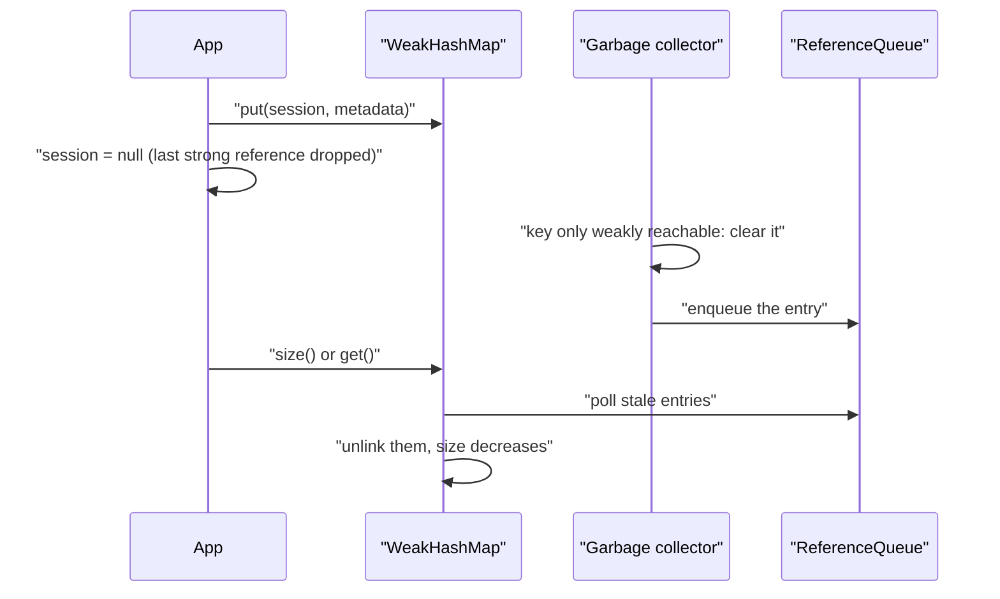

@@ 2 | MODULE | Edge cases | Fail-fast iteration and the special-purpose maps that break the usual rules on purpose | MUST
# Edge cases

**Shared analogy: the rules of a shared notebook.** A normal collection is a notebook with one rule: if someone rewrites a page while you are reading through it, you stop and shout (that shout is `ConcurrentModificationException`). The special maps are notebooks with house rules of their own: `EnumMap` is a printed form with one fixed box per option, `WeakHashMap` is a notebook whose entries fade once nobody else remembers the person they are about, and `IdentityHashMap` is a guest list that checks faces, not names, so two people called "Sam" are two different guests.

These topics are where interviewers check whether you know *why* a rule exists, because each one deliberately bends a rule from the topics before it.

@@ 3 | TOPIC | ConcurrentModificationException | modCount and expectedModCount, the for-each remove trap, the second-to-last surprise, and every safe way to modify while iterating | MUST
# ConcurrentModificationException

**Level: Intermediate | Phase 8 | Priority: MUST | Since: Java 1.2**

> **30-second interview answer:** `ConcurrentModificationException` is thrown by fail-fast iterators when the collection is structurally modified (an element added or removed) by anything other than the iterator itself. Each collection keeps a `modCount`; the iterator remembers it as `expectedModCount` and checks it on every `next()`. It usually happens in a single thread, for example calling `list.remove` inside a for-each loop. Fix it with `iterator.remove()`, `removeIf`, collecting changes and applying them after, or a concurrent collection.

## 1. Concept in Simple Words
### Analogy
A tour guide counting a group of tourists.

| Tour group | Fail-fast iterator |
|---|---|
| The guide writes down the group size at the start: 20 | `expectedModCount = modCount` when the iterator is created |
| Before pointing at the next tourist, the guide checks the headcount still matches | `checkForComodification()` in `next()` |
| Someone leaves through a side door without telling the guide | `list.remove(x)` called directly during the loop |
| The guide stops the tour: "the group changed under me" | `ConcurrentModificationException` |
| Telling the guide "I am leaving" so they update their number | `iterator.remove()` keeps the counts in sync |

### What it is
- **Structural modification:** a change in size (add, remove, clear) or, for some collections, a change in order (access-ordered `LinkedHashMap.get`). Replacing an element with `set` or `entry.setValue` is not structural.
- **`modCount`:** an `int` field in `ArrayList`, `HashMap` and friends (from `AbstractList`) incremented on every structural modification.
- **Fail-fast iterator:** one that checks `modCount` and throws `ConcurrentModificationException` as soon as it detects outside modification.
- **Fail-safe (weakly consistent or snapshot) iterator:** one that never throws because it iterates a copy (`CopyOnWriteArrayList`) or tolerates changes (`ConcurrentHashMap`).
- The check is **best effort**: the documentation says it must not be relied upon for correctness, especially across threads, because `modCount` is not volatile.

### Why it exists
Silently continuing after the underlying array shifted would skip elements, visit some twice, or read past the end. Failing fast turns a subtle data bug into an immediate, obvious exception at the line that caused it.

## 2. How It Works
`ArrayList.Itr` (simplified from the JDK):

```text
int cursor;                    // index of next element to return
int lastRet = -1;              // index of last element returned
int expectedModCount = modCount;

hasNext(): return cursor != size;                       // NO modCount check here
next():    checkForComodification(); ... return elementData[lastRet = cursor++];
remove():  ArrayList.this.remove(lastRet); cursor = lastRet; expectedModCount = modCount;
check:     if (modCount != expectedModCount) throw new ConcurrentModificationException();
```

**Trace of the classic bug:** list `[a, b, c, d]`, remove `"a"` inside for-each.

```mermaid
sequenceDiagram
    participant Loop as "for-each loop"
    participant It as "Iterator"
    participant List as "ArrayList"
    Loop->>It: "next() (expected=4, modCount=4)"
    It-->>Loop: "a (cursor=1)"
    Loop->>List: "remove(a): size=3, modCount=5"
    Loop->>It: "hasNext(): cursor 1 != size 3, true"
    Loop->>It: "next()"
    It-->>Loop: "modCount 5 != expected 4: throw CME"
```

**The second-to-last surprise:** remove `"c"` from `[a, b, c, d]` instead. After returning `c`, `cursor = 3`; the removal makes `size = 3`; `hasNext()` returns false, the loop ends quietly and `d` is never visited. No exception, but a silently skipped element. Interviewers love this output-prediction question.

**Other common triggers:**
- Adding to a `HashMap` while iterating its `keySet()`, `values()` or `entrySet()`.
- Modifying a `HashMap` inside its own `computeIfAbsent` or `compute` mapping function (detected since Java 9).
- Structurally modifying an `ArrayList` and then using a `subList` view taken earlier.
- Calling `get` on an access-ordered `LinkedHashMap` during iteration.
- Another thread modifying the collection (CME may or may not be thrown; data corruption is the real problem).

## 3. Code Example
### Code
```java
import java.util.ArrayList;
import java.util.ConcurrentModificationException;
import java.util.HashMap;
import java.util.Iterator;
import java.util.List;
import java.util.Map;
import java.util.concurrent.CopyOnWriteArrayList;

public class CmeDemo {

    // A recursive memoized Fibonacci that modifies the map inside computeIfAbsent: a bug
    static long fib(Map<Integer, Long> memo, int n) {
        if (n < 2) return n;
        return memo.computeIfAbsent(n, k -> fib(memo, k - 1) + fib(memo, k - 2));
    }

    public static void main(String[] args) {
        // 1. The classic: remove inside for-each
        List<String> list = new ArrayList<>(List.of("a", "b", "c", "d"));
        try {
            for (String s : list) {
                if (s.equals("a")) list.remove(s);
            }
        } catch (ConcurrentModificationException e) {
            System.out.println("1. for-each remove(a): " + e.getClass().getSimpleName() + ", list=" + list);
        }

        // 2. Removing the second-to-last element: no exception, but d is skipped
        List<String> list2 = new ArrayList<>(List.of("a", "b", "c", "d"));
        List<String> visited = new ArrayList<>();
        for (String s : list2) {
            visited.add(s);
            if (s.equals("c")) list2.remove(s);
        }
        System.out.println("2. for-each remove(c): no exception, list=" + list2 + ", visited=" + visited);

        // 3. Correct: Iterator.remove keeps expectedModCount in sync
        List<Integer> nums = new ArrayList<>(List.of(1, 2, 3, 4, 5, 6));
        for (Iterator<Integer> it = nums.iterator(); it.hasNext(); ) {
            if (it.next() % 2 == 0) it.remove();
        }
        System.out.println("3. iterator.remove evens: " + nums);

        // 4. Correct and shortest: removeIf (Java 8)
        List<Integer> nums2 = new ArrayList<>(List.of(1, 2, 3, 4, 5, 6));
        nums2.removeIf(n -> n > 3);
        System.out.println("4. removeIf(n > 3): " + nums2);

        // 5. Adding keys to a HashMap while iterating it
        Map<String, Integer> map = new HashMap<>(Map.of("a", 1, "b", 2));
        try {
            for (String k : map.keySet()) map.put(k + k, 0);
        } catch (ConcurrentModificationException e) {
            System.out.println("5. HashMap put while iterating: " + e.getClass().getSimpleName());
        }

        // 6. setValue is not a structural modification
        Map<String, Integer> prices = new HashMap<>(Map.of("a", 1, "b", 2));
        for (Map.Entry<String, Integer> e : prices.entrySet()) e.setValue(e.getValue() * 10);
        System.out.println("6. entry.setValue while iterating: " + prices);

        // 7. Modifying a HashMap inside its own computeIfAbsent (detected since Java 9)
        try {
            fib(new HashMap<>(), 10);
        } catch (ConcurrentModificationException e) {
            System.out.println("7. recursive computeIfAbsent: " + e.getClass().getSimpleName());
        }

        // 8. A subList view becomes invalid after the parent changes size
        List<Integer> base = new ArrayList<>(List.of(1, 2, 3, 4));
        List<Integer> view = base.subList(0, 2);
        base.add(5);
        try {
            System.out.println(view.size());
        } catch (ConcurrentModificationException e) {
            System.out.println("8. subList after parent add: " + e.getClass().getSimpleName());
        }

        // 9. Snapshot iterator: CopyOnWriteArrayList never throws
        List<String> cow = new CopyOnWriteArrayList<>(List.of("a", "b"));
        for (String s : cow) cow.add(s + "!");
        System.out.println("9. CopyOnWriteArrayList add while iterating: " + cow);
    }
}
```

### Walkthrough
- Case 1 follows the sequence diagram: the removal bumps `modCount`, and the next `next()` throws. The element was removed before the exception, so the list is `[b, c, d]`.
- Case 2 is the silent bug: `hasNext()` only compares `cursor` with `size`, so after removing `c` the loop simply ends and `d` is never processed.
- Cases 3 and 4 are the correct single-threaded fixes. `removeIf` on `ArrayList` is also faster for many removals because it compacts the array in one pass instead of shifting on every removal.
- Case 5 adds new keys, a structural change, so the key-set iterator throws.
- Case 6 only replaces values, which is not structural, so iteration is fine.
- Case 7 shows the `computeIfAbsent` check: `HashMap` records `modCount` before calling the mapping function and throws if it changed. Use a loop or a plain `get` and `put` for recursive memoization.
- Case 8 shows that `subList` is a view that checks the parent's `modCount` on every access.
- Case 9 iterates a snapshot of the array taken when the loop started, so the two added elements are not visited and nothing is thrown.

### Output
```text
1. for-each remove(a): ConcurrentModificationException, list=[b, c, d]
2. for-each remove(c): no exception, list=[a, b, d], visited=[a, b, c]
3. iterator.remove evens: [1, 3, 5]
4. removeIf(n > 3): [1, 2, 3]
5. HashMap put while iterating: ConcurrentModificationException
6. entry.setValue while iterating: {a=10, b=20}
7. recursive computeIfAbsent: ConcurrentModificationException
8. subList after parent add: ConcurrentModificationException
9. CopyOnWriteArrayList add while iterating: [a, b, a!, b!]
```

### Compare
| Way to remove while iterating | Safe? | Notes |
|---|---|---|
| `list.remove(x)` inside for-each | No | CME or silently skipped elements |
| Index loop forward with `remove(i)` | Buggy | Skips the element after each removal unless you `i--` |
| Index loop backwards with `remove(i)` | Yes | Works, but O(n squared) for many removals |
| `iterator.remove()` | Yes | The classic answer |
| `removeIf(predicate)` | Yes | Shortest, one pass, Java 8+ |
| Stream filter into a new list | Yes | Leaves the original untouched |
| Concurrent collection | Yes | For multi-threaded access |

## 4. Interview Questions
**Basic**
1. **What is `ConcurrentModificationException`?**
   A runtime exception thrown by fail-fast iterators when the collection is structurally modified during iteration by something other than the iterator itself. Despite the name, it usually happens in a single thread.
2. **How does the iterator detect the modification?**
   The collection increments `modCount` on each structural change. The iterator copies it into `expectedModCount` and compares the two in `next()` (and `remove()`); a mismatch throws.
3. **How do you remove elements from a list while iterating?**
   Use `Iterator.remove()`, or `removeIf` on Java 8+, or build a new filtered list. On a map use `entrySet().removeIf(...)` or `iterator.remove()`.

**Follow-up**
4. **Does `list.set(i, x)` during iteration throw CME?**
   No. `set` replaces an element without changing the size, so it does not increment `modCount`. The same goes for `Map.Entry.setValue`.
5. **What is the difference between fail-fast and fail-safe iterators?**
   Fail-fast iterators (`ArrayList`, `HashMap`) throw CME on concurrent structural change. Fail-safe ones never throw: `CopyOnWriteArrayList` iterates an immutable snapshot, and `ConcurrentHashMap` uses weakly consistent iterators that may or may not reflect concurrent changes.
6. **Can you rely on CME to detect concurrent modification by another thread?**
   No. `modCount` is a plain field, so another thread's change may not be visible in time; the check is best effort only. Thread-safety must come from synchronization or concurrent collections, not from waiting for a CME.

**Tricky / scenario**
7. **What does this print? `List<String> l = new ArrayList<>(List.of("a","b","c")); for (String s : l) if (s.equals("b")) l.remove(s); System.out.println(l);`**
   `[a, c]` with no exception. After returning `b` the cursor is 2; removing `b` makes the size 2, so `hasNext()` returns false and the loop ends. Removing the second-to-last element never throws, and the last element is skipped.
8. **A service iterates a shared `ArrayList` of listeners while another thread registers a new listener, and occasionally we get CME. How do you fix it?**
   Use a `CopyOnWriteArrayList`: listener lists are read far more often than written, and iteration over a snapshot is exactly the right semantics for event dispatch. Alternatively synchronize both registration and iteration on the same lock, or iterate a copy.
9. **Why does a memoized recursive Fibonacci with `HashMap.computeIfAbsent` throw CME on Java 9+?**
   The mapping function recursively calls `computeIfAbsent` for smaller keys, which inserts entries while the outer call is still running. `HashMap` detects that `modCount` changed during the function and throws, because the bucket it was about to fill may have moved during a resize.

**What the interviewer is really testing:** whether you understand the `modCount` mechanism well enough to predict tricky outputs, and know the idiomatic fixes for both single-threaded and multi-threaded code.

## 5. Pitfalls & Best Practices
### Common mistakes
| Mistake | What goes wrong | Fix |
|---|---|---|
| `list.remove` inside for-each | CME, or a skipped last element | `removeIf` or `iterator.remove()` |
| Forward index loop with `remove(i)` | Skips the next element | Iterate backwards or use `removeIf` |
| Catching CME and continuing | Hides the bug; data may be half-processed | Fix the modification pattern |
| Using CME as a thread-safety signal | Races go undetected | Use locks or concurrent collections |
| Keeping `subList` views across parent changes | CME on next access | Copy with `new ArrayList<>(list.subList(a, b))` |
| Modifying a map in its own `compute` function | CME (HashMap) or `IllegalStateException` (ConcurrentHashMap) | Compute first, then put |

### Best practices
- Default to `removeIf` for conditional removal and `replaceAll` for in-place updates.
- When you need to add while iterating, collect additions in a separate list and `addAll` after the loop.
- For maps, `map.entrySet().removeIf(e -> ...)` and `map.replaceAll((k, v) -> ...)` cover most needs.
- Use `CopyOnWriteArrayList` for small, read-mostly, shared lists such as listeners; use `ConcurrentHashMap` for shared maps.

### Compare with
| Collection | Iterator type | Modify during iteration |
|---|---|---|
| ArrayList, HashMap, HashSet, TreeMap | Fail-fast | Only through the iterator |
| CopyOnWriteArrayList, CopyOnWriteArraySet | Snapshot | Allowed; changes not seen by the current loop |
| ConcurrentHashMap, ConcurrentSkipListMap | Weakly consistent | Allowed; changes may or may not be seen |
| `Collections.synchronizedList` | Fail-fast | Must hold the list's lock while iterating |
| `List.of` and other immutable lists | No modification possible | Every mutator throws `UnsupportedOperationException` |

## 6. Hands-on Exercise
OrderHub keeps a `Map<Long, Order>` of pending orders in memory. Write `expireOldOrders(Map<Long, Order> pending, Instant cutoff)` that removes every order created before `cutoff` and returns the removed ids in ascending order, plus `markAllReviewed` that sets a `reviewed` flag on every remaining order. Acceptance criteria:
- No `ConcurrentModificationException` and no second pass over a copied key list.
- Use `entrySet().removeIf` (or an explicit iterator) for removal.
- With orders 1 (09:00), 2 (10:00), 3 (11:00) and a cutoff of 10:30, ids `[1, 2]` are removed and order 3 is marked reviewed.

<details><summary>Solution</summary>

```java
import java.time.Instant;
import java.util.ArrayList;
import java.util.HashMap;
import java.util.List;
import java.util.Map;

public class OrderExpiry {

    static final class Order {
        final long id;
        final Instant createdAt;
        boolean reviewed;
        Order(long id, Instant createdAt) { this.id = id; this.createdAt = createdAt; }
        @Override public String toString() { return "Order" + id + (reviewed ? "(reviewed)" : ""); }
    }

    static List<Long> expireOldOrders(Map<Long, Order> pending, Instant cutoff) {
        List<Long> removed = new ArrayList<>();
        pending.entrySet().removeIf(e -> {
            boolean old = e.getValue().createdAt.isBefore(cutoff);
            if (old) removed.add(e.getKey());
            return old;
        });
        removed.sort(null);   // natural order
        return removed;
    }

    static void markAllReviewed(Map<Long, Order> pending) {
        pending.values().forEach(o -> o.reviewed = true);   // not structural: safe
    }

    public static void main(String[] args) {
        Map<Long, Order> pending = new HashMap<>();
        pending.put(1L, new Order(1, Instant.parse("2026-01-01T09:00:00Z")));
        pending.put(2L, new Order(2, Instant.parse("2026-01-01T10:00:00Z")));
        pending.put(3L, new Order(3, Instant.parse("2026-01-01T11:00:00Z")));

        List<Long> removed = expireOldOrders(pending, Instant.parse("2026-01-01T10:30:00Z"));
        markAllReviewed(pending);
        System.out.println("removed=" + removed + " remaining=" + pending);
    }
}
```
Output:
```text
removed=[1, 2] remaining={3=Order3(reviewed)}
```
`removeIf` uses the iterator internally, so `modCount` and `expectedModCount` stay in sync. Changing a field of a value object is not a structural change of the map.
</details>

## 7. Recall
Q: What triggers a ConcurrentModificationException in a fail-fast iterator?
A: A structural modification of the collection (add, remove, clear) made by anything other than the iterator, detected by `modCount != expectedModCount` in `next()`.

Q: Why does removing the second-to-last element inside a for-each loop over an ArrayList not throw ConcurrentModificationException?
A: After the removal `cursor == size`, so `hasNext()` returns false and the loop ends before `next()` can check `modCount`; the last element is silently skipped.

Q: What are the safe ways to remove elements while iterating a list?
A: `Iterator.remove()`, `removeIf`, iterating backwards by index, or building a new filtered collection.

Q: Does `Map.Entry.setValue` during iteration cause ConcurrentModificationException?
A: No, replacing a value is not a structural modification.

Q: Can you rely on ConcurrentModificationException to detect multi-threaded modification?
A: No, the check is best effort because `modCount` is not volatile; use synchronization or concurrent collections.

**Related:** [[Iterator and Fail-Fast vs Fail-Safe]] · [[HashMap Internals]] · [[ConcurrentHashMap Internals]] · [[Concurrent Collections and BlockingQueue]]

@@ 3 | TOPIC | EnumMap, WeakHashMap and IdentityHashMap | Array-backed enum maps, weakly referenced keys for metadata caches, and reference-equality maps for object graphs | NICE
# EnumMap, WeakHashMap and IdentityHashMap

**Level: Intermediate | Phase 8 | Priority: NICE | Since: Java 1.2 (WeakHashMap), Java 1.4 (IdentityHashMap), Java 5 (EnumMap)**

> **30-second interview answer:** These are three special-purpose maps. `EnumMap` is backed by a plain array indexed by the enum's ordinal, so it is the fastest and most compact map for enum keys and iterates in declaration order. `WeakHashMap` holds its keys through weak references, so an entry disappears once nothing else references the key, which suits metadata attached to objects you do not own. `IdentityHashMap` compares keys with `==` and `System.identityHashCode` instead of `equals` and `hashCode`, which is what you need when tracking object identity, such as visited nodes while copying an object graph.

## 1. Concept in Simple Words
### Analogy
Three different kinds of reception desk.

| Reception desk | Map |
|---|---|
| A printed form with one box per weekday: no searching, just go to box 3 | `EnumMap`: an array slot per enum constant |
| Sticky notes on visitors' badges that fall off when the visitor leaves the building | `WeakHashMap`: entries vanish when the key is garbage collected |
| A security desk that checks your face, not your name: two people named Sam are two entries | `IdentityHashMap`: `==` instead of `equals` |

### What it is
- **`EnumMap<K extends Enum<K>, V>`:** stores values in an `Object[]` of length "number of constants"; the key's `ordinal()` is the index. No hashing, no collisions, no `null` keys, iteration in declaration order. Its partner `EnumSet` is a bit vector (one `long` for up to 64 constants).
- **Weak reference:** a reference that does not keep its target alive. When the only references to an object are weak, the garbage collector may reclaim it.
- **`WeakHashMap<K, V>`:** each entry extends `WeakReference<K>` and is registered with a `ReferenceQueue`. When a key is collected, the entry is enqueued, and the map removes ("expunges") stale entries on its next `get`, `put`, `size` and similar calls. Values are held strongly.
- **`IdentityHashMap<K, V>`:** uses reference equality (`k1 == k2`) and `System.identityHashCode`. It is backed by one array alternating keys and values with linear probing (open addressing) instead of chained nodes. It intentionally violates the general `Map` contract, which is defined in terms of `equals`.

### Why it exists
- `EnumMap`: a `HashMap` with enum keys wastes time hashing and memory on node objects when an array lookup would do.
- `WeakHashMap`: a normal map holding objects as keys keeps them alive forever, causing memory leaks in caches of per-object metadata (for example per-`Class` or per-`Thread` data held by a library).
- `IdentityHashMap`: serializers, deep-copy utilities, proxies and graph algorithms must know whether they have seen *this exact object*, even if another object is `equal` to it, to handle cycles and shared references correctly.

## 2. How It Works
```text
EnumMap<OrderStatus, Integer>       enum OrderStatus { NEW, PAID, SHIPPED, DELIVERED, CANCELLED }
  vals: [ 5 , 2 , 3 , null , null ]
  index:  0   1   2    3      4      <- key.ordinal()

IdentityHashMap table (keys and values interleaved, linear probing)
  [k1][v1][null][null][k2][v2][null][null] ...
  slot = identityHashCode(k) mapped to an even index, probe forward on collision

WeakHashMap entry
  Entry extends WeakReference<K> { V value (strong); int hash; Entry next; }
  key collected -> entry put on ReferenceQueue -> expungeStaleEntries() unlinks it
```



**The `WeakHashMap` leak trap:** values are strong. If the value references its own key (for example `map.put(widget, new Listener(widget))`), the key is always strongly reachable through the map, so it is never collected. Also, interned `String` literals and small cached `Integer`s are reachable forever and make poor weak keys.

**`IdentityHashMap` and `String`:** two `new String("x")` objects are two keys; a `"x"` literal is a third, different object (unless interned), so lookups with a literal miss.

## 3. Code Example
### Code
```java
import java.util.EnumMap;
import java.util.EnumSet;
import java.util.HashMap;
import java.util.IdentityHashMap;
import java.util.Map;
import java.util.Set;
import java.util.WeakHashMap;

public class SpecialMapsDemo {

    enum OrderStatus { NEW, PAID, SHIPPED, DELIVERED, CANCELLED }

    public static void main(String[] args) throws InterruptedException {
        // 1. EnumMap: ordinal-indexed array, iterates in declaration order
        EnumMap<OrderStatus, Integer> counts = new EnumMap<>(OrderStatus.class);
        counts.put(OrderStatus.SHIPPED, 3);
        counts.put(OrderStatus.NEW, 5);
        counts.put(OrderStatus.PAID, 2);
        System.out.println("EnumMap: " + counts);

        // A state machine as EnumMap<Status, EnumSet<Status>>
        EnumMap<OrderStatus, Set<OrderStatus>> transitions = new EnumMap<>(OrderStatus.class);
        transitions.put(OrderStatus.NEW, EnumSet.of(OrderStatus.PAID, OrderStatus.CANCELLED));
        transitions.put(OrderStatus.PAID, EnumSet.of(OrderStatus.SHIPPED, OrderStatus.CANCELLED));
        transitions.put(OrderStatus.SHIPPED, EnumSet.of(OrderStatus.DELIVERED));
        transitions.put(OrderStatus.DELIVERED, EnumSet.noneOf(OrderStatus.class));
        transitions.put(OrderStatus.CANCELLED, EnumSet.noneOf(OrderStatus.class));
        System.out.println("allowed from PAID: " + transitions.get(OrderStatus.PAID));
        System.out.println("NEW -> SHIPPED allowed? " + transitions.get(OrderStatus.NEW).contains(OrderStatus.SHIPPED));
        System.out.println("range PAID..DELIVERED: " + EnumSet.range(OrderStatus.PAID, OrderStatus.DELIVERED));

        // 2. IdentityHashMap: == instead of equals
        String k1 = new String("sku-1");
        String k2 = new String("sku-1");
        Map<String, Integer> byEquals = new HashMap<>();
        byEquals.put(k1, 1);
        byEquals.put(k2, 2);
        Map<String, Integer> byIdentity = new IdentityHashMap<>();
        byIdentity.put(k1, 1);
        byIdentity.put(k2, 2);
        System.out.println("HashMap size=" + byEquals.size() + ", IdentityHashMap size=" + byIdentity.size());
        System.out.println("identity get(k2)=" + byIdentity.get(k2) + ", get(literal)=" + byIdentity.get("sku-1"));

        // 3. WeakHashMap: entry disappears once the key is unreachable
        WeakHashMap<Object, String> weak = new WeakHashMap<>();
        Object session = new Object();
        weak.put(session, "session metadata");
        weak.put("literal-key", "never collected");   // literals stay strongly reachable
        System.out.println("weak before GC: " + weak.size());
        session = null;                                // drop the only strong reference
        for (int i = 0; i < 20 && weak.size() > 1; i++) {
            System.gc();                               // only a hint to the JVM
            Thread.sleep(50);
        }
        System.out.println("weak after GC: " + weak.size() + " -> " + weak);
    }
}
```

### Walkthrough
- `EnumMap` needs the enum's `Class` to size its array. Insertion order does not matter: `toString` lists keys by ordinal (`NEW`, `PAID`, `SHIPPED`).
- The transition table is a common real use: a state machine with no `switch` statements, where each lookup is an array index plus a bit test.
- `EnumSet.range` uses ordinals, so it returns every constant between the two, inclusive.
- `IdentityHashMap` keeps both `new String("sku-1")` objects because `k1 != k2`. Looking up the literal `"sku-1"` returns `null` because the literal is a third object.
- The `WeakHashMap` starts with 2 entries. After `session = null`, the only reference to that object is the weak one inside the map, so a GC clears it and the next `size()` call expunges the entry. The literal key stays because the class's constant pool keeps it reachable.

### Output
Every line is deterministic except the last: `System.gc()` is only a request, so on a rare run (or with GC disabled through flags) it can still print 2.
```text
EnumMap: {NEW=5, PAID=2, SHIPPED=3}
allowed from PAID: [SHIPPED, CANCELLED]
NEW -> SHIPPED allowed? false
range PAID..DELIVERED: [PAID, SHIPPED, DELIVERED]
HashMap size=1, IdentityHashMap size=2
identity get(k2)=2, get(literal)=null
weak before GC: 2
weak after GC: 1 -> {literal-key=never collected}
```

### Compare
| Need | Wrong choice | Right choice |
|---|---|---|
| Map keyed by an enum | `HashMap<Status, V>` | `EnumMap<Status, V>` |
| Set of enum flags | `HashSet<Permission>` or int bit masks | `EnumSet<Permission>` |
| Metadata for objects you do not own | `HashMap<Object, Meta>` (leaks) | `WeakHashMap` or Caffeine `weakKeys()` |
| "Have I visited this exact object?" | `HashSet<Object>` (equal objects collide) | `Collections.newSetFromMap(new IdentityHashMap<>())` |

## 4. Interview Questions
**Basic**
1. **Why is `EnumMap` faster than `HashMap` for enum keys?**
   It is an array indexed by `ordinal()`: no `hashCode` calls, no collisions, no node objects. Lookups are a bounds-free array access and memory use is one slot per constant. It also iterates in declaration order.
2. **What is a `WeakHashMap`?**
   A map whose keys are held by weak references. Once a key is no longer strongly reachable anywhere else, the GC may collect it and the map drops the entry on its next operation.
3. **How does `IdentityHashMap` compare keys?**
   With `==` and `System.identityHashCode`, not `equals` and `hashCode`. Two distinct but equal objects are two different keys.

**Follow-up**
4. **Can `EnumMap` hold a `null` key? A `null` value?**
   No `null` key (it throws `NullPointerException`, since there is no ordinal), but `null` values are allowed; it masks them internally to tell "mapped to null" from "absent".
5. **Why might a `WeakHashMap` still leak memory?**
   Values are held strongly. If a value refers back to its key, or the key is a literal or cached object that is always reachable, the entry is never removed. Wrap such values in a `WeakReference` too, or use a proper cache.
6. **Where is `IdentityHashMap` used in practice?**
   In serialization and deep-copy code to remember already-visited objects (handling cycles and shared references), in proxies and mocking frameworks to map original objects to wrappers, and in topology-preserving graph algorithms.

**Tricky / scenario**
7. **Would you use `WeakHashMap` as a general-purpose cache?**
   No. Entries disappear based on key reachability, not on memory pressure, age or size, so the hit rate is unpredictable. For caches use Caffeine with size or time limits (it also offers `weakKeys()` and `softValues()` when you really need reference semantics).
8. **Is `WeakHashMap` thread-safe?**
   No, and the GC can cause entries to vanish between two of your calls, so `size()` can shrink while you are not touching the map. Wrap with `Collections.synchronizedMap` or use Caffeine for concurrent use.
9. **Why does `IdentityHashMap` violate the `Map` contract, and why is that acceptable?**
   The `Map` interface defines key equality with `equals`. `IdentityHashMap` deliberately uses `==` for the rare cases where identity is the point. Its documentation warns about it, and it should never be passed to code that expects normal map semantics.

**What the interviewer is really testing:** breadth: knowing the specialised tools exist, when each one beats `HashMap`, and the reference-semantics trap behind `WeakHashMap`.

## 5. Pitfalls & Best Practices
### Common mistakes
| Mistake | What goes wrong | Fix |
|---|---|---|
| Values referencing their keys in a `WeakHashMap` | Keys never collected, memory leak | Weakly reference the value or redesign |
| String literals or small `Integer` as weak keys | Never collected | Use real object identities as keys |
| Using `WeakHashMap` as a size-bounded cache | Unpredictable eviction | Caffeine with `maximumSize` |
| Using `IdentityHashMap` for value-type keys like `String` | Lookups miss for equal strings | Use `HashMap` unless identity is the goal |
| `HashMap` with enum keys in hot code | Slower, more memory | `EnumMap` and `EnumSet` |

### Best practices
- Make `EnumMap` and `EnumSet` your default for anything keyed by enum constants: permissions, statuses, feature flags, state machines.
- Prefer library caches over `WeakHashMap`; reach for weak references only when a key's lifetime is truly owned by someone else.
- When implementing a deep copy or graph traversal of arbitrary objects, track visited nodes with an identity set: `Collections.newSetFromMap(new IdentityHashMap<>())`.

### Compare with
| Map | Key equality | Backing structure | Order | Nulls | Thread-safe |
|---|---|---|---|---|---|
| HashMap | `equals` and `hashCode` | Buckets with chains or trees | None | Null key allowed | No |
| EnumMap | Ordinal | Array | Declaration order | No null key | No |
| WeakHashMap | `equals` and `hashCode` | Buckets of weak entries | None | Null key allowed | No |
| IdentityHashMap | `==` and identity hash | Linear-probing array | None | Null key allowed | No |
| ConcurrentHashMap | `equals` and `hashCode` | Buckets with per-bin locks | None | Not allowed | Yes |

## 6. Hands-on Exercise
Write a `deepCopy` for a small graph of `Node` objects (`String name`, `List<Node> neighbours`) that may contain cycles and shared nodes. Acceptance criteria:
- Use an `IdentityHashMap<Node, Node>` from original to copy so each original is copied exactly once.
- A graph A to B, B to A (cycle), and A to C, B to C (shared C) copies without infinite recursion.
- In the copy, A's C and B's C are the same object, and no copied node is an original.

<details><summary>Solution</summary>

```java
import java.util.ArrayList;
import java.util.IdentityHashMap;
import java.util.List;
import java.util.Map;

public class GraphCopy {

    static final class Node {
        final String name;
        final List<Node> neighbours = new ArrayList<>();
        Node(String name) { this.name = name; }
    }

    static Node deepCopy(Node original, Map<Node, Node> copies) {
        Node existing = copies.get(original);
        if (existing != null) return existing;          // already copied: reuse (handles cycles)
        Node copy = new Node(original.name);
        copies.put(original, copy);                     // register BEFORE recursing
        for (Node n : original.neighbours) {
            copy.neighbours.add(deepCopy(n, copies));
        }
        return copy;
    }

    public static void main(String[] args) {
        Node a = new Node("A"), b = new Node("B"), c = new Node("C");
        a.neighbours.add(b);
        b.neighbours.add(a);   // cycle
        a.neighbours.add(c);
        b.neighbours.add(c);   // shared

        Map<Node, Node> copies = new IdentityHashMap<>();
        Node a2 = deepCopy(a, copies);
        Node b2 = a2.neighbours.get(0);
        Node cFromA = a2.neighbours.get(1);
        Node cFromB = b2.neighbours.get(1);

        System.out.println("copied nodes: " + copies.size());
        System.out.println("cycle preserved: " + (b2.neighbours.get(0) == a2));
        System.out.println("shared C preserved: " + (cFromA == cFromB));
        System.out.println("copy is new object: " + (a2 != a && cFromA != c));
    }
}
```
Output:
```text
copied nodes: 3
cycle preserved: true
shared C preserved: true
copy is new object: true
```
Identity matters here: if two distinct nodes happened to be `equal`, a `HashMap` would merge them and corrupt the copy.
</details>

## 7. Recall
Q: How does EnumMap store its entries?
A: In an array indexed by each enum constant's `ordinal()`, so there is no hashing and iteration follows declaration order.

Q: When is a WeakHashMap entry removed?
A: After its key becomes only weakly reachable and is garbage collected; the map expunges the stale entry on its next operation.

Q: Why can a WeakHashMap still leak memory?
A: Its values are strongly referenced, so a value that references its key keeps the key alive forever.

Q: How does IdentityHashMap decide two keys are equal?
A: By reference equality (`==`) using `System.identityHashCode`, not `equals` and `hashCode`.

Q: What is a typical use of IdentityHashMap?
A: Tracking already-visited objects in serialization, deep copy or graph traversal so cycles and shared references are handled.

**Related:** [[Enums]] · [[HashMap Internals]] · [[Memory Leaks and OutOfMemoryError]] · [[equals() and hashCode() Contract]]

@@ 3 | TOPIC | Practice — Coding drill: Collections internals | Ten interview tasks on hash maps, LRU caches, sorted maps, concurrent maps and safe iteration | MUST
# Coding drill: Collections internals

Ten tasks that interviewers use to check whether you understand collections from the inside. Try each one on paper or in your IDE before opening the solution, and say your reasoning aloud as you would in an interview.

## 1. Predict the bucket
A `HashMap<Integer, String>` has capacity 16. In which buckets do keys 3, 19, 35 and 64 land? What happens to them when the map resizes to 32?

Hint: `Integer.hashCode()` is the value, and for values below 65536 spreading changes nothing.

<details><summary>Solution</summary>

```java
public class BucketPredict {
    static int index(int key, int capacity) {
        int h = Integer.hashCode(key);
        return (h ^ (h >>> 16)) & (capacity - 1);
    }

    public static void main(String[] args) {
        for (int k : new int[] {3, 19, 35, 64}) {
            System.out.println(k + ": " + index(k, 16) + " -> " + index(k, 32));
        }
    }
}
```
Output:
```text
3: 3 -> 3
19: 3 -> 19
35: 3 -> 3
64: 0 -> 0
```
3, 19 and 35 collide in bucket 3 (they differ only in bits above the low four). After doubling, bit 16 decides: 19 has it set and moves to 3 + 16 = 19; 3 and 35 stay. 64 has all low five bits clear, so it is in bucket 0 both times.
</details>

## 2. LRU cache in ten lines
Implement `LruCache<K, V>` with a capacity using `LinkedHashMap`.

Hint: one constructor flag and one overridden method.

<details><summary>Solution</summary>

```java
import java.util.LinkedHashMap;
import java.util.Map;

public class LruCache<K, V> extends LinkedHashMap<K, V> {
    private final int capacity;

    public LruCache(int capacity) {
        super(16, 0.75f, true);      // access order
        this.capacity = capacity;
    }

    @Override
    protected boolean removeEldestEntry(Map.Entry<K, V> eldest) {
        return size() > capacity;
    }

    public static void main(String[] args) {
        LruCache<Integer, String> c = new LruCache<>(2);
        c.put(1, "one");
        c.put(2, "two");
        c.get(1);
        c.put(3, "three");           // evicts 2, the least recently used
        System.out.println(c.keySet());
    }
}
```
Output:
```text
[1, 3]
```
Mention in the interview that this is not thread-safe because `get` reorders the list, and that Caffeine is the production choice.
</details>

## 3. Fix the broken key
This code prints `null`. Explain why and fix it without changing the `main` method's logic.

```java
import java.util.HashMap;
import java.util.Map;
import java.util.Objects;

public class BrokenKey {
    static class Point {
        int x, y;
        Point(int x, int y) { this.x = x; this.y = y; }
        @Override public boolean equals(Object o) { return o instanceof Point p && p.x == x && p.y == y; }
        @Override public int hashCode() { return Objects.hash(x, y); }
    }

    public static void main(String[] args) {
        Map<Point, String> map = new HashMap<>();
        Point p = new Point(1, 2);
        map.put(p, "A");
        p.x = 5;
        System.out.println(map.get(new Point(1, 2)));
    }
}
```

Hint: what bucket was the entry stored in, and what does `equals` compare against there?

<details><summary>Solution</summary>

The entry was stored under the hash of (1, 2). After `p.x = 5`, a lookup for a new (1, 2) finds the right bucket, but the stored key is now (5, 2), so `equals` fails. Make the key immutable so this cannot happen:

```java
import java.util.HashMap;
import java.util.Map;

public class FixedKey {
    record Point(int x, int y) { }   // final fields, generated equals and hashCode

    public static void main(String[] args) {
        Map<Point, String> map = new HashMap<>();
        Point p = new Point(1, 2);
        map.put(p, "A");
        Point moved = new Point(5, p.y());   // "changing" a record creates a new object
        System.out.println(map.get(new Point(1, 2)) + " " + map.get(moved));
    }
}
```
Output:
```text
A null
```
</details>

## 4. Remove while iterating
Given `List<String> skus`, remove every SKU that starts with `"TMP-"`, and from `Map<String, Integer> stock` remove every entry with zero quantity. No `ConcurrentModificationException`.

Hint: there is a one-liner for each.

<details><summary>Solution</summary>

```java
import java.util.ArrayList;
import java.util.HashMap;
import java.util.List;
import java.util.Map;
import java.util.TreeMap;

public class SafeRemoval {
    public static void main(String[] args) {
        List<String> skus = new ArrayList<>(List.of("A-1", "TMP-2", "B-3", "TMP-4"));
        skus.removeIf(s -> s.startsWith("TMP-"));

        Map<String, Integer> stock = new HashMap<>(Map.of("A-1", 5, "B-3", 0, "C-9", 2));
        stock.values().removeIf(q -> q == 0);    // removing through a view removes the entry

        System.out.println(skus + " " + new TreeMap<>(stock));
    }
}
```
Output:
```text
[A-1, B-3] {A-1=5, C-9=2}
```
`values().removeIf` and `entrySet().removeIf` both remove from the underlying map through its iterator.
</details>

## 5. Concurrent word count
Count word frequencies from 4 threads processing different chunks of text into one shared map. The total must be exact.

Hint: one atomic map method.

<details><summary>Solution</summary>

```java
import java.util.List;
import java.util.TreeMap;
import java.util.concurrent.ConcurrentHashMap;
import java.util.concurrent.ExecutorService;
import java.util.concurrent.Executors;

public class ConcurrentWordCount {
    public static void main(String[] args) {
        List<String> chunks = List.of("to be or not", "to be is to do", "do be do", "not to");
        ConcurrentHashMap<String, Integer> freq = new ConcurrentHashMap<>();
        try (ExecutorService pool = Executors.newFixedThreadPool(4)) {
            for (String chunk : chunks) {
                pool.submit(() -> {
                    for (String w : chunk.split(" ")) freq.merge(w, 1, Integer::sum);
                });
            }
        }
        System.out.println(new TreeMap<>(freq));
    }
}
```
Output:
```text
{be=3, do=3, is=1, not=2, or=1, to=4}
```
`merge` is atomic per key. A `get` then `put` would lose updates even on a `ConcurrentHashMap`.
</details>

## 6. Find the price for a quantity
Bulk pricing: 1 to 9 units cost 10.00 each, 10 to 49 cost 8.50, 50 or more cost 7.00. Write `unitPrice(int qty)` in O(log n) that works for any number of tiers.

Hint: `TreeMap.floorEntry`.

<details><summary>Solution</summary>

```java
import java.math.BigDecimal;
import java.util.TreeMap;

public class BulkPricing {
    private static final TreeMap<Integer, BigDecimal> TIERS = new TreeMap<>();
    static {
        TIERS.put(1, new BigDecimal("10.00"));
        TIERS.put(10, new BigDecimal("8.50"));
        TIERS.put(50, new BigDecimal("7.00"));
    }

    static BigDecimal unitPrice(int qty) {
        if (qty < 1) throw new IllegalArgumentException("qty must be positive");
        return TIERS.floorEntry(qty).getValue();
    }

    public static void main(String[] args) {
        for (int q : new int[] {1, 9, 10, 49, 50, 500}) {
            System.out.println(q + " -> " + unitPrice(q));
        }
    }
}
```
Output:
```text
1 -> 10.00
9 -> 10.00
10 -> 8.50
49 -> 8.50
50 -> 7.00
500 -> 7.00
```
</details>

## 7. Sliding-window rate limiter
Allow at most 3 requests per user in any 10-second window. `allow(user, timestampSeconds)` returns true or false.

Hint: keep a deque of recent timestamps per user and drop those older than the window.

<details><summary>Solution</summary>

```java
import java.util.ArrayDeque;
import java.util.Deque;
import java.util.HashMap;
import java.util.Map;

public class SlidingWindowLimiter {
    private final int limit;
    private final long windowSeconds;
    private final Map<String, Deque<Long>> hits = new HashMap<>();

    SlidingWindowLimiter(int limit, long windowSeconds) {
        this.limit = limit;
        this.windowSeconds = windowSeconds;
    }

    boolean allow(String user, long now) {
        Deque<Long> q = hits.computeIfAbsent(user, u -> new ArrayDeque<>());
        while (!q.isEmpty() && q.peekFirst() <= now - windowSeconds) q.pollFirst();   // expire old hits
        if (q.size() >= limit) return false;
        q.addLast(now);
        return true;
    }

    public static void main(String[] args) {
        SlidingWindowLimiter limiter = new SlidingWindowLimiter(3, 10);
        long[] times = {0, 1, 2, 3, 10, 11, 12};
        StringBuilder sb = new StringBuilder();
        for (long t : times) sb.append(t).append('=').append(limiter.allow("u1", t)).append(' ');
        System.out.println(sb.toString().trim());
    }
}
```
Output:
```text
0=true 1=true 2=true 3=false 10=true 11=true 12=true
```
At t=10 the hit at 0 is outside the window (0 is at most 10 - 10), at 11 the hit at 1 expires, and so on. For multiple threads, use `ConcurrentHashMap` and synchronize on each user's deque.
</details>

## 8. State machine with EnumMap
Model order transitions `NEW -> PAID -> SHIPPED -> DELIVERED`, plus `CANCELLED` from `NEW` or `PAID`. Write `boolean canMove(Status from, Status to)`.

Hint: `EnumMap<Status, EnumSet<Status>>`.

<details><summary>Solution</summary>

```java
import java.util.EnumMap;
import java.util.EnumSet;
import java.util.Map;

public class OrderStateMachine {
    enum Status { NEW, PAID, SHIPPED, DELIVERED, CANCELLED }

    private static final Map<Status, EnumSet<Status>> ALLOWED = new EnumMap<>(Status.class);
    static {
        ALLOWED.put(Status.NEW, EnumSet.of(Status.PAID, Status.CANCELLED));
        ALLOWED.put(Status.PAID, EnumSet.of(Status.SHIPPED, Status.CANCELLED));
        ALLOWED.put(Status.SHIPPED, EnumSet.of(Status.DELIVERED));
        ALLOWED.put(Status.DELIVERED, EnumSet.noneOf(Status.class));
        ALLOWED.put(Status.CANCELLED, EnumSet.noneOf(Status.class));
    }

    static boolean canMove(Status from, Status to) {
        return ALLOWED.get(from).contains(to);
    }

    public static void main(String[] args) {
        System.out.println(canMove(Status.NEW, Status.PAID) + " "
                + canMove(Status.SHIPPED, Status.CANCELLED) + " "
                + canMove(Status.PAID, Status.CANCELLED));
    }
}
```
Output:
```text
true false true
```
Each check is an array index plus a bit test; adding a status is a one-line change in the table.
</details>

## 9. Memoize without the recursion trap
A memoized Fibonacci using `HashMap.computeIfAbsent` recursively throws `ConcurrentModificationException`. Write a correct memoized version that still uses a map.

Hint: do the recursive work before touching the map for the current key.

<details><summary>Solution</summary>

```java
import java.util.HashMap;
import java.util.Map;

public class SafeMemo {
    private final Map<Integer, Long> memo = new HashMap<>();

    long fib(int n) {
        if (n < 2) return n;
        Long cached = memo.get(n);
        if (cached != null) return cached;
        long value = fib(n - 1) + fib(n - 2);   // recursion happens outside any map call
        memo.put(n, value);
        return value;
    }

    public static void main(String[] args) {
        SafeMemo m = new SafeMemo();
        System.out.println(m.fib(50) + " cached=" + m.memo.size());
    }
}
```
Output:
```text
12586269025 cached=49
```
The map holds keys 2 to 50, so 49 entries. Plain `get` and `put` are fine single-threaded; for a shared memo, compute outside and then `putIfAbsent` into a `ConcurrentHashMap`.
</details>

## 10. Group anagrams keeping first-seen order
Given `["eat", "tea", "tan", "ate", "nat", "bat"]`, group anagrams. Groups must appear in the order their first word appeared.

Hint: sorted letters as the key, `LinkedHashMap` for order.

<details><summary>Solution</summary>

```java
import java.util.ArrayList;
import java.util.Arrays;
import java.util.LinkedHashMap;
import java.util.List;
import java.util.Map;

public class GroupAnagrams {
    static List<List<String>> group(List<String> words) {
        Map<String, List<String>> groups = new LinkedHashMap<>();
        for (String w : words) {
            char[] letters = w.toCharArray();
            Arrays.sort(letters);
            groups.computeIfAbsent(new String(letters), k -> new ArrayList<>()).add(w);
        }
        return new ArrayList<>(groups.values());
    }

    public static void main(String[] args) {
        System.out.println(group(List.of("eat", "tea", "tan", "ate", "nat", "bat")));
    }
}
```
Output:
```text
[[eat, tea, ate], [tan, nat], [bat]]
```
O(n k log k) for n words of length k. With a plain `HashMap` the group order would depend on hash codes.
</details>

@@ 3 | TOPIC | Practice — Phase 8 review: Collections Internals | Cheat sheet, key snippets, top 10 questions and rapid-fire flashcards for Phase 8 | MUST
# Phase 8 review: Collections Internals

## Cheat sheet

| Idea | Remember |
|---|---|
| HashMap layout | `Node[] table`, node = hash, key, value, next |
| Bucket index | `(n - 1) & (h ^ (h >>> 16))`; n is a power of two |
| Defaults | Capacity 16, load factor 0.75, threshold 12; table created on first put |
| Resize | Doubles; each node stays at i or moves to i + oldCap (one bit decides) |
| Treeify | Bucket of 8+ nodes and table of 64+ becomes a red-black tree; back to list at 6 |
| Java 7 vs 8 | Head insertion and possible infinite loop vs tail insertion and trees; still not thread-safe |
| Keys | Immutable, `equals` and `hashCode` consistent; mutated key = lost entry |
| Pre-sizing | `HashMap.newHashMap(n)` (Java 19+) avoids resizes |
| LinkedHashMap | HashMap plus before and after links; insertion or access order |
| LRU | `super(16, 0.75f, true)` plus `removeEldestEntry` returning `size() > cap` |
| SequencedMap | Java 21: `firstEntry`, `lastEntry`, `pollFirstEntry`, `putFirst`, `reversed()` |
| TreeMap | Red-black tree, O(log n), sorted, `NavigableMap` (floor, ceiling, subMap) |
| Red-black rules | Red or black, black root, no red-red, equal black height |
| Comparator | Defines key identity in TreeMap; keep it consistent with `equals` |
| ConcurrentHashMap 8+ | Lock-free get, CAS on empty bin, `synchronized` on bin head, cooperative resize |
| ConcurrentHashMap 7 | 16 segments with `ReentrantLock` each |
| No nulls | ConcurrentHashMap and Hashtable reject null keys and values |
| Atomic ops | `merge`, `compute`, `computeIfAbsent`, `putIfAbsent`, `replace(k, old, new)` |
| CME | `modCount != expectedModCount` in `next()`; fix with `removeIf` or `iterator.remove()` |
| Second-to-last trap | Removing it in for-each ends the loop silently, last element skipped |
| EnumMap | Array by ordinal, declaration order, no null key |
| WeakHashMap | Weak keys, strong values; value referencing key leaks |
| IdentityHashMap | `==` and identity hash, linear probing; for object graphs |

### Key code snippets
```java
// Bucket index, exactly as HashMap computes it
static int index(Object key, int capacity) {
    int h;
    int hash = key == null ? 0 : (h = key.hashCode()) ^ (h >>> 16);
    return hash & (capacity - 1);
}
```

```java
// LRU cache
class Lru<K, V> extends LinkedHashMap<K, V> {
    private final int cap;
    Lru(int cap) { super(16, 0.75f, true); this.cap = cap; }
    @Override protected boolean removeEldestEntry(Map.Entry<K, V> e) { return size() > cap; }
}
```

```java
// TreeMap navigation
TreeMap<Integer, String> tiers = new TreeMap<>(Map.of(0, "STANDARD", 50, "FREE_SHIPPING", 200, "GOLD"));
String tier = tiers.floorEntry(amount).getValue();
SortedMap<Integer, String> cheap = tiers.headMap(50);          // live view, keys below 50
```

```java
// ConcurrentHashMap: atomic updates only
counts.merge(word, 1, Integer::sum);
views.computeIfAbsent(productId, id -> new LongAdder()).increment();
cache.computeIfAbsent(id, this::loadQuickly);                   // keep the function short
```

```java
// Safe removal while iterating
list.removeIf(x -> x.isExpired());
map.entrySet().removeIf(e -> e.getValue() == 0);
for (Iterator<Order> it = orders.iterator(); it.hasNext(); ) if (it.next().isCancelled()) it.remove();
```

```java
// Special maps
EnumMap<Status, Integer> byStatus = new EnumMap<>(Status.class);
Set<Object> visited = Collections.newSetFromMap(new IdentityHashMap<>());
```

## The 10 most likely interview questions

1. **How does HashMap work internally?** Array of buckets; index from spread `hashCode` and a bitmask; collisions chained, compared by hash then `equals`; resize at 75% full; trees for long buckets.
2. **What happens on a hash collision?** Nodes chain in the bucket; `equals` finds the right key; 8+ nodes (table 64+) become a red-black tree, so worst case O(log n).
3. **Why is capacity a power of two?** Cheap `&` instead of `%`, and resize splits each bucket into exactly two.
4. **What if a key's hashCode changes after insertion?** Lookups go to the wrong bucket or fail `equals`; the entry is stuck. Use immutable keys.
5. **How do you build an LRU cache?** Access-ordered `LinkedHashMap` plus `removeEldestEntry`; or hash map plus doubly linked list by hand; Caffeine in production.
6. **TreeMap vs HashMap?** Sorted and O(log n) with range queries vs unordered and O(1); comparator defines equality in TreeMap.
7. **ConcurrentHashMap vs Hashtable vs synchronizedMap?** Per-bin locks, CAS and lock-free reads vs one lock for everything.
8. **Why no nulls in ConcurrentHashMap?** `get` returning null must mean absent; no atomic way to disambiguate.
9. **What causes ConcurrentModificationException and how do you avoid it?** Structural change outside the iterator; use `removeIf`, `iterator.remove()`, or concurrent collections.
10. **When would you use EnumMap, WeakHashMap or IdentityHashMap?** Enum keys; metadata tied to the key's lifetime; identity tracking in object graphs.

## Rapid-fire flashcards

Q: What is the default initial capacity and load factor of HashMap?
A: 16 and 0.75, so the first resize happens when the 13th entry is added.

Q: What is HashMap's TREEIFY_THRESHOLD?
A: 8 nodes in one bucket, provided the table capacity is at least 64 (MIN_TREEIFY_CAPACITY).

Q: In HashMap resize, where can a node from bucket 5 of a 16-slot table go?
A: Bucket 5 or bucket 21 of the 32-slot table, depending on bit 16 of its hash.

Q: Which LinkedHashMap constructor argument enables access order?
A: The third one, `accessOrder = true`, in `new LinkedHashMap<>(16, 0.75f, true)`.

Q: What is the worst-case time complexity of TreeMap `get`?
A: O(log n), guaranteed by red-black balancing.

Q: Which TreeMap method returns the greatest key strictly less than a given key?
A: `lowerKey`.

Q: How does Java 8 ConcurrentHashMap handle a write to an empty bucket?
A: A CAS from null to the new node, with no lock.

Q: Which ConcurrentHashMap method returns the size as a long?
A: `mappingCount()`.

Q: What does `ArrayList` iterator's `hasNext()` compare?
A: Only `cursor != size`; the `modCount` check happens in `next()`.

Q: Which map compares keys with == instead of equals?
A: `IdentityHashMap`.
