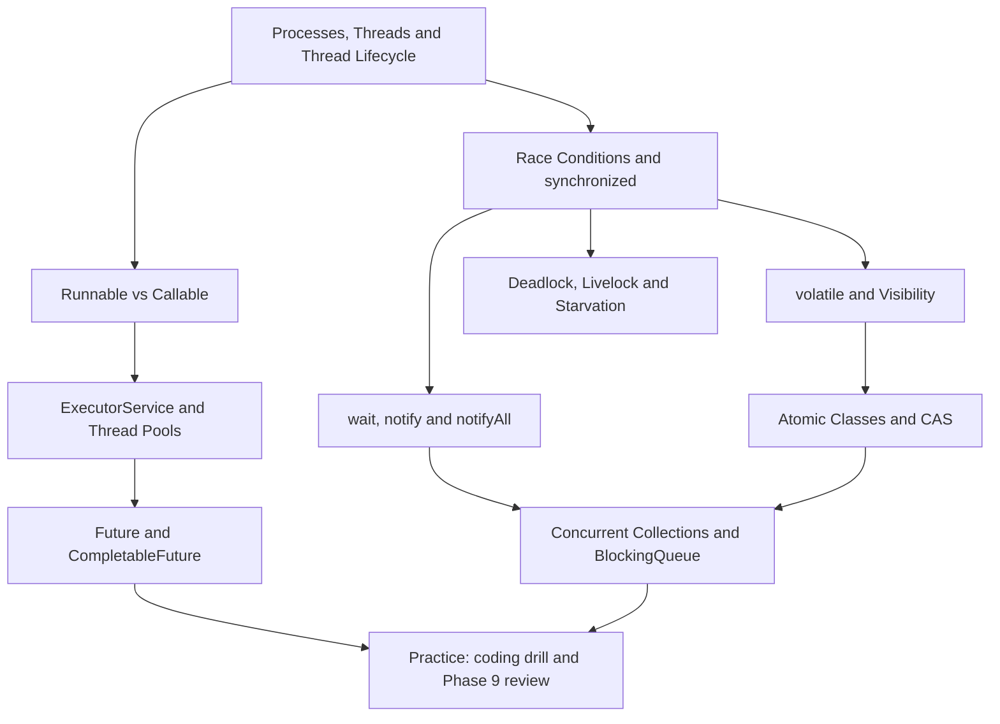
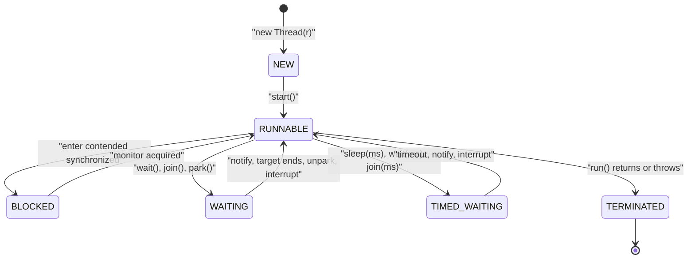
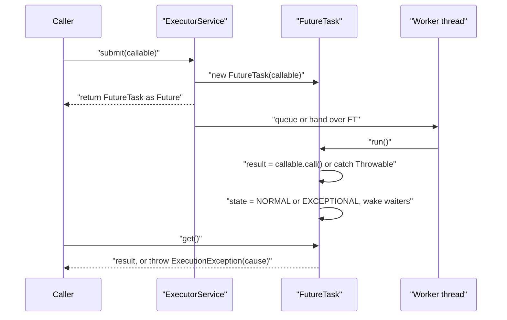

@@ 1 | MODULE | Phase 9 — Concurrency Fundamentals (Intermediate) | Threads, shared state, synchronized, volatile, wait and notify, deadlock, atomics, executors, futures and concurrent collections | MUST
# Phase 9: Concurrency Fundamentals (Intermediate)

This phase teaches you how Java runs several things at once and how to keep shared data correct while it does. You start with threads themselves (what they are, their states, `Runnable` vs `Callable`), move to the problems shared state causes (race conditions, visibility, deadlock) and the tools that fix them (`synchronized`, `volatile`, `wait` and `notify`, atomic classes), and finish with the modern, high-level toolkit every Spring developer uses daily: executors and thread pools, `Future` and `CompletableFuture`, and concurrent collections such as `BlockingQueue`.

Why interviewers care: every Spring Boot service is concurrent. Tomcat serves each request on a pool thread, so two requests can hit the same singleton bean at the same moment. Interviewers ask concurrency questions to find out whether you will write the bug where two customers get the last item in stock, or the thread pool that brings production down. The questions range from definitions ("process vs thread") to output prediction ("what does this counter print?") to design ("how would you call three services in parallel?").



**Prerequisites:** Phase 2 (objects, interfaces, `final`), Phase 7 (lambdas, because every task is a lambda), and Phase 8 ([[ConcurrentHashMap Internals]] previews CAS and per-bin locking). Phase 16 builds on this phase with explicit locks, synchronizers, virtual threads and advanced `CompletableFuture` composition; Phase 15 covers the formal Java Memory Model.

**The 5 questions from this phase that come up most often**
1. What is a race condition, and how do `synchronized` and atomic classes fix it?
2. What does `volatile` guarantee, and why is `count++` on a volatile field still unsafe?
3. What is a deadlock, and how do you prevent one?
4. How does a `ThreadPoolExecutor` decide whether to run, queue or reject a task?
5. `Future` vs `CompletableFuture`: how do you call several services in parallel and combine the results?

@@ 2 | MODULE | Threads | What a thread is, how it moves through its states, and the two shapes of a task | MUST
# Threads

**Shared analogy: a restaurant kitchen.** The restaurant is a *process*: it has its own building, pantry and money (memory, file handles). The cooks are *threads*: they share the same pantry and the same kitchen, which is why they can cooperate quickly and also why they bump into each other. A cook is hired (NEW), starts working (RUNNABLE), waits for the only oven (BLOCKED), waits for a waiter to call them (WAITING), takes a timed break (TIMED_WAITING), and finally goes home (TERMINATED). An order ticket is a *task*: a `Runnable` ticket just says "do this", while a `Callable` ticket says "do this and bring me back the result, or tell me what went wrong".

@@ 3 | TOPIC | Processes, Threads and Thread Lifecycle | Process vs thread, what a thread owns and shares, creating and starting threads, the six states, join, sleep, interrupt and daemon threads | MUST
# Processes, Threads and Thread Lifecycle

**Level: Intermediate | Phase 9 | Priority: MUST | Since: Java 1.0 (Thread.Builder Java 21)**

> **30-second interview answer:** A process is a running program with its own memory space; a thread is an independent path of execution inside a process that shares the process's heap but has its own stack and program counter. In Java you create a thread from a `Runnable` and call `start()`, which asks the JVM to run `run()` on a new OS thread; calling `run()` directly just runs it on the current thread. A thread moves through six states (NEW, RUNNABLE, BLOCKED, WAITING, TIMED_WAITING, TERMINATED), and you coordinate with `join`, `sleep` and cooperative cancellation through `interrupt`.

## 1. Concept in Simple Words
### Analogy
Cooks in one restaurant kitchen.

| Kitchen | Java |
|---|---|
| The restaurant building with its own pantry | A process with its own address space (heap, loaded classes) |
| Each cook | A thread |
| A cook's personal notepad of what step they are on | The thread's own stack and program counter |
| The shared pantry and fridge | The heap: objects every thread can reach |
| Hiring a cook vs telling them to start | `new Thread(...)` (NEW) vs `start()` (RUNNABLE) |
| Waiting for the single oven someone else is using | BLOCKED on a monitor |
| Waiting until the head chef says "go" | WAITING (`wait`, `join`, `park`) |
| A 5-minute break | TIMED_WAITING (`sleep`, `wait(timeout)`) |
| The head chef tapping a cook on the shoulder: "stop when convenient" | `interrupt()` |
| The cleaner who leaves when the last cook leaves | A daemon thread |

### What it is
- **Process:** an OS-level running program. Separate processes do not share memory; they talk through sockets, files or pipes. Each JVM is one process.
- **Thread:** a unit of scheduling inside a process. It owns a **stack** (local variables, call frames) and a **program counter**; it shares the **heap**, static fields and open files with other threads in the same process.
- **Platform thread:** a `java.lang.Thread` mapped one-to-one to an OS thread (about 1 MB of reserved stack by default, expensive to create). **Virtual threads** (Java 21) are lightweight threads scheduled by the JVM; they are covered in [[Virtual Threads]].
- **Context switch:** the OS saving one thread's registers and loading another's so a core can run it. Cheap individually, expensive by the thousands.
- **The six states (`Thread.State`):**

| State | Meaning | How you get there |
|---|---|---|
| NEW | Created, not started | `new Thread(r)` |
| RUNNABLE | Running or ready to run (the JVM does not separate the two) | `start()` |
| BLOCKED | Waiting to enter a `synchronized` block held by another thread | Contended monitor |
| WAITING | Waiting indefinitely for another thread | `wait()`, `join()`, `LockSupport.park()` |
| TIMED_WAITING | Waiting with a timeout | `sleep(ms)`, `wait(ms)`, `join(ms)`, `parkNanos` |
| TERMINATED | `run()` has returned or thrown | End of `run()` |

- **`join()`:** wait for another thread to finish. It also guarantees you see everything that thread wrote (a happens-before edge).
- **`interrupt()`:** sets a flag on the target thread. Blocking methods (`sleep`, `wait`, `join`, `BlockingQueue.take`) respond by throwing `InterruptedException` and clearing the flag; other code must check `Thread.currentThread().isInterrupted()`.
- **Daemon thread:** a background thread that does not keep the JVM alive. The JVM exits when only daemon threads remain.

### Why it exists
One thread can only do one thing at a time. Threads let a server handle many requests at once, keep a UI responsive while work runs in the background, and use all CPU cores. Separate processes would also work, but sharing memory between threads is far cheaper than inter-process communication, at the price of having to coordinate access to that shared memory.

## 2. How It Works
**Memory: what is shared and what is private.**

```text
                 JVM process
+--------------------------------------------------+
|  Heap (shared): objects, arrays, static fields   |
|     Order#1   ProductCache   HashMap ...         |
|                                                  |
|  Metaspace (shared): class metadata              |
+--------------------------------------------------+
| Thread "main"     | Thread "worker-1" | Thread "worker-2"
| stack:            | stack:            | stack:
|  main() frame     |  run() frame      |  run() frame
|   local int i     |   local Order o --+--> points into the heap
| program counter   | program counter   | program counter
+-------------------+-------------------+------------------
```

Local primitives and references live on each thread's stack and are therefore thread-confined. The objects they point to live on the shared heap, and that is where races happen.

**State machine:**



**What `start()` does:** checks the thread is NEW (otherwise `IllegalThreadStateException`, so a thread can be started only once), asks the OS to create a native thread with its own stack, marks the Java thread RUNNABLE, and returns immediately. The new OS thread then calls `run()`. Calling `run()` yourself skips all of that: it is an ordinary method call on the caller's thread.

**Ways to create a thread (all end in a `Thread` running a `Runnable`):**

```java
Thread t1 = new Thread(() -> work(), "worker-1");                    // Runnable lambda, the usual way
Thread t2 = Thread.ofPlatform().name("worker-2").start(() -> work()); // Java 21 builder
Thread t3 = Thread.ofVirtual().start(() -> work());                    // Java 21 virtual thread
// Extending Thread works but wastes your one superclass; prefer Runnable.
// In real applications, submit tasks to an ExecutorService instead of creating threads.
```

**Interruption is cooperative:** Java has no safe way to kill a thread (`Thread.stop` is deprecated and removed in recent versions). You interrupt, and the thread decides when to stop. When you catch `InterruptedException` and cannot rethrow it, restore the flag with `Thread.currentThread().interrupt()` so callers higher up still know.

## 3. Code Example
### Code
```java
public class ThreadLifecycleDemo {

    private static final Object LOCK = new Object();
    private static boolean released;          // guarded by LOCK
    private static volatile boolean stop;     // read by a spinning thread

    // Poll until the thread reaches the state we want to show (keeps the output deterministic)
    static void awaitState(Thread t, Thread.State state) {
        while (t.getState() != state) {
            Thread.onSpinWait();
        }
    }

    public static void main(String[] args) throws InterruptedException {
        // run() vs start()
        Runnable task = () -> System.out.println("task runs on: " + Thread.currentThread().getName());
        Thread worker = new Thread(task, "worker-1");
        worker.run();        // ordinary method call on the main thread
        worker.start();      // new thread
        worker.join();

        // NEW, RUNNABLE
        Thread spinner = new Thread(() -> {
            while (!stop) {
                Thread.onSpinWait();
            }
        }, "spinner");
        System.out.println("1. after new: " + spinner.getState());
        spinner.start();
        System.out.println("2. while running: " + spinner.getState());
        stop = true;
        spinner.join();

        // TIMED_WAITING, then interrupt
        Thread sleeper = new Thread(() -> {
            try {
                Thread.sleep(10_000);
            } catch (InterruptedException e) {
                System.out.println("sleeper interrupted");
            }
        }, "sleeper");
        sleeper.start();
        awaitState(sleeper, Thread.State.TIMED_WAITING);
        System.out.println("3. while sleeping: " + sleeper.getState());
        sleeper.interrupt();
        sleeper.join();

        // BLOCKED: main holds the monitor the other thread wants
        Thread blocked = new Thread(() -> {
            synchronized (LOCK) {
                // nothing: we only want to observe the wait to get in
            }
        }, "blocked");
        synchronized (LOCK) {
            blocked.start();
            awaitState(blocked, Thread.State.BLOCKED);
            System.out.println("4. waiting for a monitor: " + blocked.getState());
        }
        blocked.join();

        // WAITING: inside wait() until main releases it
        Thread waiter = new Thread(() -> {
            synchronized (LOCK) {
                while (!released) {
                    try {
                        LOCK.wait();
                    } catch (InterruptedException e) {
                        Thread.currentThread().interrupt();
                        return;
                    }
                }
            }
        }, "waiter");
        waiter.start();
        awaitState(waiter, Thread.State.WAITING);
        System.out.println("5. inside wait(): " + waiter.getState());
        synchronized (LOCK) {
            released = true;
            LOCK.notifyAll();
        }
        waiter.join();
        System.out.println("6. after join: " + waiter.getState());

        // Java 21 builder: a daemon platform thread
        Thread cleaner = Thread.ofPlatform().name("bg-cleaner").daemon(true).unstarted(() -> { });
        System.out.println("daemon thread? " + cleaner.isDaemon() + ", name=" + cleaner.getName());
    }
}
```

### Walkthrough
- `worker.run()` prints `main` because it is a plain call; `worker.start()` runs the same code on `worker-1`. `join` makes main wait so the lines never interleave.
- A thread is NEW until `start()`. Immediately after `start()` returns it is RUNNABLE; our spinner never blocks, so it stays RUNNABLE until we set the `volatile` flag.
- `awaitState` polls `getState()` so we only print once the thread has really reached the state. Without it, the print could run before the other thread gets going, and the output would vary.
- The sleeper is TIMED_WAITING inside `sleep`. `interrupt()` makes `sleep` throw `InterruptedException`, the thread prints its message and ends; `join` guarantees that line appears before the next one.
- Main holds `LOCK`, so the `blocked` thread cannot enter its `synchronized` block and shows BLOCKED. Leaving main's block lets it in.
- The `waiter` calls `LOCK.wait()` in a `while` loop over a condition (the correct pattern, see [[wait, notify and notifyAll]]); `wait` releases the monitor and the thread shows WAITING until main sets `released` and calls `notifyAll`.
- `Thread.ofPlatform()` (Java 21) is a builder for named, daemon or virtual threads; `unstarted` creates without starting.

### Output
```text
task runs on: main
task runs on: worker-1
1. after new: NEW
2. while running: RUNNABLE
3. while sleeping: TIMED_WAITING
sleeper interrupted
4. waiting for a monitor: BLOCKED
5. inside wait(): WAITING
6. after join: TERMINATED
daemon thread? true, name=bg-cleaner
```

### Compare
| Old or wrong | Modern or right | Why |
|---|---|---|
| `class Worker extends Thread` | `new Thread(runnable)` or an executor | Keeps inheritance free; separates task from runner |
| Calling `run()` to "start" a thread | `start()` | `run()` runs on the caller's thread |
| `Thread.stop()` to kill a thread | `interrupt()` plus checking the flag | `stop` released locks mid-update and corrupted state |
| Swallowing `InterruptedException` | Rethrow, or restore with `Thread.currentThread().interrupt()` | Callers need to know cancellation was requested |
| `new Thread` per request | `ExecutorService` (or virtual threads, Java 21) | Thread creation is expensive and unbounded |

## 4. Interview Questions
**Basic**
1. **What is the difference between a process and a thread?**
   A process is an executing program with its own memory space and OS resources; processes are isolated from each other. A thread is a path of execution within a process: threads share the heap and resources of their process but each has its own stack and program counter. Threads are cheaper to create and communicate faster, but need synchronization.
2. **What are the states of a Java thread?**
   NEW, RUNNABLE, BLOCKED, WAITING, TIMED_WAITING and TERMINATED. RUNNABLE covers both "running on a CPU" and "ready to run"; BLOCKED is only for waiting on a monitor lock; WAITING and TIMED_WAITING are for `wait`, `join`, `park` and `sleep`.
3. **What is the difference between `start()` and `run()`?**
   `start()` creates a new thread of execution and that thread calls `run()`. Calling `run()` directly executes the code on the current thread with no concurrency. Calling `start()` twice throws `IllegalThreadStateException`.

**Follow-up**
4. **What is the difference between BLOCKED and WAITING?**
   BLOCKED means the thread wants to enter a `synchronized` block whose monitor another thread holds. WAITING means it voluntarily gave up running until some other thread acts: `notify`, the joined thread ending, or `unpark`. A thread in `wait()` that is notified moves to BLOCKED first, because it must reacquire the monitor.
5. **How do you stop a thread?**
   Cooperatively. Call `interrupt()`, and have the thread check `isInterrupted()` in its loop or let blocking calls throw `InterruptedException`, then clean up and return. A `volatile boolean` flag also works for simple loops, but it does not wake a thread that is sleeping or waiting.
6. **What does `sleep` do with locks the thread holds?**
   Nothing: `sleep` keeps every monitor it holds, so other threads stay blocked. `wait` is different: it releases the monitor of the object it is called on while waiting.
7. **What is a daemon thread?**
   A background thread that does not prevent the JVM from exiting; when only daemon threads are left, the JVM shuts down without running their remaining code (`finally` blocks may not execute). The flag must be set before `start()`. GC and JIT threads are examples.

**Tricky / scenario**
8. **What does `Thread t = new Thread(() -> System.out.println(Thread.currentThread().getName()), "w"); t.run(); t.start();` print?**
   `main` then `w`. The first call runs the lambda on the main thread; `start()` then runs it on the new thread named `w`. The order is guaranteed only because `run()` completes before `start()` is called.
9. **A thread catches `InterruptedException` with an empty catch block. What is the problem?**
   The interrupt flag was cleared when the exception was thrown, so the cancellation request is lost: an executor's `shutdownNow` or a framework timeout can no longer stop that thread. Either propagate the exception or call `Thread.currentThread().interrupt()` to restore the flag.
10. **Our service creates a new `Thread` for each incoming request and crashes under load with `OutOfMemoryError: unable to create native thread`. Why, and what is the fix?**
    Each platform thread reserves an OS stack, and the OS caps thread count; unbounded creation exhausts both. Use a bounded thread pool (`ExecutorService`) with a queue and rejection policy, or on Java 21 virtual threads for blocking I/O workloads.

**What the interviewer is really testing:** whether you understand what threads share (the heap, hence races) and what they do not (stacks), can read a thread dump's states, and know cooperative cancellation instead of killing threads.

## 5. Pitfalls & Best Practices
### Common mistakes
| Mistake | What goes wrong | Fix |
|---|---|---|
| Calling `run()` instead of `start()` | No new thread; code runs sequentially | Call `start()` or submit to an executor |
| Starting the same `Thread` twice | `IllegalThreadStateException` | Create a new `Thread` or reuse an executor |
| Empty `catch (InterruptedException e)` | Cancellation silently lost | Restore the flag or rethrow |
| Creating raw threads per task | Unbounded threads, OOM, slow creation | Thread pool or virtual threads |
| Unnamed threads | Thread dumps full of `Thread-17` | Name threads (constructor, builder or `ThreadFactory`) |
| Relying on thread priorities | OS may ignore them | Design without priorities |

### Best practices
- Treat raw `Thread` as a low-level building block. In applications, submit tasks to an `ExecutorService` (or Spring's `TaskExecutor` and `@Async`).
- Name your threads; it makes thread dumps and logs readable.
- Always support interruption in long-running loops and blocking code.
- Keep shared mutable state to a minimum: thread-confined (local) data needs no synchronization at all.
- Learn to read a thread dump (`jstack`, `jcmd <pid> Thread.print`): the states in this topic are exactly what it shows.

### Compare with
| Concept | Memory | Created by | Cost | Communication |
|---|---|---|---|---|
| Process | Own address space | OS | High | Sockets, files, pipes |
| Platform thread | Shared heap, own stack | `new Thread`, pools | About 1 MB stack, OS scheduling | Shared objects plus synchronization |
| Virtual thread (Java 21) | Shared heap, stack on heap | `Thread.ofVirtual()`, `newVirtualThreadPerTaskExecutor` | A few KB, JVM scheduling | Same as platform threads |
| Coroutine (Kotlin) | Shared heap | Language runtime | Very cheap | Channels, shared objects |

## 6. Hands-on Exercise
Write `CancellableReportJob` for OrderHub: a thread that "processes" orders 1 to 1000, sleeping 10 ms per order, and stops cleanly when interrupted. Acceptance criteria:
- The job checks the interrupt flag and handles `InterruptedException` without swallowing it.
- `main` starts the job, waits until it has processed at least 5 orders, interrupts it, joins it, and prints the final state and whether the job reported cancellation.
- The job prints `cancelled after N orders` exactly once (N varies by run; the other lines do not).

<details><summary>Solution</summary>

```java
import java.util.concurrent.atomic.AtomicInteger;

public class CancellableReportJob implements Runnable {
    final AtomicInteger processed = new AtomicInteger();
    volatile boolean cancelled;

    @Override
    public void run() {
        try {
            for (int orderId = 1; orderId <= 1000; orderId++) {
                if (Thread.currentThread().isInterrupted()) throw new InterruptedException();
                Thread.sleep(10);                       // simulated work; responds to interrupt
                processed.incrementAndGet();
            }
        } catch (InterruptedException e) {
            cancelled = true;
            Thread.currentThread().interrupt();         // restore the flag for anyone above us
            System.out.println("cancelled after " + processed.get() + " orders");
        }
    }

    public static void main(String[] args) throws InterruptedException {
        CancellableReportJob job = new CancellableReportJob();
        Thread t = new Thread(job, "report-job");
        t.start();
        while (job.processed.get() < 5) Thread.sleep(5);
        t.interrupt();
        t.join();
        System.out.println("state=" + t.getState() + " cancelled=" + job.cancelled);
    }
}
```
Output (the number on the first line varies between runs, typically 5 or 6):
```text
cancelled after 5 orders
state=TERMINATED cancelled=true
```
The explicit `isInterrupted()` check catches interrupts that arrive while the thread is computing rather than sleeping.
</details>

## 7. Recall
Q: What does a Java thread share with other threads in the same process, and what does it own?
A: It shares the heap, static fields and process resources; it owns its stack (local variables, frames) and program counter.

Q: What are the six Java thread states?
A: NEW, RUNNABLE, BLOCKED, WAITING, TIMED_WAITING and TERMINATED.

Q: What happens if you call `run()` on a Thread instead of `start()`?
A: The code runs synchronously on the calling thread; no new thread is created.

Q: What is the difference between BLOCKED and WAITING thread states?
A: BLOCKED is waiting to acquire a monitor held by another thread; WAITING is waiting indefinitely for another thread's action such as `notify`, `join` completion or `unpark`.

Q: How should code respond to InterruptedException if it cannot rethrow it?
A: Restore the interrupt flag with `Thread.currentThread().interrupt()` and stop the work cleanly.

**Related:** [[Runnable vs Callable]] · [[Race Conditions and synchronized]] · [[ExecutorService and Thread Pools]] · [[Virtual Threads]]

@@ 3 | TOPIC | Runnable vs Callable | Return values, checked exceptions, Future, FutureTask, how submit and execute treat exceptions differently | MUST
# Runnable vs Callable

**Level: Intermediate | Phase 9 | Priority: MUST | Since: Java 1.0 (Runnable), Java 5 (Callable)**

> **30-second interview answer:** Both describe a task to run on another thread. `Runnable.run()` returns nothing and cannot throw checked exceptions; `Callable<V>.call()` returns a value and may throw any `Exception`. You can pass a `Runnable` to a `Thread` or an executor, but a `Callable` only to an executor (or wrapped in a `FutureTask`). Submitting either returns a `Future`; if the task fails, the exception is captured and rethrown from `future.get()` wrapped in an `ExecutionException`.

## 1. Concept in Simple Words
### Analogy
Two kinds of errand.

| Errand | Java |
|---|---|
| "Please water the plants" (no report expected) | `Runnable`: `void run()` |
| "Please check the price of milk and tell me" | `Callable<BigDecimal>`: `V call()` |
| "If the shop is closed, tell me that" | `call() throws Exception` |
| The receipt you get when you hand over the errand | The `Future` returned by `submit` |
| Asking for the answer when you need it, waiting if it is not ready | `future.get()` blocks |
| Being told "the errand failed, here is why" | `ExecutionException` with the original cause |

### What it is
- **`Runnable`** (`java.lang`, Java 1.0): `@FunctionalInterface` with `void run()`. No result, no checked exceptions.
- **`Callable<V>`** (`java.util.concurrent`, Java 5): `@FunctionalInterface` with `V call() throws Exception`.
- **`Future<V>`:** a handle to a pending result: `get()`, `get(timeout, unit)`, `isDone()`, `cancel(mayInterrupt)`, `isCancelled()`, plus `resultNow()`, `exceptionNow()` and `state()` (Java 19).
- **`FutureTask<V>`:** implements both `Runnable` and `Future` (through `RunnableFuture`). Executors wrap every submitted task in one. You can also give a `FutureTask` to a plain `Thread`.
- **`ExecutionException`:** the checked exception `get()` throws when the task threw; `getCause()` is the original exception.
- **`execute(Runnable)`** vs **`submit(...)`:** `execute` (from `Executor`) returns nothing; an exception kills the worker thread and goes to the uncaught exception handler (printed to stderr by default). `submit` returns a `Future` and stores the exception inside it.

### Why it exists
`Runnable` predates the concurrency library. To get a result out of a `Runnable` you had to write it into a shared field and synchronize, and checked exceptions had to be wrapped. Java 5 added `Callable` and `Future` so a task could return a value or fail, and the caller could collect the outcome safely without hand-written synchronization.

## 2. How It Works


**Inside `FutureTask`:** a `volatile int state` (NEW, COMPLETING, NORMAL, EXCEPTIONAL, CANCELLED, INTERRUPTING, INTERRUPTED), an `outcome` field holding either the result or the `Throwable`, and a stack of waiting threads. `run()` calls `call()` in a try-catch that catches everything, so a failure never escapes to the worker thread. `get()` parks the caller until the state is final. Because `state` is volatile and written after `outcome`, the caller is guaranteed to see the full result (a happens-before edge).

**`submit(Runnable)`** wraps the runnable with `Executors.callable(runnable, null)`, so `get()` returns `null` on success. `submit(runnable, result)` returns the given result instead.

**Lambda overload resolution:** `pool.submit(() -> 42)` picks `submit(Callable)` because the lambda returns a value. `pool.submit(() -> System.out.println())` picks `submit(Runnable)` because it is void. A lambda body that only throws is compatible with both, and the compiler picks `Callable`; assign it to a typed variable when the intent matters.

```text
execute(runnable)                         submit(runnable or callable)
  task throws RuntimeException              task throws anything
        |                                         |
  worker thread dies (pool replaces it)     FutureTask catches it, stores it
        |                                         |
  UncaughtExceptionHandler prints it        silent until someone calls get()
                                            get() -> ExecutionException(cause)
```

## 3. Code Example
### Code
```java
import java.io.IOException;
import java.util.concurrent.Callable;
import java.util.concurrent.ExecutionException;
import java.util.concurrent.ExecutorService;
import java.util.concurrent.Executors;
import java.util.concurrent.Future;
import java.util.concurrent.FutureTask;

public class RunnableVsCallableDemo {

    public static void main(String[] args) throws Exception {
        try (ExecutorService pool = Executors.newFixedThreadPool(2)) {
            // 1. Runnable: no result, Future.get() returns null
            Runnable audit = () -> System.out.println("audit written");
            Future<?> f1 = pool.submit(audit);
            System.out.println("runnable result: " + f1.get());

            // 2. Callable: returns a value
            Callable<Integer> stockLookup = () -> 42;
            Future<Integer> f2 = pool.submit(stockLookup);
            System.out.println("callable result: " + f2.get());

            // 3. Callable may throw a checked exception; get() wraps it
            Callable<Integer> failingLookup = () -> {
                throw new IOException("inventory service down");
            };
            Future<Integer> f3 = pool.submit(failingLookup);
            try {
                f3.get();
            } catch (ExecutionException e) {
                System.out.println("callable failed: " + e.getCause());
            }

            // 4. A failing Runnable passed to submit(): the exception hides inside the Future
            Runnable buggy = () -> {
                throw new IllegalStateException("bug in runnable");
            };
            Future<?> f4 = pool.submit(buggy);
            try {
                f4.get();
            } catch (ExecutionException e) {
                System.out.println("runnable failure surfaced via get(): " + e.getCause());
            }

            // 5. The same Runnable on a raw thread goes to the uncaught exception handler
            Thread raw = new Thread(buggy, "raw-thread");
            raw.setUncaughtExceptionHandler((t, ex) ->
                    System.out.println("uncaught in " + t.getName() + ": " + ex.getMessage()));
            raw.start();
            raw.join();
        }

        // 6. FutureTask lets a plain Thread run a Callable
        FutureTask<String> task = new FutureTask<>(() -> "computed in a plain Thread");
        new Thread(task).start();
        System.out.println("FutureTask result: " + task.get());

        // 7. Adapting a Runnable into a Callable
        Callable<String> adapted = Executors.callable(() -> { }, "done");
        System.out.println("adapted: " + adapted.call());
    }
}
```

### Walkthrough
- `f1.get()` waits for the runnable to finish (so "audit written" always prints first) and returns `null`.
- `f2.get()` returns the callable's value. The type parameter flows through: `Future<Integer>`.
- `failingLookup` throws a checked `IOException`, which a `Runnable` could not do without wrapping. `get()` throws `ExecutionException`; `getCause()` is the original exception, printed with its class name.
- `buggy` is a `Runnable` that throws. Submitted to the pool, the exception is swallowed into the `Future`: if nobody called `get()`, you would never see it. This is the most common "my task silently failed" bug.
- On a raw thread the same exception reaches the uncaught exception handler. We install one so the message is printed in a predictable place; the default handler prints a stack trace to stderr.
- `FutureTask` wraps a `Callable` into a `Runnable` so a plain `Thread` can run it, while still exposing `get()`.
- `Executors.callable(runnable, result)` adapts in the other direction.

### Output
```text
audit written
runnable result: null
callable result: 42
callable failed: java.io.IOException: inventory service down
runnable failure surfaced via get(): java.lang.IllegalStateException: bug in runnable
uncaught in raw-thread: bug in runnable
FutureTask result: computed in a plain Thread
adapted: done
```

### Compare
| Aspect | Runnable | Callable |
|---|---|---|
| Method | `void run()` | `V call() throws Exception` |
| Result | None | A value of type V |
| Checked exceptions | Must be caught inside | Allowed, surface as `ExecutionException` |
| Run by `Thread` | Yes | Only through `FutureTask` |
| Run by executor | `execute` or `submit` | `submit`, `invokeAll`, `invokeAny` |
| Package and version | `java.lang`, Java 1.0 | `java.util.concurrent`, Java 5 |

## 4. Interview Questions
**Basic**
1. **What is the difference between `Runnable` and `Callable`?**
   `Runnable.run()` returns `void` and cannot throw checked exceptions. `Callable.call()` returns a value and can throw any exception. Both are functional interfaces, so both are usually written as lambdas.
2. **How do you get the result of a `Callable`?**
   Submit it to an `ExecutorService`, which returns a `Future<V>`, and call `get()` (optionally with a timeout). `get()` blocks until the result is ready.
3. **Can you pass a `Callable` to a `Thread` constructor?**
   Not directly; `Thread` only accepts a `Runnable`. Wrap it in a `FutureTask`, which is a `Runnable` and a `Future` at once.

**Follow-up**
4. **What happens when a task submitted with `submit` throws an exception?**
   `FutureTask` catches it and stores it. The worker thread survives. The exception is rethrown, wrapped in `ExecutionException`, only when someone calls `get()`. If nobody calls `get()`, the failure is invisible.
5. **How is `execute` different from `submit` when the task fails?**
   With `execute`, the exception propagates out of the worker thread, which dies (the pool creates a replacement) and the uncaught exception handler logs it. With `submit`, the exception is captured in the `Future`. That is why fire-and-forget tasks should use `execute` or catch and log inside the task.
6. **What does `Future.get(timeout, unit)` do on timeout?**
   It throws `TimeoutException` but does not stop the task. If you want to stop it, call `future.cancel(true)`, which interrupts the worker thread; the task must respond to interruption for that to work.

**Tricky / scenario**
7. **`pool.submit(() -> { throw new RuntimeException(); })`: is that a `Runnable` or a `Callable`?**
   It compiles against both overloads, and Java chooses `submit(Callable)` because a lambda that completes abruptly is compatible with a value-returning interface and that overload is more specific. Behaviour is the same either way: the exception ends up in the `Future`.
8. **A scheduled cleanup job submitted with `scheduleAtFixedRate` stopped running after a week and nothing was logged. Why?**
   One run threw an exception. For periodic tasks, an exception cancels all future executions and is stored in the returned `ScheduledFuture`, which nobody checked. Wrap the body in try-catch and log, so a single failure does not end the schedule.
9. **Why is `get()` a happens-before point?**
   `FutureTask` writes the result, then sets its volatile `state`; `get()` reads that state before reading the result. So everything the task did before completing is visible to the thread that called `get()`, with no extra synchronization.

**What the interviewer is really testing:** whether you know where task results and exceptions go, especially the silent-failure trap with `submit`, and how `Future` connects the two threads.

## 5. Pitfalls & Best Practices
### Common mistakes
| Mistake | What goes wrong | Fix |
|---|---|---|
| Submitting tasks and never calling `get()` | Exceptions vanish silently | Call `get()`, use `execute`, or catch and log inside the task |
| Calling `get()` without a timeout | Caller blocks forever if the task hangs | `get(timeout, unit)` and handle `TimeoutException` |
| Catching `ExecutionException` and logging only it | The real cause is hidden | Log or rethrow `e.getCause()` |
| Wrapping checked exceptions inside a `Runnable` by hand | Boilerplate, lost exception types | Use a `Callable` |
| Periodic task without try-catch | One failure cancels all future runs silently | Catch and log inside periodic tasks |

### Best practices
- Use `Callable` whenever the caller needs a result or should know about failure; use `Runnable` for fire-and-forget work that logs its own errors.
- Always bound waits: `get(timeout, unit)`.
- When you have several tasks, use `invokeAll` (all results) or `invokeAny` (first success), or move up to `CompletableFuture` for composition.
- Unwrap `ExecutionException` at the boundary and translate the cause into your domain exception.

### Compare with
| Type | Returns | Throws checked | Composable | Typical use |
|---|---|---|---|---|
| Runnable | Nothing | No | No | Fire-and-forget tasks, `Thread` |
| Callable | V | Yes | No | Tasks whose result you need |
| Supplier (functional) | V | No | Used by `CompletableFuture.supplyAsync` | Async pipelines |
| Future | Handle to V | `get` throws `ExecutionException` | No (blocking `get` only) | Waiting for one result |
| CompletableFuture | Handle to V | Completion carries exception | Yes (`thenApply`, `thenCombine`) | Async composition |

## 6. Hands-on Exercise
OrderHub must check three warehouses for a product's stock at once and report the total. Write `WarehouseStockChecker` with a `Callable<Integer>` per warehouse submitted through `invokeAll`. Acceptance criteria:
- Warehouses A and B return 5 and 7; warehouse C throws `IOException("C offline")`.
- Total stock counts only successful warehouses, and each failure is reported with its cause message.
- Output lists warehouses in submission order (A, B, C) regardless of which finishes first.

<details><summary>Solution</summary>

```java
import java.io.IOException;
import java.util.List;
import java.util.concurrent.Callable;
import java.util.concurrent.ExecutionException;
import java.util.concurrent.ExecutorService;
import java.util.concurrent.Executors;
import java.util.concurrent.Future;

public class WarehouseStockChecker {

    record Warehouse(String name, Callable<Integer> lookup) { }

    public static void main(String[] args) throws InterruptedException {
        List<Warehouse> warehouses = List.of(
                new Warehouse("A", () -> 5),
                new Warehouse("B", () -> { Thread.sleep(50); return 7; }),
                new Warehouse("C", () -> { throw new IOException("C offline"); }));

        try (ExecutorService pool = Executors.newFixedThreadPool(3)) {
            List<Future<Integer>> futures = pool.invokeAll(warehouses.stream().map(Warehouse::lookup).toList());
            int total = 0;
            for (int i = 0; i < futures.size(); i++) {
                String name = warehouses.get(i).name();
                try {
                    int stock = futures.get(i).get();       // already done: invokeAll waits for all
                    total += stock;
                    System.out.println(name + ": " + stock);
                } catch (ExecutionException e) {
                    System.out.println(name + ": failed (" + e.getCause().getMessage() + ")");
                }
            }
            System.out.println("total available: " + total);
        }
    }
}
```
Output:
```text
A: 5
B: 7
C: failed (C offline)
total available: 12
```
`invokeAll` returns futures in the same order as the input list and only returns once every task has completed, so the output order is fixed.
</details>

## 7. Recall
Q: What can a Callable do that a Runnable cannot?
A: Return a value and throw checked exceptions from its `call()` method.

Q: How does an exception thrown by a submitted Callable reach the caller?
A: It is stored in the `Future` and rethrown from `get()` wrapped in an `ExecutionException` whose cause is the original exception.

Q: How can a plain Thread run a Callable?
A: Wrap it in a `FutureTask`, which implements both `Runnable` and `Future`.

Q: What is the difference between `execute` and `submit` when a task throws?
A: `execute` lets the exception kill the worker thread and reach the uncaught exception handler; `submit` captures it in the returned `Future`.

Q: What does `Future.get()` return for a Runnable submitted with `submit(runnable)`?
A: `null` on successful completion.

**Related:** [[Processes, Threads and Thread Lifecycle]] · [[ExecutorService and Thread Pools]] · [[Future and CompletableFuture]] · [[Lambdas and Functional Interfaces]]
