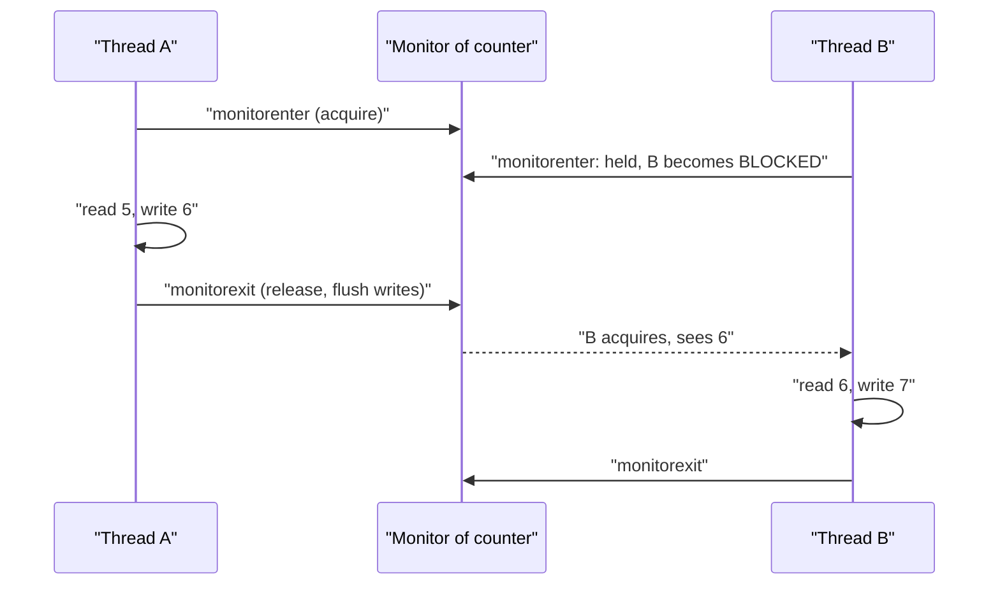
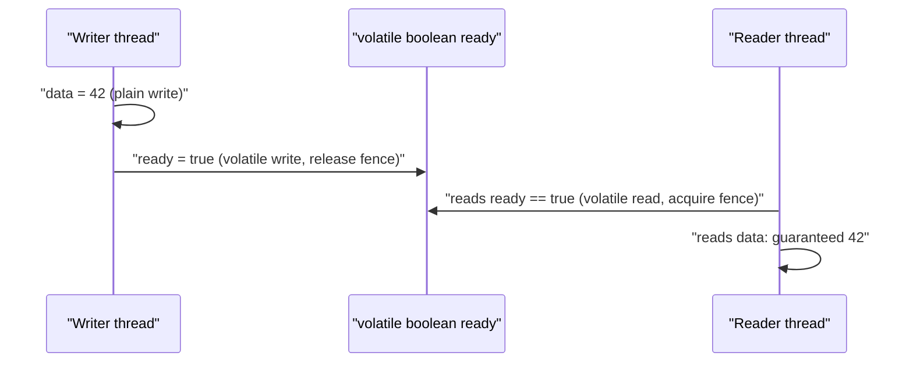

@@ 2 | MODULE | Shared state | What goes wrong when threads share mutable data, and the tools that make it correct | MUST
# Shared state

**Shared analogy: one whiteboard in a busy office.** Everyone can read and write the same whiteboard (the heap). If two people update the same number at once, one update is lost (a race condition), so the office uses a marker that only one person may hold at a time (`synchronized`). Some people copy the board into their notebook and keep reading the stale copy (visibility), unless the board has a "always look at the real board" sign (`volatile`). People can wait by the board until someone rings a bell (`wait` and `notify`), two people each holding one marker and waiting for the other's can freeze forever (deadlock), and some numbers can be changed with a single tamper-proof stroke that never needs the marker at all (atomic classes and CAS).

Every topic in this group answers the same question: when two threads touch the same data, how do we keep it correct?

@@ 3 | TOPIC | Race Conditions and synchronized | Read-modify-write and check-then-act races, intrinsic locks and monitors, synchronized methods vs blocks, reentrancy and what to lock on | MUST
# Race Conditions and synchronized

**Level: Intermediate | Phase 9 | Priority: MUST | Since: Java 1.0**

> **30-second interview answer:** A race condition is a bug where the result depends on the timing of threads, typically when two threads read, modify and write the same variable (`count++`) or check a condition and act on it (`if (stock > 0) stock--`) without coordination. `synchronized` fixes it by making a block mutually exclusive on an object's monitor lock: only one thread at a time can run code synchronized on that object, and releasing the lock publishes its writes to the next thread that takes it. The lock is reentrant, a synchronized instance method locks `this`, and a static one locks the `Class` object.

## 1. Concept in Simple Words
### Analogy
A single-occupancy bathroom with a key on a big wooden block.

| Bathroom | Java |
|---|---|
| The bathroom | The critical section (code touching shared state) |
| The one key | The object's monitor (intrinsic lock) |
| Taking the key before entering | Entering a `synchronized` block |
| People queueing for the key | Threads in the BLOCKED state |
| Returning the key on the way out, whatever happens inside | The lock is released when the block exits, even by exception |
| The same person can open an inner cabinet with the key they already hold | Reentrancy |
| Two bathrooms with two keys: different people can use them at once | Synchronizing on different objects does not exclude each other |

### What it is
- **Race condition:** correctness depends on the interleaving of threads. Two classic shapes:
  - **Read-modify-write:** `count++` is three steps (read `count`, add 1, write back). Two threads can both read 5 and both write 6.
  - **Check-then-act:** `if (!map.containsKey(k)) map.put(k, v)` or `if (stock > 0) stock--`. Another thread can act between the check and the act.
- **Data race:** two threads access the same variable, at least one writes, and there is no happens-before ordering between them. Data races cause both lost updates and visibility problems.
- **Critical section:** code that must not run in two threads at the same time.
- **Monitor (intrinsic lock):** every Java object has one. `synchronized (obj) { ... }` acquires `obj`'s monitor on entry and releases it on exit.
- **`synchronized` method:** an instance method locks `this`; a `static synchronized` method locks `TheClass.class`.
- **Reentrant:** a thread that already holds a monitor can enter another block synchronized on the same object without deadlocking itself; the JVM keeps a hold count.
- **Atomicity, visibility, ordering:** the three guarantees `synchronized` gives: the block runs as one indivisible unit relative to other threads using the same lock, writes made before releasing are visible to the next thread acquiring, and code is not reordered out of the block.

### Why it exists
CPUs interleave threads at arbitrary instruction boundaries and cache values in registers and per-core caches. Without a way to say "this sequence must happen as a unit and its results must be visible", shared counters, caches, balances and stock levels would silently corrupt under load, usually only in production.

## 2. How It Works
**The lost update, step by step** (`count` starts at 5):

```text
time   Thread A                 Thread B                 count in memory
 t1    read count -> 5                                   5
 t2                             read count -> 5          5
 t3    add 1 -> 6                                        5
 t4                             add 1 -> 6               5
 t5    write 6                                           6
 t6                             write 6                  6   <- one increment lost
```

**With `synchronized`:**



**Bytecode:** a `synchronized` block compiles to `monitorenter` and `monitorexit` instructions, with an extra `monitorexit` in an exception handler so the lock is always released. A `synchronized` method instead has the `ACC_SYNCHRONIZED` flag and the JVM does the same work implicitly.

**Inside the JVM:** each object header has a mark word. An uncontended lock is a cheap CAS on that word (a "thin" or lightweight lock); under contention the JVM inflates it to a heavyweight monitor with an OS-level wait queue. Biased locking, an older optimisation, was disabled by default in Java 15 and removed in Java 18. The JIT can also remove locks on objects that never escape a thread (lock elision) and merge adjacent blocks (lock coarsening).

**Happens-before:** an unlock of a monitor happens-before every later lock of the same monitor. That is why a reader must also synchronize on the same lock: synchronizing only the writer gives no visibility guarantee to an unsynchronized reader.

**Choosing the lock object:**

```java
private final Object lock = new Object();   // best: private, final, nobody else can lock it
synchronized (lock) { balance -= amount; }

synchronized (this) { }      // works, but any outside code can also lock your object
synchronized ("LOCK") { }    // never: string literals are shared across the whole JVM
synchronized (count) { }     // never: Integer is immutable; count++ creates a new object, the lock changes
```

**Virtual threads:** on Java 21 to 23, a virtual thread that blocks inside `synchronized` pins its carrier thread, which can starve the scheduler; `ReentrantLock` avoided that. `Java 25+` (fixed in Java 24, JEP 491) removes most pinning for `synchronized`.

## 3. Code Example
### Code
```java
import java.util.concurrent.CountDownLatch;
import java.util.concurrent.ExecutorService;
import java.util.concurrent.Executors;
import java.util.concurrent.atomic.AtomicInteger;

public class RaceConditionDemo {

    static class UnsafeCounter {
        private int count;
        void increment() { count++; }                  // read-modify-write, not atomic
        int get() { return count; }
    }

    static class SyncCounter {
        private int count;
        synchronized void increment() { count++; }     // locks this
        synchronized int get() { return count; }       // readers must lock too (visibility)
        synchronized void incrementTwice() {           // reentrancy: calls another synchronized method
            increment();
            increment();
        }
    }

    static class Inventory {
        private int stock = 1;
        private final Object lock = new Object();

        boolean reserveUnsafe() {
            if (stock > 0) {                           // check...
                pause();                               // widen the window, as a slow DB call would
                stock--;                               // ...then act
                return true;
            }
            return false;
        }

        boolean reserveSafe() {
            synchronized (lock) {                      // check and act as one unit
                if (stock > 0) {
                    pause();
                    stock--;
                    return true;
                }
                return false;
            }
        }
    }

    static void pause() {
        try { Thread.sleep(10); } catch (InterruptedException e) { Thread.currentThread().interrupt(); }
    }

    // Starts all tasks at the same moment to maximise contention
    static void runConcurrently(int threads, Runnable task) throws InterruptedException {
        CountDownLatch start = new CountDownLatch(1);
        try (ExecutorService pool = Executors.newFixedThreadPool(threads)) {
            for (int i = 0; i < threads; i++) {
                pool.submit(() -> {
                    try { start.await(); } catch (InterruptedException e) { return; }
                    task.run();
                });
            }
            start.countDown();
        }
    }

    public static void main(String[] args) throws InterruptedException {
        UnsafeCounter unsafe = new UnsafeCounter();
        runConcurrently(2, () -> { for (int i = 0; i < 1_000_000; i++) unsafe.increment(); });
        System.out.println("unsafe counter: " + unsafe.get() + " (expected 2000000)");

        SyncCounter safe = new SyncCounter();
        runConcurrently(2, () -> { for (int i = 0; i < 1_000_000; i++) safe.increment(); });
        System.out.println("synchronized counter: " + safe.get());

        Inventory shop1 = new Inventory();
        AtomicInteger winners1 = new AtomicInteger();
        runConcurrently(10, () -> { if (shop1.reserveUnsafe()) winners1.incrementAndGet(); });
        System.out.println("unsafe reserve: " + winners1.get() + " buyers got the last item");

        Inventory shop2 = new Inventory();
        AtomicInteger winners2 = new AtomicInteger();
        runConcurrently(10, () -> { if (shop2.reserveSafe()) winners2.incrementAndGet(); });
        System.out.println("synchronized reserve: " + winners2.get() + " buyer got the last item");

        SyncCounter re = new SyncCounter();
        re.incrementTwice();
        System.out.println("reentrant call completed, count=" + re.get());
    }
}
```

### Walkthrough
- `runConcurrently` uses a `CountDownLatch` as a starting gun so all threads begin together; the executor's `close()` waits for them to finish, which also makes their writes visible to `main`.
- `UnsafeCounter.increment` loses updates whenever two threads interleave between read and write, so the total falls short of 2,000,000 by a different amount on every run.
- `SyncCounter` makes `increment` and `get` synchronized on `this`. Only one thread increments at a time, so no update is lost.
- `reserveUnsafe` is the oversell bug: ten buyers all see `stock > 0` before anyone decrements, so several "get" the single item and stock goes negative. The sleep stands in for a slow database or HTTP call between check and act.
- `reserveSafe` puts the check and the act inside one `synchronized` block on a private lock, so exactly one buyer wins.
- `incrementTwice` is synchronized and calls `increment`, also synchronized on `this`. Because monitors are reentrant, the thread does not block on a lock it already holds.

### Output
Lines 1 and 3 vary between runs (the numbers shown are from one run; on rare runs the unsafe counter can even hit the expected value by luck). Lines 2, 4 and 5 are always the same.
```text
unsafe counter: 1183402 (expected 2000000)
synchronized counter: 2000000
unsafe reserve: 10 buyers got the last item
synchronized reserve: 1 buyer got the last item
reentrant call completed, count=2
```

### Compare
| Broken | Fixed | Why |
|---|---|---|
| `count++` on a shared field | `synchronized` method or `AtomicInteger.incrementAndGet()` | Makes read-modify-write indivisible |
| `if (stock > 0) stock--;` | Check and act in one `synchronized` block, or an atomic DB update | Closes the window between check and act |
| Synchronized writer, unsynchronized reader | Both synchronize on the same lock | Visibility needs the same monitor on both sides |
| `synchronized (new Object())` inside the method | A shared `private final` lock field | A fresh lock per call excludes nobody |
| `synchronized` on a `String` literal or boxed `Integer` | Dedicated lock object | Shared or changing lock objects cause deadlocks or no exclusion |

## 4. Interview Questions
**Basic**
1. **What is a race condition?**
   A bug where the outcome depends on the relative timing of threads accessing shared mutable state. The classic examples are lost updates from `count++` and check-then-act sequences like "if not present, insert".
2. **What does `synchronized` guarantee?**
   Mutual exclusion for code synchronized on the same monitor, plus visibility: everything a thread wrote before releasing the lock is visible to the next thread that acquires it. It also prevents reordering of code out of the block.
3. **What does a synchronized instance method lock? A static one?**
   An instance method locks `this`; a static method locks the `Class` object (`Counter.class`). They are different locks, so a static and an instance synchronized method can run at the same time.

**Follow-up**
4. **Why is `count++` not thread-safe even though it is one line?**
   It compiles to read, add and write. Two threads can read the same old value and both write the same new value, losing an increment. Mark the method `synchronized`, or use `AtomicInteger`.
5. **What is reentrancy and why does it matter?**
   A thread holding a monitor can acquire it again (the JVM counts holds). Without it, a synchronized method calling another synchronized method on the same object, or a subclass calling `super` on a synchronized method, would deadlock with itself.
6. **Is it enough to synchronize only the setter?**
   No. A reader that does not take the same lock has no happens-before relationship with the writer, so it may see a stale or partially updated value. Both reads and writes of shared mutable state must use the same lock (or the field must be `volatile` if only visibility is needed).
7. **Why synchronize on a private final lock object rather than `this`?**
   Any code holding a reference to your object can `synchronized (yourObject)` and interfere, causing unexpected contention or deadlocks. A private lock is fully under your control. `final` also prevents the lock from being reassigned between threads.

**Tricky / scenario**
8. **Two threads call `a.transfer(b)` and `b.transfer(a)` where `transfer` is `synchronized` and calls a synchronized method on the other account. What can happen?**
   Deadlock: thread 1 holds `a` and waits for `b`, thread 2 holds `b` and waits for `a`. Fix it with a global lock order (always lock the account with the smaller id first), or with `tryLock` and timeouts. See [[Deadlock, Livelock and Starvation]].
9. **In a Spring Boot app, a singleton `@Service` keeps a `private int requestCount` field and increments it per request. Is that safe?**
   No. A singleton bean is shared by every Tomcat request thread, so increments race. Use `AtomicLong` or `LongAdder` (or Micrometer counters), and in general keep singleton beans stateless.
10. **We synchronized our inventory method, but with two instances of the service behind a load balancer we still oversell. Why?**
    `synchronized` only coordinates threads inside one JVM. Across instances you need the database to enforce it: an atomic `UPDATE ... SET stock = stock - 1 WHERE id = ? AND stock > 0`, optimistic locking with a version column, or a distributed lock.

**What the interviewer is really testing:** whether you can spot read-modify-write and check-then-act races in ordinary code, explain mutual exclusion and visibility, and know the limits of `synchronized` (same lock, same JVM).

## 5. Pitfalls & Best Practices
### Common mistakes
| Mistake | What goes wrong | Fix |
|---|---|---|
| Synchronizing writes but not reads | Readers see stale values | Lock both sides on the same monitor |
| Locking on different objects for the same data | No mutual exclusion | One designated lock per piece of state |
| Slow I/O inside a synchronized block | All other threads queue, throughput collapses | Do I/O outside, keep the critical section tiny |
| Locking on string literals, boxed values or `getClass()` | Unexpected sharing or changing locks | `private final Object lock = new Object()` |
| Mutable state in Spring singleton beans | Races between request threads | Stateless beans, or atomics and concurrent collections |
| Assuming `synchronized` works across instances | Overselling in a cluster | Database constraints, optimistic locking or distributed locks |

### Best practices
- First try to avoid shared mutable state: immutable objects, thread-confined data, message passing.
- When you must share, keep the critical section as small as possible and never call unknown code (callbacks, listeners) while holding a lock.
- Document which lock guards which field (for example a comment `// guarded by lock`).
- Prefer higher-level tools when they fit: `AtomicInteger`, `ConcurrentHashMap.merge`, `ReentrantLock` (timeouts, fairness) from [[ReentrantLock, ReadWriteLock and StampedLock]].
- Test with many threads and a starting latch; races hide at low concurrency.

### Compare with
| Tool | Mutual exclusion | Visibility | Atomic compound ops | Notes |
|---|---|---|---|---|
| `synchronized` | Yes | Yes | Yes, anything in the block | Simple, reentrant, no timeout |
| `volatile` | No | Yes | No | Flags and safe publication |
| `AtomicInteger` and friends | No lock needed | Yes | Single-variable updates via CAS | Fast counters |
| `ReentrantLock` | Yes | Yes | Yes | `tryLock`, timeouts, fairness, conditions |
| Immutable objects | Not needed | Yes, once safely published | Not applicable | Simplest thread safety |

## 6. Hands-on Exercise
Write a thread-safe `BankAccount` for OrderHub's wallet feature with `deposit(long cents)`, `boolean withdraw(long cents)` (false if insufficient funds) and `long balance()`. Acceptance criteria:
- A private final lock object; all three methods use it.
- 4 threads each depositing 100 cents 1000 times while 4 other threads each try to withdraw 100 cents 1000 times leaves the account with `balance() == deposits - successfulWithdrawals` and never negative.
- Print the final balance check as `consistent=true`.

<details><summary>Solution</summary>

```java
import java.util.concurrent.ExecutorService;
import java.util.concurrent.Executors;
import java.util.concurrent.atomic.AtomicLong;

public class BankAccount {
    private final Object lock = new Object();
    private long balanceCents;                 // guarded by lock

    public void deposit(long cents) {
        if (cents <= 0) throw new IllegalArgumentException("amount must be positive");
        synchronized (lock) {
            balanceCents += cents;
        }
    }

    public boolean withdraw(long cents) {
        synchronized (lock) {                  // check and act together
            if (balanceCents < cents) return false;
            balanceCents -= cents;
            return true;
        }
    }

    public long balance() {
        synchronized (lock) {
            return balanceCents;
        }
    }

    public static void main(String[] args) {
        BankAccount account = new BankAccount();
        AtomicLong withdrawn = new AtomicLong();
        try (ExecutorService pool = Executors.newFixedThreadPool(8)) {
            for (int t = 0; t < 4; t++) {
                pool.submit(() -> { for (int i = 0; i < 1000; i++) account.deposit(100); });
                pool.submit(() -> {
                    for (int i = 0; i < 1000; i++) if (account.withdraw(100)) withdrawn.addAndGet(100);
                });
            }
        }
        long deposited = 4L * 1000 * 100;
        boolean consistent = account.balance() == deposited - withdrawn.get() && account.balance() >= 0;
        System.out.println("consistent=" + consistent);
    }
}
```
Output:
```text
consistent=true
```
How much was withdrawn varies with timing, but the invariant always holds because every read and write of `balanceCents` happens under the same lock.
</details>

## 7. Recall
Q: What are the two classic shapes of a race condition?
A: Read-modify-write (such as `count++`) and check-then-act (such as `if (stock > 0) stock--`).

Q: What object does a synchronized instance method lock, and what does a static synchronized method lock?
A: The instance method locks `this`; the static method locks the `Class` object.

Q: Besides mutual exclusion, what does synchronized guarantee?
A: Visibility and ordering: writes made before releasing a monitor are visible to the next thread that acquires the same monitor.

Q: What does it mean that Java's intrinsic locks are reentrant?
A: A thread that already holds a monitor can acquire it again without blocking; the JVM counts the holds.

Q: Why does synchronized not prevent overselling when an application runs on several servers?
A: It only coordinates threads within one JVM; cross-instance consistency needs database constraints, optimistic locking or a distributed lock.

**Related:** [[volatile and Visibility]] · [[Atomic Classes and CAS]] · [[Deadlock, Livelock and Starvation]] · [[ReentrantLock, ReadWriteLock and StampedLock]]

@@ 3 | TOPIC | volatile and Visibility | CPU caches and reordering, what volatile guarantees, happens-before through volatile, stop flags, safe publication and double-checked locking | MUST
# volatile and Visibility

**Level: Intermediate | Phase 9 | Priority: MUST | Since: Java 1.0 (semantics strengthened in Java 5, JSR-133)**

> **30-second interview answer:** `volatile` guarantees visibility and ordering for a single variable: every read sees the most recent write by any thread, and writes before a volatile write cannot be reordered after it, so a thread that reads the volatile also sees everything written before it. It does not make compound actions atomic, so `volatileCount++` still loses updates. Use it for status flags, for safely publishing an immutable object, and for the instance field in double-checked locking; use locks or atomics for read-modify-write.

## 1. Concept in Simple Words
### Analogy
A team that each keeps a personal photocopy of the shared schedule.

| Office | Java |
|---|---|
| The master schedule on the wall | The variable in main memory |
| Each person's photocopy on their desk | A core's cache or a value the JIT keeps in a register |
| Someone updates the wall but you keep reading your old photocopy | Stale read: a visibility bug |
| A red "always check the wall" sticker on one line of the schedule | The `volatile` keyword on a field |
| When you see the sticker updated, everything pinned above it is also current | Happens-before: writes before the volatile write are visible after the volatile read |
| Two people both reading "slots left: 3" and writing "2" | `volatile` does not prevent lost updates |

### What it is
- **Visibility problem:** one thread writes a variable and another thread never sees the new value, or sees it late, because of CPU caches, store buffers, or the JIT keeping the value in a register.
- **Reordering:** compilers and CPUs may reorder independent instructions for speed. Single-threaded results are unchanged, but another thread can observe the writes in a surprising order.
- **`volatile` field:** reads and writes go to memory with ordering fences. Guarantees:
  1. **Visibility:** a read returns the last write by any thread.
  2. **Ordering (happens-before):** a write to a volatile variable happens-before every subsequent read of it; everything the writer did before the write is visible to the reader after the read.
  3. **Atomic reads and writes of `long` and `double`:** non-volatile 64-bit writes may be split in two on some 32-bit JVMs (word tearing).
- **Not guaranteed:** atomicity of compound operations (`x++`, `if (x == 0) x = 1`).
- **Safe publication:** making a newly constructed object visible to other threads only after it is fully built. A volatile field, a `final` field, a lock, or a concurrent collection all publish safely.

### Why it exists
Locks give visibility but cost mutual exclusion. Many cases only need "make sure other threads see this": a shutdown flag, a configuration object swapped at runtime, a lazily initialised singleton. `volatile` gives exactly that, cheaply, and the Java 5 memory model (JSR-133) made its ordering guarantees strong enough for safe publication.

## 2. How It Works
**Why a thread can miss a write:**

```text
   Core 1 (writer)              Core 2 (reader)
   +-------------+              +-------------+
   | register    |              | register    |  <- JIT may keep 'running' here forever
   | L1 cache    |              | L1 cache    |     while (running) { }  becomes
   | running=F   |              | running=T   |     if (running) while (true) { }
   +------+------+              +------+------+
          |      shared L3 / main memory      |
          +--------- running = ? -------------+
```

The hardware caches are coherent on x86 and ARM, so the most common real cause is the **JIT compiler**: seeing no synchronization, it legally hoists the read of a non-volatile field out of the loop, and the loop never ends. Marking the field `volatile` forbids that optimisation.

**Happens-before through volatile (the publication pattern):**



The plain write to `data` cannot move below the volatile write, and the plain read of `data` cannot move above the volatile read. Without `volatile` on `ready`, the reader could see `ready == true` and still read `data == 0`.

**Double-checked locking needs `volatile`:**

```java
public final class ConfigHolder {
    private static volatile ConfigHolder instance;     // volatile is essential

    public static ConfigHolder get() {
        ConfigHolder local = instance;                  // one volatile read on the fast path
        if (local == null) {
            synchronized (ConfigHolder.class) {
                local = instance;
                if (local == null) {
                    instance = local = new ConfigHolder();
                }
            }
        }
        return local;
    }
}
```

`instance = new ConfigHolder()` is three steps: allocate, run the constructor, assign the reference. Without `volatile` the assignment can become visible before the constructor's writes, and another thread can get a half-constructed object. The volatile write forbids that reordering. (The holder-class idiom or an `enum` singleton avoid the issue entirely.)

**Cost:** a volatile read is nearly as cheap as a normal read on x86; a volatile write adds a store fence (tens of cycles). It is far cheaper than an uncontended lock under contention, but it is not free in tight loops.

## 3. Code Example
### Code
```java
import java.util.concurrent.atomic.AtomicInteger;

public class VolatileDemo {

    // 1. A stop flag: volatile so the worker's loop re-reads it
    private static volatile boolean running = true;

    // 2. Publication: plain data, volatile "ready" flag
    private static int data;
    private static volatile boolean ready;

    // 3. volatile does not make ++ atomic
    private static volatile int volatileCount;
    private static final AtomicInteger atomicCount = new AtomicInteger();

    public static void main(String[] args) throws InterruptedException {
        Thread worker = new Thread(() -> {
            long spins = 0;
            while (running) {
                spins++;                      // busy work; without volatile the JIT may hoist the read
            }
            System.out.println("worker saw running=false and stopped");
        });
        worker.start();
        Thread.sleep(100);
        running = false;
        worker.join();

        Thread reader = new Thread(() -> {
            while (!ready) {
                Thread.onSpinWait();
            }
            System.out.println("reader sees data=" + data);   // guaranteed 42
        });
        reader.start();
        data = 42;          // plain write...
        ready = true;       // ...published by the volatile write
        reader.join();

        Runnable bump = () -> {
            for (int i = 0; i < 1_000_000; i++) {
                volatileCount++;                  // read, add, write: still a race
                atomicCount.incrementAndGet();    // CAS: atomic
            }
        };
        Thread a = new Thread(bump);
        Thread b = new Thread(bump);
        a.start();
        b.start();
        a.join();
        b.join();
        System.out.println("volatile count: " + volatileCount + " (expected 2000000)");
        System.out.println("atomic count: " + atomicCount.get());
    }
}
```

### Walkthrough
- `running` is volatile, so each loop iteration reads it from memory. Remove `volatile` and on a typical HotSpot JVM the JIT compiles the loop as `while (true)` after a few thousand iterations: the program hangs. That is why the broken version is described, not run.
- The publication block writes `data` normally and then `ready` with a volatile write. Once the reader sees `ready == true`, the happens-before rule guarantees it also sees `data == 42`.
- `volatileCount++` on two threads loses updates: every read and write is visible, but two threads can still read the same value before either writes. `AtomicInteger.incrementAndGet` uses CAS and loses nothing.

### Output
The volatile count line varies between runs; all other lines are always the same.
```text
worker saw running=false and stopped
reader sees data=42
volatile count: 1302177 (expected 2000000)
atomic count: 2000000
```

### Compare
| Need | Use `volatile`? | Better tool if not |
|---|---|---|
| Stop or status flag written by one thread | Yes | Not needed |
| Publish an immutable config object, swap at runtime | Yes (volatile reference) | `AtomicReference` if you need compare-and-set |
| Counter incremented by many threads | No | `AtomicLong`, `LongAdder` |
| "If null then create" lazy init | Only with double-checked locking | Holder class idiom, `enum` singleton |
| Invariant across several fields | No | `synchronized` or an immutable object swapped atomically |

## 4. Interview Questions
**Basic**
1. **What does `volatile` do?**
   It guarantees that reads see the latest write from any thread and prevents reordering around the volatile access, so writes made before a volatile write are visible to a thread after it reads that volatile. It also makes 64-bit `long` and `double` reads and writes atomic.
2. **Does `volatile` make an operation atomic?**
   Only single reads and writes. `x++`, `x += 2` and check-then-act on a volatile field are still races because they consist of several steps. Use `synchronized` or atomic classes for those.
3. **When would you use `volatile`?**
   For flags written by one thread and read by others (shutdown, status), for publishing a reference to an immutable object, and in double-checked locking for the instance field.

**Follow-up**
4. **Why can a loop on a non-volatile boolean run forever?**
   With no synchronization, the JIT may assume no other thread changes the field and hoist the read out of the loop, turning it into an infinite loop. The language allows this optimisation; `volatile` forbids it.
5. **What is the difference between `volatile` and `synchronized`?**
   Both give visibility and ordering. `synchronized` also gives mutual exclusion, so a whole block runs atomically with respect to the same lock, at the cost of blocking. `volatile` never blocks but protects only individual reads and writes of one variable.
6. **Why does double-checked locking need `volatile`?**
   Object construction and the assignment of the reference can be reordered, so another thread could see a non-null reference to an object whose fields are not yet initialised. Making the field volatile forbids publishing the reference before the constructor's writes.
7. **What is "piggybacking" on volatile?**
   Using the happens-before edge of a volatile write and read to publish other, non-volatile writes made before it, like `data = 42; ready = true;`. It is correct but subtle; reserve it for well-documented patterns.

**Tricky / scenario**
8. **A config reload thread does `config.setUrl(u); config.setTimeout(t);` on a shared mutable object with volatile fields. Readers sometimes see the new URL with the old timeout. Why?**
   Each field is individually visible, but the pair is not updated atomically, so a reader can run between the two writes. Build a new immutable `Config` object and swap a single `volatile` (or `AtomicReference`) reference to it.
9. **Is `volatile int[] arr` enough to make element writes visible?**
   No. Only the reference `arr` is volatile; writes to `arr[i]` are plain writes. Use `AtomicIntegerArray` or `VarHandle` array access for volatile element semantics.
10. **Would `volatile` on a `HashMap` field make the map thread-safe?**
    No. It only makes assignments of the reference visible. Concurrent `put` calls still corrupt the map's internals. It is fine to publish an immutable map (`Map.copyOf`) through a volatile field and replace it wholesale.

**What the interviewer is really testing:** whether you separate visibility from atomicity, can explain why the JIT breaks unsynchronized flag loops, and know why double-checked locking needs `volatile`.

## 5. Pitfalls & Best Practices
### Common mistakes
| Mistake | What goes wrong | Fix |
|---|---|---|
| `volatile int count; count++` | Lost updates | `AtomicInteger` or `LongAdder` |
| Non-volatile stop flag | Loop never sees the change, thread never stops | Mark it `volatile` or use interruption |
| Double-checked locking without `volatile` | Half-constructed object visible | Add `volatile` or use the holder idiom |
| Volatile array expecting element visibility | Element writes not visible | `AtomicIntegerArray`, `AtomicReferenceArray` |
| Several volatile fields forming one invariant | Readers see mixed old and new values | One volatile reference to an immutable object |

### Best practices
- Use `volatile` for one variable, one writer, simple state. The moment you need "read then write", switch to atomics or locks.
- Prefer immutable value objects published through a volatile or `AtomicReference` field for configuration that changes at runtime.
- For lazy singletons, prefer the holder idiom: `private static class Holder { static final X INSTANCE = new X(); }`; class initialisation is thread-safe and lazy.
- Remember that `final` fields are also safely published once the constructor finishes (as long as `this` does not escape during construction).
- The formal rules live in the Java Memory Model; see [[Java Memory Model and Happens-Before]].

### Compare with
| Mechanism | Visibility | Atomicity | Blocking | Typical use |
|---|---|---|---|---|
| Plain field | No guarantee across threads | Single read or write (not long or double) | No | Thread-confined data |
| `volatile` | Yes | Single read or write | No | Flags, publication |
| `final` | Yes after construction | Not applicable | No | Immutable objects |
| Atomic classes | Yes | Single-variable read-modify-write | No (CAS) | Counters, sequences |
| `synchronized` | Yes | Whole block | Yes | Multi-step invariants |

## 6. Hands-on Exercise
OrderHub has a `FeatureFlags` component read by every request thread and refreshed by one background thread. Write it so readers never see a half-updated set of flags. Acceptance criteria:
- Flags are held in an immutable record `Flags(boolean newCheckout, int maxCartItems)` referenced by a single `volatile` field.
- `refresh(boolean, int)` replaces the whole record; `current()` returns it.
- A reader thread spins until it observes `newCheckout == true` and then prints `maxCartItems`, which must always be the value written in the same refresh (50).

<details><summary>Solution</summary>

```java
public class FeatureFlags {

    public record Flags(boolean newCheckout, int maxCartItems) { }

    private volatile Flags current = new Flags(false, 20);

    public Flags current() { return current; }

    public void refresh(boolean newCheckout, int maxCartItems) {
        current = new Flags(newCheckout, maxCartItems);   // one volatile write publishes both values
    }

    public static void main(String[] args) throws InterruptedException {
        FeatureFlags flags = new FeatureFlags();
        Thread reader = new Thread(() -> {
            Flags f;
            while (!(f = flags.current()).newCheckout()) {
                Thread.onSpinWait();
            }
            System.out.println("newCheckout on, maxCartItems=" + f.maxCartItems());
        });
        reader.start();
        Thread.sleep(50);
        flags.refresh(true, 50);
        reader.join();
    }
}
```
Output:
```text
newCheckout on, maxCartItems=50
```
The reader reads the reference once into `f` and uses that snapshot, so both fields always come from the same refresh. Two separate volatile fields could not give that guarantee.
</details>

## 7. Recall
Q: What two guarantees does volatile give?
A: Visibility (reads see the latest write from any thread) and ordering (writes before a volatile write are visible to a thread after it reads that volatile).

Q: Why is `count++` on a volatile int still not thread-safe?
A: It is a read, an add and a write; two threads can read the same value before either writes, so updates are lost.

Q: Why can a loop on a non-volatile boolean flag never terminate?
A: The JIT may hoist the field read out of the loop because it sees no synchronization, so the loop never re-reads the flag.

Q: Why does double-checked locking require a volatile instance field?
A: Without it, the reference can be published before the constructor's writes, letting another thread see a half-constructed object.

Q: How do you safely update several related configuration values read by many threads?
A: Put them in one immutable object and replace a single volatile or `AtomicReference` field holding it.

**Related:** [[Race Conditions and synchronized]] · [[Atomic Classes and CAS]] · [[Java Memory Model and Happens-Before]] · [[Immutable Class Design]]

@@ 3 | TOPIC | wait, notify and notifyAll | Guarded blocks, why wait must be in a loop, monitor ownership, notify vs notifyAll, wait vs sleep and a bounded buffer | SHOULD
# wait, notify and notifyAll

**Level: Intermediate | Phase 9 | Priority: SHOULD | Since: Java 1.0**

> **30-second interview answer:** `wait`, `notify` and `notifyAll` are `Object` methods that let threads coordinate on a condition using the object's monitor. A thread must hold the monitor (be inside `synchronized` on that object) to call them, otherwise it gets `IllegalMonitorStateException`. `wait()` releases the monitor and sleeps until notified; it must always be called in a `while` loop that re-checks the condition, because of spurious wakeups and because another thread may have changed the state first. `notifyAll` is the safe default; in new code, `BlockingQueue` or `Condition` usually replace them.

## 1. Concept in Simple Words
### Analogy
A restaurant pickup counter with a bell.

| Pickup counter | Java |
|---|---|
| The counter area, one person allowed at a time | The object's monitor (`synchronized (counter)`) |
| A customer finds no food, sits down and gives up their spot at the counter | `wait()` releases the monitor and waits |
| The cook puts food out and rings the bell | `notify()` or `notifyAll()` |
| Everyone who hears the bell walks back and checks whether *their* order is there | Waking up and re-checking the condition in a `while` loop |
| Ringing the bell for one random person who may not be the right one | `notify()` can wake the wrong waiter |
| Ringing loud enough for everyone | `notifyAll()` |
| Sometimes someone wakes up thinking they heard the bell when nobody rang | A spurious wakeup |

### What it is
- **Guarded block:** code that waits until a condition (the guard) is true, for example "buffer is not empty".
- **`wait()`:** called while holding the object's monitor; atomically releases the monitor and puts the thread into the object's **wait set** (state WAITING, or TIMED_WAITING for `wait(ms)`). When woken it must reacquire the monitor before `wait` returns.
- **`notify()`:** wakes one arbitrary thread from the object's wait set. The woken thread cannot proceed until the notifier releases the monitor.
- **`notifyAll()`:** wakes every thread in the wait set; they compete for the monitor one at a time.
- **Spurious wakeup:** `wait` returning without any notify, which the specification explicitly allows.
- **`IllegalMonitorStateException`:** thrown if you call `wait` or `notify` on an object whose monitor you do not hold.

### Why it exists
Before Java 5 there was no `BlockingQueue` or `Condition`. Without `wait` and `notify`, a thread waiting for data would have to busy-spin (burning CPU) or sleep in a loop (adding latency). Monitors with wait sets let a thread sleep efficiently until another thread signals that the state it cares about may have changed. Today they are mostly an interview topic and the foundation that higher-level tools are built on.

## 2. How It Works
Every object's monitor has two queues: the **entry set** (threads BLOCKED trying to enter `synchronized`) and the **wait set** (threads that called `wait`).

```text
                    synchronized (buffer)
   entry set                 +-----------+               wait set
 (BLOCKED, want lock) -----> |  OWNER    | --wait()----> (WAITING, released lock)
                             | (1 thread)|
                             +-----------+ <-------------- notify()/notifyAll():
                                                          moved back to compete
                                                          for the lock (BLOCKED)
```

**The canonical pattern:**

```java
synchronized (lock) {
    while (!condition) {        // while, never if
        lock.wait();
    }
    // condition is true AND we hold the lock: act on it
}

synchronized (lock) {
    changeStateSoConditionMayBeTrue();
    lock.notifyAll();
}
```

**Why `while` and not `if`:**
1. Spurious wakeups can happen.
2. With `notifyAll`, several consumers wake up for one item; the first takes it and the others must wait again.
3. Between being notified and reacquiring the lock, another thread may have entered and changed the state.

```mermaid
sequenceDiagram
    participant C as "Consumer"
    participant M as "Monitor of buffer"
    participant P as "Producer"
    C->>M: "lock; buffer empty, wait() releases lock"
    P->>M: "lock; add item; notifyAll()"
    P->>M: "unlock"
    M-->>C: "C reacquires the lock"
    C->>C: "while check: not empty, take item"
    C->>M: "notifyAll() (space freed); unlock"
```

**`notify` vs `notifyAll`:** with one condition and interchangeable waiters (all consumers waiting for "not empty"), `notify` is a valid optimisation. When producers and consumers wait on the *same* monitor for *different* conditions ("not full" vs "not empty"), `notify` can wake a thread of the wrong kind, which goes back to waiting, and the signal is lost: every thread can end up waiting forever. `notifyAll` avoids that, at the cost of extra wakeups. `ReentrantLock` with two `Condition` objects solves it precisely (Phase 16).

**`wait` vs `sleep`:**

| | `wait()` | `Thread.sleep()` |
|---|---|---|
| Defined in | `Object` | `Thread` (static) |
| Needs the monitor | Yes | No |
| Releases the monitor | Yes | No, keeps every lock |
| Woken by | `notify`, `notifyAll`, interrupt, timeout | Timeout or interrupt |
| Purpose | Wait for a condition | Pause for a duration |

## 3. Code Example
### Code
```java
import java.util.ArrayDeque;
import java.util.Queue;

public class WaitNotifyDemo {

    // A bounded buffer built with wait/notifyAll (what ArrayBlockingQueue does for you)
    static final class BoundedBuffer<T> {
        private final Queue<T> items = new ArrayDeque<>();
        private final int capacity;

        BoundedBuffer(int capacity) { this.capacity = capacity; }

        public synchronized void put(T item) throws InterruptedException {
            while (items.size() == capacity) {   // guard: wait while full
                wait();                           // releases the monitor of this
            }
            items.add(item);
            notifyAll();                          // wake consumers waiting for "not empty"
        }

        public synchronized T take() throws InterruptedException {
            while (items.isEmpty()) {             // guard: wait while empty
                wait();
            }
            T item = items.remove();
            notifyAll();                          // wake producers waiting for "not full"
            return item;
        }
    }

    private static final int POISON = -1;

    public static void main(String[] args) throws InterruptedException {
        BoundedBuffer<Integer> buffer = new BoundedBuffer<>(2);

        Thread producer = new Thread(() -> {
            try {
                for (int i = 1; i <= 5; i++) {
                    buffer.put(i);                // blocks whenever 2 items are waiting
                }
                buffer.put(POISON);               // tell the consumer to stop
            } catch (InterruptedException e) {
                Thread.currentThread().interrupt();
            }
        }, "producer");

        Thread consumer = new Thread(() -> {
            try {
                while (true) {
                    int item = buffer.take();
                    if (item == POISON) {
                        System.out.println("consumer got poison pill, stopping");
                        return;
                    }
                    System.out.println("consumed " + item);
                }
            } catch (InterruptedException e) {
                Thread.currentThread().interrupt();
            }
        }, "consumer");

        consumer.start();
        producer.start();
        producer.join();
        consumer.join();

        // Calling notify without holding the monitor
        Object lock = new Object();
        try {
            lock.notify();
        } catch (IllegalMonitorStateException e) {
            System.out.println("notify outside synchronized: IllegalMonitorStateException");
        }
    }
}
```

### Walkthrough
- `put` and `take` are `synchronized`, so they hold the buffer's monitor, which `wait` and `notifyAll` require.
- Each method waits in a `while` loop on its own guard: producers wait while full, consumers wait while empty. Both call `notifyAll` after changing the state, because waiters for both conditions share one wait set.
- With capacity 2, the producer regularly blocks until the consumer takes an item; you cannot see that in the output, but it is what keeps memory bounded.
- There is a single producer and a single consumer and the buffer is FIFO, so items are always consumed in order 1 to 5 and the output is deterministic.
- A **poison pill** (a special value meaning "no more items") is a simple way to shut down a consumer.
- `lock.notify()` outside a `synchronized (lock)` block throws `IllegalMonitorStateException`.

### Output
```text
consumed 1
consumed 2
consumed 3
consumed 4
consumed 5
consumer got poison pill, stopping
notify outside synchronized: IllegalMonitorStateException
```

### Compare
| Hand-written wait and notify | `java.util.concurrent` |
|---|---|
| `BoundedBuffer` above, about 25 lines, easy to get wrong | `new ArrayBlockingQueue<>(2)` with `put` and `take` |
| One wait set for "not full" and "not empty", so `notifyAll` | `ReentrantLock` with two `Condition` objects, precise `signal` |
| No timeouts unless you write them | `offer(e, timeout, unit)`, `poll(timeout, unit)` |
| Interview and legacy code | Production code |

## 4. Interview Questions
**Basic**
1. **What do `wait`, `notify` and `notifyAll` do?**
   `wait` releases the object's monitor and suspends the thread until it is notified (or interrupted, or times out). `notify` wakes one waiting thread on that object; `notifyAll` wakes them all. Woken threads must reacquire the monitor before continuing.
2. **Why must `wait` be called inside a `synchronized` block?**
   Because it releases the monitor, the thread must own it; otherwise `IllegalMonitorStateException` is thrown. More fundamentally, checking the condition and starting to wait must be atomic, or a notify could arrive between the check and the wait and be lost.
3. **What is the difference between `wait` and `sleep`?**
   `wait` is an `Object` method that requires and releases the monitor and is woken by a notify. `sleep` is a static `Thread` method that does not need a lock and does not release any lock it holds; it just pauses for a time.

**Follow-up**
4. **Why should `wait` always be called in a loop?**
   Spurious wakeups are allowed, another waiter may consume the state first, and the state can change between notification and reacquiring the monitor. Re-checking the condition in a `while` loop handles all three cases.
5. **When is `notify` enough and when do you need `notifyAll`?**
   `notify` is enough when all waiters wait for the same condition and any one of them can make progress. If different threads wait for different conditions on the same object (producers and consumers), `notify` may wake the wrong kind and the signal is lost, so use `notifyAll`, or separate `Condition` objects.
6. **Why are these methods on `Object` and not on `Thread`?**
   Because they operate on a monitor, and every object has a monitor. Threads wait for a condition associated with a shared object (a buffer, a queue), not for a particular thread.

**Tricky / scenario**
7. **A producer-consumer with two producers and two consumers using `notify` occasionally freezes with every thread in WAITING. Why?**
   A consumer took the last item and its `notify` woke the other consumer instead of a producer; that consumer saw the buffer empty and waited again. Now nobody will ever notify the producers. Switching to `notifyAll` or to two `Condition` objects fixes it.
8. **What happens to a thread blocked in `wait` when it is interrupted?**
   It must first reacquire the monitor, then `wait` throws `InterruptedException` and clears the interrupt flag. Handle it by stopping or restoring the flag.
9. **Would you write wait and notify code in a Spring Boot service today?**
   Rarely. `BlockingQueue`, `CountDownLatch`, `CompletableFuture` and `Semaphore` express the same coordination with less code and fewer bugs. I would still recognise and fix it in legacy code and use it to explain how those tools work inside.

**What the interviewer is really testing:** whether you know the guarded-block pattern exactly (synchronized, while loop, notifyAll) and understand the lost-wakeup and spurious-wakeup problems, not just the method names.

## 5. Pitfalls & Best Practices
### Common mistakes
| Mistake | What goes wrong | Fix |
|---|---|---|
| `if (!condition) wait();` | Proceeds on spurious wakeup or stolen state | `while (!condition) wait();` |
| Calling `wait` or `notify` without the monitor | `IllegalMonitorStateException` | Call inside `synchronized` on the same object |
| `notify` with mixed waiter types | Lost wakeups, all threads waiting forever | `notifyAll` or separate `Condition`s |
| Waiting on one object, notifying another | Waiters never wake | Use the same lock object for both |
| Changing state without notifying | Waiters sleep forever | Notify after every state change that can satisfy a guard |
| Using `sleep` in a loop to wait for a condition | Latency and wasted CPU | `wait` and `notify` or a `BlockingQueue` |

### Best practices
- Prefer `BlockingQueue`, `CountDownLatch`, `Semaphore` or `CompletableFuture` in new code.
- If you must use them: one lock object, a documented condition, `while` loops and `notifyAll`.
- Use a private lock object rather than `this` so outside code cannot call `notify` on your monitor.
- Consider `wait(timeout)` to avoid waiting forever if a signal is missed due to a bug.

### Compare with
| Tool | Waits for | Signal | Notes |
|---|---|---|---|
| `wait` and `notify` | A condition on a monitor | `notify`, `notifyAll` | Low level, one wait set per object |
| `Condition` (`ReentrantLock`) | A named condition | `signal`, `signalAll` | Several conditions per lock, timeouts |
| `BlockingQueue` | Space or items | Built in | The usual producer-consumer answer |
| `CountDownLatch` | A count reaching zero | `countDown` | One-shot gate |
| `LockSupport.park` | A permit | `unpark(thread)` | Building block of all of the above |

## 6. Hands-on Exercise
Write `PingPong`: two threads print `ping` and `pong` strictly alternately, 3 times each, using a shared lock with `wait` and `notifyAll`. Acceptance criteria:
- A `boolean pingTurn` guarded by the lock decides who prints next.
- Each thread waits in a `while` loop until it is its turn.
- Output is always `ping`, `pong` repeated three times, regardless of which thread starts first.

<details><summary>Solution</summary>

```java
public class PingPong {
    private final Object lock = new Object();
    private boolean pingTurn = true;           // guarded by lock

    void play(String word, boolean isPing, int times) {
        for (int i = 0; i < times; i++) {
            synchronized (lock) {
                while (pingTurn != isPing) {
                    try {
                        lock.wait();
                    } catch (InterruptedException e) {
                        Thread.currentThread().interrupt();
                        return;
                    }
                }
                System.out.println(word);
                pingTurn = !isPing;            // hand the turn over
                lock.notifyAll();
            }
        }
    }

    public static void main(String[] args) throws InterruptedException {
        PingPong game = new PingPong();
        Thread pong = new Thread(() -> game.play("pong", false, 3));
        Thread ping = new Thread(() -> game.play("ping", true, 3));
        pong.start();                          // starting pong first does not matter
        ping.start();
        ping.join();
        pong.join();
    }
}
```
Output:
```text
ping
pong
ping
pong
ping
pong
```
The turn flag, not the start order, decides who prints; that is what makes the output deterministic.
</details>

## 7. Recall
Q: What must a thread hold before calling `wait()` or `notify()` on an object?
A: That object's monitor, by being inside a block synchronized on it; otherwise `IllegalMonitorStateException` is thrown.

Q: Why must `wait()` be called in a while loop?
A: Because of spurious wakeups and because the condition may have been changed by another thread before the woken thread reacquired the monitor.

Q: What is the key difference between `wait()` and `Thread.sleep()` regarding locks?
A: `wait()` releases the monitor it is called on; `sleep()` keeps every lock the thread holds.

Q: When can using `notify()` instead of `notifyAll()` cause all threads to hang?
A: When threads wait for different conditions on the same monitor, such as producers and consumers, and `notify` wakes a thread of the wrong kind, losing the signal.

Q: Which java.util.concurrent class replaces a hand-written wait/notify bounded buffer?
A: A `BlockingQueue` such as `ArrayBlockingQueue` with `put` and `take`.

**Related:** [[Race Conditions and synchronized]] · [[Concurrent Collections and BlockingQueue]] · [[CountDownLatch, CyclicBarrier, Semaphore and Phaser]] · [[Processes, Threads and Thread Lifecycle]]
