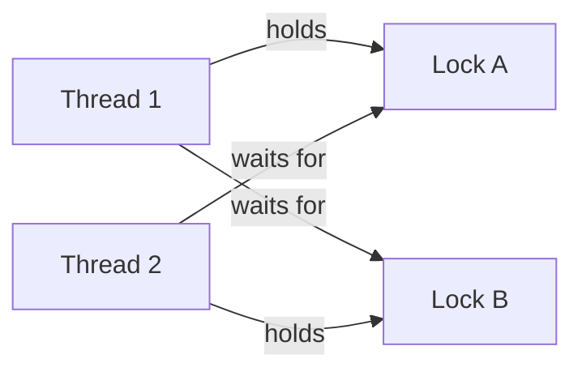
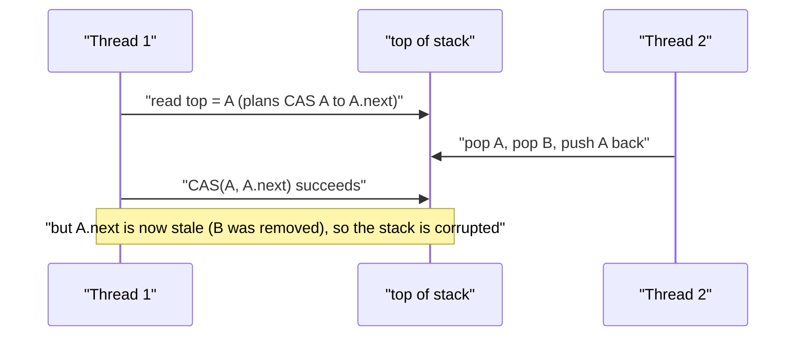

@@ 3 | TOPIC | Deadlock, Livelock and Starvation | The four Coffman conditions, lock ordering, tryLock with timeouts, detecting deadlocks in thread dumps, livelock and starvation | MUST
# Deadlock, Livelock and Starvation

**Level: Intermediate | Phase 9 | Priority: MUST | Since: Java 1.0 (deadlock detection via ThreadMXBean Java 5 and 6)**

> **30-second interview answer:** A deadlock is when two or more threads each hold a lock and wait forever for a lock another one holds, for example thread 1 holds A and wants B while thread 2 holds B and wants A. It needs four conditions at once: mutual exclusion, hold and wait, no preemption and circular wait; breaking any one prevents it, and the usual fix is a global lock order or `tryLock` with a timeout. Livelock is threads that keep reacting to each other and never progress, and starvation is a thread that never gets the CPU or lock because others always win.

## 1. Concept in Simple Words
### Analogy
Two cars meeting on a narrow one-lane bridge.

| Bridge | Concurrency |
|---|---|
| Each car drives onto half the bridge and waits for the other to back up | Deadlock: each holds one lock and waits for the other |
| Only one car fits in each half | Mutual exclusion |
| Neither driver gives up the half they hold | Hold and wait, no preemption |
| Car 1 waits for car 2, car 2 waits for car 1 | Circular wait |
| A rule "the car from the north always goes first" | Lock ordering |
| "If the other car does not move in 10 seconds, back off and try later" | `tryLock` with a timeout |
| Two polite drivers both reversing, then both advancing, forever | Livelock |
| A side road whose car never gets a gap in heavy traffic | Starvation |

### What it is
- **Deadlock:** a set of threads, each blocked waiting for a resource held by another in the set. Nobody can proceed and nothing will change without outside intervention. With `synchronized`, the JVM never resolves it: the threads stay BLOCKED until the process is restarted.
- **Coffman conditions:** all four must hold for a deadlock:
  1. **Mutual exclusion:** a resource can be held by only one thread.
  2. **Hold and wait:** a thread holds one resource while waiting for another.
  3. **No preemption:** a resource cannot be taken away; only its holder releases it.
  4. **Circular wait:** a cycle of threads, each waiting for the next.
- **Livelock:** threads are not blocked, they keep running, but they keep undoing each other's work or retrying in lockstep, so no useful progress is made.
- **Starvation:** a thread waits indefinitely because others are always preferred: unfair locks, long-held locks, low priority, or a thread pool full of long tasks.
- **Fair lock:** a lock that grants access in arrival order (`new ReentrantLock(true)`), which prevents starvation at a throughput cost.

### Why it exists
Deadlock is the price of using locks to fix races: as soon as code takes more than one lock, the order in which threads take them matters. The topic exists in interviews because deadlocks are rare in testing, catastrophic in production (requests hang, thread pools fill up) and entirely preventable by design.

## 2. How It Works
**The classic transfer deadlock:**

```text
time   Thread 1: transfer(A -> B)        Thread 2: transfer(B -> A)
 t1    lock(A)  ok
 t2                                      lock(B)  ok
 t3    lock(B)  ... BLOCKED (held by T2)
 t4                                      lock(A)  ... BLOCKED (held by T1)
       forever                           forever
```



The wait-for graph has a cycle, which is exactly the circular-wait condition.

**Prevention strategies (each breaks one condition):**

| Strategy | Breaks | How |
|---|---|---|
| Global lock ordering | Circular wait | Always lock accounts in ascending id order |
| `tryLock(timeout)` and back off | Hold and wait, no preemption | If the second lock is not free in time, release the first and retry later |
| One coarse lock | Hold and wait | Use a single lock for both resources (simpler, less concurrency) |
| Lock-free or immutable designs | Mutual exclusion | Atomics, message passing, immutable snapshots |
| Never call unknown code while holding a lock | Hidden cycles | Callbacks and listeners can take other locks |

**`tryLock` with timeout (with `ReentrantLock`, covered in Phase 16):**

```java
boolean transfer(Account from, Account to, long amount) throws InterruptedException {
    while (true) {
        if (from.lock.tryLock(50, TimeUnit.MILLISECONDS)) {
            try {
                if (to.lock.tryLock(50, TimeUnit.MILLISECONDS)) {
                    try {
                        from.balance -= amount;
                        to.balance += amount;
                        return true;
                    } finally {
                        to.lock.unlock();
                    }
                }
            } finally {
                from.lock.unlock();
            }
        }
        Thread.sleep(ThreadLocalRandom.current().nextInt(1, 10));  // random back-off avoids livelock
    }
}
```

The random back-off matters: if both threads retry after exactly the same delay, they can collide forever, which is a livelock.

**Detection:**
- **Thread dump** (`jstack <pid>`, `jcmd <pid> Thread.print`, or a JFR recording): the JVM prints `Found one Java-level deadlock:` with each thread, the lock it holds and the lock it waits for.
- **Programmatically:** `ThreadMXBean.findDeadlockedThreads()` returns the ids of deadlocked threads (monitors and `java.util.concurrent` locks), useful in health checks.
- **Database deadlocks** are different: the database detects the cycle and aborts one transaction with an error your code should retry.

**Starvation causes in practice:** a `synchronized` block held during slow I/O, an unfair lock under heavy contention, a thread pool whose threads all block waiting on tasks queued behind them (thread-pool starvation deadlock), or a reader-heavy read-write lock that never lets a writer in.

## 3. Code Example
### Code
```java
import java.lang.management.ManagementFactory;
import java.lang.management.ThreadInfo;
import java.lang.management.ThreadMXBean;
import java.util.ArrayList;
import java.util.Collections;
import java.util.List;
import java.util.concurrent.CountDownLatch;

public class DeadlockDemo {

    static final class Account {
        final int id;
        int balance;
        Account(int id, int balance) { this.id = id; this.balance = balance; }
    }

    // Locks "from" then "to": two opposite transfers can deadlock
    static void transferNaive(Account from, Account to, int amount, CountDownLatch bothHoldFirstLock) {
        synchronized (from) {
            bothHoldFirstLock.countDown();
            try {
                bothHoldFirstLock.await();   // guarantee the other thread holds its first lock too
            } catch (InterruptedException e) {
                Thread.currentThread().interrupt();
                return;
            }
            synchronized (to) {
                from.balance -= amount;
                to.balance += amount;
            }
        }
    }

    // Always locks the lower id first: no circular wait is possible
    static void transferOrdered(Account from, Account to, int amount) {
        Account first = from.id < to.id ? from : to;
        Account second = first == from ? to : from;
        synchronized (first) {
            synchronized (second) {
                from.balance -= amount;
                to.balance += amount;
            }
        }
    }

    public static void main(String[] args) throws InterruptedException {
        // 1. Force a deadlock and detect it
        Account a = new Account(1, 100);
        Account b = new Account(2, 100);
        CountDownLatch latch = new CountDownLatch(2);
        Thread t1 = new Thread(() -> transferNaive(a, b, 30, latch), "transfer-A-to-B");
        Thread t2 = new Thread(() -> transferNaive(b, a, 30, latch), "transfer-B-to-A");
        t1.setDaemon(true);   // daemon so the JVM can still exit at the end
        t2.setDaemon(true);
        t1.start();
        t2.start();

        ThreadMXBean mx = ManagementFactory.getThreadMXBean();
        long[] ids;
        while ((ids = mx.findDeadlockedThreads()) == null) {
            Thread.sleep(10);
        }
        List<String> names = new ArrayList<>();
        for (ThreadInfo info : mx.getThreadInfo(ids)) {
            names.add(info.getThreadName() + " " + info.getThreadState());
        }
        Collections.sort(names);
        System.out.println("deadlocked threads: " + names);

        // 2. The same opposite transfers with lock ordering, 1000 times each
        Account c = new Account(3, 100);
        Account d = new Account(4, 100);
        Thread t3 = new Thread(() -> { for (int i = 0; i < 1000; i++) transferOrdered(c, d, 1); });
        Thread t4 = new Thread(() -> { for (int i = 0; i < 1000; i++) transferOrdered(d, c, 1); });
        t3.start();
        t4.start();
        t3.join();
        t4.join();
        System.out.println("ordered locking finished: c=" + c.balance + " d=" + d.balance
                + " total=" + (c.balance + d.balance));
    }
}
```

### Walkthrough
- `transferNaive` locks the source account, then the destination. The `CountDownLatch` makes both threads hold their first lock before either asks for the second, so the deadlock happens on every run instead of once in a thousand (which is how it behaves in real code).
- `findDeadlockedThreads()` returns `null` until a cycle exists, so `main` polls it. Each deadlocked thread is BLOCKED on a monitor. The names are sorted for stable output.
- The deadlocked threads are daemons; otherwise the JVM could never exit, because nothing can unblock them.
- `transferOrdered` always takes the lower-id lock first. Both opposite transfers now try to lock account 3 first, so one simply waits for the other and no cycle can form. Each thread moves 1 unit 1000 times in opposite directions, so both balances end where they started.

### Output
```text
deadlocked threads: [transfer-A-to-B BLOCKED, transfer-B-to-A BLOCKED]
ordered locking finished: c=100 d=100 total=200
```

### Compare
| Problem | Threads are | Progress | Typical cause | Fix |
|---|---|---|---|---|
| Deadlock | Blocked forever | None | Locks taken in different orders | Lock ordering, `tryLock` with timeout |
| Livelock | Running, busy | None | Symmetric retry or back-off logic | Randomised back-off, priorities |
| Starvation | Some never scheduled | Others progress | Unfair locks, long critical sections, saturated pools | Fair locks, shorter critical sections, separate pools |

## 4. Interview Questions
**Basic**
1. **What is a deadlock?**
   Two or more threads blocked forever, each waiting for a resource held by another in the group. The textbook case is two threads acquiring the same two locks in opposite orders.
2. **What are the four conditions for a deadlock?**
   Mutual exclusion, hold and wait, no preemption and circular wait (the Coffman conditions). All four must hold; removing any one makes deadlock impossible.
3. **What is the difference between deadlock, livelock and starvation?**
   In a deadlock threads are blocked and nothing moves. In a livelock threads are active but keep reacting to each other so nothing useful happens. In starvation the system progresses but some thread never gets its turn.

**Follow-up**
4. **How do you prevent deadlocks in practice?**
   Acquire locks in a consistent global order (for example by account id), hold as few locks as possible for as short as possible, never call external code while holding a lock, and use `tryLock` with a timeout where ordering is impractical.
5. **How do you find a deadlock in a running production JVM?**
   Take a thread dump with `jcmd <pid> Thread.print` or `jstack`. The JVM reports "Found one Java-level deadlock" with the threads, the locks they hold and the locks they wait for. `ThreadMXBean.findDeadlockedThreads()` can do the same from inside the app, for example in an actuator health check.
6. **Can a single thread deadlock itself with `synchronized`?**
   Not on the same monitor, because intrinsic locks are reentrant. It can with a non-reentrant lock, or by waiting for a task it submitted to a single-threaded executor it is itself running on (thread-pool starvation deadlock).

**Tricky / scenario**
7. **A service's thread pool of 10 threads hangs: every thread runs a task that submits a sub-task to the same pool and calls `get()` on it. Why?**
   All 10 threads are blocked in `get()` waiting for sub-tasks that sit in the queue with no free thread to run them. That is a thread-pool starvation deadlock. Use a separate pool for sub-tasks, avoid blocking in pool threads (compose with `CompletableFuture`), or use `ForkJoinPool`, which is designed for it.
8. **How do you lock two accounts in a consistent order if they have no natural id?**
   Use `System.identityHashCode` to order them, and handle the rare tie by first acquiring a global tie-breaker lock. In practice, give entities a unique id and order by it.
9. **Your retry logic uses `tryLock`, and under load two threads keep failing and retrying forever without deadlocking. What is happening and how do you fix it?**
   That is a livelock: both threads take their first lock, fail on the second, release, wait the same fixed time and collide again. Add randomised (jittered) back-off, or impose a lock order so retries are not needed.
10. **We see a deadlock in the database, not in Java. Is that the same thing?**
    Same concept, different handler. Two transactions lock rows in opposite orders; the database detects the cycle and aborts one with a deadlock error. Fix by updating rows in a consistent order (for example sorted by id), keeping transactions short, and retrying the aborted transaction.

**What the interviewer is really testing:** whether you can recognise a lock-ordering deadlock in code, name the conditions, choose a prevention technique, and know how to diagnose one with a thread dump.

## 5. Pitfalls & Best Practices
### Common mistakes
| Mistake | What goes wrong | Fix |
|---|---|---|
| Taking nested locks in parameter order (`from` then `to`) | Opposite calls deadlock | Order by a stable key such as id |
| Calling listeners or callbacks while holding a lock | Hidden lock cycles | Copy state, release the lock, then call out |
| Blocking on sub-tasks inside the same bounded pool | Pool starvation deadlock | Separate pools or non-blocking composition |
| Fixed retry delays with `tryLock` | Livelock | Randomised back-off |
| Long I/O inside `synchronized` | Starvation of other threads | Move I/O outside the critical section |
| Ignoring database deadlock errors | Failed requests | Consistent update order plus retry |

### Best practices
- Design so that each operation needs at most one lock. If it needs more, document a global order and stick to it.
- Prefer higher-level concurrency (immutable data, concurrent collections, message queues) that needs no nested locking.
- Use timeouts everywhere: `tryLock(timeout)`, `future.get(timeout)`, HTTP client timeouts, database lock timeouts.
- Add deadlock detection to monitoring: a scheduled `findDeadlockedThreads()` check or periodic thread dumps when latency spikes.
- In thread dumps, look for many threads BLOCKED on the same monitor: that is contention or starvation even without a cycle.

### Compare with
| Lock option | Deadlock risk | Starvation risk | Notes |
|---|---|---|---|
| `synchronized` | Yes with nested locks; cannot time out | Possible (not fair) | Simple, reentrant |
| `ReentrantLock` (unfair) | Yes, but `tryLock` timeout breaks it | Possible | Higher throughput |
| `ReentrantLock(true)` (fair) | Same as above | Low | FIFO handoff, slower |
| Lock-free atomics | No | Possible in theory (CAS retries) | Single-variable updates |
| Single global lock | No (only one lock) | Possible | Simple but serialises everything |

## 6. Hands-on Exercise
OrderHub moves stock between warehouses. Write `StockTransfer.move(Warehouse from, Warehouse to, String sku, int qty)` that cannot deadlock even when two threads move stock in opposite directions at the same time. Acceptance criteria:
- Each `Warehouse` has an `id` and a `Map<String, Integer>` of stock, protected by its own monitor.
- Locks are always taken in ascending id order; moving more than available throws `IllegalStateException` and changes nothing.
- 2 threads making 5,000 opposite moves of 1 unit each finish, and the total stock is unchanged.

<details><summary>Solution</summary>

```java
import java.util.HashMap;
import java.util.Map;

public class StockTransfer {

    static final class Warehouse {
        final int id;
        final Map<String, Integer> stock = new HashMap<>();   // guarded by this
        Warehouse(int id) { this.id = id; }
        synchronized int get(String sku) { return stock.getOrDefault(sku, 0); }
    }

    static void move(Warehouse from, Warehouse to, String sku, int qty) {
        if (from == to) throw new IllegalArgumentException("same warehouse");
        Warehouse first = from.id < to.id ? from : to;
        Warehouse second = first == from ? to : from;
        synchronized (first) {
            synchronized (second) {
                int available = from.stock.getOrDefault(sku, 0);
                if (available < qty) throw new IllegalStateException("only " + available + " of " + sku);
                from.stock.put(sku, available - qty);
                to.stock.merge(sku, qty, Integer::sum);
            }
        }
    }

    public static void main(String[] args) throws InterruptedException {
        Warehouse east = new Warehouse(1);
        Warehouse west = new Warehouse(2);
        east.stock.put("SKU-1", 10_000);
        west.stock.put("SKU-1", 10_000);

        Thread eastToWest = new Thread(() -> { for (int i = 0; i < 5_000; i++) move(east, west, "SKU-1", 1); });
        Thread westToEast = new Thread(() -> { for (int i = 0; i < 5_000; i++) move(west, east, "SKU-1", 1); });
        eastToWest.start();
        westToEast.start();
        eastToWest.join();
        westToEast.join();

        System.out.println("total=" + (east.get("SKU-1") + west.get("SKU-1")));
        try {
            move(east, west, "SKU-1", 50_000);
        } catch (IllegalStateException e) {
            System.out.println("rejected: insufficient stock");
        }
        System.out.println("total after rejected move=" + (east.get("SKU-1") + west.get("SKU-1")));
    }
}
```
Output:
```text
total=20000
rejected: insufficient stock
total after rejected move=20000
```
The split between the two warehouses at any moment depends on timing, but the total is always 20000. Each warehouse starts with 10,000 units and gives away at most 5,000, so no move can fail during the run. Both opposite movers lock warehouse 1 first, so they simply take turns instead of deadlocking, and the rejected move throws before changing anything.
</details>

## 7. Recall
Q: What are the four Coffman conditions required for a deadlock?
A: Mutual exclusion, hold and wait, no preemption and circular wait.

Q: What is the most common technique to prevent lock-ordering deadlocks?
A: Acquire locks in a consistent global order, for example always the lower id first.

Q: How do livelock and deadlock differ?
A: In a deadlock threads are blocked and idle; in a livelock threads keep running and reacting to each other but make no progress.

Q: How can you detect a Java deadlock in production?
A: Take a thread dump (`jcmd <pid> Thread.print` or `jstack`), which reports Java-level deadlocks, or call `ThreadMXBean.findDeadlockedThreads()`.

Q: What is thread-pool starvation deadlock?
A: Pool threads block waiting for sub-tasks queued in the same pool, and no free thread remains to run them.

**Related:** [[Race Conditions and synchronized]] · [[ReentrantLock, ReadWriteLock and StampedLock]] · [[Heap Dumps, Thread Dumps and Profiling (JFR, jcmd)]] · [[ExecutorService and Thread Pools]]

@@ 3 | TOPIC | Atomic Classes and CAS | Compare-and-swap, AtomicInteger and AtomicReference, CAS loops, updateAndGet, the ABA problem, LongAdder under contention | MUST
# Atomic Classes and CAS

**Level: Intermediate | Phase 9 | Priority: MUST | Since: Java 5 (LongAdder Java 8, VarHandle Java 9)**

> **30-second interview answer:** Atomic classes such as `AtomicInteger`, `AtomicLong` and `AtomicReference` give lock-free, thread-safe updates of a single variable. They are built on CAS (compare-and-swap), a CPU instruction that sets a value only if it still equals the expected old value; if another thread changed it first, the operation retries. That makes `incrementAndGet` atomic without blocking. For heavily contended counters `LongAdder` is faster because it spreads updates over several cells, and `AtomicStampedReference` solves the ABA problem.

## 1. Concept in Simple Words
### Analogy
Editing a shared online spreadsheet cell with "only save if unchanged".

| Spreadsheet | CAS |
|---|---|
| You read the cell: it says 5 | Read the current value (expected = 5) |
| You compute your new value: 6 | Compute the update |
| You click save with the rule "only if it still says 5" | `compareAndSet(5, 6)` |
| Someone else saved 7 meanwhile, so your save is refused | CAS fails, returns false |
| You re-read (7), recompute (8) and save again | The retry loop |
| Nobody ever locks the cell for editing | Lock-free: no thread blocks |
| The cell changed 5 to 9 and back to 5 while you were away; your save succeeds even though things happened | The ABA problem |

### What it is
- **CAS (compare-and-swap, also compare-and-set):** an atomic hardware instruction (`LOCK CMPXCHG` on x86, LL/SC or `CAS` on ARM) taking a memory location, an expected value and a new value. It writes the new value only if the location holds the expected value, and reports whether it did.
- **Lock-free:** at least one thread always makes progress; threads never block waiting for a lock holder that might be descheduled.
- **Atomic classes** (`java.util.concurrent.atomic`): `AtomicInteger`, `AtomicLong`, `AtomicBoolean`, `AtomicReference<V>`, array versions (`AtomicIntegerArray`), field updaters, `AtomicStampedReference`, `AtomicMarkableReference`, and the striped `LongAdder`, `LongAccumulator`, `DoubleAdder`.
- **Key methods:** `get`, `set`, `incrementAndGet`, `getAndIncrement`, `addAndGet`, `compareAndSet`, `updateAndGet(fn)`, `accumulateAndGet(x, fn)` (Java 8). Values are stored in a `volatile` field, so reads and writes also have volatile visibility.
- **ABA problem:** a CAS succeeds because the value is back to what was expected, even though it changed in between, which matters when the value is a pointer into a structure that was modified.
- **`LongAdder`:** keeps a base value plus an array of cells; contending threads update different cells, and `sum()` adds them up.

### Why it exists
Locks are heavy for tiny updates: a thread that loses the race is parked by the OS and must be woken later, which costs microseconds. A counter incremented millions of times per second by many threads would spend most of its time on lock handoffs. CAS keeps every thread running and retries in nanoseconds, which is why `ConcurrentHashMap`, `AQS` (the base of `ReentrantLock`) and thread pools are all built on it.

## 2. How It Works
**`incrementAndGet` is a CAS loop** (conceptually; the JDK uses an intrinsic `getAndAdd` that maps to a single `LOCK XADD` instruction on x86):

```java
int incrementAndGet() {
    while (true) {
        int current = get();                 // volatile read
        int next = current + 1;
        if (compareAndSet(current, next)) {  // atomic: only if nobody changed it
            return next;
        }
        // another thread won: loop and retry with the fresh value
    }
}
```

```text
time   Thread A                         Thread B                      value
 t1    read 5                                                         5
 t2                                     read 5                        5
 t3    CAS(5 -> 6) succeeds                                           6
 t4                                     CAS(5 -> 6) FAILS (is 6)      6
 t5                                     read 6, CAS(6 -> 7) succeeds  7   <- nothing lost
```

**`updateAndGet` and `accumulateAndGet`** run that loop for you with your function. The function may be called several times if there is contention, so it **must be side-effect free** (no logging, no I/O, no counting).

**ABA:**



`AtomicStampedReference` pairs the reference with an `int` stamp (a version number) and CASes both together, so A at version 0 and A at version 2 are different. In Java, garbage collection already prevents the most dangerous form (memory reuse) for plain object references, so ABA mostly matters for lock-free data structures and for values like counters or states that can legitimately cycle back.

**`LongAdder` under contention:**

```text
AtomicLong                         LongAdder
  one value, all threads CAS it      base + cells[] (one per contending thread, roughly)
  T1 T2 T3 T4 --> [ value ]          T1 --> cell[0]   T2 --> cell[1]
  many CAS failures and retries      T3 --> cell[2]   T4 --> base
                                     sum() = base + all cells (not an atomic snapshot)
```

`LongAdder` is much faster for write-heavy counters (metrics, statistics) but `sum()` is not a point-in-time snapshot and there is no `compareAndSet`. Use `AtomicLong` when you need the exact current value for decisions, such as generating ids.

**Limits of CAS:** under very high contention CAS loops spin and waste CPU; and CAS works on one variable. Invariants across several variables need a lock, or one `AtomicReference` to an immutable object holding all of them.

## 3. Code Example
### Code
```java
import java.util.concurrent.ExecutorService;
import java.util.concurrent.Executors;
import java.util.concurrent.atomic.AtomicInteger;
import java.util.concurrent.atomic.AtomicReference;
import java.util.concurrent.atomic.AtomicStampedReference;
import java.util.concurrent.atomic.LongAdder;

public class AtomicDemo {

    record Stats(int orders, long revenueCents) { }

    // A hand-written CAS loop: add credits but never exceed a cap
    static int addCapped(AtomicInteger value, int delta, int cap) {
        while (true) {
            int current = value.get();
            int next = Math.min(current + delta, cap);
            if (value.compareAndSet(current, next)) {
                return next;
            }
        }
    }

    public static void main(String[] args) {
        AtomicInteger counter = new AtomicInteger();
        LongAdder adder = new LongAdder();
        AtomicInteger max = new AtomicInteger(Integer.MIN_VALUE);
        AtomicReference<Stats> stats = new AtomicReference<>(new Stats(0, 0));

        // 1. Four threads update shared state without any lock
        try (ExecutorService pool = Executors.newFixedThreadPool(4)) {
            for (int t = 0; t < 4; t++) {
                final int highest = t * 1000 + 999;
                pool.submit(() -> {
                    for (int i = 0; i < 250_000; i++) {
                        counter.incrementAndGet();
                        adder.increment();
                    }
                    max.accumulateAndGet(highest, Math::max);
                    for (int i = 0; i < 1000; i++) {
                        // immutable snapshot replaced atomically: both fields always consistent
                        stats.updateAndGet(s -> new Stats(s.orders() + 1, s.revenueCents() + 250));
                    }
                });
            }
        }
        System.out.println("AtomicInteger: " + counter.get());
        System.out.println("LongAdder: " + adder.sum());
        System.out.println("max seen: " + max.get());
        System.out.println("stats: " + stats.get());

        // 2. compareAndSet succeeds only when the expected value matches
        AtomicInteger seats = new AtomicInteger(5);
        System.out.println("CAS 5->6: " + seats.compareAndSet(5, 6));
        System.out.println("CAS 5->7: " + seats.compareAndSet(5, 7) + ", value=" + seats.get());

        // 3. A custom CAS loop
        AtomicInteger credits = new AtomicInteger(40);
        System.out.println("capped add: " + addCapped(credits, 30, 50));

        // 4. ABA: a stamp detects the A -> B -> A change
        AtomicStampedReference<String> top = new AtomicStampedReference<>("A", 0);
        int seenStamp = top.getStamp();                 // thread 1 reads A at stamp 0
        top.compareAndSet("A", "B", 0, 1);              // thread 2: A -> B
        top.compareAndSet("B", "A", 1, 2);              // thread 2: B -> A
        boolean ok = top.compareAndSet("A", "C", seenStamp, seenStamp + 1);
        System.out.println("stamped CAS after A->B->A: " + ok
                + ", value=" + top.getReference() + ", stamp=" + top.getStamp());
    }
}
```

### Walkthrough
- `counter.incrementAndGet()` and `adder.increment()` are each called 1,000,000 times in total across four threads; neither loses an update.
- `max.accumulateAndGet(highest, Math::max)` is a lock-free "keep the maximum". The four threads offer 999, 1999, 2999 and 3999, and the result is 3999 whatever the order.
- `stats.updateAndGet` replaces an immutable `Stats` record with a new one through a CAS loop. Because both fields live in one object, readers can never see the order count from one update and the revenue from another. The lambda is pure, as it must be, since it can run more than once.
- `compareAndSet(5, 6)` succeeds; the second `compareAndSet(5, 7)` fails because the value is now 6, and nothing changes.
- `addCapped` shows the CAS loop pattern for logic the built-in methods do not cover (here `updateAndGet(v -> Math.min(v + 30, 50))` would also work).
- The stamped reference simulates ABA in one thread for a deterministic demo: the value is back to `"A"`, but the stamp moved from 0 to 2, so thread 1's CAS with stamp 0 correctly fails.

### Output
```text
AtomicInteger: 1000000
LongAdder: 1000000
max seen: 3999
stats: Stats[orders=4000, revenueCents=1000000]
CAS 5->6: true
CAS 5->7: false, value=6
capped add: 50
stamped CAS after A->B->A: false, value=A, stamp=2
```

### Compare
| Counter implementation | Correct | Blocking | Contention behaviour |
|---|---|---|---|
| `int` with `count++` | No | No | Loses updates |
| `volatile int` with `count++` | No | No | Loses updates |
| `synchronized` increment | Yes | Yes | Threads park and wake; slow under contention |
| `AtomicInteger` | Yes | No | CAS retries; fine for moderate contention |
| `LongAdder` | Yes (sum is approximate while updating) | No | Scales best for write-heavy counters |

## 4. Interview Questions
**Basic**
1. **What is CAS?**
   Compare-and-swap: an atomic CPU instruction that updates a memory location to a new value only if it currently holds an expected value, returning whether it succeeded. It lets threads update shared data without locks by retrying on failure.
2. **How does `AtomicInteger.incrementAndGet` work?**
   It reads the current value, computes value plus 1 and CASes it in; if another thread changed the value first, the CAS fails and it retries with the fresh value. Modern JDKs compile it to a single atomic add instruction where the hardware supports it.
3. **Why use atomic classes instead of `synchronized`?**
   For single-variable updates they are faster and never block: a thread that loses a race retries immediately instead of being parked by the OS. They also cannot deadlock.

**Follow-up**
4. **What is the ABA problem and how do you solve it?**
   A thread reads value A, another thread changes it to B and back to A, and the first thread's CAS succeeds as if nothing happened, although the state it reasoned about changed. Fix it with a version stamp: `AtomicStampedReference` CASes the reference and an integer stamp together.
5. **When would you use `LongAdder` instead of `AtomicLong`?**
   For counters that many threads update frequently but read rarely, such as metrics and request counts. `LongAdder` spreads updates across cells to avoid CAS contention. Use `AtomicLong` when you need the exact current value for logic, such as id generation or `compareAndSet`.
6. **Why must the function passed to `updateAndGet` be side-effect free?**
   Under contention the CAS can fail and the function is re-run with the new value, so side effects (logging, sending a message, incrementing something else) could happen several times.

**Tricky / scenario**
7. **Is `if (counter.get() < 100) counter.incrementAndGet();` thread-safe?**
   No. Each call is atomic, but the check and the increment are separate, so several threads can pass the check at 99 and overshoot the limit. Use a CAS loop or `updateAndGet(v -> v < 100 ? v + 1 : v)` and compare the result.
8. **We need to update a balance and a transaction count together without locks. How?**
   Put both in an immutable record and keep an `AtomicReference` to it; update with `updateAndGet(s -> new State(s.balance() + x, s.count() + 1))`. Every reader sees a consistent pair. If updates are frequent and heavily contended, a lock may actually be faster than many failed CAS retries creating garbage.
9. **Are atomic classes always faster than locks?**
   No. Under extreme contention, CAS loops spin and burn CPU, and every failed attempt wastes work; a lock that parks threads, or `LongAdder` striping, can perform better. Measure with realistic thread counts.

**What the interviewer is really testing:** whether you understand optimistic concurrency (read, compute, CAS, retry), its pitfalls (ABA, compound checks, side effects in update functions) and when to pick `LongAdder` or a lock instead.

## 5. Pitfalls & Best Practices
### Common mistakes
| Mistake | What goes wrong | Fix |
|---|---|---|
| `get()` then `set()` on an atomic | Lost updates, like a plain field | `incrementAndGet`, `updateAndGet`, CAS loop |
| Check with `get()`, then update separately | Limits overshot | One CAS loop or `updateAndGet` containing the check |
| Side effects inside `updateAndGet` | Executed several times under contention | Keep the function pure; act on the returned value |
| Several atomics that must change together | Readers see inconsistent combinations | One `AtomicReference` to an immutable object, or a lock |
| `AtomicLong` for a hot metrics counter | CAS contention and slow throughput | `LongAdder` |
| Using `LongAdder.sum()` for exact decisions | Value can be off while updates are in flight | `AtomicLong` for decisions |

### Best practices
- Use atomics for counters, sequence numbers, flags with compare-and-set (`AtomicBoolean.compareAndSet(false, true)` for "run once"), and immutable-state holders.
- Prefer `LongAdder` for statistics; in Spring Boot, use Micrometer counters, which are built on such primitives.
- Reach for `VarHandle` (Java 9) only when writing low-level libraries; application code should use the atomic classes.
- Remember atomics give atomicity of one variable only; for multi-step invariants use a lock or immutable snapshots.

### Compare with
| Class | Holds | Best for | Notes |
|---|---|---|---|
| AtomicInteger, AtomicLong | A number | Counters, ids, CAS logic | `incrementAndGet`, `compareAndSet` |
| AtomicBoolean | A flag | Run-once guards | `compareAndSet(false, true)` |
| AtomicReference | An object reference | Immutable state snapshots | `updateAndGet` with records |
| AtomicStampedReference | Reference plus int stamp | ABA-safe lock-free structures | CASes both together |
| LongAdder, LongAccumulator | Striped number | Write-heavy counters, max or min | No CAS; `sum()` not a snapshot |

## 6. Hands-on Exercise
OrderHub needs a `FlashSaleLimiter` that lets at most 100 buyers claim a discounted item, using no locks. Acceptance criteria:
- `boolean tryClaim()` uses a single `AtomicInteger` with a CAS loop (or `updateAndGet` plus a comparison) so the limit is never exceeded.
- 1000 claims from 16 threads result in exactly 100 successes and a final count of 100.
- An `AtomicBoolean` makes a "sold out" announcement print exactly once.

<details><summary>Solution</summary>

```java
import java.util.concurrent.ExecutorService;
import java.util.concurrent.Executors;
import java.util.concurrent.atomic.AtomicBoolean;
import java.util.concurrent.atomic.AtomicInteger;

public class FlashSaleLimiter {
    private final int limit;
    private final AtomicInteger claimed = new AtomicInteger();
    private final AtomicBoolean soldOutAnnounced = new AtomicBoolean();

    FlashSaleLimiter(int limit) { this.limit = limit; }

    boolean tryClaim() {
        while (true) {
            int current = claimed.get();
            if (current >= limit) {
                if (soldOutAnnounced.compareAndSet(false, true)) {
                    System.out.println("sold out");     // exactly one thread wins this CAS
                }
                return false;
            }
            if (claimed.compareAndSet(current, current + 1)) {
                return true;
            }
        }
    }

    public static void main(String[] args) {
        FlashSaleLimiter limiter = new FlashSaleLimiter(100);
        AtomicInteger successes = new AtomicInteger();
        try (ExecutorService pool = Executors.newFixedThreadPool(16)) {
            for (int i = 0; i < 1000; i++) {
                pool.submit(() -> { if (limiter.tryClaim()) successes.incrementAndGet(); });
            }
        }
        System.out.println("successes=" + successes.get() + " claimed=" + limiter.claimed.get());
    }
}
```
Output:
```text
sold out
successes=100 claimed=100
```
The check (`current >= limit`) and the increment are tied together by the CAS on `current`: if anyone changed the count in between, the CAS fails and the check runs again.
</details>

## 7. Recall
Q: What does a CAS (compare-and-swap) operation do?
A: It atomically sets a variable to a new value only if it still equals an expected value, and reports whether it succeeded.

Q: How do atomic classes stay thread-safe without locks?
A: They use CAS in a retry loop on a volatile field: read, compute, CAS, and retry if another thread changed the value.

Q: What is the ABA problem in CAS-based code?
A: A value changes from A to B and back to A, so a CAS expecting A succeeds even though the state changed; a version stamp (`AtomicStampedReference`) detects it.

Q: When is LongAdder better than AtomicLong?
A: For counters updated by many threads and read rarely, because it spreads updates across cells and avoids CAS contention.

Q: Why must functions passed to `AtomicReference.updateAndGet` have no side effects?
A: They may be executed several times when the CAS fails under contention.

**Related:** [[volatile and Visibility]] · [[Race Conditions and synchronized]] · [[ConcurrentHashMap Internals]] · [[Designing Thread-Safe Classes]]
