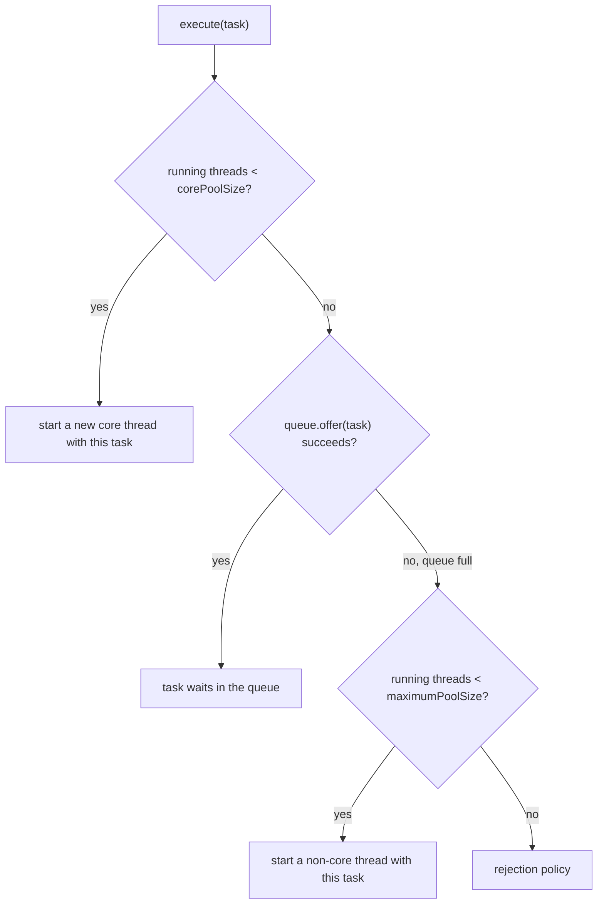
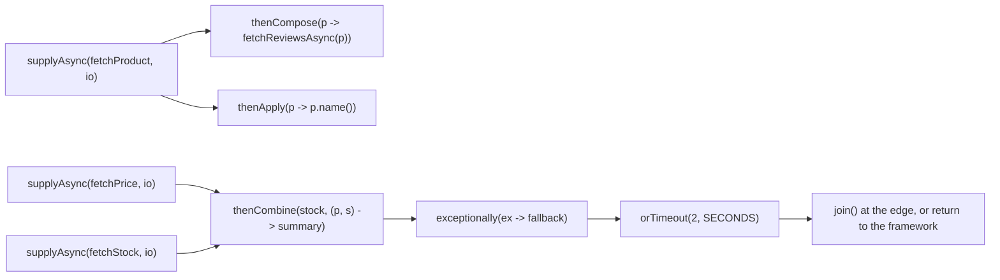

@@ 2 | MODULE | Executors | Thread pools, asynchronous results and thread-safe collections: the high-level toolkit used in real services | MUST
# Executors

**Shared analogy: a delivery company.** You do not hire a new driver for every parcel; you keep a fleet of drivers (a thread pool) and a sorting area where parcels wait (the work queue). When you hand over a parcel you get a tracking number (a `Future`); a smarter tracking number can also say "when this arrives, send the invoice, and if it fails, refund" (`CompletableFuture`). The sorting area itself must be safe for many drivers and clerks to use at once, with shelves that make a clerk wait when they are full and a driver wait when they are empty (concurrent collections and `BlockingQueue`).

This group is what you actually use in Spring Boot code: `@Async` runs on an executor, `RestClient` calls are fanned out with `CompletableFuture`, and Kafka consumers and schedulers are built on queues and pools.

@@ 3 | TOPIC | ExecutorService and Thread Pools | ThreadPoolExecutor parameters, the submit flow, queues and rejection policies, Executors factory traps, sizing, shutdown and virtual-thread executors | MUST
# ExecutorService and Thread Pools

**Level: Intermediate | Phase 9 | Priority: MUST | Since: Java 5 (AutoCloseable Java 19, virtual-thread executor Java 21)**

> **30-second interview answer:** An `ExecutorService` decouples submitting tasks from running them: you hand it `Runnable`s or `Callable`s and a pool of reusable threads executes them. The workhorse is `ThreadPoolExecutor`, configured with a core size, a maximum size, a keep-alive time, a work queue, a thread factory and a rejection policy. A new task starts a thread if fewer than core threads exist, otherwise it is queued, and only when the queue is full does the pool grow to the maximum, after which tasks are rejected. In production I avoid the unbounded `Executors` factory methods, size pools by workload (about the number of cores for CPU-bound work, more for I/O-bound), name the threads and always shut pools down.

## 1. Concept in Simple Words
### Analogy
A bank branch with tellers and a waiting area.

| Bank branch | ThreadPoolExecutor |
|---|---|
| Permanent tellers always on shift | `corePoolSize` threads |
| Chairs in the waiting area | The work queue and its capacity |
| Temporary tellers called in only when every chair is taken | Threads above core, up to `maximumPoolSize` |
| Temps go home after being idle for a while | `keepAliveTime` |
| The doorman turning customers away when tellers are busy and chairs are full | `RejectedExecutionHandler` |
| Name badges on tellers | A `ThreadFactory` that names threads |
| "We close at 5: finish the customers inside, let nobody new in" | `shutdown()` |
| "Fire alarm: everybody out now" | `shutdownNow()` |

### What it is
- **`Executor`:** one method, `execute(Runnable)`.
- **`ExecutorService`:** adds lifecycle (`shutdown`, `shutdownNow`, `awaitTermination`, `close` in Java 19) and results (`submit`, `invokeAll`, `invokeAny`).
- **`ThreadPoolExecutor` parameters:**

| Parameter | Meaning |
|---|---|
| `corePoolSize` | Threads kept alive even when idle (unless `allowCoreThreadTimeOut`) |
| `maximumPoolSize` | Upper bound on threads; extra threads are only created when the queue is full |
| `keepAliveTime` and unit | How long threads above core may idle before ending |
| `workQueue` | A `BlockingQueue<Runnable>` holding tasks waiting for a thread |
| `threadFactory` | Creates threads (names, daemon flag, uncaught-exception handler) |
| `handler` | What to do when the pool is saturated (rejection policy) |

- **Rejection policies:** `AbortPolicy` (default, throws `RejectedExecutionException`), `CallerRunsPolicy` (the submitting thread runs the task itself, which naturally slows producers: back-pressure), `DiscardPolicy` (silently drop), `DiscardOldestPolicy` (drop the oldest queued task and retry).
- **`ScheduledExecutorService`:** runs tasks after a delay or periodically (`schedule`, `scheduleAtFixedRate`, `scheduleWithFixedDelay`).
- **Virtual-thread executor (Java 21):** `Executors.newVirtualThreadPerTaskExecutor()` starts a new, cheap virtual thread per task, with no pool; ideal for blocking I/O.

### Why it exists
Creating an OS thread per task is slow (tens to hundreds of microseconds and about 1 MB of stack) and unbounded: a traffic spike creates thousands of threads and the JVM dies. Pools reuse a bounded set of threads, queue the excess, give a clear policy for overload and a single place to shut everything down.

## 2. How It Works
**The `execute` decision (the most asked internal):**



Note the counter-intuitive order: **the queue fills before the pool grows past core.** With an unbounded queue the pool never grows past core, so `maximumPoolSize` is ignored.

**Worker loop:** each worker thread runs its first task, then loops on `queue.take()` (or `poll(keepAlive)` for non-core threads, which end when the poll times out). Exceptions from `execute` tasks kill the worker, which is replaced; `submit` tasks capture exceptions in their `Future`.

**The `Executors` factory traps:**

| Factory | Real configuration | Production risk |
|---|---|---|
| `newFixedThreadPool(n)` | core = max = n, unbounded `LinkedBlockingQueue` | Queue grows without limit: memory exhaustion, unbounded latency |
| `newSingleThreadExecutor()` | 1 thread, unbounded queue | Same as above |
| `newCachedThreadPool()` | core 0, max `Integer.MAX_VALUE`, `SynchronousQueue`, 60 s keep-alive | Unbounded threads under load |
| `newScheduledThreadPool(n)` | n core threads, unbounded delay queue | Unbounded queue |
| `newVirtualThreadPerTaskExecutor()` | A virtual thread per task | Unbounded concurrency: limit access to scarce resources with a `Semaphore` |

For services, build a `ThreadPoolExecutor` explicitly (or Spring's `ThreadPoolTaskExecutor`) with a bounded queue and a deliberate rejection policy.

**Sizing rule of thumb (Brian Goetz):**

```text
CPU-bound work:  threads ≈ number of cores (+1)
I/O-bound work:  threads ≈ cores x (1 + wait time / compute time)
                 e.g. 8 cores, tasks wait 90 ms on a DB and compute 10 ms -> 8 x (1 + 9) = 80
Then measure: queue length, active threads, task latency, rejections.
```

Also bound pools by downstream capacity: 200 threads calling a database with a pool of 20 connections just means 180 threads waiting for connections.

**Shutdown:**

```text
shutdown()          no new tasks; queued and running tasks finish
awaitTermination(t) block until finished or timeout
shutdownNow()       interrupt running tasks, return the queued ones as a List<Runnable>
close() (Java 19)   shutdown + awaitTermination in a loop; works with try-with-resources
```

The idiom: `shutdown()`, then `awaitTermination(30, SECONDS)`, then `shutdownNow()` if it timed out. Forgetting to shut down a pool of non-daemon threads keeps the JVM from exiting.

**Spring Boot:** auto-configures a `ThreadPoolTaskExecutor` named `applicationTaskExecutor` (core 8, unbounded queue by default, configurable with `spring.task.execution.pool.*`), used by `@Async` and MVC async requests. With `spring.threads.virtual.enabled=true` (Boot 3.2+) it uses virtual threads instead.

## 3. Code Example
### Code
```java
import java.util.ArrayList;
import java.util.List;
import java.util.concurrent.ArrayBlockingQueue;
import java.util.concurrent.Callable;
import java.util.concurrent.CountDownLatch;
import java.util.concurrent.ExecutorService;
import java.util.concurrent.Executors;
import java.util.concurrent.Future;
import java.util.concurrent.RejectedExecutionException;
import java.util.concurrent.ScheduledExecutorService;
import java.util.concurrent.ScheduledFuture;
import java.util.concurrent.ThreadFactory;
import java.util.concurrent.ThreadPoolExecutor;
import java.util.concurrent.TimeUnit;
import java.util.concurrent.atomic.AtomicInteger;

public class ThreadPoolDemo {

    public static void main(String[] args) throws Exception {
        // 1. Watch the core -> queue -> max -> reject sequence
        CountDownLatch release = new CountDownLatch(1);
        AtomicInteger threadNumber = new AtomicInteger();
        ThreadFactory named = r -> new Thread(r, "orderhub-worker-" + threadNumber.incrementAndGet());

        ThreadPoolExecutor pool = new ThreadPoolExecutor(
                2, 4,                                   // core 2, max 4
                30, TimeUnit.SECONDS,                   // idle non-core threads end after 30 s
                new ArrayBlockingQueue<>(2),            // bounded queue of 2
                named,
                new ThreadPoolExecutor.AbortPolicy());  // throw when saturated

        Runnable blockingTask = () -> {
            try {
                release.await();                        // hold the thread until we release it
            } catch (InterruptedException e) {
                Thread.currentThread().interrupt();
            }
        };

        for (int i = 1; i <= 7; i++) {
            try {
                pool.execute(blockingTask);
                System.out.println("task " + i + ": threads=" + pool.getPoolSize()
                        + " queued=" + pool.getQueue().size());
            } catch (RejectedExecutionException e) {
                System.out.println("task " + i + ": REJECTED (4 threads busy, queue full)");
            }
        }
        release.countDown();                            // let all tasks finish
        pool.shutdown();                                // no new tasks
        pool.awaitTermination(5, TimeUnit.SECONDS);
        System.out.println("completed=" + pool.getCompletedTaskCount() + " terminated=" + pool.isTerminated());

        // 2. invokeAll returns futures in submission order
        try (ExecutorService fixed = Executors.newFixedThreadPool(3)) {
            List<Callable<String>> calls = List.of(() -> "price", () -> "stock", () -> "reviews");
            List<String> results = new ArrayList<>();
            for (Future<String> f : fixed.invokeAll(calls)) {
                results.add(f.get());
            }
            System.out.println("invokeAll: " + results);
        }

        // 3. Delayed task
        try (ScheduledExecutorService scheduler = Executors.newSingleThreadScheduledExecutor()) {
            ScheduledFuture<String> reminder =
                    scheduler.schedule(() -> "payment reminder sent", 100, TimeUnit.MILLISECONDS);
            System.out.println("scheduled: " + reminder.get());
        }

        // 4. Java 21: one virtual thread per task, 10,000 blocking tasks
        AtomicInteger done = new AtomicInteger();
        try (ExecutorService virtual = Executors.newVirtualThreadPerTaskExecutor()) {
            for (int i = 0; i < 10_000; i++) {
                virtual.submit(() -> {
                    Thread.sleep(10);                   // blocking call: the virtual thread unmounts
                    return done.incrementAndGet();
                });
            }
        }
        System.out.println("virtual threads finished " + done.get() + " tasks");
    }
}
```

### Walkthrough
- Every task blocks on the latch, so threads stay busy and we can watch the pool fill up deterministically.
- Tasks 1 and 2 each start a core thread. Tasks 3 and 4 go into the queue (capacity 2) because core threads exist. Task 5 finds the queue full and the pool below max, so a third thread starts; task 6 starts the fourth. Task 7 finds 4 threads and a full queue and is rejected by `AbortPolicy`.
- After `release.countDown()`, the six accepted tasks finish, `shutdown` lets the queue drain, and `awaitTermination` waits for it. The completed count is 6.
- `invokeAll` waits for all tasks and returns futures in the order of the input list, so results are in a predictable order no matter which finishes first.
- `schedule` returns a `ScheduledFuture`; `get()` waits for the 100 ms delay and the result.
- `close()` (Java 19+) on the virtual-thread executor waits for all 10,000 tasks. Ten thousand platform threads would be expensive; ten thousand virtual threads sleeping 10 ms each finish in a fraction of a second.

### Output
```text
task 1: threads=1 queued=0
task 2: threads=2 queued=0
task 3: threads=2 queued=1
task 4: threads=2 queued=2
task 5: threads=3 queued=2
task 6: threads=4 queued=2
task 7: REJECTED (4 threads busy, queue full)
completed=6 terminated=true
invokeAll: [price, stock, reviews]
scheduled: payment reminder sent
virtual threads finished 10000 tasks
```

### Compare
| Old or risky | Better | Why |
|---|---|---|
| `new Thread(task).start()` per request | Bounded `ThreadPoolExecutor` | Reuse and bounded resources |
| `Executors.newFixedThreadPool(n)` in a service | Explicit `ThreadPoolExecutor` with `ArrayBlockingQueue` | Unbounded queue hides overload until OOM |
| `newCachedThreadPool()` for request work | Bounded max plus `CallerRunsPolicy` | Unbounded threads under spikes |
| Never shutting down | `try (var pool = ...)` or `shutdown` plus `awaitTermination` | Lingering threads, JVM cannot exit |
| Huge platform pool for blocking I/O | `newVirtualThreadPerTaskExecutor()` (Java 21) | Cheap threads, simpler code |

## 4. Interview Questions
**Basic**
1. **Why use a thread pool instead of creating threads?**
   Thread creation is expensive and unbounded creation can crash the JVM. A pool reuses a bounded set of threads, queues excess work, gives an overload policy and central lifecycle management.
2. **What are the parameters of `ThreadPoolExecutor`?**
   Core pool size, maximum pool size, keep-alive time and unit, the work queue, a thread factory and a rejected-execution handler.
3. **What is the difference between `shutdown` and `shutdownNow`?**
   `shutdown` stops accepting new tasks but lets queued and running tasks finish. `shutdownNow` also interrupts running tasks and returns the tasks that never started. Neither waits; call `awaitTermination` for that.

**Follow-up**
4. **In what order does `ThreadPoolExecutor` use core threads, the queue and max threads?**
   First it starts threads up to core size; then it queues; only when the queue is full does it start threads up to the maximum; then it rejects. So with an unbounded queue the pool never grows beyond core.
5. **Why is `Executors.newFixedThreadPool` considered dangerous in production?**
   It uses an unbounded `LinkedBlockingQueue`. If tasks arrive faster than they finish, the queue grows without limit, latency climbs and eventually memory runs out, with no rejection to signal overload. Build the executor with a bounded queue and a rejection policy.
6. **What does `CallerRunsPolicy` do and why is it useful?**
   When the pool is saturated, the submitting thread runs the task itself. That slows the producer down to the pool's pace, a simple form of back-pressure, and nothing is dropped.
7. **How do you size a thread pool?**
   For CPU-bound work about the number of cores; for I/O-bound work cores x (1 + wait time / compute time), then tune with metrics. Also respect downstream limits such as the database connection pool size.

**Tricky / scenario**
8. **We configured core 10, max 100 and a `LinkedBlockingQueue` with no capacity, yet only 10 threads ever run while latency grows. Why?**
   The pool only creates threads beyond core when the queue rejects an offer, and an unbounded queue never does. Use a bounded queue (or a `SynchronousQueue`) so the pool can grow to max.
9. **A Spring `@Async` method is called 50,000 times during a batch import and the service runs out of memory. What happened?**
   The default `applicationTaskExecutor` has an unbounded queue, so 50,000 tasks (with their captured data) queued up. Configure `spring.task.execution.pool.queue-capacity` and `max-size`, a rejection policy, or process the batch in chunks.
10. **When would you use virtual threads instead of a pool?**
    For many concurrent tasks that mostly block on I/O (HTTP calls, JDBC), with Java 21: each task gets a cheap virtual thread and you write simple blocking code. For CPU-bound work they give no benefit, and you still need limits (a `Semaphore` or connection pool) to protect scarce resources.

**What the interviewer is really testing:** whether you know the task-admission algorithm, the hidden unbounded queues behind convenient factories, and can size, monitor and shut down pools like someone who has run them in production.

## 5. Pitfalls & Best Practices
### Common mistakes
| Mistake | What goes wrong | Fix |
|---|---|---|
| Unbounded queues (`newFixedThreadPool`) | Memory grows, latency explodes silently | Bounded `ArrayBlockingQueue` and a rejection policy |
| Expecting max threads with an unbounded queue | Pool never grows beyond core | Bounded queue or `SynchronousQueue` |
| Not shutting down pools | Thread leaks, JVM will not exit | try-with-resources or `shutdown` and `awaitTermination` |
| One shared pool for everything | A slow dependency starves all other work | Separate pools per dependency (bulkheads) |
| Tasks that block waiting for other tasks in the same pool | Starvation deadlock | Separate pools or non-blocking composition |
| Unnamed threads | Unreadable thread dumps | Custom `ThreadFactory` or Spring `threadNamePrefix` |
| Ignoring the `Future` of submitted tasks | Silent failures | Check results or log inside tasks |

### Best practices
- Create executors explicitly with bounded queues, named threads and a chosen rejection policy; expose them as Spring beans so they are shut down with the context.
- Monitor pool metrics (active threads, queue size, completed and rejected counts); Micrometer can bind `ThreadPoolTaskExecutor` metrics automatically.
- Use separate pools for different workloads (bulkhead pattern) so one slow downstream system cannot consume every thread.
- Prefer virtual threads for blocking I/O on Java 21, and keep a bounded pool for CPU-heavy work.
- Propagate context (MDC, security, tracing) with a `TaskDecorator` in Spring.

### Compare with
| Executor | Threads | Queue | Best for |
|---|---|---|---|
| Custom ThreadPoolExecutor | Bounded core and max | Bounded | Production services |
| `newFixedThreadPool` | Fixed | Unbounded | Small tools, tests |
| `newCachedThreadPool` | Unbounded | None (handoff) | Short bursts of short tasks |
| `ScheduledThreadPoolExecutor` | Fixed core | Delay queue | Timers, periodic jobs |
| ForkJoinPool | Work-stealing | Per-thread deques | Recursive CPU tasks, parallel streams |
| Virtual-thread-per-task | One virtual thread per task | None | High-concurrency blocking I/O (Java 21) |

## 6. Hands-on Exercise
Configure OrderHub's email-notification executor as a Spring bean: a `ThreadPoolTaskExecutor` with core 4, max 8, queue capacity 100, thread name prefix `notify-`, `CallerRunsPolicy`, and graceful shutdown that waits up to 30 seconds. Then write an `@Async` method that sends an order confirmation on that executor. Acceptance criteria:
- `@EnableAsync` is present and the executor bean is named `notificationExecutor`.
- `@Async("notificationExecutor")` is used on a public method of a separate bean (not self-invoked).
- Application properties keep Spring's default `applicationTaskExecutor` bounded too.

<details><summary>Solution</summary>

```java
package com.orderhub.notification;

import java.util.concurrent.ThreadPoolExecutor;
import org.springframework.context.annotation.Bean;
import org.springframework.context.annotation.Configuration;
import org.springframework.scheduling.annotation.EnableAsync;
import org.springframework.scheduling.concurrent.ThreadPoolTaskExecutor;

@Configuration
@EnableAsync
public class NotificationExecutorConfig {

    @Bean(name = "notificationExecutor")
    public ThreadPoolTaskExecutor notificationExecutor() {
        ThreadPoolTaskExecutor executor = new ThreadPoolTaskExecutor();
        executor.setCorePoolSize(4);
        executor.setMaxPoolSize(8);
        executor.setQueueCapacity(100);                       // bounded: the pool can grow to 8
        executor.setThreadNamePrefix("notify-");
        executor.setRejectedExecutionHandler(new ThreadPoolExecutor.CallerRunsPolicy());
        executor.setWaitForTasksToCompleteOnShutdown(true);
        executor.setAwaitTerminationSeconds(30);
        executor.initialize();
        return executor;
    }
}
```

```java
package com.orderhub.notification;

import org.slf4j.Logger;
import org.slf4j.LoggerFactory;
import org.springframework.scheduling.annotation.Async;
import org.springframework.stereotype.Service;

@Service
public class OrderNotificationService {
    private static final Logger log = LoggerFactory.getLogger(OrderNotificationService.class);

    @Async("notificationExecutor")
    public void sendConfirmation(long orderId, String email) {
        try {
            // call the mail provider here
            log.info("Sent confirmation for order {} to {} on {}", orderId, email, Thread.currentThread().getName());
        } catch (RuntimeException e) {
            log.error("Confirmation for order {} failed", orderId, e);   // void @Async: log, nobody calls get()
        }
    }
}
```

```yaml
spring:
  task:
    execution:
      pool:
        core-size: 8
        max-size: 16
        queue-capacity: 500
      thread-name-prefix: app-async-
```
Log line when `OrderService` calls `notificationService.sendConfirmation(42, "ana@example.com")` after saving an order:
```text
INFO  c.o.n.OrderNotificationService : Sent confirmation for order 42 to ana@example.com on notify-1
```
`@Async` works through a Spring proxy, so the method must be public and called from another bean; a call from inside the same class bypasses the proxy and runs synchronously.
</details>

## 7. Recall
Q: In what order does ThreadPoolExecutor handle a new task?
A: Start a thread if below core size, otherwise queue it, otherwise start a thread if below max size, otherwise apply the rejection policy.

Q: Why is `Executors.newFixedThreadPool` risky in production services?
A: It uses an unbounded queue, so overload turns into growing memory and latency instead of rejections.

Q: What does ThreadPoolExecutor's CallerRunsPolicy do?
A: It runs a rejected task on the submitting thread, slowing producers down as back-pressure.

Q: What is the rule of thumb for sizing an I/O-bound thread pool?
A: Cores x (1 + wait time / compute time), then tune with metrics and downstream limits.

Q: What is the difference between ExecutorService `shutdown()` and `shutdownNow()`?
A: `shutdown()` finishes queued and running tasks but accepts no new ones; `shutdownNow()` interrupts running tasks and returns the unstarted ones.

**Related:** [[Runnable vs Callable]] · [[Future and CompletableFuture]] · [[Virtual Threads]] · [[ForkJoinPool and Work Stealing]]

@@ 3 | TOPIC | Future and CompletableFuture | Blocking Future vs composable CompletableFuture, supplyAsync, thenApply, thenCompose, thenCombine, allOf, exception handling, timeouts and executors | MUST
# Future and CompletableFuture

**Level: Intermediate | Phase 9 | Priority: MUST | Since: Java 5 (Future), Java 8 (CompletableFuture), Java 9 (timeouts)**

> **30-second interview answer:** A `Future` is a handle to a result that will exist later, but the only way to use it is to block on `get()`. `CompletableFuture` (Java 8) is a `Future` you can compose: you attach callbacks such as `thenApply` to transform, `thenCompose` to chain another async call, `thenCombine` or `allOf` to join parallel calls, and `exceptionally` or `handle` to recover from errors, all without blocking. I always pass my own executor to the `...Async` methods, because the default common `ForkJoinPool` is small and shared, and I add timeouts with `orTimeout` or `completeOnTimeout`.

## 1. Concept in Simple Words
### Analogy
Ordering at a food court.

| Food court | Java |
|---|---|
| A paper ticket: you stand at the counter until your number is called | `Future.get()`: block until ready |
| A buzzer that vibrates when your food is ready, so you can sit down | `CompletableFuture` callbacks |
| "When the burger is ready, add ketchup" | `thenApply` (transform the result) |
| "When the burger is ready, order a dessert that uses its receipt" | `thenCompose` (start another async step) |
| Burger and drink ordered at two counters, eat when both arrive | `thenCombine`, `allOf` |
| "If the burger is sold out, give me fries instead" | `exceptionally`, `handle` |
| "If it is not ready in 10 minutes, I take a sandwich" | `completeOnTimeout` |
| Which staff cook your order | The `Executor` you pass in |

### What it is
- **`Future<V>`** (Java 5): `get()`, `get(timeout, unit)`, `isDone()`, `cancel(boolean)`. No callbacks, no composition, no way to complete it yourself.
- **`CompletableFuture<V>`** (Java 8): implements `Future` and `CompletionStage`. It can be completed by a task (`supplyAsync`, `runAsync`) or manually (`complete(v)`, `completeExceptionally(ex)`).
- **Stage methods (each returns a new `CompletableFuture`):**

| Method | Input to your function | Use |
|---|---|---|
| `thenApply(fn)` | The result | Transform synchronously (like `map`) |
| `thenAccept(consumer)` | The result | Consume, return nothing |
| `thenRun(runnable)` | Nothing | Run after completion |
| `thenCompose(fn)` | The result; fn returns a `CompletableFuture` | Chain a dependent async call (like `flatMap`) |
| `thenCombine(other, bifn)` | Both results | Join two independent futures |
| `allOf(cfs...)` | Nothing (returns `CompletableFuture<Void>`) | Wait for all |
| `anyOf(cfs...)` | The first result as `Object` | First to finish |
| `exceptionally(fn)` | The exception | Recover with a fallback value |
| `handle(bifn)` | Result or exception | Map both outcomes |
| `whenComplete(biconsumer)` | Result or exception | Side effect (logging), keeps the outcome |
| `orTimeout`, `completeOnTimeout` (Java 9) | | Fail or default after a time limit |

- **`...Async` variants** (`thenApplyAsync`, etc.) run the callback on an executor instead of on whichever thread completed the previous stage.
- **`join()` vs `get()`:** both block; `join` throws unchecked `CompletionException`, `get` throws checked `ExecutionException` and `InterruptedException`.

### Why it exists
Real services call several slow systems: price, stock, reviews, shipping. With plain `Future`s you either call them one after another or block a thread per call and then juggle `get()`s with nested try-catch. `CompletableFuture` lets you describe the whole flow (fan out, combine, recover, time out) declaratively, so threads are not wasted waiting and the total latency is the slowest call, not the sum.

## 2. How It Works
**Sequential vs parallel calls:**

```text
Sequential with Future.get():          Parallel with CompletableFuture:
price   |=====| 200 ms                 price   |=====|
stock          |=====| 200 ms          stock   |=====|
reviews               |===| 150 ms     reviews |===|
total   550 ms                         total   200 ms (slowest call) then combine
```

**Inside:** a `CompletableFuture` holds a `volatile Object result` (the value, or an `AltResult` wrapping an exception or null) and a stack of dependent actions. Calling `thenApply` on an incomplete future pushes a dependent node; when the future completes (via CAS on `result`), it pops and fires the dependents. If the future is already complete, `thenApply` runs the function immediately on the calling thread.



**Which thread runs a callback?**
- Non-async `thenApply`: the thread that completes the previous stage, or the caller if it is already complete. Keep these callbacks cheap.
- `thenApplyAsync(fn)` without an executor: the common `ForkJoinPool` (size = cores minus 1). Blocking I/O there starves parallel streams and every other user of the pool.
- `thenApplyAsync(fn, executor)`: your executor. For I/O, always provide one.

**Exceptions travel down the chain:** if a stage throws, dependents are skipped and complete exceptionally with a `CompletionException` wrapping the cause, until a stage like `exceptionally` or `handle` recovers. Because of that wrapping, a handler should unwrap: `Throwable cause = ex instanceof CompletionException ? ex.getCause() : ex;`.

**Cancellation does not interrupt:** `cancel(true)` on a `CompletableFuture` completes it with `CancellationException` but does not interrupt the thread running the task. Likewise, `orTimeout` completes the future but the underlying work keeps running.

Phase 16's [[CompletableFuture Composition and Error Handling]] goes deeper into composition patterns, error strategies and context propagation.

## 3. Code Example
### Code
```java
import java.util.List;
import java.util.concurrent.CompletableFuture;
import java.util.concurrent.CompletionException;
import java.util.concurrent.ExecutorService;
import java.util.concurrent.Executors;
import java.util.concurrent.Future;
import java.util.concurrent.TimeUnit;

public class CompletableFutureDemo {

    record Product(long id, String name) { }

    // Simulates a remote call
    static <T> T slow(long millis, T value) {
        try {
            Thread.sleep(millis);
        } catch (InterruptedException e) {
            Thread.currentThread().interrupt();
            throw new IllegalStateException(e);
        }
        return value;
    }

    public static void main(String[] args) throws Exception {
        try (ExecutorService io = Executors.newFixedThreadPool(8)) {
            // 1. Plain Future: the only option is to block
            Future<String> legacy = io.submit(() -> slow(100, "legacy result"));
            System.out.println("Future.isDone right away: " + legacy.isDone());
            System.out.println("Future.get: " + legacy.get());

            // 2. Two independent calls in parallel, combined
            CompletableFuture<Integer> price = CompletableFuture.supplyAsync(() -> slow(200, 1999), io);
            CompletableFuture<Integer> stock = CompletableFuture.supplyAsync(() -> slow(200, 7), io);
            String summary = price.thenCombine(stock, (p, s) -> "price=" + p + " stock=" + s).join();
            System.out.println("combined: " + summary);

            // 3. thenApply transforms; thenCompose chains another async call
            CompletableFuture<Product> product = CompletableFuture.supplyAsync(() -> new Product(42, "Keyboard"), io);
            CompletableFuture<String> label = product.thenApply(p -> p.name().toUpperCase());
            CompletableFuture<String> reviews = product.thenCompose(
                    p -> CompletableFuture.supplyAsync(() -> p.name() + " has 12 reviews", io));
            System.out.println("thenApply: " + label.join());
            System.out.println("thenCompose: " + reviews.join());

            // 4. Fan out to many services, wait for all
            List<CompletableFuture<String>> calls = List.of("inventory", "pricing", "shipping").stream()
                    .map(name -> CompletableFuture.supplyAsync(() -> slow(50, name + ":ok"), io))
                    .toList();
            CompletableFuture.allOf(calls.toArray(new CompletableFuture[0])).join();
            System.out.println("allOf: " + calls.stream().map(CompletableFuture::join).toList());

            // 5. Recovering from failure
            CompletableFuture<Integer> failing = CompletableFuture.supplyAsync(() -> {
                throw new IllegalStateException("pricing service down");
            }, io);
            int fallback = failing.exceptionally(ex -> {
                Throwable cause = ex instanceof CompletionException ? ex.getCause() : ex;
                System.out.println("recovered from: " + cause.getMessage());
                return 0;
            }).join();
            System.out.println("fallback price: " + fallback);
            String handled = failing.handle((v, ex) -> ex == null ? "ok " + v : "failed, using cache").join();
            System.out.println("handle: " + handled);

            // 6. Time limit with a default value (Java 9)
            String estimate = CompletableFuture.supplyAsync(() -> slow(1000, "carrier estimate"), io)
                    .completeOnTimeout("default shipping estimate", 100, TimeUnit.MILLISECONDS)
                    .join();
            System.out.println("completeOnTimeout: " + estimate);

            // 7. join throws an unchecked CompletionException
            try {
                failing.join();
            } catch (CompletionException e) {
                System.out.println("join throws CompletionException, cause: " + e.getCause().getMessage());
            }
        }
    }
}
```

### Walkthrough
- Part 1: `isDone()` is false because the task sleeps 100 ms; `get()` then blocks the main thread until it finishes. That blocking is all a plain `Future` offers.
- Part 2: price and stock run at the same time on the `io` pool, so the combined result arrives after about 200 ms, not 400. `thenCombine` runs when both are done.
- Part 3: `thenApply` maps `Product` to `String`. `thenCompose` is needed when the function itself returns a `CompletableFuture`; with `thenApply` you would get a nested `CompletableFuture<CompletableFuture<String>>`.
- Part 4: `allOf` returns `CompletableFuture<Void>`; after joining it, every individual future is done, so `join()` on each returns instantly. Results keep the list order.
- Part 5: the supplier throws, so `failing` completes exceptionally. `exceptionally` receives a `CompletionException` wrapping the real exception, which we unwrap, and supplies 0. `handle` sees both outcomes and maps either to a string.
- Part 6: `completeOnTimeout` completes the future with a default if the real value has not arrived in 100 ms. The slow task keeps running in the background (and the pool's `close()` waits for it at the end).
- Part 7: `join()` on a failed future throws `CompletionException` (unchecked), while `get()` would throw `ExecutionException`.
- All printing happens on the main thread after a `join()`, except the "recovered from" line, which runs inside the `exceptionally` callback before `join()` returns; so the output order is fixed.

### Output
```text
Future.isDone right away: false
Future.get: legacy result
combined: price=1999 stock=7
thenApply: KEYBOARD
thenCompose: Keyboard has 12 reviews
allOf: [inventory:ok, pricing:ok, shipping:ok]
recovered from: pricing service down
fallback price: 0
handle: failed, using cache
completeOnTimeout: default shipping estimate
join throws CompletionException, cause: pricing service down
```

### Compare
| Future | CompletableFuture |
|---|---|
| Only `get()` (blocking) | Callbacks: `thenApply`, `thenAccept`, `thenCompose` |
| Cannot combine results without blocking | `thenCombine`, `allOf`, `anyOf` |
| Exceptions only through `get()` | `exceptionally`, `handle`, `whenComplete` |
| Cannot be completed manually | `complete`, `completeExceptionally` |
| Timeout only on `get(timeout)` | `orTimeout`, `completeOnTimeout` (Java 9) |
| `cancel(true)` interrupts the task | `cancel` does not interrupt the running task |

## 4. Interview Questions
**Basic**
1. **What is the difference between `Future` and `CompletableFuture`?**
   `Future` represents a pending result that you can only wait for with a blocking `get()`. `CompletableFuture` adds non-blocking composition (transform, chain, combine), error handling, manual completion and timeouts.
2. **What is the difference between `thenApply` and `thenCompose`?**
   `thenApply` takes a function returning a plain value and is like `map`. `thenCompose` takes a function returning another `CompletableFuture` and flattens it, like `flatMap`; use it to chain dependent async calls.
3. **How do you run several calls in parallel and wait for all of them?**
   Start each with `supplyAsync(supplier, executor)`, then `CompletableFuture.allOf(...)` and read each result with `join()` once it completes. For two results, `thenCombine` is neater.

**Follow-up**
4. **Which thread runs `supplyAsync` if you do not pass an executor? Why does that matter?**
   The common `ForkJoinPool`, which has about cores minus one threads and is shared with parallel streams and other libraries. Blocking I/O there can exhaust it and stall unrelated work, so pass a dedicated executor for I/O.
5. **How do exceptions propagate through a chain?**
   A failure skips the remaining normal stages; each dependent completes exceptionally with a `CompletionException` wrapping the original, until `exceptionally`, `handle` or `whenComplete` deals with it. At the end, `join()` throws `CompletionException` and `get()` throws `ExecutionException`.
6. **`exceptionally` vs `handle` vs `whenComplete`?**
   `exceptionally` runs only on failure and returns a replacement value. `handle` runs on both outcomes and maps them to a new value. `whenComplete` runs on both for side effects such as logging and passes the original outcome through unchanged.
7. **How do you add a timeout?**
   Java 9 added `orTimeout(t, unit)`, which completes exceptionally with `TimeoutException`, and `completeOnTimeout(value, t, unit)`, which completes with a default. On Java 8 you would use `get(timeout)` or a scheduler that completes the future.

**Tricky / scenario**
8. **A REST endpoint fans out 3 calls with `supplyAsync` and no executor. Under load, the endpoint and the app's parallel streams both slow to a crawl. Why?**
   All the blocking calls run on the small common `ForkJoinPool`, so it is saturated and every user of it waits. Give the calls their own bounded executor (or virtual threads), and add timeouts so one slow dependency cannot hold threads indefinitely.
9. **Does `orTimeout` stop the slow task?**
   No. It completes the future exceptionally, but the task keeps running and holding its thread. If the work supports it, cancel it separately (for example through an HTTP client timeout) and always set timeouts on the underlying I/O.
10. **Why might `cf.thenApply(...)` run on the main thread?**
    If `cf` is already complete when `thenApply` is called, the function runs immediately on the calling thread. Otherwise it runs on the thread that completes `cf`. Use `thenApplyAsync(fn, executor)` when you need control.

**What the interviewer is really testing:** whether you can design a parallel, failure-tolerant call flow, know which threads execute each stage, and avoid the common-pool and missing-timeout traps.

## 5. Pitfalls & Best Practices
### Common mistakes
| Mistake | What goes wrong | Fix |
|---|---|---|
| Blocking I/O in `supplyAsync` without an executor | Common pool starved, app-wide slowdown | Pass a dedicated executor |
| Calling `join()` right after each `supplyAsync` | Calls become sequential | Start all futures first, then join |
| No timeouts | Threads and requests hang on slow services | `orTimeout`, `completeOnTimeout`, client timeouts |
| Using `thenApply` with a function returning a future | Nested `CompletableFuture<CompletableFuture<T>>` | `thenCompose` |
| Forgetting `CompletionException` wrapping | Wrong exception type checks | Unwrap `getCause()` |
| Swallowing failures in `exceptionally` without logging | Silent degraded behaviour | Log, emit a metric, then fall back |

### Best practices
- Fan out first, join last; join only at the edge (or return the `CompletableFuture` from a Spring MVC controller, which supports async return values).
- Always use your own bounded executor (or a virtual-thread executor on Java 21) for I/O stages.
- Put a timeout on every remote call and a fallback where the business allows a degraded answer.
- Use `whenComplete` for logging and metrics without altering results.
- Keep callbacks short and non-blocking; heavy work goes in `...Async` stages on a suitable executor.

### Compare with
| Approach | Blocking | Composition | Best for |
|---|---|---|---|
| Sequential calls | Yes | Not needed | Simple, dependent steps |
| `ExecutorService` plus `Future.get()` | Yes, at `get` | Manual | A few parallel tasks |
| `invokeAll` | Yes | Collect all results | Batch of similar tasks |
| CompletableFuture | No until `join` | Rich | Parallel service calls with fallbacks |
| Virtual threads with simple blocking code (Java 21) | Yes, but cheap | Plain code | Readable concurrency for I/O |
| Reactor (`Mono`, `Flux`) | No | Very rich, streams, back-pressure | WebFlux, streaming |

## 6. Hands-on Exercise
OrderHub's product page needs product details, price and stock. Write a plain-Java `ProductPageService.load(long id)` that fetches price and stock in parallel after the product is loaded, with a 300 ms timeout on stock that falls back to "unknown", and a failing price service that falls back to the catalogue price. Acceptance criteria:
- Uses a dedicated executor, `thenCompose` (or chaining after the product) and `thenCombine`.
- The stock call takes 1000 ms, so the fallback is used; the price call throws.
- `load(42)` returns `ProductPage[name=Keyboard, price=49.99 (catalogue), stock=unknown]`.

<details><summary>Solution</summary>

```java
import java.util.concurrent.CompletableFuture;
import java.util.concurrent.ExecutorService;
import java.util.concurrent.Executors;
import java.util.concurrent.TimeUnit;

public class ProductPageService implements AutoCloseable {

    record Product(long id, String name, String cataloguePrice) { }
    record ProductPage(String name, String price, String stock) { }

    private final ExecutorService io = Executors.newFixedThreadPool(8);

    CompletableFuture<Product> fetchProduct(long id) {
        return CompletableFuture.supplyAsync(() -> new Product(id, "Keyboard", "49.99"), io);
    }

    CompletableFuture<String> fetchLivePrice(Product p) {
        return CompletableFuture.supplyAsync(() -> {
            throw new IllegalStateException("pricing down");
        }, io);
    }

    CompletableFuture<String> fetchStock(Product p) {
        return CompletableFuture.supplyAsync(() -> {
            try { Thread.sleep(1000); } catch (InterruptedException e) { Thread.currentThread().interrupt(); }
            return "12";
        }, io);
    }

    ProductPage load(long id) {
        return fetchProduct(id).thenCompose(product -> {
            CompletableFuture<String> price = fetchLivePrice(product)
                    .exceptionally(ex -> product.cataloguePrice() + " (catalogue)");
            CompletableFuture<String> stock = fetchStock(product)
                    .completeOnTimeout("unknown", 300, TimeUnit.MILLISECONDS);
            return price.thenCombine(stock, (pr, st) -> new ProductPage(product.name(), pr, st));
        }).join();
    }

    @Override
    public void close() { io.shutdownNow(); }   // interrupts the still-sleeping stock call

    public static void main(String[] args) {
        try (ProductPageService service = new ProductPageService()) {
            System.out.println(service.load(42));
        }
    }
}
```
Output:
```text
ProductPage[name=Keyboard, price=49.99 (catalogue), stock=unknown]
```
Price and stock start at the same moment once the product is known, so the page is ready after about 300 ms (the stock timeout) instead of waiting for the slow call.
</details>

## 7. Recall
Q: What can CompletableFuture do that a plain Future cannot?
A: Compose stages with callbacks (`thenApply`, `thenCompose`, `thenCombine`), handle errors (`exceptionally`, `handle`), be completed manually and apply timeouts, all without blocking.

Q: What is the difference between CompletableFuture `thenApply` and `thenCompose`?
A: `thenApply` maps the result to a plain value; `thenCompose` maps it to another `CompletableFuture` and flattens it, for chaining dependent async calls.

Q: Which pool runs `CompletableFuture.supplyAsync(supplier)` when no executor is given?
A: The common `ForkJoinPool`, which is small and shared, so blocking I/O should use a dedicated executor.

Q: What does `CompletableFuture.join()` throw when the future failed?
A: An unchecked `CompletionException` wrapping the original exception.

Q: Does `orTimeout` stop the underlying task of a CompletableFuture?
A: No, it only completes the future exceptionally; the task keeps running.

**Related:** [[Runnable vs Callable]] · [[ExecutorService and Thread Pools]] · [[CompletableFuture Composition and Error Handling]] · [[RestClient, WebClient and HTTP Interfaces]]
