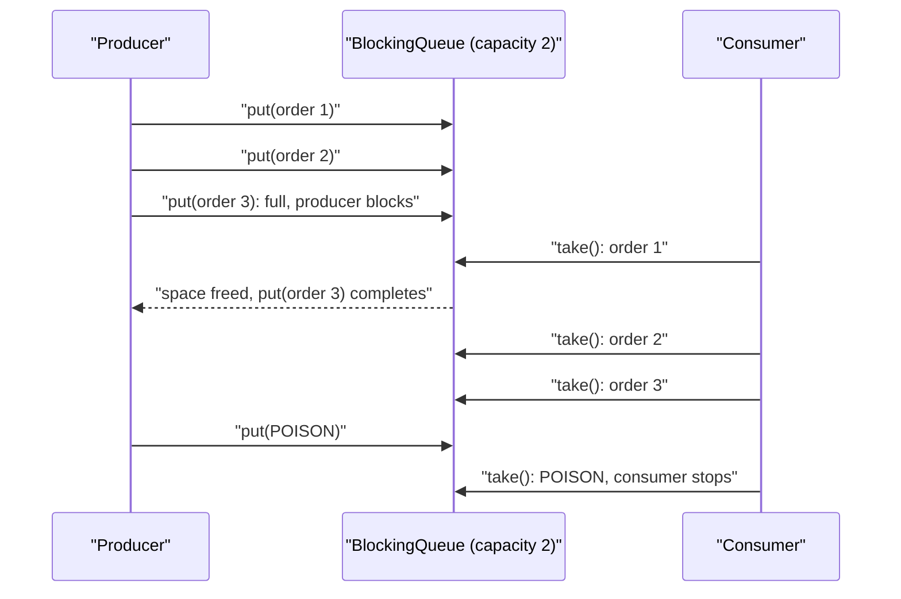

@@ 3 | TOPIC | Concurrent Collections and BlockingQueue | ConcurrentHashMap, CopyOnWriteArrayList, ConcurrentLinkedQueue, ConcurrentSkipListMap, the BlockingQueue family, method groups and the producer-consumer pattern | MUST
# Concurrent Collections and BlockingQueue

**Level: Intermediate | Phase 9 | Priority: MUST | Since: Java 5 (ConcurrentSkipListMap Java 6, LinkedTransferQueue Java 7)**

> **30-second interview answer:** `java.util.concurrent` provides collections that are safe for many threads without external locking: `ConcurrentHashMap` for maps, `CopyOnWriteArrayList` for read-mostly lists, `ConcurrentLinkedQueue` for non-blocking queues and `ConcurrentSkipListMap` for sorted maps. `BlockingQueue` adds methods that wait: `put` blocks while the queue is full and `take` blocks while it is empty, which makes it the standard building block for producer-consumer designs and the work queue inside every thread pool. They scale far better than `Collections.synchronizedXxx` wrappers because they use lock striping, CAS or copy-on-write instead of one big lock.

## 1. Concept in Simple Words
### Analogy
A warehouse loading dock.

| Loading dock | Java |
|---|---|
| A conveyor belt with room for 10 boxes | `ArrayBlockingQueue` with capacity 10 |
| The loader stops when the belt is full | `put` blocks while full |
| The packer waits when the belt is empty | `take` blocks while empty |
| "Try to place the box; if full, put it aside" | `offer` returns false |
| "Wait up to 5 seconds for a box, then give up" | `poll(5, SECONDS)` returns null |
| A box marked "end of shift" | A poison pill that tells consumers to stop |
| A handover with no belt at all: loader waits until a packer takes the box from their hands | `SynchronousQueue` |
| Express boxes jump the line | `PriorityBlockingQueue` |
| A noticeboard that is reprinted whenever someone edits it; readers keep their own printed copy | `CopyOnWriteArrayList` |

### What it is
- **Thread-safe collection:** every method is atomic and visible across threads without the caller locking.
- **Main families:**

| Class | Structure | Concurrency technique | Use |
|---|---|---|---|
| `ConcurrentHashMap` | Hash table | CAS plus per-bin locks | Shared maps, caches, counters |
| `ConcurrentSkipListMap`, `ConcurrentSkipListSet` | Skip list (sorted) | Lock-free CAS | Sorted shared data, leaderboards |
| `CopyOnWriteArrayList`, `CopyOnWriteArraySet` | Array copied on every write | Copy-on-write | Listeners, config lists: many reads, rare writes |
| `ConcurrentLinkedQueue`, `ConcurrentLinkedDeque` | Linked nodes | Lock-free CAS (Michael-Scott queue) | Non-blocking unbounded queues |
| `ArrayBlockingQueue` | Fixed array | One `ReentrantLock`, two conditions | Bounded producer-consumer |
| `LinkedBlockingQueue` | Linked nodes, optionally bounded | Separate put and take locks | Thread-pool queues, higher throughput |
| `PriorityBlockingQueue` | Binary heap, unbounded | One lock | Priority work queues |
| `DelayQueue` | Heap of `Delayed` elements | One lock | Retry after delay, expiring items |
| `SynchronousQueue` | No storage | Direct handoff | `newCachedThreadPool`, handoffs |
| `LinkedTransferQueue` | Linked nodes, unbounded | Lock-free, `transfer` waits for a consumer | High-throughput handoffs |

- **The four method groups of `BlockingQueue`:**

| Operation | Throws exception | Returns special value | Blocks | Times out |
|---|---|---|---|---|
| Insert | `add(e)` | `offer(e)` returns false | `put(e)` | `offer(e, time, unit)` |
| Remove | `remove()` | `poll()` returns null | `take()` | `poll(time, unit)` |
| Examine | `element()` | `peek()` returns null | Not applicable | Not applicable |

- **Producer-consumer:** producers put work on a queue, consumers take it off, and the queue decouples their speeds. A bounded queue gives back-pressure: fast producers are slowed down instead of exhausting memory.
- **Poison pill:** a special element that tells a consumer to stop; with N consumers, put N pills.
- Concurrent collections reject `null` elements (`null` is used as the "nothing there" signal by `poll` and `get`).

### Why it exists
`Collections.synchronizedList` and `Hashtable` serialize every access through one lock, so they do not scale, and compound actions and iteration still need manual locking. Hand-written `wait` and `notify` queues are error-prone. Doug Lea's `java.util.concurrent` (JSR-166, Java 5) gave correct, fast building blocks so application code rarely needs explicit locks.

## 2. How It Works
**`ArrayBlockingQueue` internals** (essentially the bounded buffer from [[wait, notify and notifyAll]], done properly):

```text
items: Object[capacity]   takeIndex -> [ e1 ][ e2 ][ e3 ][    ][    ] <- putIndex (circular)
count = 3
lock = ReentrantLock
notEmpty = lock.newCondition()   // consumers wait here
notFull  = lock.newCondition()   // producers wait here

put(e):  lock; while (count == items.length) notFull.await(); enqueue; notEmpty.signal(); unlock
take():  lock; while (count == 0) notEmpty.await(); dequeue; notFull.signal(); unlock
```

Two `Condition`s mean a producer only wakes consumers and vice versa: no lost wakeups and no wasted `notifyAll`. `LinkedBlockingQueue` goes further with separate `putLock` and `takeLock`, so a producer and a consumer can work at the same time.

**Producer-consumer flow:**



**Copy-on-write:** every `add`, `set` or `remove` on `CopyOnWriteArrayList` copies the whole array under a lock and swaps a volatile reference to the new array. Readers and iterators use whichever array was current when they started: no locks, no `ConcurrentModificationException`, but O(n) per write and possibly stale reads. Great for 10 listeners read a million times; terrible for a list with frequent writes.

**Skip list:** a sorted linked list with extra "express lane" levels added randomly, giving expected O(log n) search. It is easier to make lock-free than a red-black tree, which is why the concurrent sorted map is a skip list, not a `TreeMap`.

**Weakly consistent iterators:** concurrent collections' iterators never throw `ConcurrentModificationException` and may or may not reflect changes made during iteration. `size()` on `ConcurrentLinkedQueue` is O(n) and only an estimate under concurrency.

## 3. Code Example
### Code
```java
import java.util.Comparator;
import java.util.List;
import java.util.concurrent.ArrayBlockingQueue;
import java.util.concurrent.BlockingQueue;
import java.util.concurrent.ConcurrentSkipListMap;
import java.util.concurrent.CopyOnWriteArrayList;
import java.util.concurrent.ExecutorService;
import java.util.concurrent.Executors;
import java.util.concurrent.LinkedBlockingQueue;
import java.util.concurrent.PriorityBlockingQueue;
import java.util.concurrent.SynchronousQueue;
import java.util.concurrent.TimeUnit;
import java.util.concurrent.atomic.AtomicLong;

public class ConcurrentCollectionsDemo {

    record OrderEvent(long orderId, long amountCents) { }

    private static final OrderEvent POISON = new OrderEvent(-1, 0);

    public static void main(String[] args) throws Exception {
        // 1. The four method groups on a full and an empty queue
        BlockingQueue<String> q = new ArrayBlockingQueue<>(2);
        q.put("a");
        q.put("b");
        System.out.println("offer on full: " + q.offer("c"));
        System.out.println("offer with 50 ms timeout: " + q.offer("c", 50, TimeUnit.MILLISECONDS));
        try {
            q.add("c");
        } catch (IllegalStateException e) {
            System.out.println("add on full: IllegalStateException (" + e.getMessage() + ")");
        }
        q.clear();
        System.out.println("poll on empty: " + q.poll());
        System.out.println("poll with 50 ms timeout: " + q.poll(50, TimeUnit.MILLISECONDS));

        // 2. One producer, three consumers, bounded queue, poison pills
        BlockingQueue<OrderEvent> events = new LinkedBlockingQueue<>(100);
        AtomicLong revenue = new AtomicLong();
        AtomicLong processed = new AtomicLong();
        int consumers = 3;
        try (ExecutorService pool = Executors.newFixedThreadPool(consumers + 1)) {
            for (int c = 0; c < consumers; c++) {
                pool.submit(() -> {
                    while (true) {
                        OrderEvent e = events.take();          // blocks while empty
                        if (e == POISON) return null;          // stop signal
                        revenue.addAndGet(e.amountCents());
                        processed.incrementAndGet();
                    }
                });
            }
            pool.submit(() -> {
                for (long id = 1; id <= 1000; id++) {
                    events.put(new OrderEvent(id, 500));       // blocks while 100 are waiting
                }
                for (int c = 0; c < consumers; c++) {
                    events.put(POISON);                        // one pill per consumer
                }
                return null;
            });
        }
        System.out.println("processed=" + processed.get() + " revenueCents=" + revenue.get());

        // 3. CopyOnWriteArrayList: modify while iterating, iteration sees a snapshot
        List<String> listeners = new CopyOnWriteArrayList<>(List.of("email", "sms"));
        for (String l : listeners) {
            if (l.equals("email")) listeners.add("push");
        }
        System.out.println("listeners: " + listeners);

        // 4. ConcurrentSkipListMap: a sorted map updated by several threads
        ConcurrentSkipListMap<Integer, String> leaderboard = new ConcurrentSkipListMap<>(Comparator.reverseOrder());
        try (ExecutorService pool = Executors.newFixedThreadPool(4)) {
            pool.submit(() -> leaderboard.put(90, "ana"));
            pool.submit(() -> leaderboard.put(75, "ben"));
            pool.submit(() -> leaderboard.put(99, "cy"));
            pool.submit(() -> leaderboard.put(60, "dee"));
        }
        System.out.println("top: " + leaderboard.firstEntry() + ", ranking: " + leaderboard);

        // 5. PriorityBlockingQueue: highest amount first
        PriorityBlockingQueue<OrderEvent> urgent =
                new PriorityBlockingQueue<>(11, Comparator.comparingLong(OrderEvent::amountCents).reversed());
        urgent.add(new OrderEvent(1, 100));
        urgent.add(new OrderEvent(2, 9000));
        urgent.add(new OrderEvent(3, 500));
        System.out.println("highest value first: order " + urgent.take().orderId());

        // 6. SynchronousQueue: no capacity, a direct handoff
        SynchronousQueue<String> handoff = new SynchronousQueue<>();
        System.out.println("offer with no waiting consumer: " + handoff.offer("x"));
        Thread taker = new Thread(() -> {
            try {
                System.out.println("taken: " + handoff.take());
            } catch (InterruptedException e) {
                Thread.currentThread().interrupt();
            }
        });
        taker.start();
        handoff.put("parcel");      // waits until the taker receives it
        taker.join();
    }
}
```

### Walkthrough
- Part 1 shows each method group: `offer` returns false at once, timed `offer` gives up after 50 ms, `add` throws `IllegalStateException("Queue full")`, and on an empty queue `poll` returns null at once or after the timeout.
- Part 2 is the producer-consumer pattern. The queue is bounded at 100, so the producer blocks whenever consumers fall behind. Each consumer stops on the poison pill; with three consumers the producer sends three pills. The pool's `close()` waits for all of them, and the totals are exact: 1000 events x 500 cents.
- The lambdas use `return null` so they are `Callable`s, which may throw the checked `InterruptedException` from `take` and `put`.
- Part 3: adding during iteration is allowed. The loop iterates the snapshot taken when it started, so `push` is added once and not visited.
- Part 4: four threads insert concurrently, but the skip list keeps keys sorted (descending, by the comparator), so the result does not depend on timing.
- Part 5: `take()` returns the element with the highest priority according to the comparator, not the oldest.
- Part 6: `SynchronousQueue` has no capacity: `offer` fails when nobody is waiting, and `put` blocks until a consumer takes the element from its hands.

### Output
```text
offer on full: false
offer with 50 ms timeout: false
add on full: IllegalStateException (Queue full)
poll on empty: null
poll with 50 ms timeout: null
processed=1000 revenueCents=500000
listeners: [email, sms, push]
top: 99=cy, ranking: {99=cy, 90=ana, 75=ben, 60=dee}
highest value first: order 2
offer with no waiting consumer: false
taken: parcel
```

### Compare
| Synchronized wrapper or legacy | Concurrent collection | Difference |
|---|---|---|
| `Collections.synchronizedMap(new HashMap<>())`, `Hashtable` | `ConcurrentHashMap` | Per-bin locking, lock-free reads, atomic `merge` and `compute` |
| `Collections.synchronizedList(new ArrayList<>())` | `CopyOnWriteArrayList` (read-mostly) | No lock to iterate, snapshot iteration |
| `Collections.synchronizedSortedMap(new TreeMap<>())` | `ConcurrentSkipListMap` | Lock-free, concurrent navigation |
| Hand-written `wait` and `notify` buffer | `ArrayBlockingQueue` or `LinkedBlockingQueue` | Correct, timeouts, two conditions |
| `synchronizedList` used as a queue | `ConcurrentLinkedQueue` or `BlockingQueue` | Non-blocking or blocking queue semantics |

## 4. Interview Questions
**Basic**
1. **What is a `BlockingQueue`?**
   A thread-safe queue with operations that wait: `put` blocks while the queue is full and `take` blocks while it is empty, plus timed `offer` and `poll`. It is the standard tool for producer-consumer designs and the work queue of `ThreadPoolExecutor`.
2. **What is the difference between `offer`, `add` and `put`?**
   On a full queue, `offer` returns false, `add` throws `IllegalStateException`, and `put` waits until there is space. `offer(e, timeout, unit)` waits up to the timeout. The removal side mirrors this: `poll`, `remove`, `take`, `poll(timeout, unit)`.
3. **When do you use `CopyOnWriteArrayList`?**
   When reads and iteration vastly outnumber writes, such as listener or observer lists and small configuration lists. Each write copies the array, so frequent writes or large lists make it slow and memory-hungry.

**Follow-up**
4. **`ArrayBlockingQueue` vs `LinkedBlockingQueue`?**
   `ArrayBlockingQueue` is always bounded, backed by an array, and uses one lock for both ends. `LinkedBlockingQueue` is optionally bounded (unbounded by default, which is risky), allocates a node per element, and uses separate put and take locks, so it often has higher throughput.
5. **Why are concurrent collections better than `Collections.synchronizedList` or `synchronizedMap`?**
   The wrappers use one lock for everything, so threads serialize, and you must still lock manually around iteration and compound actions. Concurrent collections use finer-grained techniques (CAS, striping, copy-on-write), provide atomic compound methods and iterate without `ConcurrentModificationException`.
6. **How do you shut down consumers of a `BlockingQueue` cleanly?**
   Send one poison pill per consumer after the last real item, or interrupt the consumer threads (`take` throws `InterruptedException`), for example through `ExecutorService.shutdownNow`. Poison pills guarantee all queued work is processed first.
7. **What is a `SynchronousQueue` and where is it used?**
   A queue with no capacity: each `put` waits for a matching `take`. `Executors.newCachedThreadPool` uses it, so a task is handed directly to an idle thread or a new thread is created.

**Tricky / scenario**
8. **Our order-import pipeline uses `new LinkedBlockingQueue<>()` between a fast reader and slow database writers, and the service runs out of memory during big imports. Why?**
   The default `LinkedBlockingQueue` is unbounded, so the reader keeps adding and nothing pushes back. Give it a capacity (for example 1000) so `put` blocks when writers fall behind, which bounds memory and throttles the reader.
9. **Is `if (!queue.isEmpty()) item = queue.poll();` safe with several consumers?**
   No, it is check-then-act: another consumer can take the last item between the check and the `poll`, so `poll` may return null. Just call `poll()` (or `take()`) and handle null; the queue's methods are atomic on their own.
10. **Would you use `CopyOnWriteArrayList` to collect results from 16 threads adding 100,000 items each?**
    No. Each add copies the whole array, so that is quadratic work. Use `ConcurrentLinkedQueue`, a per-thread list merged at the end, or a stream collector.

**What the interviewer is really testing:** whether you can pick the right concurrent structure for a workload, explain blocking versus non-blocking semantics and back-pressure, and avoid the unbounded-queue trap.

## 5. Pitfalls & Best Practices
### Common mistakes
| Mistake | What goes wrong | Fix |
|---|---|---|
| Unbounded `LinkedBlockingQueue` between fast and slow stages | Memory exhaustion | Give it a capacity |
| `CopyOnWriteArrayList` with frequent writes | O(n) copy per write, GC pressure | `ConcurrentLinkedQueue` or locking |
| Check-then-act on a concurrent collection | Races despite thread-safe methods | Use the atomic method (`poll`, `putIfAbsent`, `merge`) |
| Inserting `null` | `NullPointerException` | Use a sentinel object or `Optional` |
| Relying on `size()` of concurrent queues | Estimate only, O(n) for linked queues | Track counts separately if needed |
| One poison pill for several consumers | Remaining consumers block forever | One pill per consumer |
| Ignoring `InterruptedException` from `take` | Consumers cannot be shut down | Exit the loop and restore the flag |

### Best practices
- Bound every queue between stages; decide what happens when it is full (block, drop, reject).
- Use `poll(timeout)` in consumers that also need to check a shutdown flag or do periodic work.
- Choose by access pattern: read-mostly lists use copy-on-write, shared maps use `ConcurrentHashMap`, sorted data uses skip lists, pipelines use `BlockingQueue`.
- In Spring Boot, prefer a message broker (Kafka, RabbitMQ) when the queue must survive restarts or span several instances; in-memory queues lose data on crash.

### Compare with
| Queue | Bounded | Blocking | Ordering | Typical use |
|---|---|---|---|---|
| ArrayBlockingQueue | Always | Yes | FIFO | Bounded pipelines, thread pools |
| LinkedBlockingQueue | Optional | Yes | FIFO | Pools (bounded), pipelines |
| PriorityBlockingQueue | No | `take` blocks | By priority | Priority jobs |
| DelayQueue | No | `take` waits for expiry | By delay | Scheduled retries |
| SynchronousQueue | Zero capacity | Yes | Handoff | Cached thread pools |
| ConcurrentLinkedQueue | No | No | FIFO | Non-blocking, high-throughput queues |

## 6. Hands-on Exercise
Build OrderHub's in-memory invoice pipeline: a reader stage parses order lines, a pricing stage multiplies quantity by unit price, and a writer stage sums totals. Acceptance criteria:
- Two bounded `ArrayBlockingQueue`s (capacity 10) connect the three stages, each stage on its own thread.
- Each stage forwards a poison pill to the next and stops.
- Lines `"A,2,500"`, `"B,1,1250"`, `"C,4,99"` give a printed total of `2646` cents and `3 lines`.

<details><summary>Solution</summary>

```java
import java.util.List;
import java.util.concurrent.ArrayBlockingQueue;
import java.util.concurrent.BlockingQueue;
import java.util.concurrent.ExecutorService;
import java.util.concurrent.Executors;

public class InvoicePipeline {

    record Line(String sku, int qty, long unitCents) { }
    record Priced(String sku, long totalCents) { }

    private static final Line LINE_END = new Line("", 0, 0);
    private static final Priced PRICED_END = new Priced("", 0);

    public static void main(String[] args) {
        List<String> input = List.of("A,2,500", "B,1,1250", "C,4,99");
        BlockingQueue<Line> parsed = new ArrayBlockingQueue<>(10);
        BlockingQueue<Priced> priced = new ArrayBlockingQueue<>(10);
        long[] result = new long[2];   // written by the writer, read by main after close()

        try (ExecutorService stages = Executors.newFixedThreadPool(3)) {
            stages.submit(() -> {                                    // reader
                for (String raw : input) {
                    String[] f = raw.split(",");
                    parsed.put(new Line(f[0], Integer.parseInt(f[1]), Long.parseLong(f[2])));
                }
                parsed.put(LINE_END);
                return null;
            });
            stages.submit(() -> {                                    // pricing
                while (true) {
                    Line l = parsed.take();
                    if (l == LINE_END) { priced.put(PRICED_END); return null; }
                    priced.put(new Priced(l.sku(), l.qty() * l.unitCents()));
                }
            });
            stages.submit(() -> {                                    // writer
                long total = 0;
                int lines = 0;
                while (true) {
                    Priced p = priced.take();
                    if (p == PRICED_END) break;
                    total += p.totalCents();
                    lines++;
                }
                result[0] = total;
                result[1] = lines;
                return null;
            });
        }   // close() waits for all stages; that also makes result[] visible to main
        System.out.println("total=" + result[0] + " cents, " + result[1] + " lines");
    }
}
```
Output:
```text
total=2646 cents, 3 lines
```
2 x 500 + 1 x 1250 + 4 x 99 = 1000 + 1250 + 396 = 2646. Bounded queues mean a slow writer automatically slows the earlier stages instead of letting memory grow.
</details>

## 7. Recall
Q: What do `put` and `take` do on a BlockingQueue?
A: `put` waits while the queue is full; `take` waits while it is empty.

Q: On a full BlockingQueue, how do `add`, `offer` and `put` differ?
A: `add` throws `IllegalStateException`, `offer` returns false, and `put` blocks until space is available.

Q: When is CopyOnWriteArrayList a good choice?
A: For small, read-mostly lists such as listeners, because reads and iteration are lock-free but every write copies the array.

Q: Why is an unbounded LinkedBlockingQueue risky between pipeline stages?
A: Producers are never slowed down, so the queue can grow until memory runs out; a bounded queue provides back-pressure.

Q: How do you stop N consumers of a BlockingQueue after all work is done?
A: Put N poison-pill elements after the last real item, one per consumer.

Q: Which concurrent collection provides a thread-safe sorted map?
A: `ConcurrentSkipListMap`.

**Related:** [[ConcurrentHashMap Internals]] · [[wait, notify and notifyAll]] · [[ExecutorService and Thread Pools]] · [[ConcurrentModificationException]]

@@ 3 | TOPIC | Practice — Coding drill: Concurrency problems | Ten classic interview tasks on threads, synchronization, deadlocks, executors and CompletableFuture | MUST
# Coding drill: Concurrency problems

Ten classic concurrency tasks from Java interviews. For each, explain aloud which shared state exists, which threads touch it and how you guarantee correctness, before you write code. Every solution prints deterministic output so you can check yourself.

## 1. Print odd and even numbers with two threads
Two threads print 1 to 10 in order: one prints odd numbers, the other even numbers.

Hint: a shared counter guarded by one lock, `wait` in a `while` loop until it is your turn, then `notifyAll`.

<details><summary>Solution</summary>

```java
public class OddEvenPrinter {
    private final Object lock = new Object();
    private final int max;
    private int next = 1;                               // guarded by lock
    private final StringBuilder out = new StringBuilder();

    OddEvenPrinter(int max) { this.max = max; }

    void run(boolean odd, String name) {
        synchronized (lock) {
            while (true) {
                while (next <= max && (next % 2 == 1) != odd) {
                    try {
                        lock.wait();
                    } catch (InterruptedException e) {
                        Thread.currentThread().interrupt();
                        return;
                    }
                }
                if (next > max) {
                    lock.notifyAll();                   // release the other thread too
                    return;
                }
                out.append(name).append(':').append(next).append(' ');
                next++;
                lock.notifyAll();
            }
        }
    }

    public static void main(String[] args) throws InterruptedException {
        OddEvenPrinter p = new OddEvenPrinter(10);
        Thread even = new Thread(() -> p.run(false, "E"));
        Thread odd = new Thread(() -> p.run(true, "O"));
        even.start();
        odd.start();
        even.join();
        odd.join();
        System.out.println(p.out.toString().trim());
    }
}
```
Output:
```text
O:1 E:2 O:3 E:4 O:5 E:6 O:7 E:8 O:9 E:10
```
The counter decides whose turn it is, so start order does not matter. The final `notifyAll` stops the other thread from waiting forever once the counter passes `max`.
</details>

## 2. Thread-safe singleton, three ways
Write a lazily created, thread-safe singleton using the holder idiom, an enum, and double-checked locking. Prove from 8 threads that only one instance exists.

Hint: double-checked locking needs `volatile`.

<details><summary>Solution</summary>

```java
import java.util.Collections;
import java.util.IdentityHashMap;
import java.util.Set;
import java.util.concurrent.ExecutorService;
import java.util.concurrent.Executors;

public class Singletons {

    // 1. Holder idiom: lazy, thread-safe through class initialization, no locking on reads
    static final class Config {
        private Config() { }
        private static final class Holder { static final Config INSTANCE = new Config(); }
        static Config get() { return Holder.INSTANCE; }
    }

    // 2. Enum: thread-safe, serialization-safe and reflection-safe (Effective Java's favourite)
    enum Registry { INSTANCE }

    // 3. Double-checked locking
    static final class Connection {
        private static volatile Connection instance;      // volatile is essential
        private Connection() { }
        static Connection get() {
            Connection local = instance;
            if (local == null) {
                synchronized (Connection.class) {
                    local = instance;
                    if (local == null) instance = local = new Connection();
                }
            }
            return local;
        }
    }

    public static void main(String[] args) {
        Set<Object> seen = Collections.synchronizedSet(Collections.newSetFromMap(new IdentityHashMap<>()));
        try (ExecutorService pool = Executors.newFixedThreadPool(8)) {
            for (int i = 0; i < 8; i++) {
                pool.submit(() -> {
                    seen.add(Config.get());
                    seen.add(Registry.INSTANCE);
                    seen.add(Connection.get());
                });
            }
        }
        System.out.println("distinct instances across 8 threads: " + seen.size());
    }
}
```
Output:
```text
distinct instances across 8 threads: 3
```
Three classes, one instance each. In an interview, recommend the holder idiom or enum; explain DCL to show you understand why `volatile` is needed. In Spring you would simply use a singleton-scoped bean.
</details>

## 3. Run initialization exactly once
This "init once" code sometimes runs `init` twice when many threads call `ensureInit` together. Find the bug and fix it without `synchronized`.

```java
private volatile boolean initialized;
void ensureInit() {
    if (!initialized) {
        init();
        initialized = true;
    }
}
```

Hint: `volatile` gives visibility, not atomicity of check-then-act.

<details><summary>Solution</summary>

Two threads can both read `false` before either sets `true`. Make the check and the claim one atomic step with `compareAndSet`:

```java
import java.util.concurrent.ExecutorService;
import java.util.concurrent.Executors;
import java.util.concurrent.atomic.AtomicBoolean;
import java.util.concurrent.atomic.AtomicInteger;

public class InitOnce {
    private final AtomicBoolean started = new AtomicBoolean();
    private final AtomicInteger initRuns = new AtomicInteger();

    void ensureInit() {
        if (started.compareAndSet(false, true)) {    // only one thread wins
            init();
        }
    }

    private void init() { initRuns.incrementAndGet(); }

    public static void main(String[] args) {
        InitOnce service = new InitOnce();
        try (ExecutorService pool = Executors.newFixedThreadPool(16)) {
            for (int i = 0; i < 1000; i++) pool.submit(service::ensureInit);
        }
        System.out.println("init ran " + service.initRuns.get() + " time(s)");
    }
}
```
Output:
```text
init ran 1 time(s)
```
Caveat to mention: losers return immediately, possibly before `init()` has finished. If callers must wait for initialization to complete, use the holder idiom, a `CountDownLatch`, or a `CompletableFuture` that every caller joins.
</details>

## 4. Build a one-shot latch with wait and notifyAll
Write `SimpleLatch(int count)` with `countDown()` and `await()`, behaving like `CountDownLatch`. Three workers count down; `main` waits for all of them.

Hint: one counter, one monitor, `while (count > 0) wait();`.

<details><summary>Solution</summary>

```java
public class SimpleLatch {
    private int count;                        // guarded by this

    public SimpleLatch(int count) {
        if (count < 0) throw new IllegalArgumentException("count < 0");
        this.count = count;
    }

    public synchronized void countDown() {
        if (count > 0 && --count == 0) {
            notifyAll();                      // open the gate for every waiter
        }
    }

    public synchronized void await() throws InterruptedException {
        while (count > 0) {
            wait();
        }
    }

    public synchronized int getCount() { return count; }

    public static void main(String[] args) throws InterruptedException {
        SimpleLatch ready = new SimpleLatch(3);
        for (int i = 1; i <= 3; i++) {
            new Thread(ready::countDown, "worker-" + i).start();
        }
        ready.await();
        System.out.println("all 3 workers ready, count=" + ready.getCount());
    }
}
```
Output:
```text
all 3 workers ready, count=0
```
This is the essence of `CountDownLatch`, which is built on `AbstractQueuedSynchronizer` instead of a monitor.
</details>

## 5. Find and fix the deadlock
Two threads call `transfer(a, b, 1)` and `transfer(b, a, 1)` 1000 times each. Explain the deadlock and fix it, assuming accounts have no id field.

```java
static void transfer(Account from, Account to, int amount) {
    synchronized (from) {
        synchronized (to) {
            from.balance -= amount;
            to.balance += amount;
        }
    }
}
```

Hint: impose a global order; without ids, use `System.identityHashCode` plus a tie-breaker lock.

<details><summary>Solution</summary>

Thread 1 locks `a` then waits for `b`; thread 2 locks `b` then waits for `a`: circular wait. Always lock in the same global order:

```java
public class DeadlockFix {

    static final class Account { int balance; Account(int b) { balance = b; } }

    private static final Object TIE_LOCK = new Object();

    static void transfer(Account from, Account to, int amount) {
        int h1 = System.identityHashCode(from);
        int h2 = System.identityHashCode(to);
        if (h1 < h2) {
            synchronized (from) { synchronized (to) { move(from, to, amount); } }
        } else if (h1 > h2) {
            synchronized (to) { synchronized (from) { move(from, to, amount); } }
        } else {
            synchronized (TIE_LOCK) {         // rare hash tie: serialize through a third lock
                synchronized (from) { synchronized (to) { move(from, to, amount); } }
            }
        }
    }

    private static void move(Account from, Account to, int amount) {
        from.balance -= amount;
        to.balance += amount;
    }

    public static void main(String[] args) throws InterruptedException {
        Account a = new Account(100);
        Account b = new Account(100);
        Thread t1 = new Thread(() -> { for (int i = 0; i < 1000; i++) transfer(a, b, 1); });
        Thread t2 = new Thread(() -> { for (int i = 0; i < 1000; i++) transfer(b, a, 1); });
        t1.start();
        t2.start();
        t1.join();
        t2.join();
        System.out.println("done: a=" + a.balance + " b=" + b.balance);
    }
}
```
Output:
```text
done: a=100 b=100
```
This is the textbook solution from "Java Concurrency in Practice". With entity ids, simply order by id.
</details>

## 6. Parallel sum with an ExecutorService
Sum the numbers 1 to 1,000,000 by splitting the range into 4 chunks processed in parallel.

Hint: one `Callable<Long>` per chunk, `invokeAll`, then add the results.

<details><summary>Solution</summary>

```java
import java.util.ArrayList;
import java.util.List;
import java.util.concurrent.Callable;
import java.util.concurrent.ExecutorService;
import java.util.concurrent.Executors;
import java.util.concurrent.Future;

public class ParallelSum {
    public static void main(String[] args) throws Exception {
        long n = 1_000_000;
        int chunks = 4;
        List<Callable<Long>> tasks = new ArrayList<>();
        long size = n / chunks;
        for (int c = 0; c < chunks; c++) {
            long from = c * size + 1;
            long to = (c == chunks - 1) ? n : from + size - 1;
            tasks.add(() -> {
                long sum = 0;
                for (long i = from; i <= to; i++) sum += i;
                return sum;
            });
        }
        long total = 0;
        try (ExecutorService pool = Executors.newFixedThreadPool(chunks)) {
            for (Future<Long> f : pool.invokeAll(tasks)) total += f.get();
        }
        System.out.println("sum=" + total + " formula=" + n * (n + 1) / 2);
    }
}
```
Output:
```text
sum=500000500000 formula=500000500000
```
Each task works on its own range and local variable, so no shared mutable state exists until the results are combined on the main thread. Mention that `LongStream.rangeClosed(1, n).parallel().sum()` does the same with the common `ForkJoinPool`.
</details>

## 7. Cheapest price from several suppliers with a timeout
Ask three suppliers in parallel for a price. Supplier A answers 1999 after 100 ms, B answers 1899 after 50 ms, C takes 2 seconds. Use a 300 ms limit per supplier and return the cheapest of those that answered.

Hint: `completeOnTimeout` with an empty `Optional`, then `allOf`.

<details><summary>Solution</summary>

```java
import java.util.List;
import java.util.Optional;
import java.util.concurrent.CompletableFuture;
import java.util.concurrent.ExecutorService;
import java.util.concurrent.Executors;
import java.util.concurrent.TimeUnit;

public class CheapestPrice {

    static CompletableFuture<Optional<Integer>> quote(ExecutorService io, long delayMs, int price) {
        return CompletableFuture.supplyAsync(() -> {
                    try { Thread.sleep(delayMs); } catch (InterruptedException e) { Thread.currentThread().interrupt(); }
                    return Optional.of(price);
                }, io)
                .completeOnTimeout(Optional.empty(), 300, TimeUnit.MILLISECONDS)
                .exceptionally(ex -> Optional.empty());           // a failing supplier is ignored too
    }

    public static void main(String[] args) {
        ExecutorService io = Executors.newFixedThreadPool(3);
        List<CompletableFuture<Optional<Integer>>> quotes = List.of(
                quote(io, 100, 1999), quote(io, 50, 1899), quote(io, 2000, 1500));
        CompletableFuture.allOf(quotes.toArray(new CompletableFuture[0])).join();
        List<Integer> answered = quotes.stream().map(CompletableFuture::join).flatMap(Optional::stream).toList();
        int cheapest = answered.stream().min(Integer::compare).orElseThrow();
        System.out.println("cheapest=" + cheapest + " from " + answered.size() + " responding suppliers");
        io.shutdownNow();                                          // interrupt supplier C
    }
}
```
Output:
```text
cheapest=1899 from 2 responding suppliers
```
Supplier C would have been cheapest but missed the deadline; that is the business trade-off timeouts encode. `shutdownNow` interrupts its sleeping thread so the program exits promptly.
</details>

## 8. Three threads print 1 to 9 in turn
Thread T1 prints 1, 4, 7; T2 prints 2, 5, 8; T3 prints 3, 6, 9, so the output is 1 to 9 in order.

Hint: generalise task 1: thread k may print when `(next - 1) % 3 == k`.

<details><summary>Solution</summary>

```java
public class RoundRobinPrinter {
    private final Object lock = new Object();
    private final int threads;
    private final int max;
    private int next = 1;                                   // guarded by lock
    private final StringBuilder out = new StringBuilder();

    RoundRobinPrinter(int threads, int max) { this.threads = threads; this.max = max; }

    void run(int k) {
        synchronized (lock) {
            while (true) {
                while (next <= max && (next - 1) % threads != k) {
                    try { lock.wait(); } catch (InterruptedException e) { Thread.currentThread().interrupt(); return; }
                }
                if (next > max) { lock.notifyAll(); return; }
                out.append("T").append(k + 1).append('=').append(next).append(' ');
                next++;
                lock.notifyAll();                           // notify alone could wake the wrong thread
            }
        }
    }

    public static void main(String[] args) throws InterruptedException {
        RoundRobinPrinter p = new RoundRobinPrinter(3, 9);
        Thread[] ts = new Thread[3];
        for (int k = 2; k >= 0; k--) {                      // start in reverse order on purpose
            final int id = k;
            ts[k] = new Thread(() -> p.run(id));
            ts[k].start();
        }
        for (Thread t : ts) t.join();
        System.out.println(p.out.toString().trim());
    }
}
```
Output:
```text
T1=1 T2=2 T3=3 T1=4 T2=5 T3=6 T1=7 T2=8 T3=9
```
With three waiters on one monitor, `notify` could wake a thread whose turn it is not, and the signal would be lost; `notifyAll` lets every thread re-check.
</details>

## 9. Time out and cancel a slow task
Submit a task that would take 5 seconds, wait at most 200 ms for it, then cancel it and prove the task saw the interruption.

Hint: `future.get(timeout, unit)`, `future.cancel(true)`, and a latch counted down in the task's `catch (InterruptedException)`.

<details><summary>Solution</summary>

```java
import java.util.concurrent.CountDownLatch;
import java.util.concurrent.ExecutorService;
import java.util.concurrent.Executors;
import java.util.concurrent.Future;
import java.util.concurrent.TimeUnit;
import java.util.concurrent.TimeoutException;

public class TimeoutCancel {
    public static void main(String[] args) throws Exception {
        CountDownLatch sawInterrupt = new CountDownLatch(1);
        try (ExecutorService pool = Executors.newSingleThreadExecutor()) {
            Future<String> report = pool.submit(() -> {
                try {
                    Thread.sleep(5_000);                    // slow report generation
                    return "report";
                } catch (InterruptedException e) {
                    sawInterrupt.countDown();
                    throw e;
                }
            });
            try {
                report.get(200, TimeUnit.MILLISECONDS);
            } catch (TimeoutException e) {
                boolean cancelled = report.cancel(true);    // true = interrupt the running thread
                System.out.println("timed out, cancel returned " + cancelled + ", isCancelled=" + report.isCancelled());
            }
            System.out.println("task observed interrupt: " + sawInterrupt.await(1, TimeUnit.SECONDS));
        }
    }
}
```
Output:
```text
timed out, cancel returned true, isCancelled=true
task observed interrupt: true
```
`get` with a timeout only stops waiting; `cancel(true)` is what interrupts the worker, and it only helps because `sleep` responds to interruption. Code stuck in non-interruptible I/O would keep running.
</details>

## 10. A memoizer that computes each key once
Many threads request product details by id; the slow loader must run at most once per id, and concurrent callers for the same id must share the result.

Hint: cache `CompletableFuture`s, not values, in a `ConcurrentHashMap`, so the bin is held only for an instant.

<details><summary>Solution</summary>

```java
import java.util.concurrent.CompletableFuture;
import java.util.concurrent.ConcurrentHashMap;
import java.util.concurrent.Executor;
import java.util.concurrent.ExecutorService;
import java.util.concurrent.Executors;
import java.util.concurrent.atomic.AtomicInteger;
import java.util.function.Function;

public class Memoizer<K, V> {
    private final ConcurrentHashMap<K, CompletableFuture<V>> cache = new ConcurrentHashMap<>();
    private final Function<K, V> loader;
    private final Executor executor;

    public Memoizer(Function<K, V> loader, Executor executor) {
        this.loader = loader;
        this.executor = executor;
    }

    public CompletableFuture<V> get(K key) {
        CompletableFuture<V> future = cache.computeIfAbsent(key,
                k -> CompletableFuture.supplyAsync(() -> loader.apply(k), executor));
        // Do not cache failures forever: remove so a later call can retry
        future.whenComplete((v, ex) -> { if (ex != null) cache.remove(key, future); });
        return future;
    }

    public static void main(String[] args) {
        AtomicInteger loads = new AtomicInteger();
        try (ExecutorService io = Executors.newFixedThreadPool(4);
             ExecutorService callers = Executors.newFixedThreadPool(16)) {
            Memoizer<String, String> details = new Memoizer<>(id -> {
                loads.incrementAndGet();
                try { Thread.sleep(100); } catch (InterruptedException e) { Thread.currentThread().interrupt(); }
                return "details of " + id;
            }, io);

            CompletableFuture<?>[] results = new CompletableFuture<?>[50];
            for (int i = 0; i < 50; i++) {
                results[i] = CompletableFuture.supplyAsync(() -> details.get("p1").join(), callers);
            }
            CompletableFuture.allOf(results).join();
            System.out.println(details.get("p1").join() + ", loader ran " + loads.get() + " time(s)");
        }
    }
}
```
Output:
```text
details of p1, loader ran 1 time(s)
```
`computeIfAbsent` only creates the future (fast), so the map bin is locked for microseconds; the slow load happens on the `io` executor and all 50 callers wait on the same future. This is the "Memoizer" from "Java Concurrency in Practice", modernised with `CompletableFuture`. Note that try-with-resources closes `callers` first and `io` second (reverse order of declaration).
</details>

@@ 3 | TOPIC | Practice — Phase 9 review: Concurrency Fundamentals | Cheat sheet, key snippets, top 10 questions and rapid-fire flashcards for Phase 9 | MUST
# Phase 9 review: Concurrency Fundamentals

## Cheat sheet

| Idea | Remember |
|---|---|
| Process vs thread | Own memory vs shared heap with own stack and program counter |
| Thread states | NEW, RUNNABLE, BLOCKED, WAITING, TIMED_WAITING, TERMINATED |
| start vs run | `start` makes a new thread; `run` is a plain call; start only once |
| Interruption | Cooperative; blocking calls throw `InterruptedException`; restore the flag if you cannot rethrow |
| Runnable vs Callable | `void run()` vs `V call() throws Exception` |
| submit vs execute | Exception stored in the `Future` vs uncaught handler kills the worker |
| Race condition | Read-modify-write (`count++`) or check-then-act |
| synchronized | Mutual exclusion plus visibility; instance method locks `this`, static locks the `Class`; reentrant |
| Lock object | `private final Object lock`; never string literals or boxed values |
| volatile | Visibility and ordering, not atomicity; flags, publication, DCL |
| wait and notify | Hold the monitor, `while` loop, prefer `notifyAll`; `wait` releases the lock, `sleep` does not |
| Deadlock | Mutual exclusion, hold and wait, no preemption, circular wait; fix with lock ordering or `tryLock` timeouts |
| Livelock vs starvation | Busy but no progress vs some thread never gets a turn |
| CAS | Set only if still equal to expected; retry loop; lock-free |
| Atomics | `incrementAndGet`, `compareAndSet`, `updateAndGet` (pure function), `LongAdder` for hot counters |
| ABA | Value returns to the old one; `AtomicStampedReference` |
| Pool admission | Core threads, then queue, then max threads, then reject |
| Executors traps | Fixed and single have unbounded queues; cached has unbounded threads |
| Pool sizing | CPU: cores; I/O: cores x (1 + wait / compute) |
| Shutdown | `shutdown`, `awaitTermination`, `shutdownNow`; `close()` in Java 19+ |
| CompletableFuture | `thenApply` (map), `thenCompose` (flatMap), `thenCombine`, `allOf`, `exceptionally`, `handle` |
| Common pool | Default for `supplyAsync`; pass your own executor for I/O |
| Timeouts | `orTimeout`, `completeOnTimeout` (Java 9); they do not stop the task |
| BlockingQueue | `put` and `take` block; `offer` and `poll` return; bound it for back-pressure |
| CopyOnWriteArrayList | Snapshot iteration, O(n) writes; read-mostly lists |

### Key code snippets
```java
// Race fixed three ways
synchronized void increment() { count++; }                    // lock
private final AtomicInteger count = new AtomicInteger();     // CAS
count.incrementAndGet();
map.merge(key, 1, Integer::sum);                              // atomic map update
```

```java
// Guarded block with wait and notifyAll
synchronized (lock) {
    while (!condition) lock.wait();
    // act
}
synchronized (lock) { changeState(); lock.notifyAll(); }
```

```java
// Lock ordering against deadlock
Account first = a.id() < b.id() ? a : b;
Account second = first == a ? b : a;
synchronized (first) { synchronized (second) { /* transfer */ } }
```

```java
// A production-style thread pool
ThreadPoolExecutor pool = new ThreadPoolExecutor(
        4, 8, 30, TimeUnit.SECONDS,
        new ArrayBlockingQueue<>(100),
        r -> new Thread(r, "orderhub-worker"),
        new ThreadPoolExecutor.CallerRunsPolicy());
```

```java
// Parallel calls with fallback and timeout
CompletableFuture<Integer> price = CompletableFuture.supplyAsync(() -> pricing.get(id), io)
        .exceptionally(ex -> cataloguePrice)
        .orTimeout(2, TimeUnit.SECONDS);
CompletableFuture<Integer> stock = CompletableFuture.supplyAsync(() -> inventory.get(id), io);
ProductPage page = price.thenCombine(stock, ProductPage::new).join();
```

```java
// Producer-consumer with a bounded queue and poison pill
BlockingQueue<Job> queue = new ArrayBlockingQueue<>(100);
queue.put(job);                 // producer blocks when full
Job next = queue.take();        // consumer blocks when empty
if (next == POISON) return;
```

## The 10 most likely interview questions

1. **Process vs thread?** A process has its own memory; threads share the process heap but have their own stacks, so they communicate cheaply and need synchronization.
2. **What is a race condition and how do you fix it?** Timing-dependent results from unsynchronized shared state; fix with `synchronized`, atomics, atomic collection methods or immutability.
3. **What does `volatile` guarantee?** Visibility and ordering of one variable, not atomicity; `count++` on a volatile still races.
4. **`synchronized` vs `volatile` vs atomics?** Mutual exclusion plus visibility vs visibility only vs lock-free single-variable atomic updates.
5. **What is a deadlock and how do you prevent it?** Threads waiting on each other's locks in a cycle; consistent lock ordering, `tryLock` with timeouts, fewer nested locks.
6. **`wait` vs `sleep`?** `wait` needs and releases the monitor and waits for a notify; `sleep` keeps locks and waits for time.
7. **Runnable vs Callable?** No result and no checked exceptions vs a result and checked exceptions via `Future.get`.
8. **How does `ThreadPoolExecutor` handle a new task?** Core thread, then queue, then extra thread up to max, then rejection policy.
9. **Future vs CompletableFuture?** Blocking `get` only vs non-blocking composition, combination, error handling and timeouts.
10. **What is a `BlockingQueue` used for?** Producer-consumer hand-off with back-pressure; it is the work queue inside thread pools.

## Rapid-fire flashcards

Q: Which thread state means waiting to enter a synchronized block?
A: BLOCKED.

Q: What exception does calling `start()` twice on the same Thread throw?
A: `IllegalThreadStateException`.

Q: What does a static synchronized method lock on?
A: The `Class` object of its class.

Q: Does `Thread.sleep()` release monitors the thread holds?
A: No.

Q: What does `future.get()` throw when the task threw an exception?
A: `ExecutionException`, with the original exception as its cause.

Q: Which atomic class detects the ABA problem?
A: `AtomicStampedReference`.

Q: What queue does `Executors.newFixedThreadPool` use?
A: An unbounded `LinkedBlockingQueue`.

Q: Which rejection policy runs the task on the submitting thread?
A: `ThreadPoolExecutor.CallerRunsPolicy`.

Q: What does `CompletableFuture.allOf` return?
A: A `CompletableFuture<Void>` that completes when all given futures complete.

Q: Which BlockingQueue has zero capacity?
A: `SynchronousQueue`.
