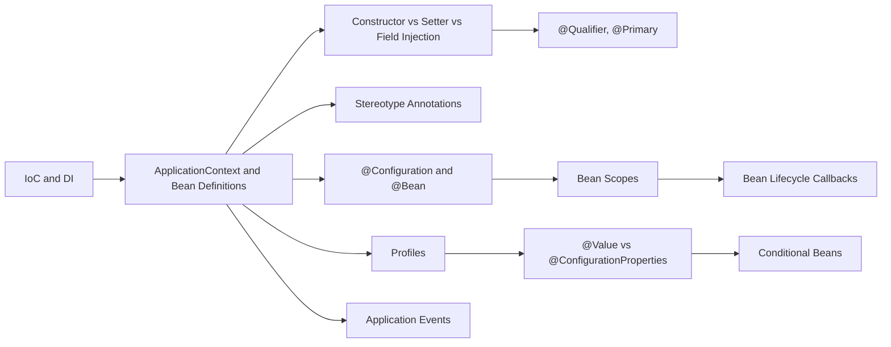
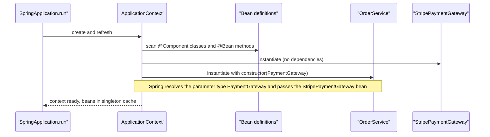
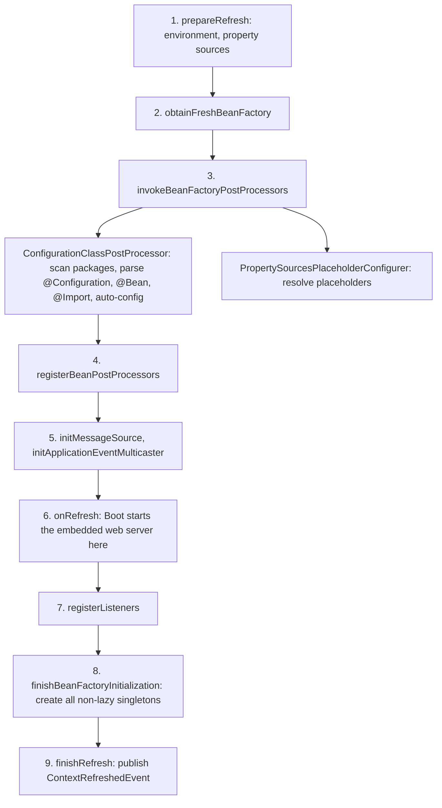
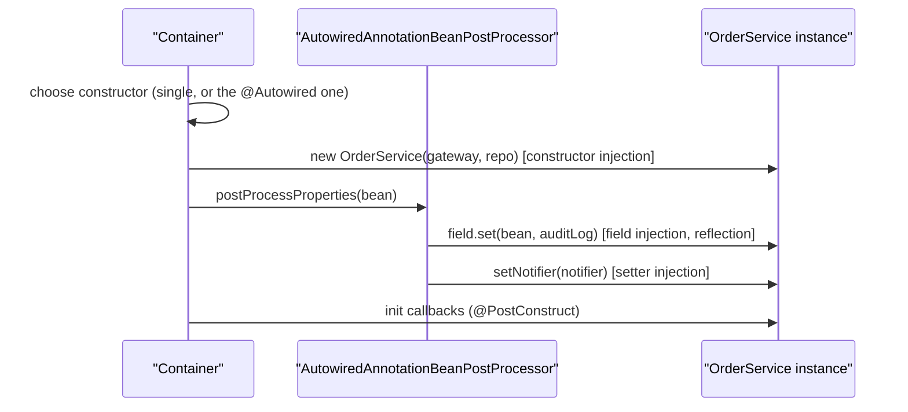
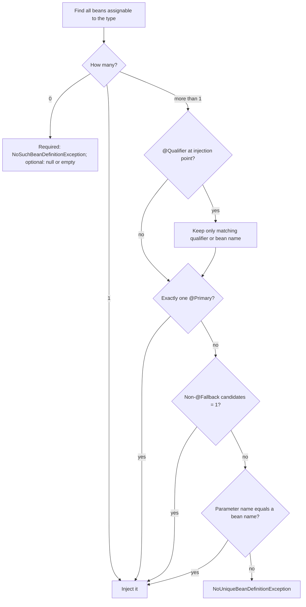

@@ 1 | MODULE | Phase 10 — Spring Core in Depth (Intermediate) | The IoC container, bean definitions, injection styles, scopes, lifecycle, profiles, configuration properties, conditions and events | MUST
# Phase 10: Spring Core in Depth (Intermediate)

In Phase 5 you used Spring Boot as a black box: annotate a class, and it "just works". This phase opens the box. You learn what the IoC container is, how it turns classes into bean definitions and then into objects, how dependencies are wired, how scopes and lifecycle callbacks work, and how Boot decides which beans exist at all (profiles, properties and conditions). Finally you see the container's built-in event bus.

Interviewers care because every Spring question above junior level rests on this: "Why does `@Transactional` not work on a private method?", "Why is my prototype bean behaving like a singleton?", "How does auto-configuration back off when I define my own bean?" You cannot answer those without a clear picture of the container.



**Prerequisites:** Phase 2 (interfaces, polymorphism), Phase 5 (your first Spring Boot app and the OrderHub product CRUD), Phase 9 helps for thread-safety of singletons.

**OrderHub in this phase:** the Phase 5 project has `com.orderhub.product` with `Product`, `ProductController`, `ProductService` and an in-memory `ProductRepository`. In Phase 10 you refactor it to constructor injection everywhere, introduce a `PaymentGateway` interface with two implementations, move settings into a typed `OrderHubProperties` class, add `dev` and `prod` profiles, a conditional notification sender, and an `OrderPlacedEvent`.

**The 5 questions from this phase that come up most often**
1. What are IoC and dependency injection, and why does Spring use them?
2. Why is constructor injection preferred over field injection?
3. What bean scopes exist, and what happens when you inject a prototype bean into a singleton?
4. Describe the Spring bean lifecycle from definition to destruction.
5. What is the difference between `@Value` and `@ConfigurationProperties`?

@@ 2 | MODULE | The container | IoC, the ApplicationContext, bean definitions, injection styles and resolving multiple candidates | MUST
# The container

**Shared analogy: a restaurant kitchen run by a head chef.** The cooks (your classes) do not go shopping for their own ingredients and tools. The head chef (the IoC container) reads the menu plan (bean definitions), hires the cooks, hands each one exactly what they need (dependency injection) and decides who gets the special knife when two cooks could use it (`@Qualifier` and `@Primary`). Cooks just cook.

- **IoC and Dependency Injection:** why cooks stop shopping for themselves.
- **ApplicationContext and Bean Definitions:** the head chef and the written plan.
- **Constructor vs Setter vs Field Injection:** three ways to hand a cook their tools.
- **@Qualifier, @Primary and Multiple Beans:** choosing between two suitable tools.

@@ 3 | TOPIC | IoC and Dependency Injection | What inversion of control means, how DI implements it and why it makes code testable | MUST
# IoC and Dependency Injection

**Level: Intermediate | Phase 10 | Priority: MUST | Since: Spring 1.0 (2004); annotation config Spring 2.5; Java config Spring 3.0**

> **30-second interview answer:** Inversion of Control means my objects do not create or look up their own collaborators; something outside (the Spring container) creates them and wires them together. Dependency injection is the way Spring implements IoC: dependencies are passed in through the constructor (preferred), a setter or a field. The result is loosely coupled classes that depend on interfaces, are easy to unit test with fakes, and can be reconfigured without code changes.

## 1. Concept in Simple Words
### Analogy
A film production versus a one-person home video.

| Film production | Spring |
|---|---|
| The actor does not hire the camera crew or buy props | A class does not call `new` on its collaborators |
| The production office books crew and props for each scene | The IoC container creates and wires beans |
| The actor's contract lists what they need ("a stunt double") | The constructor parameters declare dependencies |
| Swap the stunt double without rewriting the script | Swap an implementation without changing the class |
| Rehearsal with stand-ins | Unit tests with mocks or fakes |

### What it is
- **Dependency:** an object another object needs to do its job (`OrderService` needs a `PaymentGateway`).
- **Inversion of Control (IoC):** the general principle that the framework, not your code, controls object creation and flow ("don't call us, we'll call you").
- **Dependency Injection (DI):** a concrete form of IoC where dependencies are *given* to an object instead of being created or looked up by it.
- **Service locator:** the alternative form of IoC where an object asks a registry for its dependencies (`context.getBean(...)`). It still hides dependencies inside the class, so DI is preferred.
- **IoC container:** the Spring component (`ApplicationContext`) that holds bean definitions, creates beans and injects them.

### Why it exists
Without DI, `OrderService` writes `new StripePaymentGateway(new HttpClient(...))`. Now the service is welded to Stripe, to a real HTTP client and to its configuration. You cannot test it without hitting Stripe, and switching providers means editing every class that calls `new`. DI moves the "who uses which implementation" decision into one place (configuration), so business classes only state what they need.

## 2. How It Works


Step by step:
1. **Read configuration.** Component scanning and `@Configuration` classes produce `BeanDefinition` objects (class, scope, dependencies, init and destroy methods). No objects exist yet.
2. **Build the dependency graph.** For each singleton, Spring looks at the constructor parameters and finds beans that match by type (then by qualifier or name).
3. **Create in dependency order.** Dependencies are created first, then the dependent bean is constructed with them.
4. **Post-process.** `BeanPostProcessor`s may wrap the bean in a proxy (for `@Transactional`, `@Async`, AOP). The proxy, not the raw object, is what gets injected elsewhere.
5. **Cache.** Singletons are stored in the singleton cache; every later injection gets the same instance.

```text
Without DI                         With DI
OrderService ---new---> Stripe      OrderService ---needs---> PaymentGateway (interface)
     |                                                          ^
     +---new---> HttpClient          Container decides: StripePaymentGateway or FakePaymentGateway
```

## 3. Code Example
### Code
A plain-Java version first, so you can see that DI is just "pass collaborators in", with no framework needed.

```java
import java.math.BigDecimal;
import java.util.ArrayList;
import java.util.List;

public class DiDemo {

    interface PaymentGateway {
        String charge(String customer, BigDecimal amount);
    }

    static class StripePaymentGateway implements PaymentGateway {
        public String charge(String customer, BigDecimal amount) {
            return "stripe-ok:" + customer + ":" + amount;
        }
    }

    // Test double: records calls instead of charging real money
    static class FakePaymentGateway implements PaymentGateway {
        final List<String> calls = new ArrayList<>();
        public String charge(String customer, BigDecimal amount) {
            calls.add(customer + "=" + amount);
            return "fake-ok";
        }
    }

    // Tightly coupled: creates its own dependency
    static class CoupledOrderService {
        private final PaymentGateway gateway = new StripePaymentGateway();
        String place(String customer, BigDecimal amount) { return gateway.charge(customer, amount); }
    }

    // Dependency injection: the dependency comes in through the constructor
    static class OrderService {
        private final PaymentGateway gateway;
        OrderService(PaymentGateway gateway) { this.gateway = gateway; }
        String place(String customer, BigDecimal amount) { return gateway.charge(customer, amount); }
    }

    public static void main(String[] args) {
        System.out.println(new CoupledOrderService().place("alice", new BigDecimal("20.00")));

        // "Production wiring": the composition root chooses the implementation
        OrderService prod = new OrderService(new StripePaymentGateway());
        System.out.println(prod.place("bob", new BigDecimal("15.50")));

        // "Test wiring": same class, different collaborator
        FakePaymentGateway fake = new FakePaymentGateway();
        OrderService test = new OrderService(fake);
        System.out.println(test.place("carol", new BigDecimal("9.99")));
        System.out.println("fake recorded: " + fake.calls);
    }
}
```

Now the same wiring done by Spring Boot in OrderHub:

```java
// File: src/main/java/com/orderhub/payment/PaymentGateway.java
package com.orderhub.payment;

import java.math.BigDecimal;

public interface PaymentGateway {
    String charge(String customer, BigDecimal amount);
}

// File: src/main/java/com/orderhub/payment/StripePaymentGateway.java
package com.orderhub.payment;

import java.math.BigDecimal;
import org.springframework.stereotype.Component;

@Component                       // Spring registers a bean definition for this class
public class StripePaymentGateway implements PaymentGateway {
    @Override
    public String charge(String customer, BigDecimal amount) {
        return "stripe-ok:" + customer + ":" + amount;
    }
}

// File: src/main/java/com/orderhub/order/OrderService.java
package com.orderhub.order;

import com.orderhub.payment.PaymentGateway;
import java.math.BigDecimal;
import org.springframework.stereotype.Service;

@Service
public class OrderService {
    private final PaymentGateway gateway;

    // Single constructor: Spring uses it automatically, no @Autowired needed (since Spring 4.3)
    public OrderService(PaymentGateway gateway) {
        this.gateway = gateway;
    }

    public String place(String customer, BigDecimal amount) {
        return gateway.charge(customer, amount);
    }
}

// File: src/main/java/com/orderhub/OrderHubApplication.java
package com.orderhub;

import com.orderhub.order.OrderService;
import java.math.BigDecimal;
import org.springframework.boot.CommandLineRunner;
import org.springframework.boot.SpringApplication;
import org.springframework.boot.autoconfigure.SpringBootApplication;
import org.springframework.context.annotation.Bean;

@SpringBootApplication
public class OrderHubApplication {
    public static void main(String[] args) {
        SpringApplication.run(OrderHubApplication.class, args);
    }

    @Bean
    CommandLineRunner demo(OrderService orders) {      // dependency injected into a @Bean method
        return args -> System.out.println(orders.place("dave", new BigDecimal("42.00")));
    }
}
```

### Walkthrough
- `CoupledOrderService` creates `StripePaymentGateway` itself, so a test cannot avoid Stripe and switching providers means editing this class.
- `OrderService` only declares "I need a `PaymentGateway`". In `main`, the code that builds objects (called the **composition root**) decides which implementation to pass. In production it passes Stripe, in the test it passes a fake that records calls.
- In the Spring version, `@Component` and `@Service` let component scanning find the classes. The container sees that `OrderService`'s only constructor needs a `PaymentGateway`, finds exactly one bean of that type, and passes it in. Spring is just an automatic composition root.
- The `CommandLineRunner` bean runs after the context starts, so you see the call happen.

### Output
Plain Java:
```text
stripe-ok:alice:20.00
stripe-ok:bob:15.50
fake-ok
fake recorded: [carol=9.99]
```
Spring Boot (after the startup banner and logs):
```text
stripe-ok:dave:42.00
```

### Compare
| Creating dependencies yourself | Dependency injection |
|---|---|
| `new StripePaymentGateway()` inside the service | Constructor parameter of type `PaymentGateway` |
| Hidden dependencies; you read the body to find them | Dependencies visible in the constructor signature |
| Tests need the real implementation | Tests pass a fake or a Mockito mock |
| Changing provider edits many classes | Changing provider edits one configuration |

## 4. Interview Questions
**Basic**
1. **What is Inversion of Control?**
   A design principle where control over object creation and program flow moves from your code to a framework. Instead of a class building its collaborators, the container builds them and calls your code. Spring's container is an IoC container.
2. **What is dependency injection and how is it related to IoC?**
   DI is one way to achieve IoC: an object receives its dependencies from outside, through a constructor, setter or field. The other way is a service locator, where the object asks a registry. DI is preferred because dependencies stay visible and the class has no framework lookup code.
3. **What are the benefits of DI?**
   Loose coupling (code depends on interfaces), easy unit testing with fakes, central configuration of which implementation is used, and lifecycle management (singletons, proxies, cleanup) handled by the container.

**Follow-up**
4. **Is DI only possible with Spring?**
   No. DI is a pattern; passing collaborators into a constructor by hand is DI. Spring, Guice, Dagger, Micronaut and Quarkus automate the wiring. Interviewers like hearing that you could write the composition root yourself.
5. **How does Spring know what to inject into a constructor?**
   It resolves each parameter by type against the registered bean definitions. If exactly one bean matches it is used; if several match, Spring narrows down by `@Qualifier`, then `@Primary`, then by matching the parameter name to a bean name. If none or still several remain, startup fails with `NoSuchBeanDefinitionException` or `NoUniqueBeanDefinitionException`.
6. **Why is `context.getBean(...)` inside business code considered a smell?**
   It is the service-locator style: the class hides its real dependencies, depends on the Spring API, and is harder to test. Inject the dependency instead; use `ObjectProvider` only when you genuinely need lazy or optional lookup.

**Tricky / scenario**
7. **A colleague says "DI makes code slower because of reflection". Answer them.**
   Reflection is used once, at startup, to create and wire beans. After that, method calls between beans are ordinary Java calls (or a proxy call when AOP is involved). Runtime cost is negligible; startup cost is the real trade-off, which Spring AOT and native images reduce.
8. **You have a class with eight constructor parameters. Is DI the problem?**
   No, DI exposed the problem. A long constructor means the class has too many responsibilities. Split it into smaller services or group related collaborators. Field injection would only hide the smell.

**What the interviewer is really testing:** that you understand DI as a design idea (dependencies passed in, interfaces, testability), not just "I put `@Autowired` on things".

## 5. Pitfalls & Best Practices
### Common mistakes
| Mistake | What goes wrong | Fix |
|---|---|---|
| Calling `new` on a Spring-managed class | The object is not a bean: no injection, no `@Transactional` proxy | Inject it instead of creating it |
| Depending on concrete classes everywhere | Cannot swap implementations or mock easily | Depend on interfaces at boundaries (payments, email, storage) |
| `applicationContext.getBean(...)` in services | Hidden dependencies, framework coupling | Constructor injection; `ObjectProvider` for lazy cases |
| Creating an interface for every class "for DI" | Noise with no second implementation | Introduce interfaces where variation or test seams are real |

### Best practices
- Use constructor injection with `final` fields; one constructor means no annotation is needed.
- Keep business classes free of Spring APIs where practical; the container should be an implementation detail.
- Put interfaces at architectural boundaries (external systems), not between every pair of classes.
- If a constructor grows past four or five parameters, treat it as a design warning.

### Compare with
| Approach | How dependencies arrive | Visibility | Testability |
|---|---|---|---|
| `new` inside the class | Created internally | Hidden | Poor |
| Service locator | Looked up from a registry | Hidden | Medium |
| Dependency injection | Passed in from outside | Explicit | Excellent |
| Static factories or singletons | Global access | Hidden | Poor |

## 6. Hands-on Exercise
**OrderHub task.** Phase 5 left `ProductService` creating its repository with `new InMemoryProductRepository()`. Refactor:
1. Extract a `ProductRepository` interface (`findAll`, `findById`, `save`, `deleteById`), make `InMemoryProductRepository` implement it and annotate it with `@Repository`.
2. Make `ProductService` take `ProductRepository` through its constructor.
3. Write a plain JUnit test (no Spring) that builds `ProductService` with a hand-written fake repository.

Acceptance criteria: no `new InMemoryProductRepository()` remains in production code; the app starts; the unit test runs without a Spring context.

<details><summary>Solution</summary>

```java
// File: src/main/java/com/orderhub/product/ProductRepository.java
package com.orderhub.product;

import java.util.List;
import java.util.Optional;

public interface ProductRepository {
    List<Product> findAll();
    Optional<Product> findById(long id);
    Product save(Product product);
    void deleteById(long id);
}

// File: src/main/java/com/orderhub/product/InMemoryProductRepository.java
package com.orderhub.product;

import java.util.ArrayList;
import java.util.List;
import java.util.Map;
import java.util.Optional;
import java.util.concurrent.ConcurrentHashMap;
import java.util.concurrent.atomic.AtomicLong;
import org.springframework.stereotype.Repository;

@Repository
public class InMemoryProductRepository implements ProductRepository {
    private final Map<Long, Product> store = new ConcurrentHashMap<>();
    private final AtomicLong ids = new AtomicLong();

    public List<Product> findAll() { return new ArrayList<>(store.values()); }
    public Optional<Product> findById(long id) { return Optional.ofNullable(store.get(id)); }
    public Product save(Product p) {
        Product saved = p.id() == null ? p.withId(ids.incrementAndGet()) : p;
        store.put(saved.id(), saved);
        return saved;
    }
    public void deleteById(long id) { store.remove(id); }
}

// File: src/main/java/com/orderhub/product/ProductService.java
package com.orderhub.product;

import java.util.List;
import org.springframework.stereotype.Service;

@Service
public class ProductService {
    private final ProductRepository repository;

    public ProductService(ProductRepository repository) {
        this.repository = repository;
    }

    public List<Product> findAll() { return repository.findAll(); }

    public Product get(long id) {
        return repository.findById(id)
                .orElseThrow(() -> new ProductNotFoundException(id));
    }

    public Product create(Product product) { return repository.save(product); }
}

// File: src/test/java/com/orderhub/product/ProductServiceTest.java
package com.orderhub.product;

import static org.junit.jupiter.api.Assertions.assertEquals;
import static org.junit.jupiter.api.Assertions.assertThrows;

import java.math.BigDecimal;
import java.util.*;
import org.junit.jupiter.api.Test;

class ProductServiceTest {

    static class FakeRepo implements ProductRepository {
        final Map<Long, Product> data = new HashMap<>();
        public List<Product> findAll() { return new ArrayList<>(data.values()); }
        public Optional<Product> findById(long id) { return Optional.ofNullable(data.get(id)); }
        public Product save(Product p) { Product s = p.withId(1L); data.put(1L, s); return s; }
        public void deleteById(long id) { data.remove(id); }
    }

    @Test
    void createsAndFindsProduct() {
        ProductService service = new ProductService(new FakeRepo());   // no Spring needed
        Product saved = service.create(new Product(null, "Keyboard", new BigDecimal("49.90"), 10));
        assertEquals("Keyboard", service.get(saved.id()).name());
    }

    @Test
    void missingProductThrows() {
        ProductService service = new ProductService(new FakeRepo());
        assertThrows(ProductNotFoundException.class, () -> service.get(99));
    }
}
```
`Product` is the Phase 5 record `Product(Long id, String name, BigDecimal price, int stock)` with a `withId` helper that returns a copy with the new id. The test proves the service no longer depends on a concrete repository or on Spring.
</details>

## 7. Recall
Q: What does Inversion of Control mean in Spring?
A: Object creation and wiring move from your classes to the Spring container, which builds beans and passes them their collaborators.

Q: How is dependency injection related to IoC?
A: DI is one implementation of IoC in which dependencies are passed in from outside (constructor, setter or field) instead of created or looked up.

Q: How does Spring resolve a constructor dependency?
A: By type first, then by `@Qualifier`, then `@Primary`, then parameter name; zero or multiple remaining candidates fail startup.

Q: Why is calling `context.getBean()` from business code a smell in DI?
A: It is the service-locator pattern: it hides dependencies, couples code to Spring and makes testing harder.

Q: Does dependency injection slow down method calls at runtime?
A: No; reflection is used at startup for wiring, and later calls are plain Java calls or proxy calls.

**Related:** [[ApplicationContext and Bean Definitions]] · [[Constructor vs Setter vs Field Injection]] · [[@Qualifier, @Primary and Multiple Beans]]

@@ 3 | TOPIC | ApplicationContext and Bean Definitions | What the container is, BeanFactory vs ApplicationContext, BeanDefinition metadata and the refresh phases | MUST
# ApplicationContext and Bean Definitions

**Level: Intermediate | Phase 10 | Priority: MUST | Since: Spring 1.0 (BeanFactory and ApplicationContext); AnnotationConfigApplicationContext Spring 3.0**

> **30-second interview answer:** The `ApplicationContext` is Spring's IoC container. It first collects bean definitions, which are recipes describing each bean (class, scope, dependencies, lazy flag, init and destroy methods), from component scanning, `@Configuration` classes and auto-configuration. Then, during `refresh()`, it runs factory post-processors that can change those recipes, registers bean post-processors, and eagerly creates all non-lazy singletons. It extends the basic `BeanFactory` with events, internationalisation, resource loading and environment support.

## 1. Concept in Simple Words
### Analogy
An architect's blueprints versus the finished houses.

| Construction | Spring |
|---|---|
| Blueprint for each house type | `BeanDefinition` |
| Planning office that can edit blueprints before building | `BeanFactoryPostProcessor` |
| Inspectors who check and decorate each house after it is built | `BeanPostProcessor` |
| The construction company that builds from blueprints | `BeanFactory` |
| The whole estate office: building plus utilities, mail, notices | `ApplicationContext` |
| Show homes built on day one | Eager singletons created at startup |

### What it is
- **BeanFactory:** the core container interface. It can register definitions and create beans lazily on `getBean`.
- **ApplicationContext:** a sub-interface of `BeanFactory` that adds eager singleton creation, automatic registration of post-processors, events (`ApplicationEventPublisher`), message sources (i18n), resource loading and the `Environment` (profiles and properties). In practice you always use an `ApplicationContext`.
- **BeanDefinition:** metadata for one bean: bean class or factory method, scope, constructor arguments, property values, `lazyInit`, `primary`, `dependsOn`, init and destroy method names.
- **Bean name:** the unique id in the container. Defaults: class name with a lower-case first letter for `@Component` (`orderService`), method name for `@Bean`.
- **Common implementations:** `AnnotationConfigApplicationContext` (plain Java config), `AnnotationConfigServletWebServerApplicationContext` (what Spring Boot creates for a servlet web app), `ReactiveWebServerApplicationContext` (WebFlux).

### Why it exists
Separating "what to build" (definitions) from "building it" (instantiation) lets Spring inspect and modify the whole plan before any object exists. That is how placeholders like `${orderhub.currency}` get resolved, how `@Configuration` classes get parsed, how auto-configuration adds beans conditionally, and how Spring detects missing dependencies early at startup instead of at the first request.

## 2. How It Works
The heart of the container is `AbstractApplicationContext.refresh()`:



Key points:
- **Phase A, definitions only (steps 1 to 3).** `ConfigurationClassPostProcessor` is itself a `BeanDefinitionRegistryPostProcessor`. It is what processes `@ComponentScan`, `@Configuration`, `@Bean`, `@Import` and Boot's `@EnableAutoConfiguration`. At this point the registry holds only definitions.
- **Phase B, objects (step 8).** For each non-lazy singleton: instantiate, inject dependencies, run `Aware` callbacks, run `BeanPostProcessor.postProcessBeforeInitialization`, init callbacks, then `postProcessAfterInitialization` (where AOP proxies are created).
- **Fail fast.** Because singletons are created eagerly, a missing bean or a circular constructor dependency fails at startup, not at 3 a.m. under traffic.
- **Hierarchy.** Contexts can have a parent; a child sees parent beans but not the reverse (used by classic Spring MVC with a root and a servlet context, and by Spring Cloud).

```text
BeanDefinitionRegistry (map: name -> BeanDefinition)
  "orderService"  -> class=OrderService, scope=singleton, ctorArgs=[ref paymentGateway]
  "stripePaymentGateway" -> class=StripePaymentGateway, scope=singleton
  "clock" -> factoryBean=appConfig, factoryMethod=clock, scope=singleton
               |
               v  finishBeanFactoryInitialization
Singleton cache (map: name -> object)
  "orderService" -> OrderService@3f2a (or its proxy)
```

## 3. Code Example
### Code
Bootstrapping a context by hand (no Boot) shows the moving parts that Boot normally hides.

```java
// File: src/main/java/com/orderhub/demo/ContextDemo.java
package com.orderhub.demo;

import java.time.Clock;
import java.util.Arrays;
import org.springframework.beans.factory.config.BeanDefinition;
import org.springframework.beans.factory.config.BeanFactoryPostProcessor;
import org.springframework.context.annotation.AnnotationConfigApplicationContext;
import org.springframework.context.annotation.Bean;
import org.springframework.context.annotation.Configuration;
import org.springframework.stereotype.Component;

public class ContextDemo {

    @Component
    static class InventoryService {
        InventoryService() { System.out.println("InventoryService created"); }
    }

    @Configuration
    static class AppConfig {
        @Bean
        Clock clock() {
            System.out.println("clock() called");
            return Clock.systemUTC();
        }

        // static: must run before other beans are created
        @Bean
        static BeanFactoryPostProcessor makeInventoryLazy() {
            return beanFactory -> {
                BeanDefinition bd = beanFactory.getBeanDefinition("contextDemo.InventoryService");
                System.out.println("BFPP sees definition, lazy before = " + bd.isLazyInit());
                bd.setLazyInit(true);           // change the recipe before any object exists
            };
        }
    }

    public static void main(String[] args) {
        var ctx = new AnnotationConfigApplicationContext();
        ctx.register(AppConfig.class, InventoryService.class);
        System.out.println("definitions before refresh: " + ctx.getBeanDefinitionCount() + " registered");
        ctx.refresh();                          // runs the 9 phases
        System.out.println("refresh done");

        System.out.println("app beans: " + Arrays.stream(ctx.getBeanDefinitionNames())
                .filter(n -> !n.startsWith("org.springframework"))
                .toList());

        ctx.getBean(InventoryService.class);    // lazy: created only now
        System.out.println("same clock twice: " + (ctx.getBean(Clock.class) == ctx.getBean(Clock.class)));
        ctx.close();
    }
}
```

In Spring Boot you can inspect the same data at runtime:

```java
// File: src/main/java/com/orderhub/demo/BeanListing.java
package com.orderhub.demo;

import org.springframework.boot.ApplicationRunner;
import org.springframework.context.ApplicationContext;
import org.springframework.context.annotation.Bean;
import org.springframework.context.annotation.Configuration;

@Configuration
public class BeanListing {
    @Bean
    ApplicationRunner listOrderHubBeans(ApplicationContext ctx) {
        return args -> {
            System.out.println("context type: " + ctx.getClass().getSimpleName());
            for (String name : ctx.getBeanDefinitionNames()) {
                Object bean = ctx.getBean(name);
                if (bean.getClass().getName().startsWith("com.orderhub")) {
                    System.out.println(name + " -> " + bean.getClass().getSimpleName());
                }
            }
        };
    }
}
```

### Walkthrough
- `register(...)` only adds bean definitions. The count printed before refresh includes Spring's own internal processors (registered by the annotation context) plus our two classes.
- `refresh()` runs `ConfigurationClassPostProcessor`, which parses `AppConfig` and finds two `@Bean` methods. Our `BeanFactoryPostProcessor` then edits the `InventoryService` definition to lazy before any bean is built. It is declared `static` so Spring can call it without first creating `AppConfig` (otherwise you get a warning and lose `@Configuration` processing benefits for that class).
- The nested class bean name is `contextDemo.InventoryService` because `AnnotationBeanNameGenerator` uses the short class name including the outer class.
- During `finishBeanFactoryInitialization`, `clock()` is called (eager singleton), but `InventoryService` is skipped because it is now lazy. It is created only on `getBean`.
- `getBean(Clock.class)` twice returns the same instance: singleton scope.
- In Boot, the context is `AnnotationConfigServletWebServerApplicationContext` for a Spring MVC app.

### Output
```text
definitions before refresh: 7 registered
BFPP sees definition, lazy before = false
clock() called
refresh done
app beans: [contextDemo.AppConfig, contextDemo.InventoryService, clock, makeInventoryLazy]
InventoryService created
same clock twice: true
```
Boot runner output (OrderHub, abbreviated to app beans):
```text
context type: AnnotationConfigServletWebServerApplicationContext
orderHubApplication -> OrderHubApplication$$SpringCGLIB$$0
productController -> ProductController
productService -> ProductService
inMemoryProductRepository -> InMemoryProductRepository
```

### Compare
| BeanFactory | ApplicationContext |
|---|---|
| Lazy: creates beans on first `getBean` | Eagerly creates non-lazy singletons at refresh |
| You register post-processors manually | Detects and registers post-processors automatically |
| No events, no i18n, no environment abstraction | Events, `MessageSource`, `Environment`, resource loading |
| Used inside frameworks or very constrained setups | What every real application uses |

## 4. Interview Questions
**Basic**
1. **What is the ApplicationContext?**
   Spring's main IoC container interface. It holds bean definitions, creates and wires beans, and adds enterprise features such as events, internationalisation, the environment with profiles and properties, and resource loading.
2. **BeanFactory vs ApplicationContext?**
   `BeanFactory` is the minimal container with lazy creation. `ApplicationContext` extends it with eager singleton creation, automatic post-processor registration, events, message sources and environment support. Use `ApplicationContext` unless you are writing framework code.
3. **What is a bean definition?**
   A recipe for a bean: its class or factory method, scope, constructor arguments, dependencies, lazy and primary flags, and init and destroy methods. Spring builds all definitions first and creates objects from them later.

**Follow-up**
4. **What happens during `refresh()`?**
   Spring prepares the environment, loads definitions, runs `BeanFactoryPostProcessor`s (including the one that parses `@Configuration` and component scans), registers `BeanPostProcessor`s, initialises the event multicaster, lets Boot start the web server in `onRefresh`, creates all non-lazy singletons and publishes `ContextRefreshedEvent`.
5. **BeanFactoryPostProcessor vs BeanPostProcessor?**
   A `BeanFactoryPostProcessor` works on definitions before any regular bean exists (example: placeholder resolution, `ConfigurationClassPostProcessor`). A `BeanPostProcessor` works on bean instances after creation (example: `AutowiredAnnotationBeanPostProcessor`, AOP proxy creators).
6. **How are default bean names chosen?**
   For `@Component` classes, the simple class name with the first letter lower-cased (`OrderService` becomes `orderService`; if the first two letters are upper-case, like `URLParser`, the name stays `URLParser`). For `@Bean` methods, the method name. Both can be overridden.

**Tricky / scenario**
7. **Why should a `@Bean` method returning a `BeanFactoryPostProcessor` be static?**
   The post-processor must run before normal beans are created. If the method is an instance method, Spring has to instantiate the `@Configuration` class early, before its own processing is complete, which can break `@Autowired` and `@Value` inside that configuration. A static method lets Spring call it without the configuration instance.
8. **The app fails at startup with `NoSuchBeanDefinitionException`. Why is that a good thing?**
   Eager singleton creation surfaces wiring errors during deployment instead of on the first request. Making beans lazy hides those problems until runtime, so global lazy initialisation is a trade-off between startup time and fail-fast safety.
9. **Can two beans have the same name?**
   Not in one context. Since Spring Boot 2.1, bean definition overriding is disabled by default, so a duplicate name fails startup with `BeanDefinitionOverrideException`. You can enable `spring.main.allow-bean-definition-overriding`, but that usually hides a configuration mistake.

**What the interviewer is really testing:** whether you can describe the two-phase model (definitions, then instances) and know where extension points plug in.

## 5. Pitfalls & Best Practices
### Common mistakes
| Mistake | What goes wrong | Fix |
|---|---|---|
| Non-static `@Bean` method for a `BeanFactoryPostProcessor` | Config class created too early, injection inside it misbehaves | Declare it `static` |
| Turning on global lazy init to "speed up startup" in production | Wiring errors appear on first request, first requests are slow | Use lazy init selectively, or only in dev |
| Injecting `ApplicationContext` everywhere to call `getBean` | Service-locator style, hidden dependencies | Inject the actual dependency |
| Relying on bean definition overriding | The last definition silently wins | Keep names unique; use `@Primary` or conditions |

### Best practices
- Think of startup in two phases; extension points that change *what* exists act on definitions, those that change *how a bean behaves* act on instances.
- Use the Actuator `beans` endpoint or the conditions report (`--debug`) to see what is actually in the context.
- Keep the context fail-fast: eager singletons, no overriding, no `getBean` in business code.

### Compare with
| Container type | Typical use |
|---|---|
| `AnnotationConfigApplicationContext` | Plain Spring with Java config, small tools, tests |
| `AnnotationConfigServletWebServerApplicationContext` | Spring Boot servlet (Spring MVC) apps |
| `ReactiveWebServerApplicationContext` | Spring Boot WebFlux apps |
| `GenericApplicationContext` | Programmatic registration, functional bean registration |

## 6. Hands-on Exercise
**OrderHub task.** Add a startup report to OrderHub:
1. Create `StartupReport` in `com.orderhub.config`, a bean that implements `ApplicationListener<ContextRefreshedEvent>`.
2. When the context is refreshed, print how many bean definitions exist in total and list the names of beans whose class is in the `com.orderhub` package, sorted.
3. Mark `InMemoryProductRepository` with `@Lazy` and show that it still appears in the list (it is a definition) but is created only when `ProductService` needs it.

Acceptance criteria: the report prints once at startup; the list is sorted; you can explain why `@Lazy` on the repository changes nothing if `ProductService` is an eager singleton that depends on it.

<details><summary>Solution</summary>

```java
// File: src/main/java/com/orderhub/config/StartupReport.java
package com.orderhub.config;

import java.util.Arrays;
import org.springframework.beans.factory.config.ConfigurableListableBeanFactory;
import org.springframework.context.ApplicationListener;
import org.springframework.context.ConfigurableApplicationContext;
import org.springframework.context.event.ContextRefreshedEvent;
import org.springframework.stereotype.Component;

@Component
public class StartupReport implements ApplicationListener<ContextRefreshedEvent> {

    @Override
    public void onApplicationEvent(ContextRefreshedEvent event) {
        ConfigurableListableBeanFactory factory =
                ((ConfigurableApplicationContext) event.getApplicationContext()).getBeanFactory();
        System.out.println("total bean definitions: " + factory.getBeanDefinitionCount());
        Arrays.stream(factory.getBeanDefinitionNames())
                .filter(name -> {
                    String cls = factory.getBeanDefinition(name).getBeanClassName();
                    return cls != null && cls.startsWith("com.orderhub");
                })
                .sorted()
                .forEach(name -> System.out.println("  " + name));
    }
}
```
Sample output:
```text
total bean definitions: 312
  inMemoryProductRepository
  orderHubApplication
  productController
  productService
  startupReport
```
`@Lazy` on `InMemoryProductRepository` only delays creation until someone asks for it. `ProductService` is an eager singleton that needs the repository in its constructor, so the repository is created right away anyway. To truly defer it you would also put `@Lazy` on the constructor parameter, which injects a lazy-resolution proxy. `@Bean` methods have no bean class name in the definition (they use a factory method), which is why the filter checks for null.
</details>

## 7. Recall
Q: What is a Spring bean definition?
A: Metadata describing how to create a bean: class or factory method, scope, dependencies, lazy and primary flags, init and destroy methods.

Q: What does `ApplicationContext` add on top of `BeanFactory`?
A: Eager singleton creation, automatic post-processor registration, events, message sources, the `Environment` and resource loading.

Q: What is the difference between a BeanFactoryPostProcessor and a BeanPostProcessor in Spring?
A: The first modifies bean definitions before beans are created; the second modifies or wraps bean instances after creation.

Q: In which refresh step are non-lazy singletons created in Spring?
A: `finishBeanFactoryInitialization`, after post-processors are registered and before `ContextRefreshedEvent` is published.

Q: What happens in Spring Boot when two bean definitions share a name?
A: Startup fails with `BeanDefinitionOverrideException`, because overriding is disabled by default since Boot 2.1.

**Related:** [[IoC and Dependency Injection]] · [[Bean Lifecycle Callbacks]] · [[@Configuration and @Bean]] · [[Conditional Beans]]

@@ 3 | TOPIC | Constructor vs Setter vs Field Injection | The three injection styles, why constructor injection wins, and when setter injection still fits | MUST
# Constructor vs Setter vs Field Injection

**Level: Intermediate | Phase 10 | Priority: MUST | Since: Spring 1.0 (constructor and setter); @Autowired Spring 2.5; implicit single-constructor injection Spring 4.3**

> **30-second interview answer:** Spring can inject through a constructor, a setter or directly into a field. I use constructor injection for required dependencies: fields can be `final`, the object is never half-built, dependencies are visible, and I can unit test with plain `new`. Setter injection fits optional or reconfigurable dependencies. Field injection is short but hides dependencies, prevents `final`, needs reflection for tests and is discouraged by the Spring team.

## 1. Concept in Simple Words
### Analogy
Three ways to equip a new delivery driver.

| Equipping the driver | Injection style |
|---|---|
| The van, keys and route sheet are handed over at hiring; no van, no job | Constructor injection: required, complete from the start |
| A phone charger they can be given later if available | Setter injection: optional, can change later |
| Someone secretly slips tools into the driver's pockets at night | Field injection: works, but nobody can see what the driver depends on |

### What it is
- **Constructor injection:** dependencies are constructor parameters. Spring calls the constructor with resolved beans. With a single constructor no annotation is needed (since Spring 4.3).
- **Setter injection:** Spring calls `@Autowired` setter methods after construction.
- **Field injection:** `@Autowired` on a field; Spring sets it with reflection after construction, even if it is private.
- **Required vs optional:** constructor parameters are required by default; for optional ones use `Optional<T>`, `ObjectProvider<T>` or `@Autowired(required = false)` on a setter.

### Why it exists
Each style solves a different need. Constructor injection guarantees a fully formed, immutable object. Setter injection allows optional dependencies and breaking circular dependencies (a design smell, but sometimes legacy reality). Field injection exists for brevity and was popular in early annotation-driven Spring, but its costs became clear as codebases grew.

## 2. How It Works


Details that matter in interviews:
- **Constructor choice.** One constructor: used automatically. Several: Spring uses the one marked `@Autowired`; if none is marked it falls back to a no-arg constructor or fails.
- **Field and setter injection happen after construction**, in `AutowiredAnnotationBeanPostProcessor.postProcessProperties`. So inside the constructor, injected fields are still `null`.
- **Circular dependencies.** A needs B and B needs A. With constructor injection, Spring cannot create either first, and startup fails with `BeanCurrentlyInCreationException`. With field or setter injection, Spring used to resolve it using an early reference from the "third-level" singleton cache. Since Spring Boot 2.6, circular references are **prohibited by default** (`spring.main.allow-circular-references=false`), so all styles fail unless you opt in.

```text
Constructor injection timeline     Field injection timeline
new OrderService(gw)  -> ready     new OrderService()  -> gw == null (half-built)
                                   reflection sets gw  -> ready
```

## 3. Code Example
### Code
```java
// File: src/main/java/com/orderhub/order/InjectionStyles.java
package com.orderhub.order;

import com.orderhub.payment.PaymentGateway;
import java.util.Optional;
import org.springframework.beans.factory.ObjectProvider;
import org.springframework.beans.factory.annotation.Autowired;
import org.springframework.stereotype.Component;
import org.springframework.stereotype.Service;

interface AuditLog { void record(String msg); }
interface SmsNotifier { void send(String msg); }

@Component
class ConsoleAuditLog implements AuditLog {
    public void record(String msg) { System.out.println("AUDIT " + msg); }
}

// 1. Field injection: short, but hidden and mutable
@Service
class FieldInjectedOrderService {
    @Autowired
    private PaymentGateway gateway;          // cannot be final; null inside the constructor

    FieldInjectedOrderService() {
        System.out.println("field style: gateway in constructor = " + gateway);
    }
}

// 2. Setter injection: good for optional collaborators
@Service
class SetterInjectedOrderService {
    private SmsNotifier sms;                 // optional; no SmsNotifier bean exists

    @Autowired(required = false)
    void setSms(SmsNotifier sms) { this.sms = sms; }

    void notifyCustomer(String msg) {
        if (sms != null) sms.send(msg);
        else System.out.println("setter style: no SMS notifier, skipping");
    }
}

// 3. Constructor injection: required deps final, optional ones explicit
@Service
class ConstructorInjectedOrderService {
    private final PaymentGateway gateway;
    private final AuditLog audit;
    private final Optional<SmsNotifier> sms;           // optional dependency
    private final ObjectProvider<SmsNotifier> smsLater; // lazy and optional lookup

    ConstructorInjectedOrderService(PaymentGateway gateway, AuditLog audit,
                                    Optional<SmsNotifier> sms,
                                    ObjectProvider<SmsNotifier> smsLater) {
        this.gateway = gateway;
        this.audit = audit;
        this.sms = sms;
        this.smsLater = smsLater;
        System.out.println("constructor style: gateway in constructor = "
                + gateway.getClass().getSimpleName());
    }

    void place(String customer) {
        audit.record("order for " + customer);
        sms.ifPresentOrElse(s -> s.send("thanks"), () -> System.out.println("no SMS (Optional)"));
        smsLater.ifAvailable(s -> s.send("thanks again"));
    }
}

// Runner to show the behaviour at startup
@Component
class InjectionRunner implements org.springframework.boot.CommandLineRunner {
    private final SetterInjectedOrderService setterStyle;
    private final ConstructorInjectedOrderService ctorStyle;

    InjectionRunner(SetterInjectedOrderService setterStyle, ConstructorInjectedOrderService ctorStyle) {
        this.setterStyle = setterStyle;
        this.ctorStyle = ctorStyle;
    }

    public void run(String... args) {
        setterStyle.notifyCustomer("shipped");
        ctorStyle.place("alice");
    }
}
```

The unit test shows the practical difference:

```java
// File: src/test/java/com/orderhub/order/ConstructorInjectionTest.java
package com.orderhub.order;

import static org.mockito.Mockito.*;

import com.orderhub.payment.PaymentGateway;
import java.util.Optional;
import org.junit.jupiter.api.Test;
import org.springframework.beans.factory.ObjectProvider;

class ConstructorInjectionTest {
    @Test
    void placesOrderWithoutSpring() {
        AuditLog audit = mock(AuditLog.class);
        @SuppressWarnings("unchecked")
        ObjectProvider<SmsNotifier> none = mock(ObjectProvider.class);
        var service = new ConstructorInjectedOrderService(
                mock(PaymentGateway.class), audit, Optional.empty(), none);   // plain new

        service.place("bob");

        verify(audit).record("order for bob");
    }
    // A field-injected class would need ReflectionTestUtils.setField or @InjectMocks magic.
}
```

### Walkthrough
- `FieldInjectedOrderService` prints `null` in its constructor because field injection happens after construction. The field cannot be `final`, so any code could reassign it.
- `SetterInjectedOrderService` declares the SMS notifier optional with `required = false`. No `SmsNotifier` bean exists, so Spring simply never calls the setter.
- `ConstructorInjectedOrderService` gets everything at construction time. Required dependencies are `final`. Optional ones are explicit: `Optional<SmsNotifier>` is empty when no bean exists, and `ObjectProvider` defers the lookup until `ifAvailable` is called.
- The test builds the constructor-injected service with `new` and mocks. No Spring context, no reflection tricks.

### Output
```text
field style: gateway in constructor = null
constructor style: gateway in constructor = StripePaymentGateway
setter style: no SMS notifier, skipping
AUDIT order for alice
no SMS (Optional)
```
(Bean creation order between the two services can differ, so the first two lines may swap.)

### Compare
| Aspect | Constructor | Setter | Field |
|---|---|---|---|
| Immutability (`final`) | Yes | No | No |
| Object complete after `new` | Yes | No | No |
| Dependencies visible in API | Yes | Partly | No |
| Unit test without Spring | Easy | Easy | Needs reflection |
| Optional dependencies | `Optional` or `ObjectProvider` | Natural fit | `required = false` |
| Circular dependency | Fails fast | Possible only if allowed | Possible only if allowed |

## 4. Interview Questions
**Basic**
1. **What are the three types of dependency injection in Spring?**
   Constructor injection (dependencies as constructor parameters), setter injection (`@Autowired` setter methods called after construction) and field injection (`@Autowired` directly on fields, set by reflection).
2. **Which one do you prefer and why?**
   Constructor injection for required dependencies: fields can be final, the object is always valid, dependencies are visible, and tests can use plain `new`. The Spring team recommends it.
3. **Do I need `@Autowired` on a constructor?**
   Not if the class has a single constructor, since Spring 4.3. With multiple constructors, mark the one Spring should use.

**Follow-up**
4. **When does setter injection make sense?**
   For optional dependencies that have a sensible default, or values that may be reconfigured after construction (for example via JMX). It is also how some framework base classes accept collaborators.
5. **Why is field injection discouraged?**
   It hides dependencies (you must read the fields), prevents `final`, makes the object usable in an invalid half-built state, ties the class to the container (you cannot construct it properly without reflection) and makes it easy to keep adding dependencies unnoticed.
6. **How do you inject an optional dependency with constructor injection?**
   Use `Optional<T>`, `ObjectProvider<T>` (lazy and optional, also handles multiple candidates) or a `@Nullable` parameter. `ObjectProvider` is the most flexible.

**Tricky / scenario**
7. **What does this print, and why?**
   ```java
   @Service
   class Report {
       @Autowired private Clock clock;
       Report() { System.out.println(clock.instant()); }
   }
   ```
   Startup fails with a `BeanCreationException` caused by a `NullPointerException`: the constructor runs before field injection, so `clock` is null. Move the logic to `@PostConstruct` or, better, inject the `Clock` through the constructor.
8. **Two services need each other through constructor injection and startup fails. What do you do?**
   First, fix the design: extract the shared logic into a third service, or use events so one side does not call the other directly. As a stopgap you can put `@Lazy` on one constructor parameter, which injects a proxy resolved on first use. Re-enabling `allow-circular-references` is a last resort.
9. **Lombok `@RequiredArgsConstructor` on a service: what kind of injection is that?**
   Constructor injection. Lombok generates a constructor for all `final` fields, and with a single constructor Spring uses it automatically.

**What the interviewer is really testing:** whether you know the trade-offs and the timing (fields are set after construction), not just "constructor is best".

## 5. Pitfalls & Best Practices
### Common mistakes
| Mistake | What goes wrong | Fix |
|---|---|---|
| Using an injected field in the constructor | `NullPointerException` at startup | Constructor injection or `@PostConstruct` |
| Field injection plus `new` in tests | Dependencies stay null | Constructor injection with mocks |
| Fixing a circular dependency with field injection | Fails anyway since Boot 2.6; hides a design problem | Refactor, events, or `@Lazy` parameter |
| `@Autowired(required = false)` on a required dependency | NPE later instead of startup failure | Keep required dependencies required |

### Best practices
- Constructor injection with `private final` fields; one constructor; no `@Autowired`.
- Lombok `@RequiredArgsConstructor` is fine if your team uses Lombok.
- Optional dependencies: `ObjectProvider<T>` or `Optional<T>` in the constructor.
- Field injection is acceptable in test classes (`@Autowired` in a `@SpringBootTest`) where the test framework manages the lifecycle.

### Compare with
| Style | Spring team stance | Typical use |
|---|---|---|
| Constructor | Recommended for mandatory dependencies | Services, controllers, repositories |
| Setter | Recommended for optional dependencies | Optional collaborators, framework base classes |
| Field | Discouraged in production code | Test classes, quick demos |
| Method injection (`@Lookup`) | Niche | Getting a fresh prototype from a singleton |

## 6. Hands-on Exercise
**OrderHub task.** Audit and refactor OrderHub's injection style:
1. Convert every `@Autowired` field in `ProductController`, `ProductService` and any helpers to constructor injection with `final` fields.
2. Add an optional `ProductEventsPublisher` dependency to `ProductService`. No implementation exists yet, so the service must work without it and must call it if it exists.
3. Set `spring.main.allow-circular-references=false` explicitly in `application.yml` to document the rule.

Acceptance criteria: `grep -r "@Autowired" src/main` returns nothing; the app starts with no publisher bean; a unit test verifies that the publisher is called when present.

<details><summary>Solution</summary>

```java
// File: src/main/java/com/orderhub/product/ProductEventsPublisher.java
package com.orderhub.product;

public interface ProductEventsPublisher {
    void productCreated(Product product);
}

// File: src/main/java/com/orderhub/product/ProductService.java
package com.orderhub.product;

import java.util.List;
import org.springframework.beans.factory.ObjectProvider;
import org.springframework.stereotype.Service;

@Service
public class ProductService {
    private final ProductRepository repository;
    private final ObjectProvider<ProductEventsPublisher> publisher;

    public ProductService(ProductRepository repository,
                          ObjectProvider<ProductEventsPublisher> publisher) {
        this.repository = repository;
        this.publisher = publisher;
    }

    public List<Product> findAll() { return repository.findAll(); }

    public Product create(Product product) {
        Product saved = repository.save(product);
        publisher.ifAvailable(p -> p.productCreated(saved));   // no-op when no bean exists
        return saved;
    }
}

// File: src/main/java/com/orderhub/product/ProductController.java
package com.orderhub.product;

import java.util.List;
import org.springframework.web.bind.annotation.*;

@RestController
@RequestMapping("/api/products")
public class ProductController {
    private final ProductService service;

    public ProductController(ProductService service) { this.service = service; }

    @GetMapping
    public List<Product> all() { return service.findAll(); }

    @PostMapping
    public Product create(@RequestBody Product product) { return service.create(product); }
}

// File: src/test/java/com/orderhub/product/ProductServicePublisherTest.java
package com.orderhub.product;

import static org.mockito.ArgumentMatchers.any;
import static org.mockito.Mockito.*;

import java.math.BigDecimal;
import java.util.function.Consumer;
import org.junit.jupiter.api.Test;
import org.springframework.beans.factory.ObjectProvider;

class ProductServicePublisherTest {
    @Test
    @SuppressWarnings("unchecked")
    void publishesWhenPublisherExists() {
        ProductRepository repo = mock(ProductRepository.class);
        ProductEventsPublisher events = mock(ProductEventsPublisher.class);
        ObjectProvider<ProductEventsPublisher> provider = mock(ObjectProvider.class);
        doAnswer(inv -> { ((Consumer<ProductEventsPublisher>) inv.getArgument(0)).accept(events); return null; })
                .when(provider).ifAvailable(any());
        Product p = new Product(1L, "Mouse", new BigDecimal("19.90"), 5);
        when(repo.save(any())).thenReturn(p);

        new ProductService(repo, provider).create(p);

        verify(events).productCreated(p);
    }
}
```

```yaml
# File: src/main/resources/application.yml
spring:
  main:
    allow-circular-references: false   # already the default since Boot 2.6, stated for clarity
```
</details>

## 7. Recall
Q: What are the three injection styles in Spring?
A: Constructor injection, setter injection and field injection.

Q: Why is constructor injection preferred in Spring?
A: Dependencies can be final, the object is complete after construction, dependencies are visible, and it is testable with plain `new`.

Q: When are `@Autowired` fields populated relative to the constructor?
A: After the constructor runs, by `AutowiredAnnotationBeanPostProcessor`, so they are null inside the constructor.

Q: How do you declare an optional dependency with constructor injection in Spring?
A: Use `Optional<T>`, `ObjectProvider<T>` or a `@Nullable` parameter.

Q: Are circular dependencies allowed by default in Spring Boot 3?
A: No; since Boot 2.6 `spring.main.allow-circular-references` defaults to false, so cycles fail at startup.

**Related:** [[IoC and Dependency Injection]] · [[@Qualifier, @Primary and Multiple Beans]] · [[Bean Lifecycle Callbacks]]

@@ 3 | TOPIC | @Qualifier, @Primary and Multiple Beans | Resolving several beans of one type, injecting all of them as a List or Map, and the resolution order | MUST
# @Qualifier, @Primary and Multiple Beans

**Level: Intermediate | Phase 10 | Priority: MUST | Since: @Qualifier Spring 2.5; @Primary Spring 3.0; ordered List injection Spring 4.0**

> **30-second interview answer:** When two beans implement the same interface, Spring cannot choose and fails with `NoUniqueBeanDefinitionException`. `@Primary` marks the default candidate, and `@Qualifier("name")` at the injection point picks a specific one; a qualifier wins over primary. If I need all implementations, I inject a `List<PaymentGateway>` (ordered by `@Order`) or a `Map<String, PaymentGateway>` keyed by bean name, which is how I build strategy patterns in Spring.

## 1. Concept in Simple Words
### Analogy
Calling a taxi company that has several drivers.

| Taxi company | Spring |
|---|---|
| "Send me a driver" with three on shift: dispatcher cannot choose | `NoUniqueBeanDefinitionException` |
| The default driver for normal bookings | `@Primary` |
| "I specifically want Maria" | `@Qualifier("maria")` |
| The VIP booking label that any VIP driver matches | Custom qualifier annotation (`@Express`) |
| The dispatcher's full roster, in shift order | `List<Driver>` ordered by `@Order` |
| Roster as a name-to-driver lookup | `Map<String, Driver>` |

### What it is
- **Candidate beans:** all beans assignable to the injection point type.
- **`@Primary`:** on a bean (class or `@Bean` method); makes it the preferred candidate when several match.
- **`@Qualifier`:** on the bean to give it a qualifier value, and on the injection point to require that value. Without an explicit qualifier on the bean, the bean name acts as a fallback qualifier.
- **Custom qualifier annotation:** your own annotation meta-annotated with `@Qualifier`, giving type-safe selection without string names.
- **Collection injection:** `List<T>`, `Set<T>`, `T[]` or `Map<String, T>` receive all candidates.
- **`@Order` or `Ordered`:** controls ordering in injected lists (lower value first). It does not affect single-bean selection.
- **`@Fallback`** (Spring 6.2): the opposite of `@Primary`; the bean is used only if no other candidate exists.

### Why it exists
Real applications have several implementations of one abstraction: multiple payment providers, several notification channels, a read and a write `DataSource`. Spring needs explicit rules to choose, and you need ways to inject either one specific implementation or all of them.

## 2. How It Works
Resolution for a single-valued injection point (inside `DefaultListableBeanFactory.doResolveDependency`):



Notes:
- The qualifier filter is applied first; `@Primary` then applies among the remaining candidates.
- Parameter-name matching needs the `-parameters` compiler flag, which Spring Boot's Maven and Gradle plugins enable. Spring 6.1 removed the fallback that read names from debug info, so without `-parameters` this step silently does nothing.
- Two `@Primary` beans of the same type fail with "more than one primary bean found".
- For `List<T>` injection, Spring collects every candidate and sorts by `@Order`, `Ordered` or `@Priority`; unordered beans go last.

## 3. Code Example
### Code
```java
// File: src/main/java/com/orderhub/payment/PaymentConfig.java
package com.orderhub.payment;

import java.lang.annotation.*;
import java.math.BigDecimal;
import java.util.List;
import java.util.Map;
import org.springframework.beans.factory.annotation.Qualifier;
import org.springframework.boot.CommandLineRunner;
import org.springframework.context.annotation.Bean;
import org.springframework.context.annotation.Configuration;
import org.springframework.context.annotation.Primary;
import org.springframework.core.annotation.Order;
import org.springframework.stereotype.Component;
import org.springframework.stereotype.Service;

interface PaymentGateway {
    String code();
    String charge(BigDecimal amount);
}

// Custom, type-safe qualifier
@Target({ElementType.TYPE, ElementType.PARAMETER, ElementType.FIELD, ElementType.METHOD})
@Retention(RetentionPolicy.RUNTIME)
@Qualifier
@interface Sandbox { }

@Component("stripe")
@Primary                    // default when nothing else is specified
@Order(1)
class StripeGateway implements PaymentGateway {
    public String code() { return "STRIPE"; }
    public String charge(BigDecimal a) { return "stripe charged " + a; }
}

@Component("paypal")
@Order(2)
class PaypalGateway implements PaymentGateway {
    public String code() { return "PAYPAL"; }
    public String charge(BigDecimal a) { return "paypal charged " + a; }
}

@Component
@Sandbox
@Order(3)
class SandboxGateway implements PaymentGateway {
    public String code() { return "SANDBOX"; }
    public String charge(BigDecimal a) { return "sandbox pretended to charge " + a; }
}

@Service
class CheckoutService {
    private final PaymentGateway defaultGateway;
    private final PaymentGateway paypal;
    private final PaymentGateway sandbox;

    CheckoutService(PaymentGateway defaultGateway,                  // @Primary wins
                    @Qualifier("paypal") PaymentGateway paypal,     // by qualifier or bean name
                    @Sandbox PaymentGateway sandbox) {              // by custom qualifier
        this.defaultGateway = defaultGateway;
        this.paypal = paypal;
        this.sandbox = sandbox;
    }

    void demo() {
        System.out.println(defaultGateway.charge(new BigDecimal("10")));
        System.out.println(paypal.charge(new BigDecimal("20")));
        System.out.println(sandbox.charge(new BigDecimal("30")));
    }
}

// Strategy pattern: pick the gateway the customer chose at runtime
@Service
class PaymentRouter {
    private final Map<String, PaymentGateway> byCode;

    PaymentRouter(List<PaymentGateway> gateways) {   // all three, ordered by @Order
        System.out.println("order of list: " + gateways.stream().map(PaymentGateway::code).toList());
        this.byCode = gateways.stream()
                .collect(java.util.stream.Collectors.toMap(PaymentGateway::code, g -> g));
    }

    String pay(String code, BigDecimal amount) {
        PaymentGateway g = byCode.get(code);
        if (g == null) throw new IllegalArgumentException("Unknown payment method " + code);
        return g.charge(amount);
    }
}

@Configuration
class PaymentDemoConfig {
    @Bean
    CommandLineRunner paymentDemo(CheckoutService checkout, PaymentRouter router,
                                  Map<String, PaymentGateway> byBeanName) {
        return args -> {
            checkout.demo();
            System.out.println(router.pay("PAYPAL", new BigDecimal("55")));
            System.out.println("map keys: " + byBeanName.keySet());
        };
    }
}
```

### Walkthrough
- Three beans implement `PaymentGateway`. Without any hints, an unqualified injection would fail with `NoUniqueBeanDefinitionException: expected single matching bean but found 3: stripe,paypal,sandboxGateway`.
- `StripeGateway` is `@Primary`, so the unqualified `defaultGateway` parameter gets Stripe.
- `@Qualifier("paypal")` matches the bean named `paypal` (the name is the fallback qualifier).
- `@Sandbox` is a custom qualifier: compile-time checked, refactor-friendly, no strings.
- `PaymentRouter` takes a `List<PaymentGateway>`, which contains all three in `@Order` order, then builds its own map keyed by a business code. This is the standard Spring strategy pattern.
- Injecting `Map<String, PaymentGateway>` gives bean name to bean, in registration order.

### Output
```text
order of list: [STRIPE, PAYPAL, SANDBOX]
stripe charged 10
paypal charged 20
sandbox pretended to charge 30
paypal charged 55
map keys: [stripe, paypal, sandboxGateway]
```

### Compare
| Need | Tool |
|---|---|
| One default implementation | `@Primary` on the bean |
| A specific implementation at one injection point | `@Qualifier` at the injection point |
| Type-safe, reusable selection | Custom annotation meta-annotated with `@Qualifier` |
| Pick at runtime by user input | Inject `List<T>` or `Map<String, T>` and route |
| A default that steps aside when anyone defines another | `@Fallback` (Spring 6.2) or `@ConditionalOnMissingBean` |

## 4. Interview Questions
**Basic**
1. **What happens if two beans implement the same interface and you inject the interface?**
   Startup fails with `NoUniqueBeanDefinitionException`, unless Spring can narrow it down with `@Qualifier`, `@Primary`, `@Fallback` or by matching the parameter name to a bean name.
2. **Difference between `@Primary` and `@Qualifier`?**
   `@Primary` is declared on the bean and sets a global default. `@Qualifier` is declared at the injection point and picks a specific bean for that one place. When both apply, the qualifier wins because it filters candidates before primary is considered.
3. **How do you inject all implementations of an interface?**
   Inject `List<T>`, `Set<T>`, an array or `Map<String, T>`. The list is sorted by `@Order` or `Ordered`; the map key is the bean name.

**Follow-up**
4. **Does `@Order` decide which single bean gets injected?**
   No. `@Order` only sorts collection injection and some ordered callbacks (filters, advice). For single-bean selection use `@Primary` or `@Qualifier`.
5. **Why use a custom qualifier annotation instead of `@Qualifier("sandbox")`?**
   Strings are not checked by the compiler and break silently on renames. A custom annotation is type-safe, self-documenting and can carry attributes.
6. **Can a parameter name select a bean?**
   Yes, as the last fallback: if the parameter is named `paypal` and a bean named `paypal` exists, it is chosen. It requires compiling with `-parameters` (Boot's build plugins do this). It is fragile, so prefer explicit qualifiers.

**Tricky / scenario**
7. **A library auto-configures an `ObjectMapper`. You define your own, and now some code gets yours and some fails. Why?**
   Most Boot auto-configurations use `@ConditionalOnMissingBean`, so defining your own replaces theirs entirely. Failures come when something else defines a second one, or when you meant to customise rather than replace. Use a `Jackson2ObjectMapperBuilderCustomizer` to customise, or mark yours `@Primary` if two must coexist.
8. **You have two `DataSource` beans (primary and reporting). How do you wire JPA to the right one?**
   Mark the main one `@Primary` so auto-configured JPA and `JdbcTemplate` use it, and inject the reporting one with `@Qualifier("reportingDataSource")` into a dedicated `JdbcTemplate` or `JdbcClient`.
9. **What is the output when two beans are both marked `@Primary`?**
   Startup fails with `NoUniqueBeanDefinitionException` saying more than one primary bean was found among the candidates.

**What the interviewer is really testing:** whether you know the resolution order and can design a strategy pattern with Spring instead of an if-else chain.

## 5. Pitfalls & Best Practices
### Common mistakes
| Mistake | What goes wrong | Fix |
|---|---|---|
| `@Qualifier("stripeGateway")` after renaming the class | Startup failure or wrong bean | Give beans explicit names or use custom qualifiers |
| Expecting `@Order` to choose a single bean | Still `NoUniqueBeanDefinitionException` | Use `@Primary` or `@Qualifier` |
| Two `@Primary` beans of the same type | Startup failure | Exactly one primary per type |
| if-else on payment type inside a service | Every new provider edits the service | Inject `List<T>` and route by key |

### Best practices
- Put `@Primary` on the implementation most code should use; use qualifiers for exceptions.
- Prefer custom qualifier annotations over string qualifiers in larger codebases.
- Use `List<T>` or `Map<String, T>` injection for strategy, plugin and chain-of-responsibility patterns.
- Fail clearly when a runtime key has no implementation (throw with a helpful message).

### Compare with
| Mechanism | Declared on | Scope of effect | Wins over |
|---|---|---|---|
| `@Qualifier` | Bean and injection point | One injection point | `@Primary` |
| `@Primary` | Bean | All unqualified injection points | `@Fallback`, name matching |
| `@Fallback` | Bean | Used only when no other candidate | Nothing |
| Parameter name | Injection point | One injection point | Last resort |
| `@Order` | Bean | Ordering of collections only | Not a selection tool |

## 6. Hands-on Exercise
**OrderHub task.** OrderHub must support two payment providers.
1. Create `PaymentGateway` with `PaymentMethod method()` and `PaymentResult charge(long orderId, BigDecimal amount)`; `PaymentMethod` is an enum `CARD, PAYPAL`.
2. Implement `CardPaymentGateway` (mark it `@Primary`) and `PaypalPaymentGateway`.
3. Create `PaymentService` that receives `List<PaymentGateway>`, builds an `EnumMap<PaymentMethod, PaymentGateway>` and exposes `pay(orderId, method, amount)`.
4. Startup must fail with a clear message if two gateways claim the same method.

Acceptance criteria: `pay(1, PAYPAL, 10)` uses PayPal; any class injecting a plain `PaymentGateway` gets the card gateway; a duplicate method breaks startup with `IllegalStateException`.

<details><summary>Solution</summary>

```java
// File: src/main/java/com/orderhub/payment/PaymentService.java
package com.orderhub.payment;

import java.math.BigDecimal;
import java.util.EnumMap;
import java.util.List;
import java.util.Map;
import org.springframework.context.annotation.Primary;
import org.springframework.stereotype.Component;
import org.springframework.stereotype.Service;

enum PaymentMethod { CARD, PAYPAL }

record PaymentResult(long orderId, PaymentMethod method, String reference) { }

interface PaymentGateway {
    PaymentMethod method();
    PaymentResult charge(long orderId, BigDecimal amount);
}

@Component
@Primary
class CardPaymentGateway implements PaymentGateway {
    public PaymentMethod method() { return PaymentMethod.CARD; }
    public PaymentResult charge(long orderId, BigDecimal amount) {
        return new PaymentResult(orderId, method(), "card-" + orderId);
    }
}

@Component
class PaypalPaymentGateway implements PaymentGateway {
    public PaymentMethod method() { return PaymentMethod.PAYPAL; }
    public PaymentResult charge(long orderId, BigDecimal amount) {
        return new PaymentResult(orderId, method(), "pp-" + orderId);
    }
}

@Service
public class PaymentService {
    private final Map<PaymentMethod, PaymentGateway> gateways = new EnumMap<>(PaymentMethod.class);

    public PaymentService(List<PaymentGateway> all) {
        for (PaymentGateway g : all) {
            PaymentGateway previous = gateways.putIfAbsent(g.method(), g);
            if (previous != null) {
                throw new IllegalStateException("Two gateways for " + g.method() + ": "
                        + previous.getClass().getSimpleName() + " and " + g.getClass().getSimpleName());
            }
        }
    }

    public PaymentResult pay(long orderId, PaymentMethod method, BigDecimal amount) {
        PaymentGateway g = gateways.get(method);
        if (g == null) throw new IllegalArgumentException("No gateway for " + method);
        return g.charge(orderId, amount);
    }
}
```
`pay(1, PAYPAL, BigDecimal.TEN)` returns `PaymentResult[orderId=1, method=PAYPAL, reference=pp-1]`. Adding a third provider means adding one class; `PaymentService` never changes (open/closed principle).
</details>

## 7. Recall
Q: Which exception does Spring throw when several beans match one injection point?
A: `NoUniqueBeanDefinitionException`.

Q: When both `@Primary` and `@Qualifier` apply in Spring, which wins?
A: `@Qualifier`, because it filters candidates before `@Primary` is considered.

Q: How do you inject every implementation of an interface in Spring?
A: Inject `List<T>` (sorted by `@Order`), `Set<T>`, an array, or `Map<String, T>` keyed by bean name.

Q: Does `@Order` choose which single bean Spring injects?
A: No; it only orders collection injection and ordered callbacks.

Q: What does `@Fallback` do in Spring 6.2?
A: Marks a bean to be used only when no other candidate of that type exists, the opposite of `@Primary`.

**Related:** [[Constructor vs Setter vs Field Injection]] · [[Stereotype Annotations]] · [[Conditional Beans]] · [[IoC and Dependency Injection]]
