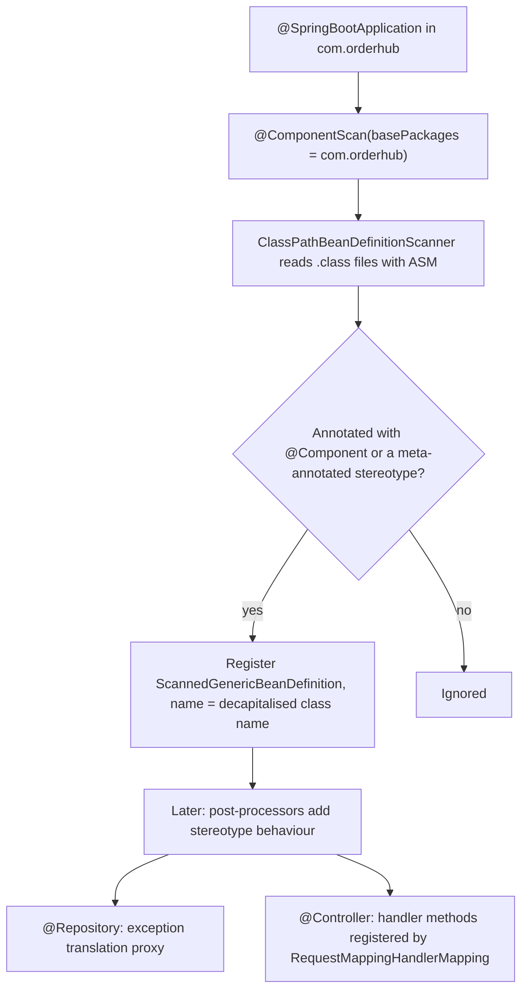
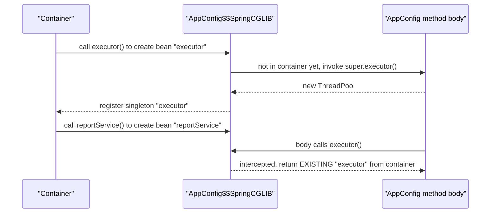
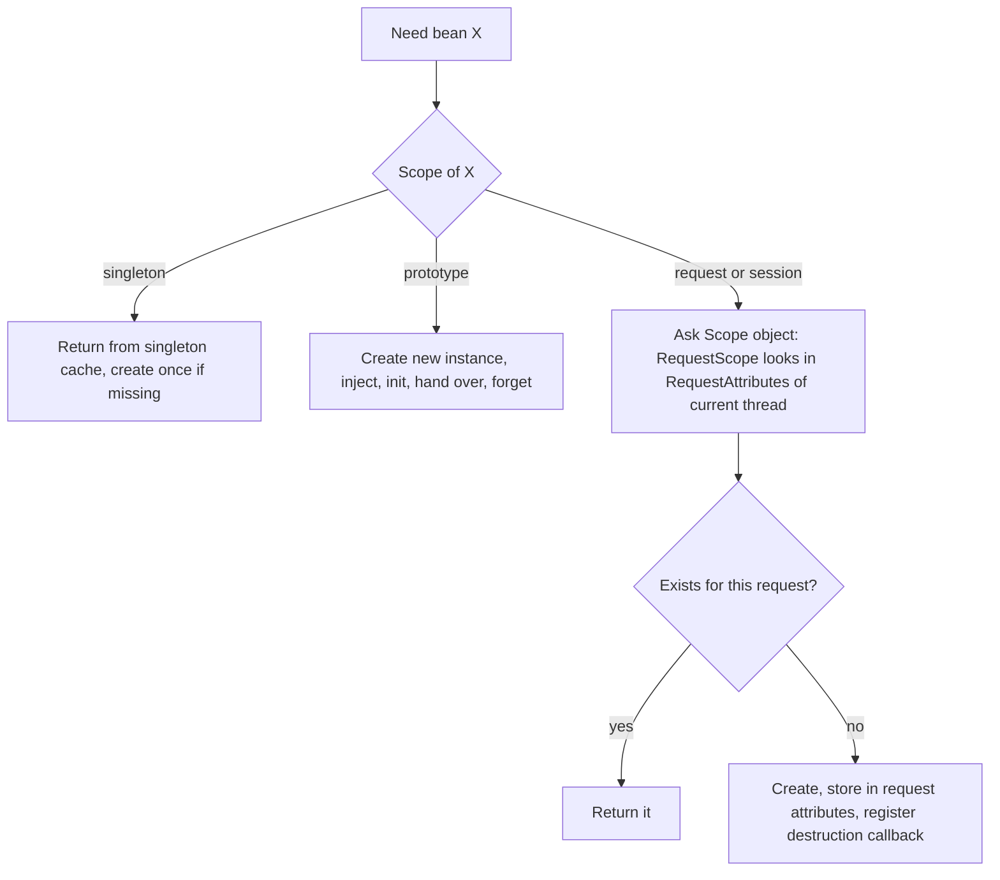
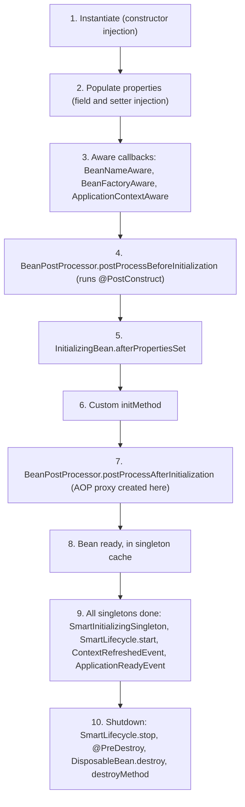

@@ 2 | MODULE | Beans | Declaring beans with stereotypes and @Bean methods, choosing scopes and hooking into the lifecycle | MUST
# Beans

**Shared analogy: staff at a hotel.** Some staff are hired through the agency by job title (stereotype annotations: `@Service`, `@Repository`), others are hand-picked by the manager with specific instructions (`@Bean` methods in a `@Configuration` class). Some roles are one person for the whole hotel, like the general manager (singleton), others get a fresh person each time, like a room-service waiter per order (prototype), or one per guest stay (session scope). Every employee goes through onboarding (init callbacks) and an exit interview (destroy callbacks).

- **Stereotype Annotations:** hiring by job title through component scanning.
- **@Configuration and @Bean:** hand-picking and configuring staff yourself.
- **Bean Scopes:** how many instances exist and how long they live.
- **Bean Lifecycle Callbacks:** onboarding and exit hooks.

@@ 3 | TOPIC | Stereotype Annotations | @Component, @Service, @Repository, @Controller, component scanning and what each stereotype adds | MUST
# Stereotype Annotations

**Level: Intermediate | Phase 10 | Priority: MUST | Since: @Repository Spring 2.0; @Component, @Service, @Controller Spring 2.5; @RestController Spring 4.0**

> **30-second interview answer:** `@Component` marks a class as a Spring-managed bean found by component scanning. `@Service`, `@Repository` and `@Controller` are specialisations of `@Component` that document the layer. Functionally, `@Service` adds nothing extra, `@Repository` enables translation of persistence exceptions into Spring's `DataAccessException` hierarchy, and `@Controller` makes the class a Spring MVC handler; `@RestController` is `@Controller` plus `@ResponseBody`. Scanning starts at the package of the `@SpringBootApplication` class.

## 1. Concept in Simple Words
### Analogy
Name badges in a company.

| Company badge | Spring |
|---|---|
| "Employee" badge: you work here | `@Component` |
| "Front desk" badge: talks to visitors | `@Controller` and `@RestController` |
| "Operations" badge: does the core work | `@Service` |
| "Archive" badge: handles the records, and translates archive jargon into company language | `@Repository` with exception translation |
| HR walks the building floor by floor collecting badged people | Component scanning from a base package |
| People in another building are never found | Classes outside the scanned packages |

### What it is
- **Component scanning:** at startup Spring walks the classpath under base packages, reads class metadata with ASM (without loading the classes) and registers a bean definition for each class annotated (directly or via meta-annotation) with `@Component`.
- **`@Component`:** generic stereotype.
- **`@Service`:** business logic layer; semantically meaningful, no extra behaviour.
- **`@Repository`:** data access layer; `PersistenceExceptionTranslationPostProcessor` wraps it in a proxy that converts exceptions like JPA's `PersistenceException` or JDBC `SQLException` into `DataAccessException` subclasses.
- **`@Controller`:** web layer; detected by `RequestMappingHandlerMapping` as a handler with `@RequestMapping` methods returning views.
- **`@RestController`:** `@Controller` plus `@ResponseBody`: return values are written to the HTTP body (JSON) instead of resolved as view names.
- **Meta-annotation:** an annotation placed on another annotation. `@Service` is itself annotated with `@Component`, which is why scanning finds it.

### Why it exists
Before annotations, every bean was declared in XML. Stereotypes let the class itself say "I am a bean, and I belong to this layer". The specialised stereotypes also give tools and aspects a hook: you can target "all repositories" with exception translation or "all controllers" with `@ControllerAdvice`.

## 2. How It Works


What `@Service` looks like inside Spring:

```java
@Target(ElementType.TYPE)
@Retention(RetentionPolicy.RUNTIME)
@Documented
@Component                    // this meta-annotation is what makes scanning find it
public @interface Service {
    @AliasFor(annotation = Component.class)
    String value() default "";
}
```

Scanning rules worth knowing:
- `@SpringBootApplication` includes `@ComponentScan` with no base package, meaning "the package of this class and everything below it".
- A class in `com.other` is not found if the main class is in `com.orderhub`. Fix with `scanBasePackages` or, better, move the main class to the root package.
- Filters: `includeFilters` and `excludeFilters` on `@ComponentScan` (Boot already excludes auto-configuration classes from scanning).
- For faster startup with huge classpaths, Spring used to offer a compile-time index (`spring-context-indexer`); it is deprecated since 6.1 in favour of AOT.

## 3. Code Example
### Code
```java
// File: src/main/java/com/orderhub/customer/Customer.java
package com.orderhub.customer;

public record Customer(Long id, String email, String name) { }

// File: src/main/java/com/orderhub/customer/CustomerRepository.java
package com.orderhub.customer;

import java.util.Map;
import java.util.Optional;
import java.util.concurrent.ConcurrentHashMap;
import org.springframework.dao.DuplicateKeyException;
import org.springframework.stereotype.Repository;

@Repository                                   // data layer + exception translation
public class CustomerRepository {
    private final Map<String, Customer> byEmail = new ConcurrentHashMap<>();

    public Customer save(Customer c) {
        if (byEmail.putIfAbsent(c.email(), c) != null) {
            // Throw a Spring DataAccessException subtype, like a real DB unique violation would become
            throw new DuplicateKeyException("email already used: " + c.email());
        }
        return c;
    }

    public Optional<Customer> findByEmail(String email) {
        return Optional.ofNullable(byEmail.get(email));
    }
}

// File: src/main/java/com/orderhub/customer/CustomerService.java
package com.orderhub.customer;

import org.springframework.dao.DataAccessException;
import org.springframework.stereotype.Service;

@Service                                      // business layer
public class CustomerService {
    private final CustomerRepository repository;

    public CustomerService(CustomerRepository repository) { this.repository = repository; }

    public Customer register(String email, String name) {
        try {
            return repository.save(new Customer(null, email, name));
        } catch (DataAccessException e) {     // technology-neutral exception type
            throw new EmailTakenException(email);
        }
    }
}

// File: src/main/java/com/orderhub/customer/EmailTakenException.java
package com.orderhub.customer;

public class EmailTakenException extends RuntimeException {
    public EmailTakenException(String email) { super("Email already registered: " + email); }
}

// File: src/main/java/com/orderhub/customer/CustomerController.java
package com.orderhub.customer;

import org.springframework.http.HttpStatus;
import org.springframework.web.bind.annotation.*;

@RestController                               // @Controller + @ResponseBody
@RequestMapping("/api/customers")
public class CustomerController {
    private final CustomerService service;

    public CustomerController(CustomerService service) { this.service = service; }

    record RegisterRequest(String email, String name) { }

    @PostMapping
    @ResponseStatus(HttpStatus.CREATED)
    public Customer register(@RequestBody RegisterRequest req) {
        return service.register(req.email(), req.name());
    }

    @ExceptionHandler(EmailTakenException.class)
    @ResponseStatus(HttpStatus.CONFLICT)
    public String taken(EmailTakenException e) { return e.getMessage(); }
}

// File: src/main/java/com/orderhub/common/UseCase.java
package com.orderhub.common;

import java.lang.annotation.*;
import org.springframework.core.annotation.AliasFor;
import org.springframework.stereotype.Service;

// Your own stereotype: meta-annotated with @Service (and therefore @Component)
@Target(ElementType.TYPE)
@Retention(RetentionPolicy.RUNTIME)
@Documented
@Service
public @interface UseCase {
    @AliasFor(annotation = Service.class)
    String value() default "";
}
```

### Walkthrough
- All four classes live under `com.orderhub`, the package of `OrderHubApplication`, so scanning finds them without configuration.
- `CustomerRepository` throws `DuplicateKeyException`, a `DataAccessException`. With a real JPA repository the `@Repository` proxy would translate a `ConstraintViolationException` or `PersistenceException` into `DataIntegrityViolationException` for you, so the service only ever catches Spring's neutral hierarchy.
- `CustomerService` is a `@Service`: no extra behaviour, but it tells readers and tools "business logic lives here".
- `CustomerController` is a `@RestController`: the returned `Customer` record is serialised to JSON by Jackson.
- `@UseCase` shows you can build your own stereotype; classes annotated with it are discovered because of the meta-annotation chain `@UseCase` to `@Service` to `@Component`.

### Output
```http
POST /api/customers
Content-Type: application/json

{"email":"ana@example.com","name":"Ana"}
```
```http
HTTP/1.1 201 Created
Content-Type: application/json

{"id":null,"email":"ana@example.com","name":"Ana"}
```
Second identical request:
```http
HTTP/1.1 409 Conflict
Content-Type: text/plain;charset=UTF-8

Email already registered: ana@example.com
```

### Compare
| Annotation | Layer | Extra behaviour |
|---|---|---|
| `@Component` | Any | None |
| `@Service` | Business | None (semantic only) |
| `@Repository` | Data access | Persistence exception translation |
| `@Controller` | Web (views) | Handler detection; return value is a view name |
| `@RestController` | Web (APIs) | `@Controller` plus `@ResponseBody` on every method |
| `@Configuration` | Configuration | CGLIB proxy so `@Bean` methods return singletons |

## 4. Interview Questions
**Basic**
1. **What is the difference between `@Component`, `@Service`, `@Repository` and `@Controller`?**
   All are detected by component scanning because they are meta-annotated with `@Component`. `@Service` is purely semantic. `@Repository` adds exception translation into `DataAccessException`. `@Controller` registers the class as a Spring MVC handler.
2. **What is the difference between `@Controller` and `@RestController`?**
   `@RestController` is `@Controller` plus `@ResponseBody`. Return values are written to the response body through message converters (JSON with Jackson) instead of being treated as view names.
3. **Where does Spring Boot start component scanning?**
   From the package of the class annotated with `@SpringBootApplication`, including all sub-packages.

**Follow-up**
4. **Can I use `@Component` instead of `@Service` on a service class?**
   Yes, it works identically today. Use `@Service` for clarity and so aspects or architecture tests (ArchUnit) can target the layer.
5. **What exactly does exception translation do?**
   `PersistenceExceptionTranslationPostProcessor` wraps `@Repository` beans in a proxy. When a vendor-specific exception escapes (JPA, Hibernate, JDBC), the proxy asks registered `PersistenceExceptionTranslator`s to convert it into Spring's unchecked `DataAccessException` hierarchy, for example `DataIntegrityViolationException`. Services stay independent of the persistence technology.
6. **Do Spring Data JPA repository interfaces need `@Repository`?**
   No. Spring Data creates the implementation and applies exception translation itself. Adding `@Repository` to the interface is harmless but redundant.

**Tricky / scenario**
7. **You added a `@Service` in package `com.orderhub2.billing` and get `NoSuchBeanDefinitionException`. Why?**
   It is outside the scanned base package `com.orderhub` (`com.orderhub2` is a different package, not a sub-package). Move it under `com.orderhub` or add `scanBasePackages`.
8. **Is a class annotated with `@Component` but with two constructors and no `@Autowired` valid?**
   Spring uses the no-arg constructor if one exists; otherwise startup fails with "No default constructor found". Mark the intended constructor with `@Autowired` or keep a single constructor.
9. **Can you put stereotype annotations on interfaces?**
   Scanning only registers concrete classes; an annotated interface is skipped. Spring Data repositories are an exception because Spring Data registers them through its own scanning.

**What the interviewer is really testing:** that you know stereotypes are mostly semantic, which one has real extra behaviour, and how scanning finds classes.

## 5. Pitfalls & Best Practices
### Common mistakes
| Mistake | What goes wrong | Fix |
|---|---|---|
| Main class in a sub-package (`com.orderhub.app`) | Beans in `com.orderhub.product` are not found | Main class in the root package |
| `@Controller` on a JSON API without `@ResponseBody` | Spring looks for a view named after the return value, 404 or 500 | Use `@RestController` |
| Stereotype on a class that also has a `@Bean` method creating it | Two beans of the same type, `NoUniqueBeanDefinitionException` | Declare it once |
| Catching `SQLException` in services | Persistence details leak upward | Catch `DataAccessException` or translate at the repository |

### Best practices
- Package by feature (`product`, `order`, `customer`) with the main class at the root.
- Use the most specific stereotype; it documents intent and enables layer-targeted rules.
- Use `@Bean` instead of stereotypes for third-party classes you cannot annotate.
- Enforce layering with ArchUnit tests (controllers do not call repositories directly).

### Compare with
| Way to register a bean | When |
|---|---|
| Stereotype + scanning | Your own classes |
| `@Bean` method | Third-party classes or conditional, customised creation |
| `@Import` | Pulling in specific configuration classes explicitly |
| Auto-configuration | Library defaults that back off when you define your own |

## 6. Hands-on Exercise
**OrderHub task.** Make the layering explicit:
1. Annotate OrderHub classes with the correct stereotype (`ProductController` `@RestController`, `ProductService` `@Service`, `InMemoryProductRepository` `@Repository`).
2. Make the repository throw `DuplicateKeyException` when a product with the same name (case-insensitive) already exists.
3. In `ProductService`, catch `DataAccessException` and rethrow a domain `DuplicateProductException`.
4. Map it to HTTP 409 in the controller.

Acceptance criteria: creating two products named "Keyboard" and "keyboard" returns 201 then 409; `ProductService` imports nothing from the repository implementation.

<details><summary>Solution</summary>

```java
// File: src/main/java/com/orderhub/product/InMemoryProductRepository.java
package com.orderhub.product;

import java.util.*;
import java.util.concurrent.ConcurrentHashMap;
import java.util.concurrent.atomic.AtomicLong;
import org.springframework.dao.DuplicateKeyException;
import org.springframework.stereotype.Repository;

@Repository
public class InMemoryProductRepository implements ProductRepository {
    private final Map<Long, Product> store = new ConcurrentHashMap<>();
    private final AtomicLong ids = new AtomicLong();

    public synchronized Product save(Product p) {
        boolean duplicate = store.values().stream()
                .anyMatch(e -> e.name().equalsIgnoreCase(p.name()) && !Objects.equals(e.id(), p.id()));
        if (duplicate) throw new DuplicateKeyException("product name exists: " + p.name());
        Product saved = p.id() == null ? p.withId(ids.incrementAndGet()) : p;
        store.put(saved.id(), saved);
        return saved;
    }
    public List<Product> findAll() { return new ArrayList<>(store.values()); }
    public Optional<Product> findById(long id) { return Optional.ofNullable(store.get(id)); }
    public void deleteById(long id) { store.remove(id); }
}

// File: src/main/java/com/orderhub/product/DuplicateProductException.java
package com.orderhub.product;

public class DuplicateProductException extends RuntimeException {
    public DuplicateProductException(String name) { super("Product already exists: " + name); }
}

// File: src/main/java/com/orderhub/product/ProductService.java (create method)
package com.orderhub.product;

import org.springframework.dao.DataAccessException;
import org.springframework.stereotype.Service;

@Service
public class ProductService {
    private final ProductRepository repository;
    public ProductService(ProductRepository repository) { this.repository = repository; }

    public Product create(Product product) {
        try {
            return repository.save(product);
        } catch (DataAccessException e) {
            throw new DuplicateProductException(product.name());
        }
    }
}

// File: src/main/java/com/orderhub/product/ProductController.java (handler)
package com.orderhub.product;

import org.springframework.http.HttpStatus;
import org.springframework.web.bind.annotation.*;

@RestController
@RequestMapping("/api/products")
public class ProductController {
    private final ProductService service;
    public ProductController(ProductService service) { this.service = service; }

    @PostMapping
    @ResponseStatus(HttpStatus.CREATED)
    public Product create(@RequestBody Product p) { return service.create(p); }

    @ExceptionHandler(DuplicateProductException.class)
    @ResponseStatus(HttpStatus.CONFLICT)
    public String duplicate(DuplicateProductException e) { return e.getMessage(); }
}
```
In Phase 11 the local `@ExceptionHandler` moves into a global `@RestControllerAdvice` returning `ProblemDetail`.
</details>

## 7. Recall
Q: Which Spring stereotype annotation adds real behaviour beyond marking a bean, and what is it?
A: `@Repository`, which enables translation of persistence exceptions into Spring's `DataAccessException` hierarchy.

Q: What is `@RestController` made of?
A: `@Controller` plus `@ResponseBody`.

Q: Why does component scanning find classes annotated with `@Service`?
A: Because `@Service` is meta-annotated with `@Component`.

Q: Where does Spring Boot's component scan start?
A: At the package of the `@SpringBootApplication` class, including sub-packages.

Q: Does `@Service` add any functionality over `@Component`?
A: No; it is semantic, documenting the business layer for readers and tools.

**Related:** [[@Configuration and @Bean]] · [[ApplicationContext and Bean Definitions]] · [[@RestController and Request Mapping Deep Dive]]

@@ 3 | TOPIC | @Configuration and @Bean | Java-based configuration, CGLIB proxying of @Configuration classes, lite mode and when to use @Bean over stereotypes | MUST
# @Configuration and @Bean

**Level: Intermediate | Phase 10 | Priority: MUST | Since: Spring 3.0 (JavaConfig); proxyBeanMethods Spring 5.2**

> **30-second interview answer:** A `@Configuration` class holds `@Bean` methods; each method's return value becomes a bean named after the method. I use `@Bean` for third-party classes I cannot annotate, or when creation needs logic. Spring subclasses full `@Configuration` classes with CGLIB, so when one `@Bean` method calls another, the call is intercepted and returns the existing singleton instead of creating a new object. With `proxyBeanMethods = false` (lite mode) there is no proxy, startup is faster, and inter-bean calls are plain Java calls, so you should pass dependencies as method parameters instead.

## 1. Concept in Simple Words
### Analogy
A restaurant's prep list versus staff who show up on their own.

| Restaurant | Spring |
|---|---|
| Staff who walk in wearing a badge | Stereotype-annotated classes found by scanning |
| The head chef's prep list: "make one big pot of stock, then use it for soup and sauce" | `@Configuration` class with `@Bean` methods |
| A sous-chef who checks "stock already made? reuse it" | CGLIB proxy intercepting `@Bean` method calls |
| A prep list without the sous-chef: every recipe makes fresh stock | Lite mode (`proxyBeanMethods = false`) with method calls |
| Ingredients bought from a supplier, not made in-house | Third-party classes (`Clock`, `RestClient`, `ObjectMapper`) |

### What it is
- **`@Configuration`:** marks a class as a source of bean definitions. It is itself a `@Component`, so scanning finds it.
- **`@Bean`:** on a method; the return value is registered as a bean. Bean name = method name (override with `@Bean("name")`). Supports `initMethod`, `destroyMethod`, and works with `@Scope`, `@Primary`, `@Lazy`, `@Profile`, `@Conditional...`.
- **Full mode:** `@Configuration` (default `proxyBeanMethods = true`); the class is subclassed with CGLIB.
- **Lite mode:** `@Bean` methods inside a `@Component` class, or in `@Configuration(proxyBeanMethods = false)`; no proxy.
- **Method parameter injection:** `@Bean` method parameters are resolved from the container like constructor parameters.
- **Inferred destroy method:** for `@Bean`, Spring automatically calls a public `close()` or `shutdown()` method on destruction unless you set `destroyMethod = ""`.

### Why it exists
Stereotypes only work on classes you own. For a `Clock`, a configured `RestClient`, a `DataSource` or a `ThreadPoolTaskExecutor` you need to call constructors and builders yourself. Java config gives you type-safe, refactor-friendly, debuggable bean creation that replaced XML.

## 2. How It Works


- `ConfigurationClassPostProcessor` parses `@Configuration` classes and creates a bean definition per `@Bean` method (factory bean = the config class, factory method = the method).
- `ConfigurationClassEnhancer` creates a CGLIB subclass for full-mode classes. Its interceptor checks the container before running the method body. That is why config classes and `@Bean` methods must not be `final` or `private` in full mode.
- Static `@Bean` methods are never intercepted; use them for `BeanFactoryPostProcessor` and `BeanPostProcessor` beans.
- Spring Boot's own auto-configurations use `proxyBeanMethods = false` everywhere for faster startup and GraalVM native compatibility.

```text
Full mode:  reportService() calls executor()  -> proxy -> same singleton executor
Lite mode:  reportService() calls executor()  -> plain call -> NEW executor (bug!)
Lite mode fix: reportService(ThreadPoolTaskExecutor executor)  -> container injects the singleton
```

## 3. Code Example
### Code
```java
// File: src/main/java/com/orderhub/config/AppConfig.java
package com.orderhub.config;

import java.time.Clock;
import java.time.ZoneOffset;
import java.util.concurrent.atomic.AtomicInteger;
import org.springframework.boot.ApplicationRunner;
import org.springframework.context.annotation.Bean;
import org.springframework.context.annotation.Configuration;
import org.springframework.web.client.RestClient;

@Configuration                       // full mode: CGLIB proxy
public class AppConfig {

    static final AtomicInteger CREATED = new AtomicInteger();

    public static class AuditSink {
        private final int id = CREATED.incrementAndGet();
        public int id() { return id; }
        public void close() { System.out.println("AuditSink " + id + " closed"); }  // inferred destroy method
    }

    public record OrderAuditor(AuditSink sink) { }
    public record PaymentAuditor(AuditSink sink) { }

    @Bean
    public Clock clock() {                       // third-party class: no stereotype possible
        return Clock.system(ZoneOffset.UTC);
    }

    @Bean
    public AuditSink auditSink() {
        return new AuditSink();
    }

    @Bean
    public OrderAuditor orderAuditor() {
        return new OrderAuditor(auditSink());    // intercepted: returns the singleton
    }

    @Bean
    public PaymentAuditor paymentAuditor() {
        return new PaymentAuditor(auditSink());  // intercepted again: same singleton
    }

    @Bean
    public RestClient inventoryClient(RestClient.Builder builder) {  // parameter injection
        return builder.baseUrl("http://localhost:8081/api/inventory").build();
    }

    @Bean
    ApplicationRunner configDemo(OrderAuditor o, PaymentAuditor p, AppConfig self) {
        return args -> {
            System.out.println("config class: " + self.getClass().getSimpleName());
            System.out.println("order sink " + o.sink().id() + ", payment sink " + p.sink().id()
                    + ", sinks created " + CREATED.get());
        };
    }
}

// File: src/main/java/com/orderhub/config/LiteConfig.java
package com.orderhub.config;

import org.springframework.context.annotation.Bean;
import org.springframework.context.annotation.Configuration;

@Configuration(proxyBeanMethods = false)    // lite mode: no proxy, faster startup
public class LiteConfig {

    public record Greeting(String text) { }
    public record Greeter(Greeting greeting) { }

    @Bean
    public Greeting greeting() { return new Greeting("Welcome to OrderHub"); }

    @Bean
    public Greeter greeter(Greeting greeting) {   // correct lite style: take it as a parameter
        return new Greeter(greeting);
    }
}
```

### Walkthrough
- `clock()` and `inventoryClient()` register third-party types as beans. `inventoryClient` receives Boot's auto-configured `RestClient.Builder` as a method parameter.
- `orderAuditor()` and `paymentAuditor()` both call `auditSink()`. Because `AppConfig` is a CGLIB subclass, the call is intercepted and returns the container's singleton, so only one `AuditSink` is ever created.
- Injecting `AppConfig` itself shows the proxy class name.
- `AuditSink.close()` is called automatically at shutdown because `@Bean` infers `close` and `shutdown` as destroy methods.
- `LiteConfig` uses `proxyBeanMethods = false` and passes `Greeting` as a parameter, which is correct in lite mode. Calling `greeting()` directly inside `greeter()` would create a second, unmanaged `Greeting`.

### Output
```text
config class: AppConfig$$SpringCGLIB$$0
order sink 1, payment sink 1, sinks created 1
```
On shutdown (Ctrl+C):
```text
AuditSink 1 closed
```
If you change `AppConfig` to `@Configuration(proxyBeanMethods = false)` without other changes:
```text
config class: AppConfig
order sink 2, payment sink 3, sinks created 3
```
Three sinks: one bean plus two unmanaged copies created by direct calls (and only the bean is closed at shutdown).

### Compare
| Aspect | Full `@Configuration` | Lite mode |
|---|---|---|
| CGLIB proxy | Yes | No |
| Inter-bean method calls | Return the singleton | Plain Java calls (new objects) |
| Startup cost | Slightly higher | Lower |
| Can be `final` | No | Yes |
| Native image friendliness | Needs proxy generation at build time | Simplest |
| Recommended style | Fine for apps | Used by Boot auto-config; pass dependencies as parameters |

## 4. Interview Questions
**Basic**
1. **What do `@Configuration` and `@Bean` do?**
   `@Configuration` marks a class as a source of bean definitions; each `@Bean` method's return value is registered as a bean, named after the method by default. Method parameters are injected by the container.
2. **When do you use `@Bean` instead of `@Component`?**
   For classes you do not own (library classes), when creation needs logic or builder configuration, when you need several differently configured instances of one class, or when creation is conditional.
3. **What is the default bean name for a `@Bean` method?**
   The method name. You can set names (and aliases) with `@Bean(name = {"a", "b"})`.

**Follow-up**
4. **Why does Spring proxy `@Configuration` classes?**
   To preserve singleton semantics when one `@Bean` method calls another. The CGLIB subclass intercepts the call and returns the bean from the container instead of running the method again.
5. **What is `proxyBeanMethods = false` and why does Boot use it?**
   It disables the CGLIB proxy (lite mode). Startup is faster and it suits native images. The trade-off is that inter-bean method calls are plain calls, so dependencies must be passed as method parameters.
6. **What happens if you put `@Bean` methods in a `@Component` class?**
   They work in lite mode: beans are registered, but calls between those methods are not intercepted.

**Tricky / scenario**
7. **Can a `@Configuration` class or a `@Bean` method be `final` or `private`?**
   In full mode no: CGLIB must subclass the class and override the methods, so startup fails with an error for a final class, and private or final `@Bean` methods are not allowed. In lite mode final is fine.
8. **A `@Bean` returns an `ExecutorService`. Do you need to shut it down?**
   Usually not explicitly: Spring infers a public `close()` or `shutdown()` method as the destroy method for `@Bean` and calls it on context close. `ExecutorService` has `shutdown()` (and `close()` since Java 19), so it is shut down. Set `destroyMethod = ""` to disable that.
9. **Your `@Bean` method declares return type `Object` but returns a `StripeGateway`. Injection by `PaymentGateway` sometimes fails. Why?**
   Before the bean is created, Spring only knows the declared return type, so type matching for not-yet-created or lazy beans sees `Object`. Declare the most specific useful return type on `@Bean` methods.

**What the interviewer is really testing:** whether you know the CGLIB interception trick, the lite-mode trade-off and when Java config beats scanning.

## 5. Pitfalls & Best Practices
### Common mistakes
| Mistake | What goes wrong | Fix |
|---|---|---|
| Calling another `@Bean` method in lite mode | Duplicate, unmanaged objects | Inject as a method parameter |
| `final` `@Configuration` class in full mode | Startup failure (CGLIB cannot subclass) | Remove `final` or use lite mode |
| Vague return type (`Object`, base class) | Type matching fails before creation | Declare a specific return type |
| Non-static `@Bean` for a `BeanPostProcessor` | Config class created early, warnings, lost processing | Make it `static` |
| Same bean declared via `@Component` and `@Bean` | `NoUniqueBeanDefinitionException` | Declare once |

### Best practices
- Group configuration by concern (`WebConfig`, `PaymentConfig`, `ClientsConfig`) instead of one giant class.
- Prefer `proxyBeanMethods = false` with parameter injection for new configuration classes; it is explicit and works in both modes.
- Use builders auto-configured by Boot (`RestClient.Builder`, `Jackson2ObjectMapperBuilder`) so global settings apply.
- Keep business logic out of configuration classes.

### Compare with
| Approach | Strengths | Weaknesses |
|---|---|---|
| `@Bean` in `@Configuration` | Full control, third-party types, conditional | More code |
| Stereotype + scanning | Minimal code | Only for your own classes |
| XML config | Change wiring without recompiling | Verbose, not type-safe, legacy |
| Functional registration (`registerBean`) | Fast, no reflection | Less common, less tooling |

## 6. Hands-on Exercise
**OrderHub task.** Create `com.orderhub.config.CoreConfig` with:
1. A `Clock` bean (UTC) and change `OrderService` to stamp new orders with `Instant.now(clock)`.
2. A `ThreadPoolTaskExecutor` bean named `notificationExecutor` (core 2, max 4, queue 100, thread prefix `notify-`).
3. A `RestClient` bean named `inventoryClient` built from the auto-configured `RestClient.Builder` with base URL `http://localhost:8081`.
Use `proxyBeanMethods = false`.

Acceptance criteria: a unit test can pass `Clock.fixed(...)` to `OrderService` and assert the timestamp; threads named `notify-1` appear when the executor runs a task; no `@Bean` method calls another `@Bean` method.

<details><summary>Solution</summary>

```java
// File: src/main/java/com/orderhub/config/CoreConfig.java
package com.orderhub.config;

import java.time.Clock;
import org.springframework.context.annotation.Bean;
import org.springframework.context.annotation.Configuration;
import org.springframework.scheduling.concurrent.ThreadPoolTaskExecutor;
import org.springframework.web.client.RestClient;

@Configuration(proxyBeanMethods = false)
public class CoreConfig {

    @Bean
    public Clock clock() {
        return Clock.systemUTC();
    }

    @Bean
    public ThreadPoolTaskExecutor notificationExecutor() {
        ThreadPoolTaskExecutor ex = new ThreadPoolTaskExecutor();
        ex.setCorePoolSize(2);
        ex.setMaxPoolSize(4);
        ex.setQueueCapacity(100);
        ex.setThreadNamePrefix("notify-");
        ex.setWaitForTasksToCompleteOnShutdown(true);
        return ex;                 // Spring calls initialize() (InitializingBean) and shutdown() on close
    }

    @Bean
    public RestClient inventoryClient(RestClient.Builder builder) {
        return builder.baseUrl("http://localhost:8081").build();
    }
}

// File: src/main/java/com/orderhub/order/OrderService.java (excerpt)
package com.orderhub.order;

import java.time.Clock;
import java.time.Instant;
import org.springframework.stereotype.Service;

@Service
public class OrderService {
    private final Clock clock;
    public OrderService(Clock clock) { this.clock = clock; }

    public Order newOrder(long customerId) {
        return new Order(null, customerId, Instant.now(clock));
    }
}

record Order(Long id, long customerId, Instant createdAt) { }

// File: src/test/java/com/orderhub/order/OrderServiceClockTest.java
package com.orderhub.order;

import static org.junit.jupiter.api.Assertions.assertEquals;

import java.time.*;
import org.junit.jupiter.api.Test;

class OrderServiceClockTest {
    @Test
    void stampsWithInjectedClock() {
        Instant fixed = Instant.parse("2026-01-01T10:00:00Z");
        OrderService service = new OrderService(Clock.fixed(fixed, ZoneOffset.UTC));
        assertEquals(fixed, service.newOrder(7).createdAt());
    }
}
```
Injecting a `Clock` is the standard way to make time-dependent code testable.
</details>

## 7. Recall
Q: Why does Spring create a CGLIB proxy for a `@Configuration` class?
A: So calls between `@Bean` methods return the existing singleton from the container instead of creating new objects.

Q: What does `@Configuration(proxyBeanMethods = false)` change?
A: It disables the CGLIB proxy (lite mode): faster startup, but inter-bean method calls become plain calls, so dependencies must be method parameters.

Q: What is the default name of a bean declared with `@Bean`?
A: The name of the method.

Q: When should you use `@Bean` instead of a stereotype annotation?
A: For third-party classes, creation that needs logic or builders, multiple configured instances, or conditional creation.

Q: Which destroy methods does Spring infer for `@Bean` beans?
A: A public `close()` or `shutdown()` method, unless `destroyMethod = ""` is set.

**Related:** [[Stereotype Annotations]] · [[Bean Lifecycle Callbacks]] · [[Conditional Beans]] · [[ApplicationContext and Bean Definitions]]

@@ 3 | TOPIC | Bean Scopes | Singleton, prototype, request, session and application scopes, scoped proxies and the prototype-in-singleton trap | MUST
# Bean Scopes

**Level: Intermediate | Phase 10 | Priority: MUST | Since: singleton and prototype Spring 1.0; web scopes Spring 2.0; @RequestScope Spring 4.3**

> **30-second interview answer:** A scope decides how many instances of a bean exist and how long they live. Singleton (the default) is one instance per container; prototype is a new instance on every lookup; the web scopes request, session and application tie the instance to an HTTP request, an HTTP session or the servlet context. The classic trap is injecting a prototype or request-scoped bean into a singleton: injection happens once, so you get one instance forever unless you use a scoped proxy, `ObjectProvider` or `@Lookup`.

## 1. Concept in Simple Words
### Analogy
Things in an office.

| Office item | Scope |
|---|---|
| The one shared printer | Singleton: one per container, shared by all |
| Paper cups: take a new one every time | Prototype: new instance per request to the container |
| A visitor badge valid for one visit | Request scope: one per HTTP request |
| A locker assigned for your whole stay | Session scope: one per HTTP session |
| The building's notice board | Application scope: one per `ServletContext` |
| A receptionist who fetches "the current visitor's badge" each time you ask | Scoped proxy |

### What it is
- **singleton:** one shared instance per Spring container (not per JVM, not per class loader). Created eagerly by default. Must be thread-safe, because all requests share it.
- **prototype:** a new instance each time it is injected or requested with `getBean`. Spring creates and initialises it, then forgets it: **destroy callbacks are not called**.
- **request:** one instance per HTTP request (`@RequestScope`).
- **session:** one per HTTP session (`@SessionScope`).
- **application:** one per `ServletContext` (`@ApplicationScope`); differs from singleton only if several contexts share one servlet context.
- **websocket:** one per WebSocket session.
- **Scoped proxy:** a stand-in object injected into longer-lived beans; on every method call it looks up the real target in the current scope. `@RequestScope` and `@SessionScope` enable it by default (`proxyMode = TARGET_CLASS`).

### Why it exists
Most services are stateless, so one shared instance is efficient. But some objects hold per-use state: a builder, a per-request context (current tenant, correlation id), a shopping cart in a session. Scopes let the container manage those lifetimes instead of you passing objects around manually.

## 2. How It Works


The prototype-in-singleton trap and the scoped proxy fix:

```text
WITHOUT proxy                                   WITH scoped proxy
CheckoutController (singleton, created once)    CheckoutController (singleton)
   cart ------> Cart@1  (injected once)            cart ------> CartProxy (singleton stand-in)
                                                                  |  every call: "which cart for
request A uses Cart@1                                             |  the current request?"
request B uses Cart@1   <- shared state bug!                      +--> Cart@A for request A
                                                                  +--> Cart@B for request B
```

- Request and session scopes rely on `RequestContextHolder`, a thread-local set by `DispatcherServlet` (or `RequestContextFilter`). Accessing a request-scoped bean outside a request thread (for example in `@Async` or a scheduler) throws `ScopeNotActiveException` ("No thread-bound request found").
- Prototype beans that hold resources must be cleaned up by the caller, because Spring does not track them after handing them over.
- Custom scopes implement `org.springframework.beans.factory.config.Scope` (Spring Cloud's `@RefreshScope` is one).

## 3. Code Example
### Code
```java
// File: src/main/java/com/orderhub/scope/ScopeDemo.java
package com.orderhub.scope;

import java.util.ArrayList;
import java.util.List;
import java.util.UUID;
import java.util.concurrent.atomic.AtomicInteger;
import org.springframework.beans.factory.ObjectProvider;
import org.springframework.beans.factory.config.ConfigurableBeanFactory;
import org.springframework.context.annotation.Scope;
import org.springframework.stereotype.Component;
import org.springframework.web.bind.annotation.*;
import org.springframework.web.context.annotation.RequestScope;

// Prototype: a fresh builder every time
@Component
@Scope(ConfigurableBeanFactory.SCOPE_PROTOTYPE)
class InvoiceBuilder {
    private static final AtomicInteger COUNT = new AtomicInteger();
    private final int instance = COUNT.incrementAndGet();
    private final List<String> lines = new ArrayList<>();
    InvoiceBuilder add(String line) { lines.add(line); return this; }
    String build() { return "invoice#" + instance + " " + lines; }
}

// Request scope: one per HTTP request, proxied by default
@Component
@RequestScope
class RequestContext {
    private final String requestId = UUID.randomUUID().toString().substring(0, 8);
    String requestId() { return requestId; }
}

// Singleton that WRONGLY holds a prototype directly
@Component
class BrokenInvoiceService {
    private final InvoiceBuilder builder;                 // injected ONCE
    BrokenInvoiceService(InvoiceBuilder builder) { this.builder = builder; }
    String invoice(String item) { return builder.add(item).build(); }
}

// Singleton that correctly asks for a new prototype each time
@Component
class InvoiceService {
    private final ObjectProvider<InvoiceBuilder> builders;
    InvoiceService(ObjectProvider<InvoiceBuilder> builders) { this.builders = builders; }
    String invoice(String item) { return builders.getObject().add(item).build(); }
}

@RestController
@RequestMapping("/api/scopes")
class ScopeController {
    private final BrokenInvoiceService broken;
    private final InvoiceService fixed;
    private final RequestContext requestContext;          // actually a proxy

    ScopeController(BrokenInvoiceService broken, InvoiceService fixed, RequestContext requestContext) {
        this.broken = broken;
        this.fixed = fixed;
        this.requestContext = requestContext;
    }

    @GetMapping("/{item}")
    String demo(@PathVariable String item) {
        return "broken=" + broken.invoice(item)
                + " | fixed=" + fixed.invoice(item)
                + " | requestId same within request: "
                + requestContext.requestId().equals(requestContext.requestId())
                + " | proxy class: " + requestContext.getClass().getSimpleName();
    }
}
```

### Walkthrough
- `InvoiceBuilder` is prototype. `BrokenInvoiceService` is a singleton that receives one builder at construction, so every call appends to the same list: state leaks across requests and threads.
- `InvoiceService` injects `ObjectProvider<InvoiceBuilder>` and calls `getObject()` per use, getting a fresh builder each time. Alternatives: a `@Lookup` method, or `@Scope(value = "prototype", proxyMode = ScopedProxyMode.TARGET_CLASS)`, which creates a new target on every method call (usually surprising, so avoid it for builders).
- `RequestContext` is request-scoped. The controller (a singleton) receives a CGLIB proxy; each call to `requestId()` inside one request resolves the same target, while a new request gets a new target.
### Output
```http
GET /api/scopes/book
```
```text
broken=invoice#1 [book] | fixed=invoice#2 [book] | requestId same within request: true | proxy class: RequestContext$$SpringCGLIB$$0
```
```http
GET /api/scopes/pen
```
```text
broken=invoice#1 [book, pen] | fixed=invoice#3 [pen] | requestId same within request: true | proxy class: RequestContext$$SpringCGLIB$$0
```
The broken service keeps growing the same invoice #1; the fixed one gets a new builder every call.

### Compare
| Scope | Instances | Destroy callback | Thread-safety concern | Typical use |
|---|---|---|---|---|
| singleton | One per container | Yes | High: shared by all threads | Stateless services, repositories |
| prototype | One per lookup | No | Low if not shared | Stateful builders, non-thread-safe helpers |
| request | One per HTTP request | Yes, at request end | Low | Per-request context, correlation id |
| session | One per HTTP session | Yes, at session end | Medium (parallel tabs) | Carts in server-rendered apps |
| application | One per servlet context | Yes | High | Rare; shared web-level state |

## 4. Interview Questions
**Basic**
1. **What bean scopes does Spring support?**
   Singleton (default) and prototype in any context; request, session, application and websocket in web-aware contexts. You can also register custom scopes.
2. **Is a Spring singleton the same as the GoF Singleton pattern?**
   No. A Spring singleton is one instance per container per bean definition. You can have two singleton beans of the same class with different names, and two contexts each with their own instance. GoF Singleton is one instance per class loader enforced by the class itself.
3. **Are singleton beans thread-safe?**
   Not automatically. Spring does nothing to make them thread-safe. Keep them stateless (only final, immutable or thread-safe fields) or protect mutable state with concurrency tools.

**Follow-up**
4. **Does Spring manage the full lifecycle of prototype beans?**
   No. It creates, injects and initialises them (including `@PostConstruct`), then hands them over and forgets them. Destroy callbacks such as `@PreDestroy` are never called; the client must release resources.
5. **What happens when you inject a prototype bean into a singleton?**
   The prototype is created once, when the singleton is created, and the singleton keeps that one instance forever. To get a new instance per use, inject `ObjectProvider<T>` or `Provider<T>`, use a `@Lookup` method, or use a scoped proxy.
6. **How does a request-scoped bean work when injected into a singleton controller?**
   The controller receives a scoped proxy. On every method call the proxy looks up the real instance in the current request's attributes (through a thread-local `RequestContextHolder`) and delegates to it.

**Tricky / scenario**
7. **A request-scoped bean is used inside an `@Async` method and you get "No thread-bound request found". Why?**
   Request attributes live in a thread-local of the request thread. The async method runs on a pool thread with no request bound. Copy the values you need (for example the request id) into method parameters before going async, or use a `TaskDecorator` to propagate context.
8. **In production, order totals sometimes include items from other customers. The service is a singleton with a `List<Item> items` field. What happened?**
   A singleton is shared across all request threads, so the mutable field is shared state with race conditions. Make the service stateless (local variables, method parameters) or move per-request state into a request-scoped bean or a value object.
9. **What does `@Scope(value = "prototype", proxyMode = ScopedProxyMode.TARGET_CLASS)` do when injected into a singleton?**
   The singleton gets a proxy, and every method call on it fetches a new prototype instance. Two consecutive calls like `builder.add(x)` and `builder.build()` therefore hit two different objects, which surprises people. `ObjectProvider` is usually clearer.

**What the interviewer is really testing:** whether you understand that injection happens once, and whether you design singletons to be stateless and thread-safe.

## 5. Pitfalls & Best Practices
### Common mistakes
| Mistake | What goes wrong | Fix |
|---|---|---|
| Mutable fields in a singleton service | Data leaks between concurrent requests | Stateless services, local variables |
| Prototype injected directly into a singleton | Same instance reused forever | `ObjectProvider`, `@Lookup` |
| Expecting `@PreDestroy` on prototypes | Resources never released | Clean up in client code |
| Request-scoped bean used in async or scheduled code | `ScopeNotActiveException` | Pass values explicitly or propagate context |
| Session scope for REST APIs behind a load balancer | Sticky sessions, memory per user, scaling pain | Stateless APIs with tokens; store state in DB or Redis |

### Best practices
- Default to singleton, and make singletons stateless and immutable after construction.
- Use prototype only for objects with per-use mutable state; obtain them via `ObjectProvider`.
- Keep request-scoped beans small (ids, tenant, user info) and never pass them to other threads.
- For REST APIs avoid session scope; prefer stateless design.

### Compare with
| Way to get a fresh object | Pros | Cons |
|---|---|---|
| `ObjectProvider<T>.getObject()` | Explicit, lazy, handles optional | Slight Spring API coupling |
| `jakarta.inject.Provider<T>` | Standard API | Needs `jakarta.inject` dependency |
| `@Lookup` method | No API in business code | Magic: method body overridden by CGLIB |
| Scoped proxy on prototype | Transparent | New target per call, surprising |
| Plain `new` | Simplest | No injection or container features |

## 6. Hands-on Exercise
**OrderHub task.** Add a per-request correlation id:
1. Create a `@RequestScope` bean `RequestInfo` that generates a correlation id, or uses the incoming `X-Correlation-Id` header if present (inject `HttpServletRequest` into it).
2. Inject `RequestInfo` into `OrderService` (a singleton) and include the correlation id in a log line when an order is placed.
3. Return the id in an `X-Correlation-Id` response header from `OrderController`.

Acceptance criteria: two concurrent requests log different ids; a request sending `X-Correlation-Id: abc` gets `abc` back; `OrderService` stays a singleton.

<details><summary>Solution</summary>

```java
// File: src/main/java/com/orderhub/common/RequestInfo.java
package com.orderhub.common;

import jakarta.servlet.http.HttpServletRequest;
import java.util.UUID;
import org.springframework.stereotype.Component;
import org.springframework.web.context.annotation.RequestScope;

@Component
@RequestScope                    // proxyMode TARGET_CLASS by default
public class RequestInfo {
    private final String correlationId;

    public RequestInfo(HttpServletRequest request) {   // Spring injects a proxy to the current request
        String header = request.getHeader("X-Correlation-Id");
        this.correlationId = (header != null && !header.isBlank()) ? header : UUID.randomUUID().toString();
    }

    public String correlationId() { return correlationId; }
}

// File: src/main/java/com/orderhub/order/OrderService.java (excerpt)
package com.orderhub.order;

import com.orderhub.common.RequestInfo;
import org.slf4j.Logger;
import org.slf4j.LoggerFactory;
import org.springframework.stereotype.Service;

@Service
public class OrderService {
    private static final Logger log = LoggerFactory.getLogger(OrderService.class);
    private final RequestInfo requestInfo;      // proxy, safe in a singleton

    public OrderService(RequestInfo requestInfo) { this.requestInfo = requestInfo; }

    public long place(long customerId) {
        long orderId = System.nanoTime() % 100000;
        log.info("order {} placed for customer {} [correlationId={}]",
                orderId, customerId, requestInfo.correlationId());
        return orderId;
    }
}

// File: src/main/java/com/orderhub/order/OrderController.java (excerpt)
package com.orderhub.order;

import com.orderhub.common.RequestInfo;
import org.springframework.http.ResponseEntity;
import org.springframework.web.bind.annotation.*;

@RestController
@RequestMapping("/api/orders")
public class OrderController {
    private final OrderService service;
    private final RequestInfo requestInfo;

    public OrderController(OrderService service, RequestInfo requestInfo) {
        this.service = service;
        this.requestInfo = requestInfo;
    }

    @PostMapping
    public ResponseEntity<Long> place(@RequestParam long customerId) {
        long id = service.place(customerId);
        return ResponseEntity.ok()
                .header("X-Correlation-Id", requestInfo.correlationId())
                .body(id);
    }
}
```
Log:
```text
INFO  c.o.order.OrderService : order 48213 placed for customer 7 [correlationId=abc]
```
In Phase 21 this idea is replaced by MDC and Micrometer Tracing, which propagate ids automatically.
</details>

## 7. Recall
Q: What is the default Spring bean scope?
A: Singleton: one instance per container per bean definition.

Q: Are Spring singleton beans thread-safe by default?
A: No; Spring does not synchronise them, so they must be stateless or protect their own mutable state.

Q: Does Spring call `@PreDestroy` on prototype-scoped beans?
A: No; Spring forgets prototypes after creating them, so the client must clean up.

Q: How do you get a new prototype instance per call inside a Spring singleton?
A: Inject `ObjectProvider<T>` (or `Provider<T>`) and call `getObject()`, or use a `@Lookup` method.

Q: How does a request-scoped bean work inside a singleton controller in Spring?
A: A scoped proxy is injected; each call looks up the current request's instance via a thread-local and delegates to it.

**Related:** [[Bean Lifecycle Callbacks]] · [[Race Conditions and synchronized]] · [[Constructor vs Setter vs Field Injection]]

@@ 3 | TOPIC | Bean Lifecycle Callbacks | The full lifecycle, @PostConstruct and @PreDestroy, InitializingBean, Aware interfaces, BeanPostProcessor and SmartLifecycle | MUST
# Bean Lifecycle Callbacks

**Level: Intermediate | Phase 10 | Priority: MUST | Since: InitializingBean Spring 1.0; @PostConstruct support Spring 2.5 (jakarta.annotation since Spring 6); SmartLifecycle Spring 3.0**

> **30-second interview answer:** A bean is instantiated, its dependencies are injected, `Aware` callbacks run, then `BeanPostProcessor`s run before initialisation, then init callbacks in this order: `@PostConstruct`, `InitializingBean.afterPropertiesSet()`, a custom `initMethod`. After that, post-processors run again, which is where AOP proxies are created. On shutdown, destroy callbacks run in order: `@PreDestroy`, `DisposableBean.destroy()`, custom `destroyMethod`. I use `@PostConstruct` and `@PreDestroy` in my code, and `SmartLifecycle` for things that must start after the whole context is ready, like consumers.

## 1. Concept in Simple Words
### Analogy
A new employee's first and last day.

| Employee | Bean |
|---|---|
| Signing the contract | Instantiation (constructor) |
| Receiving laptop and badge | Dependency injection |
| Learning their own employee number and manager's name | `Aware` callbacks (`BeanNameAware`, `ApplicationContextAware`) |
| HR checks and adds a uniform | `BeanPostProcessor` before and after init (proxy wrapping) |
| Orientation day: set up desk, log in | `@PostConstruct` and init methods |
| Whole office opens for customers | `SmartLifecycle.start()` and `ApplicationReadyEvent` |
| Exit interview, hand back the badge | `@PreDestroy` and destroy methods |

### What it is
- **Init callback:** code that runs once after all dependencies are injected: `@PostConstruct` (Jakarta annotation), `InitializingBean.afterPropertiesSet()`, or `@Bean(initMethod = "...")`.
- **Destroy callback:** code that runs when the container closes: `@PreDestroy`, `DisposableBean.destroy()`, `@Bean(destroyMethod = "...")` or the inferred `close` and `shutdown`.
- **Aware interfaces:** give a bean access to container objects (`BeanNameAware`, `BeanFactoryAware`, `ApplicationContextAware`, `EnvironmentAware`).
- **BeanPostProcessor:** a container-wide hook that sees every bean before and after initialisation and may return a different object (a proxy).
- **SmartLifecycle:** for beans that start and stop with the context as a whole (`start()` after all singletons are created, `stop()` before destruction), ordered by `getPhase()`.

### Why it exists
Constructors run before field and setter injection and before proxies exist. Some work must wait until a bean is fully wired (warm a cache, validate config, open a connection), and resources must be released cleanly on shutdown (close pools, flush buffers). Callbacks give you exact, well-defined moments for both.

## 2. How It Works


Important consequences:
- `@PostConstruct` is executed by `CommonAnnotationBeanPostProcessor` in step 4, which is why it runs before `afterPropertiesSet`.
- The proxy is created in step 7, **after** `@PostConstruct`. Calling a `@Transactional` method of the same bean from `@PostConstruct` runs on the raw object, so no transaction. Use `ApplicationReadyEvent` or `SmartLifecycle` for work that needs proxies.
- Destruction order is the reverse of dependency order: a bean is destroyed before the beans it depends on.
- Spring Boot registers a JVM shutdown hook, so destroy callbacks run on SIGTERM and Ctrl+C, but not on `kill -9`.
- Graceful shutdown (`server.shutdown=graceful`, default in Boot 3.4+) stops accepting requests and lets in-flight ones finish, as a `SmartLifecycle` phase.

## 3. Code Example
### Code
```java
// File: src/main/java/com/orderhub/lifecycle/LifecycleDemo.java
package com.orderhub.lifecycle;

import jakarta.annotation.PostConstruct;
import jakarta.annotation.PreDestroy;
import org.springframework.beans.BeansException;
import org.springframework.beans.factory.BeanNameAware;
import org.springframework.beans.factory.DisposableBean;
import org.springframework.beans.factory.InitializingBean;
import org.springframework.beans.factory.config.BeanPostProcessor;
import org.springframework.boot.context.event.ApplicationReadyEvent;
import org.springframework.context.SmartLifecycle;
import org.springframework.context.annotation.Bean;
import org.springframework.context.annotation.Configuration;
import org.springframework.context.event.EventListener;

@Configuration(proxyBeanMethods = false)
public class LifecycleDemo {

    public static class ProductCache implements BeanNameAware, InitializingBean, DisposableBean {
        private final String source;
        public ProductCache(String source) { this.source = source; System.out.println("1 constructor"); }
        public void setBeanName(String name) { System.out.println("3 BeanNameAware: " + name); }
        @PostConstruct void postConstruct() { System.out.println("4 @PostConstruct: warm cache from " + source); }
        public void afterPropertiesSet() { System.out.println("5 afterPropertiesSet"); }
        void customInit() { System.out.println("6 initMethod"); }
        @PreDestroy void preDestroy() { System.out.println("D1 @PreDestroy"); }
        public void destroy() { System.out.println("D2 DisposableBean.destroy"); }
        void customDestroy() { System.out.println("D3 destroyMethod"); }
    }

    public static class OrderConsumer implements SmartLifecycle {
        private volatile boolean running;
        public void start() { running = true; System.out.println("8 SmartLifecycle.start: consumer polling"); }
        public void stop() { running = false; System.out.println("S1 SmartLifecycle.stop: consumer stopped"); }
        public boolean isRunning() { return running; }
    }

    @Bean(initMethod = "customInit", destroyMethod = "customDestroy")
    public ProductCache productCache() {
        return new ProductCache("inventory-db");
    }

    @Bean
    public OrderConsumer orderConsumer() { return new OrderConsumer(); }

    // static: post-processors must be created before ordinary beans
    @Bean
    public static BeanPostProcessor tracingPostProcessor() {
        return new BeanPostProcessor() {
            public Object postProcessBeforeInitialization(Object bean, String name) throws BeansException {
                if (bean instanceof ProductCache) System.out.println("4a BPP before init");
                return bean;
            }
            public Object postProcessAfterInitialization(Object bean, String name) throws BeansException {
                if (bean instanceof ProductCache) System.out.println("7 BPP after init (proxies are made here)");
                return bean;
            }
        };
    }

    @EventListener(ApplicationReadyEvent.class)
    public void ready() { System.out.println("9 ApplicationReadyEvent: app is serving traffic"); }
}
```

### Walkthrough
- The constructor runs first. `BeanNameAware` gives the bean its name (`productCache`).
- Our post-processor's `postProcessBeforeInitialization` and Spring's `CommonAnnotationBeanPostProcessor` (which invokes `@PostConstruct`) both run in the "before init" step. Spring's internal annotation processor implements `PriorityOrdered`, so it runs before our unordered processor: that is why "4 @PostConstruct" prints before "4a BPP before init".
- Then `afterPropertiesSet` and the custom `initMethod`, then the after-init post-processing where AOP would wrap the bean.
- `OrderConsumer.start()` runs only after every singleton is ready, which is the right moment to begin consuming messages.
- `ApplicationReadyEvent` fires after the runners and once the app is ready to serve.
- On shutdown, `SmartLifecycle.stop()` runs first (stop consuming before resources close), then the three destroy callbacks in fixed order.

### Output
```text
1 constructor
3 BeanNameAware: productCache
4 @PostConstruct: warm cache from inventory-db
4a BPP before init
5 afterPropertiesSet
6 initMethod
7 BPP after init (proxies are made here)
8 SmartLifecycle.start: consumer polling
9 ApplicationReadyEvent: app is serving traffic
```
On Ctrl+C:
```text
S1 SmartLifecycle.stop: consumer stopped
D1 @PreDestroy
D2 DisposableBean.destroy
D3 destroyMethod
```

### Compare
| Init option | Coupling to Spring | Use when |
|---|---|---|
| `@PostConstruct` | Jakarta annotation only | Your own classes (default choice) |
| `InitializingBean` | Spring interface | Framework or library code |
| `@Bean(initMethod)` | None in the class | Third-party classes you cannot annotate |
| `SmartLifecycle` | Spring interface | Start and stop with the whole context, phased |
| `ApplicationReadyEvent` listener | Spring Boot event | Work after startup that needs proxies and a running server |

## 4. Interview Questions
**Basic**
1. **Describe the Spring bean lifecycle.**
   Instantiate, inject dependencies, call `Aware` methods, run `BeanPostProcessor` before-init, run init callbacks (`@PostConstruct`, `afterPropertiesSet`, `initMethod`), run `BeanPostProcessor` after-init (proxies), bean is ready. On shutdown: `@PreDestroy`, `destroy()`, `destroyMethod`.
2. **Why use `@PostConstruct` instead of the constructor?**
   Field and setter injection happen after the constructor, so injected fields are null inside it. `@PostConstruct` runs once all dependencies are set. With pure constructor injection, simple setup can live in the constructor, but `@PostConstruct` is still clearer for heavier initialisation.
3. **In which order do the three init mechanisms run?**
   `@PostConstruct`, then `InitializingBean.afterPropertiesSet()`, then the custom `initMethod`. Destroy follows the same pattern: `@PreDestroy`, `DisposableBean.destroy()`, `destroyMethod`.

**Follow-up**
4. **What is a `BeanPostProcessor` and give a real example?**
   A hook that receives every bean before and after initialisation and can modify or replace it. `AutowiredAnnotationBeanPostProcessor` performs field injection; `AnnotationAwareAspectJAutoProxyCreator` wraps beans in AOP proxies for `@Transactional`, `@Async` and `@Cacheable`.
5. **Why does a `@Transactional` call from `@PostConstruct` not start a transaction?**
   `@PostConstruct` runs on the raw bean before the after-init post-processor creates the proxy, and the call is a self-invocation anyway. Use an `ApplicationReadyEvent` listener or `SmartLifecycle` that calls the bean through its proxy.
6. **When are `@PreDestroy` methods not called?**
   For prototype beans, when the JVM is killed with `kill -9` or crashes, and when the context is never closed (no shutdown hook in a plain `AnnotationConfigApplicationContext` unless you call `close()` or `registerShutdownHook()`).

**Tricky / scenario**
7. **Your Kafka consumer starts processing messages before the database cache is warmed. How do you fix the order?**
   Start consumption in `SmartLifecycle.start()` (or rely on the listener container, which is itself a `SmartLifecycle`), and warm the cache in `@PostConstruct` of a singleton. All singletons, including their init callbacks, finish before any `start()` is called; `getPhase()` orders multiple lifecycle beans.
8. **Kubernetes sends SIGTERM and in-flight requests fail. What lifecycle features help?**
   Graceful shutdown (`server.shutdown=graceful`, `spring.lifecycle.timeout-per-shutdown-phase=30s`) stops accepting new requests and waits for active ones; `@PreDestroy` methods then release resources. Combine with a readiness probe that turns off first, so the load balancer stops routing.
9. **A `@PostConstruct` method throws an exception. What happens?**
   Bean creation fails with `BeanCreationException`, and since singletons are created at startup, the whole application fails to start. This is useful for validating configuration early.

**What the interviewer is really testing:** whether you can order the callbacks, know where proxies appear, and pick the right hook for startup and shutdown work in production.

## 5. Pitfalls & Best Practices
### Common mistakes
| Mistake | What goes wrong | Fix |
|---|---|---|
| Heavy remote calls in `@PostConstruct` | Slow startup, app fails if the remote is down | Lazy loading, `ApplicationReadyEvent`, retries |
| Calling `@Transactional` or `@Async` methods from `@PostConstruct` | No proxy yet, annotations ignored | `ApplicationReadyEvent` listener |
| Expecting cleanup on prototypes | Leaked connections or threads | Client closes resources |
| Non-static `@Bean` for a `BeanPostProcessor` | Early creation warnings, some beans not post-processed | Make it static |
| Missing `jakarta.annotation-api` in a plain Spring app | `@PostConstruct` ignored silently | Add the dependency (Boot includes it) |

### Best practices
- Prefer `@PostConstruct` and `@PreDestroy` for your own beans; `initMethod` and `destroyMethod` for third-party classes.
- Keep init callbacks fast and local; do remote warm-up after readiness, ideally in the background.
- Use `SmartLifecycle` for components that consume external work (message listeners, schedulers) so they start last and stop first.
- Enable graceful shutdown and set a phase timeout in containerised deployments.

### Compare with
| Hook | Runs | Proxy available? |
|---|---|---|
| Constructor | Instantiation | No |
| `@PostConstruct` | After injection, per bean | No (raw bean) |
| `SmartInitializingSingleton` | After all singletons are created | Yes |
| `SmartLifecycle.start()` | After refresh, by phase | Yes |
| `ApplicationReadyEvent` | After runners, app ready | Yes |

## 6. Hands-on Exercise
**OrderHub task.** Add a product price cache with a proper lifecycle:
1. `ProductPriceCache` (`@Component`) loads all product prices from `ProductRepository` into a `ConcurrentHashMap` in `@PostConstruct` and logs how many it loaded.
2. On `@PreDestroy` it logs "price cache cleared" and clears the map.
3. Add an `OrderEventsConsumer` implementing `SmartLifecycle` that logs "consuming order events" on start and "stopped consuming" on stop.
4. Enable graceful shutdown in `application.yml`.

Acceptance criteria: startup logs show the cache load before the consumer start; shutdown logs show the consumer stop before the cache clear.

<details><summary>Solution</summary>

```java
// File: src/main/java/com/orderhub/product/ProductPriceCache.java
package com.orderhub.product;

import jakarta.annotation.PostConstruct;
import jakarta.annotation.PreDestroy;
import java.math.BigDecimal;
import java.util.Map;
import java.util.Optional;
import java.util.concurrent.ConcurrentHashMap;
import org.slf4j.Logger;
import org.slf4j.LoggerFactory;
import org.springframework.stereotype.Component;

@Component
public class ProductPriceCache {
    private static final Logger log = LoggerFactory.getLogger(ProductPriceCache.class);
    private final ProductRepository repository;
    private final Map<Long, BigDecimal> prices = new ConcurrentHashMap<>();

    public ProductPriceCache(ProductRepository repository) { this.repository = repository; }

    @PostConstruct
    void load() {
        repository.findAll().forEach(p -> prices.put(p.id(), p.price()));
        log.info("price cache loaded {} products", prices.size());
    }

    public Optional<BigDecimal> price(long productId) { return Optional.ofNullable(prices.get(productId)); }

    @PreDestroy
    void clear() {
        prices.clear();
        log.info("price cache cleared");
    }
}

// File: src/main/java/com/orderhub/order/OrderEventsConsumer.java
package com.orderhub.order;

import org.slf4j.Logger;
import org.slf4j.LoggerFactory;
import org.springframework.context.SmartLifecycle;
import org.springframework.stereotype.Component;

@Component
public class OrderEventsConsumer implements SmartLifecycle {
    private static final Logger log = LoggerFactory.getLogger(OrderEventsConsumer.class);
    private volatile boolean running;

    @Override public void start() { running = true; log.info("consuming order events"); }
    @Override public void stop() { running = false; log.info("stopped consuming"); }
    @Override public boolean isRunning() { return running; }
    @Override public int getPhase() { return Integer.MAX_VALUE - 100; }   // start late, stop early
}
```

```yaml
# File: src/main/resources/application.yml
server:
  shutdown: graceful
spring:
  lifecycle:
    timeout-per-shutdown-phase: 20s
```
Startup:
```text
INFO  c.o.product.ProductPriceCache : price cache loaded 0 products
INFO  c.o.order.OrderEventsConsumer : consuming order events
```
Shutdown:
```text
INFO  c.o.order.OrderEventsConsumer : stopped consuming
INFO  c.o.product.ProductPriceCache : price cache cleared
```
</details>

## 7. Recall
Q: In what order do Spring init callbacks run?
A: `@PostConstruct`, then `InitializingBean.afterPropertiesSet()`, then the custom `initMethod`.

Q: At which lifecycle step does Spring create AOP proxies for a bean?
A: In `BeanPostProcessor.postProcessAfterInitialization`, after all init callbacks.

Q: Why does calling a `@Transactional` method from `@PostConstruct` not start a transaction?
A: The proxy does not exist yet and the call is on the raw object, so no transactional advice runs.

Q: What is `SmartLifecycle` used for in Spring?
A: For components that start after all singletons are ready and stop before destruction, ordered by phase, such as message consumers.

Q: When are Spring `@PreDestroy` methods skipped?
A: For prototype beans, on `kill -9` or a crash, and when the context is never closed.

**Related:** [[Bean Scopes]] · [[ApplicationContext and Bean Definitions]] · [[@Configuration and @Bean]] · [[Spring Application Events]]
