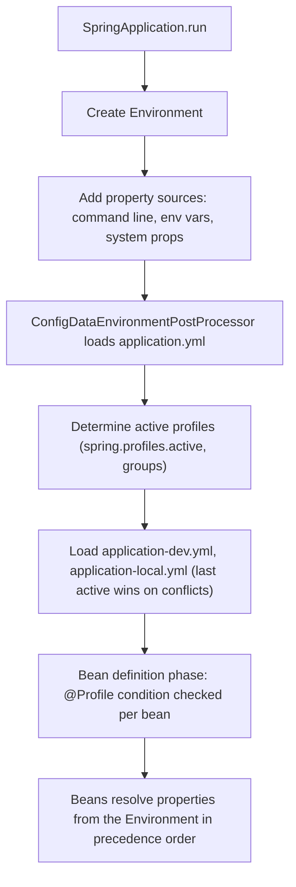
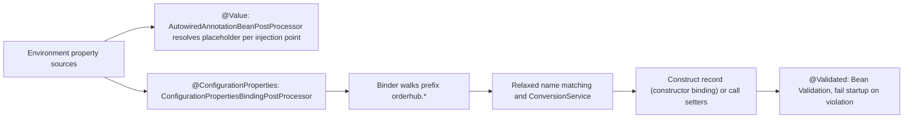
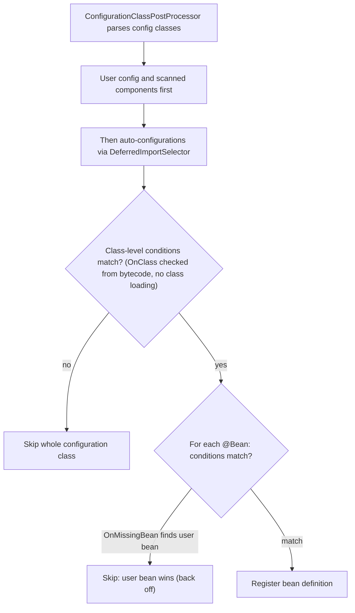
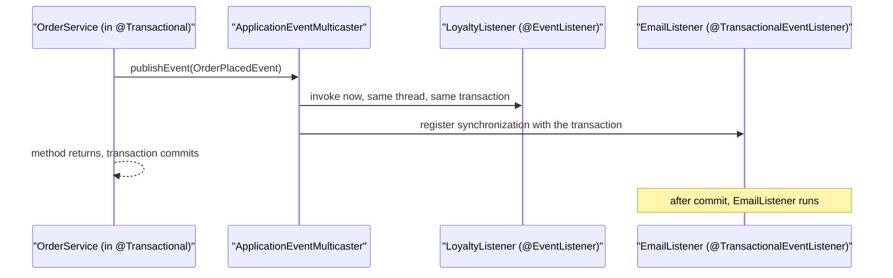

@@ 2 | MODULE | Configuration | Profiles, property binding, conditional beans and the container's event bus | MUST
# Configuration

**Shared analogy: a travelling theatre company.** The same play (your code) is performed in different cities (environments). Each city has its own settings sheet: stage size, ticket prices, local crew (profiles and properties). Some props are only brought if the venue supports them, like a pyrotechnics kit only where it is allowed (conditional beans). During the show, the stage manager announces cues over a loudspeaker and whoever is responsible reacts, without the actors calling each crew member directly (application events).

- **Profiles and Environment-Specific Config:** one settings sheet per city.
- **@Value vs @ConfigurationProperties:** reading single values vs binding a whole typed settings object.
- **Conditional Beans:** bringing a prop only when conditions are met; the basis of auto-configuration.
- **Spring Application Events:** the loudspeaker for decoupled communication.

@@ 3 | TOPIC | Profiles and Environment-Specific Config | Spring profiles, profile-specific application files, property source precedence and the Environment | MUST
# Profiles and Environment-Specific Config

**Level: Intermediate | Phase 10 | Priority: MUST | Since: @Profile Spring 3.1; profile groups and spring.config.activate.on-profile Boot 2.4**

> **30-second interview answer:** A profile is a named set of configuration and beans, like `dev`, `test` or `prod`. Spring Boot loads `application.yml` first and then `application-{profile}.yml` for each active profile, with later values overriding earlier ones. Beans annotated `@Profile("dev")` exist only when that profile is active. I activate profiles with `SPRING_PROFILES_ACTIVE` in each environment, keep secrets out of the files, and remember that environment variables and command-line arguments override file values.

## 1. Concept in Simple Words
### Analogy
A phone with modes: Home, Work and Flight.

| Phone modes | Spring profiles |
|---|---|
| Base settings shared by all modes | `application.yml` |
| Work mode turns on email sync and silences games | `application-prod.yml` plus `@Profile("prod")` beans |
| Flight mode disables the radio entirely | A bean excluded by `@Profile("!prod")` |
| You switch mode from the quick menu | `--spring.profiles.active=prod` or an environment variable |
| A temporary override like "do not disturb for 1 hour" | Command-line argument that beats file values |

### What it is
- **Profile:** a label that activates profile-specific property files and beans.
- **Active profiles:** set with `spring.profiles.active` (property, `SPRING_PROFILES_ACTIVE` env var, `-Dspring.profiles.active`, `--spring.profiles.active`, or `@ActiveProfiles` in tests).
- **Default profile:** `default` is active when no profile is set.
- **`@Profile`:** on a `@Component` or `@Bean` method; supports expressions like `"!prod"`, `"dev & local"`, `"dev or test"` (the logical operator words or their symbol forms).
- **Profile groups (Boot 2.4+):** `spring.profiles.group.prod=prod-db,prod-mq` activates several at once.
- **Multi-document YAML:** one file with `---` separators and `spring.config.activate.on-profile` per document.
- **Environment:** the Spring abstraction that holds active profiles and an ordered list of property sources.
- **Property source precedence (high to low, simplified):** command-line arguments, `SPRING_APPLICATION_JSON`, Java system properties, OS environment variables, profile-specific files outside the jar, profile-specific files inside the jar, `application.yml` outside the jar, `application.yml` inside the jar, `@PropertySource`, defaults.

### Why it exists
The same jar must run on a laptop (H2 or local Postgres, verbose logs), in CI (Testcontainers), and in production (managed database, JSON logs, real payment provider). Without profiles you would rebuild for each environment or fill the code with if-statements on environment names. The Twelve-Factor App principle "build once, configure per environment" depends on this.

## 2. How It Works


```text
Lookup of orderhub.payment.provider (first hit wins)
  1. --orderhub.payment.provider=stripe          (command line)
  2. ORDERHUB_PAYMENT_PROVIDER=stripe            (environment variable, relaxed binding)
  3. application-prod.yml                         (profile-specific)
  4. application.yml                              (base)
```

- `@Profile` is implemented as a `@Conditional(ProfileCondition.class)`, evaluated when bean definitions are registered. Excluded beans never get a definition.
- **Relaxed binding:** `orderhub.payment.provider` can be set by env var `ORDERHUB_PAYMENT_PROVIDER` (dots become underscores, upper case).
- `spring.profiles.active` cannot be set inside a profile-specific file (Boot 2.4+ rejects it), which prevents confusing chains.
- `spring.profiles.include` adds profiles on top of the active ones; groups are the recommended replacement.

## 3. Code Example
### Code
```yaml
# File: src/main/resources/application.yml  (shared by all environments)
spring:
  application:
    name: orderhub
  profiles:
    group:
      prod: "prod-db,json-logs"
orderhub:
  payment:
    provider: fake
  free-shipping-threshold: 50.00
logging:
  level:
    com.orderhub: INFO
---
# Same file, second document: only when the dev profile is active
spring:
  config:
    activate:
      on-profile: dev
logging:
  level:
    com.orderhub: DEBUG
```

```yaml
# File: src/main/resources/application-prod.yml
orderhub:
  payment:
    provider: stripe
  free-shipping-threshold: 75.00
server:
  shutdown: graceful
```

```java
// File: src/main/java/com/orderhub/notification/NotificationConfig.java
package com.orderhub.notification;

import org.springframework.beans.factory.annotation.Value;
import org.springframework.boot.ApplicationRunner;
import org.springframework.context.annotation.Bean;
import org.springframework.context.annotation.Configuration;
import org.springframework.context.annotation.Profile;
import org.springframework.core.env.Environment;

interface EmailSender { void send(String to, String body); }

class SmtpEmailSender implements EmailSender {
    public void send(String to, String body) { System.out.println("SMTP to " + to + ": " + body); }
}

class ConsoleEmailSender implements EmailSender {
    public void send(String to, String body) { System.out.println("[console email] to " + to + ": " + body); }
}

@Configuration(proxyBeanMethods = false)
public class NotificationConfig {

    @Bean
    @Profile("prod")                 // real emails only in prod
    EmailSender smtpEmailSender() { return new SmtpEmailSender(); }

    @Bean
    @Profile("!prod")                // everywhere else: print to console
    EmailSender consoleEmailSender() { return new ConsoleEmailSender(); }

    @Bean
    ApplicationRunner profileReport(Environment env, EmailSender sender,
                                    @Value("${orderhub.payment.provider}") String provider,
                                    @Value("${orderhub.free-shipping-threshold}") String threshold) {
        return args -> {
            System.out.println("active profiles: " + String.join(",", env.getActiveProfiles()));
            System.out.println("payment provider: " + provider + ", free shipping from " + threshold);
            System.out.println("email sender: " + sender.getClass().getSimpleName());
            System.out.println("is prod? " + env.acceptsProfiles(org.springframework.core.env.Profiles.of("prod")));
        };
    }
}
```

```java
// File: src/test/java/com/orderhub/notification/NotificationProfileTest.java
package com.orderhub.notification;

import static org.assertj.core.api.Assertions.assertThat;

import org.junit.jupiter.api.Test;
import org.springframework.beans.factory.annotation.Autowired;
import org.springframework.boot.test.context.SpringBootTest;
import org.springframework.test.context.ActiveProfiles;

@SpringBootTest
@ActiveProfiles("test")
class NotificationProfileTest {
    @Autowired EmailSender sender;

    @Test
    void nonProdUsesConsoleSender() {
        assertThat(sender).isInstanceOf(ConsoleEmailSender.class);
    }
}
```

### Walkthrough
- `application.yml` holds defaults. The second YAML document applies only with `dev` active and raises the log level.
- `application-prod.yml` overrides the provider and threshold. The group `prod` also activates `prod-db` and `json-logs`, which could have their own files.
- Exactly one `EmailSender` bean exists in any environment thanks to complementary profile expressions `prod` and `!prod`.
- `Environment` exposes active profiles and `acceptsProfiles`. Prefer `@Profile` over checking profiles in code.
- The test activates `test`, so the console sender is chosen.

### Output
Run with `java -jar orderhub.jar --spring.profiles.active=dev`:
```text
active profiles: dev
payment provider: fake, free shipping from 50.00
email sender: ConsoleEmailSender
is prod? false
```
Run with `SPRING_PROFILES_ACTIVE=prod java -jar orderhub.jar`:
```text
active profiles: prod,prod-db,json-logs
payment provider: stripe, free shipping from 75.00
email sender: SmtpEmailSender
is prod? true
```
Run with `SPRING_PROFILES_ACTIVE=prod java -jar orderhub.jar --orderhub.payment.provider=adyen`:
```text
active profiles: prod,prod-db,json-logs
payment provider: adyen, free shipping from 75.00
email sender: SmtpEmailSender
is prod? true
```

### Compare
| Old way | Modern Boot way |
|---|---|
| Separate builds per environment | One jar, profile chosen at runtime |
| `if (env.equals("prod"))` in code | `@Profile("prod")` beans and profile-specific files |
| `spring.profiles` key in YAML documents | `spring.config.activate.on-profile` (Boot 2.4+) |
| `spring.profiles.include` chains | `spring.profiles.group` |
| Passwords in `application-prod.yml` | Env vars, Kubernetes secrets, Vault |

## 4. Interview Questions
**Basic**
1. **What is a Spring profile?**
   A named configuration set. When active, Spring loads `application-{profile}.yml` on top of the base file and registers beans marked `@Profile` with that name. It lets one artifact behave differently per environment.
2. **How do you activate a profile?**
   `spring.profiles.active` via command line (`--spring.profiles.active=prod`), the `SPRING_PROFILES_ACTIVE` environment variable, a system property, or `@ActiveProfiles` in tests. If none is set, the `default` profile is active.
3. **What happens when the same property is in `application.yml` and `application-prod.yml`?**
   With `prod` active, the profile-specific value wins. With several active profiles, the last one listed wins on conflicts.

**Follow-up**
4. **What is the property source precedence in Spring Boot?**
   From highest: command-line arguments, `SPRING_APPLICATION_JSON`, system properties, OS environment variables, profile-specific config files (outside the jar before inside), then the base config files (outside before inside), `@PropertySource`, then defaults. So an env var overrides any value in a packaged YAML file.
5. **How can an environment variable set `orderhub.payment.provider`?**
   Relaxed binding: `ORDERHUB_PAYMENT_PROVIDER=stripe`. Dots become underscores, dashes are removed, everything upper case. List indexes use `_0_`, as in `ORDERHUB_ADMINS_0_`.
6. **What expressions does `@Profile` support?**
   Negation (`!prod`), and, or, and parentheses, written with the logical words or symbols: `@Profile("dev & !cloud")`. A list `@Profile({"dev", "test"})` means any of them.

**Tricky / scenario**
7. **A teammate puts `spring.profiles.active: prod` inside `application-dev.yml`. What happens?**
   Since Boot 2.4, startup fails: `spring.profiles.active` is not allowed in profile-specific documents, because it would make activation order ambiguous. Use profile groups instead.
8. **The prod database password is in `application-prod.yml` in Git. How would you fix it?**
   Remove it and rotate the password. Reference it as `${DB_PASSWORD}` and inject the value from the platform: Kubernetes secrets as env vars, AWS Secrets Manager or Vault via Spring Cloud integrations, or `spring.config.import=configtree:/run/secrets/`.
9. **Is it a good idea to have profiles per customer or per feature?**
   Usually not. Profiles should describe environments or broad infrastructure choices. For features use properties with `@ConditionalOnProperty` or a feature-flag tool; for tenants use data, not profiles. Profile explosion makes it unclear which beans exist.

**What the interviewer is really testing:** whether you can configure one artifact for many environments safely and know the precedence rules that cause "why is my value ignored?" bugs.

## 5. Pitfalls & Best Practices
### Common mistakes
| Mistake | What goes wrong | Fix |
|---|---|---|
| Secrets in profile YAML files | Leaked credentials in Git | Env vars, secret managers, `configtree` |
| Forgetting to set a profile in production | `default` profile runs with dev settings | Set `SPRING_PROFILES_ACTIVE` in deployment manifests; fail if missing |
| Two beans with overlapping profiles | `NoUniqueBeanDefinitionException` in one environment | Use complementary expressions (`prod` and `!prod`) |
| Profile checks in business code | Logic tied to environment names | `@Profile` beans or properties |
| Many tiny profiles | Unclear which beans exist | Few environment profiles plus groups |

### Best practices
- Base `application.yml` with safe defaults, one file per environment, secrets from the platform.
- Use `@ActiveProfiles("test")` in tests and a `test` profile with Testcontainers or fakes.
- Print active profiles at startup (Boot logs "The following profiles are active").
- Prefer feature properties (`orderhub.notifications.enabled`) over profiles for toggling single features.

### Compare with
| Mechanism | Granularity | Best for |
|---|---|---|
| Profiles | Whole environment | dev, test, staging, prod |
| `@ConditionalOnProperty` | One feature | Feature toggles |
| Spring Cloud Config or Kubernetes ConfigMaps | External, central | Many services, runtime refresh |
| Environment variables | Single values | Secrets and per-deployment overrides |

## 6. Hands-on Exercise
**OrderHub task.** Configure OrderHub for three environments:
1. `application.yml`: `orderhub.payment.provider: fake`, `orderhub.order.max-items: 20`.
2. `application-dev.yml`: debug logging for `com.orderhub`, H2 console enabled placeholder setting `orderhub.dev-tools: true`.
3. `application-prod.yml`: `provider: stripe`, `max-items: 50`, Stripe key read from `${STRIPE_API_KEY}`.
4. Beans: `FakePaymentGateway` active for `!prod`, `StripePaymentGateway` for `prod`.
5. A `@SpringBootTest` with `@ActiveProfiles("prod")` and the property `STRIPE_API_KEY=test-key` that asserts the Stripe gateway is used.

Acceptance criteria: no secret value in any file; the app starts without a profile using the fake gateway; the prod test passes.

<details><summary>Solution</summary>

```yaml
# File: src/main/resources/application.yml
orderhub:
  payment:
    provider: fake
  order:
    max-items: 20
```

```yaml
# File: src/main/resources/application-dev.yml
orderhub:
  dev-tools: true
logging:
  level:
    com.orderhub: DEBUG
```

```yaml
# File: src/main/resources/application-prod.yml
orderhub:
  payment:
    provider: stripe
    stripe-api-key: ${STRIPE_API_KEY}
  order:
    max-items: 50
```

```java
// File: src/main/java/com/orderhub/payment/PaymentGateways.java
package com.orderhub.payment;

import java.math.BigDecimal;
import org.springframework.beans.factory.annotation.Value;
import org.springframework.context.annotation.Profile;
import org.springframework.stereotype.Component;

@Component
@Profile("!prod")
class FakePaymentGateway implements PaymentGateway {
    public String charge(String customer, BigDecimal amount) { return "fake-" + customer; }
}

@Component
@Profile("prod")
class StripePaymentGateway implements PaymentGateway {
    private final String apiKey;
    StripePaymentGateway(@Value("${orderhub.payment.stripe-api-key}") String apiKey) { this.apiKey = apiKey; }
    public String charge(String customer, BigDecimal amount) {
        return "stripe(" + apiKey.substring(0, 4) + "****)-" + customer;
    }
}

// File: src/test/java/com/orderhub/payment/ProdProfileTest.java
package com.orderhub.payment;

import static org.assertj.core.api.Assertions.assertThat;

import org.junit.jupiter.api.Test;
import org.springframework.beans.factory.annotation.Autowired;
import org.springframework.boot.test.context.SpringBootTest;
import org.springframework.test.context.ActiveProfiles;

@SpringBootTest(properties = "STRIPE_API_KEY=test-key")
@ActiveProfiles("prod")
class ProdProfileTest {
    @Autowired PaymentGateway gateway;

    @Test
    void prodUsesStripe() {
        assertThat(gateway).isInstanceOf(StripePaymentGateway.class);
    }
}
```
If `STRIPE_API_KEY` is missing in prod, startup fails with "Could not resolve placeholder", which is the fail-fast behaviour you want. The `****` masks the rest of the key so it never appears in logs.
</details>

## 7. Recall
Q: What does a Spring profile control?
A: Which profile-specific property files are loaded and which `@Profile`-annotated beans are registered.

Q: How do you activate the prod profile through an environment variable?
A: Set `SPRING_PROFILES_ACTIVE=prod`.

Q: Which wins in Spring Boot: an environment variable or a value in `application.yml`?
A: The environment variable, because OS environment variables have higher precedence than packaged config files.

Q: What replaced `spring.profiles` inside multi-document YAML in Boot 2.4?
A: `spring.config.activate.on-profile`.

Q: What does `spring.profiles.group.prod=prod-db,json-logs` do?
A: Activating `prod` also activates `prod-db` and `json-logs`.

**Related:** [[@Value vs @ConfigurationProperties]] · [[Conditional Beans]] · [[@Configuration and @Bean]]

@@ 3 | TOPIC | @Value vs @ConfigurationProperties | Injecting single values with placeholders and SpEL vs binding typed, validated configuration objects | MUST
# @Value vs @ConfigurationProperties

**Level: Intermediate | Phase 10 | Priority: MUST | Since: @Value Spring 3.0; @ConfigurationProperties Boot 1.0; constructor binding for records Boot 2.2 (implicit in Boot 3)**

> **30-second interview answer:** `@Value("${key:default}")` injects one property (or a SpEL expression) into a field or parameter. It is fine for one or two values. `@ConfigurationProperties(prefix = "orderhub")` binds a whole tree of properties into a typed object, ideally an immutable record, with relaxed binding, type conversion for durations and sizes, nested objects, lists and maps, and `@Validated` JSR-380 validation at startup. For anything more than a couple of values, I use `@ConfigurationProperties`.

## 1. Concept in Simple Words
### Analogy
Reading a settings form.

| Settings form | Spring |
|---|---|
| Copying one field from the form onto a sticky note | `@Value("${orderhub.currency}")` |
| Photocopying a whole section into a neat typed folder | `@ConfigurationProperties(prefix = "orderhub")` |
| The folder has labelled tabs (payment, shipping) | Nested records |
| A clerk checks "max items must be at least 1" before filing | `@Validated` with `@Min` |
| The form accepts "30s" or "5MB" and converts them | `Duration` and `DataSize` conversion |

### What it is
- **`@Value`:** resolves `${...}` placeholders from the `Environment` and `#{...}` SpEL expressions. Supports defaults: `${orderhub.currency:EUR}`.
- **`@ConfigurationProperties`:** binds all properties under a prefix to a Java object using `Binder`. Works with JavaBeans (setters) or constructor binding (records, immutable classes).
- **Registration:** `@EnableConfigurationProperties(OrderHubProperties.class)`, `@ConfigurationPropertiesScan` on the main class, or `@Component` on a mutable class.
- **Relaxed binding:** `free-shipping-threshold`, `freeShippingThreshold`, `FREE_SHIPPING_THRESHOLD` all bind to the field `freeShippingThreshold`.
- **Conversion:** `Duration` (`30s`, `5m`), `DataSize` (`10MB`), `Period`, enums, lists from comma-separated strings, maps.
- **Metadata:** adding `spring-boot-configuration-processor` generates `META-INF/spring-configuration-metadata.json`, giving IDE autocompletion and docs for your properties.

### Why it exists
Scattered `@Value` strings are typo-prone (a misspelled key only fails at runtime or silently uses the default), not type-safe, cannot be validated as a group, and make it hard to see all settings in one place. `@ConfigurationProperties` gives one typed, documented, validated, testable configuration object.

## 2. How It Works


- `@Value` placeholders are resolved by the `PropertySourcesPlaceholderConfigurer` mechanism; an unresolvable placeholder without a default fails startup with `IllegalArgumentException: Could not resolve placeholder`.
- `@Value` does **not** support relaxed binding fully (only the canonical kebab-case form is recommended) and has no validation.
- In Boot 3, a class with a single parameterised constructor (such as a record) uses constructor binding automatically; `@ConstructorBinding` is only needed to choose among several constructors.
- `@DefaultValue` sets defaults for constructor-bound parameters; otherwise missing values are null (or empty for collections only if you annotate them).
- Configuration properties objects are ordinary beans, so you can inject them anywhere.

## 3. Code Example
### Code
```yaml
# File: src/main/resources/application.yml
orderhub:
  currency: EUR
  free-shipping-threshold: 50.00
  order:
    max-items: 20
    reservation-timeout: 15m
  payment:
    provider: stripe
    retry-attempts: 3
  admin-emails:
    - ops@orderhub.example
    - cto@orderhub.example
  upload:
    max-size: 5MB
```

```java
// File: src/main/java/com/orderhub/config/OrderHubProperties.java
package com.orderhub.config;

import jakarta.validation.Valid;
import jakarta.validation.constraints.*;
import java.math.BigDecimal;
import java.time.Duration;
import java.util.List;
import org.springframework.boot.context.properties.ConfigurationProperties;
import org.springframework.boot.context.properties.bind.DefaultValue;
import org.springframework.util.unit.DataSize;
import org.springframework.validation.annotation.Validated;

@Validated
@ConfigurationProperties(prefix = "orderhub")
public record OrderHubProperties(
        @NotBlank String currency,
        @NotNull @DecimalMin("0.00") BigDecimal freeShippingThreshold,
        @Valid Order order,
        @Valid Payment payment,
        @DefaultValue({}) List<@Email String> adminEmails,
        Upload upload) {

    public record Order(@Min(1) @Max(100) int maxItems,
                        @DefaultValue("10m") Duration reservationTimeout) { }

    public record Payment(@NotBlank String provider,
                          @DefaultValue("2") @Min(0) int retryAttempts) { }

    public record Upload(@DefaultValue("2MB") DataSize maxSize) { }
}

// File: src/main/java/com/orderhub/OrderHubApplication.java
package com.orderhub;

import org.springframework.boot.SpringApplication;
import org.springframework.boot.autoconfigure.SpringBootApplication;
import org.springframework.boot.context.properties.ConfigurationPropertiesScan;

@SpringBootApplication
@ConfigurationPropertiesScan          // finds @ConfigurationProperties classes under com.orderhub
public class OrderHubApplication {
    public static void main(String[] args) { SpringApplication.run(OrderHubApplication.class, args); }
}

// File: src/main/java/com/orderhub/order/ShippingService.java
package com.orderhub.order;

import com.orderhub.config.OrderHubProperties;
import java.math.BigDecimal;
import org.springframework.beans.factory.annotation.Value;
import org.springframework.stereotype.Service;

@Service
public class ShippingService {
    private final OrderHubProperties props;
    private final String appName;
    private final int cpuCount;

    public ShippingService(OrderHubProperties props,
                           @Value("${spring.application.name:orderhub}") String appName,   // placeholder with default
                           @Value("#{T(java.lang.Runtime).getRuntime().availableProcessors()}") int cpuCount) { // SpEL
        this.props = props;
        this.appName = appName;
        this.cpuCount = cpuCount;
    }

    public BigDecimal shippingFee(BigDecimal orderTotal) {
        return orderTotal.compareTo(props.freeShippingThreshold()) >= 0
                ? BigDecimal.ZERO : new BigDecimal("4.99");
    }

    public String describe() {
        return appName + " ships in " + props.currency()
                + ", max items " + props.order().maxItems()
                + ", reservation " + props.order().reservationTimeout().toMinutes() + " min"
                + ", upload limit " + props.upload().maxSize().toMegabytes() + " MB"
                + ", admins " + props.adminEmails().size()
                + ", cpus>0 " + (cpuCount > 0);
    }
}
```

```xml
<!-- File: pom.xml (dependencies) -->
<dependency>
    <groupId>org.springframework.boot</groupId>
    <artifactId>spring-boot-starter-validation</artifactId>
</dependency>
<dependency>
    <groupId>org.springframework.boot</groupId>
    <artifactId>spring-boot-configuration-processor</artifactId>
    <optional>true</optional>
</dependency>
```

### Walkthrough
- The YAML uses kebab-case keys; relaxed binding maps `free-shipping-threshold` to `freeShippingThreshold` and `max-items` to `maxItems`.
- `OrderHubProperties` is an immutable record bound through its canonical constructor. Nested records map nested YAML blocks. `15m` becomes a `Duration`, `5MB` a `DataSize`, the YAML list a `List<String>`.
- `@Validated` plus constraints validate at startup. `@Valid` on nested records cascades validation into them.
- `@DefaultValue` provides defaults when a key is missing (for example `retry-attempts`).
- `@ConfigurationPropertiesScan` registers the record as a bean; `ShippingService` injects it like any other bean.
- `@Value` is used for one framework property with a default and one SpEL expression, which is where `@Value` still shines.
- The configuration processor generates metadata so the IDE autocompletes `orderhub.*` keys.

### Output
`shippingService.describe()` and fees:
```text
orderhub ships in EUR, max items 20, reservation 15 min, upload limit 5 MB, admins 2, cpus>0 true
fee for 30.00 = 4.99
fee for 80.00 = 0
```
Starting with `--orderhub.order.max-items=0`:
```text
***************************
APPLICATION FAILED TO START
***************************

Description:

Binding to target com.orderhub.config.OrderHubProperties failed:

    Property: orderhub.order.max-items
    Value: "0"
    Origin: "orderhub.order.max-items" from property source "commandLineArgs"
    Reason: must be greater than or equal to 1
```

### Compare
| Feature | `@Value` | `@ConfigurationProperties` |
|---|---|---|
| Granularity | One value | A whole prefix tree |
| Type safety | String key, converted on injection | Typed object, IDE metadata |
| Relaxed binding | Limited | Full |
| Validation | No | `@Validated` with JSR-380 |
| SpEL | Yes | No |
| Immutability | Constructor parameter only | Records with constructor binding |
| Testability | Needs context or reflection | Construct the record directly in unit tests |

## 4. Interview Questions
**Basic**
1. **What is the difference between `@Value` and `@ConfigurationProperties`?**
   `@Value` injects a single property or SpEL expression at one injection point. `@ConfigurationProperties` binds a group of properties under a prefix into a typed object with relaxed binding, nested structures, conversion and validation. Use the latter for structured configuration.
2. **How do you provide a default value with `@Value`?**
   After a colon: `@Value("${orderhub.currency:EUR}")`. Without a default, a missing property fails startup.
3. **How do you register a `@ConfigurationProperties` class?**
   With `@ConfigurationPropertiesScan`, `@EnableConfigurationProperties(MyProps.class)`, or by making a mutable class a `@Component`. Records need one of the first two.

**Follow-up**
4. **What is relaxed binding?**
   Boot matches property names regardless of format: `max-items`, `maxItems`, `max_items` and the env var `ORDERHUB_ORDER_MAXITEMS` all bind to `maxItems`. The canonical form in files is kebab-case.
5. **How do you validate configuration properties?**
   Add `spring-boot-starter-validation`, annotate the class with `@Validated`, and put constraints such as `@NotBlank`, `@Min`, `@Email` on fields or record components. Use `@Valid` on nested objects. Violations fail startup with a clear report.
6. **What is the difference between `${...}` and `#{...}` in `@Value`?**
   `${...}` is a property placeholder resolved from the Environment. `#{...}` is a SpEL expression evaluated at injection time, which can call methods, reference beans (`#{orderService.limit}`) or compute values. They can be combined: `#{'${orderhub.admins}'.split(',')}`.

**Tricky / scenario**
7. **`@Value("${orderhub.max-items}")` on a field in a class you create with `new` is always 0. Why?**
   Only Spring beans are processed; `new` bypasses the container, so nothing injects the value. The same happens for a static field: `@Value` is not applied to static fields.
8. **You changed a property in Kubernetes ConfigMap. Does the running app see it?**
   No. Properties are bound at startup. To pick up changes you restart (the usual approach), or use Spring Cloud's `@RefreshScope` and the refresh endpoint, which re-creates refresh-scoped beans and rebinds `@ConfigurationProperties`.
9. **Why prefer records for configuration properties?**
   They are immutable, so nothing can change configuration at runtime by accident, they are thread-safe, concise and easy to construct in unit tests without Spring.

**What the interviewer is really testing:** whether you write type-safe, validated configuration and know the limits of `@Value` (no validation, string keys, beans only).

## 5. Pitfalls & Best Practices
### Common mistakes
| Mistake | What goes wrong | Fix |
|---|---|---|
| Typo in an `@Value` key with a default | Default silently used, wrong behaviour | `@ConfigurationProperties` with validation and metadata |
| `@Value` on a static field | Stays null or 0 | Instance field or constructor parameter |
| Forgetting `spring-boot-starter-validation` | `@Validated` constraints silently ignored | Add the starter |
| No `@Valid` on nested objects | Nested constraints not checked | Annotate nested fields with `@Valid` |
| Mutable properties class shared everywhere | Code changes config at runtime | Records with constructor binding |

### Best practices
- One properties record per feature or prefix (`orderhub.payment`, `orderhub.shipping`), validated, immutable.
- Add the configuration processor for IDE help and documentation.
- Use `Duration` and `DataSize` types instead of `long timeoutMillis`.
- Keep `@Value` for one-off values and SpEL; never for groups of settings.
- Fail fast: no defaults for values that must be set per environment (like API keys).

### Compare with
| Way to read config | When |
|---|---|
| `@Value` | One value, SpEL needed |
| `@ConfigurationProperties` | Groups of related settings (default choice) |
| `Environment.getProperty` | Dynamic keys at runtime, framework code |
| `@PropertySource` | Loading an extra `.properties` file (YAML not supported by default) |

## 6. Hands-on Exercise
**OrderHub task.** Replace scattered `@Value` usages in OrderHub with one typed config:
1. Create `OrderProperties` record bound to `orderhub.order` with `maxItems` (1 to 100), `minTotal` (`BigDecimal`, at least 0), `reservationTimeout` (`Duration`, default 10 minutes) and `allowedCountries` (list, not empty).
2. Use it in `OrderService.place(...)` to reject orders with too many items, a total below the minimum or a country not in the list (throw `IllegalArgumentException` for now; Phase 11 maps it to 400).
3. Write a plain unit test constructing `OrderProperties` directly.

Acceptance criteria: invalid config (`max-items: 0`) fails startup; the unit test needs no Spring context.

<details><summary>Solution</summary>

```java
// File: src/main/java/com/orderhub/order/OrderProperties.java
package com.orderhub.order;

import jakarta.validation.constraints.*;
import java.math.BigDecimal;
import java.time.Duration;
import java.util.List;
import org.springframework.boot.context.properties.ConfigurationProperties;
import org.springframework.boot.context.properties.bind.DefaultValue;
import org.springframework.validation.annotation.Validated;

@Validated
@ConfigurationProperties(prefix = "orderhub.order")
public record OrderProperties(
        @Min(1) @Max(100) int maxItems,
        @NotNull @DecimalMin("0") BigDecimal minTotal,
        @DefaultValue("10m") Duration reservationTimeout,
        @NotEmpty List<String> allowedCountries) { }

// File: src/main/java/com/orderhub/order/OrderService.java (excerpt)
package com.orderhub.order;

import java.math.BigDecimal;
import org.springframework.stereotype.Service;

@Service
public class OrderService {
    private final OrderProperties props;

    public OrderService(OrderProperties props) { this.props = props; }

    public void validate(int itemCount, BigDecimal total, String country) {
        if (itemCount > props.maxItems())
            throw new IllegalArgumentException("Too many items: " + itemCount + " (max " + props.maxItems() + ")");
        if (total.compareTo(props.minTotal()) < 0)
            throw new IllegalArgumentException("Order total below minimum " + props.minTotal());
        if (!props.allowedCountries().contains(country))
            throw new IllegalArgumentException("We do not ship to " + country);
    }
}

// File: src/test/java/com/orderhub/order/OrderServiceLimitsTest.java
package com.orderhub.order;

import static org.junit.jupiter.api.Assertions.*;

import java.math.BigDecimal;
import java.time.Duration;
import java.util.List;
import org.junit.jupiter.api.Test;

class OrderServiceLimitsTest {
    private final OrderService service = new OrderService(
            new OrderProperties(3, new BigDecimal("10"), Duration.ofMinutes(10), List.of("DE", "NL")));

    @Test
    void rejectsTooManyItems() {
        var ex = assertThrows(IllegalArgumentException.class,
                () -> service.validate(4, new BigDecimal("50"), "DE"));
        assertEquals("Too many items: 4 (max 3)", ex.getMessage());
    }

    @Test
    void acceptsValidOrder() {
        assertDoesNotThrow(() -> service.validate(2, new BigDecimal("50"), "NL"));
    }
}
```

```yaml
# File: src/main/resources/application.yml
orderhub:
  order:
    max-items: 20
    min-total: 5.00
    allowed-countries: DE,NL,BE
```
The comma-separated string binds to a `List<String>` automatically.
</details>

## 7. Recall
Q: When should you use `@ConfigurationProperties` instead of `@Value`?
A: For groups of related settings: it gives typed, validated, relaxed-bound, testable configuration objects.

Q: How do you give `@Value` a default in Spring?
A: Add it after a colon in the placeholder, like `${orderhub.currency:EUR}`.

Q: How do you validate `@ConfigurationProperties` at startup?
A: Add the validation starter, annotate the class with `@Validated`, add constraints, and use `@Valid` for nested objects.

Q: What is the difference between `${}` and `#{}` in Spring's `@Value`?
A: `${}` resolves a property placeholder; `#{}` evaluates a SpEL expression.

Q: Do `@ConfigurationProperties` records need `@ConstructorBinding` in Boot 3?
A: No; a single-constructor class such as a record uses constructor binding automatically.

**Related:** [[Profiles and Environment-Specific Config]] · [[Bean Validation]] · [[Conditional Beans]]

@@ 3 | TOPIC | Conditional Beans | @Conditional, Boot's @ConditionalOnProperty, OnClass and OnMissingBean, and how auto-configuration backs off | SHOULD
# Conditional Beans

**Level: Intermediate | Phase 10 | Priority: SHOULD | Since: @Conditional Spring 4.0; @ConditionalOn... annotations Boot 1.0; @AutoConfiguration Boot 2.7**

> **30-second interview answer:** `@Conditional` lets Spring decide at startup whether to register a bean, based on a `Condition` that inspects the environment, classpath or existing beans. Spring Boot builds auto-configuration on it: `@ConditionalOnClass` (a library is on the classpath), `@ConditionalOnProperty` (a feature flag), and `@ConditionalOnMissingBean` (only if the user has not defined their own). That last one is why defining your own `ObjectMapper` or `DataSource` makes Boot's default back off.

## 1. Concept in Simple Words
### Analogy
A hotel room prepared according to the booking.

| Hotel | Spring |
|---|---|
| Put a baby cot in the room only if the booking says "infant" | `@ConditionalOnProperty` |
| Provide a hair dryer only if the room has a socket for it | `@ConditionalOnClass` |
| Put a standard pillow only if the guest did not bring their own | `@ConditionalOnMissingBean` |
| Housekeeping checklist that runs these checks for every room | Auto-configuration classes |
| The checklist report you can ask for at the front desk | The conditions evaluation report (`--debug`) |

### What it is
- **`Condition`:** interface with `matches(ConditionContext, AnnotatedTypeMetadata)`. The context gives access to the `Environment`, bean factory, class loader and resource loader.
- **`@Conditional(MyCondition.class)`:** on a `@Configuration`, `@Component` or `@Bean` method.
- **Boot conditions (most used):**
  - `@ConditionalOnProperty(prefix, name, havingValue, matchIfMissing)`
  - `@ConditionalOnClass` and `@ConditionalOnMissingClass`
  - `@ConditionalOnBean` and `@ConditionalOnMissingBean`
  - `@ConditionalOnWebApplication`, `@ConditionalOnExpression`, `@ConditionalOnResource`, `@ConditionalOnCloudPlatform`, `@ConditionalOnThreading` (virtual threads, Boot 3.2)
- **Auto-configuration:** classes annotated `@AutoConfiguration`, listed in `META-INF/spring/org.springframework.boot.autoconfigure.AutoConfiguration.imports`, processed after your own configuration.

### Why it exists
Libraries need sensible defaults that adapt to what you have: if Jackson is on the classpath, configure an `ObjectMapper`; if you set `spring.datasource.url`, create a `DataSource`; if you define your own, step aside. Applications also need feature toggles without code changes. `@Profile` is itself implemented as a condition.

## 2. How It Works


Key points:
- Conditions are evaluated during the **bean definition** phase, not when beans are created. `@ConditionalOnBean` therefore only sees definitions registered so far, which is why it is reliable in auto-configuration (processed last) but fragile in your own configuration.
- `@ConditionalOnClass(name = "...")` is checked by reading annotation metadata with ASM, so a missing class does not cause `ClassNotFoundException`.
- Ordering among auto-configurations: `@AutoConfiguration(after = ..., before = ...)`.
- See every decision with `--debug` or `debug=true` (the "CONDITIONS EVALUATION REPORT"), or the Actuator `conditions` endpoint.

```text
CONDITIONS EVALUATION REPORT (excerpt)
Positive matches:
   JacksonAutoConfiguration matched:
      - @ConditionalOnClass found required class 'com.fasterxml.jackson.databind.ObjectMapper'
Negative matches:
   MongoAutoConfiguration:
      Did not match:
         - @ConditionalOnClass did not find required class 'com.mongodb.client.MongoClient'
```

## 3. Code Example
### Code
```java
// File: src/main/java/com/orderhub/notification/NotificationAutoConfig.java
package com.orderhub.notification;

import org.springframework.boot.ApplicationRunner;
import org.springframework.boot.autoconfigure.condition.ConditionalOnClass;
import org.springframework.boot.autoconfigure.condition.ConditionalOnMissingBean;
import org.springframework.boot.autoconfigure.condition.ConditionalOnProperty;
import org.springframework.context.annotation.Bean;
import org.springframework.context.annotation.Condition;
import org.springframework.context.annotation.ConditionContext;
import org.springframework.context.annotation.Conditional;
import org.springframework.context.annotation.Configuration;
import org.springframework.core.type.AnnotatedTypeMetadata;

interface Notifier { String name(); void notify(String msg); }

class SmsNotifier implements Notifier {
    public String name() { return "sms"; }
    public void notify(String msg) { System.out.println("SMS: " + msg); }
}

class SlackNotifier implements Notifier {
    public String name() { return "slack"; }
    public void notify(String msg) { System.out.println("Slack: " + msg); }
}

class LogNotifier implements Notifier {
    public String name() { return "log"; }
    public void notify(String msg) { System.out.println("LOG: " + msg); }
}

// Custom condition: only on weekdays-style business rule, here "running in a container"
class RunningInContainerCondition implements Condition {
    @Override
    public boolean matches(ConditionContext ctx, AnnotatedTypeMetadata metadata) {
        return ctx.getEnvironment().containsProperty("KUBERNETES_SERVICE_HOST");
    }
}

@Configuration(proxyBeanMethods = false)
public class NotificationAutoConfig {

    // Feature flag: create only if orderhub.notifications.sms.enabled=true
    @Bean
    @ConditionalOnProperty(prefix = "orderhub.notifications.sms", name = "enabled", havingValue = "true")
    Notifier smsNotifier() { return new SmsNotifier(); }

    // Only if a Slack client library is on the classpath (string name: safe if absent)
    @Bean
    @ConditionalOnClass(name = "com.slack.api.Slack")
    Notifier slackNotifier() { return new SlackNotifier(); }

    // Fallback: only if no other Notifier bean has been defined
    @Bean
    @ConditionalOnMissingBean(Notifier.class)
    Notifier logNotifier() { return new LogNotifier(); }

    // Custom condition
    @Bean
    @Conditional(RunningInContainerCondition.class)
    ApplicationRunner containerBanner() {
        return args -> System.out.println("running inside Kubernetes");
    }

    @Bean
    ApplicationRunner notifierReport(java.util.List<Notifier> notifiers) {
        return args -> System.out.println("notifiers: " + notifiers.stream().map(Notifier::name).toList());
    }
}
```

```yaml
# File: src/main/resources/application.yml
orderhub:
  notifications:
    sms:
      enabled: false
```

### Walkthrough
- `smsNotifier` exists only when `orderhub.notifications.sms.enabled=true`. With `matchIfMissing = true` it would also be created when the property is absent.
- `slackNotifier` checks the classpath by class name; without the Slack SDK the bean is skipped without errors.
- `logNotifier` is a fallback with `@ConditionalOnMissingBean`. Because these beans are in the same configuration class, evaluation order follows method order, so the fallback is declared last. In real auto-configuration, the fallback lives in an `@AutoConfiguration` class processed after user configuration, which makes it reliable.
- `RunningInContainerCondition` reads the environment: Kubernetes injects `KUBERNETES_SERVICE_HOST` into every pod.
- `notifierReport` injects all `Notifier` beans to show which ones exist.

### Output
Default (`sms.enabled=false`, no Slack SDK, not in Kubernetes):
```text
notifiers: [log]
```
With `--orderhub.notifications.sms.enabled=true`:
```text
notifiers: [sms]
```
With the SMS flag on and the Slack SDK dependency added, in a Kubernetes pod:
```text
running inside Kubernetes
notifiers: [sms, slack]
```

### Compare
| Mechanism | Decides by | Typical use |
|---|---|---|
| `@Profile` | Active profiles | Environment-wide differences |
| `@ConditionalOnProperty` | A property value | Feature flags |
| `@ConditionalOnClass` | Classpath content | Library integrations |
| `@ConditionalOnMissingBean` | Existing bean definitions | Overridable defaults |
| Custom `@Conditional` | Any logic | Platform detection, complex rules |

## 4. Interview Questions
**Basic**
1. **What does `@Conditional` do?**
   It registers a bean or configuration only if a `Condition` returns true at startup. The condition can check properties, the classpath, existing beans or anything in the environment.
2. **Name some Spring Boot conditional annotations.**
   `@ConditionalOnProperty`, `@ConditionalOnClass`, `@ConditionalOnMissingClass`, `@ConditionalOnBean`, `@ConditionalOnMissingBean`, `@ConditionalOnWebApplication`, `@ConditionalOnExpression` and `@ConditionalOnResource`.
3. **How does Spring Boot auto-configuration work?**
   Boot loads auto-configuration classes listed in `AutoConfiguration.imports` after your own configuration. Each is guarded by conditions: on the classpath, on properties and on missing beans. So it configures what you have on the classpath and backs off when you define your own beans.

**Follow-up**
4. **How do you override an auto-configured bean?**
   Define your own bean of the same type; the auto-configuration's `@ConditionalOnMissingBean` skips its default. Alternatively set properties it reads, use a customizer bean, or exclude the auto-configuration with `@SpringBootApplication(exclude = ...)` or `spring.autoconfigure.exclude`.
5. **How do you find out why a bean was or was not created?**
   Start with `--debug` to print the conditions evaluation report, or call the Actuator `/actuator/conditions` endpoint. It lists positive and negative matches with reasons.
6. **Why is `@ConditionalOnBean` risky in your own configuration classes?**
   Conditions are evaluated in the order definitions are registered. If the bean you are checking for is registered later (another config class or auto-configuration), the condition sees nothing and wrongly fails. It is designed for auto-configuration, whose ordering is controlled.

**Tricky / scenario**
7. **You add `spring-boot-starter-data-jpa` and the app no longer starts: "Failed to configure a DataSource". Why?**
   JPA brings `DataSource` classes onto the classpath, so `DataSourceAutoConfiguration` matches its `@ConditionalOnClass` and tries to build a `DataSource`, but no URL is configured and no embedded database is present. Configure `spring.datasource.url`, add an embedded database for tests, or exclude the auto-configuration.
8. **How does `@ConditionalOnClass` work when the class is missing? Would that not throw `ClassNotFoundException`?**
   Spring reads the annotation metadata from bytecode with ASM without loading the configuration class, so the referenced class is never resolved. That is why it is safe on the class level. On `@Bean` methods, use the `name` attribute with a string to be safe.
9. **What is the difference between `@Profile` and `@ConditionalOnProperty` for toggling a feature?**
   `@Profile` ties the feature to an environment name; `@ConditionalOnProperty` ties it to a specific setting that can be flipped per environment or per deployment. Properties are finer-grained and easier to reason about for single features.

**What the interviewer is really testing:** whether you understand auto-configuration as conditional bean registration and can debug "why is this bean here or missing".

## 5. Pitfalls & Best Practices
### Common mistakes
| Mistake | What goes wrong | Fix |
|---|---|---|
| `@ConditionalOnBean` in user config | Order-dependent, false negatives | Use it only in auto-configuration, or `ObjectProvider` |
| `@ConditionalOnClass(SomeClass.class)` on a `@Bean` method | `NoClassDefFoundError` if absent | Use the `name` string attribute or a nested config class |
| Expecting conditions to re-evaluate at runtime | Bean set fixed at startup | Restart or use refresh scope or a feature-flag service |
| Excluding auto-config instead of setting one property | Lose many sensible defaults | Prefer properties and customizers |

### Best practices
- Use `@ConditionalOnProperty` for feature toggles with an explicit `havingValue` and a deliberate `matchIfMissing`.
- Put overridable defaults in `@AutoConfiguration` classes with `@ConditionalOnMissingBean` (Phase 18 builds a custom starter this way).
- Run with `--debug` once when a bean is missing; read the report before guessing.
- Keep custom conditions simple and side-effect free.

### Compare with
| Toggle approach | Changes at runtime? | Scope |
|---|---|---|
| `@Profile` | No | Environment |
| `@ConditionalOnProperty` | No (startup) | Feature |
| Feature-flag service (Unleash, LaunchDarkly) | Yes | Per request or user |
| `@RefreshScope` (Spring Cloud) | Yes, bean re-created | Bean |

## 6. Hands-on Exercise
**OrderHub task.** Make order notifications pluggable:
1. Interface `OrderNotifier` with `void orderPlaced(long orderId, String customerEmail)`.
2. `EmailOrderNotifier`, created only when `orderhub.notifications.email.enabled=true`.
3. `WebhookOrderNotifier`, created only when `orderhub.notifications.webhook.url` is set (use `@ConditionalOnProperty(name = "orderhub.notifications.webhook.url")`, which matches any value except `false`).
4. `NoopOrderNotifier` fallback, created only when no other `OrderNotifier` exists; put it in a separate configuration class annotated `@AutoConfiguration` and registered in `AutoConfiguration.imports` so it is evaluated last.
5. `OrderService` injects `List<OrderNotifier>` and calls all of them.

Acceptance criteria: with no properties only the no-op notifier exists; enabling email gives only email; enabling both gives both and no no-op.

<details><summary>Solution</summary>

```java
// File: src/main/java/com/orderhub/notification/OrderNotifiers.java
package com.orderhub.notification;

import org.springframework.beans.factory.annotation.Value;
import org.springframework.boot.autoconfigure.condition.ConditionalOnProperty;
import org.springframework.stereotype.Component;

@Component
@ConditionalOnProperty(prefix = "orderhub.notifications.email", name = "enabled", havingValue = "true")
class EmailOrderNotifier implements OrderNotifier {
    public void orderPlaced(long orderId, String email) {
        System.out.println("email to " + email + ": order " + orderId + " placed");
    }
}

@Component
@ConditionalOnProperty(name = "orderhub.notifications.webhook.url")
class WebhookOrderNotifier implements OrderNotifier {
    private final String url;
    WebhookOrderNotifier(@Value("${orderhub.notifications.webhook.url}") String url) { this.url = url; }
    public void orderPlaced(long orderId, String email) {
        System.out.println("POST " + url + " {orderId:" + orderId + "}");
    }
}

// File: src/main/java/com/orderhub/notification/OrderNotifier.java
package com.orderhub.notification;

public interface OrderNotifier {
    void orderPlaced(long orderId, String customerEmail);
}

// File: src/main/java/com/orderhub/notification/NotifierFallbackAutoConfiguration.java
package com.orderhub.notification;

import org.springframework.boot.autoconfigure.AutoConfiguration;
import org.springframework.boot.autoconfigure.condition.ConditionalOnMissingBean;
import org.springframework.context.annotation.Bean;

@AutoConfiguration      // processed after user configuration
public class NotifierFallbackAutoConfiguration {
    @Bean
    @ConditionalOnMissingBean(OrderNotifier.class)
    OrderNotifier noopOrderNotifier() {
        return (orderId, email) -> System.out.println("no notifier configured for order " + orderId);
    }
}

// File: src/main/java/com/orderhub/order/OrderService.java (excerpt)
package com.orderhub.order;

import com.orderhub.notification.OrderNotifier;
import java.util.List;
import org.springframework.stereotype.Service;

@Service
public class OrderService {
    private final List<OrderNotifier> notifiers;
    public OrderService(List<OrderNotifier> notifiers) { this.notifiers = notifiers; }

    public void place(long orderId, String email) {
        notifiers.forEach(n -> n.orderPlaced(orderId, email));
    }
}
```

```text
# File: src/main/resources/META-INF/spring/org.springframework.boot.autoconfigure.AutoConfiguration.imports
com.orderhub.notification.NotifierFallbackAutoConfiguration
```
Make sure component scanning does not also pick up the auto-configuration class: `@AutoConfiguration` classes are excluded from scanning by `@SpringBootApplication`'s `AutoConfigurationExcludeFilter` as long as they are listed in the imports file.
</details>

## 7. Recall
Q: When are Spring `@Conditional` conditions evaluated?
A: At startup during bean definition registration, not at bean creation or runtime.

Q: Which Spring Boot condition makes auto-configuration back off when you define your own bean?
A: `@ConditionalOnMissingBean`.

Q: How do you see why Spring Boot auto-configured a bean or skipped it?
A: Run with `--debug` for the conditions evaluation report, or use the Actuator `conditions` endpoint.

Q: What does `@ConditionalOnProperty(name = "x.enabled", havingValue = "true", matchIfMissing = true)` mean?
A: Create the bean if `x.enabled` is true or not set at all.

Q: Why is `@ConditionalOnBean` unreliable in your own configuration classes?
A: It only sees bean definitions registered so far, so ordering can make it fail; it is meant for auto-configuration.

**Related:** [[Profiles and Environment-Specific Config]] · [[@Configuration and @Bean]] · [[@Qualifier, @Primary and Multiple Beans]]

@@ 3 | TOPIC | Spring Application Events | ApplicationEventPublisher, @EventListener, @TransactionalEventListener, async listeners and built-in Boot events | SHOULD
# Spring Application Events

**Level: Intermediate | Phase 10 | Priority: SHOULD | Since: ApplicationEvent Spring 1.0; @EventListener and any-object events Spring 4.2; @TransactionalEventListener Spring 4.2**

> **30-second interview answer:** Spring has an in-process publish-subscribe bus. A bean publishes an event object with `ApplicationEventPublisher.publishEvent()`, and every `@EventListener` method whose parameter type matches is invoked. By default listeners run synchronously in the publisher's thread and transaction, so an exception propagates back. `@Async` makes a listener asynchronous, and `@TransactionalEventListener` runs it only after the surrounding transaction commits, which is how I send emails only for orders that were really saved.

## 1. Concept in Simple Words
### Analogy
A school public-address system.

| School PA system | Spring events |
|---|---|
| The office announces "Fire drill at 10:00" | `publisher.publishEvent(new FireDrillEvent())` |
| Teachers who care about drills react; others ignore it | `@EventListener` methods for that event type |
| The office does not phone each teacher | Publisher does not know its listeners (decoupling) |
| By default the office waits until every class confirms | Synchronous listeners in the same thread |
| "Announce the results only after the exam is officially graded" | `@TransactionalEventListener(phase = AFTER_COMMIT)` |
| Announcements are not recorded; a teacher out sick misses it | In-memory only, lost on crash (not a message broker) |

### What it is
- **Event:** any object (since Spring 4.2); historically a subclass of `ApplicationEvent`. Records make great events.
- **`ApplicationEventPublisher`:** inject it (the `ApplicationContext` implements it) and call `publishEvent(event)`.
- **`@EventListener`:** on a bean method; parameter type selects events. Supports `condition` (SpEL), ordering with `@Order`, and returning a new event to publish it.
- **`@TransactionalEventListener`:** bound to the current transaction; phases `BEFORE_COMMIT`, `AFTER_COMMIT` (default), `AFTER_ROLLBACK`, `AFTER_COMPLETION`.
- **`@Async` listener:** runs on a task executor, needs `@EnableAsync`.
- **Built-in events:** `ContextRefreshedEvent`, `ContextClosedEvent`, and Boot's `ApplicationStartingEvent`, `ApplicationEnvironmentPreparedEvent`, `ApplicationPreparedEvent`, `ApplicationStartedEvent`, `ApplicationReadyEvent`, `ApplicationFailedEvent`.

### Why it exists
When an order is placed, many things should happen: send a confirmation, update analytics, reserve stock, award loyalty points. If `OrderService` calls each service directly, it depends on all of them and grows with every new feature. With events, `OrderService` announces "order placed" and new reactions are added as listeners without touching it. This is the in-process version of the event-driven design you will use with Kafka in Phase 20.

## 2. How It Works


- `EventListenerMethodProcessor` (a `SmartInitializingSingleton`) scans beans for `@EventListener` methods at startup and registers an `ApplicationListenerMethodAdapter` for each.
- `SimpleApplicationEventMulticaster` invokes matching listeners one by one in the calling thread (unless an executor is configured on it, which affects all listeners).
- An exception in a synchronous listener propagates to the publisher: later listeners do not run and a surrounding transaction rolls back.
- `@TransactionalEventListener` registers a `TransactionSynchronization`. If there is no active transaction, the event is **dropped** unless `fallbackExecution = true`.
- In an `AFTER_COMMIT` listener the transaction is already committed; any database writes there need a new transaction (`@Transactional(propagation = REQUIRES_NEW)`).
- Events are in memory only: if the JVM crashes after commit but before the listener runs, the reaction is lost. For guaranteed delivery use the transactional outbox pattern (Phase 20).

## 3. Code Example
### Code
```java
// File: src/main/java/com/orderhub/order/OrderPlacedEvent.java
package com.orderhub.order;

import java.math.BigDecimal;

public record OrderPlacedEvent(long orderId, String customerEmail, BigDecimal total) { }

// File: src/main/java/com/orderhub/order/OrderService.java
package com.orderhub.order;

import java.math.BigDecimal;
import java.util.concurrent.atomic.AtomicLong;
import org.springframework.context.ApplicationEventPublisher;
import org.springframework.stereotype.Service;
import org.springframework.transaction.annotation.Transactional;

@Service
public class OrderService {
    private final ApplicationEventPublisher events;
    private final AtomicLong ids = new AtomicLong(1000);

    public OrderService(ApplicationEventPublisher events) { this.events = events; }

    @Transactional
    public long place(String email, BigDecimal total) {
        long id = ids.incrementAndGet();
        System.out.println("[" + Thread.currentThread().getName() + "] order " + id + " saved");
        events.publishEvent(new OrderPlacedEvent(id, email, total));
        System.out.println("[" + Thread.currentThread().getName() + "] place() returning");
        return id;
    }
}

// File: src/main/java/com/orderhub/order/OrderListeners.java
package com.orderhub.order;

import org.springframework.core.annotation.Order;
import org.springframework.scheduling.annotation.Async;
import org.springframework.stereotype.Component;
import org.springframework.transaction.event.TransactionPhase;
import org.springframework.transaction.event.TransactionalEventListener;
import org.springframework.context.event.EventListener;

@Component
class OrderListeners {

    @EventListener
    @Order(1)
    void awardLoyaltyPoints(OrderPlacedEvent e) {      // sync, inside the transaction
        System.out.println("[" + Thread.currentThread().getName() + "] loyalty points for order " + e.orderId());
    }

    @EventListener(condition = "#e.total.compareTo(new java.math.BigDecimal('100')) > 0")
    @Order(2)
    void flagBigOrder(OrderPlacedEvent e) {            // conditional listener
        System.out.println("[" + Thread.currentThread().getName() + "] big order " + e.orderId() + " flagged for review");
    }

    @Async
    @TransactionalEventListener(phase = TransactionPhase.AFTER_COMMIT)
    void sendConfirmation(OrderPlacedEvent e) {        // only after commit, on another thread
        System.out.println("[" + Thread.currentThread().getName() + "] email sent to " + e.customerEmail());
    }
}

// File: src/main/java/com/orderhub/config/AsyncConfig.java
package com.orderhub.config;

import org.springframework.context.annotation.Configuration;
import org.springframework.scheduling.annotation.EnableAsync;

@Configuration(proxyBeanMethods = false)
@EnableAsync
public class AsyncConfig { }
```

```java
// File: src/main/java/com/orderhub/order/StartupListener.java
package com.orderhub.order;

import org.springframework.boot.context.event.ApplicationReadyEvent;
import org.springframework.context.event.EventListener;
import org.springframework.stereotype.Component;

@Component
class StartupListener {
    @EventListener(ApplicationReadyEvent.class)
    void ready() { System.out.println("OrderHub ready to take orders"); }
}
```

### Walkthrough
- `OrderPlacedEvent` is a plain record; no need to extend `ApplicationEvent`.
- `OrderService` depends only on `ApplicationEventPublisher`, not on loyalty, review or email services.
- `awardLoyaltyPoints` runs synchronously in the request thread, inside the transaction, before `place()` returns. If it threw, the order transaction would roll back.
- `flagBigOrder` uses a SpEL `condition`, so it only runs for totals above 100. `@Order` controls the order of synchronous listeners.
- `sendConfirmation` is transactional and async: Spring holds the event until commit, then hands it to the async executor (`task-1` is Boot's default executor thread name). If the transaction rolled back, no email would be sent.
- `StartupListener` reacts to a built-in Boot event.
- This needs a transaction manager. Until Phase 12 adds JPA, add `spring-boot-starter-jdbc` with H2 so `@Transactional` has a `DataSourceTransactionManager`.

### Output
`POST /api/orders` that calls `place("ana@example.com", 150.00)`:
```text
[http-nio-8080-exec-1] order 1001 saved
[http-nio-8080-exec-1] loyalty points for order 1001
[http-nio-8080-exec-1] big order 1001 flagged for review
[http-nio-8080-exec-1] place() returning
[task-1] email sent to ana@example.com
```
With total 40.00, the "big order" line is absent.

### Compare
| Listener type | Thread | Transaction | Exception effect |
|---|---|---|---|
| `@EventListener` | Publisher's thread | Same as publisher | Propagates, may roll back |
| `@EventListener` + `@Async` | Executor thread | None | Logged, publisher unaffected |
| `@TransactionalEventListener` (AFTER_COMMIT) | Publisher's thread after commit | Committed already | Logged, does not undo the commit |
| `@TransactionalEventListener` + `@Async` | Executor thread after commit | None | Logged, publisher unaffected |

## 4. Interview Questions
**Basic**
1. **How do you publish and listen to events in Spring?**
   Inject `ApplicationEventPublisher` and call `publishEvent(object)`. Annotate a method in any bean with `@EventListener`; its parameter type decides which events it receives.
2. **Are Spring events synchronous or asynchronous?**
   Synchronous by default: listeners run in the publisher's thread, one after another, before `publishEvent` returns. Add `@Async` (with `@EnableAsync`) for asynchronous listeners.
3. **Name some built-in Spring Boot events.**
   `ApplicationStartingEvent`, `ApplicationEnvironmentPreparedEvent`, `ApplicationPreparedEvent`, `ContextRefreshedEvent`, `ApplicationStartedEvent`, `ApplicationReadyEvent`, `ApplicationFailedEvent` and `ContextClosedEvent`.

**Follow-up**
4. **What is `@TransactionalEventListener` and why use it?**
   A listener bound to the publisher's transaction. With the default `AFTER_COMMIT` phase, it runs only if the transaction commits. It prevents side effects such as emails or messages for data that was rolled back.
5. **What happens if a synchronous listener throws an exception?**
   The exception propagates to the publisher, remaining listeners are skipped, and if the publisher is in a transaction that is rolled back. Async and after-commit listeners do not affect the publisher.
6. **What happens to a `@TransactionalEventListener` event published outside a transaction?**
   It is silently discarded, unless the listener sets `fallbackExecution = true`. This is a common "my listener never fires" bug.

**Tricky / scenario**
7. **An `AFTER_COMMIT` listener saves an audit row with a repository, but the row never appears. Why?**
   The original transaction has already committed; the listener runs in its completion phase where the resources are still bound but no new commit will happen. Annotate the listener's work with `@Transactional(propagation = Propagation.REQUIRES_NEW)` or make the listener async so it starts its own transaction.
8. **Can Spring events replace Kafka?**
   Only inside one JVM and without durability. Events are lost on crash, are not shared between instances and have no replay. Use them for in-process decoupling; use a broker plus the outbox pattern for cross-service or guaranteed delivery.
9. **Your `@Async` event listener is not asynchronous. What do you check?**
   That `@EnableAsync` is present, that the listener bean is a Spring proxy (not created with `new`), and that the method is not private or final. Also check the thread name in logs to confirm.

**What the interviewer is really testing:** whether you know the default synchronous, same-transaction behaviour and the after-commit pattern that avoids inconsistent side effects.

## 5. Pitfalls & Best Practices
### Common mistakes
| Mistake | What goes wrong | Fix |
|---|---|---|
| Sending emails from a plain `@EventListener` inside a transaction | Email sent even if the transaction rolls back | `@TransactionalEventListener(AFTER_COMMIT)` |
| Publishing a transactional event outside a transaction | Listener never runs | Publish inside `@Transactional` or set `fallbackExecution = true` |
| Slow synchronous listeners | Request latency grows with each listener | `@Async` for slow, non-critical work |
| Relying on events for critical cross-service work | Lost on crash | Transactional outbox and a broker |
| Mutable event objects | Listeners change data others see | Immutable records |

### Best practices
- Model events as immutable records named in the past tense (`OrderPlacedEvent`).
- Keep events small: ids and key facts, not whole entities with lazy relations.
- Use after-commit listeners for external side effects; make them idempotent.
- Configure a dedicated executor for async listeners and monitor it.
- Spring Modulith (`@ApplicationModuleListener`, event publication registry) adds durable in-process events if you need them.

### Compare with
| Approach | Coupling | Durability | Scope |
|---|---|---|---|
| Direct method call | High | n/a | In process |
| Spring application events | Low | None (in memory) | One JVM |
| Spring Modulith event registry | Low | Stored in DB, retried | One application |
| Kafka or RabbitMQ | Low | Durable | Across services |

## 6. Hands-on Exercise
**OrderHub task.** Decouple order side effects:
1. Publish `OrderPlacedEvent(orderId, customerEmail, total)` from `OrderService.place` inside `@Transactional`.
2. `InventoryListener` (`@EventListener`, synchronous) reserves stock and throws `OutOfStockException` if a product is unavailable, causing the order to roll back.
3. `ConfirmationEmailListener` (`@Async` + `@TransactionalEventListener`) sends the email only after commit.
4. Write a test that publishes an order that fails stock reservation and verifies no email was sent.

Acceptance criteria: a failed reservation leaves no order and sends no email; a successful order logs the email on an async thread.

<details><summary>Solution</summary>

```java
// File: src/main/java/com/orderhub/inventory/InventoryListener.java
package com.orderhub.inventory;

import com.orderhub.order.OrderPlacedEvent;
import java.math.BigDecimal;
import org.springframework.context.event.EventListener;
import org.springframework.stereotype.Component;

@Component
public class InventoryListener {
    @EventListener
    public void reserve(OrderPlacedEvent e) {
        // demo rule: orders above 1000 cannot be reserved
        if (e.total().compareTo(new BigDecimal("1000")) > 0) {
            throw new OutOfStockException(e.orderId());
        }
        System.out.println("stock reserved for order " + e.orderId());
    }
}

// File: src/main/java/com/orderhub/inventory/OutOfStockException.java
package com.orderhub.inventory;

public class OutOfStockException extends RuntimeException {
    public OutOfStockException(long orderId) { super("Out of stock for order " + orderId); }
}

// File: src/main/java/com/orderhub/notification/ConfirmationEmailListener.java
package com.orderhub.notification;

import com.orderhub.order.OrderPlacedEvent;
import java.util.List;
import java.util.concurrent.CopyOnWriteArrayList;
import org.springframework.scheduling.annotation.Async;
import org.springframework.stereotype.Component;
import org.springframework.transaction.event.TransactionalEventListener;

@Component
public class ConfirmationEmailListener {
    public final List<Long> sent = new CopyOnWriteArrayList<>();   // visible for the test

    @Async
    @TransactionalEventListener   // AFTER_COMMIT by default
    public void send(OrderPlacedEvent e) {
        sent.add(e.orderId());
        System.out.println("[" + Thread.currentThread().getName() + "] confirmation to " + e.customerEmail());
    }
}

// File: src/test/java/com/orderhub/order/OrderEventsTest.java
package com.orderhub.order;

import static org.assertj.core.api.Assertions.*;
import static org.awaitility.Awaitility.await;

import com.orderhub.inventory.OutOfStockException;
import com.orderhub.notification.ConfirmationEmailListener;
import java.math.BigDecimal;
import java.time.Duration;
import org.junit.jupiter.api.Test;
import org.springframework.beans.factory.annotation.Autowired;
import org.springframework.boot.test.context.SpringBootTest;

@SpringBootTest
class OrderEventsTest {
    @Autowired OrderService orders;
    @Autowired ConfirmationEmailListener emails;

    @Test
    void failedReservationSendsNoEmail() {
        assertThatThrownBy(() -> orders.place("bob@example.com", new BigDecimal("5000")))
                .isInstanceOf(OutOfStockException.class);
        assertThat(emails.sent).isEmpty();
    }

    @Test
    void successfulOrderSendsEmailAfterCommit() {
        long id = orders.place("ana@example.com", new BigDecimal("50"));
        await().atMost(Duration.ofSeconds(2)).until(() -> emails.sent.contains(id));
    }
}
```
The synchronous inventory listener throws inside the transaction, so the transaction rolls back and the after-commit listener is never triggered. Awaitility (bundled with `spring-boot-starter-test` in Boot 3) waits for the async thread instead of a fragile `Thread.sleep`.
</details>

## 7. Recall
Q: Are Spring application event listeners synchronous by default?
A: Yes; they run in the publisher's thread and transaction before `publishEvent` returns.

Q: What does `@TransactionalEventListener` do by default?
A: Runs the listener only after the publisher's transaction commits (phase `AFTER_COMMIT`).

Q: What happens to a `@TransactionalEventListener` event published without a transaction?
A: It is discarded unless `fallbackExecution = true` is set.

Q: How do you make a Spring event listener asynchronous?
A: Add `@Async` to the listener method and `@EnableAsync` to a configuration class.

Q: Why are Spring application events not a replacement for Kafka?
A: They are in-memory and single-JVM: no durability, no replay, lost on crash, invisible to other instances.

**Related:** [[Bean Lifecycle Callbacks]] · [[IoC and Dependency Injection]] · [[Conditional Beans]]
