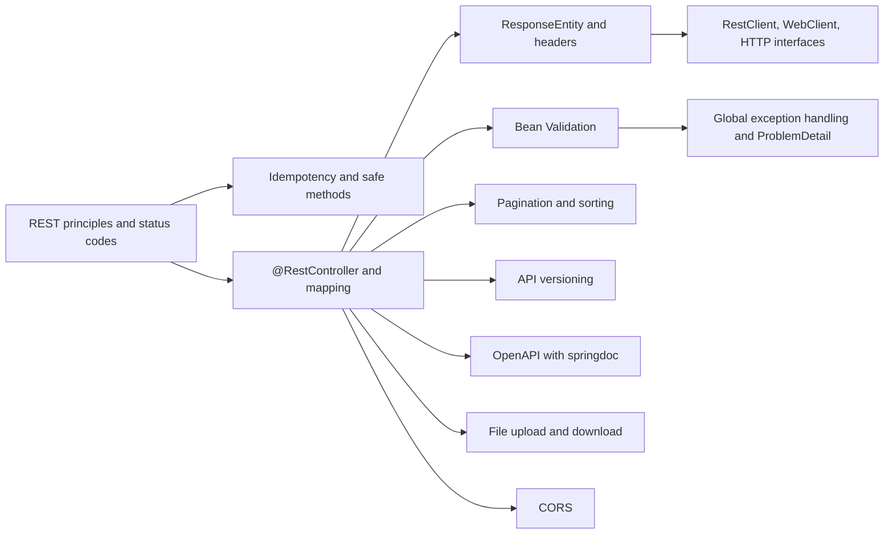
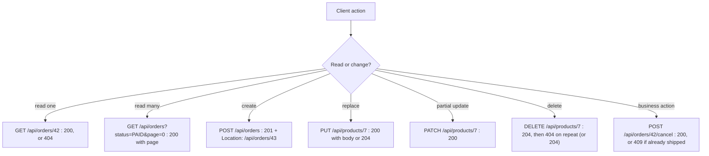
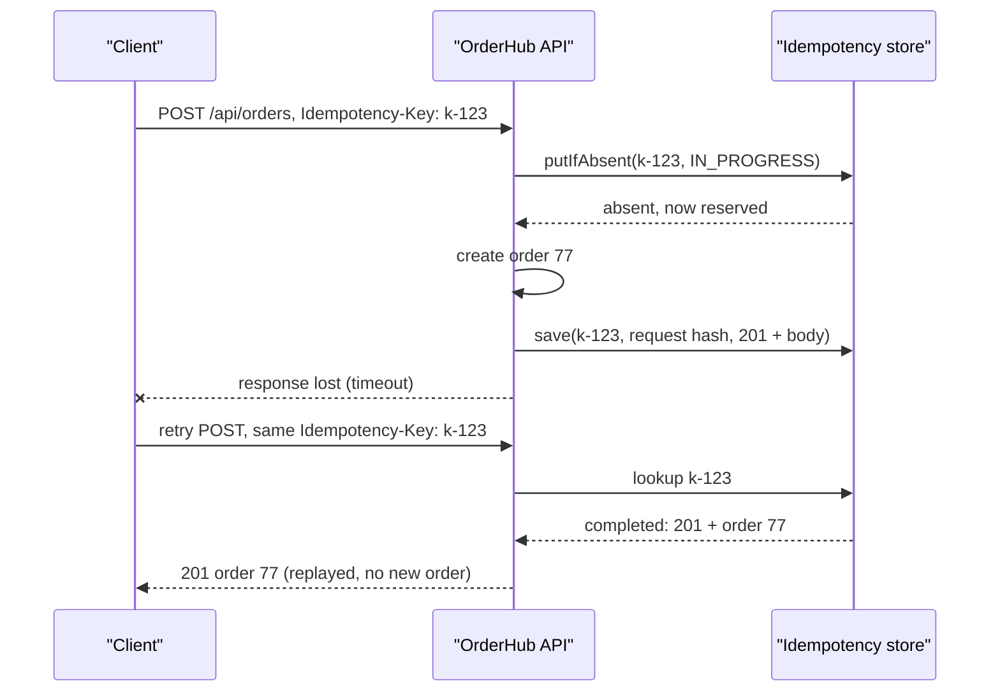
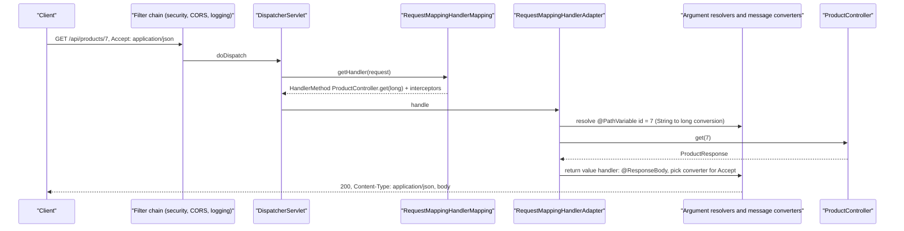
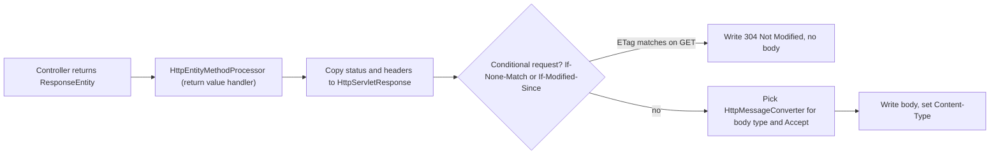

@@ 1 | MODULE | Phase 11 — Building REST APIs (Intermediate) | REST design, Spring MVC request handling, validation, error handling, pagination, versioning, OpenAPI, files, CORS and HTTP clients | MUST
# Phase 11: Building REST APIs (Intermediate)

Phase 5 gave OrderHub a working CRUD API. This phase makes it an API you could put in front of real clients: correct HTTP semantics and status codes, idempotent operations, precise request mapping, meaningful headers, validated input, one consistent error format (RFC 9457 `ProblemDetail`), pagination and sorting, a versioning strategy, generated OpenAPI documentation, file upload and download, CORS for the browser frontend, and finally calling other services with `RestClient` and HTTP interfaces.

Interviewers love this phase because almost every backend job is "build and maintain REST APIs". Expect questions such as "PUT vs PATCH?", "Which status code for a validation error?", "How do you handle exceptions globally?", "What is idempotency and how would you make POST idempotent?" and "Why does my browser get a CORS error when Postman works?".



**Prerequisites:** Phase 5 (first REST controller, `DispatcherServlet` basics), Phase 10 (DI, configuration properties, conditional beans), Phase 3 (exceptions).

**OrderHub in this phase:** the product and order APIs get proper status codes and `Location` headers, `Idempotency-Key` support on order creation, validated request DTOs, a global `@RestControllerAdvice` returning `ProblemDetail`, paginated product search, `/api/v1` versioning, Swagger UI, product image upload, CORS for the `http://localhost:5173` frontend, and an `InventoryClient` HTTP interface for the inventory service.

**The 5 questions from this phase that come up most often**
1. What are the main HTTP methods and status codes, and when do you use each?
2. What is idempotency, which methods are idempotent, and how do you make a POST idempotent?
3. How do you validate request bodies, and what happens when validation fails?
4. How do you implement global exception handling in Spring Boot?
5. What is CORS and how do you configure it in Spring?

@@ 2 | MODULE | REST design | Resource modelling, HTTP methods, status codes, safety and idempotency | MUST
# REST design

**Shared analogy: a well-run library.** Every book has a permanent shelf address (a resource URI). You do a small set of standard things with any book: look at it (GET), add a new one to the catalogue (POST), replace its catalogue card (PUT), correct one detail on the card (PATCH), withdraw it (DELETE). The librarian answers with standard slips: "here it is" (200), "added, it is on shelf 12" (201 with `Location`), "no such book" (404), "your form is filled in wrong" (400). Looking at a book never changes it (safe), and asking twice to withdraw the same book has the same result as asking once (idempotent).

- **REST Principles, HTTP Methods and Status Codes:** the shelf addresses, the standard actions and the standard answer slips.
- **Idempotency and Safe Methods:** which actions are harmless to repeat, and how to make "add a book" safe to retry.

@@ 3 | TOPIC | REST Principles, HTTP Methods and Status Codes | Resources and URIs, statelessness, method semantics, PUT vs PATCH vs POST and choosing the right status code | MUST
# REST Principles, HTTP Methods and Status Codes

**Level: Intermediate | Phase 11 | Priority: MUST | Since: REST defined by Roy Fielding (2000); HTTP semantics RFC 9110 (2022); PATCH RFC 5789**

> **30-second interview answer:** REST is an architectural style where the server exposes resources identified by URIs, and clients manipulate them through a uniform interface: standard HTTP methods with defined semantics (GET reads, POST creates or triggers, PUT replaces, PATCH partially updates, DELETE removes), standard status codes and representations such as JSON. Each request is stateless and carries everything needed to process it. Good REST APIs use nouns for resources, the right method for the action, and precise status codes: 200, 201 with a `Location` header, 204, 400, 401, 403, 404, 409, 422 and 500.

## 1. Concept in Simple Words
### Analogy
A post office with standard forms.

| Post office | REST |
|---|---|
| Every mailbox has a unique address | Every resource has a URI (`/api/orders/42`) |
| A small set of standard forms for every mailbox | Uniform interface: GET, POST, PUT, PATCH, DELETE |
| Clerk does not remember you between visits; you bring your ID each time | Statelessness: each request carries auth and context |
| Standard reply stamps: "delivered", "address unknown", "form invalid" | Status codes: 200, 404, 400 |
| The parcel content can be paper or digital | Representations: JSON, XML, CSV via content negotiation |
| A stamp saying "valid for 1 week, no need to ask again" | Cache headers (`Cache-Control`, `ETag`) |

### What it is
- **Resource:** a thing the API exposes (a product, an order, a customer's orders). Identified by a URI; plural nouns by convention: `/products`, `/products/7`, `/customers/3/orders`.
- **Representation:** the format of a resource in a request or response, chosen with `Content-Type` and `Accept` headers.
- **REST constraints:** client-server, stateless, cacheable, uniform interface, layered system, and optional code-on-demand. HATEOAS (links in responses that tell the client what it can do next) is part of the uniform interface, but most real APIs stop at "level 2" of the Richardson maturity model (resources plus HTTP verbs).
- **HTTP methods:**
  - **GET:** read; no body; safe and idempotent; cacheable.
  - **POST:** create a subordinate resource, or trigger a process (`/orders/42/cancel`); not idempotent.
  - **PUT:** replace the whole resource at a known URI (or create it there); idempotent.
  - **PATCH:** partial update; not idempotent by definition, although many concrete patches are.
  - **DELETE:** remove; idempotent.
  - **HEAD** (GET without body) and **OPTIONS** (allowed methods, used by CORS preflight).
- **Status code classes:** 1xx informational, 2xx success, 3xx redirection, 4xx client error, 5xx server error.

### Why it exists
Before REST, many APIs were RPC over one endpoint (SOAP, `POST /api?action=getOrder`), so caching, proxies, monitoring and client libraries could not understand them. REST reuses HTTP itself as the application protocol: every proxy, browser, cache and tool already knows what GET or 404 means, and statelessness makes horizontal scaling trivial because any instance can serve any request.

## 2. How It Works
Choosing method and status for OrderHub:



Status codes you must know:

| Code | Name | Use in OrderHub |
|---|---|---|
| 200 | OK | Successful GET, PUT or PATCH with body |
| 201 | Created | POST created an order; `Location` header points to it |
| 202 | Accepted | Async processing started (export job) |
| 204 | No Content | DELETE succeeded, or PUT without body |
| 301 and 308 | Moved Permanently | Old URI moved; 308 keeps the method |
| 304 | Not Modified | Conditional GET with matching `ETag` |
| 400 | Bad Request | Malformed JSON, validation failure |
| 401 | Unauthorized | Missing or invalid authentication |
| 403 | Forbidden | Authenticated but not allowed |
| 404 | Not Found | Order 999 does not exist |
| 405 | Method Not Allowed | DELETE on a read-only resource |
| 409 | Conflict | Cancel a shipped order, duplicate email, version conflict |
| 412 | Precondition Failed | `If-Match` ETag no longer matches |
| 415 | Unsupported Media Type | Client sent XML to a JSON-only endpoint |
| 422 | Unprocessable Content | Well-formed but semantically invalid (some teams use it for validation) |
| 429 | Too Many Requests | Rate limit exceeded, with `Retry-After` |
| 500 | Internal Server Error | Unexpected bug |
| 502, 503, 504 | Bad Gateway, Service Unavailable, Gateway Timeout | Upstream or overload problems |

URI design rules:
```text
GOOD                                   BAD
GET  /api/products                     GET  /api/getAllProducts
GET  /api/products/7                   GET  /api/product?id=7&action=read
POST /api/products                     POST /api/createProduct
GET  /api/customers/3/orders           GET  /api/ordersOfCustomer/3
POST /api/orders/42/cancel  (action)   PUT  /api/orders/42  {"cancel": true}  (hidden intent)
GET  /api/products?category=books&sort=price,asc
```

## 3. Code Example
### Code
```java
// File: src/main/java/com/orderhub/product/ProductController.java
package com.orderhub.product;

import java.math.BigDecimal;
import java.net.URI;
import java.util.List;
import java.util.Map;
import java.util.concurrent.ConcurrentHashMap;
import java.util.concurrent.atomic.AtomicLong;
import org.springframework.http.HttpStatus;
import org.springframework.http.ResponseEntity;
import org.springframework.web.bind.annotation.*;
import org.springframework.web.servlet.support.ServletUriComponentsBuilder;

@RestController
@RequestMapping("/api/products")
public class ProductController {

    public record Product(Long id, String name, BigDecimal price, int stock) { }
    public record ProductPatch(String name, BigDecimal price, Integer stock) { }

    private final Map<Long, Product> store = new ConcurrentHashMap<>();
    private final AtomicLong ids = new AtomicLong();

    @GetMapping                                    // collection: 200
    public List<Product> list() {
        return List.copyOf(store.values());
    }

    @GetMapping("/{id}")                           // single: 200 or 404
    public ResponseEntity<Product> get(@PathVariable long id) {
        Product p = store.get(id);
        return p == null ? ResponseEntity.notFound().build() : ResponseEntity.ok(p);
    }

    @PostMapping                                   // create: 201 + Location
    public ResponseEntity<Product> create(@RequestBody Product body) {
        Product saved = new Product(ids.incrementAndGet(), body.name(), body.price(), body.stock());
        store.put(saved.id(), saved);
        URI location = ServletUriComponentsBuilder.fromCurrentRequest()
                .path("/{id}").buildAndExpand(saved.id()).toUri();
        return ResponseEntity.created(location).body(saved);
    }

    @PutMapping("/{id}")                           // full replace: 200 (or 404)
    public ResponseEntity<Product> replace(@PathVariable long id, @RequestBody Product body) {
        if (!store.containsKey(id)) return ResponseEntity.notFound().build();
        Product replaced = new Product(id, body.name(), body.price(), body.stock());
        store.put(id, replaced);
        return ResponseEntity.ok(replaced);
    }

    @PatchMapping("/{id}")                         // partial update: only non-null fields
    public ResponseEntity<Product> patch(@PathVariable long id, @RequestBody ProductPatch patch) {
        Product updated = store.computeIfPresent(id, (k, p) -> new Product(id,
                patch.name() != null ? patch.name() : p.name(),
                patch.price() != null ? patch.price() : p.price(),
                patch.stock() != null ? patch.stock() : p.stock()));
        return updated == null ? ResponseEntity.notFound().build() : ResponseEntity.ok(updated);
    }

    @DeleteMapping("/{id}")                        // delete: 204, idempotent
    @ResponseStatus(HttpStatus.NO_CONTENT)
    public void delete(@PathVariable long id) {
        store.remove(id);
    }
}
```

### Walkthrough
- Resource URIs are nouns: `/api/products` and `/api/products/{id}`; the HTTP method carries the verb.
- `create` returns 201 with a `Location` header built from the current request URI plus the new id. Clients and tools follow it to fetch the resource.
- `replace` (PUT) overwrites every field: a missing `stock` in the body becomes 0. That is the PUT contract: send the full representation.
- `patch` (PATCH) changes only fields present in the body. Here a record with nullable fields implements a simple JSON merge patch; RFC 7396 merge patch or RFC 6902 JSON Patch are the formal options.
- `delete` returns 204 even when the product is already gone, which keeps DELETE idempotent from the client's view. Returning 404 for a missing resource is also acceptable; pick one rule and document it.

### Output
```http
POST /api/products HTTP/1.1
Content-Type: application/json

{"name":"Keyboard","price":49.90,"stock":10}
```
```http
HTTP/1.1 201 Created
Location: http://localhost:8080/api/products/1
Content-Type: application/json

{"id":1,"name":"Keyboard","price":49.90,"stock":10}
```
```http
PATCH /api/products/1 HTTP/1.1
Content-Type: application/json

{"price":44.90}
```
```http
HTTP/1.1 200 OK
Content-Type: application/json

{"id":1,"name":"Keyboard","price":44.90,"stock":10}
```
```http
PUT /api/products/1 HTTP/1.1
Content-Type: application/json

{"name":"Keyboard Pro","price":59.90}
```
```http
HTTP/1.1 200 OK
Content-Type: application/json

{"id":1,"name":"Keyboard Pro","price":59.90,"stock":0}
```
```http
DELETE /api/products/1 HTTP/1.1
```
```http
HTTP/1.1 204 No Content
```
```http
GET /api/products/1 HTTP/1.1
```
```http
HTTP/1.1 404 Not Found
```

### Compare
| Method | Purpose | Body | Safe | Idempotent | Typical success code |
|---|---|---|---|---|---|
| GET | Read | No | Yes | Yes | 200 |
| POST | Create or action | Yes | No | No | 201 or 200 |
| PUT | Replace | Yes | No | Yes | 200 or 204 |
| PATCH | Partial update | Yes | No | Not guaranteed | 200 |
| DELETE | Remove | Usually no | No | Yes | 204 |
| HEAD | Headers only | No | Yes | Yes | 200 |
| OPTIONS | Capabilities, CORS preflight | No | Yes | Yes | 200 or 204 |

## 4. Interview Questions
**Basic**
1. **What is REST?**
   An architectural style for networked systems: resources identified by URIs, a uniform interface (standard methods, status codes and media types), stateless requests, cacheable responses and a layered system. In practice it means using HTTP as intended rather than tunnelling RPC through it.
2. **PUT vs PATCH vs POST?**
   POST creates a resource whose URI the server chooses, or triggers an action; it is not idempotent. PUT replaces the full resource at a client-known URI and is idempotent. PATCH applies a partial change; it is not guaranteed idempotent (for example "increment stock by 1").
3. **Which status code do you return after creating a resource?**
   201 Created with a `Location` header containing the new resource's URI, usually with the created representation in the body.

**Follow-up**
4. **What does "stateless" mean, and does it forbid sessions?**
   The server does not keep client conversation state between requests; each request carries everything needed, such as a JWT. Application data in the database is fine. Server-side HTTP sessions violate statelessness and complicate scaling, which is why REST APIs use tokens.
5. **401 vs 403?**
   401 Unauthorized means "not authenticated": no or invalid credentials; the response should include `WWW-Authenticate`. 403 Forbidden means "authenticated, but you lack permission". Some APIs return 404 instead of 403 to hide that a resource exists.
6. **400 vs 422 vs 409?**
   400 for malformed requests (bad JSON, wrong types) and often for validation errors. 422 for syntactically correct but semantically invalid content; some teams use it for validation errors. 409 for conflicts with the current resource state: duplicate unique key, optimistic-lock version mismatch, cancelling a shipped order.

**Tricky / scenario**
7. **How would you model "cancel order" in REST?**
   Either as a sub-resource action, `POST /orders/42/cancel`, which is clear and commonly accepted, or as a state change, `PATCH /orders/42` with `{"status":"CANCELLED"}`. The action endpoint makes intent and authorisation rules explicit; return 409 if the order is already shipped.
8. **A GET endpoint `/api/orders/42/mark-read` updates a flag. What is wrong?**
   GET must be safe: crawlers, prefetchers, caches and retries may call it freely, causing unintended state changes. Use POST or PATCH for anything that changes state.
9. **Should errors return 200 with `{"success": false}`?**
   No. It breaks HTTP semantics: monitoring, caches, retries and client libraries rely on status codes. Return the right 4xx or 5xx code with a structured error body such as `ProblemDetail`.

**What the interviewer is really testing:** that you design APIs using HTTP semantics correctly and can justify method and status code choices.

## 5. Pitfalls & Best Practices
### Common mistakes
| Mistake | What goes wrong | Fix |
|---|---|---|
| Verbs in URIs (`/createOrder`) | Inconsistent, RPC-style API | Nouns plus HTTP methods |
| 200 for everything with an error flag | Monitoring and clients cannot detect failures | Proper 4xx and 5xx codes |
| GET that changes state | Crawlers or retries mutate data | POST, PUT, PATCH or DELETE |
| PUT used as partial update | Missing fields are wiped or ignored unpredictably | PATCH for partial changes |
| 201 without `Location` | Client cannot find the new resource | `ResponseEntity.created(uri)` |
| Exposing JPA entities directly | Leaks internals, lazy-loading errors, over-posting | Request and response DTOs |

### Best practices
- Plural nouns, lowercase, hyphens for multi-word segments (`/order-items`), nesting at most one level (`/customers/3/orders`).
- Use DTOs (records) for requests and responses; never bind directly to entities.
- Return consistent error bodies (`ProblemDetail`) and document every status code in OpenAPI.
- Support filtering, sorting and pagination on collections from day one.
- Use ETags and `If-Match` for optimistic concurrency on updates.

### Compare with
| Style | Strength | Weakness |
|---|---|---|
| REST over HTTP and JSON | Universal tooling, cacheable, simple | Over- and under-fetching |
| GraphQL | Client picks fields, one round trip | Caching and authorisation per field are harder |
| gRPC | Fast binary protocol, streaming, contracts | Not browser-native, needs proxies |
| SOAP | Strict contracts, WS-* standards | Verbose, legacy |

## 6. Hands-on Exercise
**OrderHub task.** Review and fix OrderHub's order API so that it follows REST conventions:
1. Replace `POST /api/createOrder` with `POST /api/orders` returning 201 and a `Location` header.
2. Replace `GET /api/orders/{id}/cancel` with `POST /api/orders/{id}/cancel`, returning 200 with the updated order, 404 if missing, and 409 if the order is already `SHIPPED`.
3. Add `GET /api/customers/{customerId}/orders` returning the customer's orders.
4. `DELETE /api/orders/{id}` returns 204 only for `NEW` orders; 409 otherwise.

Acceptance criteria: every endpoint's method and status code matches the table in this note; no URI contains a verb except the cancel action sub-resource.

<details><summary>Solution</summary>

```java
// File: src/main/java/com/orderhub/order/OrderController.java
package com.orderhub.order;

import java.math.BigDecimal;
import java.net.URI;
import java.util.List;
import java.util.Map;
import java.util.concurrent.ConcurrentHashMap;
import java.util.concurrent.atomic.AtomicLong;
import org.springframework.http.HttpStatus;
import org.springframework.http.ResponseEntity;
import org.springframework.web.bind.annotation.*;
import org.springframework.web.servlet.support.ServletUriComponentsBuilder;

@RestController
public class OrderController {

    public enum Status { NEW, PAID, SHIPPED, CANCELLED }
    public record Order(Long id, long customerId, BigDecimal total, Status status) { }
    public record CreateOrder(long customerId, BigDecimal total) { }

    private final Map<Long, Order> orders = new ConcurrentHashMap<>();
    private final AtomicLong ids = new AtomicLong();

    @PostMapping("/api/orders")
    public ResponseEntity<Order> create(@RequestBody CreateOrder req) {
        Order o = new Order(ids.incrementAndGet(), req.customerId(), req.total(), Status.NEW);
        orders.put(o.id(), o);
        URI location = ServletUriComponentsBuilder.fromCurrentRequest()
                .path("/{id}").buildAndExpand(o.id()).toUri();
        return ResponseEntity.created(location).body(o);
    }

    @GetMapping("/api/orders/{id}")
    public ResponseEntity<Order> get(@PathVariable long id) {
        return ResponseEntity.of(java.util.Optional.ofNullable(orders.get(id)));   // 200 or 404
    }

    @PostMapping("/api/orders/{id}/cancel")
    public ResponseEntity<Order> cancel(@PathVariable long id) {
        Order o = orders.get(id);
        if (o == null) return ResponseEntity.notFound().build();
        if (o.status() == Status.SHIPPED) return ResponseEntity.status(HttpStatus.CONFLICT).build();
        Order cancelled = new Order(o.id(), o.customerId(), o.total(), Status.CANCELLED);
        orders.put(id, cancelled);
        return ResponseEntity.ok(cancelled);
    }

    @GetMapping("/api/customers/{customerId}/orders")
    public List<Order> byCustomer(@PathVariable long customerId) {
        return orders.values().stream().filter(o -> o.customerId() == customerId).toList();
    }

    @DeleteMapping("/api/orders/{id}")
    public ResponseEntity<Void> delete(@PathVariable long id) {
        Order o = orders.get(id);
        if (o == null) return ResponseEntity.noContent().build();          // idempotent
        if (o.status() != Status.NEW) return ResponseEntity.status(HttpStatus.CONFLICT).build();
        orders.remove(id);
        return ResponseEntity.noContent().build();
    }
}
```
Later topics in this phase replace the bare 404 and 409 responses with exceptions mapped to `ProblemDetail` bodies by a global handler, and move storage into a service.
</details>

## 7. Recall
Q: Which HTTP methods are idempotent according to REST and HTTP semantics?
A: GET, HEAD, OPTIONS, PUT and DELETE; POST is not, and PATCH is not guaranteed.

Q: What status code and header should a REST API return after creating a resource?
A: 201 Created with a `Location` header pointing to the new resource.

Q: What is the difference between HTTP 401 and 403?
A: 401 means not authenticated (missing or invalid credentials); 403 means authenticated but not permitted.

Q: When should a REST API return 409 Conflict?
A: When the request conflicts with the current state of the resource, such as a duplicate unique value, a version mismatch or an invalid state transition.

Q: What does statelessness mean in REST?
A: The server keeps no client session state between requests; each request carries all context such as authentication tokens.

**Related:** [[Idempotency and Safe Methods]] · [[ResponseEntity and Headers]] · [[@RestController and Request Mapping Deep Dive]] · [[Global Exception Handling and ProblemDetail]]

@@ 3 | TOPIC | Idempotency and Safe Methods | Safe vs idempotent methods, why retries need idempotency, Idempotency-Key for POST and ETag-based concurrency | MUST
# Idempotency and Safe Methods

**Level: Intermediate | Phase 11 | Priority: MUST | Since: HTTP/1.1 RFC 2616 (1999), restated in RFC 9110; Idempotency-Key header IETF draft (popularised by Stripe)**

> **30-second interview answer:** A safe method does not change server state (GET, HEAD, OPTIONS). An idempotent method can be repeated any number of times with the same effect on the server as one call (all safe methods plus PUT and DELETE). This matters because networks fail: if a client times out, it can safely retry an idempotent request. POST is not idempotent, so for payments or orders I make it idempotent with an `Idempotency-Key` header: the server stores the key with the result and returns the stored result for repeats instead of creating a duplicate.

## 1. Concept in Simple Words
### Analogy
A lift button and a vending machine.

| Everyday thing | HTTP |
|---|---|
| Looking at the floor display | Safe method (GET): no change at all |
| Pressing the lift call button five times | Idempotent (PUT, DELETE): same result as pressing once |
| Pressing "buy" on a vending machine five times | Non-idempotent (POST): five drinks, five charges |
| A vending machine with an order number: "order 7781 already served" | `Idempotency-Key` on POST |
| "Change the price only if it is still 2.00" | Conditional update with `If-Match` and an `ETag` |

### What it is
- **Safe:** the client does not request any state change. The server may still log or count, but the request has no intended side effect.
- **Idempotent:** the server state after N identical requests equals the state after one. The *response* can differ (DELETE may return 204 then 404); the *effect* is the same.
- **Retry safety:** clients, proxies and libraries (including Spring Retry, Resilience4j and Kubernetes ingress) may retry on timeouts. Retrying non-idempotent requests can duplicate orders or payments.
- **Idempotency-Key:** a client-generated unique value (usually a UUID) sent with a POST. The server records key plus request fingerprint plus response and replays the response for repeats.
- **ETag and `If-Match`:** an `ETag` is a version identifier for a representation. Sending `If-Match: "v3"` on PUT or PATCH means "apply only if the current version is still v3"; otherwise the server returns 412 Precondition Failed. This prevents lost updates.
- **`If-None-Match`:** on GET, lets the server return 304 Not Modified if the representation has not changed.

### Why it exists
A mobile client sends `POST /orders`, the server creates the order, but the response is lost because the train goes into a tunnel. The client cannot know whether the order exists. Without idempotency, the retry creates a second order and charges the customer twice. With an idempotency key, the retry returns the original order. This is why every payment API (Stripe, Adyen, PayPal) requires idempotency keys.

## 2. How It Works


Rules a robust implementation follows:
1. **Atomic reservation.** Use `putIfAbsent` (or a unique database constraint, or Redis `SET NX`) so two concurrent retries cannot both pass.
2. **Fingerprint the request.** If the same key arrives with a different body, return 422 (or 409): the client is misusing the key.
3. **In-progress state.** If a retry arrives while the first request is still running, return 409 Conflict (or wait), never process twice.
4. **Store the full response** (status, headers you need, body) and replay it exactly.
5. **Expiry.** Keep keys for a limited time (Stripe uses 24 hours).
6. **Do not store failures caused by server errors** permanently, so clients can retry after a 500.

ETag concurrency:
```text
GET /api/products/7           -> 200, ETag: "3", body {price: 10}
Alice: PUT If-Match: "3"      -> 200, ETag: "4"   (version now 4)
Bob:   PUT If-Match: "3"      -> 412 Precondition Failed (Bob must re-read)
```

## 3. Code Example
### Code
```java
// File: src/main/java/com/orderhub/order/IdempotentOrderController.java
package com.orderhub.order;

import java.math.BigDecimal;
import java.net.URI;
import java.util.Map;
import java.util.Objects;
import java.util.concurrent.ConcurrentHashMap;
import java.util.concurrent.atomic.AtomicLong;
import org.springframework.http.HttpStatus;
import org.springframework.http.ResponseEntity;
import org.springframework.web.bind.annotation.*;

@RestController
@RequestMapping("/api/orders")
public class IdempotentOrderController {

    public record CreateOrder(long customerId, BigDecimal total) { }
    public record Order(long id, long customerId, BigDecimal total) { }

    // What we remember per key: the request fingerprint and the response (null while in progress)
    private record Entry(int requestHash, ResponseEntity<Object> response) { }

    private final Map<String, Entry> keys = new ConcurrentHashMap<>();   // Redis or DB table in production
    private final AtomicLong ids = new AtomicLong(76);

    @PostMapping
    public ResponseEntity<Object> create(@RequestHeader("Idempotency-Key") String key,
                                         @RequestBody CreateOrder req) {
        int hash = Objects.hash(req.customerId(), req.total());
        Entry reserved = new Entry(hash, null);
        Entry existing = keys.putIfAbsent(key, reserved);            // atomic reservation

        if (existing != null) {
            if (existing.requestHash() != hash)
                return ResponseEntity.unprocessableEntity().body("Idempotency-Key reused with a different body");
            if (existing.response() == null)
                return ResponseEntity.status(HttpStatus.CONFLICT).body("Request with this key is in progress");
            System.out.println("replaying response for key " + key);
            return existing.response();                               // replay
        }

        try {
            Order order = new Order(ids.incrementAndGet(), req.customerId(), req.total());
            System.out.println("created order " + order.id() + " for key " + key);
            ResponseEntity<Object> response = ResponseEntity
                    .created(URI.create("/api/orders/" + order.id())).body(order);
            keys.put(key, new Entry(hash, response));                 // remember the result
            return response;
        } catch (RuntimeException e) {
            keys.remove(key);                                         // allow a retry after a failure
            throw e;
        }
    }
}

// File: src/main/java/com/orderhub/product/ProductVersionController.java
package com.orderhub.product;

import java.math.BigDecimal;
import java.util.Map;
import java.util.concurrent.ConcurrentHashMap;
import org.springframework.http.HttpStatus;
import org.springframework.http.ResponseEntity;
import org.springframework.web.bind.annotation.*;

@RestController
@RequestMapping("/api/v-demo/products")
class ProductVersionController {
    record Product(long id, String name, BigDecimal price, long version) { }

    private final Map<Long, Product> store = new ConcurrentHashMap<>(
            Map.of(7L, new Product(7, "Mouse", new BigDecimal("10.00"), 3)));

    @GetMapping("/{id}")
    ResponseEntity<Product> get(@PathVariable long id) {
        Product p = store.get(id);
        return ResponseEntity.ok().eTag(String.valueOf(p.version())).body(p);   // ETag: "3"
    }

    @PutMapping("/{id}/price")
    ResponseEntity<Product> changePrice(@PathVariable long id,
                                        @RequestHeader("If-Match") String ifMatch,
                                        @RequestBody BigDecimal price) {
        Product current = store.get(id);
        String expected = "\"" + current.version() + "\"";
        if (!expected.equals(ifMatch)) {
            return ResponseEntity.status(HttpStatus.PRECONDITION_FAILED).build();   // 412
        }
        Product updated = new Product(id, current.name(), price, current.version() + 1);
        store.put(id, updated);
        return ResponseEntity.ok().eTag(String.valueOf(updated.version())).body(updated);
    }
}
```

### Walkthrough
- The client sends a UUID in `Idempotency-Key`. `putIfAbsent` reserves the key atomically, so two simultaneous retries cannot both create an order.
- If the key exists with a different request fingerprint, the client reused a key incorrectly: 422.
- If the first request is still in progress (`response == null`), the retry gets 409 instead of a duplicate.
- When processing finishes, the full response is stored and replayed on later retries.
- On an exception the key is removed so the client may retry. In production, store keys in Redis with a TTL or in a database table with a unique constraint, so all instances share them.
- `ProductVersionController` shows optimistic concurrency over HTTP: `GET` returns `ETag: "3"`; a `PUT` with a stale `If-Match` gets 412. In Phase 12, the version comes from a JPA `@Version` column.

### Output
```http
POST /api/orders HTTP/1.1
Idempotency-Key: 5f0c7a52-2f6e-4f0a-a8e5-1b2c3d4e5f60
Content-Type: application/json

{"customerId":3,"total":99.50}
```
```http
HTTP/1.1 201 Created
Location: /api/orders/77
Content-Type: application/json

{"id":77,"customerId":3,"total":99.50}
```
Same request again (retry):
```http
HTTP/1.1 201 Created
Location: /api/orders/77
Content-Type: application/json

{"id":77,"customerId":3,"total":99.50}
```
Server log:
```text
created order 77 for key 5f0c7a52-2f6e-4f0a-a8e5-1b2c3d4e5f60
replaying response for key 5f0c7a52-2f6e-4f0a-a8e5-1b2c3d4e5f60
```
Same key, different total:
```http
HTTP/1.1 422 Unprocessable Entity
Content-Type: text/plain;charset=UTF-8

Idempotency-Key reused with a different body
```
Stale ETag:
```http
PUT /api/v-demo/products/7/price HTTP/1.1
If-Match: "2"
Content-Type: application/json

12.00
```
```http
HTTP/1.1 412 Precondition Failed
```

### Compare
| Technique | Protects against | Where state lives |
|---|---|---|
| Idempotent method choice (PUT instead of POST) | Duplicate effects on retry | Nothing extra |
| `Idempotency-Key` | Duplicate creates or payments | Key store (Redis, DB) |
| Unique business key (order reference) | Duplicate rows | Database unique constraint |
| ETag and `If-Match` | Lost updates from concurrent edits | Resource version |
| Natural idempotency ("set status to PAID") | Repeated state changes | The resource itself |

## 4. Interview Questions
**Basic**
1. **What is the difference between safe and idempotent?**
   Safe methods do not change server state (GET, HEAD, OPTIONS). Idempotent methods may change state, but repeating them has the same effect as doing them once (PUT, DELETE, plus all safe methods). Every safe method is idempotent; not every idempotent method is safe.
2. **Is DELETE idempotent if the second call returns 404?**
   Yes. Idempotency is about server state, not the response. After the first call the resource is gone; further calls leave it gone.
3. **Why is POST not idempotent?**
   Each POST typically creates a new resource or triggers a new action, so repeating it creates duplicates or repeats side effects such as payments.

**Follow-up**
4. **How do you make POST idempotent?**
   Require an `Idempotency-Key` header. Atomically reserve the key, process once, store the response, and replay it for repeats. Validate that repeats have the same body, handle in-progress duplicates, and expire keys after a while.
5. **Is PATCH idempotent?**
   Not by definition. `{"price": 12}` is idempotent, but a JSON Patch operation like "add item to array" or "increment counter" is not. Design PATCH bodies as "set" operations if clients may retry.
6. **What are ETags used for?**
   For caching (`If-None-Match` returns 304 when unchanged, saving bandwidth) and for optimistic concurrency (`If-Match` on updates returns 412 if someone else changed the resource first).

**Tricky / scenario**
7. **Two retries of the same payment request arrive at two different instances at the same millisecond. How do you avoid charging twice?**
   The key reservation must be atomic and shared: a database insert into a table with a unique constraint on the key, or Redis `SET key value NX EX 86400`. The loser of the race sees the key exists and returns 409 or waits for the stored response. An in-memory map per instance is not enough.
8. **A message consumer receives the same Kafka message twice. Is that an HTTP idempotency problem?**
   It is the same concept. Brokers give at-least-once delivery, so consumers must be idempotent: store processed message ids or use upserts and unique constraints. The idempotency key is the message id.
9. **Your API gateway retries on 504 timeouts. What should you check?**
   That it only retries idempotent methods (GET, PUT, DELETE) or POSTs carrying idempotency keys. Otherwise a slow but successful POST is executed twice.

**What the interviewer is really testing:** whether you think about failures and retries, and can design safe retries for money-moving endpoints.

## 5. Pitfalls & Best Practices
### Common mistakes
| Mistake | What goes wrong | Fix |
|---|---|---|
| Check-then-insert for keys (`if (!exists) save`) | Race lets two requests through | Atomic `putIfAbsent`, unique constraint or `SET NX` |
| Keys stored in memory per instance | Retries hitting another instance duplicate work | Shared store (Redis, DB) |
| Ignoring the request body on replay | Different request silently gets an old response | Fingerprint and reject mismatches |
| GET endpoints with side effects | Prefetch or retries mutate data | Keep GET safe |
| PATCH with increment semantics and client retries | Values change twice | Set-style patches or idempotency keys |

### Best practices
- Require idempotency keys on every POST that moves money or creates orders.
- Return the original status code and body on replay; add a header such as `Idempotent-Replayed: true` for debugging.
- Combine idempotency keys with database unique constraints as the final safety net.
- Use `ETag` plus `If-Match` for updates on resources edited by multiple users.
- Document which endpoints are safe to retry in your OpenAPI spec.

### Compare with
| Concept | Meaning |
|---|---|
| Safe | No intended state change |
| Idempotent | Same effect when repeated |
| Commutative | Order of operations does not matter |
| Exactly-once | Effect happens once; in practice at-least-once delivery plus idempotent processing |

## 6. Hands-on Exercise
**OrderHub task.** Add idempotent order creation backed by a shared store abstraction:
1. Interface `IdempotencyStore` with `Optional<StoredResponse> find(String key)`, `boolean reserve(String key, String fingerprint)` and `void complete(String key, StoredResponse response)`.
2. `InMemoryIdempotencyStore` using `ConcurrentHashMap` (Phase 19 replaces it with Redis).
3. `POST /api/orders` requires `Idempotency-Key` (400 if missing), uses the store, and replays.
4. Fingerprint = SHA-256 of the request JSON.

Acceptance criteria: sending the same request twice creates one order and both responses are identical; a different body with the same key returns 422; a missing header returns 400.

<details><summary>Solution</summary>

```java
// File: src/main/java/com/orderhub/common/idempotency/IdempotencyStore.java
package com.orderhub.common.idempotency;

import java.util.Optional;

public interface IdempotencyStore {
    record StoredResponse(String fingerprint, int status, Object body, boolean completed) { }
    Optional<StoredResponse> find(String key);
    boolean reserve(String key, String fingerprint);   // true if this caller owns the key
    void complete(String key, StoredResponse response);
    void release(String key);
}

// File: src/main/java/com/orderhub/common/idempotency/InMemoryIdempotencyStore.java
package com.orderhub.common.idempotency;

import java.util.Map;
import java.util.Optional;
import java.util.concurrent.ConcurrentHashMap;
import org.springframework.stereotype.Component;

@Component
public class InMemoryIdempotencyStore implements IdempotencyStore {
    private final Map<String, StoredResponse> map = new ConcurrentHashMap<>();

    public Optional<StoredResponse> find(String key) { return Optional.ofNullable(map.get(key)); }
    public boolean reserve(String key, String fp) {
        return map.putIfAbsent(key, new StoredResponse(fp, 0, null, false)) == null;
    }
    public void complete(String key, StoredResponse r) { map.put(key, r); }
    public void release(String key) { map.remove(key); }
}

// File: src/main/java/com/orderhub/order/OrderController.java (create endpoint)
package com.orderhub.order;

import com.fasterxml.jackson.databind.ObjectMapper;
import com.orderhub.common.idempotency.IdempotencyStore;
import com.orderhub.common.idempotency.IdempotencyStore.StoredResponse;
import java.nio.charset.StandardCharsets;
import java.security.MessageDigest;
import java.util.HexFormat;
import org.springframework.http.HttpStatus;
import org.springframework.http.ResponseEntity;
import org.springframework.web.bind.annotation.*;

@RestController
@RequestMapping("/api/orders")
public class OrderController {
    private final OrderService orders;
    private final IdempotencyStore store;
    private final ObjectMapper json;

    public OrderController(OrderService orders, IdempotencyStore store, ObjectMapper json) {
        this.orders = orders;
        this.store = store;
        this.json = json;
    }

    @PostMapping
    public ResponseEntity<Object> create(@RequestHeader("Idempotency-Key") String key,
                                         @RequestBody CreateOrderRequest req) throws Exception {
        String fp = HexFormat.of().formatHex(MessageDigest.getInstance("SHA-256")
                .digest(json.writeValueAsString(req).getBytes(StandardCharsets.UTF_8)));

        if (!store.reserve(key, fp)) {
            StoredResponse prev = store.find(key).orElseThrow();
            if (!prev.fingerprint().equals(fp)) return ResponseEntity.unprocessableEntity().build();
            if (!prev.completed()) return ResponseEntity.status(HttpStatus.CONFLICT).build();
            return ResponseEntity.status(prev.status()).header("Idempotent-Replayed", "true").body(prev.body());
        }
        try {
            OrderResponse created = orders.create(req);
            store.complete(key, new StoredResponse(fp, 201, created, true));
            return ResponseEntity.status(HttpStatus.CREATED).body(created);
        } catch (RuntimeException e) {
            store.release(key);
            throw e;
        }
    }
}
```
A missing `Idempotency-Key` header makes Spring throw `MissingRequestHeaderException`, which Spring MVC maps to 400 automatically (and the global handler in a later topic renders it as `ProblemDetail`). `CreateOrderRequest` and `OrderResponse` are the order DTO records introduced in the Bean Validation topic.
</details>

## 7. Recall
Q: What is the difference between safe and idempotent HTTP methods?
A: Safe methods do not change state; idempotent methods may change state but repeating them has the same effect as one call.

Q: Which HTTP methods are safe?
A: GET, HEAD and OPTIONS (and TRACE).

Q: How do you make an HTTP POST endpoint idempotent?
A: Require an `Idempotency-Key`, reserve it atomically, store the response and replay it for repeated requests with the same key and body.

Q: What status code does a conditional PUT with a stale `If-Match` ETag return?
A: 412 Precondition Failed.

Q: Why must idempotency keys be stored in a shared store rather than in memory?
A: Retries can hit a different instance, which would not know the key and would process the request again.

**Related:** [[REST Principles, HTTP Methods and Status Codes]] · [[ResponseEntity and Headers]] · [[Global Exception Handling and ProblemDetail]]

@@ 2 | MODULE | Spring MVC | How Spring MVC maps, validates, answers and documents HTTP requests, plus pagination, versioning, files and CORS | MUST
# Spring MVC

**Shared analogy: an airport.** Passengers (requests) arrive at one entrance, the `DispatcherServlet`. The departure board (handler mappings) sends each one to the right gate (controller method) based on destination, airline and ticket type (path, method, headers, content type). Security checks the documents (Bean Validation), and any problem goes to one central help desk that answers in a standard format (global exception handling with `ProblemDetail`). Large groups board in batches (pagination), old and new terminals run side by side (API versioning), the published timetable tells everyone how it works (OpenAPI), baggage is checked in and collected (file upload and download), and foreign visitors need the right visa rules (CORS).

- **@RestController and Request Mapping Deep Dive:** the departure board and gates.
- **ResponseEntity and Headers:** the boarding pass you hand back, with all its stamps.
- **Bean Validation:** document checks at security.
- **Global Exception Handling and ProblemDetail:** the central help desk.
- **Pagination and Sorting:** boarding in batches.
- **API Versioning:** old and new terminals.
- **OpenAPI with springdoc:** the public timetable.
- **File Upload and Download:** baggage.
- **CORS:** visa rules for browsers from other origins.

@@ 3 | TOPIC | @RestController and Request Mapping Deep Dive | DispatcherServlet flow, mapping by path, method, params, headers and media types, argument binding and message converters | MUST
# @RestController and Request Mapping Deep Dive

**Level: Intermediate | Phase 11 | Priority: MUST | Since: @RequestMapping Spring 2.5; @RestController and composed @GetMapping Spring 4.0 and 4.3; PathPatternParser default Boot 2.6**

> **30-second interview answer:** Every request enters the `DispatcherServlet`, which asks `RequestMappingHandlerMapping` for the controller method matching the path, HTTP method, params, headers, `Content-Type` (`consumes`) and `Accept` (`produces`). A `RequestMappingHandlerAdapter` then resolves each method argument: `@PathVariable`, `@RequestParam`, `@RequestHeader`, `@RequestBody` (deserialised by an `HttpMessageConverter`, Jackson for JSON) and more. Because `@RestController` implies `@ResponseBody`, the return value is serialised back through a message converter chosen by content negotiation.

## 1. Concept in Simple Words
### Analogy
A large company switchboard.

| Switchboard | Spring MVC |
|---|---|
| One main phone number everyone calls | `DispatcherServlet` mapped to `/` |
| Directory: "sales, in German, for business customers" goes to extension 214 | `HandlerMapping` matching path, method, headers, media types |
| The receptionist who connects you and takes your details | `HandlerAdapter` resolving arguments |
| Interpreter translating your speech into the employee's language and back | `HttpMessageConverter` (JSON to Java and back) |
| "Sorry, nobody speaks Klingon here" | 406 Not Acceptable or 415 Unsupported Media Type |
| Employee writes the answer directly on a form, not a brochure | `@ResponseBody`: data, not a view |

### What it is
- **`@RequestMapping`:** maps requests to a class or method; attributes `path`, `method`, `params`, `headers`, `consumes`, `produces`. Class-level mapping is a prefix.
- **Composed annotations:** `@GetMapping`, `@PostMapping`, `@PutMapping`, `@PatchMapping`, `@DeleteMapping`.
- **Argument annotations:**
  - `@PathVariable`: part of the URI path (`/orders/{id}`).
  - `@RequestParam`: query string or form field (`?page=2`), with `required` and `defaultValue`.
  - `@RequestHeader`, `@CookieValue`.
  - `@RequestBody`: the body, converted by a message converter.
  - `@ModelAttribute` (or no annotation on a simple object): binds query params to an object's fields; great for search filters.
  - Also injectable: `HttpServletRequest`, `Principal`, `Locale`, `UriComponentsBuilder`, `@AuthenticationPrincipal`.
- **Return values:** an object (serialised), `ResponseEntity<T>`, `void` with `@ResponseStatus`, `ProblemDetail`, `StreamingResponseBody`, `Callable` or `CompletableFuture` for async.
- **Content negotiation:** the server compares `Accept` with what converters can produce; the client declares the body type with `Content-Type`.
- **Path patterns:** `{id}`, `{id:\\d+}` regex, `*`, `**` at the end, `{*path}` capture-the-rest. `PathPatternParser` is the default matcher.

### Why it exists
Writing raw servlets meant parsing paths, query strings and JSON by hand in every endpoint. Spring MVC declares the mapping and the inputs, and handles routing, conversion, validation hooks, content negotiation and error translation consistently.

## 2. How It Works


Matching details:
- At startup, `RequestMappingHandlerMapping` scans every `@Controller` bean and builds a registry of `RequestMappingInfo` (patterns plus conditions). Ambiguous mappings fail startup with "Ambiguous mapping".
- For a request, all matching infos are compared; the most specific wins (`/products/{id}` beats `/products/**`, a mapping with `params` beats one without).
- No path match gives 404; a path match with the wrong method gives 405 with an `Allow` header; wrong `Content-Type` gives 415; impossible `Accept` gives 406.
- **Trailing slash:** since Spring 6, `/products/` no longer matches `/products` by default.
- **`HandlerInterceptor`** (`preHandle`, `postHandle`, `afterCompletion`) runs around handler methods inside the `DispatcherServlet`, unlike servlet filters which run outside it.
- Jackson's `MappingJackson2HttpMessageConverter` handles JSON both ways; `StringHttpMessageConverter` handles `String` return values (as `text/plain`).

## 3. Code Example
### Code
```java
// File: src/main/java/com/orderhub/product/ProductQueryController.java
package com.orderhub.product;

import java.math.BigDecimal;
import java.util.List;
import java.util.Locale;
import org.springframework.http.MediaType;
import org.springframework.web.bind.annotation.*;

@RestController
@RequestMapping(path = "/api/products", produces = MediaType.APPLICATION_JSON_VALUE)
public class ProductQueryController {

    public record ProductResponse(long id, String name, String category, BigDecimal price) { }
    public record ProductFilter(String category, BigDecimal minPrice, BigDecimal maxPrice) { }  // bound from query params
    public record CreateProduct(String name, String category, BigDecimal price) { }

    private final List<ProductResponse> data = List.of(
            new ProductResponse(1, "Keyboard", "electronics", new BigDecimal("49.90")),
            new ProductResponse(2, "Mouse", "electronics", new BigDecimal("19.90")),
            new ProductResponse(3, "Java Book", "books", new BigDecimal("39.00")));

    // Path variable with a regex: only digits match, so /api/products/abc is a 404, not a 400
    @GetMapping("/{id:\\d+}")
    public ProductResponse byId(@PathVariable long id) {
        return data.stream().filter(p -> p.id() == id).findFirst()
                .orElseThrow(() -> new ProductNotFoundException(id));
    }

    // Query params bound to a record (no annotation needed for a non-simple type)
    @GetMapping
    public List<ProductResponse> search(ProductFilter filter) {
        return data.stream()
                .filter(p -> filter.category() == null || p.category().equals(filter.category()))
                .filter(p -> filter.minPrice() == null || p.price().compareTo(filter.minPrice()) >= 0)
                .filter(p -> filter.maxPrice() == null || p.price().compareTo(filter.maxPrice()) <= 0)
                .toList();
    }

    // Same path, selected by a request param: /api/products?name=Mouse
    @GetMapping(params = "name")
    public List<ProductResponse> byName(@RequestParam String name) {
        return data.stream().filter(p -> p.name().equalsIgnoreCase(name)).toList();
    }

    // Header and optional param with a default
    @GetMapping("/top")
    public List<ProductResponse> top(@RequestParam(defaultValue = "2") int limit,
                                     @RequestHeader(name = "X-Client", required = false) String client,
                                     Locale locale) {
        System.out.println("top " + limit + " for client=" + client + " locale=" + locale);
        return data.stream().limit(limit).toList();
    }

    // consumes: only JSON bodies accepted, otherwise 415
    @PostMapping(consumes = MediaType.APPLICATION_JSON_VALUE)
    public ProductResponse create(@RequestBody CreateProduct body) {
        return new ProductResponse(4, body.name(), body.category(), body.price());
    }

    // produces: CSV for clients that ask for it
    @GetMapping(path = "/export", produces = "text/csv")
    public String exportCsv() {
        StringBuilder sb = new StringBuilder("id,name,price\n");
        data.forEach(p -> sb.append(p.id()).append(',').append(p.name()).append(',').append(p.price()).append('\n'));
        return sb.toString();
    }
}

// File: src/main/java/com/orderhub/product/ProductNotFoundException.java
package com.orderhub.product;

import org.springframework.http.HttpStatus;
import org.springframework.web.bind.annotation.ResponseStatus;

@ResponseStatus(HttpStatus.NOT_FOUND)           // simplest mapping; Phase 11 later uses ProblemDetail
public class ProductNotFoundException extends RuntimeException {
    public ProductNotFoundException(long id) { super("Product " + id + " not found"); }
}
```

### Walkthrough
- Class-level `@RequestMapping` sets the `/api/products` prefix and a default `produces` of JSON for all methods (the CSV method overrides it).
- `byId` uses `{id:\\d+}`, so non-numeric ids never reach the method. Without the regex, `/api/products/abc` would match and fail conversion with 400 (`MethodArgumentTypeMismatchException`).
- `search(ProductFilter filter)`: a record parameter without annotation is treated as `@ModelAttribute`, and query params bind to its components by name. Ideal for optional filters.
- `byName` has the same path as `search`, but `params = "name"` makes it more specific when `name` is present.
- `top` shows `defaultValue`, an optional header and `Locale` resolved from `Accept-Language`.
- `create` accepts only `application/json`; a `text/plain` body gets 415.
- `exportCsv` is selected when the client sends `Accept: text/csv`; its `String` return value is written by `StringHttpMessageConverter`.

### Output
```http
GET /api/products?category=electronics&maxPrice=30 HTTP/1.1
```
```http
HTTP/1.1 200 OK
Content-Type: application/json

[{"id":2,"name":"Mouse","category":"electronics","price":19.90}]
```
```http
GET /api/products?name=java%20book HTTP/1.1
```
```http
HTTP/1.1 200 OK
Content-Type: application/json

[{"id":3,"name":"Java Book","category":"books","price":39.00}]
```
```http
GET /api/products/export HTTP/1.1
Accept: text/csv
```
```http
HTTP/1.1 200 OK
Content-Type: text/csv;charset=UTF-8

id,name,price
1,Keyboard,49.90
2,Mouse,19.90
3,Java Book,39.00
```
```http
POST /api/products HTTP/1.1
Content-Type: text/plain

Keyboard
```
```http
HTTP/1.1 415 Unsupported Media Type
```
```http
DELETE /api/products/1 HTTP/1.1
```
```http
HTTP/1.1 405 Method Not Allowed
Allow: GET
```

### Compare
| Annotation | Reads from | Example |
|---|---|---|
| `@PathVariable` | URI path segment | `/orders/{id}` |
| `@RequestParam` | Query string or form field | `?page=2` |
| `@ModelAttribute` or plain object | Many query params into one object | `?category=books&minPrice=10` |
| `@RequestHeader` | HTTP header | `X-Client: web` |
| `@RequestBody` | Body via message converter | JSON order request |
| `@CookieValue` | Cookie | `session=abc` |

## 4. Interview Questions
**Basic**
1. **What is the role of `DispatcherServlet`?**
   It is the front controller: every request goes through it. It finds the handler via `HandlerMapping`, invokes it via `HandlerAdapter` (resolving arguments and return values), and handles exceptions via `HandlerExceptionResolver`s. Spring Boot registers it automatically on `/`.
2. **`@PathVariable` vs `@RequestParam`?**
   `@PathVariable` takes a value from the URI path and identifies a resource (`/orders/42`). `@RequestParam` takes a query or form parameter, typically for filtering, sorting and paging (`/orders?status=PAID`).
3. **What does `@RequestBody` do?**
   It tells Spring to read the request body and convert it into the parameter type using an `HttpMessageConverter` chosen by `Content-Type`, Jackson for JSON. Combined with `@Valid` it also triggers validation.

**Follow-up**
4. **What are `consumes` and `produces`?**
   `consumes` restricts the mapping to requests with a matching `Content-Type` (otherwise 415). `produces` restricts it to requests whose `Accept` header can be satisfied (otherwise 406) and sets the response content type.
5. **Filter vs HandlerInterceptor?**
   A servlet `Filter` runs before the `DispatcherServlet`, sees every request (including static resources and errors) and works with raw servlet objects; Spring Security is a filter chain. A `HandlerInterceptor` runs inside the dispatcher, knows the chosen handler method and can act before and after it. Use filters for cross-cutting HTTP concerns, interceptors for handler-aware logic.
6. **How does Spring decide between two mappings that both match?**
   It compares the conditions and picks the most specific: fewer wildcards and URI variables, longer patterns, more specific params, headers and media types. If two are equally specific, startup fails with an ambiguous mapping error.

**Tricky / scenario**
7. **A client calls `/api/products/` (trailing slash) and gets 404 after upgrading to Boot 3. Why?**
   Spring Framework 6 disabled trailing-slash matching by default. Fix clients, add explicit mappings, or redirect with a filter; Spring deprecated the old option rather than re-enabling it.
8. **`@RequestParam int page` and the client omits `page`. What happens?**
   A 400 Bad Request with `MissingServletRequestParameterException`, because `@RequestParam` is required by default and a primitive cannot be null. Use `defaultValue = "0"`, `required = false` with `Integer`, or `Optional<Integer>`.
9. **A controller returns a `String` and the client receives `text/plain` instead of JSON. Why?**
   `StringHttpMessageConverter` is ahead of Jackson in the converter list and handles `String` return values directly. Return an object or record instead, or set `produces` and serialise yourself.

**What the interviewer is really testing:** whether you can trace a request through `DispatcherServlet` and explain the 404, 405, 406, 415 and 400 cases precisely.

## 5. Pitfalls & Best Practices
### Common mistakes
| Mistake | What goes wrong | Fix |
|---|---|---|
| `@Controller` instead of `@RestController` | Return value treated as a view name | `@RestController` |
| Required primitive `@RequestParam` without default | 400 when omitted | `defaultValue` or `Optional` |
| Overlapping mappings | Ambiguous mapping at startup or surprising routing | Distinct paths or explicit params |
| Binding request bodies to JPA entities | Over-posting (client sets `id`, `role`), lazy-loading issues | Request DTO records |
| Returning `String` JSON by hand | Wrong content type, escaping bugs | Return objects; let Jackson serialise |

### Best practices
- Keep controllers thin: map HTTP to a service call and back.
- Use records for request and response DTOs; one DTO per use case if they differ.
- Bind complex filters to a record with `@ModelAttribute` semantics instead of ten `@RequestParam`s.
- Declare `produces` for non-JSON formats explicitly.
- Write `@WebMvcTest` slice tests for mappings and status codes (Phase 13).

### Compare with
| Model | Programming style | Thread model |
|---|---|---|
| Spring MVC annotated controllers | Imperative, annotations | Thread per request (virtual threads optional) |
| Spring MVC functional endpoints (`RouterFunction`) | Functional routes | Same |
| Spring WebFlux | Reactive (`Mono`, `Flux`) | Event loop, non-blocking |
| JAX-RS (Jersey) | Annotations (`@Path`, `@GET`) | Thread per request |

## 6. Hands-on Exercise
**OrderHub task.** Build an order search endpoint:
1. `GET /api/orders` binds an `OrderSearch` record with `status` (enum), `customerId` (`Long`), `from` and `to` (`LocalDate`, ISO format) from query params.
2. `GET /api/orders/{id:\\d+}` returns one order.
3. `GET /api/orders/export` with `produces = "text/csv"` returns CSV.
4. Add a `HandlerInterceptor` that logs method, URI, handler method name and duration.

Acceptance criteria: `?status=PAID&from=2026-01-01` filters correctly; `?status=FOO` returns 400; the interceptor logs `GET /api/orders -> OrderController#search took 3 ms`.

<details><summary>Solution</summary>

```java
// File: src/main/java/com/orderhub/order/OrderSearch.java
package com.orderhub.order;

import java.time.LocalDate;
import org.springframework.format.annotation.DateTimeFormat;

public record OrderSearch(
        OrderStatus status,
        Long customerId,
        @DateTimeFormat(iso = DateTimeFormat.ISO.DATE) LocalDate from,
        @DateTimeFormat(iso = DateTimeFormat.ISO.DATE) LocalDate to) { }

// File: src/main/java/com/orderhub/order/OrderController.java (search excerpt)
package com.orderhub.order;

import java.util.List;
import org.springframework.web.bind.annotation.*;

@RestController
@RequestMapping("/api/orders")
public class OrderController {
    private final OrderService service;
    public OrderController(OrderService service) { this.service = service; }

    @GetMapping
    public List<OrderResponse> search(OrderSearch search) { return service.search(search); }

    @GetMapping("/{id:\\d+}")
    public OrderResponse get(@PathVariable long id) { return service.get(id); }

    @GetMapping(path = "/export", produces = "text/csv")
    public String export(OrderSearch search) {
        StringBuilder sb = new StringBuilder("id,customerId,status,total\n");
        service.search(search).forEach(o -> sb.append(o.id()).append(',').append(o.customerId())
                .append(',').append(o.status()).append(',').append(o.total()).append('\n'));
        return sb.toString();
    }
}

// File: src/main/java/com/orderhub/config/TimingInterceptor.java
package com.orderhub.config;

import jakarta.servlet.http.HttpServletRequest;
import jakarta.servlet.http.HttpServletResponse;
import org.slf4j.Logger;
import org.slf4j.LoggerFactory;
import org.springframework.web.method.HandlerMethod;
import org.springframework.web.servlet.HandlerInterceptor;

public class TimingInterceptor implements HandlerInterceptor {
    private static final Logger log = LoggerFactory.getLogger(TimingInterceptor.class);
    private static final String START = "timing.start";

    @Override
    public boolean preHandle(HttpServletRequest req, HttpServletResponse res, Object handler) {
        req.setAttribute(START, System.nanoTime());
        return true;                                   // continue to the handler
    }

    @Override
    public void afterCompletion(HttpServletRequest req, HttpServletResponse res, Object handler, Exception ex) {
        long ms = (System.nanoTime() - (long) req.getAttribute(START)) / 1_000_000;
        String target = handler instanceof HandlerMethod hm
                ? hm.getBeanType().getSimpleName() + "#" + hm.getMethod().getName() : handler.toString();
        log.info("{} {} -> {} took {} ms", req.getMethod(), req.getRequestURI(), target, ms);
    }
}

// File: src/main/java/com/orderhub/config/WebConfig.java
package com.orderhub.config;

import org.springframework.context.annotation.Configuration;
import org.springframework.web.servlet.config.annotation.InterceptorRegistry;
import org.springframework.web.servlet.config.annotation.WebMvcConfigurer;

@Configuration
public class WebConfig implements WebMvcConfigurer {
    @Override
    public void addInterceptors(InterceptorRegistry registry) {
        registry.addInterceptor(new TimingInterceptor()).addPathPatterns("/api/**");
    }
}
```
`?status=FOO` fails enum conversion during binding, producing a 400 with a binding error; the global handler in a later topic formats it as `ProblemDetail`.
</details>

## 7. Recall
Q: What does Spring MVC's `DispatcherServlet` do?
A: It is the front controller that finds the handler, invokes it through a handler adapter, and handles exceptions and responses.

Q: Which status codes does Spring MVC return for wrong method, wrong Content-Type and unsatisfiable Accept?
A: 405 Method Not Allowed, 415 Unsupported Media Type and 406 Not Acceptable.

Q: What is the difference between `@PathVariable` and `@RequestParam` in Spring MVC?
A: `@PathVariable` reads a URI path segment identifying a resource; `@RequestParam` reads query or form parameters.

Q: What converts a JSON request body into a Java object in Spring MVC?
A: An `HttpMessageConverter`, specifically Jackson's `MappingJackson2HttpMessageConverter`, triggered by `@RequestBody`.

Q: What is the difference between a servlet filter and a Spring `HandlerInterceptor`?
A: Filters run before the `DispatcherServlet` on raw requests; interceptors run inside it around a known handler method.

**Related:** [[ResponseEntity and Headers]] · [[Bean Validation]] · [[REST Principles, HTTP Methods and Status Codes]] · [[Stereotype Annotations]]

@@ 3 | TOPIC | ResponseEntity and Headers | Controlling status, headers and body with ResponseEntity, Location, caching headers, ETags and when not to use ResponseEntity | MUST
# ResponseEntity and Headers

**Level: Intermediate | Phase 11 | Priority: MUST | Since: ResponseEntity Spring 3.0; builder API Spring 4.1; ResponseEntity.of(Optional) Spring 5.1**

> **30-second interview answer:** `ResponseEntity<T>` represents the whole HTTP response: status code, headers and body. I return it when the status or headers depend on the outcome: 201 with a `Location` header, 204, 404 for a missing resource, `ETag` and `Cache-Control`, or `Content-Disposition` for downloads. When the response is always 200 with a body, returning the object directly is simpler, and `@ResponseStatus` covers fixed non-200 codes.

## 1. Concept in Simple Words
### Analogy
Sending a parcel.

| Parcel | HTTP response |
|---|---|
| The parcel's contents | Body |
| The delivery status stamp ("delivered", "refused") | Status code |
| Labels on the box: "fragile", "keep cold", "return address" | Headers (`Content-Type`, `Cache-Control`, `Location`) |
| A courier form where you fill in status, labels and contents together | `ResponseEntity` builder |
| A pre-printed standard envelope | Returning the object directly (always 200) |

### What it is
- **`ResponseEntity<T>`:** extends `HttpEntity<T>` with an `HttpStatusCode`.
- **Static builders:** `ok(body)`, `created(uri)`, `accepted()`, `noContent()`, `badRequest()`, `notFound()`, `unprocessableEntity()`, `status(code)`, `of(Optional)` (200 or 404), `ofNullable(body)`.
- **Header helpers:** `.header(name, values)`, `.headers(HttpHeaders)`, `.location(uri)`, `.eTag(tag)`, `.lastModified(instant)`, `.cacheControl(CacheControl)`, `.contentType(mediaType)`, `.contentLength(n)`, `.allow(methods)`, `.varyBy(headers)`.
- **`@ResponseStatus`:** fixes the status for a method (or an exception class) without `ResponseEntity`.
- **`HttpHeaders`:** a case-insensitive multi-value map with constants (`HttpHeaders.LOCATION`, `HttpHeaders.RETRY_AFTER`).
- **Request side:** `@RequestHeader` or `HttpEntity<T>` and `RequestEntity<T>` give access to incoming headers.

### Why it exists
Real APIs need more than "200 plus JSON": creation needs 201 and `Location`, deletes need 204, rate limits need 429 and `Retry-After`, caches need `ETag` and `Cache-Control`, downloads need `Content-Disposition`. `ResponseEntity` expresses all of that type-safely in the controller.

## 2. How It Works


- `HttpEntityMethodProcessor` handles `ResponseEntity` and `HttpEntity` return values. It also performs the `ETag` check: if your response has an `ETag` and the request's `If-None-Match` matches (for GET or HEAD), it automatically returns 304 without a body.
- For a plain object return, `RequestResponseBodyMethodProcessor` writes it with status 200 (or the `@ResponseStatus` value).
- `ShallowEtagHeaderFilter` can compute ETags from the response body hash for all responses (saves bandwidth, not server work).
- Headers that are not CORS-safelisted (like `Location` or `X-Total-Count`) are not readable by browser JavaScript from another origin unless exposed with `Access-Control-Expose-Headers` (see the CORS topic).

## 3. Code Example
### Code
```java
// File: src/main/java/com/orderhub/product/ProductResponseController.java
package com.orderhub.product;

import java.math.BigDecimal;
import java.net.URI;
import java.time.Duration;
import java.time.Instant;
import java.util.Map;
import java.util.Optional;
import java.util.concurrent.ConcurrentHashMap;
import java.util.concurrent.atomic.AtomicLong;
import org.springframework.http.CacheControl;
import org.springframework.http.HttpHeaders;
import org.springframework.http.HttpStatus;
import org.springframework.http.ResponseEntity;
import org.springframework.web.bind.annotation.*;
import org.springframework.web.servlet.support.ServletUriComponentsBuilder;

@RestController
@RequestMapping("/api/catalog")
public class ProductResponseController {

    public record Product(long id, String name, BigDecimal price, long version, Instant updatedAt) { }
    public record CreateProduct(String name, BigDecimal price) { }

    private final Map<Long, Product> store = new ConcurrentHashMap<>();
    private final AtomicLong ids = new AtomicLong();
    private int callsThisMinute;

    @PostMapping
    public ResponseEntity<Product> create(@RequestBody CreateProduct req) {
        Product p = new Product(ids.incrementAndGet(), req.name(), req.price(), 1,
                Instant.parse("2026-11-24T10:00:00Z"));
        store.put(p.id(), p);
        URI location = ServletUriComponentsBuilder.fromCurrentRequest()
                .path("/{id}").buildAndExpand(p.id()).toUri();
        return ResponseEntity.created(location)                        // 201 + Location
                .eTag(Long.toString(p.version()))
                .body(p);
    }

    @GetMapping("/{id}")
    public ResponseEntity<Product> get(@PathVariable long id) {
        return Optional.ofNullable(store.get(id))
                .map(p -> ResponseEntity.ok()
                        .eTag(Long.toString(p.version()))              // ETag: "1"
                        .lastModified(p.updatedAt())
                        .cacheControl(CacheControl.maxAge(Duration.ofSeconds(60)).cachePrivate())
                        .body(p))
                .orElse(ResponseEntity.notFound().build());            // 404, no body
    }

    @DeleteMapping("/{id}")
    public ResponseEntity<Void> delete(@PathVariable long id) {
        store.remove(id);
        return ResponseEntity.noContent().build();                     // 204
    }

    @PostMapping("/reindex")
    public ResponseEntity<Map<String, String>> reindex() {
        if (++callsThisMinute > 1) {
            return ResponseEntity.status(HttpStatus.TOO_MANY_REQUESTS)  // 429
                    .header(HttpHeaders.RETRY_AFTER, "60")
                    .body(Map.of("error", "reindex allowed once per minute"));
        }
        return ResponseEntity.accepted()                               // 202: work continues async
                .location(URI.create("/api/catalog/jobs/42"))
                .body(Map.of("jobId", "42", "status", "QUEUED"));
    }

    @GetMapping("/count")
    @ResponseStatus(HttpStatus.OK)                                     // fixed status, plain body
    public Map<String, Integer> count() {
        return Map.of("count", store.size());
    }
}
```

### Walkthrough
- `create` returns 201, a `Location` built from the request URI, and an `ETag` with the version (Spring adds the quotes).
- `get` uses `Optional` to choose between 200 and 404. It sets `ETag`, `Last-Modified` and `Cache-Control: max-age=60, private`. If the client resends with `If-None-Match: "1"`, Spring answers 304 automatically.
- `delete` returns 204 with `ResponseEntity<Void>`.
- `reindex` shows 202 Accepted with a job `Location`, and 429 with `Retry-After` on the second call (the counter is a demo; real rate limiting belongs in a filter or gateway).
- `count` uses no `ResponseEntity` at all because the response is always 200.

### Output
```http
POST /api/catalog HTTP/1.1
Content-Type: application/json

{"name":"Monitor","price":199.00}
```
```http
HTTP/1.1 201 Created
Location: http://localhost:8080/api/catalog/1
ETag: "1"
Content-Type: application/json

{"id":1,"name":"Monitor","price":199.00,"version":1,"updatedAt":"2026-11-24T10:00:00Z"}
```
```http
GET /api/catalog/1 HTTP/1.1
If-None-Match: "1"
```
```http
HTTP/1.1 304 Not Modified
ETag: "1"
Last-Modified: Tue, 24 Nov 2026 10:00:00 GMT
Cache-Control: max-age=60, private
```
```http
POST /api/catalog/reindex HTTP/1.1
```
```http
HTTP/1.1 202 Accepted
Location: /api/catalog/jobs/42
Content-Type: application/json

{"jobId":"42","status":"QUEUED"}
```
Second call:
```http
HTTP/1.1 429 Too Many Requests
Retry-After: 60
Content-Type: application/json

{"error":"reindex allowed once per minute"}
```

### Compare
| Approach | Status | Headers | Best for |
|---|---|---|---|
| Return the object | 200 | Defaults only | Simple reads |
| `@ResponseStatus` on method | Fixed | Defaults only | Always 201 or 204 without headers |
| `ResponseEntity<T>` | Dynamic | Full control | Create with `Location`, 404 handling, caching, downloads |
| Throwing an exception mapped by advice | Error status | Via handler | Error paths (keeps the happy path clean) |

## 4. Interview Questions
**Basic**
1. **What is `ResponseEntity`?**
   A Spring class that represents the full HTTP response: status, headers and body. Returning it from a controller gives you control over all three.
2. **When would you use `ResponseEntity` instead of returning the object?**
   When the status or headers vary: 201 with `Location`, 204, 404 for missing resources, caching headers, `Retry-After`, or `Content-Disposition` for downloads. For a fixed 200 response, return the object.
3. **How do you return 201 with a `Location` header?**
   Build the URI with `ServletUriComponentsBuilder.fromCurrentRequest().path("/{id}").buildAndExpand(id).toUri()` and return `ResponseEntity.created(uri).body(dto)`.

**Follow-up**
4. **What does `ResponseEntity.of(optional)` do?**
   It returns 200 with the value if present, and 404 with an empty body if not. Handy for `findById` results, though throwing a not-found exception gives a richer error body.
5. **How do ETags reduce traffic in Spring?**
   If the response has an `ETag` and the request's `If-None-Match` matches, Spring's return value handler sends 304 Not Modified without a body. `ShallowEtagHeaderFilter` can do it globally by hashing the body, which saves bandwidth but not server computation.
6. **Should you use `ResponseEntity` for error responses?**
   You can, but it clutters controllers. Prefer throwing domain exceptions and mapping them centrally with `@RestControllerAdvice` to `ProblemDetail`, so every endpoint produces the same error format.

**Tricky / scenario**
7. **A frontend on another origin cannot read your `Location` or `X-Total-Count` header, but it is visible in DevTools. Why?**
   Browsers expose only CORS-safelisted response headers to JavaScript. Add them to `Access-Control-Expose-Headers` via your CORS configuration (`exposedHeaders("Location", "X-Total-Count")`).
8. **What is wrong with `ResponseEntity<?>` used everywhere?**
   It loses type information for readers, OpenAPI generation and tests. Use precise types like `ResponseEntity<ProductResponse>` or `ResponseEntity<Void>`.
9. **Your controller sets `Cache-Control: max-age=3600` on a user-specific endpoint and users see each other's data. Why?**
   A shared cache (CDN or proxy) cached the response because it was not marked `private`, and the cache key does not include the user. Use `cachePrivate()` or `no-store` for personal data, and `Vary: Authorization` when appropriate.

**What the interviewer is really testing:** whether you produce correct HTTP responses, not just bodies, and know caching and header subtleties.

## 5. Pitfalls & Best Practices
### Common mistakes
| Mistake | What goes wrong | Fix |
|---|---|---|
| `ResponseEntity.ok(null)` for missing data | 200 with empty body, confusing clients | 404 or `ResponseEntity.of(optional)` |
| Hard-coded `Location` like `"/api/products/" + id` behind a proxy | Wrong host or prefix | `ServletUriComponentsBuilder` with forwarded headers support |
| Public caching of personal data | Data leaks via shared caches | `private` or `no-store` |
| Custom headers not exposed for CORS | Frontend cannot read them | `exposedHeaders` |
| Error handling with `ResponseEntity` in every method | Inconsistent error bodies | Global exception handler |

### Best practices
- Use `ResponseEntity` for create (201 plus `Location`), delete (204), conditional and cached responses, and downloads.
- Set `server.forward-headers-strategy=framework` behind a load balancer so generated URIs use the public host and scheme.
- Keep error responses out of controllers; throw exceptions and handle them centrally.
- Use standard headers (`Retry-After`, `ETag`, `Link` for pagination) before inventing `X-` headers.

### Compare with
| Header | Purpose |
|---|---|
| `Location` | URI of a created resource or async job |
| `ETag` and `If-None-Match` or `If-Match` | Caching validation and optimistic concurrency |
| `Cache-Control` | Who may cache and for how long |
| `Retry-After` | When to retry after 429 or 503 |
| `Content-Disposition` | Download file name, inline or attachment |
| `Link` | Pagination links (next, prev) |

## 6. Hands-on Exercise
**OrderHub task.** Upgrade `ProductController` responses:
1. `POST /api/products` returns 201, `Location` and `ETag` (product version).
2. `GET /api/products/{id}` returns `ETag` and `Cache-Control: max-age=30` and supports 304.
3. `PUT /api/products/{id}` requires `If-Match`; return 428 Precondition Required if it is missing and 412 if it is stale.
4. `DELETE` returns 204.

Acceptance criteria: a curl sequence (create, get with `If-None-Match`, put with stale `If-Match`) produces 201, 304, 412.

<details><summary>Solution</summary>

```java
// File: src/main/java/com/orderhub/product/ProductController.java (excerpt)
package com.orderhub.product;

import java.net.URI;
import java.time.Duration;
import org.springframework.http.CacheControl;
import org.springframework.http.HttpStatus;
import org.springframework.http.ResponseEntity;
import org.springframework.web.bind.annotation.*;
import org.springframework.web.servlet.support.ServletUriComponentsBuilder;

@RestController
@RequestMapping("/api/products")
public class ProductController {
    private final ProductService service;
    public ProductController(ProductService service) { this.service = service; }

    @PostMapping
    public ResponseEntity<ProductResponse> create(@RequestBody CreateProductRequest req) {
        ProductResponse p = service.create(req);
        URI uri = ServletUriComponentsBuilder.fromCurrentRequest().path("/{id}").buildAndExpand(p.id()).toUri();
        return ResponseEntity.created(uri).eTag(String.valueOf(p.version())).body(p);
    }

    @GetMapping("/{id}")
    public ResponseEntity<ProductResponse> get(@PathVariable long id) {
        ProductResponse p = service.get(id);
        return ResponseEntity.ok()
                .eTag(String.valueOf(p.version()))
                .cacheControl(CacheControl.maxAge(Duration.ofSeconds(30)))
                .body(p);                       // Spring returns 304 if If-None-Match matches
    }

    @PutMapping("/{id}")
    public ResponseEntity<ProductResponse> update(@PathVariable long id,
                                                  @RequestHeader(name = "If-Match", required = false) String ifMatch,
                                                  @RequestBody UpdateProductRequest req) {
        if (ifMatch == null) return ResponseEntity.status(HttpStatus.PRECONDITION_REQUIRED).build();   // 428
        long expected = Long.parseLong(ifMatch.replace("\"", ""));
        ProductResponse current = service.get(id);
        if (current.version() != expected) return ResponseEntity.status(HttpStatus.PRECONDITION_FAILED).build();
        ProductResponse updated = service.update(id, req);
        return ResponseEntity.ok().eTag(String.valueOf(updated.version())).body(updated);
    }

    @DeleteMapping("/{id}")
    public ResponseEntity<Void> delete(@PathVariable long id) {
        service.delete(id);
        return ResponseEntity.noContent().build();
    }
}
```

```bash
curl -i -X POST localhost:8080/api/products -H 'Content-Type: application/json' -d '{"name":"Lamp","price":25,"stock":3}'
curl -i localhost:8080/api/products/1 -H 'If-None-Match: "1"'
curl -i -X PUT localhost:8080/api/products/1 -H 'If-Match: "0"' -H 'Content-Type: application/json' -d '{"name":"Lamp","price":30,"stock":3}'
```
Responses: `201 Created`, `304 Not Modified`, `412 Precondition Failed`. The check-then-update here has a race between two concurrent PUTs; Phase 12's JPA `@Version` makes the version check atomic in the database.
</details>

## 7. Recall
Q: What three parts of an HTTP response does Spring's `ResponseEntity` control?
A: The status code, the headers and the body.

Q: What does `ResponseEntity.of(Optional)` return?
A: 200 with the value when present, 404 with no body when empty.

Q: How does Spring return 304 Not Modified for a `ResponseEntity` with an ETag?
A: Its return value handler compares the ETag with the request's `If-None-Match` and sends 304 without a body on a match.

Q: When is returning a plain object better than `ResponseEntity` in a Spring controller?
A: When the response is always 200 with a body and needs no custom headers.

Q: Why can browser JavaScript not read a custom response header from a cross-origin API?
A: Only CORS-safelisted headers are exposed unless the server lists others in `Access-Control-Expose-Headers`.

**Related:** [[REST Principles, HTTP Methods and Status Codes]] · [[Idempotency and Safe Methods]] · [[CORS]] · [[File Upload and Download]]
