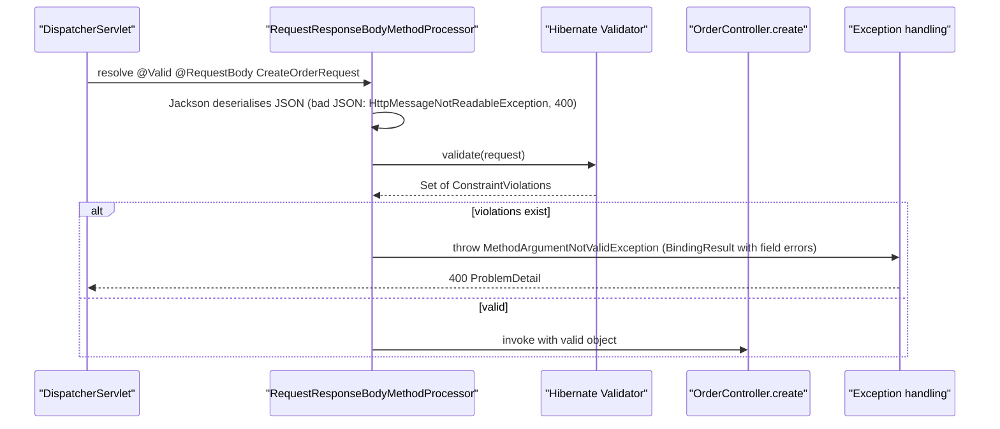
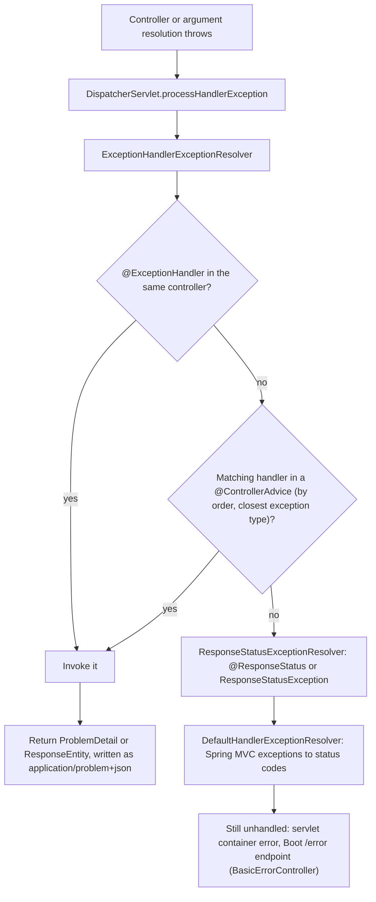
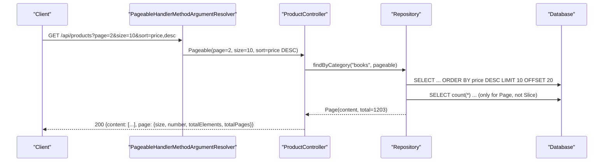

@@ 3 | TOPIC | Bean Validation | Jakarta Validation constraints on DTOs, @Valid vs @Validated, nested and method validation, groups and custom constraints | MUST
# Bean Validation

**Level: Intermediate | Phase 11 | Priority: MUST | Since: Bean Validation 1.0 JSR-303 (2009), 2.0 JSR-380; jakarta.validation namespace Boot 3; built-in MVC method validation Spring 6.1**

> **30-second interview answer:** Bean Validation (Jakarta Validation, implemented by Hibernate Validator) lets me declare rules on fields with annotations such as `@NotBlank`, `@Size`, `@Email`, `@Positive` and `@Valid` for nested objects. In Spring MVC, putting `@Valid` on a `@RequestBody` parameter validates it before the method runs; failures throw `MethodArgumentNotValidException`, which becomes a 400 that I format as `ProblemDetail` with field errors. `@Validated` on a class enables validation of method parameters like `@RequestParam` and supports validation groups.

## 1. Concept in Simple Words
### Analogy
Airport security screening.

| Airport | Bean Validation |
|---|---|
| Rules printed on the wall: "no liquids over 100 ml" | Constraint annotations on fields (`@Size(max = 100)`) |
| The scanner that checks every bag against the rules | `Validator` (Hibernate Validator) |
| Opening the bag inside the bag | `@Valid` cascading into nested objects |
| Rejected at security, before reaching the gate | 400 Bad Request before the controller method runs |
| List of every problem found, not just the first | All field errors in one response |
| Extra checks only for international flights | Validation groups |
| Special rule written by the airport | Custom constraint annotation |

### What it is
- **Jakarta Validation:** a specification (`jakarta.validation.*`); **Hibernate Validator** is the reference implementation, added by `spring-boot-starter-validation`.
- **Common constraints:** `@NotNull`, `@NotEmpty` (not null and not empty), `@NotBlank` (not null and at least one non-whitespace character), `@Size(min, max)`, `@Min`, `@Max`, `@Positive`, `@PositiveOrZero`, `@DecimalMin`, `@Digits(integer, fraction)`, `@Email`, `@Pattern(regexp)`, `@Past`, `@Future`, `@FutureOrPresent`, `@AssertTrue`.
- **`@Valid`:** standard annotation that triggers validation of a parameter and cascades into fields, collections and nested objects.
- **`@Validated`:** Spring's variant; on a class it enables **method validation** through an AOP proxy (`MethodValidationPostProcessor`); on a parameter it accepts **groups**.
- **Validation groups:** marker interfaces that let one DTO have different rules for create and update.
- **Custom constraint:** an annotation with `@Constraint(validatedBy = ...)` plus a `ConstraintValidator` implementation.
- **Container element constraints:** `List<@NotBlank String> tags`, `Map<String, @Positive Integer>`.

### Why it exists
Without declarative validation, every controller starts with a dozen `if (name == null) throw ...` lines, repeated and inconsistent across endpoints. Bean Validation puts the rules on the data type, runs them automatically, collects all violations at once, and produces machine-readable errors. The same annotations also work in JPA entities and configuration properties.

## 2. How It Works


Where validation happens and what is thrown:

| Where | Trigger | Exception on failure | Default status |
|---|---|---|---|
| `@Valid @RequestBody` | Argument resolver | `MethodArgumentNotValidException` | 400 |
| `@Valid` on a `@ModelAttribute` (query params object) | Data binder | `MethodArgumentNotValidException` (a `BindException`) | 400 |
| `@RequestParam @Min(1) int page` (Spring 6.1+) | Built-in MVC method validation | `HandlerMethodValidationException` | 400 |
| Service method in a `@Validated` class | AOP proxy | `ConstraintViolationException` | 500 unless you map it |
| JPA entity on persist | Hibernate pre-persist listener | `ConstraintViolationException` | 500 unless mapped |

- `@NotNull` vs `@NotEmpty` vs `@NotBlank`: for `" "`, only `@NotBlank` fails; for `""`, `@NotEmpty` and `@NotBlank` fail; for null, all three fail.
- Most constraints treat null as valid (`@Size`, `@Email`, `@Min`), so combine with `@NotNull` when the field is required.
- Since Spring 6.1, constraints directly on controller method parameters work without `@Validated` on the controller class.

## 3. Code Example
### Code
```java
// File: src/main/java/com/orderhub/order/dto/OrderDtos.java
package com.orderhub.order.dto;

import com.orderhub.common.validation.ValidSku;
import jakarta.validation.Valid;
import jakarta.validation.constraints.*;
import java.math.BigDecimal;
import java.time.LocalDate;
import java.util.List;

public final class OrderDtos {
    private OrderDtos() { }

    public record CreateOrderRequest(
            @NotNull @Positive Long customerId,
            @NotBlank @Email String contactEmail,
            @NotEmpty @Size(max = 20) List<@Valid OrderLineRequest> lines,       // cascade into each line
            @Valid @NotNull ShippingAddress shippingAddress,
            @FutureOrPresent LocalDate deliveryDate,                              // optional, but not in the past
            @Size(max = 5) List<@NotBlank @Size(max = 20) String> couponCodes) { }

    public record OrderLineRequest(
            @NotBlank @ValidSku String sku,
            @Min(1) @Max(99) int quantity,
            @NotNull @DecimalMin("0.01") @Digits(integer = 8, fraction = 2) BigDecimal unitPrice) { }

    public record ShippingAddress(
            @NotBlank @Size(max = 100) String street,
            @NotBlank String city,
            @NotBlank @Pattern(regexp = "[A-Z]{2}", message = "must be a 2-letter ISO country code") String country,
            @NotBlank @Size(min = 4, max = 10) String postalCode) { }
}

// File: src/main/java/com/orderhub/common/validation/ValidSku.java
package com.orderhub.common.validation;

import jakarta.validation.Constraint;
import jakarta.validation.ConstraintValidator;
import jakarta.validation.ConstraintValidatorContext;
import jakarta.validation.Payload;
import java.lang.annotation.*;
import java.util.regex.Pattern;

@Target({ElementType.FIELD, ElementType.PARAMETER, ElementType.RECORD_COMPONENT, ElementType.TYPE_USE})
@Retention(RetentionPolicy.RUNTIME)
@Documented
@Constraint(validatedBy = ValidSku.Validator.class)
public @interface ValidSku {
    String message() default "must look like ABC-12345";
    Class<?>[] groups() default {};
    Class<? extends Payload>[] payload() default {};

    class Validator implements ConstraintValidator<ValidSku, String> {
        private static final Pattern SKU = Pattern.compile("[A-Z]{3}-\\d{5}");
        @Override
        public boolean isValid(String value, ConstraintValidatorContext ctx) {
            return value == null || SKU.matcher(value).matches();   // null handled by @NotBlank
        }
    }
}

// File: src/main/java/com/orderhub/order/OrderController.java
package com.orderhub.order;

import com.orderhub.order.dto.OrderDtos.CreateOrderRequest;
import jakarta.validation.Valid;
import jakarta.validation.constraints.Max;
import jakarta.validation.constraints.Min;
import java.util.List;
import java.util.Map;
import org.springframework.http.HttpStatus;
import org.springframework.web.bind.annotation.*;

@RestController
@RequestMapping("/api/orders")
public class OrderController {

    @PostMapping
    @ResponseStatus(HttpStatus.CREATED)
    public Map<String, Object> create(@Valid @RequestBody CreateOrderRequest req) {
        return Map.of("status", "accepted", "lines", req.lines().size());
    }

    // Spring 6.1+: parameter constraints are validated without @Validated on the class
    @GetMapping
    public List<String> list(@RequestParam(defaultValue = "0") @Min(0) int page,
                             @RequestParam(defaultValue = "20") @Min(1) @Max(100) int size) {
        return List.of("page " + page + " size " + size);
    }
}
```

```xml
<!-- File: pom.xml -->
<dependency>
    <groupId>org.springframework.boot</groupId>
    <artifactId>spring-boot-starter-validation</artifactId>
</dependency>
```

### Walkthrough
- Request DTOs are records with constraints on components. `@Valid` on `lines` elements and on `shippingAddress` cascades validation into nested objects; without it, nested constraints are ignored.
- `List<@NotBlank @Size(max = 20) String>` validates each coupon code (container element constraints).
- `@ValidSku` is a custom constraint: the annotation declares message, groups and payload (all three are required by the spec), and the nested `Validator` holds the logic. It treats null as valid so `@NotBlank` alone reports missing values (no duplicate errors).
- `@Valid @RequestBody` triggers validation before `create` runs. A failure produces `MethodArgumentNotValidException`, and Spring's default handling gives 400. The next topic turns it into a `ProblemDetail` with a list of field errors.
- `list` validates `@RequestParam` values directly; violations raise `HandlerMethodValidationException` (400).

### Output
```http
POST /api/orders HTTP/1.1
Content-Type: application/json

{"customerId":-5,"contactEmail":"not-an-email","lines":[{"sku":"abc","quantity":0,"unitPrice":10}],
 "shippingAddress":{"street":"Main 1","city":"Berlin","country":"Germany","postalCode":"10115"}}
```
With the global handler from the next topic:
```http
HTTP/1.1 400 Bad Request
Content-Type: application/problem+json

{
  "type": "https://api.orderhub.example/problems/validation",
  "title": "Validation failed",
  "status": 400,
  "detail": "5 field(s) are invalid",
  "instance": "/api/orders",
  "errors": [
    {"field": "contactEmail", "message": "must be a well-formed email address"},
    {"field": "customerId", "message": "must be greater than 0"},
    {"field": "lines[0].quantity", "message": "must be greater than or equal to 1"},
    {"field": "lines[0].sku", "message": "must look like ABC-12345"},
    {"field": "shippingAddress.country", "message": "must be a 2-letter ISO country code"}
  ]
}
```
(The handler sorts errors by field name so the output is stable.)
```http
GET /api/orders?size=500 HTTP/1.1
```
```http
HTTP/1.1 400 Bad Request
Content-Type: application/problem+json

{"type":"about:blank","title":"Bad Request","status":400,"detail":"Validation failure","instance":"/api/orders"}
```

### Compare
| `@Valid` | `@Validated` |
|---|---|
| Jakarta standard (`jakarta.validation.Valid`) | Spring (`org.springframework.validation.annotation.Validated`) |
| Triggers validation and cascades into nested objects | Triggers validation and supports groups |
| Use on `@RequestBody`, nested fields, collection elements | Use on classes for method validation, or on parameters with groups |
| No group support | `@Validated(OnCreate.class)` |

## 4. Interview Questions
**Basic**
1. **How do you validate a request body in Spring Boot?**
   Add `spring-boot-starter-validation`, put constraint annotations on the DTO fields, and annotate the controller parameter with `@Valid @RequestBody`. Invalid input throws `MethodArgumentNotValidException` before the method runs, resulting in a 400.
2. **`@NotNull` vs `@NotEmpty` vs `@NotBlank`?**
   `@NotNull` rejects null only. `@NotEmpty` rejects null and empty (strings, collections, maps, arrays). `@NotBlank` (strings only) rejects null, empty and whitespace-only.
3. **What is the difference between `@Valid` and `@Validated`?**
   `@Valid` is the Jakarta standard and cascades into nested objects. `@Validated` is Spring's annotation that supports validation groups and, placed on a class, enables method-level validation through a proxy.

**Follow-up**
4. **Why are nested object constraints not checked?**
   Validation does not cascade automatically. Annotate the nested field (or collection elements) with `@Valid`.
5. **How do you write a custom constraint?**
   Create an annotation with `@Constraint(validatedBy = MyValidator.class)` and the `message`, `groups` and `payload` attributes, then implement `ConstraintValidator<MyAnnotation, T>` with `isValid`. Validators can be Spring beans and receive injected dependencies.
6. **How do you validate a field relationship, such as start date before end date?**
   A class-level custom constraint on the DTO type, whose validator receives the whole object. Report the error on a specific field with `ctx.buildConstraintViolationWithTemplate(...).addPropertyNode("endDate")`.

**Tricky / scenario**
7. **A service method annotated `@Validated` class-level validates parameters, but calling it from another method in the same class skips validation. Why?**
   Method validation is implemented with an AOP proxy. Self-invocation calls the target directly, bypassing the proxy, just like `@Transactional`. Call through another bean or validate at the boundary.
8. **Validation errors return 500 instead of 400 for a `@Validated` service. Why?**
   Service-level method validation throws `jakarta.validation.ConstraintViolationException`, which Spring MVC does not map by default. Add a handler in your `@RestControllerAdvice` that maps it to 400.
9. **Should you validate only at the controller?**
   No. Validate input format at the API boundary (DTO constraints), enforce business invariants in the domain or service (stock, credit limits, state transitions) and enforce integrity in the database (not null, unique, foreign keys). Each layer catches different problems.

**What the interviewer is really testing:** whether you can design layered validation with clear 400 responses and know the cascading and proxy gotchas.

## 5. Pitfalls & Best Practices
### Common mistakes
| Mistake | What goes wrong | Fix |
|---|---|---|
| Forgetting `spring-boot-starter-validation` | Annotations silently ignored | Add the starter |
| Missing `@Valid` on nested objects or list elements | Nested data unchecked | `@Valid` on the field or `List<@Valid T>` |
| `@Size` or `@Email` without `@NotNull` for required fields | Null passes | Combine with `@NotNull` or `@NotBlank` |
| Validation annotations on JPA entities only | Invalid input reaches services | Validate request DTOs |
| Using `@Min` on `BigDecimal` with decimals | `@Min` takes a long, decimals truncated | `@DecimalMin("0.01")` |

### Best practices
- Separate request DTOs per use case (`CreateProductRequest`, `UpdateProductRequest`) instead of validation groups where possible; it is clearer.
- Return all field errors at once, with field paths like `lines[0].quantity`.
- Keep messages user-friendly; externalise them in `ValidationMessages.properties` for i18n.
- Fail fast at the boundary, but keep business rules in the domain layer.

### Compare with
| Approach | Pros | Cons |
|---|---|---|
| Bean Validation annotations | Declarative, standard, all errors at once | Cross-field rules need custom constraints |
| Manual if-checks in controllers | Flexible | Repetitive, inconsistent errors |
| Spring `Validator` interface | Programmatic, can use services | More code, Spring-specific |
| Domain invariants in constructors | Always enforced | Errors one at a time, not field-oriented |

## 6. Hands-on Exercise
**OrderHub task.** Validate product creation and update:
1. `CreateProductRequest(name, sku, price, stock, category)`: name not blank and at most 80 chars; sku with `@ValidSku`; price between 0.01 and 99999.99 with two decimals; stock zero or positive; category one of `books`, `electronics`, `home` via a custom `@OneOf({"books","electronics","home"})` constraint.
2. `UpdateProductRequest` with the same rules but every field optional (null means "unchanged").
3. Use `@Valid` in `ProductController` for both.

Acceptance criteria: an invalid create returns 400 with every invalid field listed; `PATCH` with `{"price": -1}` fails only on price; `PATCH` with `{}` is valid.

<details><summary>Solution</summary>

```java
// File: src/main/java/com/orderhub/common/validation/OneOf.java
package com.orderhub.common.validation;

import jakarta.validation.Constraint;
import jakarta.validation.ConstraintValidator;
import jakarta.validation.ConstraintValidatorContext;
import jakarta.validation.Payload;
import java.lang.annotation.*;
import java.util.Set;

@Target({ElementType.FIELD, ElementType.PARAMETER, ElementType.RECORD_COMPONENT, ElementType.TYPE_USE})
@Retention(RetentionPolicy.RUNTIME)
@Constraint(validatedBy = OneOf.Validator.class)
public @interface OneOf {
    String[] value();
    String message() default "must be one of {value}";
    Class<?>[] groups() default {};
    Class<? extends Payload>[] payload() default {};

    class Validator implements ConstraintValidator<OneOf, String> {
        private Set<String> allowed;
        @Override public void initialize(OneOf a) { allowed = Set.of(a.value()); }
        @Override public boolean isValid(String v, ConstraintValidatorContext c) { return v == null || allowed.contains(v); }
    }
}

// File: src/main/java/com/orderhub/product/dto/ProductRequests.java
package com.orderhub.product.dto;

import com.orderhub.common.validation.OneOf;
import com.orderhub.common.validation.ValidSku;
import jakarta.validation.constraints.*;
import java.math.BigDecimal;

public final class ProductRequests {
    private ProductRequests() { }

    public record CreateProductRequest(
            @NotBlank @Size(max = 80) String name,
            @NotBlank @ValidSku String sku,
            @NotNull @DecimalMin("0.01") @DecimalMax("99999.99") @Digits(integer = 5, fraction = 2) BigDecimal price,
            @PositiveOrZero int stock,
            @NotBlank @OneOf({"books", "electronics", "home"}) String category) { }

    // All optional: constraints still apply when a value is present (null passes these constraints)
    public record UpdateProductRequest(
            @Size(min = 1, max = 80) String name,
            @DecimalMin("0.01") @DecimalMax("99999.99") @Digits(integer = 5, fraction = 2) BigDecimal price,
            @PositiveOrZero Integer stock,
            @OneOf({"books", "electronics", "home"}) String category) { }
}

// File: src/main/java/com/orderhub/product/ProductController.java (excerpt)
package com.orderhub.product;

import com.orderhub.product.dto.ProductRequests.*;
import jakarta.validation.Valid;
import org.springframework.http.HttpStatus;
import org.springframework.web.bind.annotation.*;

@RestController
@RequestMapping("/api/products")
public class ProductController {
    private final ProductService service;
    public ProductController(ProductService service) { this.service = service; }

    @PostMapping
    @ResponseStatus(HttpStatus.CREATED)
    public ProductResponse create(@Valid @RequestBody CreateProductRequest req) { return service.create(req); }

    @PatchMapping("/{id}")
    public ProductResponse patch(@PathVariable long id, @Valid @RequestBody UpdateProductRequest req) {
        return service.patch(id, req);
    }
}
```
The trick for the update DTO: constraints such as `@Size`, `@DecimalMin` and `@OneOf` accept null, so omitted fields pass while present ones are checked. `{}` binds to all nulls and is valid.
</details>

## 7. Recall
Q: Which exception does Spring MVC throw when a `@Valid @RequestBody` fails validation?
A: `MethodArgumentNotValidException`, which results in 400 Bad Request.

Q: What is the difference between `@NotEmpty` and `@NotBlank` in Bean Validation?
A: `@NotEmpty` rejects null and empty; `@NotBlank` also rejects whitespace-only strings.

Q: How do you make Bean Validation check a nested object in a DTO?
A: Annotate the nested field or collection elements with `@Valid` to cascade validation.

Q: What does `@Validated` add compared with `@Valid` in Spring?
A: Validation groups, and method-level validation when placed on a class.

Q: Why does self-invocation skip `@Validated` method validation in Spring?
A: Method validation runs in an AOP proxy, and internal calls bypass the proxy.

**Related:** [[Global Exception Handling and ProblemDetail]] · [[@RestController and Request Mapping Deep Dive]] · [[@Value vs @ConfigurationProperties]]

@@ 3 | TOPIC | Global Exception Handling and ProblemDetail | @RestControllerAdvice, @ExceptionHandler, ResponseEntityExceptionHandler, RFC 9457 ProblemDetail and mapping domain errors | MUST
# Global Exception Handling and ProblemDetail

**Level: Intermediate | Phase 11 | Priority: MUST | Since: @ExceptionHandler Spring 3.0; @ControllerAdvice Spring 3.2; @RestControllerAdvice Spring 4.3; ProblemDetail and ErrorResponse Spring 6.0 (RFC 7807, updated by RFC 9457)**

> **30-second interview answer:** I handle exceptions centrally in a `@RestControllerAdvice` class with `@ExceptionHandler` methods, so controllers only contain the happy path. Domain exceptions such as `OrderNotFoundException` map to 404, `InvalidOrderStateException` to 409, validation errors to 400 with a list of field errors, and anything unexpected to a generic 500 that logs the stack trace but never leaks it. Since Spring 6 I return `ProblemDetail`, the RFC 9457 standard JSON error format with `type`, `title`, `status`, `detail` and `instance`, plus custom properties. Extending `ResponseEntityExceptionHandler` gives the same format for Spring's own MVC exceptions.

## 1. Concept in Simple Words
### Analogy
A hospital triage desk.

| Hospital | Spring |
|---|---|
| Doctors in each ward focus on treatment, not paperwork about problems | Controllers contain only the happy path |
| Every emergency goes to one triage desk | `@RestControllerAdvice` |
| Triage rules: "broken bone to orthopaedics, fever to general" | `@ExceptionHandler` per exception type |
| A standard patient report form used in every hospital | `ProblemDetail` (RFC 9457) |
| The report never includes internal staff notes | No stack traces in responses |
| Unknown conditions go to the general emergency doctor | Catch-all `Exception` handler returning 500 |

### What it is
- **`@ExceptionHandler(X.class)`:** a method that handles exception type X (and subclasses) thrown by handler methods. Inside a controller it applies only to that controller.
- **`@ControllerAdvice` and `@RestControllerAdvice`:** a bean whose `@ExceptionHandler` methods apply globally (optionally limited with `basePackages`, `assignableTypes` or `annotations`). `@RestControllerAdvice` adds `@ResponseBody`.
- **`ProblemDetail`:** Spring class for RFC 9457 "Problem Details for HTTP APIs": `type` (URI identifying the problem type, default `about:blank`), `title`, `status`, `detail`, `instance` (the request path), and extra properties via `setProperty`. Content type `application/problem+json`.
- **`ErrorResponse` and `ErrorResponseException`:** Spring interfaces and a base exception carrying status, headers and a `ProblemDetail`; Spring's own MVC exceptions implement `ErrorResponse`.
- **`ResponseEntityExceptionHandler`:** a base class for your advice that already handles all Spring MVC exceptions (`MethodArgumentNotValidException`, `HttpMessageNotReadableException`, `HttpRequestMethodNotSupportedException`, and others), rendering them as `ProblemDetail`. Override its methods to customise.
- **`spring.mvc.problemdetails.enabled=true`:** Boot property that registers such a handler automatically if you do not define your own.
- **`@ResponseStatus` on an exception class:** simplest mapping, but gives you no control over the body.

### Why it exists
Without central handling, every controller has try-catch blocks, responses differ per endpoint (`{"error": ...}`, `{"message": ...}`, HTML error pages), and stack traces leak to clients. A single advice class gives one consistent, documented error contract, and `ProblemDetail` makes it a standard that client libraries and API gateways understand.

## 2. How It Works


Details:
- Resolution picks the handler for the **closest** exception type in the hierarchy (`OrderNotFoundException` beats `RuntimeException`).
- Several advice classes are ordered with `@Order`; the first that has a matching handler wins.
- Exceptions thrown in **filters** (for example Spring Security) never reach `@ControllerAdvice`, because they happen before the `DispatcherServlet`. Security has its own `AuthenticationEntryPoint` and `AccessDeniedHandler` (Phase 14).
- Boot's `/error` fallback (`BasicErrorController`) produces `{"timestamp","status","error","path"}` JSON for anything unhandled; `server.error.include-stacktrace=never` is the default.
- A handler method can declare parameters such as the exception, `HttpServletRequest`, `WebRequest` or `Locale`, and return `ProblemDetail`, `ResponseEntity<ProblemDetail>` or `ErrorResponse`.

## 3. Code Example
### Code
```java
// File: src/main/java/com/orderhub/common/error/DomainExceptions.java
package com.orderhub.common.error;

public final class DomainExceptions {
    private DomainExceptions() { }

    public static class NotFoundException extends RuntimeException {
        public NotFoundException(String resource, Object id) { super(resource + " " + id + " not found"); }
    }

    public static class ConflictException extends RuntimeException {
        private final String code;
        public ConflictException(String code, String message) { super(message); this.code = code; }
        public String code() { return code; }
    }
}

// File: src/main/java/com/orderhub/common/error/GlobalExceptionHandler.java
package com.orderhub.common.error;

import com.orderhub.common.error.DomainExceptions.ConflictException;
import com.orderhub.common.error.DomainExceptions.NotFoundException;
import jakarta.servlet.http.HttpServletRequest;
import jakarta.validation.ConstraintViolationException;
import java.net.URI;
import java.time.Instant;
import java.util.Comparator;
import java.util.List;
import java.util.Map;
import org.slf4j.Logger;
import org.slf4j.LoggerFactory;
import org.springframework.http.HttpHeaders;
import org.springframework.http.HttpStatus;
import org.springframework.http.HttpStatusCode;
import org.springframework.http.ProblemDetail;
import org.springframework.http.ResponseEntity;
import org.springframework.web.bind.MethodArgumentNotValidException;
import org.springframework.web.bind.annotation.ExceptionHandler;
import org.springframework.web.bind.annotation.RestControllerAdvice;
import org.springframework.web.context.request.WebRequest;
import org.springframework.web.servlet.mvc.method.annotation.ResponseEntityExceptionHandler;

@RestControllerAdvice
public class GlobalExceptionHandler extends ResponseEntityExceptionHandler {

    private static final Logger log = LoggerFactory.getLogger(GlobalExceptionHandler.class);
    private static final String TYPE_BASE = "https://api.orderhub.example/problems/";

    @ExceptionHandler(NotFoundException.class)
    public ProblemDetail notFound(NotFoundException ex, HttpServletRequest req) {
        ProblemDetail pd = ProblemDetail.forStatusAndDetail(HttpStatus.NOT_FOUND, ex.getMessage());
        pd.setType(URI.create(TYPE_BASE + "not-found"));
        pd.setTitle("Resource not found");
        pd.setInstance(URI.create(req.getRequestURI()));
        return pd;
    }

    @ExceptionHandler(ConflictException.class)
    public ProblemDetail conflict(ConflictException ex, HttpServletRequest req) {
        ProblemDetail pd = ProblemDetail.forStatusAndDetail(HttpStatus.CONFLICT, ex.getMessage());
        pd.setType(URI.create(TYPE_BASE + "conflict"));
        pd.setTitle("Conflict");
        pd.setInstance(URI.create(req.getRequestURI()));
        pd.setProperty("code", ex.code());                       // machine-readable error code
        return pd;
    }

    // Override the base class hook for @Valid @RequestBody failures
    @Override
    protected ResponseEntity<Object> handleMethodArgumentNotValid(MethodArgumentNotValidException ex,
            HttpHeaders headers, HttpStatusCode status, WebRequest request) {
        List<Map<String, String>> errors = ex.getBindingResult().getFieldErrors().stream()
                .sorted(Comparator.comparing(fe -> fe.getField()))
                .map(fe -> Map.of("field", fe.getField(),
                        "message", fe.getDefaultMessage() == null ? "invalid" : fe.getDefaultMessage()))
                .toList();
        ProblemDetail pd = ex.getBody();                          // already status 400, instance set
        pd.setType(URI.create(TYPE_BASE + "validation"));
        pd.setTitle("Validation failed");
        pd.setDetail(errors.size() + " field(s) are invalid");
        pd.setProperty("errors", errors);
        return handleExceptionInternal(ex, pd, headers, status, request);
    }

    // Service-level @Validated failures are not handled by the base class
    @ExceptionHandler(ConstraintViolationException.class)
    public ProblemDetail constraintViolation(ConstraintViolationException ex) {
        ProblemDetail pd = ProblemDetail.forStatusAndDetail(HttpStatus.BAD_REQUEST, "Validation failed");
        pd.setProperty("errors", ex.getConstraintViolations().stream()
                .map(v -> Map.of("field", v.getPropertyPath().toString(), "message", v.getMessage()))
                .toList());
        return pd;
    }

    // Last resort: log everything, reveal nothing
    @ExceptionHandler(Exception.class)
    public ProblemDetail unexpected(Exception ex, HttpServletRequest req) {
        String errorId = Long.toHexString(System.nanoTime());
        log.error("Unhandled error {} on {} {}", errorId, req.getMethod(), req.getRequestURI(), ex);
        ProblemDetail pd = ProblemDetail.forStatusAndDetail(HttpStatus.INTERNAL_SERVER_ERROR,
                "Unexpected error. Reference: " + errorId);
        pd.setTitle("Internal error");
        pd.setProperty("timestamp", Instant.now().toString());
        return pd;
    }
}

// File: src/main/java/com/orderhub/order/OrderService.java (excerpt)
package com.orderhub.order;

import com.orderhub.common.error.DomainExceptions.ConflictException;
import com.orderhub.common.error.DomainExceptions.NotFoundException;
import java.util.Map;
import java.util.concurrent.ConcurrentHashMap;
import org.springframework.stereotype.Service;

@Service
public class OrderService {
    public enum Status { NEW, PAID, SHIPPED, CANCELLED }
    private final Map<Long, Status> orders = new ConcurrentHashMap<>(Map.of(42L, Status.SHIPPED));

    public Status cancel(long id) {
        Status s = orders.get(id);
        if (s == null) throw new NotFoundException("Order", id);
        if (s == Status.SHIPPED) throw new ConflictException("ORDER_ALREADY_SHIPPED", "Order " + id + " is already shipped");
        orders.put(id, Status.CANCELLED);
        return Status.CANCELLED;
    }
}

// File: src/main/java/com/orderhub/order/OrderCancelController.java
package com.orderhub.order;

import org.springframework.web.bind.annotation.*;

@RestController
@RequestMapping("/api/orders")
class OrderCancelController {
    private final OrderService service;
    OrderCancelController(OrderService service) { this.service = service; }

    @PostMapping("/{id}/cancel")
    OrderService.Status cancel(@PathVariable long id) { return service.cancel(id); }   // happy path only
}
```

```yaml
# File: src/main/resources/application.yml
spring:
  mvc:
    problemdetails:
      enabled: false     # we define our own ResponseEntityExceptionHandler subclass
server:
  error:
    include-stacktrace: never
    include-message: never
```

### Walkthrough
- Domain exceptions describe what went wrong in business terms; they know nothing about HTTP.
- `GlobalExceptionHandler` extends `ResponseEntityExceptionHandler`, so all Spring MVC exceptions (bad JSON, 405, 415, missing params, type mismatch) automatically return `ProblemDetail` too.
- `notFound` and `conflict` build `ProblemDetail` objects with a problem `type` URI, a title, the detail message and the request path as `instance`. `conflict` adds a custom `code` property that clients can switch on.
- `handleMethodArgumentNotValid` overrides the base class hook and adds a sorted `errors` array of field errors to the existing body.
- `ConstraintViolationException` (from `@Validated` services) is mapped to 400 explicitly.
- The catch-all logs the stack trace with a reference id and returns a generic message: the client can quote the id to support, but sees no internals.
- The controller has no try-catch at all.

### Output
```http
POST /api/orders/42/cancel HTTP/1.1
```
```http
HTTP/1.1 409 Conflict
Content-Type: application/problem+json

{
  "type": "https://api.orderhub.example/problems/conflict",
  "title": "Conflict",
  "status": 409,
  "detail": "Order 42 is already shipped",
  "instance": "/api/orders/42/cancel",
  "code": "ORDER_ALREADY_SHIPPED"
}
```
```http
POST /api/orders/7/cancel HTTP/1.1
```
```http
HTTP/1.1 404 Not Found
Content-Type: application/problem+json

{
  "type": "https://api.orderhub.example/problems/not-found",
  "title": "Resource not found",
  "status": 404,
  "detail": "Order 7 not found",
  "instance": "/api/orders/7/cancel"
}
```
Malformed JSON body on any endpoint (handled by the base class):
```http
HTTP/1.1 400 Bad Request
Content-Type: application/problem+json

{"type":"about:blank","title":"Bad Request","status":400,"detail":"Failed to read request","instance":"/api/orders"}
```

### Compare
| Approach | Consistent format | Controls body | Covers Spring MVC exceptions | Notes |
|---|---|---|---|---|
| try-catch in controllers | No | Yes | No | Repetitive |
| `@ResponseStatus` on exception | Partly | No | No | Quick, Boot default error body |
| `ResponseStatusException` | Partly | Detail only | No | Ad hoc, couples service to HTTP |
| `@RestControllerAdvice` + `@ExceptionHandler` | Yes | Yes | Only what you handle | Standard approach |
| Advice extending `ResponseEntityExceptionHandler` with `ProblemDetail` | Yes (RFC 9457) | Yes | Yes | Recommended in Spring 6 |

## 4. Interview Questions
**Basic**
1. **How do you implement global exception handling in Spring Boot?**
   Create a class annotated with `@RestControllerAdvice` containing `@ExceptionHandler` methods for each exception type. Each method returns the error body (ideally `ProblemDetail`) and status. It applies to all controllers.
2. **What is `ProblemDetail`?**
   Spring 6's implementation of RFC 9457 (formerly RFC 7807), a standard JSON error format with `type`, `title`, `status`, `detail` and `instance`, served as `application/problem+json`, and extensible with custom properties.
3. **`@ControllerAdvice` vs `@RestControllerAdvice`?**
   `@RestControllerAdvice` is `@ControllerAdvice` plus `@ResponseBody`, so handler return values are written to the response body as JSON rather than resolved as views.

**Follow-up**
4. **Why extend `ResponseEntityExceptionHandler`?**
   It already handles all standard Spring MVC exceptions (unreadable body, method not allowed, media type problems, missing parameters, validation) and renders them as `ProblemDetail`. You override hooks such as `handleMethodArgumentNotValid` to customise, and get a consistent format for errors you would otherwise forget.
5. **If both `IllegalArgumentException` and `RuntimeException` handlers exist, which handles `IllegalArgumentException`?**
   The one for the closest matching type in the hierarchy, `IllegalArgumentException`. Spring sorts candidate handlers by exception depth.
6. **Why do exceptions from Spring Security not reach your `@RestControllerAdvice`?**
   Security runs as servlet filters before the `DispatcherServlet`; advice only applies to exceptions thrown inside dispatcher handling. Configure `AuthenticationEntryPoint` (401) and `AccessDeniedHandler` (403) to write `ProblemDetail` there.

**Tricky / scenario**
7. **A production error response contains a full stack trace and SQL. What do you change?**
   Add a catch-all handler that logs details server-side and returns a generic message with a correlation id; ensure `server.error.include-stacktrace=never` and `include-message=never`; never put `ex.getMessage()` of low-level exceptions into responses, because they can contain SQL, file paths or secrets.
8. **Should services throw `ResponseStatusException(HttpStatus.NOT_FOUND)`?**
   It works but couples the service layer to HTTP, which hurts reuse from messaging consumers or batch jobs. Prefer domain exceptions in services and map them to HTTP in the advice.
9. **How do clients distinguish two different 409 errors?**
   Through the problem `type` URI or a custom property such as `code` (`ORDER_ALREADY_SHIPPED` vs `EMAIL_TAKEN`). Status codes are coarse; the problem type is the stable, documented contract.

**What the interviewer is really testing:** whether you can produce a consistent, secure, standard error contract and know where exceptions escape the advice.

## 5. Pitfalls & Best Practices
### Common mistakes
| Mistake | What goes wrong | Fix |
|---|---|---|
| Returning `ex.getMessage()` for unexpected exceptions | Leaks SQL, paths, internals | Generic message plus logged reference id |
| Catch-all handler without logging | Errors vanish silently | Always log unexpected exceptions with stack trace |
| Two advice classes handling the same type without `@Order` | Unpredictable winner | One advice, or explicit ordering |
| Mapping every exception to 500 | Client errors look like server bugs, wrong alerts | Map domain and validation errors to 4xx |
| Expecting advice to handle filter exceptions | Security errors keep the default format | Entry point and access-denied handlers |

### Best practices
- One global `@RestControllerAdvice` extending `ResponseEntityExceptionHandler`.
- A small hierarchy of domain exceptions (not found, conflict, business rule violation) mapped to 404, 409 and 422 or 400.
- Stable problem `type` URIs and error `code` properties, documented in OpenAPI.
- Include a trace or correlation id in 5xx responses (Phase 21 adds it automatically via tracing).
- Write `@WebMvcTest` tests for error responses as part of the API contract.

### Compare with
| Error format | Standard | Notes |
|---|---|---|
| `ProblemDetail` (RFC 9457) | IETF standard | Recommended, native in Spring 6 |
| Boot default `/error` JSON | Spring Boot specific | `timestamp`, `status`, `error`, `path` |
| Custom `{code, message}` object | None | Common in older APIs |
| GraphQL `errors` array | GraphQL spec | Different protocol |

## 6. Hands-on Exercise
**OrderHub task.** Add the global error contract to OrderHub:
1. Create `ProductNotFoundException`, `OrderNotFoundException` (both extend a `NotFoundException` base), `InsufficientStockException` (409, code `INSUFFICIENT_STOCK`, with properties `productId`, `requested`, `available`).
2. Create `GlobalExceptionHandler` extending `ResponseEntityExceptionHandler` that maps them, formats validation errors, and has a catch-all.
3. Remove every try-catch and local `@ExceptionHandler` from controllers.
4. Write a `@WebMvcTest(ProductController.class)` test asserting the 404 response has `application/problem+json` and the expected `title`.

Acceptance criteria: all error responses in OrderHub have the `ProblemDetail` shape; the insufficient stock response includes the three properties.

<details><summary>Solution</summary>

```java
// File: src/main/java/com/orderhub/common/error/NotFoundException.java
package com.orderhub.common.error;

public abstract class NotFoundException extends RuntimeException {
    protected NotFoundException(String message) { super(message); }
}

// File: src/main/java/com/orderhub/product/ProductNotFoundException.java
package com.orderhub.product;

import com.orderhub.common.error.NotFoundException;

public class ProductNotFoundException extends NotFoundException {
    public ProductNotFoundException(long id) { super("Product " + id + " not found"); }
}

// File: src/main/java/com/orderhub/inventory/InsufficientStockException.java
package com.orderhub.inventory;

public class InsufficientStockException extends RuntimeException {
    private final long productId;
    private final int requested;
    private final int available;

    public InsufficientStockException(long productId, int requested, int available) {
        super("Only " + available + " left for product " + productId);
        this.productId = productId;
        this.requested = requested;
        this.available = available;
    }
    public long productId() { return productId; }
    public int requested() { return requested; }
    public int available() { return available; }
}

// File: src/main/java/com/orderhub/common/error/GlobalExceptionHandler.java (additions)
package com.orderhub.common.error;

import com.orderhub.inventory.InsufficientStockException;
import java.net.URI;
import org.springframework.http.HttpStatus;
import org.springframework.http.ProblemDetail;
import org.springframework.web.bind.annotation.ExceptionHandler;
import org.springframework.web.bind.annotation.RestControllerAdvice;
import org.springframework.web.servlet.mvc.method.annotation.ResponseEntityExceptionHandler;

@RestControllerAdvice
public class GlobalExceptionHandler extends ResponseEntityExceptionHandler {

    @ExceptionHandler(NotFoundException.class)
    public ProblemDetail notFound(NotFoundException ex) {
        ProblemDetail pd = ProblemDetail.forStatusAndDetail(HttpStatus.NOT_FOUND, ex.getMessage());
        pd.setTitle("Resource not found");
        pd.setType(URI.create("https://api.orderhub.example/problems/not-found"));
        return pd;
    }

    @ExceptionHandler(InsufficientStockException.class)
    public ProblemDetail stock(InsufficientStockException ex) {
        ProblemDetail pd = ProblemDetail.forStatusAndDetail(HttpStatus.CONFLICT, ex.getMessage());
        pd.setTitle("Insufficient stock");
        pd.setType(URI.create("https://api.orderhub.example/problems/insufficient-stock"));
        pd.setProperty("code", "INSUFFICIENT_STOCK");
        pd.setProperty("productId", ex.productId());
        pd.setProperty("requested", ex.requested());
        pd.setProperty("available", ex.available());
        return pd;
    }
    // plus handleMethodArgumentNotValid override and catch-all exactly as in the Code section
}

// File: src/test/java/com/orderhub/product/ProductControllerErrorTest.java
package com.orderhub.product;

import static org.mockito.Mockito.when;
import static org.springframework.test.web.servlet.request.MockMvcRequestBuilders.get;
import static org.springframework.test.web.servlet.result.MockMvcResultMatchers.*;

import com.orderhub.common.error.GlobalExceptionHandler;
import org.junit.jupiter.api.Test;
import org.springframework.beans.factory.annotation.Autowired;
import org.springframework.boot.test.autoconfigure.web.servlet.WebMvcTest;
import org.springframework.context.annotation.Import;
import org.springframework.http.MediaType;
import org.springframework.test.context.bean.override.mockito.MockitoBean;
import org.springframework.test.web.servlet.MockMvc;

@WebMvcTest(ProductController.class)
@Import(GlobalExceptionHandler.class)
class ProductControllerErrorTest {
    @Autowired MockMvc mvc;
    @MockitoBean ProductService service;          // Spring 6.2 replacement for @MockBean

    @Test
    void missingProductReturnsProblemDetail() throws Exception {
        when(service.get(99)).thenThrow(new ProductNotFoundException(99));
        mvc.perform(get("/api/products/99"))
                .andExpect(status().isNotFound())
                .andExpect(content().contentType(MediaType.APPLICATION_PROBLEM_JSON))
                .andExpect(jsonPath("$.title").value("Resource not found"))
                .andExpect(jsonPath("$.detail").value("Product 99 not found"));
    }
}
```
`@WebMvcTest` picks up `@ControllerAdvice` beans automatically; the explicit `@Import` documents the dependency. Phase 13 covers MVC slice tests in depth.
</details>

## 7. Recall
Q: Which annotation makes `@ExceptionHandler` methods apply to all Spring controllers and write JSON bodies?
A: `@RestControllerAdvice`.

Q: What fields does an RFC 9457 `ProblemDetail` contain in Spring?
A: `type`, `title`, `status`, `detail` and `instance`, plus optional custom properties.

Q: Why extend `ResponseEntityExceptionHandler` in a Spring advice class?
A: It already maps Spring MVC's own exceptions to `ProblemDetail`, giving one consistent error format, with overridable hooks.

Q: Why do Spring Security exceptions bypass `@RestControllerAdvice`?
A: They are thrown in servlet filters before the `DispatcherServlet`, where advice does not apply.

Q: What should a catch-all exception handler in a Spring REST API return?
A: A generic 500 `ProblemDetail` with a reference id, while logging the full stack trace server-side.

**Related:** [[Bean Validation]] · [[REST Principles, HTTP Methods and Status Codes]] · [[ResponseEntity and Headers]] · [[Custom Exceptions and Best Practices]]

@@ 3 | TOPIC | Pagination and Sorting | Offset vs cursor pagination, Spring Data Pageable and Sort, page size limits, stable sorting and page response formats | MUST
# Pagination and Sorting

**Level: Intermediate | Phase 11 | Priority: MUST | Since: Spring Data Pageable 1.0 (2011); PagedModel serialisation and VIA_DTO mode Spring Data 3.3; Window and scroll API Spring Data 3.1**

> **30-second interview answer:** Collections are never returned unbounded. With Spring, a controller takes a `Pageable` parameter, which binds `?page=0&size=20&sort=price,desc`, and passes it to the repository, which returns a `Page<T>` containing the content plus total elements and pages. I cap the page size, always add a unique tie-breaker to the sort for stable ordering, and whitelist sortable fields. For very large or fast-changing data I use keyset (cursor) pagination instead of offset, because `OFFSET 100000` forces the database to scan and discard rows.

## 1. Concept in Simple Words
### Analogy
Search results in a library catalogue.

| Library catalogue | Pagination |
|---|---|
| "Showing results 21 to 40 of 1,203" | Offset page with total count (`Page`) |
| "Next 20 results" button only, no total | `Slice`: knows only whether a next page exists |
| "Continue after the book titled 'Java Concurrency'" | Keyset (cursor) pagination |
| Sort by year, then by title when years are equal | Multi-field sort with a tie-breaker |
| The librarian refuses to print all 1,203 at once | Maximum page size |
| New books added while you browse shift page 2 | Offset drift; cursors avoid it |

### What it is
- **Offset pagination:** `page` and `size` translate to SQL `LIMIT size OFFSET page*size`. Supports jumping to any page and showing totals.
- **Keyset or cursor pagination:** `WHERE (created_at, id) < (:lastCreatedAt, :lastId) ORDER BY created_at DESC, id DESC LIMIT 20`. The client sends a cursor from the last item. Constant cost per page, no drift, but no "jump to page 50".
- **Spring Data types** (from `spring-data-commons`, available with any Spring Data module):
  - `Pageable`: page number (zero-based), size, `Sort`. Created with `PageRequest.of(page, size, sort)`.
  - `Sort`: `Sort.by(Sort.Order.desc("price"), Sort.Order.asc("id"))`.
  - `Page<T>`: content, `totalElements`, `totalPages`, `number`, `size`; costs an extra `count` query.
  - `Slice<T>`: content plus `hasNext()`; fetches size+1 rows, no count query.
  - `Window<T>` and `ScrollPosition` (Spring Data 3.1): keyset scrolling support.
- **Web binding:** `PageableHandlerMethodArgumentResolver` turns `?page=1&size=10&sort=name,asc&sort=id` into a `Pageable`. Boot auto-configures it when Spring Data is on the classpath (`spring.data.web.pageable.*`).

### Why it exists
Returning a whole table kills memory, latency and the client. Pagination bounds the work per request. Sorting must be deterministic, otherwise items appear twice or go missing across pages when many rows share the same sort value.

## 2. How It Works


Offset vs keyset cost:
```text
OFFSET 0      LIMIT 20 -> reads 20 rows
OFFSET 100000 LIMIT 20 -> reads 100,020 rows, throws away 100,000   (slow, grows with depth)

WHERE (price, id) > (49.90, 1234) ORDER BY price, id LIMIT 20
                        -> index seek, reads 20 rows                (constant)
```

Spring settings (Boot):
```yaml
spring:
  data:
    web:
      pageable:
        default-page-size: 20
        max-page-size: 100          # size=5000 is silently capped to 100
        one-indexed-parameters: false
```

Serialising `Page<T>` directly (`PageImpl`) produces an unstable JSON structure, and Spring Data 3.3 logs a warning about it. Use `@EnableSpringDataWebSupport(pageSerializationMode = VIA_DTO)` to serialise a stable `PagedModel`, or map to your own page DTO.

## 3. Code Example
### Code
In this phase OrderHub still stores products in memory, so the repository applies `Pageable` itself. Phase 12 replaces it with a JPA repository whose method signature stays the same.

```xml
<!-- File: pom.xml: Pageable, Sort, Page types (spring-data-jpa in Phase 12 brings this transitively) -->
<dependency>
    <groupId>org.springframework.data</groupId>
    <artifactId>spring-data-commons</artifactId>
</dependency>
```

```java
// File: src/main/java/com/orderhub/product/ProductPageRepository.java
package com.orderhub.product;

import java.math.BigDecimal;
import java.util.Comparator;
import java.util.List;
import org.springframework.data.domain.Page;
import org.springframework.data.domain.PageImpl;
import org.springframework.data.domain.Pageable;
import org.springframework.data.domain.Sort;
import org.springframework.stereotype.Repository;

@Repository
public class ProductPageRepository {

    public record Product(long id, String name, String category, BigDecimal price) { }

    private final List<Product> all = List.of(
            new Product(1, "Keyboard", "electronics", new BigDecimal("49.90")),
            new Product(2, "Mouse", "electronics", new BigDecimal("19.90")),
            new Product(3, "Monitor", "electronics", new BigDecimal("199.00")),
            new Product(4, "Headset", "electronics", new BigDecimal("49.90")),
            new Product(5, "Webcam", "electronics", new BigDecimal("59.00")),
            new Product(6, "Java Book", "books", new BigDecimal("39.00")));

    public Page<Product> findByCategory(String category, Pageable pageable) {
        List<Product> filtered = all.stream()
                .filter(p -> category == null || p.category().equals(category))
                .sorted(comparator(pageable.getSort()))
                .toList();
        int from = (int) Math.min(pageable.getOffset(), filtered.size());
        int to = Math.min(from + pageable.getPageSize(), filtered.size());
        return new PageImpl<>(filtered.subList(from, to), pageable, filtered.size());
    }

    // In-memory equivalent of ORDER BY; JPA generates SQL instead
    private Comparator<Product> comparator(Sort sort) {
        Comparator<Product> c = (a, b) -> 0;
        for (Sort.Order o : sort) {
            Comparator<Product> next = switch (o.getProperty()) {
                case "name" -> Comparator.comparing(Product::name);
                case "price" -> Comparator.comparing(Product::price);
                case "id" -> Comparator.comparingLong(Product::id);
                default -> throw new IllegalArgumentException("Cannot sort by " + o.getProperty());
            };
            c = c.thenComparing(o.isAscending() ? next : next.reversed());
        }
        return c;
    }
}

// File: src/main/java/com/orderhub/product/ProductPageController.java
package com.orderhub.product;

import com.orderhub.product.ProductPageRepository.Product;
import java.util.List;
import java.util.Set;
import org.springframework.data.domain.Page;
import org.springframework.data.domain.PageRequest;
import org.springframework.data.domain.Pageable;
import org.springframework.data.domain.Sort;
import org.springframework.data.web.PageableDefault;
import org.springframework.web.bind.annotation.*;

@RestController
@RequestMapping("/api/products")
public class ProductPageController {

    // Stable, documented response shape instead of serialising PageImpl
    public record PageResponse<T>(List<T> content, int page, int size, long totalElements,
                                  int totalPages, boolean hasNext) {
        static <T> PageResponse<T> of(Page<T> p) {
            return new PageResponse<>(p.getContent(), p.getNumber(), p.getSize(),
                    p.getTotalElements(), p.getTotalPages(), p.hasNext());
        }
    }

    private static final Set<String> SORTABLE = Set.of("name", "price", "id");
    private final ProductPageRepository repository;

    public ProductPageController(ProductPageRepository repository) { this.repository = repository; }

    @GetMapping
    public PageResponse<Product> list(@RequestParam(required = false) String category,
                                      @PageableDefault(size = 20, sort = "name") Pageable pageable) {
        // whitelist sort fields and add a unique tie-breaker for stable paging
        for (Sort.Order o : pageable.getSort()) {
            if (!SORTABLE.contains(o.getProperty()))
                throw new IllegalArgumentException("Unsupported sort field: " + o.getProperty());
        }
        Sort stable = pageable.getSort().and(Sort.by("id"));
        Pageable safe = PageRequest.of(pageable.getPageNumber(), Math.min(pageable.getPageSize(), 100), stable);
        return PageResponse.of(repository.findByCategory(category, safe));
    }
}
```

### Walkthrough
- Spring binds `page`, `size` and `sort` query parameters to `Pageable`; `@PageableDefault` supplies defaults when they are absent.
- The controller whitelists sort properties. Without this, clients can sort by unindexed or internal fields (with JPA, unknown properties raise `PropertyReferenceException`).
- `Sort.by("id")` is appended as a unique tie-breaker: Keyboard and Headset have the same price, so without it their order between requests could change and an item could appear on two pages.
- Page size is capped at 100 even if the client asks for more (Boot's `max-page-size` does the same globally).
- `PageImpl` takes the slice of content, the `Pageable` and the total, and computes `totalPages` and `hasNext`.
- `PageResponse` is our own stable JSON shape; the API contract will not change when Spring Data's internals do.

### Output
```http
GET /api/products?category=electronics&page=0&size=2&sort=price,desc HTTP/1.1
```
```http
HTTP/1.1 200 OK
Content-Type: application/json

{"content":[{"id":3,"name":"Monitor","category":"electronics","price":199.00},
            {"id":5,"name":"Webcam","category":"electronics","price":59.00}],
 "page":0,"size":2,"totalElements":5,"totalPages":3,"hasNext":true}
```
```http
GET /api/products?category=electronics&page=1&size=2&sort=price,desc HTTP/1.1
```
```http
HTTP/1.1 200 OK
Content-Type: application/json

{"content":[{"id":1,"name":"Keyboard","category":"electronics","price":49.90},
            {"id":4,"name":"Headset","category":"electronics","price":49.90}],
 "page":1,"size":2,"totalElements":5,"totalPages":3,"hasNext":true}
```
The two products priced 49.90 are always ordered by id (1 then 4), so paging is stable. With JPA in Phase 12 the logged SQL for page 1 is:
```sql
select p.id, p.name, p.category, p.price from product p
where p.category = ? order by p.price desc, p.id asc offset ? rows fetch first ? rows only
select count(p.id) from product p where p.category = ?
```

### Compare
| Approach | Jump to page N | Total count | Cost at depth | Consistency with inserts | Best for |
|---|---|---|---|---|---|
| Offset `Page` | Yes | Yes (extra count query) | Grows with offset | Items shift | Admin tables, small data |
| Offset `Slice` | Yes | No | Grows with offset | Items shift | "Load more" with modest depth |
| Keyset or cursor (`Window`) | No | No | Constant | Stable | Feeds, infinite scroll, big tables, exports |

## 4. Interview Questions
**Basic**
1. **How do you implement pagination in a Spring Boot REST API?**
   Accept a `Pageable` parameter in the controller (bound from `page`, `size`, `sort`), pass it to a Spring Data repository method returning `Page<T>` or `Slice<T>`, and return the content with paging metadata.
2. **What is the difference between `Page` and `Slice`?**
   `Page` includes total elements and total pages, which requires an additional count query. `Slice` only knows whether a next page exists (it fetches one extra row), so it is cheaper for "load more" UIs.
3. **How do you sort by several fields?**
   Repeat the parameter (`?sort=price,desc&sort=name,asc`) or build `Sort.by(Order.desc("price"), Order.asc("name"))` in code.

**Follow-up**
4. **Why add a unique tie-breaker to the sort?**
   SQL gives no guaranteed order among rows with equal sort values, so different pages can return the same row or skip one. Adding the primary key as the last sort key makes ordering deterministic.
5. **What is wrong with large offsets?**
   The database must read and discard all skipped rows, so `OFFSET 1000000` is slow and gets slower with depth. Keyset pagination uses an index seek from the last seen key and costs the same for every page.
6. **How do you protect the API from `size=1000000`?**
   Set `spring.data.web.pageable.max-page-size` (Boot caps it silently) or validate and reject sizes above a limit with 400. Also whitelist sortable fields.

**Tricky / scenario**
7. **Users report seeing the same order on page 1 and page 2 of a list sorted by `createdAt`. Why?**
   Many orders share the same `createdAt` timestamp (batch imports), so ordering among them is undefined; or new orders were inserted between requests, shifting offsets. Add `id` as a tie-breaker and, for live feeds, use keyset pagination.
8. **The count query for `Page` takes 3 seconds on a 50-million-row table. Options?**
   Return a `Slice` without totals, use keyset pagination, cache or estimate counts (PostgreSQL `reltuples`), or provide a custom optimised count query (`countQuery` in `@Query`). Many UIs do not need exact totals.
9. **How would you design a cursor for keyset pagination?**
   Encode the last item's sort keys (for example `createdAt` and `id`) as an opaque Base64 string returned as `nextCursor`. The next request decodes it and queries `WHERE (created_at, id) < (?, ?) ORDER BY created_at DESC, id DESC LIMIT n`. Opaque cursors let you change the internals later.

**What the interviewer is really testing:** whether you know that offset pagination has limits and that stable ordering needs a unique key.

## 5. Pitfalls & Best Practices
### Common mistakes
| Mistake | What goes wrong | Fix |
|---|---|---|
| Unbounded `findAll()` endpoints | Memory and latency explode as data grows | Always paginate collections |
| Sorting without a unique tie-breaker | Duplicates and gaps across pages | Append the id to the sort |
| No max page size | One request can dump the table | `max-page-size` or validation |
| Serialising `PageImpl` directly | Unstable JSON, Spring Data warning | Own DTO or `VIA_DTO` mode |
| Client-controlled sort on any property | Slow unindexed sorts, internal fields exposed | Whitelist sortable fields |
| Deep offset pagination on big tables | Slow queries | Keyset pagination |

### Best practices
- Default size 20, maximum 100; document both.
- Return a stable page envelope (`content`, `page`, `size`, `totalElements`, `totalPages`) or `Link` headers.
- Index the columns you sort and filter by, in the same order (Phase 12 covers indexes).
- Prefer `Slice` or keyset pagination for infinite scroll and exports.

### Compare with
| Response style | Example |
|---|---|
| Envelope with metadata | `{"content":[...],"page":0,"totalPages":5}` |
| Headers | `X-Total-Count: 1203` and `Link: <...?page=3>; rel="next"` |
| Cursor | `{"items":[...],"nextCursor":"eyJpZCI6MTIzfQ"}` |
| HATEOAS `PagedModel` | `_embedded` and `_links` (Spring HATEOAS) |

## 6. Hands-on Exercise
**OrderHub task.** Add paginated order history:
1. `GET /api/customers/{id}/orders?page&size&sort` returns `PageResponse<OrderResponse>`, default sort `createdAt,desc`, tie-breaker `id,desc`, max size 50, sortable fields `createdAt`, `total`, `status`.
2. `GET /api/orders/feed?cursor=<opaque>&size=20` returns `{"items": [ orders ], "nextCursor": "<opaque or null>"}` using keyset pagination over `(createdAt, id)` descending; the cursor is the URL-safe Base64 encoding of the text `createdAt_id` of the last item.
3. Unsupported sort fields return 400 via the global handler (throw `InvalidSortException`).

Acceptance criteria: pages never repeat items; `nextCursor` is null on the last page; `sort=password` returns a 400 `ProblemDetail`.

<details><summary>Solution</summary>

```java
// File: src/main/java/com/orderhub/order/OrderFeedService.java
package com.orderhub.order;

import java.nio.charset.StandardCharsets;
import java.time.Instant;
import java.util.Base64;
import java.util.Comparator;
import java.util.List;
import java.util.concurrent.CopyOnWriteArrayList;
import org.springframework.stereotype.Service;

@Service
public class OrderFeedService {

    public record OrderResponse(long id, long customerId, Instant createdAt, String status) { }
    public record FeedPage(List<OrderResponse> items, String nextCursor) { }

    private final List<OrderResponse> orders = new CopyOnWriteArrayList<>();   // Phase 12: a JPA query

    public void add(OrderResponse order) { orders.add(order); }

    public FeedPage feed(String cursor, int size) {
        Comparator<OrderResponse> newestFirst = Comparator.comparing(OrderResponse::createdAt)
                .thenComparingLong(OrderResponse::id).reversed();
        Instant afterTime = null;
        long afterId = 0;
        if (cursor != null) {
            String[] parts = new String(Base64.getUrlDecoder().decode(cursor), StandardCharsets.UTF_8).split("_");
            afterTime = Instant.parse(parts[0]);
            afterId = Long.parseLong(parts[1]);
        }
        final Instant t = afterTime;
        final long id = afterId;
        List<OrderResponse> page = orders.stream()
                .sorted(newestFirst)
                // keyset condition: (createdAt, id) < (t, id)
                .filter(o -> t == null || o.createdAt().isBefore(t) || (o.createdAt().equals(t) && o.id() < id))
                .limit(size + 1L)                 // one extra row tells us if there is a next page
                .toList();
        boolean hasNext = page.size() > size;
        List<OrderResponse> items = hasNext ? page.subList(0, size) : page;
        String next = null;
        if (hasNext) {
            OrderResponse last = items.get(items.size() - 1);
            next = Base64.getUrlEncoder().withoutPadding()
                    .encodeToString((last.createdAt() + "_" + last.id()).getBytes(StandardCharsets.UTF_8));
        }
        return new FeedPage(items, next);
    }
}
```
The equivalent SQL in Phase 12:
```sql
select * from orders
where (created_at, id) < (:createdAt, :id)
order by created_at desc, id desc
limit :sizePlusOne
```
For the customer history endpoint, reuse the `ProductPageController` pattern: whitelist `createdAt`, `total` and `status`, throw `InvalidSortException` (mapped to 400 in `GlobalExceptionHandler`) for anything else, append `Sort.by(Sort.Direction.DESC, "id")`, and cap the size at 50.
</details>

## 7. Recall
Q: What is the difference between Spring Data `Page` and `Slice`?
A: `Page` includes totals via an extra count query; `Slice` only knows whether a next page exists.

Q: Which query parameters does Spring bind to a `Pageable` by default?
A: `page` (zero-based), `size` and `sort` (for example `sort=price,desc`).

Q: Why add the id as the last sort field in paginated queries?
A: To make ordering deterministic so rows with equal sort values do not repeat or vanish across pages.

Q: Why is keyset pagination faster than offset pagination for deep pages?
A: It seeks directly from the last seen key using an index instead of reading and discarding all skipped rows.

Q: How do you cap the page size globally in Spring Boot?
A: Set `spring.data.web.pageable.max-page-size`.

**Related:** [[@RestController and Request Mapping Deep Dive]] · [[ResponseEntity and Headers]] · [[API Versioning]]
