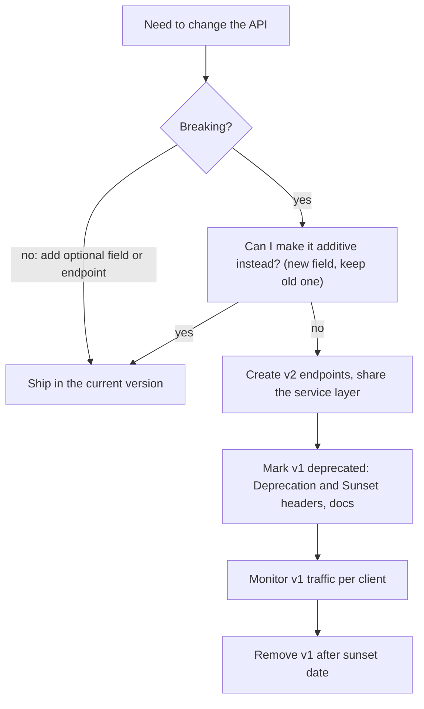
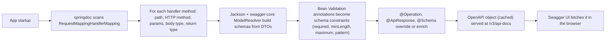
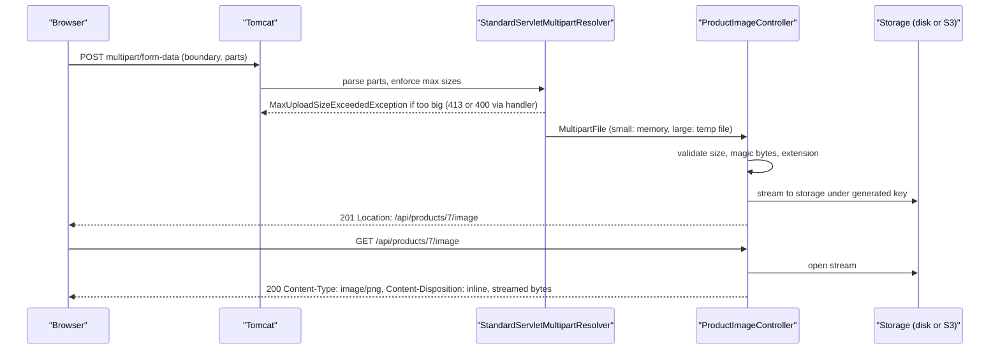

@@ 3 | TOPIC | API Versioning | URI, header, query and media-type versioning, what counts as a breaking change, deprecation and Spring Framework 7 native versioning | SHOULD
# API Versioning

**Level: Intermediate | Phase 11 | Priority: SHOULD | Since: patterns predate Spring; native API versioning in Spring MVC and WebFlux arrives with Spring Framework 7 (Boot 4)**

> **30-second interview answer:** Versioning lets me evolve an API without breaking existing clients. The common strategies are a version in the URI (`/api/v1/orders`), a custom header (`X-API-Version: 2`), a query parameter, or a vendor media type in the `Accept` header. I prefer URI versioning for public APIs because it is explicit, cacheable and easy to route at a gateway. I avoid new versions where possible by making only additive, backward-compatible changes, and when I must break something I run both versions side by side, announce deprecation with `Deprecation` and `Sunset` headers, and remove the old one after a migration window. Spring Framework 7 (Boot 4) adds first-class versioning with a `version` attribute on mappings.

## 1. Concept in Simple Words
### Analogy
Electrical plugs and adapters.

| Electrical plugs | API versioning |
|---|---|
| Adding a USB port to a socket does not affect old plugs | Additive change (new optional field): no new version |
| Changing the pin shape breaks every old plug | Breaking change: needs a new version |
| Shops sell both old and new sockets for years | Running v1 and v2 side by side |
| A label "this socket type retires in 2027" | `Deprecation` and `Sunset` headers |
| The plug type printed on the device | Version in the URI or header |

### What it is
- **Breaking change:** anything that can make a correct existing client fail: removing or renaming a field or endpoint, changing a type (`"price": "9.99"` to `9.99`), making an optional field required, changing meaning or status codes, tightening validation, changing enum values that clients switch on.
- **Non-breaking (additive) change:** new endpoints, new optional request fields, new response fields (if clients ignore unknown fields), new enum values only if clients are told to tolerate them.
- **Strategies:**
  - **URI path:** `/api/v1/products`, `/api/v2/products`.
  - **Query parameter:** `/api/products?version=2`.
  - **Custom header:** `X-API-Version: 2` (or `API-Version`).
  - **Media type (content negotiation):** `Accept: application/vnd.orderhub.v2+json`.
- **Tolerant reader:** clients ignore unknown fields (Jackson: `FAIL_ON_UNKNOWN_PROPERTIES` is false in Spring Boot by default), which makes additive changes safe.
- **Deprecation headers:** `Deprecation` (RFC 9745) and `Sunset` (RFC 8594) tell clients a version is going away; a `Link` header can point to migration docs.

### Why it exists
Mobile apps stay installed for years, partners integrate once and rarely update, and other teams' services deploy on their own schedule. You cannot force every client to upgrade the moment you deploy. Versioning lets old and new contracts coexist while clients migrate.

## 2. How It Works


Strategies compared in routing terms:
```text
URI:        GET /api/v2/orders/42                      route on path (gateway, CDN friendly)
Query:      GET /api/orders/42?version=2               route on param
Header:     GET /api/orders/42   X-API-Version: 2      route on header (needs Vary: X-API-Version for caches)
Media type: GET /api/orders/42   Accept: application/vnd.orderhub.v2+json
```

In Spring Boot 3 you implement these with ordinary mapping conditions: different path prefixes, `params = "version=2"`, `headers = "X-API-Version=2"` or `produces = "application/vnd.orderhub.v2+json"`.

`Boot 4`: Spring Framework 7 adds native support. You configure how the version is resolved once (path segment, header, query param or media type parameter) and declare `@GetMapping(path = "/orders/{id}", version = "2")`; versions like `"1.2+"` mean "1.2 and later", unsupported versions get 400, and deprecation headers can be emitted automatically. `RestClient` and HTTP interfaces can send the version too.

## 3. Code Example
### Code
```java
// File: src/main/java/com/orderhub/product/api/ProductApiV1.java
package com.orderhub.product.api;

import java.math.BigDecimal;
import java.time.ZonedDateTime;
import java.util.List;
import org.springframework.http.HttpHeaders;
import org.springframework.http.ResponseEntity;
import org.springframework.web.bind.annotation.*;

// Shared service result used by both versions
record ProductView(long id, String name, BigDecimal price, String currency, int stock) { }

// v1 contract: price as a single string "49.90 EUR", field "inStock" boolean
record ProductV1(long id, String name, String price, boolean inStock) {
    static ProductV1 from(ProductView v) {
        return new ProductV1(v.id(), v.name(), v.price() + " " + v.currency(), v.stock() > 0);
    }
}

// v2 contract: structured money, real stock number
record Money(BigDecimal amount, String currency) { }
record ProductV2(long id, String name, Money price, int stock) {
    static ProductV2 from(ProductView v) {
        return new ProductV2(v.id(), v.name(), new Money(v.price(), v.currency()), v.stock());
    }
}

@RestController
@RequestMapping("/api/v1/products")
class ProductApiV1 {
    private static final List<ProductView> DATA =
            List.of(new ProductView(1, "Keyboard", new BigDecimal("49.90"), "EUR", 7));

    @GetMapping("/{id}")
    ResponseEntity<ProductV1> get(@PathVariable long id) {
        ProductView v = DATA.stream().filter(p -> p.id() == id).findFirst().orElseThrow();
        return ResponseEntity.ok()
                .header("Deprecation", "@1767225600")                       // RFC 9745: since 2026-01-01
                .header("Sunset", ZonedDateTime.parse("2027-06-30T23:59:59Z")
                        .format(java.time.format.DateTimeFormatter.RFC_1123_DATE_TIME))
                .header(HttpHeaders.LINK, "<https://docs.orderhub.example/migrate-v2>; rel=\"deprecation\"")
                .body(ProductV1.from(v));
    }
}

@RestController
@RequestMapping("/api/v2/products")
class ProductApiV2 {
    private static final List<ProductView> DATA =
            List.of(new ProductView(1, "Keyboard", new BigDecimal("49.90"), "EUR", 7));

    @GetMapping("/{id}")
    ProductV2 get(@PathVariable long id) {
        return ProductV2.from(DATA.stream().filter(p -> p.id() == id).findFirst().orElseThrow());
    }
}

// Header-based alternative on one path (Boot 3 style)
@RestController
@RequestMapping("/api/products-hv")
class ProductHeaderVersioned {
    private static final ProductView V = new ProductView(1, "Keyboard", new BigDecimal("49.90"), "EUR", 7);

    @GetMapping(path = "/{id}", headers = "X-API-Version=1")
    ProductV1 v1(@PathVariable long id) { return ProductV1.from(V); }

    @GetMapping(path = "/{id}", headers = "X-API-Version=2")
    ProductV2 v2(@PathVariable long id) { return ProductV2.from(V); }
}
```

`Boot 4` equivalent with native versioning (Spring Framework 7):

```java
// File: src/main/java/com/orderhub/config/ApiVersionConfig.java  (Boot 4 / Spring Framework 7)
package com.orderhub.config;

import org.springframework.context.annotation.Configuration;
import org.springframework.web.servlet.config.annotation.ApiVersionConfigurer;
import org.springframework.web.servlet.config.annotation.WebMvcConfigurer;

@Configuration
public class ApiVersionConfig implements WebMvcConfigurer {
    @Override
    public void configureApiVersioning(ApiVersionConfigurer configurer) {
        configurer.useRequestHeader("X-API-Version");   // or usePathSegment(1), useQueryParam("version")
    }
}

// In the controller:
// @GetMapping(path = "/api/products/{id}", version = "1")   -> ProductV1
// @GetMapping(path = "/api/products/{id}", version = "2+")  -> ProductV2 for 2 and later
```

### Walkthrough
- One service result (`ProductView`) feeds two DTO contracts. Versioning lives at the edge (controllers and DTOs); the business logic is not duplicated.
- v1 returns price as a string and a boolean `inStock`; v2 returns structured money and a stock count. That is a breaking change, so it needs a new version.
- v1 responses carry `Deprecation`, `Sunset` and a `Link` to migration docs, so client developers see the retirement plan in every response.
- `ProductHeaderVersioned` shows the header strategy with the `headers` mapping condition. A request without the header matches neither method and gets 404 (in Spring 6, an unmatched header condition yields 404 or 400 depending on other matches), which is one reason header versioning needs a sensible default.
- The `Boot 4` snippet shows the native mechanism: configure the resolution once and use the `version` attribute.

### Output
```http
GET /api/v1/products/1 HTTP/1.1
```
```http
HTTP/1.1 200 OK
Deprecation: @1767225600
Sunset: Wed, 30 Jun 2027 23:59:59 GMT
Link: <https://docs.orderhub.example/migrate-v2>; rel="deprecation"
Content-Type: application/json

{"id":1,"name":"Keyboard","price":"49.90 EUR","inStock":true}
```
```http
GET /api/v2/products/1 HTTP/1.1
```
```http
HTTP/1.1 200 OK
Content-Type: application/json

{"id":1,"name":"Keyboard","price":{"amount":49.90,"currency":"EUR"},"stock":7}
```
```http
GET /api/products-hv/1 HTTP/1.1
X-API-Version: 2
```
```http
HTTP/1.1 200 OK
Content-Type: application/json

{"id":1,"name":"Keyboard","price":{"amount":49.90,"currency":"EUR"},"stock":7}
```

### Compare
| Strategy | Visible | Cache friendly | Gateway routing | Downsides |
|---|---|---|---|---|
| URI path `/v1/` | Very | Yes | Trivial | URI no longer identifies only the resource; duplicated routes |
| Query param `?version=2` | Yes | Yes (part of URL) | Easy | Easy to forget, optional-looking |
| Custom header | Hidden | Needs `Vary` | Possible | Harder to test in a browser, needs default |
| Media type `vnd.x.v2+json` | Hidden | Needs `Vary: Accept` | Harder | Most "RESTful", but complex for clients and tooling |

## 4. Interview Questions
**Basic**
1. **Why version an API?**
   To make breaking changes without breaking existing clients that cannot upgrade immediately. Old and new versions run side by side during a migration window.
2. **What versioning strategies exist?**
   URI path (`/v1/`), query parameter, custom header (`X-API-Version`) and media type versioning in the `Accept` header. URI versioning is the most common for public APIs.
3. **What is a breaking change?**
   Any change that can make a correct client fail: removing or renaming fields or endpoints, changing types or formats, making optional inputs required, changing status codes or semantics, or stricter validation.

**Follow-up**
4. **How do you avoid creating new versions too often?**
   Make additive changes: add new optional fields instead of changing old ones, add new endpoints, keep old fields populated while deprecated, and require clients to be tolerant readers that ignore unknown fields.
5. **How do you implement versioning in Spring Boot 3?**
   With mapping conditions: separate controllers under `/api/v1` and `/api/v2`, or `headers = "X-API-Version=2"`, `params = "version=2"` or `produces = "application/vnd.orderhub.v2+json"` on the same path. Spring Framework 7 (Boot 4) adds a native `version` attribute.
6. **How do you retire an old version?**
   Announce it, add `Deprecation` and `Sunset` headers with a migration link, track usage per client (logs or metrics tagged by version and client id), contact remaining consumers, then return 410 Gone or remove it after the sunset date.

**Tricky / scenario**
7. **You add a new value `ON_HOLD` to the order status enum. Is that breaking?**
   It can be. Clients with exhaustive switches or strict enum deserialisation may fail on an unknown value. Document from day one that enums may grow and clients must handle unknown values; otherwise treat it as breaking.
8. **v1 and v2 share a database. How do you keep both working when v2 needs a new column?**
   Use expand-and-contract migrations: add the new column (nullable or with a default) while v1 keeps working, write both representations during transition, migrate data, and drop the old column only after v1 is gone (Flyway, Phase 12).
9. **Should internal microservices version their APIs the same way?**
   Often lighter: consumer-driven contract tests (Spring Cloud Contract, Pact) catch breaking changes before deployment, and teams coordinate additive changes. Versioning is still needed for events in Kafka, where a schema registry enforces compatibility.

**What the interviewer is really testing:** whether you understand compatibility and migration, not just where to put "v1".

## 5. Pitfalls & Best Practices
### Common mistakes
| Mistake | What goes wrong | Fix |
|---|---|---|
| Copy-pasting the whole service for v2 | Bug fixes must be applied twice | Version only controllers and DTOs, share services |
| No version from day one | First breaking change has no clean path | Start with `/api/v1` |
| Header versioning without a default | Clients without the header get 404 or 400 | Default to the oldest supported or latest stable version |
| Removing v1 without usage data | Silent breakage of unknown clients | Track per-client usage, announce, sunset |
| Clients that fail on unknown fields | Every additive change is breaking | Tolerant readers (Jackson default in Boot) |

### Best practices
- Prefer additive evolution; create a new major version only for genuine breaking changes.
- URI versioning with major numbers only (`v1`, `v2`), not minor ones.
- Document every version in OpenAPI (a group per version, next topic).
- Emit `Deprecation` and `Sunset` headers and metrics per version.
- Keep at most two live versions per resource.

### Compare with
| Evolution technique | When |
|---|---|
| Additive change | Default; new fields and endpoints |
| New major API version | Unavoidable breaking change |
| Feature flags per client | Gradual rollout of new behaviour |
| Consumer-driven contracts | Internal services, catch breaks in CI |

## 6. Hands-on Exercise
**OrderHub task.** Introduce `/api/v1` and a v2 order response:
1. Move all existing controllers under `/api/v1` using a single constant `ApiPaths.V1 = "/api/v1"`.
2. Add `GET /api/v2/orders/{id}` whose response splits `customerName` into `customer: {id, name, email}` and returns `total` as `Money`.
3. Add a `DeprecationHeaderFilter` (`OncePerRequestFilter`) that adds `Deprecation` and `Sunset` headers to every `/api/v1/orders/**` response.
4. Count calls per version with a log line or a simple `ConcurrentHashMap<String, LongAdder>`.

Acceptance criteria: both versions return the same order data in different shapes; only v1 responses carry deprecation headers.

<details><summary>Solution</summary>

```java
// File: src/main/java/com/orderhub/common/ApiPaths.java
package com.orderhub.common;

public final class ApiPaths {
    private ApiPaths() { }
    public static final String V1 = "/api/v1";
    public static final String V2 = "/api/v2";
}

// File: src/main/java/com/orderhub/common/DeprecationHeaderFilter.java
package com.orderhub.common;

import jakarta.servlet.FilterChain;
import jakarta.servlet.ServletException;
import jakarta.servlet.http.HttpServletRequest;
import jakarta.servlet.http.HttpServletResponse;
import java.io.IOException;
import java.util.Map;
import java.util.concurrent.ConcurrentHashMap;
import java.util.concurrent.atomic.LongAdder;
import org.springframework.stereotype.Component;
import org.springframework.web.filter.OncePerRequestFilter;

@Component
public class DeprecationHeaderFilter extends OncePerRequestFilter {
    private final Map<String, LongAdder> callsPerVersion = new ConcurrentHashMap<>();

    @Override
    protected void doFilterInternal(HttpServletRequest req, HttpServletResponse res, FilterChain chain)
            throws ServletException, IOException {
        String uri = req.getRequestURI();
        String version = uri.startsWith(ApiPaths.V2) ? "v2" : uri.startsWith(ApiPaths.V1) ? "v1" : "none";
        callsPerVersion.computeIfAbsent(version, v -> new LongAdder()).increment();
        if (uri.startsWith(ApiPaths.V1 + "/orders")) {
            res.setHeader("Deprecation", "@1767225600");
            res.setHeader("Sunset", "Wed, 30 Jun 2027 23:59:59 GMT");
            res.setHeader("Link", "<https://docs.orderhub.example/migrate-v2>; rel=\"deprecation\"");
        }
        chain.doFilter(req, res);   // headers set before the body is committed
    }

    public Map<String, LongAdder> stats() { return callsPerVersion; }
}

// File: src/main/java/com/orderhub/order/api/OrderApiV2.java
package com.orderhub.order.api;

import com.orderhub.common.ApiPaths;
import com.orderhub.order.OrderService;
import java.math.BigDecimal;
import org.springframework.web.bind.annotation.*;

@RestController
@RequestMapping(ApiPaths.V2 + "/orders")
class OrderApiV2 {
    record Money(BigDecimal amount, String currency) { }
    record Customer(long id, String name, String email) { }
    record OrderV2(long id, Customer customer, Money total, String status) { }

    private final OrderService service;
    OrderApiV2(OrderService service) { this.service = service; }

    @GetMapping("/{id}")
    OrderV2 get(@PathVariable long id) {
        var o = service.getDetails(id);      // one service method, two representations
        return new OrderV2(o.id(), new Customer(o.customerId(), o.customerName(), o.customerEmail()),
                new Money(o.total(), o.currency()), o.status().name());
    }
}
```
The v1 controller keeps returning the old flat `OrderV1` record from the same `service.getDetails(id)` call.
</details>

## 7. Recall
Q: What are the four common REST API versioning strategies?
A: URI path, query parameter, custom header and media type (Accept header) versioning.

Q: What makes an API change breaking?
A: Anything that can make a correct existing client fail, such as removing or renaming fields, changing types, making inputs required or changing semantics.

Q: How do you signal that an API version will be retired?
A: Send `Deprecation` and `Sunset` headers with a migration `Link`, announce it, and track usage before removal.

Q: Why is a tolerant reader important for API evolution?
A: Clients that ignore unknown fields make additive changes non-breaking.

Q: What does Spring Framework 7 (Boot 4) add for API versioning?
A: Native versioning with a `version` attribute on request mappings and a configurable version resolver (header, path, query or media type).

**Related:** [[REST Principles, HTTP Methods and Status Codes]] · [[OpenAPI with springdoc]] · [[@RestController and Request Mapping Deep Dive]]

@@ 3 | TOPIC | OpenAPI with springdoc | Generating an OpenAPI 3 spec and Swagger UI from Spring MVC code, annotations, grouping, security schemes and contract-first vs code-first | SHOULD
# OpenAPI with springdoc

**Level: Intermediate | Phase 11 | Priority: SHOULD | Since: OpenAPI 3.0 (2017), 3.1 (2021); springdoc-openapi 2.x for Boot 3 (springfox is dead since Boot 2.6)**

> **30-second interview answer:** OpenAPI is the standard, machine-readable description of a REST API: paths, operations, parameters, request and response schemas, status codes and security. In Spring Boot I add `springdoc-openapi-starter-webmvc-ui`, which inspects my controllers, DTOs and validation annotations at runtime and serves the spec at `/v3/api-docs` and an interactive Swagger UI at `/swagger-ui.html`. I enrich it with `@Operation`, `@ApiResponse` and `@Schema`, group endpoints per version, declare the JWT security scheme, and use the spec to generate clients and run contract checks in CI.

## 1. Concept in Simple Words
### Analogy
A restaurant menu with an ordering tablet.

| Restaurant | OpenAPI |
|---|---|
| The menu lists every dish, ingredients, allergens and price | The spec lists every endpoint, parameters, schemas and responses |
| The menu is printed from the kitchen's actual recipes | springdoc generates the spec from the code (code-first) |
| A tablet at the table where you can order and see the result | Swagger UI "Try it out" |
| A delivery app that reads the menu automatically | Client generators (OpenAPI Generator) reading the spec |
| The chef writes the menu first, then cooks to match | Contract-first (design the YAML, generate interfaces) |

### What it is
- **OpenAPI Specification (OAS):** a JSON or YAML document format (formerly Swagger 2.0) describing HTTP APIs.
- **Swagger UI:** a web page that renders the spec and lets you call endpoints.
- **springdoc-openapi:** the library that builds the spec from Spring MVC or WebFlux at runtime. Artifacts: `springdoc-openapi-starter-webmvc-ui` (spec plus UI), `-webmvc-api` (spec only). Version 2.x targets Boot 3.
- **Default endpoints:** `/v3/api-docs` (JSON), `/v3/api-docs.yaml`, `/swagger-ui.html` (redirects to `/swagger-ui/index.html`).
- **Annotations (`io.swagger.v3.oas.annotations`):** `@Tag`, `@Operation`, `@Parameter`, `@ApiResponse`, `@Schema`, `@SecurityRequirement`, `@Hidden`.
- **`OpenAPI` bean:** global info (title, version, contact), servers and security schemes.
- **`GroupedOpenApi`:** separate specs per path pattern or package (for example v1 and v2).
- **Code-first vs contract-first:** generate docs from code, or write the spec first and generate server interfaces and clients from it (`openapi-generator-maven-plugin`).

### Why it exists
Hand-written API docs go stale the day after release. A generated spec always matches the deployed code, gives frontend and partner teams an interactive playground, enables generated, type-safe clients in any language, and allows automated breaking-change detection (`openapi-diff`) in CI.

## 2. How It Works


- Generation is lazy: the spec is computed on the first request to `/v3/api-docs` and cached.
- `@NotNull` and `@NotBlank` mark properties as `required`; `@Size(max = 80)` becomes `maxLength: 80`; `@Min` and `@Max` become `minimum` and `maximum`; `@Pattern` becomes `pattern`; enums become `enum` lists.
- `@RestControllerAdvice` handlers contribute their response types (for example `ProblemDetail`) to every operation unless configured otherwise.
- `Pageable` parameters are expanded into `page`, `size` and `sort` query parameters with `@ParameterObject`.
- In production you can disable the UI (`springdoc.swagger-ui.enabled=false`) or protect it with Spring Security.

## 3. Code Example
### Code
```xml
<!-- File: pom.xml -->
<dependency>
    <groupId>org.springdoc</groupId>
    <artifactId>springdoc-openapi-starter-webmvc-ui</artifactId>
    <version>2.8.9</version>
</dependency>
```

```yaml
# File: src/main/resources/application.yml
springdoc:
  api-docs:
    path: /v3/api-docs
  swagger-ui:
    path: /swagger-ui.html
    operations-sorter: method
    tags-sorter: alpha
  default-produces-media-type: application/json
---
spring:
  config:
    activate:
      on-profile: prod
springdoc:
  swagger-ui:
    enabled: false        # spec stays available to the gateway; no public UI in prod
```

```java
// File: src/main/java/com/orderhub/config/OpenApiConfig.java
package com.orderhub.config;

import io.swagger.v3.oas.models.Components;
import io.swagger.v3.oas.models.OpenAPI;
import io.swagger.v3.oas.models.info.Contact;
import io.swagger.v3.oas.models.info.Info;
import io.swagger.v3.oas.models.security.SecurityRequirement;
import io.swagger.v3.oas.models.security.SecurityScheme;
import io.swagger.v3.oas.models.servers.Server;
import org.springdoc.core.models.GroupedOpenApi;
import org.springframework.context.annotation.Bean;
import org.springframework.context.annotation.Configuration;

@Configuration(proxyBeanMethods = false)
public class OpenApiConfig {

    @Bean
    OpenAPI orderHubOpenApi() {
        return new OpenAPI()
                .info(new Info().title("OrderHub API").version("1.4.0")
                        .description("Products, customers, orders and payments")
                        .contact(new Contact().name("OrderHub team").email("api@orderhub.example")))
                .addServersItem(new Server().url("https://api.orderhub.example").description("Production"))
                .components(new Components().addSecuritySchemes("bearerAuth",
                        new SecurityScheme().type(SecurityScheme.Type.HTTP).scheme("bearer").bearerFormat("JWT")))
                .addSecurityItem(new SecurityRequirement().addList("bearerAuth"));   // applies to all operations
    }

    @Bean
    GroupedOpenApi v1() {
        return GroupedOpenApi.builder().group("v1").pathsToMatch("/api/v1/**").build();
    }

    @Bean
    GroupedOpenApi v2() {
        return GroupedOpenApi.builder().group("v2").pathsToMatch("/api/v2/**").build();
    }
}

// File: src/main/java/com/orderhub/product/api/ProductDocsController.java
package com.orderhub.product.api;

import io.swagger.v3.oas.annotations.Operation;
import io.swagger.v3.oas.annotations.Parameter;
import io.swagger.v3.oas.annotations.media.Content;
import io.swagger.v3.oas.annotations.media.Schema;
import io.swagger.v3.oas.annotations.responses.ApiResponse;
import io.swagger.v3.oas.annotations.tags.Tag;
import jakarta.validation.Valid;
import jakarta.validation.constraints.*;
import java.math.BigDecimal;
import org.springframework.http.HttpStatus;
import org.springframework.http.ProblemDetail;
import org.springframework.web.bind.annotation.*;

@Tag(name = "Products", description = "Catalogue management")
@RestController
@RequestMapping("/api/v1/products")
class ProductDocsController {

    @Schema(description = "Data needed to create a product")
    record CreateProductRequest(
            @Schema(example = "Mechanical keyboard") @NotBlank @Size(max = 80) String name,
            @Schema(example = "KEY-00001", pattern = "[A-Z]{3}-\\d{5}") @NotBlank String sku,
            @Schema(example = "49.90") @NotNull @DecimalMin("0.01") BigDecimal price,
            @Schema(example = "10", minimum = "0") @PositiveOrZero int stock) { }

    record ProductResponse(long id, String name, String sku, BigDecimal price, int stock) { }

    @Operation(summary = "Get a product by id")
    @ApiResponse(responseCode = "200", description = "Product found")
    @ApiResponse(responseCode = "404", description = "No product with this id",
            content = @Content(mediaType = "application/problem+json", schema = @Schema(implementation = ProblemDetail.class)))
    @GetMapping("/{id}")
    ProductResponse get(@Parameter(description = "Product id", example = "1") @PathVariable long id) {
        return new ProductResponse(id, "Mechanical keyboard", "KEY-00001", new BigDecimal("49.90"), 10);
    }

    @Operation(summary = "Create a product", description = "SKU must be unique. Returns the created product.")
    @ApiResponse(responseCode = "201", description = "Created")
    @ApiResponse(responseCode = "400", description = "Validation failed",
            content = @Content(mediaType = "application/problem+json", schema = @Schema(implementation = ProblemDetail.class)))
    @ApiResponse(responseCode = "409", description = "SKU already exists",
            content = @Content(mediaType = "application/problem+json", schema = @Schema(implementation = ProblemDetail.class)))
    @PostMapping
    @ResponseStatus(HttpStatus.CREATED)
    ProductResponse create(@Valid @RequestBody CreateProductRequest req) {
        return new ProductResponse(1, req.name(), req.sku(), req.price(), req.stock());
    }
}
```

### Walkthrough
- The single starter dependency adds both the spec endpoint and Swagger UI. The version must match your Boot line (2.8.x for Boot 3.4 and 3.5).
- `OpenApiConfig` sets title, version, contact, server URL and a bearer JWT security scheme applied globally, so Swagger UI shows an "Authorize" button (useful after Phase 14).
- Two `GroupedOpenApi` beans produce separate specs for v1 and v2, selectable in a drop-down in the UI.
- In the controller, `@Tag` groups operations, `@Operation` adds summaries, `@ApiResponse` documents each status code including the `ProblemDetail` error body, and `@Schema` adds examples.
- Validation annotations on the request record automatically become `required`, `maxLength`, `minimum` and `pattern` in the schema.
- The prod profile disables the UI while keeping the JSON spec for gateways and client generation.

### Output
`GET /v3/api-docs/v1` (excerpt, as YAML from `/v3/api-docs.yaml` for readability):
```yaml
openapi: 3.1.0
info:
  title: OrderHub API
  version: 1.4.0
paths:
  /api/v1/products:
    post:
      tags:
        - Products
      summary: Create a product
      operationId: create
      requestBody:
        content:
          application/json:
            schema:
              $ref: "#/components/schemas/CreateProductRequest"
        required: true
      responses:
        "201":
          description: Created
        "400":
          description: Validation failed
        "409":
          description: SKU already exists
components:
  schemas:
    CreateProductRequest:
      type: object
      description: Data needed to create a product
      required:
        - name
        - price
        - sku
      properties:
        name:
          type: string
          maxLength: 80
          example: Mechanical keyboard
        sku:
          type: string
          pattern: "[A-Z]{3}-\\d{5}"
          example: KEY-00001
        price:
          type: number
          minimum: 0.01
          example: 49.9
        stock:
          type: integer
          format: int32
          minimum: 0
          example: 10
  securitySchemes:
    bearerAuth:
      type: http
      scheme: bearer
      bearerFormat: JWT
```
Browsing to `http://localhost:8080/swagger-ui.html` shows the "Products" tag with both operations and a "Try it out" button.

### Compare
| Approach | Source of truth | Pros | Cons |
|---|---|---|---|
| Code-first (springdoc) | Java code | Always in sync, no extra files | API design happens in code; annotations clutter controllers |
| Contract-first (YAML + generator) | OpenAPI YAML | Design reviewed before coding, parallel frontend work | Generated code and spec must be maintained |
| Hand-written docs (wiki) | People | Flexible prose | Out of date quickly |
| springfox | Java code | Historical | Dead; incompatible with Boot 2.6+ and Boot 3 |

## 4. Interview Questions
**Basic**
1. **What is OpenAPI and how is it related to Swagger?**
   OpenAPI is the specification format for describing REST APIs. It was donated by SmartBear as Swagger 2.0 and renamed OpenAPI 3.0. "Swagger" now refers to tools such as Swagger UI and Swagger Editor.
2. **How do you add API documentation to a Spring Boot 3 app?**
   Add `springdoc-openapi-starter-webmvc-ui`. It generates the spec at `/v3/api-docs` and Swagger UI at `/swagger-ui.html` from your controllers and DTOs, which you can refine with annotations and an `OpenAPI` bean.
3. **Which annotations do you use most?**
   `@Tag` on controllers, `@Operation` for summaries, `@ApiResponse` for status codes and error schemas, `@Parameter` for parameters, `@Schema` for DTO fields and examples, `@Hidden` to exclude endpoints.

**Follow-up**
4. **How do validation annotations affect the generated spec?**
   springdoc translates them: `@NotNull` and `@NotBlank` make properties required, `@Size` becomes `minLength` and `maxLength`, `@Min` and `@Max` become `minimum` and `maximum`, `@Pattern` becomes `pattern`. So the spec reflects real validation rules.
5. **Code-first or contract-first?**
   Code-first is quicker and always in sync, good for internal APIs. Contract-first suits public or multi-team APIs: the contract is reviewed before implementation, frontend and backend work in parallel, and server interfaces are generated so the code cannot drift from the contract.
6. **How do you document JWT authentication?**
   Declare a security scheme of type `http` with scheme `bearer` and format `JWT` in the `OpenAPI` bean (or `@SecurityScheme`), and add a security requirement globally or per operation. Swagger UI then offers an Authorize dialog.

**Tricky / scenario**
7. **Swagger UI returns 401 or 403 after adding Spring Security. Why?**
   The security filter chain protects `/v3/api-docs/**` and `/swagger-ui/**`. Permit them explicitly in the `SecurityFilterChain` (perhaps only in non-prod profiles) or protect them with a specific role.
8. **How would you detect breaking API changes automatically?**
   Export the spec in CI (springdoc Maven plugin or a test that fetches `/v3/api-docs`), commit it, and compare it with the previous version using a tool such as `openapi-diff` or `oasdiff`, failing the build on breaking changes.
9. **Should Swagger UI be public in production?**
   Usually not for internal or private APIs: it advertises your attack surface. Disable it in prod, put it behind authentication, or host the spec in a separate developer portal. The spec itself may still be served internally to gateways.

**What the interviewer is really testing:** whether you treat the API contract as a first-class artifact and know modern tooling (springdoc, not springfox).

## 5. Pitfalls & Best Practices
### Common mistakes
| Mistake | What goes wrong | Fix |
|---|---|---|
| Using springfox with Boot 3 | Startup failure, no `jakarta` support | springdoc 2.x |
| Mismatched springdoc and Boot versions | `NoSuchMethodError` at startup | Use the springdoc line matching your Boot version |
| Exposing JPA entities in the spec | Internal fields documented and exposed | DTO records |
| Not documenting error responses | Clients guess error formats | `@ApiResponse` with `ProblemDetail` |
| Public Swagger UI in production | Information disclosure | Disable or secure in prod |

### Best practices
- Document every non-200 response, using `ProblemDetail` as the error schema.
- Add examples to request DTOs; they make Swagger UI usable immediately.
- Group specs by version or bounded context.
- Commit the generated spec and diff it in CI to catch breaking changes.
- Generate typed clients for frontends and other services from the spec.

### Compare with
| Tool | Purpose |
|---|---|
| springdoc-openapi | Generate spec and UI from Spring code |
| OpenAPI Generator | Generate clients and server stubs from a spec |
| Spring REST Docs | Docs generated from passing tests (accurate, test-driven) |
| Redoc | Alternative read-only documentation UI |
| oasdiff or openapi-diff | Detect breaking changes between specs |

## 6. Hands-on Exercise
**OrderHub task.** Document the OrderHub API:
1. Add springdoc, an `OpenAPI` bean (title "OrderHub API", version from `@project.version@` or a property, bearer security scheme).
2. Annotate `ProductController` and `OrderController` with `@Tag`, `@Operation` and `@ApiResponse` for 200 or 201, 400, 404 and 409 using `ProblemDetail`.
3. Expand `Pageable` into separate parameters with `@ParameterObject`.
4. Add a test that fetches `/v3/api-docs` and asserts the path `/api/v1/orders` exists and `CreateOrderRequest.customerId` is required.

Acceptance criteria: Swagger UI lists both tags; the test passes; the UI is disabled in the `prod` profile.

<details><summary>Solution</summary>

```java
// File: src/main/java/com/orderhub/order/OrderController.java (documented excerpt)
package com.orderhub.order;

import io.swagger.v3.oas.annotations.Operation;
import io.swagger.v3.oas.annotations.media.Content;
import io.swagger.v3.oas.annotations.media.Schema;
import io.swagger.v3.oas.annotations.responses.ApiResponse;
import io.swagger.v3.oas.annotations.tags.Tag;
import jakarta.validation.Valid;
import org.springdoc.core.annotations.ParameterObject;
import org.springframework.data.domain.Pageable;
import org.springframework.http.HttpStatus;
import org.springframework.http.ProblemDetail;
import org.springframework.web.bind.annotation.*;

@Tag(name = "Orders", description = "Place, query and cancel orders")
@RestController
@RequestMapping("/api/v1/orders")
public class OrderController {
    private final OrderService service;
    public OrderController(OrderService service) { this.service = service; }

    @Operation(summary = "Place an order")
    @ApiResponse(responseCode = "201", description = "Order created")
    @ApiResponse(responseCode = "400", description = "Invalid request",
            content = @Content(mediaType = "application/problem+json", schema = @Schema(implementation = ProblemDetail.class)))
    @ApiResponse(responseCode = "409", description = "Insufficient stock",
            content = @Content(mediaType = "application/problem+json", schema = @Schema(implementation = ProblemDetail.class)))
    @PostMapping
    @ResponseStatus(HttpStatus.CREATED)
    public OrderResponse place(@Valid @RequestBody CreateOrderRequest req) { return service.place(req); }

    @Operation(summary = "List orders, paginated")
    @GetMapping
    public PageResponse<OrderResponse> list(@ParameterObject Pageable pageable) { return service.list(pageable); }
}

// File: src/test/java/com/orderhub/docs/OpenApiContractTest.java
package com.orderhub.docs;

import static org.springframework.test.web.servlet.request.MockMvcRequestBuilders.get;
import static org.springframework.test.web.servlet.result.MockMvcResultMatchers.*;

import org.junit.jupiter.api.Test;
import org.springframework.beans.factory.annotation.Autowired;
import org.springframework.boot.test.autoconfigure.web.servlet.AutoConfigureMockMvc;
import org.springframework.boot.test.context.SpringBootTest;
import org.springframework.test.web.servlet.MockMvc;

@SpringBootTest
@AutoConfigureMockMvc
class OpenApiContractTest {
    @Autowired MockMvc mvc;

    @Test
    void specContainsOrdersAndRequiredFields() throws Exception {
        mvc.perform(get("/v3/api-docs"))
                .andExpect(status().isOk())
                .andExpect(jsonPath("$.paths['/api/v1/orders'].post").exists())
                .andExpect(jsonPath("$.components.schemas.CreateOrderRequest.required[?(@ == 'customerId')]").exists());
    }
}
```

```yaml
# File: src/main/resources/application-prod.yml
springdoc:
  swagger-ui:
    enabled: false
```
The test turns the spec into a contract: renaming `customerId` or removing the endpoint fails the build.
</details>

## 7. Recall
Q: Which dependency adds OpenAPI docs and Swagger UI to a Spring Boot 3 MVC app?
A: `springdoc-openapi-starter-webmvc-ui`.

Q: At which default URLs does springdoc serve the spec and the UI?
A: `/v3/api-docs` for the spec and `/swagger-ui.html` for Swagger UI.

Q: How do Bean Validation annotations appear in a springdoc-generated OpenAPI schema?
A: As schema constraints such as `required`, `maxLength`, `minimum`, `maximum` and `pattern`.

Q: What is the difference between code-first and contract-first OpenAPI?
A: Code-first generates the spec from code; contract-first writes the spec first and generates code from it.

Q: Why should Swagger UI usually be disabled or secured in production?
A: It exposes the full API surface and lets anyone try requests, which is an information disclosure risk.

**Related:** [[API Versioning]] · [[Bean Validation]] · [[Global Exception Handling and ProblemDetail]]

@@ 3 | TOPIC | File Upload and Download | MultipartFile handling, size limits, storage safety, streaming large downloads and Content-Disposition | SHOULD
# File Upload and Download

**Level: Intermediate | Phase 11 | Priority: SHOULD | Since: MultipartFile Spring 2.5; StandardServletMultipartResolver (Servlet 3.0) default in Boot; StreamingResponseBody Spring 4.2**

> **30-second interview answer:** For uploads, a controller takes a `MultipartFile` from a `multipart/form-data` request; Boot configures limits with `spring.servlet.multipart.max-file-size` and `max-request-size`. I never trust the client's file name or content type: I validate size, type by inspecting the bytes, generate my own storage name to prevent path traversal, and store files in object storage such as S3 rather than the database. For downloads I return a `Resource` or `StreamingResponseBody` with `Content-Type` and `Content-Disposition` headers, streaming the bytes instead of loading the whole file into memory.

## 1. Concept in Simple Words
### Analogy
A cloakroom at a theatre.

| Cloakroom | File handling |
|---|---|
| You hand over a coat in a bag with a label | Multipart upload: file part plus metadata parts |
| "No suitcases over 10 kg" | `max-file-size` and `max-request-size` |
| Attendant checks the bag really contains a coat, not something dangerous | Content type sniffing and virus scanning |
| You get a ticket number, not your name on the hook | Server-generated storage key (UUID) |
| Coats stored in a separate room, not behind the ticket desk | Object storage, not the database |
| Handing the coat back through a hatch, piece by piece | Streaming download |
| Label on the bag: "open here" or "take away" | `Content-Disposition: inline` or `attachment` |

### What it is
- **`multipart/form-data`:** an HTTP body format with several parts separated by a boundary; each part has headers (`Content-Disposition: form-data; name="file"; filename="a.png"`, `Content-Type`) and bytes.
- **`MultipartFile`:** Spring's abstraction of an uploaded part: `getOriginalFilename()`, `getContentType()`, `getSize()`, `getInputStream()`, `transferTo(Path)`.
- **`@RequestPart`:** binds a part, including a JSON part converted to an object; `@RequestParam` also works for file parts.
- **Limits (Boot defaults):** `max-file-size=1MB`, `max-request-size=10MB`; above them Spring throws `MaxUploadSizeExceededException`.
- **`file-size-threshold`:** files larger than this are written to a temporary location instead of memory.
- **Download types:** `Resource` (`FileSystemResource`, `InputStreamResource`, `ByteArrayResource`), `StreamingResponseBody` (write to the output stream asynchronously), `byte[]` (small files only).
- **`Content-Disposition`:** `attachment; filename="invoice-42.pdf"` makes browsers download; `inline` displays. Build it with `ContentDisposition.attachment().filename(name, UTF_8)`.

### Why it exists
Products need images, orders need invoice PDFs, admins upload CSV imports. Files are large, untrusted and binary, so they need dedicated handling: size limits to protect memory and disk, validation for security, streaming for efficiency, and correct headers for browsers.

## 2. How It Works


Security checklist for uploads:
```text
1. Size limits (server config AND business rule per endpoint)
2. Allowed types by magic bytes, not the client Content-Type header
3. Never use the original filename as a path: "../../etc/passwd" or "shell.jsp"
4. Store outside the web root, under a generated key (UUID)
5. Optional: virus scan (ClamAV) before making files available
6. Serve with correct Content-Type and X-Content-Type-Options: nosniff
```

- Temporary multipart files are deleted at the end of the request; call `transferTo` or copy the stream during the request.
- With a reverse proxy (nginx), its own body limit (`client_max_body_size`) applies first, producing a 413 before Spring sees the request.
- For very large files, presigned S3 URLs let the browser upload directly to storage, bypassing your servers.

## 3. Code Example
### Code
```yaml
# File: src/main/resources/application.yml
spring:
  servlet:
    multipart:
      max-file-size: 5MB
      max-request-size: 6MB
      file-size-threshold: 512KB
orderhub:
  storage:
    root: /var/orderhub/uploads
```

```java
// File: src/main/java/com/orderhub/storage/ImageStorage.java
package com.orderhub.storage;

import java.io.IOException;
import java.io.InputStream;
import java.nio.file.Files;
import java.nio.file.Path;
import java.nio.file.StandardCopyOption;
import java.util.Arrays;
import java.util.UUID;
import org.springframework.beans.factory.annotation.Value;
import org.springframework.stereotype.Service;
import org.springframework.web.multipart.MultipartFile;

@Service
public class ImageStorage {
    public record Stored(String key, String contentType, long size) { }

    private static final byte[] PNG = {(byte) 0x89, 'P', 'N', 'G'};
    private static final byte[] JPEG = {(byte) 0xFF, (byte) 0xD8, (byte) 0xFF};
    private final Path root;

    public ImageStorage(@Value("${orderhub.storage.root}") Path root) throws IOException {
        this.root = Files.createDirectories(root).toRealPath();
    }

    public Stored store(MultipartFile file) throws IOException {
        if (file.isEmpty()) throw new InvalidFileException("File is empty");
        if (file.getSize() > 2 * 1024 * 1024) throw new InvalidFileException("Images must be at most 2 MB");

        String type = detectType(file);                                   // trust bytes, not headers
        String key = UUID.randomUUID() + (type.equals("image/png") ? ".png" : ".jpg");
        Path target = root.resolve(key).normalize();
        if (!target.startsWith(root)) throw new InvalidFileException("Invalid path");   // defence in depth

        try (InputStream in = file.getInputStream()) {
            Files.copy(in, target, StandardCopyOption.REPLACE_EXISTING);  // streams, no full byte[] copy
        }
        return new Stored(key, type, file.getSize());
    }

    public Path resolve(String key) {
        Path p = root.resolve(key).normalize();
        if (!p.startsWith(root) || !Files.exists(p)) throw new FileNotFoundInStorageException(key);
        return p;
    }

    private String detectType(MultipartFile file) throws IOException {
        byte[] head;
        try (InputStream in = file.getInputStream()) { head = in.readNBytes(4); }
        if (startsWith(head, PNG)) return "image/png";
        if (startsWith(head, JPEG)) return "image/jpeg";
        throw new InvalidFileException("Only PNG and JPEG images are allowed");
    }

    private static boolean startsWith(byte[] data, byte[] prefix) {
        return data.length >= prefix.length && Arrays.equals(Arrays.copyOf(data, prefix.length), prefix);
    }

    public static class InvalidFileException extends RuntimeException {
        public InvalidFileException(String m) { super(m); }
    }
    public static class FileNotFoundInStorageException extends RuntimeException {
        public FileNotFoundInStorageException(String key) { super("File " + key + " not found"); }
    }
}

// File: src/main/java/com/orderhub/product/ProductImageController.java
package com.orderhub.product;

import com.orderhub.storage.ImageStorage;
import com.orderhub.storage.ImageStorage.Stored;
import java.io.IOException;
import java.io.OutputStream;
import java.net.URI;
import java.nio.charset.StandardCharsets;
import java.nio.file.Path;
import java.util.Map;
import java.util.concurrent.ConcurrentHashMap;
import org.springframework.core.io.FileSystemResource;
import org.springframework.core.io.Resource;
import org.springframework.http.ContentDisposition;
import org.springframework.http.HttpHeaders;
import org.springframework.http.MediaType;
import org.springframework.http.ResponseEntity;
import org.springframework.web.bind.annotation.*;
import org.springframework.web.multipart.MultipartFile;
import org.springframework.web.servlet.mvc.method.annotation.StreamingResponseBody;

@RestController
@RequestMapping("/api/v1/products/{productId}")
public class ProductImageController {
    private final ImageStorage storage;
    private final Map<Long, Stored> imageByProduct = new ConcurrentHashMap<>();   // DB column in Phase 12

    public ProductImageController(ImageStorage storage) { this.storage = storage; }

    @PostMapping(path = "/image", consumes = MediaType.MULTIPART_FORM_DATA_VALUE)
    public ResponseEntity<Stored> upload(@PathVariable long productId,
                                         @RequestPart("file") MultipartFile file) throws IOException {
        Stored stored = storage.store(file);
        imageByProduct.put(productId, stored);
        return ResponseEntity.created(URI.create("/api/v1/products/" + productId + "/image")).body(stored);
    }

    @GetMapping("/image")
    public ResponseEntity<Resource> image(@PathVariable long productId) {
        Stored s = imageByProduct.get(productId);
        if (s == null) return ResponseEntity.notFound().build();
        Path path = storage.resolve(s.key());
        return ResponseEntity.ok()
                .contentType(MediaType.parseMediaType(s.contentType()))
                .contentLength(s.size())
                .header(HttpHeaders.CONTENT_DISPOSITION, ContentDisposition.inline().build().toString())
                .header("X-Content-Type-Options", "nosniff")
                .body(new FileSystemResource(path));                   // streamed by ResourceHttpMessageConverter
    }

    // Generated download: rows written as they are produced, never held in memory
    @GetMapping("/price-history.csv")
    public ResponseEntity<StreamingResponseBody> priceHistory(@PathVariable long productId) {
        StreamingResponseBody body = (OutputStream out) -> {
            out.write("date,price\n".getBytes(StandardCharsets.UTF_8));
            for (int day = 1; day <= 3; day++) {
                out.write(("2026-11-0" + day + ",49.9" + day + "\n").getBytes(StandardCharsets.UTF_8));
            }
        };
        String filename = "price-history-" + productId + ".csv";
        return ResponseEntity.ok()
                .contentType(new MediaType("text", "csv", StandardCharsets.UTF_8))
                .header(HttpHeaders.CONTENT_DISPOSITION,
                        ContentDisposition.attachment().filename(filename, StandardCharsets.UTF_8).build().toString())
                .body(body);
    }
}
```

### Walkthrough
- Boot's multipart config limits the file to 5 MB and the request to 6 MB; parts above 512 KB spill to temp files instead of memory. The service adds a stricter business limit of 2 MB for images.
- `detectType` reads the first bytes ("magic numbers") to verify PNG or JPEG. The client's `Content-Type` and file extension are ignored because they are trivially faked.
- The stored name is a UUID plus a safe extension. The original filename is never used as a path, which prevents path traversal and overwriting other files; the `startsWith(root)` check is a second line of defence.
- `Files.copy` streams the upload to disk without reading it fully into a `byte[]`.
- The image download returns a `FileSystemResource`; Spring streams it and supports HTTP range requests for resources. `nosniff` stops browsers from guessing a different type.
- The CSV download uses `StreamingResponseBody`: rows are written directly to the response stream, suitable for large exports. `ContentDisposition.attachment().filename(name, UTF_8)` encodes non-ASCII names correctly.
- Map `InvalidFileException` to 400 and `MaxUploadSizeExceededException` to 413 in the global handler.

### Output
```bash
curl -i -F "file=@keyboard.png;type=image/png" http://localhost:8080/api/v1/products/7/image
```
```http
HTTP/1.1 201 Created
Location: /api/v1/products/7/image
Content-Type: application/json

{"key":"3f6c1b9e-0d55-4a7e-9a51-2f1f3c1c9b10.png","contentType":"image/png","size":48213}
```
Uploading a renamed `.exe` file as `photo.png`:
```http
HTTP/1.1 400 Bad Request
Content-Type: application/problem+json

{"type":"about:blank","title":"Bad Request","status":400,"detail":"Only PNG and JPEG images are allowed","instance":"/api/v1/products/7/image"}
```
```bash
curl -i http://localhost:8080/api/v1/products/7/price-history.csv
```
```http
HTTP/1.1 200 OK
Content-Type: text/csv;charset=UTF-8
Content-Disposition: attachment; filename="price-history-7.csv"
Transfer-Encoding: chunked

date,price
2026-11-01,49.91
2026-11-02,49.92
2026-11-03,49.93
```

### Compare
| Download return type | Memory use | Best for |
|---|---|---|
| `byte[]` | Whole file in memory | Tiny files, generated thumbnails |
| `Resource` (`FileSystemResource`) | Streamed, range support | Files on disk |
| `InputStreamResource` | Streamed, read once | Streams from S3 or other sources |
| `StreamingResponseBody` | Streamed while generating | Large generated exports (CSV, ZIP) |
| Redirect to presigned URL | None on your servers | Large files in object storage |

## 4. Interview Questions
**Basic**
1. **How do you handle a file upload in Spring Boot?**
   Accept `multipart/form-data` with a `MultipartFile` parameter (`@RequestPart("file")` or `@RequestParam("file")`), validate it, and copy its input stream to storage. Configure `spring.servlet.multipart.max-file-size` and `max-request-size`.
2. **What are the default upload limits and what happens when exceeded?**
   1 MB per file and 10 MB per request. Exceeding them throws `MaxUploadSizeExceededException` before your controller runs; map it to 413 Payload Too Large in a global handler.
3. **How do you make the browser download a file instead of displaying it?**
   Set `Content-Disposition: attachment; filename="name.ext"` (build it with `ContentDisposition.attachment()`), plus the correct `Content-Type`.

**Follow-up**
4. **Why not use `file.getOriginalFilename()` as the storage name?**
   It is user-controlled: it can contain `../` for path traversal, overwrite existing files, include dangerous extensions like `.jsp`, or collide with other users' names. Generate a key (UUID) and store the original name only as metadata.
5. **How do you validate the file type?**
   Check the magic bytes at the start of the file (or use Apache Tika), and optionally the extension, against an allow-list. The `Content-Type` header comes from the client and proves nothing.
6. **How do you serve a 2 GB file without running out of memory?**
   Stream it: return a `Resource` or `StreamingResponseBody` that copies in chunks, never a `byte[]`. Better still, store it in object storage and redirect to a presigned URL so the bytes bypass your application.

**Tricky / scenario**
7. **Uploads fail with 413 before reaching Spring, even though `max-file-size` is 50 MB. Why?**
   A proxy in front (nginx `client_max_body_size`, API gateway or load balancer limit) rejects the body first. Raise the limit there too, or use direct-to-storage uploads.
8. **Should files be stored in the database?**
   Usually not: large BLOBs bloat backups and replication, increase memory pressure and are slower to serve. Store files in object storage or a file system and keep metadata (key, size, type, owner, checksum) in the database. Small files with strict transactional needs are an exception.
9. **A `MultipartFile` is passed to an `@Async` method for processing and fails with "file not found". Why?**
   Multipart temp files are deleted when the request completes. Copy the file to permanent storage (or read the bytes) inside the request, then pass the storage key to the async task.

**What the interviewer is really testing:** security awareness with untrusted files and memory-efficient streaming.

## 5. Pitfalls & Best Practices
### Common mistakes
| Mistake | What goes wrong | Fix |
|---|---|---|
| Using the original filename as a path | Path traversal, overwrites, web shells | Generated keys, normalise and check paths |
| Trusting `getContentType()` | Malicious files accepted | Magic-byte detection, allow-list |
| `file.getBytes()` for big files | `OutOfMemoryError` | Stream with `getInputStream()` |
| Returning `byte[]` for large downloads | High memory per request | `Resource` or `StreamingResponseBody` |
| Processing the multipart file asynchronously | Temp file deleted | Persist first, process by key |
| No `nosniff` on served user files | Browser may execute content as HTML or script | `X-Content-Type-Options: nosniff`, correct type |

### Best practices
- Configure server-wide limits and stricter per-endpoint business limits.
- Store in S3 or compatible storage; use presigned URLs for large uploads and downloads.
- Keep metadata and a checksum in the database; scan files before publishing them.
- Serve user content from a separate domain or with `Content-Disposition: attachment` to reduce XSS risk.

### Compare with
| Upload approach | Pros | Cons |
|---|---|---|
| Multipart through the app | Simple, full validation control | App handles all bytes |
| Base64 inside JSON | Single JSON request | 33 percent larger, memory heavy |
| Presigned direct upload to S3 | Scales, app never sees bytes | Validation happens after upload, more moving parts |
| Resumable or chunked uploads (tus) | Survives network drops | More complexity |

## 6. Hands-on Exercise
**OrderHub task.** Add CSV product import and invoice download:
1. `POST /api/v1/products/import` accepts a CSV `MultipartFile` (max 1 MB, must end with `.csv` and be UTF-8 text) with lines `sku,name,price,stock`; it returns `{imported: n, errors: [{line, message}]}` and never fails the whole file for one bad line.
2. `GET /api/v1/orders/{id}/invoice` returns a generated plain-text invoice as an attachment named `invoice-{id}.txt` using `StreamingResponseBody`.
3. Map `MaxUploadSizeExceededException` to 413 `ProblemDetail`.

Acceptance criteria: a file with one bad price imports the other lines and reports the bad line number; the invoice downloads with the right file name.

<details><summary>Solution</summary>

```java
// File: src/main/java/com/orderhub/product/ProductImportController.java
package com.orderhub.product;

import java.io.BufferedReader;
import java.io.IOException;
import java.io.InputStreamReader;
import java.math.BigDecimal;
import java.nio.charset.StandardCharsets;
import java.util.ArrayList;
import java.util.List;
import org.springframework.http.MediaType;
import org.springframework.web.bind.annotation.*;
import org.springframework.web.multipart.MultipartFile;

@RestController
@RequestMapping("/api/v1/products")
public class ProductImportController {
    public record LineError(int line, String message) { }
    public record ImportResult(int imported, List<LineError> errors) { }

    private final ProductService service;
    public ProductImportController(ProductService service) { this.service = service; }

    @PostMapping(path = "/import", consumes = MediaType.MULTIPART_FORM_DATA_VALUE)
    public ImportResult importCsv(@RequestPart("file") MultipartFile file) throws IOException {
        String name = file.getOriginalFilename();
        if (name == null || !name.toLowerCase().endsWith(".csv") || file.getSize() > 1_048_576)
            throw new IllegalArgumentException("Upload a .csv file of at most 1 MB");

        int imported = 0;
        List<LineError> errors = new ArrayList<>();
        try (BufferedReader reader = new BufferedReader(
                new InputStreamReader(file.getInputStream(), StandardCharsets.UTF_8))) {
            String line;
            int lineNo = 0;
            while ((line = reader.readLine()) != null) {
                lineNo++;
                if (lineNo == 1 && line.startsWith("sku")) continue;          // header row
                String[] f = line.split(",", -1);
                try {
                    if (f.length != 4) throw new IllegalArgumentException("expected 4 columns");
                    service.upsert(f[0].trim(), f[1].trim(), new BigDecimal(f[2].trim()), Integer.parseInt(f[3].trim()));
                    imported++;
                } catch (NumberFormatException e) {
                    errors.add(new LineError(lineNo, "invalid number"));
                } catch (IllegalArgumentException e) {
                    errors.add(new LineError(lineNo, e.getMessage()));
                }
            }
        }
        return new ImportResult(imported, errors);
    }
}

// File: src/main/java/com/orderhub/order/InvoiceController.java
package com.orderhub.order;

import java.nio.charset.StandardCharsets;
import org.springframework.http.ContentDisposition;
import org.springframework.http.HttpHeaders;
import org.springframework.http.MediaType;
import org.springframework.http.ResponseEntity;
import org.springframework.web.bind.annotation.*;
import org.springframework.web.servlet.mvc.method.annotation.StreamingResponseBody;

@RestController
@RequestMapping("/api/v1/orders")
public class InvoiceController {
    private final OrderService orders;
    public InvoiceController(OrderService orders) { this.orders = orders; }

    @GetMapping("/{id}/invoice")
    public ResponseEntity<StreamingResponseBody> invoice(@PathVariable long id) {
        OrderResponse o = orders.get(id);                     // throws OrderNotFoundException (404) first
        StreamingResponseBody body = out -> {
            out.write(("INVOICE " + o.id() + "\n").getBytes(StandardCharsets.UTF_8));
            for (var line : o.lines()) {
                out.write((line.quantity() + " x " + line.sku() + " @ " + line.unitPrice() + "\n")
                        .getBytes(StandardCharsets.UTF_8));
            }
            out.write(("TOTAL " + o.total() + "\n").getBytes(StandardCharsets.UTF_8));
        };
        return ResponseEntity.ok()
                .contentType(new MediaType("text", "plain", StandardCharsets.UTF_8))
                .header(HttpHeaders.CONTENT_DISPOSITION,
                        ContentDisposition.attachment().filename("invoice-" + id + ".txt").build().toString())
                .body(body);
    }
}
```

```java
// File: src/main/java/com/orderhub/common/error/GlobalExceptionHandler.java (addition)
// The base class already declares @ExceptionHandler for MaxUploadSizeExceededException (Spring 6.1+),
// so override its hook instead of adding a second handler (which would be an ambiguous mapping).
@Override
protected ResponseEntity<Object> handleMaxUploadSizeExceededException(
        MaxUploadSizeExceededException ex, HttpHeaders headers, HttpStatusCode status, WebRequest request) {
    ProblemDetail pd = ProblemDetail.forStatusAndDetail(HttpStatus.PAYLOAD_TOO_LARGE, "File too large");
    pd.setTitle("Payload too large");
    pd.setProperty("maxBytes", ex.getMaxUploadSize());
    return handleExceptionInternal(ex, pd, headers, HttpStatus.PAYLOAD_TOO_LARGE, request);
}
```
Without the override the base class already answers 413 with a default `ProblemDetail`; overriding only customises the body. Declaring a separate `@ExceptionHandler(MaxUploadSizeExceededException.class)` in a subclass of `ResponseEntityExceptionHandler` fails startup with an ambiguous handler error. Loading the order before building the stream matters: once streaming has started, the status is committed and an exception can no longer become a 404.
</details>

## 7. Recall
Q: Which Spring type represents an uploaded file in a multipart request?
A: `MultipartFile`.

Q: Which Spring Boot properties limit upload sizes?
A: `spring.servlet.multipart.max-file-size` (default 1MB) and `spring.servlet.multipart.max-request-size` (default 10MB).

Q: Why must an upload's original filename never be used as the storage path?
A: It is user-controlled and enables path traversal, overwrites and dangerous extensions; use a generated key.

Q: How do you stream a large generated file download in Spring MVC?
A: Return `StreamingResponseBody` (or a `Resource`) so bytes are written in chunks instead of held in memory.

Q: Which header makes a browser download a response as a file?
A: `Content-Disposition: attachment; filename="..."`.

**Related:** [[ResponseEntity and Headers]] · [[File I/O with java.nio.file]] · [[Global Exception Handling and ProblemDetail]]
