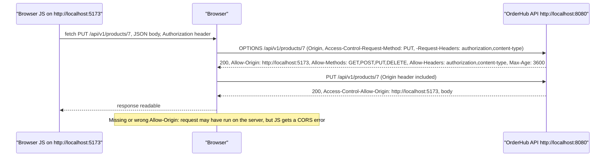
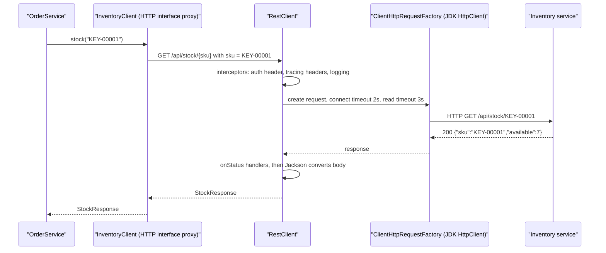

@@ 3 | TOPIC | CORS | Same-origin policy, simple vs preflight requests, configuring CORS globally in Spring MVC and with Spring Security, credentials and exposed headers | MUST
# CORS

**Level: Intermediate | Phase 11 | Priority: MUST | Since: CORS W3C recommendation 2014 (now in the WHATWG Fetch standard); @CrossOrigin Spring 4.2; CorsConfigurationSource in Spring Security 4.x**

> **30-second interview answer:** Browsers enforce the same-origin policy: JavaScript from `https://shop.orderhub.example` may not read responses from `https://api.orderhub.example` unless the API allows it with CORS headers. For non-simple requests (JSON bodies, `Authorization` headers, PUT or DELETE) the browser first sends an `OPTIONS` preflight; the server answers with `Access-Control-Allow-Origin`, `-Methods`, `-Headers` and optionally `-Allow-Credentials` and `-Max-Age`. In Spring I configure it globally via `WebMvcConfigurer.addCorsMappings` or a `CorsConfigurationSource` bean, and with Spring Security I enable `http.cors()` so preflights are not rejected by the security filter. CORS is a browser protection, not server security: Postman and curl ignore it.

## 1. Concept in Simple Words
### Analogy
A members-only club with a guest list.

| Club | CORS |
|---|---|
| The club only serves its own members by default | Same-origin policy |
| A visitor from another club arrives | A request from another origin (scheme, host, port) |
| The bouncer phones ahead: "Can a guest from Club Shop come in with a bag?" | Preflight `OPTIONS` request with `Access-Control-Request-Method` and `-Headers` |
| The club answers: "Yes, guests from Club Shop, with bags, for the next hour" | `Access-Control-Allow-Origin`, `-Allow-Headers`, `-Max-Age` |
| The bouncer works for the visitor's safety, not the club's | The browser enforces CORS to protect the user |
| Someone who climbs in through the kitchen ignores the bouncer | curl, Postman and servers are not restricted by CORS |

### What it is
- **Origin:** scheme plus host plus port. `http://localhost:5173` and `http://localhost:8080` are different origins; so are `http` and `https`.
- **Same-origin policy:** browsers block JavaScript from *reading* cross-origin responses (the request may still reach the server).
- **Simple request:** GET, HEAD or POST with only safelisted headers and a `Content-Type` of `text/plain`, `multipart/form-data` or `application/x-www-form-urlencoded`. Sent directly; the browser checks `Access-Control-Allow-Origin` on the response.
- **Preflighted request:** anything else (JSON `Content-Type`, `Authorization` header, PUT, PATCH, DELETE). The browser first sends `OPTIONS` with `Origin`, `Access-Control-Request-Method` and `Access-Control-Request-Headers`.
- **Response headers:**
  - `Access-Control-Allow-Origin`: the allowed origin (or `*`).
  - `Access-Control-Allow-Methods`, `Access-Control-Allow-Headers`: for preflights.
  - `Access-Control-Allow-Credentials: true`: allows cookies or HTTP auth; then the origin cannot be `*`.
  - `Access-Control-Expose-Headers`: response headers JavaScript may read beyond the safelisted ones (`Location`, `X-Total-Count`, `ETag`).
  - `Access-Control-Max-Age`: how long the browser caches the preflight result.
- **Spring options:** `@CrossOrigin` on a controller or method, global `addCorsMappings` in `WebMvcConfigurer`, a `CorsConfigurationSource` bean (used by Spring Security and `CorsFilter`), or the gateway.

### Why it exists
Without the same-origin policy, any website you visit could use your logged-in cookies to read your bank or email data through JavaScript. CORS is the controlled exception: the API declares which other origins may read its responses, so legitimate frontends on other domains (or `localhost:5173` during development) can work.

## 2. How It Works


Inside Spring:
- Spring MVC: `AbstractHandlerMapping` checks the CORS configuration for the matched handler. For a preflight it answers directly without calling your controller; for actual requests `DefaultCorsProcessor` adds headers or rejects with 403 "Invalid CORS request".
- Spring Security: its filter chain runs **before** MVC. A preflight carries no credentials, so without `http.cors(...)` security returns 401 and the browser reports a CORS error. `http.cors(Customizer.withDefaults())` adds a `CorsFilter` early in the chain that uses your `CorsConfigurationSource` bean (or falls back to the MVC configuration).
- `allowedOriginPatterns("https://*.orderhub.example")` supports wildcards and works with credentials, unlike `allowedOrigins("*")`.

## 3. Code Example
### Code
```yaml
# File: src/main/resources/application.yml
orderhub:
  cors:
    allowed-origins:
      - http://localhost:5173
      - https://shop.orderhub.example
```

```java
// File: src/main/java/com/orderhub/config/CorsProperties.java
package com.orderhub.config;

import jakarta.validation.constraints.NotEmpty;
import java.util.List;
import org.springframework.boot.context.properties.ConfigurationProperties;
import org.springframework.validation.annotation.Validated;

@Validated
@ConfigurationProperties(prefix = "orderhub.cors")
public record CorsProperties(@NotEmpty List<String> allowedOrigins) { }

// File: src/main/java/com/orderhub/config/CorsConfig.java
package com.orderhub.config;

import java.time.Duration;
import java.util.List;
import org.springframework.context.annotation.Bean;
import org.springframework.context.annotation.Configuration;
import org.springframework.web.cors.CorsConfiguration;
import org.springframework.web.cors.CorsConfigurationSource;
import org.springframework.web.cors.UrlBasedCorsConfigurationSource;

@Configuration(proxyBeanMethods = false)
public class CorsConfig {

    // One source of truth, used by Spring Security's CorsFilter (and by MVC if no security)
    @Bean
    CorsConfigurationSource corsConfigurationSource(CorsProperties props) {
        CorsConfiguration api = new CorsConfiguration();
        api.setAllowedOrigins(props.allowedOrigins());                    // exact origins, no "*"
        api.setAllowedMethods(List.of("GET", "POST", "PUT", "PATCH", "DELETE", "OPTIONS"));
        api.setAllowedHeaders(List.of("Authorization", "Content-Type", "Idempotency-Key", "If-Match"));
        api.setExposedHeaders(List.of("Location", "ETag", "X-Total-Count"));   // readable by JS
        api.setAllowCredentials(true);                                    // cookies or auth allowed
        api.setMaxAge(Duration.ofHours(1));                              // cache preflight

        UrlBasedCorsConfigurationSource source = new UrlBasedCorsConfigurationSource();
        source.registerCorsConfiguration("/api/**", api);
        return source;
    }
}

// File: src/main/java/com/orderhub/config/SecurityConfig.java  (minimal until Phase 14)
package com.orderhub.config;

import org.springframework.context.annotation.Bean;
import org.springframework.context.annotation.Configuration;
import org.springframework.security.config.Customizer;
import org.springframework.security.config.annotation.web.builders.HttpSecurity;
import org.springframework.security.web.SecurityFilterChain;

@Configuration
public class SecurityConfig {
    @Bean
    SecurityFilterChain api(HttpSecurity http) throws Exception {
        http.cors(Customizer.withDefaults())                 // uses the CorsConfigurationSource bean
            .csrf(csrf -> csrf.disable())                    // stateless JSON API (Phase 14 explains)
            .authorizeHttpRequests(auth -> auth.anyRequest().permitAll());
        return http.build();
    }
}
```

Without Spring Security, the MVC-only equivalent:

```java
// File: src/main/java/com/orderhub/config/WebCorsConfig.java  (alternative when Spring Security is absent)
package com.orderhub.config;

import org.springframework.context.annotation.Configuration;
import org.springframework.web.servlet.config.annotation.CorsRegistry;
import org.springframework.web.servlet.config.annotation.WebMvcConfigurer;

@Configuration
public class WebCorsConfig implements WebMvcConfigurer {
    @Override
    public void addCorsMappings(CorsRegistry registry) {
        registry.addMapping("/api/**")
                .allowedOrigins("http://localhost:5173")
                .allowedMethods("GET", "POST", "PUT", "PATCH", "DELETE")
                .allowedHeaders("Authorization", "Content-Type")
                .exposedHeaders("Location", "ETag")
                .maxAge(3600);
    }
}
```

### Walkthrough
- Allowed origins come from typed configuration, so dev, staging and prod each list their own frontends without code changes.
- The `CorsConfiguration` allows specific methods and headers, including the custom `Idempotency-Key` and `If-Match` headers from earlier topics. Forgetting a custom header in `allowedHeaders` makes every preflight fail.
- `exposedHeaders` lets the frontend read `Location`, `ETag` and `X-Total-Count`.
- `allowCredentials(true)` permits cookies; it requires explicit origins (or `allowedOriginPatterns`), never `*`.
- `maxAge` lets browsers cache the preflight for an hour, halving request count for frequent writes.
- In the security configuration, `http.cors(...)` places a `CorsFilter` before authentication so preflights get CORS headers instead of 401.
- `WebCorsConfig` is the simpler alternative for apps without Spring Security; do not configure CORS in two places with different rules.

### Output
Preflight from the dev frontend:
```http
OPTIONS /api/v1/products/7 HTTP/1.1
Origin: http://localhost:5173
Access-Control-Request-Method: PUT
Access-Control-Request-Headers: authorization,content-type
```
```http
HTTP/1.1 200 OK
Vary: Origin, Access-Control-Request-Method, Access-Control-Request-Headers
Access-Control-Allow-Origin: http://localhost:5173
Access-Control-Allow-Methods: GET,POST,PUT,PATCH,DELETE,OPTIONS
Access-Control-Allow-Headers: authorization, content-type
Access-Control-Allow-Credentials: true
Access-Control-Max-Age: 3600
```
Preflight from an unknown site:
```http
OPTIONS /api/v1/products/7 HTTP/1.1
Origin: https://evil.example
Access-Control-Request-Method: DELETE
```
```http
HTTP/1.1 403 Forbidden

Invalid CORS request
```
Browser console for a fetch from an origin that is not allowed:
```text
Access to fetch at 'http://localhost:8080/api/v1/products/7' from origin 'https://evil.example' has been blocked by CORS policy: Response to preflight request doesn't pass access control check: No 'Access-Control-Allow-Origin' header is present on the requested resource.
```

### Compare
| Where to configure | Scope | Works with Spring Security | Notes |
|---|---|---|---|
| `@CrossOrigin` on controller or method | Local | Yes, if `http.cors()` enabled | Scattered, easy to forget |
| `WebMvcConfigurer.addCorsMappings` | Global MVC | Partly (security may block preflight first) | Fine without Security |
| `CorsConfigurationSource` bean + `http.cors()` | Global, before security | Yes | Recommended with Security |
| API gateway or reverse proxy | Edge | Independent | Good for many services; avoid duplicating headers |

## 4. Interview Questions
**Basic**
1. **What is CORS?**
   Cross-Origin Resource Sharing is a browser mechanism that relaxes the same-origin policy: the server uses `Access-Control-*` headers to tell the browser which other origins may read its responses, with which methods and headers.
2. **What is an origin?**
   The combination of scheme, host and port. `https://shop.example` and `https://api.example` are different origins, and so are `http://localhost:3000` and `http://localhost:8080`.
3. **What is a preflight request?**
   An automatic `OPTIONS` request the browser sends before a non-simple request (JSON content type, custom or `Authorization` headers, PUT, PATCH, DELETE) to ask the server whether the actual request is allowed.

**Follow-up**
4. **Why does my API work in Postman but not from the browser?**
   CORS is enforced only by browsers. Postman, curl and server-to-server calls do not check `Access-Control-*` headers. Configure CORS on the server for the frontend's origin.
5. **Why can you not combine `Access-Control-Allow-Origin: *` with credentials?**
   The specification forbids it, because it would let any site make authenticated requests with the user's cookies and read the results. With credentials you must echo a specific allowed origin. Spring's `allowedOriginPatterns` lets you use wildcard patterns safely by echoing the matching origin.
6. **How do you configure CORS when using Spring Security?**
   Define a `CorsConfigurationSource` bean and call `http.cors(Customizer.withDefaults())`. This puts a `CorsFilter` before the authentication filters, so preflights (which carry no credentials) are answered instead of rejected with 401.

**Tricky / scenario**
7. **Is CORS a security feature that protects your API?**
   No. It protects users' browsers from malicious sites reading data with their credentials. Attackers can call your API directly with any tool. You still need authentication, authorisation, CSRF protection for cookie-based auth and rate limiting.
8. **The frontend gets a CORS error only on error responses (500), not on success. Why?**
   The error response is produced by a path that does not add CORS headers, for example the servlet container's error page or a filter that fails before the `CorsFilter` runs. Without `Access-Control-Allow-Origin`, the browser hides the response and reports CORS. Make sure CORS headers are added early (a filter at high precedence) so every response has them.
9. **Requests work but JavaScript reads `null` for the `Location` header. Why?**
   Only CORS-safelisted response headers are exposed to JavaScript. Add `Location` (and `ETag`, `X-Total-Count`) to `exposedHeaders`.

**What the interviewer is really testing:** whether you understand that CORS is browser-enforced, how preflight works, and how it interacts with Spring Security.

## 5. Pitfalls & Best Practices
### Common mistakes
| Mistake | What goes wrong | Fix |
|---|---|---|
| `allowedOrigins("*")` with `allowCredentials(true)` | Startup error or rejected by browsers | Explicit origins or `allowedOriginPatterns` |
| CORS configured in MVC only, with Spring Security | Preflights get 401 | `http.cors()` with a `CorsConfigurationSource` |
| Custom header missing from `allowedHeaders` | Every preflight fails | List all headers clients send |
| Not exposing `Location` or pagination headers | Frontend cannot read them | `exposedHeaders` |
| Treating CORS as API security | Direct calls bypass it | Real authentication and authorisation |
| Configuring CORS in both gateway and service | Duplicate headers, browser rejects | One place only |

### Best practices
- Keep allowed origins in configuration per environment; never `*` for authenticated APIs.
- Configure CORS once (service or gateway), globally, in a filter that runs before security.
- Set `maxAge` to reduce preflight traffic.
- In development, a frontend dev-server proxy (Vite `server.proxy`) avoids CORS entirely by making calls same-origin.

### Compare with
| Mechanism | Protects | Enforced by |
|---|---|---|
| Same-origin policy and CORS | Users' data from other websites' JavaScript | Browser |
| CSRF protection | Users from forged state-changing requests using cookies | Server (tokens, SameSite cookies) |
| Authentication and authorisation | API resources from unauthorised callers | Server |
| Content Security Policy | Pages from injected scripts | Browser, configured by server |

## 6. Hands-on Exercise
**OrderHub task.** Make the OrderHub API usable from the Vue frontend:
1. Add `CorsProperties` with per-profile origins: `dev` allows `http://localhost:5173`; `prod` allows `https://shop.orderhub.example` and `https://admin.orderhub.example`.
2. Register a `CorsConfigurationSource` for `/api/**` with the methods and headers OrderHub uses (`Authorization`, `Content-Type`, `Idempotency-Key`, `If-Match`), exposing `Location`, `ETag` and `X-Total-Count`, credentials enabled, max age one hour.
3. Enable `http.cors()` in the security chain.
4. Write a `MockMvc` test that sends a preflight from the dev origin and asserts the `Access-Control-Allow-Origin` header, and one from `https://evil.example` that expects 403.

Acceptance criteria: both tests pass; no `@CrossOrigin` annotations remain.

<details><summary>Solution</summary>

```yaml
# File: src/main/resources/application-dev.yml
orderhub:
  cors:
    allowed-origins:
      - http://localhost:5173
```

```yaml
# File: src/main/resources/application-prod.yml
orderhub:
  cors:
    allowed-origins:
      - https://shop.orderhub.example
      - https://admin.orderhub.example
```

```java
// File: src/test/java/com/orderhub/config/CorsTest.java
package com.orderhub.config;

import static org.springframework.test.web.servlet.request.MockMvcRequestBuilders.options;
import static org.springframework.test.web.servlet.result.MockMvcResultMatchers.*;

import org.junit.jupiter.api.Test;
import org.springframework.beans.factory.annotation.Autowired;
import org.springframework.boot.test.autoconfigure.web.servlet.AutoConfigureMockMvc;
import org.springframework.boot.test.context.SpringBootTest;
import org.springframework.test.context.ActiveProfiles;
import org.springframework.test.web.servlet.MockMvc;

@SpringBootTest
@AutoConfigureMockMvc
@ActiveProfiles("dev")
class CorsTest {
    @Autowired MockMvc mvc;

    @Test
    void preflightFromFrontendIsAllowed() throws Exception {
        mvc.perform(options("/api/v1/products/1")
                        .header("Origin", "http://localhost:5173")
                        .header("Access-Control-Request-Method", "PUT")
                        .header("Access-Control-Request-Headers", "authorization,content-type,if-match"))
                .andExpect(status().isOk())
                .andExpect(header().string("Access-Control-Allow-Origin", "http://localhost:5173"))
                .andExpect(header().string("Access-Control-Allow-Credentials", "true"))
                .andExpect(header().string("Access-Control-Max-Age", "3600"));
    }

    @Test
    void preflightFromUnknownOriginIsRejected() throws Exception {
        mvc.perform(options("/api/v1/products/1")
                        .header("Origin", "https://evil.example")
                        .header("Access-Control-Request-Method", "DELETE"))
                .andExpect(status().isForbidden());
    }
}
```
`CorsConfig` and `SecurityConfig` are exactly as in the Code section; the configuration source reads `CorsProperties`, so each profile gets its own origins. With `prod` active the localhost origin would get 403.
</details>

## 7. Recall
Q: What makes two URLs different origins for CORS?
A: A different scheme, host or port.

Q: When does a browser send a CORS preflight request?
A: For non-simple requests, such as JSON bodies, custom or `Authorization` headers, or methods like PUT, PATCH and DELETE.

Q: Why does an API work in Postman but fail with a CORS error in the browser?
A: CORS is enforced only by browsers; Postman ignores it, so the server must send the right `Access-Control-*` headers for the frontend origin.

Q: How do you enable CORS correctly when Spring Security is used?
A: Provide a `CorsConfigurationSource` bean and call `http.cors(Customizer.withDefaults())` so a `CorsFilter` runs before authentication.

Q: Which CORS header lets browser JavaScript read a custom response header like `Location`?
A: `Access-Control-Expose-Headers`.

**Related:** [[ResponseEntity and Headers]] · [[@RestController and Request Mapping Deep Dive]] · [[Security Filter Chain Architecture]]

@@ 2 | MODULE | Calling other APIs | Making outbound HTTP calls from Spring with RestClient, WebClient and declarative HTTP interfaces | MUST
# Calling other APIs

**Shared analogy: ordering from suppliers.** So far OrderHub has been the shop counter that answers customers. Now it also has to phone suppliers: ask the inventory service whether stock exists, ask the payment provider to charge a card. You can dial by hand and read out every detail (`RestClient` with a fluent builder), use a switchboard that handles many calls at once without waiting on hold (`WebClient`, reactive), or keep a speed-dial card where each button is already set up for one supplier request (HTTP interfaces with `@HttpExchange`). In every case you must decide how long to wait on hold (timeouts) and what to do when the supplier does not answer (error handling, retries).

- **RestClient, WebClient and HTTP Interfaces:** the three ways to call out, and how to make the calls robust.

@@ 3 | TOPIC | RestClient, WebClient and HTTP Interfaces | Synchronous RestClient, reactive WebClient, declarative @HttpExchange clients, timeouts, error handling and why RestTemplate is legacy | MUST
# RestClient, WebClient and HTTP Interfaces

**Level: Intermediate | Phase 11 | Priority: MUST | Since: RestTemplate Spring 3.0 (maintenance mode); WebClient Spring 5.0; HTTP interfaces Spring 6.0; RestClient Spring 6.1 (Boot 3.2); RestClientAdapter Spring 6.1**

> **30-second interview answer:** For synchronous calls in a Spring MVC app I use `RestClient`, the modern fluent replacement for `RestTemplate`: `restClient.get().uri("/stock/{sku}", sku).retrieve().body(Stock.class)`, with `onStatus` for error mapping. `WebClient` is the reactive, non-blocking client from WebFlux, returning `Mono` and `Flux`, best when the app is reactive or must fan out many concurrent calls. On top of either, HTTP interfaces let me declare a Java interface with `@GetExchange` methods and have Spring generate the implementation, like Feign. In all cases I configure base URL, connect and read timeouts, and translate 4xx and 5xx into domain exceptions.

## 1. Concept in Simple Words
### Analogy
Three ways to order from a supplier.

| Ordering | HTTP client |
|---|---|
| Phone the supplier, describe the order, wait on the line for the answer | `RestClient`: synchronous, fluent |
| Old phone with a thick manual and many overloaded buttons | `RestTemplate`: synchronous, template methods, maintenance mode |
| Send an order by message and get notified when the answer arrives; handle many orders in parallel | `WebClient`: reactive, non-blocking |
| A speed-dial card: "button 3 = check stock for item X" | HTTP interface with `@GetExchange` |
| How long you wait on hold before hanging up | Connect and read timeouts |
| What to say when the supplier says "unknown item" | `onStatus` mapping 404 to a domain exception |

### What it is
- **`RestClient`** (Spring 6.1): synchronous, fluent API built on a pluggable `ClientHttpRequestFactory` (JDK `HttpClient`, Apache HttpClient 5, Jetty, Reactor Netty). Boot auto-configures a `RestClient.Builder` with your Jackson settings and observability.
- **`RestTemplate`:** the older synchronous client with methods like `getForObject`, `exchange`. Still supported but in maintenance mode; `Boot 4` (Spring Framework 7) deprecates it in favour of `RestClient`.
- **`WebClient`:** reactive, non-blocking client (needs `spring-boot-starter-webflux` on the classpath); returns `Mono<T>` and `Flux<T>`. Calling `.block()` in an MVC app works but loses the benefit.
- **HTTP interfaces:** annotate interface methods with `@HttpExchange`, `@GetExchange`, `@PostExchange`, using `@PathVariable`, `@RequestParam`, `@RequestBody`, `@RequestHeader`. `HttpServiceProxyFactory` with a `RestClientAdapter` or `WebClientAdapter` creates the implementation. `Boot 4` adds `@ImportHttpServices` for auto-registration.
- **`retrieve()` vs `exchange()`:** `retrieve()` is the common path (throws on 4xx and 5xx unless you handle `onStatus`); `exchange()` gives full access to the raw response for custom handling.
- **Errors:** by default 4xx throws `HttpClientErrorException` and 5xx `HttpServerErrorException` (both `RestClientResponseException`); I/O failures and timeouts throw `ResourceAccessException`.
- **Timeouts:** connect timeout (time to establish TCP) and read timeout (time waiting for data). Default JDK client has no read timeout: a hung upstream blocks your thread forever.

### Why it exists
OrderHub must call the inventory service, a payment provider and an email API. Raw `HttpURLConnection` code is verbose and error-prone. Spring's clients handle URI templating, JSON conversion with the same `ObjectMapper` as your controllers, error mapping, observability (metrics and tracing headers) and testing support.

## 2. How It Works


Threading difference:
```text
RestClient (blocking)                   WebClient (non-blocking)
request thread T1 waits 300 ms          event-loop thread sends request, is free immediately
on the socket; with platform threads    response arrives, callback continues the pipeline
200 slow calls = 200 blocked threads    200 slow calls = a few event-loop threads
Java 21 virtual threads (spring.threads.virtual.enabled=true) make blocking cheap again,
so RestClient + virtual threads covers most MVC use cases.
```

## 3. Code Example
### Code
```yaml
# File: src/main/resources/application.yml
orderhub:
  inventory:
    base-url: http://localhost:8081
    connect-timeout: 2s
    read-timeout: 3s
```

```java
// File: src/main/java/com/orderhub/inventory/client/InventoryClient.java
package com.orderhub.inventory.client;

import org.springframework.web.bind.annotation.PathVariable;
import org.springframework.web.bind.annotation.RequestBody;
import org.springframework.web.bind.annotation.RequestHeader;
import org.springframework.web.service.annotation.GetExchange;
import org.springframework.web.service.annotation.HttpExchange;
import org.springframework.web.service.annotation.PostExchange;

@HttpExchange("/api/stock")                        // declarative client: Spring generates the implementation
public interface InventoryClient {

    record StockResponse(String sku, int available) { }
    record ReserveRequest(long orderId, String sku, int quantity) { }
    record ReserveResponse(String reservationId) { }

    @GetExchange("/{sku}")
    StockResponse stock(@PathVariable String sku);

    @PostExchange("/reservations")
    ReserveResponse reserve(@RequestHeader("Idempotency-Key") String key, @RequestBody ReserveRequest request);
}

// File: src/main/java/com/orderhub/inventory/client/InventoryClientConfig.java
package com.orderhub.inventory.client;

import java.net.http.HttpClient;
import java.time.Duration;
import org.springframework.beans.factory.annotation.Value;
import org.springframework.context.annotation.Bean;
import org.springframework.context.annotation.Configuration;
import org.springframework.http.HttpStatusCode;
import org.springframework.http.client.JdkClientHttpRequestFactory;
import org.springframework.web.client.RestClient;
import org.springframework.web.client.support.RestClientAdapter;
import org.springframework.web.service.invoker.HttpServiceProxyFactory;

@Configuration(proxyBeanMethods = false)
public class InventoryClientConfig {

    @Bean
    RestClient inventoryRestClient(RestClient.Builder builder,
                                   @Value("${orderhub.inventory.base-url}") String baseUrl,
                                   @Value("${orderhub.inventory.connect-timeout}") Duration connectTimeout,
                                   @Value("${orderhub.inventory.read-timeout}") Duration readTimeout) {
        HttpClient jdk = HttpClient.newBuilder().connectTimeout(connectTimeout).build();
        JdkClientHttpRequestFactory factory = new JdkClientHttpRequestFactory(jdk);
        factory.setReadTimeout(readTimeout);

        return builder                                   // Boot's builder: Jackson config, observability
                .baseUrl(baseUrl)
                .requestFactory(factory)
                .defaultHeader("X-Caller", "orderhub")
                .defaultStatusHandler(HttpStatusCode::is5xxServerError, (req, res) -> {
                    throw new InventoryUnavailableException("Inventory returned " + res.getStatusCode());
                })
                .build();
    }

    @Bean
    InventoryClient inventoryClient(RestClient inventoryRestClient) {
        HttpServiceProxyFactory factory = HttpServiceProxyFactory
                .builderFor(RestClientAdapter.create(inventoryRestClient))
                .build();
        return factory.createClient(InventoryClient.class);
    }
}

// File: src/main/java/com/orderhub/inventory/client/InventoryUnavailableException.java
package com.orderhub.inventory.client;

public class InventoryUnavailableException extends RuntimeException {
    public InventoryUnavailableException(String message) { super(message); }
}

// File: src/main/java/com/orderhub/inventory/client/StockLookupService.java
package com.orderhub.inventory.client;

import com.orderhub.inventory.client.InventoryClient.StockResponse;
import java.util.Optional;
import org.springframework.http.HttpStatus;
import org.springframework.stereotype.Service;
import org.springframework.web.client.HttpClientErrorException;
import org.springframework.web.client.ResourceAccessException;
import org.springframework.web.client.RestClient;

@Service
public class StockLookupService {
    private final InventoryClient client;           // declarative
    private final RestClient restClient;            // fluent, for comparison

    public StockLookupService(InventoryClient client, RestClient inventoryRestClient) {
        this.client = client;
        this.restClient = inventoryRestClient;
    }

    // Declarative style
    public Optional<StockResponse> stock(String sku) {
        try {
            return Optional.of(client.stock(sku));
        } catch (HttpClientErrorException.NotFound e) {
            return Optional.empty();                                   // unknown SKU is not an error here
        } catch (ResourceAccessException e) {                          // timeout or connection refused
            throw new InventoryUnavailableException("Inventory unreachable: " + e.getMessage());
        }
    }

    // Fluent style with explicit status handling
    public int available(String sku) {
        StockResponse stock = restClient.get()
                .uri("/api/stock/{sku}", sku)                           // URI template, encoded safely
                .retrieve()
                .onStatus(s -> s.value() == HttpStatus.NOT_FOUND.value(), (req, res) -> {
                    throw new UnknownSkuException(sku);
                })
                .body(StockResponse.class);
        return stock == null ? 0 : stock.available();
    }

    public static class UnknownSkuException extends RuntimeException {
        public UnknownSkuException(String sku) { super("Unknown SKU " + sku); }
    }
}
```

The same call with `WebClient`, for a reactive app or parallel fan-out:

```java
// File: src/main/java/com/orderhub/inventory/client/ReactiveStockService.java
package com.orderhub.inventory.client;

import com.orderhub.inventory.client.InventoryClient.StockResponse;
import java.time.Duration;
import java.util.List;
import org.springframework.stereotype.Service;
import org.springframework.web.reactive.function.client.WebClient;
import reactor.core.publisher.Flux;
import reactor.core.publisher.Mono;

@Service
public class ReactiveStockService {
    private final WebClient webClient;

    public ReactiveStockService(WebClient.Builder builder) {
        this.webClient = builder.baseUrl("http://localhost:8081").build();
    }

    public Mono<StockResponse> stock(String sku) {
        return webClient.get().uri("/api/stock/{sku}", sku)
                .retrieve()
                .bodyToMono(StockResponse.class)
                .timeout(Duration.ofSeconds(3));
    }

    // Check many SKUs concurrently (at most 8 in flight), without blocking threads
    public Flux<StockResponse> stockForAll(List<String> skus) {
        return Flux.fromIterable(skus).flatMap(this::stock, 8);
    }
}
```

### Walkthrough
- `InventoryClient` is just an interface. `HttpServiceProxyFactory` with a `RestClientAdapter` generates a proxy that turns each method call into an HTTP request, much like OpenFeign but built into Spring.
- `inventoryRestClient` starts from Boot's auto-configured `RestClient.Builder`, so it shares Jackson settings and gets Micrometer observation (metrics and trace propagation) automatically.
- A JDK `HttpClient` gets a 2-second connect timeout and the request factory a 3-second read timeout. Never ship an outbound client without timeouts.
- `defaultStatusHandler` maps every 5xx from inventory to `InventoryUnavailableException`, a domain exception the global handler can turn into 503.
- `StockLookupService.stock` treats 404 as "not found" (`Optional.empty()`) and timeouts (`ResourceAccessException`) as unavailability.
- `available` shows the fluent API: URI templates (values are encoded, preventing injection), `retrieve()`, `onStatus` and `body`.
- `ReactiveStockService` shows `WebClient`: `Mono` for one result, `flatMap` with concurrency 8 to check many SKUs in parallel on a few threads.
- Phase 20 adds Resilience4j retries and circuit breakers around these calls.

### Output
Inventory running and the SKU exists:
```text
GET http://localhost:8081/api/stock/KEY-00001
stock("KEY-00001") -> Optional[StockResponse[sku=KEY-00001, available=7]]
available("KEY-00001") -> 7
```
Unknown SKU (inventory returns 404):
```text
stock("NOP-00000") -> Optional.empty
available("NOP-00000") -> UnknownSkuException: Unknown SKU NOP-00000
```
Inventory down (connection refused) or hanging longer than 3 seconds:
```text
stock("KEY-00001") -> InventoryUnavailableException: Inventory unreachable: I/O error on GET request for "http://localhost:8081/api/stock/KEY-00001": Connection refused
```
(When the upstream hangs instead, the last part reads `request timed out`, the message of the JDK `HttpTimeoutException`.)

Through the OrderHub API, mapped by the global handler to 503:
```http
HTTP/1.1 503 Service Unavailable
Content-Type: application/problem+json

{"type":"about:blank","title":"Service Unavailable","status":503,"detail":"Inventory is temporarily unavailable","instance":"/api/v1/orders"}
```

### Compare
| Client | Style | Blocking | Status | Best for |
|---|---|---|---|---|
| `RestTemplate` | Template methods | Yes | Maintenance; deprecated in `Boot 4` | Existing code only |
| `RestClient` | Fluent | Yes | Recommended (6.1+) | Spring MVC apps, with virtual threads |
| `WebClient` | Fluent, reactive | No | Recommended for reactive | WebFlux apps, streaming, massive fan-out |
| HTTP interface (`@HttpExchange`) | Declarative | Depends on adapter | Recommended (6.0+) | Typed clients for known APIs |
| OpenFeign (Spring Cloud) | Declarative | Yes | Feature-complete, maintenance | Existing Spring Cloud projects |

## 4. Interview Questions
**Basic**
1. **How do you call another REST API from Spring Boot?**
   With `RestClient` for synchronous calls (inject `RestClient.Builder`, set a base URL, then `get().uri(...).retrieve().body(Type.class)`), `WebClient` for reactive calls, or an HTTP interface annotated with `@GetExchange` backed by either client.
2. **Is `RestTemplate` deprecated?**
   In Spring 6 it is in maintenance mode: supported, but no new features; the docs recommend `RestClient`. Spring Framework 7 (`Boot 4`) formally deprecates it, with removal planned later.
3. **What are HTTP interfaces?**
   Java interfaces whose methods are annotated with `@HttpExchange` variants. `HttpServiceProxyFactory` generates the implementation using a `RestClient` or `WebClient` adapter, so calling a method performs the HTTP request, similar to Feign.

**Follow-up**
4. **`RestClient` vs `WebClient`: which and why?**
   In a Spring MVC (servlet) app, `RestClient` is simpler, and with Java 21 virtual threads blocking calls are cheap. Choose `WebClient` in WebFlux apps, for streaming responses, or when you need non-blocking fan-out of many concurrent calls. Calling `WebClient.block()` everywhere in an MVC app adds complexity without benefit.
5. **How do you handle error responses?**
   By default 4xx and 5xx throw `HttpClientErrorException` and `HttpServerErrorException`. Use `onStatus` (per request) or `defaultStatusHandler` (per client) to translate them into domain exceptions, and catch `ResourceAccessException` for timeouts and connection errors.
6. **Why should you build clients from Boot's `RestClient.Builder` instead of `RestClient.create()`?**
   The auto-configured builder applies your `HttpMessageConverters` (same Jackson configuration), observation for metrics and tracing propagation, and any `RestClientCustomizer` beans. `RestClient.create()` gets none of that.

**Tricky / scenario**
7. **Under load, all Tomcat threads are blocked and the app stops responding. Thread dumps show them waiting in socket reads to the payment provider. What happened and how do you fix it?**
   The upstream became slow and the client had no (or a very long) read timeout, so each request held a thread. Set connect and read timeouts, add a circuit breaker and bulkhead (Resilience4j, Phase 20) to fail fast, consider virtual threads, and return 503 quickly instead of queueing forever.
8. **Is it safe to retry a failed outbound POST to the payment provider?**
   Only if the call is idempotent: send an `Idempotency-Key` that stays the same across retries, so the provider deduplicates. Retry only on timeouts and 5xx or 429 (with backoff and `Retry-After`), never on 4xx validation errors.
9. **How do you test code that uses `RestClient`?**
   Use `@RestClientTest` with `MockRestServiceServer` for slice tests, WireMock for realistic HTTP stubs (including delays to test timeouts), or contract tests. Mocking the HTTP interface itself is fine for unit-testing the calling service.

**What the interviewer is really testing:** whether you know the modern client APIs and, above all, think about timeouts, error translation and retries for outbound calls.

## 5. Pitfalls & Best Practices
### Common mistakes
| Mistake | What goes wrong | Fix |
|---|---|---|
| No read timeout | Slow upstream exhausts all request threads | Connect and read timeouts on every client |
| `RestClient.create()` or `new RestTemplate()` everywhere | No shared config, no tracing or metrics | Build from the injected `RestClient.Builder` |
| String-concatenated URLs | Encoding bugs, injection of path segments | URI templates with variables |
| Letting `HttpClientErrorException` reach your API callers | Upstream errors leak as 500 with internal details | Translate to domain exceptions mapped to 502, 503 or 404 |
| `WebClient.block()` inside a reactive pipeline | Deadlocks or blocked event loop | Stay reactive or use `RestClient` |
| Retrying non-idempotent POSTs | Double charges | Idempotency keys, retry only safe cases |

### Best practices
- One client bean per upstream with its own base URL, timeouts and error handling, configured from typed properties.
- Prefer HTTP interfaces for readability; keep the fluent API for special cases.
- Map upstream failures: 404 to "not found" in your domain, 5xx and timeouts to 503 with `Retry-After`.
- Propagate correlation and trace headers (automatic with Micrometer Tracing in Phase 21).
- Add resilience (timeouts, retries with backoff, circuit breakers) in Phase 20.

### Compare with
| Concern | Tool |
|---|---|
| Timeouts | Request factory or `HttpClient` settings, `Mono.timeout` |
| Retries and circuit breakers | Resilience4j, Spring Retry |
| Load-balanced service discovery | Spring Cloud LoadBalancer (`@LoadBalanced` builder) |
| Testing | `MockRestServiceServer`, WireMock, contract tests |
| Auth to upstream | Interceptor adding headers, OAuth2 client support |

## 6. Hands-on Exercise
**OrderHub task.** Check stock before accepting an order:
1. Create `InventoryProperties` (`orderhub.inventory.base-url`, `connect-timeout`, `read-timeout`) and the `InventoryClient` HTTP interface with `stock(sku)` and `reserve(key, request)`.
2. In `OrderService.place`, for each line call `stock(sku)`; if `available < quantity` throw `InsufficientStockException` (409 from the earlier topic); then call `reserve` with the order's idempotency key.
3. Map `InventoryUnavailableException` to 503 with `Retry-After: 30`.
4. Write a `@RestClientTest`-style test or a WireMock test where inventory responds after 5 seconds, and assert the order call fails with 503 in about 3 seconds.

Acceptance criteria: orders with enough stock succeed; insufficient stock returns 409 with details; a slow or down inventory returns 503 quickly.

<details><summary>Solution</summary>

```java
// File: src/main/java/com/orderhub/inventory/client/InventoryProperties.java
package com.orderhub.inventory.client;

import jakarta.validation.constraints.NotNull;
import java.net.URI;
import java.time.Duration;
import org.springframework.boot.context.properties.ConfigurationProperties;
import org.springframework.boot.context.properties.bind.DefaultValue;
import org.springframework.validation.annotation.Validated;

@Validated
@ConfigurationProperties(prefix = "orderhub.inventory")
public record InventoryProperties(@NotNull URI baseUrl,
                                  @DefaultValue("2s") Duration connectTimeout,
                                  @DefaultValue("3s") Duration readTimeout) { }

// File: src/main/java/com/orderhub/order/OrderService.java (place excerpt)
package com.orderhub.order;

import com.orderhub.inventory.InsufficientStockException;
import com.orderhub.inventory.client.InventoryClient;
import com.orderhub.inventory.client.InventoryClient.ReserveRequest;
import com.orderhub.inventory.client.InventoryUnavailableException;
import org.springframework.stereotype.Service;
import org.springframework.web.client.HttpClientErrorException;
import org.springframework.web.client.ResourceAccessException;

@Service
public class OrderService {
    private final InventoryClient inventory;
    private final OrderRepository orders;

    public OrderService(InventoryClient inventory, OrderRepository orders) {
        this.inventory = inventory;
        this.orders = orders;
    }

    public OrderResponse place(String idempotencyKey, CreateOrderRequest req) {
        try {
            for (var line : req.lines()) {
                var stock = inventory.stock(line.sku());
                if (stock.available() < line.quantity()) {
                    throw new InsufficientStockException(line.productId(), line.quantity(), stock.available());
                }
            }
            OrderResponse order = orders.saveNew(req);
            for (var line : req.lines()) {
                inventory.reserve(idempotencyKey + "-" + line.sku(),
                        new ReserveRequest(order.id(), line.sku(), line.quantity()));
            }
            return order;
        } catch (ResourceAccessException e) {
            throw new InventoryUnavailableException("Inventory unreachable");
        } catch (HttpClientErrorException.NotFound e) {
            throw new IllegalArgumentException("Unknown SKU in order");
        }
    }
}

// File: src/main/java/com/orderhub/common/error/GlobalExceptionHandler.java (addition)
// @ExceptionHandler(InventoryUnavailableException.class)
// public ResponseEntity<ProblemDetail> inventoryDown(InventoryUnavailableException ex) {
//     ProblemDetail pd = ProblemDetail.forStatusAndDetail(HttpStatus.SERVICE_UNAVAILABLE,
//             "Inventory is temporarily unavailable");
//     return ResponseEntity.status(HttpStatus.SERVICE_UNAVAILABLE).header(HttpHeaders.RETRY_AFTER, "30").body(pd);
// }

// File: src/test/java/com/orderhub/order/InventoryTimeoutTest.java
package com.orderhub.order;

import static com.github.tomakehurst.wiremock.client.WireMock.*;
import static org.springframework.test.web.servlet.request.MockMvcRequestBuilders.post;
import static org.springframework.test.web.servlet.result.MockMvcResultMatchers.*;

import com.github.tomakehurst.wiremock.junit5.WireMockTest;
import org.junit.jupiter.api.Test;
import org.springframework.beans.factory.annotation.Autowired;
import org.springframework.boot.test.autoconfigure.web.servlet.AutoConfigureMockMvc;
import org.springframework.boot.test.context.SpringBootTest;
import org.springframework.http.MediaType;
import org.springframework.test.web.servlet.MockMvc;

@WireMockTest(httpPort = 8089)
@SpringBootTest(properties = {"orderhub.inventory.base-url=http://localhost:8089",
                              "orderhub.inventory.read-timeout=1s"})
@AutoConfigureMockMvc
class InventoryTimeoutTest {
    @Autowired MockMvc mvc;

    @Test
    void slowInventoryGives503Quickly() throws Exception {
        stubFor(get(urlPathMatching("/api/stock/.*"))
                .willReturn(okJson("{\"sku\":\"KEY-00001\",\"available\":5}").withFixedDelay(5000)));

        long start = System.currentTimeMillis();
        mvc.perform(post("/api/v1/orders")
                        .header("Idempotency-Key", "k-1")
                        .contentType(MediaType.APPLICATION_JSON)
                        .content("{\"customerId\":1,\"lines\":[{\"productId\":1,\"sku\":\"KEY-00001\",\"quantity\":1,\"unitPrice\":10}]}"))
                .andExpect(status().isServiceUnavailable())
                .andExpect(header().string("Retry-After", "30"));
        org.assertj.core.api.Assertions.assertThat(System.currentTimeMillis() - start).isLessThan(3000);
    }
}
```
The handler addition is shown as a comment block because it slots into the existing `GlobalExceptionHandler` class. Reserving per line with a derived idempotency key means a client retry of the whole order does not double-reserve stock. Calling inventory before saving keeps the database transaction short; Phase 20 replaces the synchronous reservation with an event-driven saga.
</details>

## 7. Recall
Q: Which Spring client is the modern synchronous replacement for `RestTemplate`?
A: `RestClient`, introduced in Spring Framework 6.1 (Boot 3.2).

Q: When should you choose `WebClient` over `RestClient` in Spring?
A: In reactive WebFlux applications, for streaming, or for non-blocking fan-out of many concurrent calls.

Q: What are Spring HTTP interfaces?
A: Interfaces with `@HttpExchange` or `@GetExchange` methods whose implementation is generated by `HttpServiceProxyFactory` on top of `RestClient` or `WebClient`.

Q: What exception does `RestClient` throw on a timeout or connection failure?
A: `ResourceAccessException`.

Q: Why must every outbound HTTP client have a read timeout?
A: Without it, a slow upstream blocks request threads indefinitely and can exhaust the server's thread pool.

**Related:** [[Idempotency and Safe Methods]] · [[Global Exception Handling and ProblemDetail]] · [[Future and CompletableFuture]] · [[@Configuration and @Bean]]
