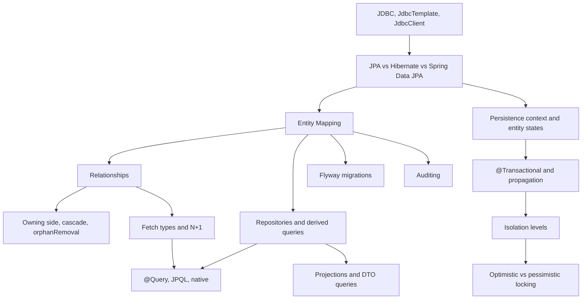
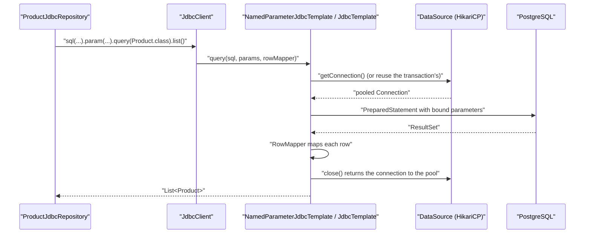
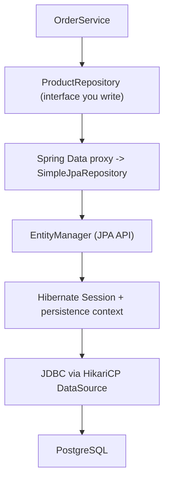

@@ 1 | MODULE | Phase 12 — Data Access with Spring Data JPA (Intermediate) | JDBC to JPA, entity mapping, relationships, N+1, repositories, transactions, isolation, locking, Flyway and auditing | MUST
# Phase 12: Data Access with Spring Data JPA (Intermediate)

Almost every Spring Boot backend talks to a relational database, and almost every Spring interview spends 10 to 20 minutes on it. This phase takes OrderHub from in-memory maps to **PostgreSQL**: first with plain JDBC so you see what the frameworks hide, then with JPA and Hibernate, relationships between products, customers, orders and order lines, Spring Data repositories, transactions, isolation, locking, schema migrations with Flyway, and auditing.

Interviewers love this area because it separates people who "used JPA" from people who understand it. The classic questions are traps: the N+1 problem, `LazyInitializationException`, `@Transactional` that silently does nothing, the owning side of a relationship, lost updates under concurrency. Every one of them is explained here with the SQL that Hibernate actually logs.



**What OrderHub gains in this phase**

| Piece | What you build |
|---|---|
| Database | PostgreSQL 17 in Docker (from the orientation `docker-compose.yml`) |
| Schema | Flyway migrations `V1__init.sql`, `V2__customer.sql` and onwards instead of `ddl-auto` |
| Entities | `Product`, `Category`, `Customer`, `CustomerProfile`, `Order`, `OrderLine`, `Payment` |
| Repositories | `ProductRepository`, `OrderRepository`, `CustomerRepository` with derived queries, JPQL, projections |
| Services | `OrderService.placeOrder` in one transaction, stock decrement with locking |
| Cross-cutting | Optimistic locking with `@Version`, auditing of `createdAt` and `updatedAt` |

**Prerequisites:** Phase 5 (layered architecture, DTOs), Phase 10 (beans, DI, configuration properties), Phase 11 (REST controllers, validation, pagination). Basic SQL: `SELECT`, `JOIN`, `WHERE`, indexes and foreign keys.

**The 5 questions from this phase that come up most often**
1. What is the N+1 problem and how do you fix it?
2. What is the difference between JPA, Hibernate and Spring Data JPA?
3. How does `@Transactional` work, and when does it not work (self-invocation, private methods, checked exceptions)?
4. Explain propagation `REQUIRED` vs `REQUIRES_NEW` and the isolation levels with their read phenomena.
5. Optimistic vs pessimistic locking: how do you prevent two users from overselling the last item in stock?

@@ 2 | MODULE | Foundations | From raw JDBC to JPA: what each layer does and how an entity maps to a table | MUST
# Foundations

**Shared analogy: sending letters abroad.** Raw JDBC is writing the letter yourself in the foreign language, buying the stamp and walking to the post office. `JdbcTemplate` and `JdbcClient` are a post office clerk: you still write the letter (the SQL), but the clerk handles envelopes, stamps and returns (connections, statements, exceptions). JPA is the international postal standard, Hibernate is the postal company that implements it, and Spring Data JPA is the concierge who sends standard letters for you when you only say "find the order with this id". Entity mapping is the address format that tells the system which table and column each field goes to.

@@ 3 | TOPIC | JDBC, JdbcTemplate and JdbcClient | How Java talks to a database at the lowest level and how Spring removes the boilerplate | SHOULD
# JDBC, JdbcTemplate and JdbcClient

**Level: Intermediate | Phase 12 | Priority: SHOULD | Since: JDBC JDK 1.1, JdbcTemplate Spring 1.0, JdbcClient Spring 6.1 (Boot 3.2)**

> **30-second interview answer:** JDBC is the low-level Java API for talking to a relational database: you get a `Connection`, prepare a statement, bind parameters, execute, iterate a `ResultSet` and close everything. `JdbcTemplate` is Spring's wrapper that does the connection handling, closing, and translation of `SQLException` into Spring's `DataAccessException` hierarchy, so I only write SQL and a row mapper. `JdbcClient`, added in Spring 6.1, is a fluent API over the same machinery with named parameters, and it is my default when I want plain SQL without JPA.

## 1. Concept in Simple Words
### Analogy
Cooking at home versus a restaurant kitchen with a sous-chef.

| Kitchen | Data access |
|---|---|
| You buy ingredients, cook, serve and wash every dish yourself | Raw JDBC: open connection, statement, result set, close all three |
| Forgetting to turn off the stove burns the house down | Forgetting to close a connection leaks the pool until the app hangs |
| A sous-chef who preps and cleans while you only do the recipe | `JdbcTemplate`: you give SQL and a mapper, it handles the rest |
| The sous-chef takes verbal orders like "two eggs, scrambled" | `JdbcClient`: fluent `sql(...).param(...).query(...)` |
| The recipe card | The SQL string you still write yourself |

### What it is
- **JDBC (Java Database Connectivity):** the `java.sql` API. Key types: `DataSource` (a factory of connections, usually a pool such as HikariCP), `Connection`, `PreparedStatement` (precompiled SQL with `?` placeholders), `ResultSet` (a cursor over rows), `SQLException` (a checked exception with a vendor error code).
- **JDBC driver:** the vendor library (`org.postgresql:postgresql`) that implements the interfaces and speaks the database wire protocol.
- **`JdbcTemplate`:** Spring class that implements the template method pattern: it owns the fixed steps (get connection, create statement, execute, close, translate exceptions) and calls your callback (`RowMapper`) for the variable part.
- **`NamedParameterJdbcTemplate`:** same, but with `:name` parameters instead of positional `?`.
- **`JdbcClient`:** a fluent facade (Spring 6.1) over `NamedParameterJdbcTemplate`. Supports positional and named params, mapping to records with `query(Product.class)`, `single()`, `optional()`, `list()`, `update()`.
- **`DataAccessException`:** Spring's unchecked exception hierarchy (`DuplicateKeyException`, `EmptyResultDataAccessException`, `DataIntegrityViolationException`) that hides vendor-specific SQL error codes.

### Why it exists
Raw JDBC needs about 25 lines for one query, most of which is try/finally plumbing, and every forgotten `close()` is a connection leak. `SQLException` is checked and vendor specific, so business code ends up full of catch blocks that cannot do anything useful. Spring's templates collapse that to two or three lines and give you exceptions you can reason about. JPA is not always the right tool: reports, bulk updates and complex SQL are often clearer with plain SQL, so `JdbcClient` remains a first-class option.

## 2. How It Works


Behind the scenes:
1. Boot auto-configures a `HikariDataSource` from `spring.datasource.*`, a `JdbcTemplate`, a `NamedParameterJdbcTemplate` and a `JdbcClient` bean (`JdbcTemplateAutoConfiguration`, `JdbcClientAutoConfiguration`).
2. The template asks `DataSourceUtils.getConnection()` for a connection. If a Spring transaction is active, it gets the connection bound to the current thread, so JDBC code joins `@Transactional` methods automatically.
3. On error, `SQLErrorCodeSQLExceptionTranslator` looks at the vendor SQL state (PostgreSQL `23505` is unique violation) and throws `DuplicateKeyException`.
4. `close()` on a pooled connection does not close the socket; it returns the connection to HikariCP.

```text
Raw JDBC ownership                       JdbcTemplate ownership
-------------------                      ----------------------
you: get connection                      template
you: prepare statement + bind            you give SQL + params
you: execute                             template
you: loop ResultSet, map rows            you give RowMapper (or a class)
you: close rs, ps, conn in finally       template
you: catch SQLException                  template translates to DataAccessException
```

## 3. Code Example
### Code
`pom.xml` (dependencies):
```xml
<dependency>
    <groupId>org.springframework.boot</groupId>
    <artifactId>spring-boot-starter-jdbc</artifactId>
</dependency>
<dependency>
    <groupId>org.postgresql</groupId>
    <artifactId>postgresql</artifactId>
    <scope>runtime</scope>
</dependency>
```

`application.yml`:
```yaml
spring:
  datasource:
    url: jdbc:postgresql://localhost:5432/orderhub
    username: orderhub
    password: orderhub
logging:
  level:
    org.springframework.jdbc.core: DEBUG   # logs every SQL statement the template runs
```

Raw JDBC, for comparison:
```java
package com.orderhub.product;

import javax.sql.DataSource;
import java.math.BigDecimal;
import java.sql.Connection;
import java.sql.PreparedStatement;
import java.sql.ResultSet;
import java.sql.SQLException;
import java.util.Optional;

public class RawJdbcProductDao {
    private final DataSource dataSource;

    public RawJdbcProductDao(DataSource dataSource) { this.dataSource = dataSource; }

    public Optional<ProductRow> findBySku(String sku) {
        String sql = "select id, sku, name, price from product where sku = ?";
        // try-with-resources closes ResultSet, PreparedStatement and Connection in reverse order
        try (Connection con = dataSource.getConnection();
             PreparedStatement ps = con.prepareStatement(sql)) {
            ps.setString(1, sku);                       // bind: never concatenate input into SQL
            try (ResultSet rs = ps.executeQuery()) {
                if (!rs.next()) return Optional.empty();
                return Optional.of(new ProductRow(rs.getLong("id"), rs.getString("sku"),
                        rs.getString("name"), rs.getBigDecimal("price")));
            }
        } catch (SQLException e) {
            throw new IllegalStateException("query failed for sku " + sku, e);  // checked -> unchecked by hand
        }
    }

    public record ProductRow(long id, String sku, String name, BigDecimal price) { }
}
```

The Spring way with `JdbcTemplate` and `JdbcClient`:
```java
package com.orderhub.product;

import org.springframework.jdbc.core.JdbcTemplate;
import org.springframework.jdbc.core.RowMapper;
import org.springframework.jdbc.core.simple.JdbcClient;
import org.springframework.jdbc.support.GeneratedKeyHolder;
import org.springframework.jdbc.support.KeyHolder;
import org.springframework.stereotype.Repository;

import java.math.BigDecimal;
import java.util.List;
import java.util.Optional;

@Repository
public class ProductJdbcRepository {

    public record ProductRow(Long id, String sku, String name, BigDecimal price) { }

    private static final RowMapper<ProductRow> MAPPER = (rs, rowNum) ->
            new ProductRow(rs.getLong("id"), rs.getString("sku"), rs.getString("name"), rs.getBigDecimal("price"));

    private final JdbcTemplate jdbcTemplate;
    private final JdbcClient jdbcClient;

    public ProductJdbcRepository(JdbcTemplate jdbcTemplate, JdbcClient jdbcClient) {
        this.jdbcTemplate = jdbcTemplate;
        this.jdbcClient = jdbcClient;
    }

    // JdbcTemplate: positional parameters + explicit RowMapper
    public List<ProductRow> findCheaperThan(BigDecimal max) {
        return jdbcTemplate.query("select id, sku, name, price from product where price < ? order by price",
                MAPPER, max);
    }

    // JdbcClient: named parameter, record mapping by column name, Optional result
    public Optional<ProductRow> findBySku(String sku) {
        return jdbcClient.sql("select id, sku, name, price from product where sku = :sku")
                .param("sku", sku)
                .query(ProductRow.class)      // maps columns to record components by name
                .optional();
    }

    // Insert and read back the generated id
    public long insert(String sku, String name, BigDecimal price) {
        KeyHolder keys = new GeneratedKeyHolder();
        jdbcClient.sql("insert into product (sku, name, price, stock) values (:sku, :name, :price, 0)")
                .param("sku", sku).param("name", name).param("price", price)
                .update(keys, "id");
        return keys.getKeyAs(Long.class);
    }

    // Bulk update: plain SQL is ideal, no entities loaded
    public int raisePrices(BigDecimal percent) {
        return jdbcClient.sql("update product set price = round(price * (1 + :pct / 100.0), 2)")
                .param("pct", percent)
                .update();
    }
}
```

A runner that exercises it:
```java
package com.orderhub;

import com.orderhub.product.ProductJdbcRepository;
import org.springframework.boot.CommandLineRunner;
import org.springframework.context.annotation.Bean;
import org.springframework.context.annotation.Configuration;
import org.springframework.dao.DuplicateKeyException;

import java.math.BigDecimal;

@Configuration
class JdbcDemoConfig {
    @Bean
    CommandLineRunner jdbcDemo(ProductJdbcRepository repo) {
        return args -> {
            long id = repo.insert("KB-01", "Keyboard", new BigDecimal("49.90"));
            System.out.println("inserted id=" + id);
            System.out.println(repo.findBySku("KB-01").orElseThrow());
            System.out.println("cheaper than 100: " + repo.findCheaperThan(new BigDecimal("100")).size());
            try {
                repo.insert("KB-01", "Duplicate", BigDecimal.TEN);   // sku has a unique constraint
            } catch (DuplicateKeyException e) {
                System.out.println("translated: " + e.getClass().getSimpleName());
            }
        };
    }
}
```

### Walkthrough
- `RawJdbcProductDao` shows the full ceremony: two nested try-with-resources, manual mapping and wrapping the checked `SQLException`.
- `MAPPER` is a `RowMapper` lambda: `JdbcTemplate` calls it once per row.
- `findBySku` with `JdbcClient` uses a named parameter and `query(ProductRow.class)`, which maps columns to record components (it uses `DataClassRowMapper` under the hood). `optional()` returns empty instead of throwing.
- `insert` uses a `KeyHolder` to read the database-generated id.
- `raisePrices` is a bulk update: one statement changes many rows without loading them, something JPA does poorly.
- The duplicate insert proves exception translation: PostgreSQL SQL state `23505` becomes Spring's `DuplicateKeyException`.

### Output
```text
DEBUG o.s.jdbc.core.JdbcTemplate : Executing prepared SQL update
DEBUG o.s.jdbc.core.JdbcTemplate : Executing prepared SQL statement [insert into product (sku, name, price, stock) values (?, ?, ?, 0)]
inserted id=1
DEBUG o.s.jdbc.core.JdbcTemplate : Executing prepared SQL query
DEBUG o.s.jdbc.core.JdbcTemplate : Executing prepared SQL statement [select id, sku, name, price from product where sku = ?]
ProductRow[id=1, sku=KB-01, name=Keyboard, price=49.90]
DEBUG o.s.jdbc.core.JdbcTemplate : Executing prepared SQL statement [select id, sku, name, price from product where price < ? order by price]
cheaper than 100: 1
DEBUG o.s.jdbc.core.JdbcTemplate : Executing prepared SQL statement [insert into product (sku, name, price, stock) values (?, ?, ?, 0)]
translated: DuplicateKeyException
```
Note that the named parameters `:sku` were rewritten to `?` before reaching the driver.

### Compare
| Raw JDBC | `JdbcTemplate` | `JdbcClient` |
|---|---|---|
| 20+ lines per query | 2 to 5 lines | 2 to 5 lines, fluent |
| You close resources | Template closes | Template closes |
| Checked `SQLException` | Unchecked `DataAccessException` | Unchecked `DataAccessException` |
| Positional `?` | Positional `?` (named with the NamedParameter variant) | Positional or named |
| Manual mapping | `RowMapper` or `BeanPropertyRowMapper` | `query(Class)` maps records and beans |

## 4. Interview Questions
**Basic**
1. **What are the main JDBC objects and their order of use?**
   `DataSource` gives a `Connection`; the connection creates a `PreparedStatement`; you bind parameters and execute it to get a `ResultSet` (or an update count); then you close result set, statement and connection in reverse order. In practice the `DataSource` is a pool, so closing returns the connection rather than disconnecting.
2. **Why use `PreparedStatement` instead of `Statement`?**
   Parameters are sent separately from the SQL text, so user input can never change the query structure: that prevents SQL injection. The database can also cache the parsed plan for repeated executions.
3. **What does `JdbcTemplate` do for you?**
   It acquires and releases connections, creates and closes statements and result sets, joins an existing Spring transaction, and translates `SQLException` into the unchecked `DataAccessException` hierarchy. You only provide the SQL, parameters and a `RowMapper`.

**Follow-up**
4. **What is `JdbcClient` and how does it relate to `JdbcTemplate`?**
   It is a fluent API added in Spring 6.1 that delegates to `NamedParameterJdbcTemplate`. It supports named and positional parameters, maps rows to records or beans by name, and has `single()`, `optional()`, `list()` and `update()` terminals. It is not a new engine, just a nicer front door.
5. **How does JDBC code participate in a `@Transactional` method?**
   The transaction manager binds a connection to the current thread when the transaction starts. `JdbcTemplate` gets its connection through `DataSourceUtils`, which returns that bound connection, so all statements commit or roll back together, even when mixed with JPA under `JpaTransactionManager`.
6. **What is exception translation and why is it useful?**
   Spring maps vendor error codes and SQL states to meaningful exceptions such as `DuplicateKeyException` or `DataIntegrityViolationException`. Your service can catch "duplicate key" the same way on PostgreSQL, MySQL or Oracle, and the exceptions are unchecked so they do not pollute signatures.

**Tricky / scenario**
7. **`jdbcTemplate.queryForObject(...)` throws an exception when the product does not exist. Why, and what do you use instead?**
   `queryForObject` expects exactly one row and throws `EmptyResultDataAccessException` for zero rows (and `IncorrectResultSizeDataAccessException` for more than one). Use `JdbcClient...optional()`, or `query(...)` and take the first element of the list.
8. **When would you choose JdbcClient over JPA in a Spring Boot app?**
   For reporting queries with many joins and aggregates, bulk updates and deletes, database-specific features (window functions, `ON CONFLICT`), or very hot paths where you want full control of the SQL. Many teams use JPA for the domain model and JdbcClient for reads and batch work in the same app.
9. **After a traffic spike the app hangs and logs `Connection is not available, request timed out after 30000ms`. What would you check in JDBC code?**
   Connections that are never returned: raw JDBC without try-with-resources, a `ResultSet` stream left open, or long transactions holding connections while calling slow HTTP services. Enable HikariCP `leakDetectionThreshold` to log the stack trace of the code that borrowed the connection.

**What the interviewer is really testing:** that you know what the frameworks hide (connections, statements, exception translation) and can pick plain SQL over JPA when it is the better tool.

## 5. Pitfalls & Best Practices
### Common mistakes
| Mistake | What goes wrong | Fix |
|---|---|---|
| Building SQL with string concatenation of user input | SQL injection | Always bind parameters (`?` or `:name`) |
| Not closing connections in raw JDBC | Pool exhaustion, app hangs | try-with-resources, or use the templates |
| `queryForObject` for an optional row | `EmptyResultDataAccessException` on no match | `JdbcClient.optional()` or `query` plus list |
| Catching `DataAccessException` everywhere | Noise, swallowed real errors | Catch only the specific subclass you can handle |
| `select *` with a `BeanPropertyRowMapper` | Breaks silently when columns change | List columns explicitly |

### Best practices
- Prefer `JdbcClient` for new plain-SQL code; keep `JdbcTemplate` for batch APIs (`batchUpdate`) and existing code.
- Keep SQL in the repository class, never in controllers or services.
- Map to records: immutable and no setters needed.
- Use `@Transactional` at the service layer; JDBC code joins it automatically.
- Turn on `org.springframework.jdbc.core` DEBUG logging in development to see every statement.

### Compare with
| Tool | Best for | Weak at |
|---|---|---|
| Raw JDBC | Libraries, learning, special driver features | Productivity, safety |
| `JdbcClient` or `JdbcTemplate` | Plain SQL, reports, bulk operations | Object graphs, dirty checking |
| Spring Data JDBC | Simple aggregates without lazy loading magic | Complex relationships |
| Spring Data JPA | Rich domain model, CRUD, relationships | Bulk work, very complex SQL |

## 6. Hands-on Exercise
In OrderHub, create `ReportRepository` using `JdbcClient` with a method `List<CategorySales> salesByCategory(LocalDate from, LocalDate to)` that returns category name, number of orders and total revenue, using a single SQL query with joins and `group by`. Expose it at `GET /api/reports/sales?from=2026-01-01&to=2026-01-31`.

Acceptance criteria:
- One SQL statement, named parameters, no string concatenation.
- Result mapped to a record `CategorySales(String category, long orders, BigDecimal revenue)`.
- Sorted by revenue descending.

<details><summary>Solution</summary>

```java
package com.orderhub.report;

import org.springframework.format.annotation.DateTimeFormat;
import org.springframework.jdbc.core.simple.JdbcClient;
import org.springframework.stereotype.Repository;
import org.springframework.web.bind.annotation.GetMapping;
import org.springframework.web.bind.annotation.RequestMapping;
import org.springframework.web.bind.annotation.RequestParam;
import org.springframework.web.bind.annotation.RestController;

import java.math.BigDecimal;
import java.time.LocalDate;
import java.util.List;

record CategorySales(String category, long orders, BigDecimal revenue) { }

@Repository
class ReportRepository {
    private final JdbcClient jdbc;

    ReportRepository(JdbcClient jdbc) { this.jdbc = jdbc; }

    List<CategorySales> salesByCategory(LocalDate from, LocalDate to) {
        return jdbc.sql("""
                select c.name as category,
                       count(distinct o.id) as orders,
                       sum(l.quantity * l.unit_price) as revenue
                from orders o
                join order_line l on l.order_id = o.id
                join product_category pc on pc.product_id = l.product_id
                join category c on c.id = pc.category_id
                where o.created_at >= :from and o.created_at < :toExclusive
                group by c.name
                order by revenue desc
                """)
                .param("from", from.atStartOfDay())
                .param("toExclusive", to.plusDays(1).atStartOfDay())
                .query(CategorySales.class)
                .list();
    }
}

@RestController
@RequestMapping("/api/reports")
class ReportController {
    private final ReportRepository reports;

    ReportController(ReportRepository reports) { this.reports = reports; }

    @GetMapping("/sales")
    List<CategorySales> sales(@RequestParam @DateTimeFormat(iso = DateTimeFormat.ISO.DATE) LocalDate from,
                              @RequestParam @DateTimeFormat(iso = DateTimeFormat.ISO.DATE) LocalDate to) {
        return reports.salesByCategory(from, to);
    }
}
```
The column aliases (`category`, `orders`, `revenue`) match the record component names, so `query(CategorySales.class)` maps them without a hand-written `RowMapper`. The half-open range `>= from and < to+1` includes the whole last day.
</details>

## 7. Recall
Q: What does JdbcTemplate handle that raw JDBC leaves to you?
A: Getting and releasing connections, closing statements and result sets, joining Spring transactions, and translating `SQLException` into unchecked `DataAccessException`.

Q: What is JdbcClient in Spring 6.1?
A: A fluent API over `NamedParameterJdbcTemplate` with named or positional params, record mapping and `single`, `optional`, `list` and `update` terminals.

Q: Why does PreparedStatement prevent SQL injection?
A: Parameters are sent separately from the SQL text, so input is always treated as data and cannot change the query structure.

Q: Which Spring exception do you get for a unique constraint violation through JdbcTemplate?
A: `DuplicateKeyException`, a subclass of `DataIntegrityViolationException`.

Q: When is plain SQL with JdbcClient a better choice than JPA?
A: For reports with joins and aggregates, bulk updates or deletes, database-specific SQL and hot paths that need full control.

**Related:** [[JPA vs Hibernate vs Spring Data JPA]] · [[@Transactional and Propagation]] · [[Connection Pooling with HikariCP]]

@@ 3 | TOPIC | JPA vs Hibernate vs Spring Data JPA | The specification, the implementation and the repository abstraction, and what each one does | MUST
# JPA vs Hibernate vs Spring Data JPA

**Level: Intermediate | Phase 12 | Priority: MUST | Since: JPA 1.0 (2006), Jakarta Persistence 3.0 (2020), Hibernate 6 in Boot 3, Spring Data JPA 1.0 (2011)**

> **30-second interview answer:** JPA, now Jakarta Persistence, is a specification: a set of interfaces and annotations like `@Entity`, `EntityManager` and JPQL, with no code that runs. Hibernate is the most popular implementation of that specification: it generates SQL, manages the persistence context, does dirty checking and lazy loading. Spring Data JPA sits on top: it generates repository implementations from interfaces, so `findByEmail` becomes a query without me writing any code. So Spring Data JPA calls JPA's `EntityManager`, which Hibernate implements, which uses JDBC to reach the database.

## 1. Concept in Simple Words
### Analogy
USB charging.

| USB world | Persistence world |
|---|---|
| The USB-C standard document | JPA (Jakarta Persistence) specification |
| A real charger made by a company (Anker, Apple) | Hibernate (or EclipseLink), the implementation |
| A smart power strip that picks the right charger and cable for you | Spring Data JPA, which writes repository code for you |
| The electricity in the wall | JDBC and the database |
| You can swap chargers because they follow the standard | You could swap Hibernate for EclipseLink if you only use JPA APIs |

### What it is
- **ORM (Object-Relational Mapping):** mapping objects and their references to tables and foreign keys so you work with `order.getLines()` instead of joins and result sets.
- **JPA / Jakarta Persistence:** the specification. Packages `jakarta.persistence.*` (Boot 3; it was `javax.persistence.*` before Jakarta EE 9). Defines `@Entity`, `@Id`, `@OneToMany`, `EntityManager`, `EntityManagerFactory`, the persistence context, JPQL and the Criteria API.
- **Hibernate ORM:** the implementation. Boot 3.5 ships Hibernate 6.6 (`Boot 4` moves to Hibernate 7 and Jakarta Persistence 3.2). It adds extras beyond JPA: `@BatchSize`, `@Formula`, `@NaturalId`, `@SQLRestriction`, statistics, its own `Session` API.
- **Spring Data JPA:** part of the Spring Data family. You declare `interface ProductRepository extends JpaRepository<Product, Long>` and at startup Spring creates a proxy implementation backed by `SimpleJpaRepository`, plus queries derived from method names.
- **`spring-boot-starter-data-jpa`:** the starter that brings Hibernate, Spring Data JPA, HikariCP and `spring-jdbc`, and auto-configures the `EntityManagerFactory` and `JpaTransactionManager`.

### Why it exists
Without an ORM you hand-write SQL and mapping for every entity, manually track which fields changed, and write the same CRUD code for every table. JPA standardised ORM so code is not tied to one vendor. Hibernate made it practical. Spring Data JPA removed the remaining boilerplate (the repository classes that all looked the same).

## 2. How It Works


What happens at startup with `spring-boot-starter-data-jpa`:
1. `DataSourceAutoConfiguration` creates the HikariCP pool.
2. `HibernateJpaAutoConfiguration` creates a `LocalContainerEntityManagerFactoryBean`, which scans `@Entity` classes under the main application package and builds Hibernate's `SessionFactory` (which is the `EntityManagerFactory`). It also creates `JpaTransactionManager`.
3. `JpaRepositoriesAutoConfiguration` scans for interfaces extending `Repository`. For each one, a `JpaRepositoryFactoryBean` creates a JDK dynamic proxy. Calls to CRUD methods go to `SimpleJpaRepository`; calls to query methods go to a query object built once at startup (derived from the name or from `@Query`).
4. A shared `EntityManager` proxy is injected everywhere. It routes each call to the `EntityManager` bound to the current transaction (thread), which is why one singleton bean can be used safely by many threads.

What happens when you call `productRepository.save(p)`:
```text
save(p)
 -> SimpleJpaRepository.save: @Transactional (opens a tx if none)
    -> entityInformation.isNew(p)?  (id == null, or @Version == null)
       yes -> em.persist(p)        no -> em.merge(p)
 -> commit: Hibernate flushes the persistence context
    -> dirty checking compares each managed entity with its snapshot
    -> generates INSERT or UPDATE through JDBC
```

## 3. Code Example
### Code
`pom.xml`:
```xml
<dependency>
    <groupId>org.springframework.boot</groupId>
    <artifactId>spring-boot-starter-data-jpa</artifactId>
</dependency>
<dependency>
    <groupId>org.postgresql</groupId>
    <artifactId>postgresql</artifactId>
    <scope>runtime</scope>
</dependency>
```

`application.yml`:
```yaml
spring:
  datasource:
    url: jdbc:postgresql://localhost:5432/orderhub
    username: orderhub
    password: orderhub
  jpa:
    open-in-view: false          # do not keep the session open during view rendering (see N+1 topic)
    show-sql: true               # prints every SQL statement prefixed with "Hibernate:"
    hibernate:
      ddl-auto: validate         # Flyway owns the schema; Hibernate only checks it
```

The same "find product by sku" at three levels:
```java
package com.orderhub.product;

import jakarta.persistence.Column;
import jakarta.persistence.Entity;
import jakarta.persistence.EntityManager;
import jakarta.persistence.GeneratedValue;
import jakarta.persistence.GenerationType;
import jakarta.persistence.Id;
import jakarta.persistence.PersistenceContext;
import org.hibernate.Session;
import org.springframework.data.jpa.repository.JpaRepository;
import org.springframework.stereotype.Repository;
import org.springframework.transaction.annotation.Transactional;

import java.math.BigDecimal;
import java.util.Optional;

@Entity
class Product {
    @Id @GeneratedValue(strategy = GenerationType.IDENTITY)
    private Long id;
    @Column(nullable = false, unique = true)
    private String sku;
    private String name;
    private BigDecimal price;

    protected Product() { }                       // JPA needs a no-arg constructor
    Product(String sku, String name, BigDecimal price) { this.sku = sku; this.name = name; this.price = price; }
    Long getId() { return id; }
    String getSku() { return sku; }
    void setPrice(BigDecimal price) { this.price = price; }
    @Override public String toString() { return "Product[" + id + ", " + sku + ", " + price + "]"; }
}

// Level 1: pure JPA API (portable across providers)
@Repository
class JpaProductDao {
    @PersistenceContext
    private EntityManager em;                    // shared, transaction-bound proxy

    Optional<Product> findBySku(String sku) {
        return em.createQuery("select p from Product p where p.sku = :sku", Product.class)
                 .setParameter("sku", sku)
                 .getResultStream().findFirst();
    }
}

// Level 2: Hibernate-specific API (only when you need provider features)
@Repository
class HibernateProductDao {
    @PersistenceContext
    private EntityManager em;

    Optional<Product> findBySku(String sku) {
        Session session = em.unwrap(Session.class);          // drop down to Hibernate
        return session.byNaturalId(Product.class)             // would need @NaturalId on sku
                      .using("sku", sku).loadOptional();
    }
}

// Level 3: Spring Data JPA (no implementation at all)
interface ProductRepository extends JpaRepository<Product, Long> {
    Optional<Product> findBySku(String sku);                  // query derived from the method name
}

@org.springframework.stereotype.Service
class PriceService {
    private final ProductRepository products;
    PriceService(ProductRepository products) { this.products = products; }

    @Transactional
    public void changePrice(String sku, BigDecimal newPrice) {
        Product p = products.findBySku(sku).orElseThrow();
        p.setPrice(newPrice);          // no save() call: dirty checking issues the UPDATE at commit
    }
}
```

### Walkthrough
- `Product` is a JPA entity: `jakarta.persistence` annotations only, so it is portable.
- `JpaProductDao` writes JPQL against the entity name `Product` and field `sku`, not the table and column.
- `HibernateProductDao` uses `unwrap(Session.class)` to reach Hibernate-only features. That ties the code to Hibernate; do it deliberately.
- `ProductRepository` has no implementation class. Spring Data parses `findBySku` into `select p from Product p where p.sku = ?1` at startup.
- `changePrice` loads the entity, changes a field, and returns. Hibernate's dirty checking notices the change at commit and writes the UPDATE.

### Output
Calling `priceService.changePrice("KB-01", new BigDecimal("44.90"))` with `show-sql: true`:
```text
Hibernate: select p1_0.id,p1_0.name,p1_0.price,p1_0.sku from product p1_0 where p1_0.sku=?
Hibernate: update product set name=?,price=?,sku=? where id=?
```
The second line was never written by you: it came from dirty checking at commit time.

### Compare
| | JPA | Hibernate | Spring Data JPA |
|---|---|---|---|
| What it is | Specification (API plus rules) | Implementation of JPA plus extras | Repository abstraction over JPA |
| Package | `jakarta.persistence` | `org.hibernate` | `org.springframework.data.jpa` |
| Runs code? | No | Yes: SQL generation, caching, dirty checking | Yes: proxies, derived queries, paging |
| Main type | `EntityManager` | `Session` | `JpaRepository` |
| Can be swapped? | It is the contract | For EclipseLink, if you avoid extras | Could drop it and use `EntityManager` directly |

## 4. Interview Questions
**Basic**
1. **What is the difference between JPA and Hibernate?**
   JPA is a specification: interfaces, annotations and rules with no runnable code. Hibernate is an implementation of that specification (others are EclipseLink and OpenJPA) and also offers extra features beyond it. You code against JPA annotations and `EntityManager`, and Hibernate does the work at runtime.
2. **What does Spring Data JPA add on top of JPA?**
   Repository interfaces with generated implementations, CRUD methods, query derivation from method names, `@Query`, pagination and sorting, projections, auditing and specifications. It removes the hand-written DAO classes but still uses JPA and Hibernate underneath.
3. **Why did imports change from `javax.persistence` to `jakarta.persistence`?**
   Java EE was moved to the Eclipse Foundation as Jakarta EE, and Oracle kept the `javax` trademark, so Jakarta EE 9 renamed packages to `jakarta.*`. Spring Boot 3 requires Jakarta EE 9+, so every entity import changed during a Boot 2 to Boot 3 upgrade.

**Follow-up**
4. **How does Spring Data create an implementation for an interface?**
   At startup it finds repository interfaces and, for each, creates a JDK dynamic proxy through `JpaRepositoryFactoryBean`. CRUD calls are delegated to `SimpleJpaRepository`, and query methods are parsed once into JPQL (or read from `@Query`) and executed through the `EntityManager`. Invalid method names fail at startup, not at runtime.
5. **How does `save()` decide between insert and update?**
   `SimpleJpaRepository.save` checks whether the entity is new: by default, id is null (or for primitive ids, zero), or the `@Version` field is null. New entities go to `em.persist`, others to `em.merge`. If you assign ids yourself, every `save` becomes a `merge` with an extra SELECT unless you implement `Persistable.isNew()`.
6. **Why is the injected `EntityManager` thread-safe when `EntityManager` itself is not?**
   Spring injects a shared proxy. Each call looks up the real `EntityManager` bound to the current transaction (stored in a thread-bound resource holder), so every thread and transaction gets its own persistence context.

**Tricky / scenario**
7. **You change a field of an entity inside a `@Transactional` method and never call `save`. Is it persisted?**
   Yes, if the entity is managed (loaded in the same persistence context). At flush time Hibernate compares the entity with its loaded snapshot and issues an UPDATE. Calling `save` on a managed entity is harmless but unnecessary; the same code outside a transaction would not persist anything.
8. **Should you use `EntityManager` directly if you have Spring Data?**
   For most CRUD and queries, no. You use it for things repositories do not express well: `em.getReference`, explicit `flush`/`clear` in batch jobs, `unwrap(Session.class)` for Hibernate features, or dynamic queries. You can inject it into a custom repository fragment and keep the rest generated.
9. **Your team wants to switch from Hibernate to EclipseLink. What would break?**
   Any use of Hibernate-only annotations and APIs (`@BatchSize`, `@Formula`, `Session`, Hibernate types, HQL extensions), behaviour differences in lazy loading and flushing, and Spring Boot auto-configuration, which is Hibernate-first. In practice teams rarely switch; the portability is more theoretical than real.

**What the interviewer is really testing:** whether you can name the layers precisely and explain what happens between `repository.save()` and the SQL on the wire.

## 5. Pitfalls & Best Practices
### Common mistakes
| Mistake | What goes wrong | Fix |
|---|---|---|
| Saying "JPA" and "Hibernate" as if they were the same | Weak interview answer | Spec vs implementation vs repository abstraction |
| `ddl-auto: update` in production | Unreviewed schema changes, no rollback, data loss risk | `validate` plus Flyway migrations |
| Leaving `open-in-view` enabled by default | Lazy loading from controllers, hidden queries, long connection use | `spring.jpa.open-in-view: false` |
| Calling `save` after every setter | Extra `merge` work, false belief it is required | Rely on dirty checking for managed entities |
| Mixing `javax.persistence` and `jakarta.persistence` imports | Entities not found after Boot 3 upgrade | Use `jakarta.*` only |

### Best practices
- Code against JPA annotations by default; use Hibernate extras deliberately and know you are doing it.
- Keep `show-sql` or `logging.level.org.hibernate.SQL=DEBUG` on in development and read the SQL.
- Set `open-in-view: false` and `ddl-auto: validate` from day one.
- Keep entities in a package under the main application class so scanning finds them.
- Use Spring Data for repositories; drop to `EntityManager` in custom fragments when needed.

### Compare with
| Option | Abstraction level | Typical use |
|---|---|---|
| JDBC or JdbcClient | SQL | Reports, bulk work |
| Spring Data JDBC | Aggregates, no lazy loading or persistence context | Simple domain, predictable SQL |
| JPA with Hibernate | Full ORM | Rich domain model |
| jOOQ | Type-safe SQL builder | SQL-heavy apps that want compile-time checks |
| MyBatis | SQL in XML or annotations mapped to objects | Legacy and SQL-first teams |

## 6. Hands-on Exercise
Migrate OrderHub's `ProductService` from the in-memory `Map<Long, Product>` (Phase 5) to Spring Data JPA.

Acceptance criteria:
- Add `spring-boot-starter-data-jpa` and the PostgreSQL driver, configure `application.yml` with `open-in-view: false`, `show-sql: true`.
- Turn `Product` into an entity and create `ProductRepository extends JpaRepository<Product, Long>`.
- `ProductService` keeps the same public methods; `update` must not call `save` (use dirty checking).
- `GET /api/products/{id}` for an unknown id still returns 404 through the existing exception handler.

<details><summary>Solution</summary>

```java
package com.orderhub.product;

import org.springframework.data.jpa.repository.JpaRepository;
import org.springframework.stereotype.Service;
import org.springframework.transaction.annotation.Transactional;

import java.math.BigDecimal;
import java.util.List;

interface ProductRepository extends JpaRepository<Product, Long> { }

@Service
@Transactional(readOnly = true)               // default for all methods: read-only transactions
class ProductService {
    private final ProductRepository products;

    ProductService(ProductRepository products) { this.products = products; }

    List<ProductDto> findAll() {
        return products.findAll().stream().map(ProductDto::from).toList();
    }

    ProductDto findById(Long id) {
        return products.findById(id).map(ProductDto::from)
                .orElseThrow(() -> new ProductNotFoundException(id));
    }

    @Transactional                               // read-write
    ProductDto create(CreateProductRequest req) {
        Product saved = products.save(new Product(req.sku(), req.name(), req.price()));
        return ProductDto.from(saved);
    }

    @Transactional
    ProductDto update(Long id, UpdateProductRequest req) {
        Product p = products.findById(id).orElseThrow(() -> new ProductNotFoundException(id));
        p.rename(req.name());
        p.changePrice(req.price());              // dirty checking writes the UPDATE at commit
        return ProductDto.from(p);
    }
}

record ProductDto(Long id, String sku, String name, BigDecimal price) {
    static ProductDto from(Product p) { return new ProductDto(p.getId(), p.getSku(), p.getName(), p.getPrice()); }
}
record CreateProductRequest(String sku, String name, BigDecimal price) { }
record UpdateProductRequest(String name, BigDecimal price) { }
```
The controller and `ProductNotFoundException` handler from Phase 11 do not change: only the storage behind the service did. That is the payoff of the layered architecture.
</details>

## 7. Recall
Q: What is the difference between JPA, Hibernate and Spring Data JPA?
A: JPA is the specification (annotations and `EntityManager` API), Hibernate is an implementation that generates SQL and manages state, and Spring Data JPA generates repository implementations on top of JPA.

Q: How does Spring Data JPA's save() decide between persist and merge?
A: It checks `isNew`: null id (or null `@Version`) means persist, otherwise merge.

Q: Why is a field change on a managed JPA entity saved without calling save()?
A: Hibernate's dirty checking compares managed entities with their snapshots at flush and issues UPDATEs for changed ones.

Q: Which package do JPA annotations use in Spring Boot 3?
A: `jakarta.persistence`, because Jakarta EE 9 renamed the `javax` packages.

Q: Which Hibernate version does Spring Boot 3.5 use, and what changes in Boot 4?
A: Hibernate 6.6 with Jakarta Persistence 3.1; Boot 4 moves to Hibernate 7 and Jakarta Persistence 3.2.

**Related:** [[Entity Mapping]] · [[Repositories and Derived Queries]] · [[Persistence Context and Entity States]] · [[JDBC, JdbcTemplate and JdbcClient]]

@@ 3 | TOPIC | Entity Mapping | @Entity, @Id and generation strategies, columns, enums, embeddables and equals and hashCode for entities | MUST
# Entity Mapping

**Level: Intermediate | Phase 12 | Priority: MUST | Since: JPA 1.0; `GenerationType.UUID` JPA 3.1 (Boot 3)**

> **30-second interview answer:** An entity is a class annotated with `@Entity` whose instances map to rows of a table, with an `@Id` primary key and a no-arg constructor. I map columns with `@Column`, enums with `@Enumerated(EnumType.STRING)`, value objects with `@Embeddable`, and choose an id strategy: `SEQUENCE` on PostgreSQL because it allows batch inserts, or `IDENTITY` on MySQL. For `equals` and `hashCode` I use a business key or an id-based equals with a constant hash code, never Lombok's `@Data`.

## 1. Concept in Simple Words
### Analogy
A customs declaration form.

| Customs form | Entity mapping |
|---|---|
| The form type ("Goods import form") | `@Entity` and `@Table(name = "orders")` |
| The unique declaration number | `@Id` primary key |
| Who issues the number: you, or the customs office counter | Id generation: assigned, `IDENTITY`, `SEQUENCE`, `UUID` |
| Each box on the form with a label and max length | `@Column(name, length, nullable)` |
| A tick box with fixed choices written as words | `@Enumerated(EnumType.STRING)` |
| A reusable "Address" block that appears on many forms | `@Embeddable Address` |
| Notes you write for yourself, not submitted | `@Transient` field |

### What it is
- **`@Entity`:** marks a class as persistent. Requirements: a no-arg constructor (can be `protected`), not `final` (Hibernate creates proxy subclasses for lazy loading), an `@Id`.
- **`@Table`:** table name, schema, unique constraints and indexes (indexes are only used for schema generation).
- **`@Id` and `@GeneratedValue`:**
  - `IDENTITY`: database auto-increment column (`bigint generated by default as identity`). Hibernate must run the INSERT immediately to learn the id, which disables JDBC batch inserts.
  - `SEQUENCE`: Hibernate calls `nextval` on a database sequence; with `allocationSize = 50` it reserves 50 ids per call (pooled optimizer). Allows batching. Best default on PostgreSQL and Oracle.
  - `UUID` (JPA 3.1): generated in Java, no round trip, good for distributed systems, but bigger indexes and random inserts.
  - `AUTO`: provider chooses; Hibernate 6 picks `SEQUENCE` for numeric ids.
- **`@Column`:** name, `nullable`, `length`, `precision`/`scale`, `unique`, `updatable`, `insertable`.
- **`@Enumerated(EnumType.STRING)`:** store the name. `ORDINAL` (the default!) stores 0, 1, 2 and silently corrupts data when someone reorders constants.
- **`@Embeddable` and `@Embedded`:** a value object without its own table or identity; its fields become columns of the owning table.
- **`@Transient`:** field not persisted.
- **Access type:** where `@Id` sits decides whether Hibernate reads fields (field access, recommended) or getters (property access).
- **Naming strategy:** Boot's `CamelCaseToUnderscoresNamingStrategy` maps `unitPrice` to `unit_price` automatically.

### Why it exists
The object world and the table world do not match: objects have types, enums, nested value objects and references; tables have columns, keys and SQL types. Mapping annotations describe the translation once, so Hibernate can generate correct SQL everywhere.

## 2. How It Works
```text
Java class Order                         Table orders
-------------------------------          ------------------------------------
@Id Long id                  ----------> id bigint primary key (sequence orders_seq)
String orderNumber           ----------> order_number varchar(20) not null unique
@Enumerated(STRING) status   ----------> status varchar(20) not null  ('NEW','PAID', etc.)
@Embedded Address shipTo                 ship_street varchar(120)
   street, city, zip         ----------> ship_city varchar(60)
                                         ship_zip varchar(10)
BigDecimal total             ----------> total numeric(12,2)
Instant createdAt            ----------> created_at timestamp with time zone
@Transient boolean dirtyUi   ----------> (no column)
```

At startup Hibernate builds a metamodel from the annotations: for each entity its table, columns, id generator and SQL templates for insert, update, delete and load. With `ddl-auto: validate` it compares that metamodel with the real schema and fails fast if a column is missing or has the wrong type.

How SEQUENCE with pooled allocation works:
```text
allocationSize = 50, sequence increment by 50
persist #1  -> select nextval('orders_seq')  returns 51  -> ids 2..51 are reserved in memory
persist #2..#50 -> no database call
persist #51 -> select nextval('orders_seq')  returns 101 -> next block
```
The sequence `INCREMENT BY` must equal `allocationSize`, or validation fails or ids collide.

## 3. Code Example
### Code
Flyway migration `src/main/resources/db/migration/V1__init.sql` (excerpt for these tables):
```sql
create sequence product_seq start with 1 increment by 50;
create sequence orders_seq  start with 1 increment by 50;

create table product (
    id          bigint primary key,
    sku         varchar(40)  not null unique,
    name        varchar(120) not null,
    price       numeric(12,2) not null,
    stock       integer not null default 0,
    status      varchar(20) not null,
    created_at  timestamp with time zone not null
);

create table orders (
    id            bigint primary key,
    order_number  varchar(20) not null unique,
    status        varchar(20) not null,
    ship_street   varchar(120),
    ship_city     varchar(60),
    ship_zip      varchar(10),
    total         numeric(12,2) not null,
    created_at    timestamp with time zone not null
);
```

Embeddable value object:
```java
package com.orderhub.order;

import jakarta.persistence.Column;
import jakarta.persistence.Embeddable;

@Embeddable
public record Address(                       // records work as embeddables since Hibernate 6.2
        @Column(name = "ship_street", length = 120) String street,
        @Column(name = "ship_city", length = 60) String city,
        @Column(name = "ship_zip", length = 10) String zip) { }
```

Product entity:
```java
package com.orderhub.product;

import jakarta.persistence.Column;
import jakarta.persistence.Entity;
import jakarta.persistence.EnumType;
import jakarta.persistence.Enumerated;
import jakarta.persistence.GeneratedValue;
import jakarta.persistence.GenerationType;
import jakarta.persistence.Id;
import jakarta.persistence.SequenceGenerator;
import jakarta.persistence.Table;
import jakarta.persistence.Transient;

import java.math.BigDecimal;
import java.time.Instant;
import java.util.Objects;

@Entity
@Table(name = "product")
public class Product {

    public enum Status { ACTIVE, DISCONTINUED }

    @Id
    @GeneratedValue(strategy = GenerationType.SEQUENCE, generator = "product_gen")
    @SequenceGenerator(name = "product_gen", sequenceName = "product_seq", allocationSize = 50)
    private Long id;

    @Column(nullable = false, unique = true, length = 40, updatable = false)
    private String sku;                              // business key, never changes

    @Column(nullable = false, length = 120)
    private String name;

    @Column(nullable = false, precision = 12, scale = 2)
    private BigDecimal price;

    @Column(nullable = false)
    private int stock;

    @Enumerated(EnumType.STRING)                     // stores 'ACTIVE', not 0
    @Column(nullable = false, length = 20)
    private Status status = Status.ACTIVE;

    @Column(name = "created_at", nullable = false, updatable = false)
    private Instant createdAt = Instant.now();

    @Transient
    private boolean lowStockWarningShown;            // UI-only, not a column

    protected Product() { }                          // for JPA

    public Product(String sku, String name, BigDecimal price, int stock) {
        this.sku = Objects.requireNonNull(sku);
        this.name = name;
        this.price = price;
        this.stock = stock;
    }

    // Domain methods instead of blind setters
    public void changePrice(BigDecimal newPrice) {
        if (newPrice.signum() <= 0) throw new IllegalArgumentException("price must be positive");
        this.price = newPrice;
    }
    public void discontinue() { this.status = Status.DISCONTINUED; }

    public Long getId() { return id; }
    public String getSku() { return sku; }
    public String getName() { return name; }
    public BigDecimal getPrice() { return price; }
    public int getStock() { return stock; }
    public Status getStatus() { return status; }

    // equals and hashCode on the immutable business key
    @Override public boolean equals(Object o) {
        if (this == o) return true;
        if (!(o instanceof Product other)) return false;
        return sku.equals(other.sku);
    }
    @Override public int hashCode() { return sku.hashCode(); }
}
```

Order entity with an embedded address and id-based equals:
```java
package com.orderhub.order;

import jakarta.persistence.*;
import org.hibernate.proxy.HibernateProxy;

import java.math.BigDecimal;
import java.time.Instant;

@Entity
@Table(name = "orders")                              // "order" is a reserved SQL word
public class Order {

    public enum Status { NEW, PAID, SHIPPED, CANCELLED }

    @Id
    @GeneratedValue(strategy = GenerationType.SEQUENCE, generator = "orders_gen")
    @SequenceGenerator(name = "orders_gen", sequenceName = "orders_seq", allocationSize = 50)
    private Long id;

    @Column(name = "order_number", nullable = false, unique = true, length = 20)
    private String orderNumber;

    @Enumerated(EnumType.STRING)
    @Column(nullable = false, length = 20)
    private Status status = Status.NEW;

    @Embedded
    private Address shipTo;

    @Column(nullable = false, precision = 12, scale = 2)
    private BigDecimal total = BigDecimal.ZERO;

    @Column(name = "created_at", nullable = false, updatable = false)
    private Instant createdAt = Instant.now();

    protected Order() { }
    public Order(String orderNumber, Address shipTo) { this.orderNumber = orderNumber; this.shipTo = shipTo; }

    public Long getId() { return id; }
    public Status getStatus() { return status; }
    public Address getShipTo() { return shipTo; }

    // Id-based equals that is safe before persist and with Hibernate proxies
    @Override public final boolean equals(Object o) {
        if (this == o) return true;
        if (o == null) return false;
        Class<?> oClass = o instanceof HibernateProxy hp ? hp.getHibernateLazyInitializer().getPersistentClass() : o.getClass();
        if (oClass != Order.class) return false;
        Order other = (Order) (o instanceof HibernateProxy hp2 ? hp2.getHibernateLazyInitializer().getImplementation() : o);
        return id != null && id.equals(other.id);    // two transient orders are never equal
    }
    @Override public final int hashCode() { return Order.class.hashCode(); }  // constant: stable across persist
}
```

Saving three products in one transaction:
```java
package com.orderhub.product;

import org.springframework.boot.CommandLineRunner;
import org.springframework.context.annotation.Bean;
import org.springframework.context.annotation.Configuration;
import org.springframework.data.jpa.repository.JpaRepository;

import java.math.BigDecimal;
import java.util.List;

interface ProductRepository extends JpaRepository<Product, Long> { }

@Configuration
class MappingDemo {
    @Bean
    CommandLineRunner seed(ProductRepository repo) {
        return args -> {
            List<Product> saved = repo.saveAll(List.of(          // saveAll runs in one transaction
                    new Product("KB-01", "Keyboard", new BigDecimal("49.90"), 10),
                    new Product("MS-01", "Mouse", new BigDecimal("19.90"), 25),
                    new Product("MN-27", "Monitor 27", new BigDecimal("229.00"), 4)));
            saved.forEach(p -> System.out.println(p.getId() + " " + p.getSku() + " " + p.getStatus()));
        };
    }
}
```

`application.yml` additions to enable JDBC batching:
```yaml
spring:
  jpa:
    show-sql: true
    properties:
      hibernate:
        jdbc.batch_size: 50
        order_inserts: true
```

### Walkthrough
- `@SequenceGenerator(allocationSize = 50)` matches `increment by 50` in the migration; Hibernate fetches one sequence value and hands out 50 ids from memory.
- `sku` is `updatable = false`, so Hibernate never includes it in UPDATE statements, which makes it a safe business key for `equals`.
- `status` uses `EnumType.STRING`; the column contains readable values and survives reordering of constants.
- `Address` is a record embeddable: its three fields become the `ship_*` columns of `orders`.
- `Order.equals` handles Hibernate proxies (lazy references are subclasses) and returns false for two unsaved orders; `hashCode` is constant so an order put in a `HashSet` before `persist` is still found after the id is assigned.
- With SEQUENCE ids and `jdbc.batch_size`, the three inserts are sent in one JDBC batch.

### Output
```text
Hibernate: select nextval('product_seq')
Hibernate: insert into product (created_at,name,price,sku,status,stock,id) values (?,?,?,?,?,?,?)
Hibernate: insert into product (created_at,name,price,sku,status,stock,id) values (?,?,?,?,?,?,?)
Hibernate: insert into product (created_at,name,price,sku,status,stock,id) values (?,?,?,?,?,?,?)
1 KB-01 ACTIVE
2 MS-01 ACTIVE
3 MN-27 ACTIVE
```
`show-sql` prints one line per statement even when they travel as one batch. Only one `nextval` call was needed for all three ids. With `IDENTITY` you would see no sequence call but each insert would run separately, immediately at `persist`.

### Compare
| Id strategy | How id is produced | Batch inserts | Best for |
|---|---|---|---|
| `IDENTITY` | Auto-increment column, known after INSERT | No (insert runs at persist) | MySQL, simple apps |
| `SEQUENCE` | `nextval` with pooled allocation | Yes | PostgreSQL, Oracle, high write volume |
| `UUID` | Generated in Java | Yes | Distributed ids, ids exposed publicly |
| Assigned | You set it | Yes, but `save` does merge | Natural keys, imports |
| `TABLE` | Emulated with a table and row locks | Poor | Avoid |

## 4. Interview Questions
**Basic**
1. **What are the minimum requirements for a JPA entity?**
   `@Entity`, an `@Id` field, and a public or protected no-arg constructor. The class must not be `final` and persistent methods should not be final, because Hibernate creates proxy subclasses for lazy loading. It must be a top-level class (records cannot be entities because they are final and immutable, but they can be embeddables).
2. **Why should you use `EnumType.STRING` instead of the default?**
   The default `ORDINAL` stores the position (0, 1, 2). Adding a constant in the middle or reordering shifts every existing value, silently corrupting data. `STRING` stores the name, which is readable and safe to reorder (renaming still needs a migration).
3. **What is an `@Embeddable`?**
   A value object without its own identity or table, such as `Address` or `Money`. Its fields are stored as columns in the owning entity's table. It is the JPA way of using composition and keeping entities small and expressive.

**Follow-up**
4. **`IDENTITY` vs `SEQUENCE`: which do you choose and why?**
   On PostgreSQL I choose `SEQUENCE` with a pooled `allocationSize`: Hibernate gets ids without inserting, so it can batch inserts and delay them until flush. `IDENTITY` forces an immediate INSERT at `persist` to learn the id and disables JDBC batching. On MySQL, which has no sequences, `IDENTITY` is the practical choice.
5. **How should you implement `equals` and `hashCode` on an entity?**
   Either on an immutable business key (`sku`, `email`) if one exists, or on the id with two rules: transient entities with null id are not equal, and `hashCode` returns a constant so it does not change when the id is assigned. Handle Hibernate proxies by comparing the real class. Never include lazy collections or all fields.
6. **What does `ddl-auto` do and which value belongs in production?**
   It controls schema generation: `create`, `create-drop`, `update`, `validate`, `none`. `update` never drops columns, cannot rename, and makes unreviewed changes. In production use `validate` (or `none`) and let Flyway or Liquibase own the schema.

**Tricky / scenario**
7. **Why does using Lombok `@Data` on an entity cause problems?**
   `@Data` generates `equals`, `hashCode` and `toString` over all fields, including relationships. That can trigger lazy loading (extra queries or `LazyInitializationException`), infinite recursion between bidirectional sides (`StackOverflowError`), and a hash code that changes when fields change, losing the entity inside a `HashSet`. Use `@Getter` and write equals and hashCode by hand.
8. **Your id-based `hashCode` returns `Objects.hash(id)`. You add a new order to a `HashSet`, save it, then `set.contains(order)` is false. Why?**
   Before saving, the id was null, so the order went into the bucket for hash 0 (or null's hash). After persist the id is set and the hash changes, so `contains` looks in a different bucket. A constant `hashCode` (or a business key that is set at construction) fixes it.
9. **You map `Order` to a table called `order` and PostgreSQL throws a syntax error. Why?**
   `ORDER` is a reserved SQL keyword (as in `ORDER BY`). Name the table `orders` with `@Table(name = "orders")`, or quote identifiers globally with `hibernate.globally_quoted_identifiers`, which is usually more trouble than it is worth.

**What the interviewer is really testing:** whether your mapping choices (ids, enums, equals) are informed by how Hibernate behaves at runtime, not copied from a tutorial.

## 5. Pitfalls & Best Practices
### Common mistakes
| Mistake | What goes wrong | Fix |
|---|---|---|
| Default `EnumType.ORDINAL` | Data corrupted when enum constants move | `@Enumerated(EnumType.STRING)` |
| `allocationSize` different from sequence increment | Id collisions or validation failure | Keep both equal (50 is common) |
| Lombok `@Data` or `@EqualsAndHashCode` on entities | Lazy loading, recursion, broken sets | Hand-written equals and hashCode |
| `double` for money columns | Rounding errors | `BigDecimal` with `precision` and `scale` |
| Entity or its methods marked `final` | Lazy proxies cannot be created; eager loading everywhere | Keep entity classes non-final |
| Public no-arg constructor used by app code | Half-initialized entities | Make it `protected`; provide a real constructor |

### Best practices
- Use `SEQUENCE` ids on PostgreSQL, `allocationSize` matching the sequence.
- Store time as `Instant` mapped to `timestamp with time zone`.
- Expose domain methods (`changePrice`, `discontinue`) instead of setters for every field.
- Keep entities out of the API: map to DTOs (Phase 5).
- Validate the schema at startup with `ddl-auto: validate`.

### Compare with
| Mapping tool | Has identity | Own table | Example |
|---|---|---|---|
| `@Entity` | Yes | Yes | `Order`, `Product` |
| `@Embeddable` | No | No (columns in owner) | `Address`, `Money` |
| `@ElementCollection` | No | Yes (collection table) | `Set<String> tags` |
| `@MappedSuperclass` | Inherited fields only | No | `BaseEntity` with id and audit fields |
| `@Inheritance` | Yes | Depends on strategy | `Payment` with `CardPayment`, `BankPayment` |

## 6. Hands-on Exercise
Map OrderHub's `Customer` entity to the table `customer`: id (SEQUENCE), unique `email` (immutable business key), `fullName`, a `tier` enum (`STANDARD`, `GOLD`, `PLATINUM`), an embedded `billingAddress` with columns `billing_street`, `billing_city`, `billing_zip`, and `createdAt`. Write the Flyway SQL and the entity.

Acceptance criteria:
- Enum stored as text, email unique and not updatable.
- `equals` and `hashCode` on email; protected no-arg constructor.
- Batch-friendly id generation with allocation size 50.

<details><summary>Solution</summary>

```sql
-- V2__customer.sql
create sequence customer_seq start with 1 increment by 50;
create table customer (
    id             bigint primary key,
    email          varchar(200) not null unique,
    full_name      varchar(120) not null,
    tier           varchar(20)  not null,
    billing_street varchar(120),
    billing_city   varchar(60),
    billing_zip    varchar(10),
    created_at     timestamp with time zone not null
);
```

```java
package com.orderhub.customer;

import jakarta.persistence.*;
import java.time.Instant;

@Embeddable
record BillingAddress(@Column(name = "billing_street") String street,
                      @Column(name = "billing_city") String city,
                      @Column(name = "billing_zip") String zip) { }

@Entity
@Table(name = "customer")
public class Customer {
    public enum Tier { STANDARD, GOLD, PLATINUM }

    @Id
    @GeneratedValue(strategy = GenerationType.SEQUENCE, generator = "customer_gen")
    @SequenceGenerator(name = "customer_gen", sequenceName = "customer_seq", allocationSize = 50)
    private Long id;

    @Column(nullable = false, unique = true, updatable = false, length = 200)
    private String email;

    @Column(name = "full_name", nullable = false, length = 120)
    private String fullName;

    @Enumerated(EnumType.STRING)
    @Column(nullable = false, length = 20)
    private Tier tier = Tier.STANDARD;

    @Embedded
    private BillingAddress billingAddress;

    @Column(name = "created_at", nullable = false, updatable = false)
    private Instant createdAt = Instant.now();

    protected Customer() { }

    public Customer(String email, String fullName, BillingAddress billingAddress) {
        this.email = email.toLowerCase();
        this.fullName = fullName;
        this.billingAddress = billingAddress;
    }

    public void upgradeTo(Tier newTier) { this.tier = newTier; }
    public Long getId() { return id; }
    public String getEmail() { return email; }
    public Tier getTier() { return tier; }

    @Override public boolean equals(Object o) {
        return this == o || (o instanceof Customer c && email.equals(c.email));
    }
    @Override public int hashCode() { return email.hashCode(); }
}
```
Email is normalised to lower case in the constructor so the business key is consistent, and `updatable = false` guarantees Hibernate never changes it after insert.
</details>

## 7. Recall
Q: What are the minimum requirements of a JPA entity?
A: `@Entity`, an `@Id`, a public or protected no-arg constructor, and a non-final class.

Q: Why is EnumType.ORDINAL dangerous in JPA entity mapping?
A: It stores the enum position, so reordering or inserting constants silently changes the meaning of existing rows.

Q: Why prefer SEQUENCE over IDENTITY id generation on PostgreSQL?
A: Sequence ids are known before the INSERT, so Hibernate can batch inserts; IDENTITY forces an immediate insert per entity.

Q: How should equals and hashCode be written for a JPA entity?
A: On an immutable business key, or on the id with null ids never equal and a constant hashCode; never over all fields or lazy relations.

Q: What is a JPA @Embeddable?
A: A value object without its own identity or table whose fields are stored as columns of the owning entity.

**Related:** [[One-to-One, One-to-Many and Many-to-Many]] · [[Schema Migrations with Flyway]] · [[equals() and hashCode() Contract]] · [[Batch Inserts and Updates]]
