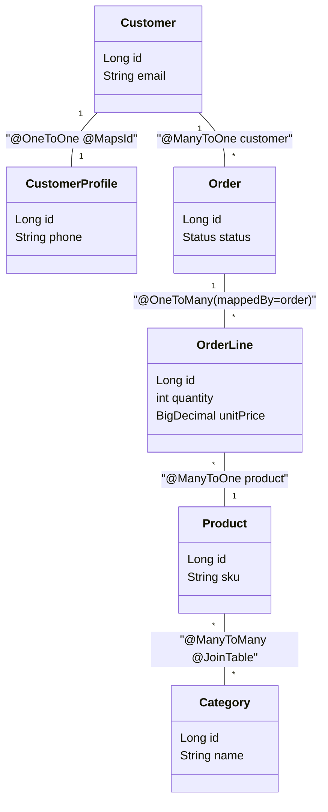
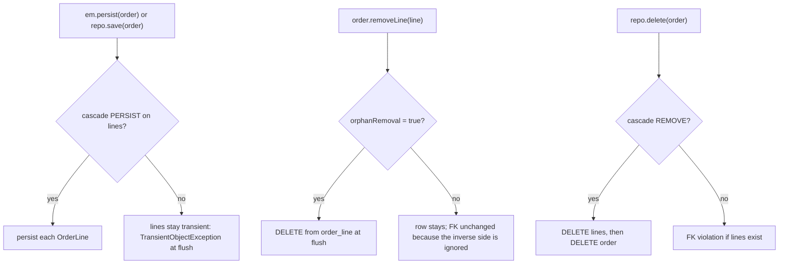
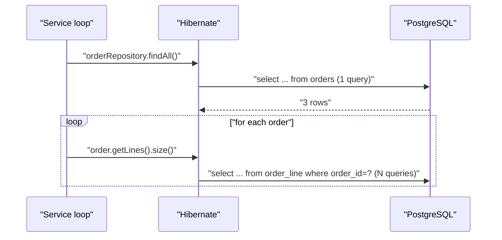

@@ 2 | MODULE | Relationships | Mapping references between entities, who owns the foreign key, cascading, and how related data is loaded | MUST
# Relationships

**Shared analogy: a family tree in a city records office.** Each person has one birth certificate (one-to-one), a mother can have many children while each child has one mother (one-to-many and many-to-one), and people join many clubs while clubs have many members (many-to-many, recorded in a membership register). Only one document is the legal record of each link: the child's birth certificate names the mother, not the other way round. That legal record is the **owning side**. Cascade is "when you register the family, register the children too", orphan removal is "a child removed from the family file is removed from the register", and fetch type is whether the clerk brings the whole family file or just the person's card until you ask for more.

@@ 3 | TOPIC | One-to-One, One-to-Many and Many-to-Many | Mapping the three relationship kinds in JPA, unidirectional vs bidirectional, join columns and join tables | MUST
# One-to-One, One-to-Many and Many-to-Many

**Level: Intermediate | Phase 12 | Priority: MUST | Since: JPA 1.0**

> **30-second interview answer:** JPA maps object references to foreign keys with `@OneToOne`, `@ManyToOne`, `@OneToMany` and `@ManyToMany`. The foreign key always lives on the "many" side, so `@ManyToOne` with `@JoinColumn` is the simplest and most efficient mapping, and a bidirectional `@OneToMany(mappedBy = ...)` just mirrors it. Many-to-many uses a join table; once the link needs its own data, like quantity or price, I replace it with an entity and two many-to-one relations. I make every to-one relation lazy.

## 1. Concept in Simple Words
### Analogy
A school.

| School | JPA relationship |
|---|---|
| Each student has exactly one student ID card | `@OneToOne` (Customer and CustomerProfile) |
| A class has many students; each student is in one class | `@OneToMany` / `@ManyToOne` (Order and OrderLine) |
| Each student's form says "class: 7B" | Foreign key `order_id` in `order_line` |
| Students take many electives; electives have many students | `@ManyToMany` through a join table (Product and Category) |
| An enrolment record with a grade | Link entity when the many-to-many needs extra columns (OrderLine between Order and Product) |

### What it is
- **Cardinality:** how many rows on each side: one-to-one, one-to-many, many-to-one, many-to-many.
- **Direction:** **unidirectional** (only one class has the reference) or **bidirectional** (both have it). The database is always "bidirectional"; direction is only about your Java navigation.
- **`@JoinColumn`:** the foreign key column on this entity's table.
- **`@JoinTable`:** the link table for many-to-many (or for unidirectional one-to-many if you do not add a join column).
- **`mappedBy`:** on the inverse side of a bidirectional relation, names the field on the other side that owns the foreign key.
- **`@MapsId`:** for one-to-one, reuse the parent's primary key as the child's primary key and foreign key (shared primary key).

OrderHub's model:
```text
customer 1 ---- 1 customer_profile      (shared primary key, @MapsId)
customer 1 ---- * orders                (orders.customer_id)
orders   1 ---- * order_line            (order_line.order_id)
product  1 ---- * order_line            (order_line.product_id)
product  * ---- * category              (join table product_category)
orders   1 ---- 1 payment               (payment.order_id unique)
```

### Why it exists
Domain objects reference each other (`order.getCustomer()`, `order.getLines()`), while tables use foreign keys and join tables. Relationship mappings let Hibernate translate navigation into joins and foreign key writes, so your service code speaks in objects.

## 2. How It Works


How each mapping becomes SQL:
- `@ManyToOne @JoinColumn(name = "customer_id")` on `Order`: the `orders` row stores `customer_id`. Setting `order.setCustomer(c)` writes that column. This is the cheapest mapping.
- `@OneToMany(mappedBy = "order")` on `Order.lines`: no column on `orders`. Hibernate loads it with `select ... from order_line where order_id=?`. It never writes the foreign key from this side.
- Unidirectional `@OneToMany` without `mappedBy` and without `@JoinColumn`: Hibernate creates a join table `orders_lines`. With `@JoinColumn` it inserts the line first with a null foreign key then runs an extra UPDATE to set it. Both are wasteful; prefer bidirectional or plain `@ManyToOne`.
- `@ManyToMany @JoinTable(...)` on `Product.categories`: rows in `product_category(product_id, category_id)`. With a `List` (a "bag"), removing one element makes Hibernate delete all link rows of that product and re-insert the rest; with a `Set` it deletes exactly one row.
- `@OneToOne @MapsId` on `CustomerProfile.customer`: the profile's id column is also the foreign key to customer, so there is no extra column and fetching by id is trivial.

Default fetch types (memorise): to-one relations are **EAGER** by default, to-many are **LAZY**. Override every to-one to `LAZY`.

## 3. Code Example
### Code
Flyway `V3__relationships.sql`:
```sql
create sequence category_seq   start with 1 increment by 50;
create sequence order_line_seq start with 1 increment by 50;

alter table orders add column customer_id bigint not null references customer(id);
create index idx_orders_customer on orders(customer_id);

create table customer_profile (
    customer_id bigint primary key references customer(id),   -- shared primary key
    phone       varchar(30),
    newsletter  boolean not null default false
);

create table order_line (
    id          bigint primary key,
    order_id    bigint not null references orders(id),
    product_id  bigint not null references product(id),
    quantity    integer not null check (quantity > 0),
    unit_price  numeric(12,2) not null
);
create index idx_order_line_order on order_line(order_id);

create table category (
    id   bigint primary key,
    name varchar(60) not null unique
);

create table product_category (
    product_id  bigint not null references product(id),
    category_id bigint not null references category(id),
    primary key (product_id, category_id)
);
```

One-to-one with shared primary key:
```java
package com.orderhub.customer;

import jakarta.persistence.*;

@Entity
@Table(name = "customer_profile")
public class CustomerProfile {
    @Id
    private Long id;                                  // same value as customer.id

    @OneToOne(fetch = FetchType.LAZY, optional = false)
    @MapsId                                           // id is copied from customer; column customer_id is PK and FK
    @JoinColumn(name = "customer_id")
    private Customer customer;

    private String phone;
    private boolean newsletter;

    protected CustomerProfile() { }
    public CustomerProfile(Customer customer, String phone) { this.customer = customer; this.phone = phone; }
    public String getPhone() { return phone; }
}
```

Order with many-to-one customer and bidirectional one-to-many lines:
```java
package com.orderhub.order;

import com.orderhub.customer.Customer;
import com.orderhub.product.Product;
import jakarta.persistence.*;

import java.math.BigDecimal;
import java.util.ArrayList;
import java.util.Collections;
import java.util.List;

@Entity
@Table(name = "orders")
public class Order {
    @Id
    @GeneratedValue(strategy = GenerationType.SEQUENCE, generator = "orders_gen")
    @SequenceGenerator(name = "orders_gen", sequenceName = "orders_seq", allocationSize = 50)
    private Long id;

    @ManyToOne(fetch = FetchType.LAZY, optional = false)   // owning side: orders.customer_id
    @JoinColumn(name = "customer_id")
    private Customer customer;

    @OneToMany(mappedBy = "order", cascade = CascadeType.ALL, orphanRemoval = true)
    private List<OrderLine> lines = new ArrayList<>();     // inverse side, lazy by default

    @Column(nullable = false, precision = 12, scale = 2)
    private BigDecimal total = BigDecimal.ZERO;

    protected Order() { }
    public Order(Customer customer) { this.customer = customer; }

    // Helper keeps BOTH sides in sync in memory
    public void addLine(Product product, int quantity) {
        OrderLine line = new OrderLine(this, product, quantity, product.getPrice());
        lines.add(line);
        total = total.add(line.subtotal());
    }

    public List<OrderLine> getLines() { return Collections.unmodifiableList(lines); }
    public Customer getCustomer() { return customer; }
    public Long getId() { return id; }
    public BigDecimal getTotal() { return total; }
}
```

```java
package com.orderhub.order;

import com.orderhub.product.Product;
import jakarta.persistence.*;

import java.math.BigDecimal;

@Entity
@Table(name = "order_line")
public class OrderLine {
    @Id
    @GeneratedValue(strategy = GenerationType.SEQUENCE, generator = "order_line_gen")
    @SequenceGenerator(name = "order_line_gen", sequenceName = "order_line_seq", allocationSize = 50)
    private Long id;

    @ManyToOne(fetch = FetchType.LAZY, optional = false)   // owning side: order_line.order_id
    @JoinColumn(name = "order_id")
    private Order order;

    @ManyToOne(fetch = FetchType.LAZY, optional = false)   // unidirectional: Product has no list of lines
    @JoinColumn(name = "product_id")
    private Product product;

    private int quantity;

    @Column(name = "unit_price", nullable = false, precision = 12, scale = 2)
    private BigDecimal unitPrice;                          // price copied at order time

    protected OrderLine() { }
    OrderLine(Order order, Product product, int quantity, BigDecimal unitPrice) {
        this.order = order; this.product = product; this.quantity = quantity; this.unitPrice = unitPrice;
    }
    BigDecimal subtotal() { return unitPrice.multiply(BigDecimal.valueOf(quantity)); }
    public Product getProduct() { return product; }
    public int getQuantity() { return quantity; }
}
```

Many-to-many between product and category:
```java
package com.orderhub.product;

import jakarta.persistence.*;

import java.util.HashSet;
import java.util.Set;

@Entity
@Table(name = "category")
public class Category {
    @Id
    @GeneratedValue(strategy = GenerationType.SEQUENCE, generator = "category_gen")
    @SequenceGenerator(name = "category_gen", sequenceName = "category_seq", allocationSize = 50)
    private Long id;

    @Column(nullable = false, unique = true)
    private String name;

    @ManyToMany(mappedBy = "categories")                    // inverse side
    private Set<Product> products = new HashSet<>();

    protected Category() { }
    public Category(String name) { this.name = name; }
    public String getName() { return name; }
    Set<Product> products() { return products; }

    @Override public boolean equals(Object o) { return o instanceof Category c && name.equals(c.name); }
    @Override public int hashCode() { return name.hashCode(); }
}
```

Added to `Product`:
```java
// inside Product
@ManyToMany
@JoinTable(name = "product_category",
        joinColumns = @JoinColumn(name = "product_id"),
        inverseJoinColumns = @JoinColumn(name = "category_id"))
private Set<Category> categories = new HashSet<>();   // Set: removing one link deletes one row

public void addCategory(Category c) { categories.add(c); c.products().add(this); }
public void removeCategory(Category c) { categories.remove(c); c.products().remove(this); }
```

A service that places an order:
```java
package com.orderhub.order;

import com.orderhub.customer.CustomerRepository;
import com.orderhub.product.ProductRepository;
import org.springframework.stereotype.Service;
import org.springframework.transaction.annotation.Transactional;

@Service
public class OrderService {
    private final OrderRepository orders;
    private final CustomerRepository customers;
    private final ProductRepository products;

    public OrderService(OrderRepository orders, CustomerRepository customers, ProductRepository products) {
        this.orders = orders; this.customers = customers; this.products = products;
    }

    @Transactional
    public Long placeOrder(Long customerId, Long productId, int qty) {
        Order order = new Order(customers.getReferenceById(customerId));  // proxy, no SELECT for customer
        order.addLine(products.findById(productId).orElseThrow(), qty);
        return orders.save(order).getId();                               // cascade persists the line
    }
}
```

### Walkthrough
- `CustomerProfile` uses `@MapsId`: its primary key is the customer's id, so `customer_profile` needs no separate id sequence and one-to-one stays truly one-to-one.
- `Order.customer` and `OrderLine.order` are `@ManyToOne` with `@JoinColumn`: these fields own the foreign keys.
- `Order.lines` is `mappedBy = "order"`: it only mirrors `OrderLine.order`. The helper `addLine` sets both sides so the in-memory graph matches what will be stored.
- `OrderLine.product` is unidirectional: we never need `product.getLines()`, and that collection would be huge.
- `Product.categories` is the owning side of the many-to-many (it has `@JoinTable`); `Category.products` is the inverse.
- `getReferenceById` returns a lazy proxy holding only the id: perfect for setting a foreign key without loading the customer.

### Output
`orderService.placeOrder(7L, 1L, 2)`:
```text
Hibernate: select p1_0.id,p1_0.created_at,p1_0.name,p1_0.price,p1_0.sku,p1_0.status,p1_0.stock from product p1_0 where p1_0.id=?
Hibernate: select nextval('orders_seq')
Hibernate: select nextval('order_line_seq')
Hibernate: insert into orders (created_at,customer_id,order_number,status,total,id) values (?,?,?,?,?,?)
Hibernate: insert into order_line (order_id,product_id,quantity,unit_price,id) values (?,?,?,?,?)
```
No SELECT for the customer (proxy), and the order is inserted before its line because the line's foreign key points at it. Hibernate orders the inserts for you.

### Compare
| Mapping | SQL efficiency | Verdict |
|---|---|---|
| `@ManyToOne` only (unidirectional) | One FK column, one INSERT | Best default |
| Bidirectional `@OneToMany(mappedBy)` plus `@ManyToOne` | Same SQL, navigation both ways | Good when you need `order.getLines()` |
| Unidirectional `@OneToMany` with `@JoinColumn` | INSERT then extra UPDATE per child | Avoid |
| Unidirectional `@OneToMany` without join column | Extra join table | Avoid |
| `@ManyToMany` with `List` | Delete all links and re-insert on removal | Use `Set` |
| Link entity (`OrderLine`) | Normal rows, extra columns possible | Use when the link has data |

## 4. Interview Questions
**Basic**
1. **What relationship annotations does JPA provide?**
   `@OneToOne`, `@OneToMany`, `@ManyToOne` and `@ManyToMany`, plus `@JoinColumn` for foreign keys, `@JoinTable` for link tables and `mappedBy` for the inverse side of bidirectional relations. In the database there are only foreign keys and join tables; the annotations describe how references map to them.
2. **What is the difference between unidirectional and bidirectional relationships?**
   Unidirectional means only one entity holds a reference; bidirectional means both do, with one side marked `mappedBy`. The table structure is the same; bidirectional only adds navigation in Java and the duty to keep both sides in sync.
3. **What are the default fetch types?**
   `@ManyToOne` and `@OneToOne` are EAGER by default; `@OneToMany` and `@ManyToMany` are LAZY. Best practice is to set every to-one relationship to `FetchType.LAZY` explicitly and load what you need per use case.

**Follow-up**
4. **Why is a unidirectional `@OneToMany` considered inefficient?**
   Without `@JoinColumn`, Hibernate uses an extra join table, so every child costs an extra row and join. With `@JoinColumn`, the parent side owns the key, so Hibernate inserts the child without the foreign key and then issues an UPDATE to set it. A `@ManyToOne` on the child, optionally mirrored with `mappedBy`, does it in one INSERT.
5. **When do you replace `@ManyToMany` with an entity?**
   As soon as the link has its own data (quantity, price, role, date added) or its own lifecycle. Then you create a link entity such as `OrderLine` with two `@ManyToOne` relations. Many teams avoid `@ManyToMany` entirely because link data almost always appears later.
6. **What does `@MapsId` do in a one-to-one?**
   It makes the child's primary key the same value as the parent's, and uses that column as the foreign key too. You avoid an extra column and index, can load the child with the parent's id, and the database itself guarantees at most one child per parent.

**Tricky / scenario**
7. **A `@OneToOne` mapped on the inverse side (`mappedBy`) is always loaded eagerly even with `fetch = LAZY`. Why?**
   On the inverse side Hibernate cannot know whether the related row exists without querying, and it must decide between null and a proxy, so it queries immediately. Fixes: map only the owning side, use `@MapsId` and load the child by id when needed, or use bytecode enhancement.
8. **Removing one category from a product deletes all its link rows and re-inserts the rest. What is going on?**
   The collection is a `List` without an order column, which Hibernate treats as a bag. A bag has no identity per element, so Hibernate cannot tell which row to delete and rewrites the whole collection. Use a `Set` with proper `equals` and `hashCode`.
9. **You add a line to `order.getLines()` but forget `line.setOrder(order)`. What is stored?**
   Nothing links them in the database: `mappedBy` means the collection is ignored for writes, so `order_line.order_id` is null (and the NOT NULL constraint fails) or the line is not linked. Always set the owning side, ideally through a helper method like `addLine` that sets both.

**What the interviewer is really testing:** whether you know where the foreign key lives and choose mappings by the SQL they produce.

## 5. Pitfalls & Best Practices
### Common mistakes
| Mistake | What goes wrong | Fix |
|---|---|---|
| Leaving to-one relations EAGER | Extra joins or queries on every load | `fetch = FetchType.LAZY` everywhere |
| Unidirectional `@OneToMany` | Join table or extra UPDATEs | `@ManyToOne` on the child, `mappedBy` on the parent |
| `@ManyToMany` with `List` | Whole link set deleted and re-inserted | Use `Set` |
| Only setting the inverse side | Foreign key not written | Helper methods that set both sides |
| Mapping huge collections (`product.getLines()`) | Loads thousands of rows into memory | Keep it unidirectional, query when needed |
| `CascadeType.ALL` on `@ManyToMany` | Deleting a product deletes shared categories | No `REMOVE` cascade on many-to-many |

### Best practices
- Start with `@ManyToOne(fetch = LAZY)`; add the inverse collection only if the use case needs it.
- Use `Set` for many-to-many and give entities stable `equals`/`hashCode`.
- Prefer a link entity over `@ManyToMany` when there is any chance of extra columns.
- Use `@MapsId` for one-to-one children.
- Index every foreign key column in the migration (PostgreSQL does not do it automatically).

### Compare with
| Relationship | Foreign key location | Typical OrderHub example |
|---|---|---|
| One-to-one (`@MapsId`) | Child PK is FK to parent | `CustomerProfile` to `Customer` |
| Many-to-one | On the many side | `Order.customer`, `OrderLine.product` |
| One-to-many (`mappedBy`) | On the other (many) side | `Order.lines` |
| Many-to-many | Join table | `Product.categories` |
| Link entity | Two FKs in the link table | `OrderLine` between `Order` and `Product` |

## 6. Hands-on Exercise
Add a `Payment` entity to OrderHub with a one-to-one relationship to `Order`. Columns: `order_id` (unique foreign key), `amount`, `method` (`CARD`, `BANK_TRANSFER`), `paid_at`. Navigation must work as `order.getPayment()` and `payment.getOrder()`, and loading an order must not load the payment.

Acceptance criteria:
- Flyway migration with a unique constraint on `order_id`.
- The foreign key is owned by `Payment`.
- Loading an order by id produces one SELECT only.

<details><summary>Solution</summary>

```sql
-- V4__payment.sql
create table payment (
    order_id bigint primary key references orders(id),   -- shared PK guarantees one payment per order
    amount   numeric(12,2) not null,
    method   varchar(20) not null,
    paid_at  timestamp with time zone not null
);
```

```java
package com.orderhub.payment;

import com.orderhub.order.Order;
import jakarta.persistence.*;
import java.math.BigDecimal;
import java.time.Instant;

@Entity
@Table(name = "payment")
public class Payment {
    public enum Method { CARD, BANK_TRANSFER }

    @Id
    private Long id;

    @OneToOne(fetch = FetchType.LAZY, optional = false)
    @MapsId
    @JoinColumn(name = "order_id")
    private Order order;

    @Column(nullable = false, precision = 12, scale = 2)
    private BigDecimal amount;

    @Enumerated(EnumType.STRING)
    @Column(nullable = false, length = 20)
    private Method method;

    @Column(name = "paid_at", nullable = false)
    private Instant paidAt = Instant.now();

    protected Payment() { }
    public Payment(Order order, BigDecimal amount, Method method) {
        this.order = order; this.amount = amount; this.method = method;
    }
    public Order getOrder() { return order; }
}
```

```java
package com.orderhub.payment;

import org.springframework.data.jpa.repository.JpaRepository;
import java.util.Optional;

public interface PaymentRepository extends JpaRepository<Payment, Long> {
    // same id as the order, so "order.getPayment()" becomes a lookup by order id
    default Optional<Payment> findForOrder(Long orderId) { return findById(orderId); }
}
```
Instead of mapping an inverse `@OneToOne(mappedBy = "order")` on `Order` (which Hibernate would always load eagerly, adding a second SELECT), `Order.getPayment()` is replaced by `paymentRepository.findForOrder(order.getId())` in the service. That keeps loading an order to one SELECT and still gives navigation from both directions.
</details>

## 7. Recall
Q: What are the default fetch types of JPA relationship annotations?
A: `@ManyToOne` and `@OneToOne` are EAGER; `@OneToMany` and `@ManyToMany` are LAZY.

Q: Where does the foreign key live in a JPA one-to-many relationship?
A: On the many side, mapped by `@ManyToOne` with `@JoinColumn`; the one side uses `mappedBy`.

Q: Why should a JPA @ManyToMany collection be a Set instead of a List?
A: A List is a bag, so removing one element deletes and re-inserts all link rows; a Set deletes only the one row.

Q: When should a JPA many-to-many be replaced by a link entity?
A: When the association needs its own columns or lifecycle, such as quantity and price on an order line.

Q: What does @MapsId do in a JPA one-to-one mapping?
A: It makes the child's primary key equal to the parent's id and uses that column as the foreign key.

**Related:** [[Owning Side, Cascade and orphanRemoval]] · [[Fetch Types and the N+1 Problem]] · [[Entity Mapping]]

@@ 3 | TOPIC | Owning Side, Cascade and orphanRemoval | Which side writes the foreign key, how operations propagate to children and how removed children are deleted | MUST
# Owning Side, Cascade and orphanRemoval

**Level: Intermediate | Phase 12 | Priority: MUST | Since: JPA 1.0 (orphanRemoval JPA 2.0)**

> **30-second interview answer:** In a bidirectional relationship only one side, the owning side, controls the foreign key: the side with `@JoinColumn` or `@JoinTable`, which for one-to-many is always the `@ManyToOne` child. The `mappedBy` side is ignored when Hibernate writes. Cascade propagates entity operations such as persist, merge and remove from parent to children, and `orphanRemoval = true` deletes a child row when it is removed from the parent's collection. I use `CascadeType.ALL` with orphan removal only for children that are fully owned by one parent, like order lines.

## 1. Concept in Simple Words
### Analogy
A car title and a garage.

| Car world | JPA |
|---|---|
| The car's registration document names the owner | Owning side: `OrderLine.order` with the foreign key |
| The owner's own list of "my cars" in a notebook | Inverse side: `Order.lines` with `mappedBy` |
| Writing a car in your notebook does not change the registration office | Adding to `order.lines` alone writes nothing |
| Scrapping the garage scraps the cars stored only in it | `CascadeType.REMOVE` |
| Taking a car out of the garage and sending it to the crusher | `orphanRemoval = true` |
| Parking a borrowed car in your garage: scrapping the garage must not scrap your friend's car | No cascade to shared entities (Product, Customer) |

### What it is
- **Owning side:** the field whose mapping has the physical foreign key (`@JoinColumn`) or join table (`@JoinTable`). Hibernate reads only this side to decide what to write.
- **Inverse side:** the field with `mappedBy`. Used for navigation and loading only.
- **Cascade:** `CascadeType.PERSIST`, `MERGE`, `REMOVE`, `REFRESH`, `DETACH`, or `ALL`. When you call `em.persist(order)`, the operation is also applied to each object reachable through a field with `PERSIST` cascade.
- **`orphanRemoval = true`:** if a child is removed from the collection (or the to-one reference is set to null or replaced), Hibernate deletes the child row at flush.
- **Aggregate:** a cluster of objects treated as one unit with one root (DDD term). `Order` is the root; `OrderLine` lives and dies with it. Cascade and orphan removal belong inside an aggregate, never across aggregates.

### Why it exists
Two Java references can disagree (the order lists a line, but the line points at another order); the database has only one foreign key, so JPA needs a rule for whose value wins. Cascade exists so you can save a whole aggregate with one call instead of persisting every child by hand, and orphan removal keeps "removing from the collection" and "deleting the row" consistent.

## 2. How It Works


At flush, Hibernate walks each managed entity:
1. For each owning-side field (`OrderLine.order`), it compares the referenced id with the snapshot and writes INSERT or UPDATE with the foreign key value.
2. Inverse collections (`Order.lines`) are never used to write foreign keys, but Hibernate does inspect them for cascade and orphan removal.
3. Cascade happens at the moment of the operation (persist cascade at `persist` and again at flush for newly added children).
4. Orphan detection compares the collection with its loaded snapshot; elements that disappeared become DELETEs.

`CascadeType.REMOVE` vs `orphanRemoval`:
```text
CascadeType.REMOVE : delete parent  -> children deleted
orphanRemoval=true : delete parent  -> children deleted
                     remove child from collection -> child deleted   (REMOVE does not do this)
```

## 3. Code Example
### Code
`Order` aggregate root with full ownership of its lines:
```java
package com.orderhub.order;

import com.orderhub.customer.Customer;
import com.orderhub.product.Product;
import jakarta.persistence.*;

import java.math.BigDecimal;
import java.util.ArrayList;
import java.util.Collections;
import java.util.List;

@Entity
@Table(name = "orders")
public class Order {
    @Id
    @GeneratedValue(strategy = GenerationType.SEQUENCE, generator = "orders_gen")
    @SequenceGenerator(name = "orders_gen", sequenceName = "orders_seq", allocationSize = 50)
    private Long id;

    // Shared entity: NO cascade. Deleting an order must never delete the customer.
    @ManyToOne(fetch = FetchType.LAZY, optional = false)
    @JoinColumn(name = "customer_id")
    private Customer customer;

    // Owned children: cascade everything, delete orphans
    @OneToMany(mappedBy = "order", cascade = CascadeType.ALL, orphanRemoval = true)
    private List<OrderLine> lines = new ArrayList<>();

    @Column(nullable = false, precision = 12, scale = 2)
    private BigDecimal total = BigDecimal.ZERO;

    protected Order() { }
    public Order(Customer customer) { this.customer = customer; }

    public OrderLine addLine(Product product, int quantity) {
        OrderLine line = new OrderLine(this, product, quantity, product.getPrice()); // sets owning side
        lines.add(line);                                                             // sets inverse side
        recalculate();
        return line;
    }

    public void removeLine(Long lineId) {
        lines.removeIf(l -> lineId.equals(l.getId()));   // orphanRemoval turns this into DELETE
        recalculate();
    }

    private void recalculate() {
        total = lines.stream().map(OrderLine::subtotal).reduce(BigDecimal.ZERO, BigDecimal::add);
    }

    public List<OrderLine> getLines() { return Collections.unmodifiableList(lines); }
    public Long getId() { return id; }
    public BigDecimal getTotal() { return total; }
}
```

`OrderLine` (owning side of the relationship to `Order`, no cascade back up):
```java
package com.orderhub.order;

import com.orderhub.product.Product;
import jakarta.persistence.*;
import java.math.BigDecimal;

@Entity
@Table(name = "order_line")
public class OrderLine {
    @Id
    @GeneratedValue(strategy = GenerationType.SEQUENCE, generator = "order_line_gen")
    @SequenceGenerator(name = "order_line_gen", sequenceName = "order_line_seq", allocationSize = 50)
    private Long id;

    @ManyToOne(fetch = FetchType.LAZY, optional = false)
    @JoinColumn(name = "order_id")              // THE foreign key: Hibernate writes order_id from here
    private Order order;

    @ManyToOne(fetch = FetchType.LAZY, optional = false)
    @JoinColumn(name = "product_id")            // no cascade: products are shared
    private Product product;

    private int quantity;
    @Column(name = "unit_price", precision = 12, scale = 2)
    private BigDecimal unitPrice;

    protected OrderLine() { }
    OrderLine(Order order, Product product, int quantity, BigDecimal unitPrice) {
        this.order = order; this.product = product; this.quantity = quantity; this.unitPrice = unitPrice;
    }
    BigDecimal subtotal() { return unitPrice.multiply(BigDecimal.valueOf(quantity)); }
    public Long getId() { return id; }
}
```

Service demonstrating all three behaviours:
```java
package com.orderhub.order;

import com.orderhub.customer.CustomerRepository;
import com.orderhub.product.ProductRepository;
import org.springframework.stereotype.Service;
import org.springframework.transaction.annotation.Transactional;

@Service
public class OrderEditingService {
    private final OrderRepository orders;
    private final CustomerRepository customers;
    private final ProductRepository products;

    public OrderEditingService(OrderRepository orders, CustomerRepository customers, ProductRepository products) {
        this.orders = orders; this.customers = customers; this.products = products;
    }

    @Transactional
    public Long createWithTwoLines(Long customerId) {
        Order order = new Order(customers.getReferenceById(customerId));
        order.addLine(products.getReferenceById(1L), 1);
        order.addLine(products.getReferenceById(2L), 3);
        return orders.save(order).getId();          // cascade PERSIST saves both lines
    }

    @Transactional
    public void removeFirstLine(Long orderId) {
        Order order = orders.findById(orderId).orElseThrow();
        order.removeLine(order.getLines().get(0).getId());   // orphanRemoval deletes the row
    }

    @Transactional
    public void delete(Long orderId) {
        orders.deleteById(orderId);                 // cascade REMOVE deletes remaining lines first
    }
}
```
(For `addLine` with `getReferenceById`, the product price is read from the proxy, which triggers a SELECT of that product: the proxy initialises on first access to a non-id field.)

### Walkthrough
- `customer` has no cascade: customers are shared by many orders and have their own lifecycle.
- `lines` has `CascadeType.ALL` and `orphanRemoval = true`: lines belong to exactly one order.
- `addLine` sets the owning side through the constructor and the inverse side by adding to the list; both are consistent before flush.
- `removeLine` only removes from the collection; orphan removal turns that into a DELETE.
- `deleteById` loads the order, cascades REMOVE to its lines (deleting children first to satisfy the foreign key), then deletes the order.

### Output
`createWithTwoLines(7L)`:
```text
Hibernate: select p1_0.id,p1_0.created_at,p1_0.name,p1_0.price,p1_0.sku,p1_0.status,p1_0.stock from product p1_0 where p1_0.id=?
Hibernate: select p1_0.id,p1_0.created_at,p1_0.name,p1_0.price,p1_0.sku,p1_0.status,p1_0.stock from product p1_0 where p1_0.id=?
Hibernate: select nextval('orders_seq')
Hibernate: select nextval('order_line_seq')
Hibernate: insert into orders (created_at,customer_id,order_number,status,total,id) values (?,?,?,?,?,?)
Hibernate: insert into order_line (order_id,product_id,quantity,unit_price,id) values (?,?,?,?,?)
Hibernate: insert into order_line (order_id,product_id,quantity,unit_price,id) values (?,?,?,?,?)
```
`removeFirstLine(51L)`:
```text
Hibernate: select o1_0.id,o1_0.created_at,o1_0.customer_id,o1_0.order_number,o1_0.status,o1_0.total from orders o1_0 where o1_0.id=?
Hibernate: select l1_0.order_id,l1_0.id,l1_0.product_id,l1_0.quantity,l1_0.unit_price from order_line l1_0 where l1_0.order_id=?
Hibernate: update orders set created_at=?,customer_id=?,order_number=?,status=?,total=? where id=?
Hibernate: delete from order_line where id=?
```
`delete(51L)`:
```text
Hibernate: select o1_0.id,o1_0.created_at,o1_0.customer_id,o1_0.order_number,o1_0.status,o1_0.total from orders o1_0 where o1_0.id=?
Hibernate: select l1_0.order_id,l1_0.id,l1_0.product_id,l1_0.quantity,l1_0.unit_price from order_line l1_0 where l1_0.order_id=?
Hibernate: delete from order_line where id=?
Hibernate: delete from orders where id=?
```
Note that cascade REMOVE deletes children one by one after loading them. For thousands of children, a bulk `delete from order_line where order_id = ?` query is much faster.

### Compare
| Setting | Delete parent | Remove child from collection | Use for |
|---|---|---|---|
| No cascade | FK violation if children exist | Nothing happens | Shared references (Customer, Product) |
| `CascadeType.PERSIST` only | FK violation | Nothing happens | Children saved with parent, deleted separately |
| `CascadeType.REMOVE` | Children deleted | Nothing happens | Rarely alone |
| `ALL` plus `orphanRemoval` | Children deleted | Child deleted | Owned children (OrderLine) |

## 4. Interview Questions
**Basic**
1. **What is the owning side of a relationship?**
   The side whose mapping contains the foreign key column or join table, declared with `@JoinColumn` or `@JoinTable`. Hibernate writes the foreign key only from this side. In one-to-many it is always the `@ManyToOne` child; the parent's collection uses `mappedBy`.
2. **What does `mappedBy` mean?**
   It marks the inverse side and names the field on the other entity that owns the relationship. It tells Hibernate not to create another foreign key or join table and to ignore this side when writing.
3. **What is cascading in JPA?**
   Applying an entity operation to related entities automatically: persisting an order also persists its new lines when `PERSIST` cascades. Types are `PERSIST`, `MERGE`, `REMOVE`, `REFRESH`, `DETACH` and `ALL`.

**Follow-up**
4. **`CascadeType.REMOVE` vs `orphanRemoval = true`?**
   Both delete children when the parent is deleted. Only orphan removal also deletes a child when it is removed from the collection or replaced in a to-one reference. Orphan removal expresses "this child cannot exist without this parent".
5. **What happens if you add a child only to the inverse collection?**
   Hibernate ignores the inverse side for writes, so the child's foreign key stays null or keeps its old value. With cascade PERSIST the child is inserted but not linked (or fails a NOT NULL constraint). Use helper methods that set both sides.
6. **Why should you not cascade from `OrderLine` to `Product`?**
   Products are shared by many lines and have their own lifecycle. Cascade REMOVE would delete a product used by other orders (or fail with a constraint error), and cascade MERGE could overwrite product data with stale values from the order request.

**Tricky / scenario**
7. **You call `order.setLines(newList)` on an entity with `orphanRemoval = true` and get "A collection with cascade=all-delete-orphan was no longer referenced by the owning entity instance". Why?**
   Hibernate wraps the collection in its own `PersistentBag` to track orphans. Replacing the reference loses that tracking. Instead mutate the existing collection: `lines.clear(); lines.addAll(newLines);`, and do not expose a setter for the collection.
8. **You get `TransientPropertyValueException: object references an unsaved transient instance`. What does it mean?**
   An entity being flushed references another entity that is new and was never persisted, and there is no cascade to persist it. Either persist the referenced entity first, cascade PERSIST to it if it is owned, or use `getReferenceById` if it already exists in the database.
9. **Deleting a customer with 50 000 orders through `customerRepository.delete` takes minutes. What is happening and how do you fix it?**
   Cascade REMOVE loads every order and every line into memory and deletes them row by row, also triggering dirty checks. For mass deletes use bulk JPQL or SQL (`delete from OrderLine l where l.order.customer.id = :id`, then orders, then customer) or `ON DELETE CASCADE` in the database, remembering that bulk deletes bypass the persistence context.

**What the interviewer is really testing:** whether you understand that only the owning side writes, and whether you limit cascade to true parent-child ownership.

## 5. Pitfalls & Best Practices
### Common mistakes
| Mistake | What goes wrong | Fix |
|---|---|---|
| Setting only the inverse side | FK not written | Helper method sets both sides |
| `CascadeType.ALL` on `@ManyToOne` | Deleting a child deletes the shared parent | Cascade only from parent to owned children |
| Replacing an orphan-removal collection | `HibernateException` about dereferenced collection | `clear()` and `addAll()` on the existing collection |
| Cascade REMOVE for huge child sets | Slow, memory heavy deletes | Bulk delete queries or `ON DELETE CASCADE` |
| Public setter for the children list | Callers bypass invariants and bidirectional sync | Expose `add`/`remove` methods only |

### Best practices
- Define aggregates: cascade and orphan removal only inside an aggregate (Order with OrderLines).
- Reference other aggregates by `@ManyToOne` without cascade, or even just by id.
- Keep the children collection private and unmodifiable to the outside.
- Initialise collections at declaration (`= new ArrayList<>()`) to avoid null checks.
- Read the SQL log after writing a cascade mapping; surprises show up there first.

### Compare with
| Concept | Question it answers |
|---|---|
| Owning side | Who writes the foreign key? |
| `mappedBy` | Which field on the other side owns it? |
| Cascade | Which operations flow from parent to child? |
| `orphanRemoval` | Is a child deleted when unlinked? |
| `ON DELETE CASCADE` (database) | Does the database delete children itself, bypassing Hibernate? |

## 6. Hands-on Exercise
Add `PUT /api/orders/{id}/lines` to OrderHub that replaces all lines of a NEW order with the lines in the request (`[{ "productId": 1, "quantity": 2 }]`). Lines that are no longer in the request must be deleted, new ones inserted, and the total recalculated.

Acceptance criteria:
- No setter for the collection; the existing collection instance is reused.
- Only NEW orders can be edited (otherwise `IllegalStateException`, mapped to 409).
- The SQL log shows DELETEs for removed lines and INSERTs for new ones in one transaction.

<details><summary>Solution</summary>

```java
// inside Order
public void replaceLines(List<OrderLineDraft> drafts, java.util.function.Function<Long, Product> productLookup) {
    if (status != Status.NEW) throw new IllegalStateException("Only NEW orders can be edited");
    lines.clear();                                         // orphanRemoval: old lines become DELETEs
    for (OrderLineDraft d : drafts) {
        lines.add(new OrderLine(this, productLookup.apply(d.productId()), d.quantity(),
                productLookup.apply(d.productId()).getPrice()));
    }
    recalculate();
}

public record OrderLineDraft(Long productId, int quantity) { }
```

```java
package com.orderhub.order;

import com.orderhub.product.ProductRepository;
import org.springframework.http.ResponseEntity;
import org.springframework.stereotype.Service;
import org.springframework.transaction.annotation.Transactional;
import org.springframework.web.bind.annotation.*;

import java.util.List;

@Service
class OrderLinesService {
    private final OrderRepository orders;
    private final ProductRepository products;

    OrderLinesService(OrderRepository orders, ProductRepository products) {
        this.orders = orders; this.products = products;
    }

    @Transactional
    void replaceLines(Long orderId, List<Order.OrderLineDraft> drafts) {
        Order order = orders.findById(orderId).orElseThrow(() -> new OrderNotFoundException(orderId));
        order.replaceLines(drafts, id -> products.findById(id).orElseThrow());
    }
}

@RestController
@RequestMapping("/api/orders")
class OrderLinesController {
    private final OrderLinesService service;
    OrderLinesController(OrderLinesService service) { this.service = service; }

    @PutMapping("/{id}/lines")
    ResponseEntity<Void> replace(@PathVariable Long id, @RequestBody List<Order.OrderLineDraft> drafts) {
        service.replaceLines(id, drafts);
        return ResponseEntity.noContent().build();
    }
}
```
The global exception handler from Phase 11 maps `IllegalStateException` to 409. Because `lines.clear()` keeps Hibernate's `PersistentBag`, orphan removal deletes the old rows and cascade persists the new ones. Calling `products.findById` twice for the same id hits the persistence context the second time, so there is no extra SELECT.
</details>

## 7. Recall
Q: What is the owning side of a JPA relationship?
A: The side with `@JoinColumn` or `@JoinTable` that controls the foreign key; Hibernate writes only from this side.

Q: What is the difference between CascadeType.REMOVE and orphanRemoval in JPA?
A: Both delete children with the parent; only orphanRemoval also deletes a child removed from the collection.

Q: Why should you never cascade from a child to a shared parent like Product?
A: Shared entities have their own lifecycle; cascading REMOVE or MERGE would delete or overwrite data used elsewhere.

Q: What causes the Hibernate error about a cascade=all-delete-orphan collection no longer referenced?
A: Replacing the collection instance instead of modifying the existing one, which breaks Hibernate's orphan tracking.

Q: Which side of a JPA one-to-many relationship should use mappedBy?
A: The one (parent) side, for example `@OneToMany(mappedBy = "order")` on `Order.lines`.

**Related:** [[One-to-One, One-to-Many and Many-to-Many]] · [[Persistence Context and Entity States]] · [[Fetch Types and the N+1 Problem]]

@@ 3 | TOPIC | Fetch Types and the N+1 Problem | LAZY vs EAGER, proxies, LazyInitializationException, the N+1 query problem and its fixes | MUST
# Fetch Types and the N+1 Problem

**Level: Intermediate | Phase 12 | Priority: MUST | Since: JPA 1.0 (`@EntityGraph` JPA 2.1, Spring Data `@EntityGraph` 1.10)**

> **30-second interview answer:** The N+1 problem is when one query loads N parents and then each access to a lazy relation fires one more query, so N+1 queries instead of one or two. I detect it by reading the SQL log or counting statements in tests, and fix it per use case with a `JOIN FETCH` query, an `@EntityGraph`, batch fetching with `default_batch_fetch_size`, or a DTO projection that selects exactly the columns needed. Making the relation EAGER does not fix it; it just moves the extra queries everywhere.

## 1. Concept in Simple Words
### Analogy
A waiter taking orders.

| Restaurant | JPA |
|---|---|
| The waiter brings the list of 20 tables | Query 1: `select * from orders` |
| For each table, he walks back to the kitchen to ask what they ordered | N queries: `select * from order_line where order_id = ?` |
| 21 walks for one round | N+1 queries |
| Ask the kitchen once: "everything for tables 1 to 20" | `JOIN FETCH` or batch fetching (`where order_id in (...)`) |
| A note saying "ask the kitchen when needed" | Lazy proxy or uninitialised collection |
| The kitchen closed when he finally asks | `LazyInitializationException` (session closed) |

### What it is
- **Fetch type:** when related data is loaded. `EAGER`: immediately with the owner. `LAZY`: only when accessed.
- **Proxy:** for a lazy to-one relation, Hibernate puts a generated subclass instance holding only the id; the first call to a non-id getter runs a SELECT.
- **Persistent collection:** for lazy to-many relations, Hibernate puts its own `PersistentBag` or `PersistentSet`; the first access (`size()`, iteration) runs a SELECT.
- **N+1 problem:** 1 query for the parents, plus 1 query per parent for a relation.
- **`LazyInitializationException`:** accessing an uninitialised proxy or collection after the persistence context is closed (outside the transaction).
- **Open Session in View (OSIV):** Spring Boot's `spring.jpa.open-in-view=true` default keeps the `EntityManager` open until the HTTP response is written, which hides `LazyInitializationException` but lets controllers and Jackson fire queries. Boot logs a warning when you rely on the default.
- **Fixes:** `JOIN FETCH` in JPQL, `@EntityGraph`, `@BatchSize` or `hibernate.default_batch_fetch_size`, `@Fetch(FetchMode.SUBSELECT)`, DTO projections.

### Why it exists
Loading every related object eagerly would pull half the database for one order, so ORMs load lazily by default. Lazy loading is convenient but invisible: a loop that looks like plain Java (`order.getLines().size()`) silently becomes hundreds of queries. N+1 is the most common JPA performance bug in production and the most common JPA interview question.

## 2. How It Works


Lazy loading internals:
```text
Order (managed)
 +-- id = 51
 +-- customer --> Customer$HibernateProxy { id = 7, initialized = false }
 |                 getEmail() -> SELECT customer where id = 7, then initialized = true
 +-- lines ----> PersistentBag { initialized = false, owner = Order#51, session = S1 }
                   size()    -> SELECT order_line where order_id = 51
                   (if S1 is closed -> LazyInitializationException)
```

The fixes, and the SQL each one produces:
```text
JOIN FETCH        : 1 query  select o.*, l.* from orders o left join order_line l on ...
@EntityGraph      : 1 query  same SQL as JOIN FETCH, declared on the repository method
batch fetching    : 1 + ceil(N / batch) queries  ... where order_id in (?,?,?,...)
SUBSELECT         : 2 queries ... where order_id in (select id from orders where ...)
DTO projection    : 1 query  only the selected columns, no entities, no lazy loading
```

Why EAGER does not help: `findAll()` runs JPQL `select o from Order o`; JPQL ignores the mapping's EAGER for the main query, so Hibernate first loads orders, then sees EAGER and loads each relation with a separate query: still N+1, now on every use case.

## 3. Code Example
### Code
`application.yml` for development:
```yaml
spring:
  jpa:
    open-in-view: false
    show-sql: true
    properties:
      hibernate:
        generate_statistics: true          # logs statement count per session
        default_batch_fetch_size: 50       # global safety net for lazy loading
logging:
  level:
    org.hibernate.stat: DEBUG
```

Repository with the different fixes:
```java
package com.orderhub.order;

import org.springframework.data.domain.Page;
import org.springframework.data.domain.Pageable;
import org.springframework.data.jpa.repository.EntityGraph;
import org.springframework.data.jpa.repository.JpaRepository;
import org.springframework.data.jpa.repository.Query;
import org.springframework.data.repository.query.Param;

import java.math.BigDecimal;
import java.util.List;
import java.util.Optional;

public interface OrderRepository extends JpaRepository<Order, Long> {

    // Fix 1: JOIN FETCH. Hibernate 6 removes duplicate parents automatically (no DISTINCT needed).
    @Query("select o from Order o join fetch o.customer left join fetch o.lines where o.status = :status")
    List<Order> findWithLinesByStatus(@Param("status") Order.Status status);

    // Fix 2: entity graph on a derived query
    @EntityGraph(attributePaths = {"customer", "lines", "lines.product"})
    Optional<Order> findWithDetailsById(Long id);

    // Paging safely: page over ids first, then fetch the graph for that page only
    @Query("select o.id from Order o where o.status = :status")
    Page<Long> findIdsByStatus(@Param("status") Order.Status status, Pageable pageable);

    @EntityGraph(attributePaths = {"customer", "lines"})
    List<Order> findByIdIn(List<Long> ids);

    // Fix 4: DTO projection: one query, only needed columns
    @Query("""
           select new com.orderhub.order.OrderSummary(o.id, c.email, count(l), o.total)
           from Order o join o.customer c left join o.lines l
           where o.status = :status
           group by o.id, c.email, o.total
           """)
    List<OrderSummary> findSummaries(@Param("status") Order.Status status);
}
```

```java
package com.orderhub.order;

import java.math.BigDecimal;

public record OrderSummary(Long id, String customerEmail, long lineCount, BigDecimal total) { }
```

Service showing the problem and the fixes:
```java
package com.orderhub.order;

import org.springframework.data.domain.Page;
import org.springframework.data.domain.PageImpl;
import org.springframework.data.domain.Pageable;
import org.springframework.stereotype.Service;
import org.springframework.transaction.annotation.Transactional;

import java.util.List;

@Service
@Transactional(readOnly = true)
public class OrderQueryService {
    private final OrderRepository orders;

    public OrderQueryService(OrderRepository orders) { this.orders = orders; }

    // N+1: 1 query for orders + 1 per order for customer + 1 per order for lines
    public List<String> naive() {
        return orders.findAll().stream()
                .map(o -> o.getCustomer().getEmail() + " has " + o.getLines().size() + " lines")
                .toList();
    }

    // 1 query
    public List<String> joinFetch() {
        return orders.findWithLinesByStatus(Order.Status.NEW).stream()
                .map(o -> o.getCustomer().getEmail() + " has " + o.getLines().size() + " lines")
                .toList();
    }

    // 2 queries per page, correct pagination done by the database
    public Page<Order> page(Pageable pageable) {
        Page<Long> ids = orders.findIdsByStatus(Order.Status.NEW, pageable);
        List<Order> content = orders.findByIdIn(ids.getContent());
        return new PageImpl<>(content, pageable, ids.getTotalElements());
    }

    public List<OrderSummary> summaries() {
        return orders.findSummaries(Order.Status.NEW);
    }
}
```

And the `LazyInitializationException` trap:
```java
package com.orderhub.order;

import org.springframework.web.bind.annotation.GetMapping;
import org.springframework.web.bind.annotation.PathVariable;
import org.springframework.web.bind.annotation.RestController;

@RestController
class BrokenOrderController {
    private final OrderRepository orders;
    BrokenOrderController(OrderRepository orders) { this.orders = orders; }

    @GetMapping("/api/broken/orders/{id}/line-count")
    int lineCount(@PathVariable Long id) {
        Order o = orders.findById(id).orElseThrow();   // transaction of findById ends here
        return o.getLines().size();                    // open-in-view=false -> LazyInitializationException
    }
}
```

### Walkthrough
- `naive()` looks innocent, but with 3 orders and `default_batch_fetch_size` turned off it runs 1 + 3 + 3 = 7 queries; with 1000 orders it runs 2001.
- `findWithLinesByStatus` uses `join fetch` for both the customer and the lines: one SQL statement with joins. Hibernate 6 deduplicates the root entities that a collection join repeats.
- `findWithDetailsById` uses `@EntityGraph` to fetch a three-level graph on a derived query without writing JPQL.
- `page()` avoids the classic trap of `join fetch` plus `Pageable`: it pages over ids in the database, then fetches the graph for those ids.
- `findSummaries` returns DTOs, not entities: there is nothing lazy left to trigger.
- `BrokenOrderController` touches a lazy collection after the repository's transaction ended; with OSIV off this fails loudly, which is what you want during development.

### Output
`naive()` with 3 orders and batch fetching disabled:
```text
Hibernate: select o1_0.id,o1_0.created_at,o1_0.customer_id,o1_0.order_number,o1_0.status,o1_0.total from orders o1_0
Hibernate: select c1_0.id,c1_0.created_at,c1_0.email,c1_0.full_name,c1_0.tier from customer c1_0 where c1_0.id=?
Hibernate: select l1_0.order_id,l1_0.id,l1_0.product_id,l1_0.quantity,l1_0.unit_price from order_line l1_0 where l1_0.order_id=?
Hibernate: select c1_0.id,c1_0.created_at,c1_0.email,c1_0.full_name,c1_0.tier from customer c1_0 where c1_0.id=?
Hibernate: select l1_0.order_id,l1_0.id,l1_0.product_id,l1_0.quantity,l1_0.unit_price from order_line l1_0 where l1_0.order_id=?
Hibernate: select c1_0.id,c1_0.created_at,c1_0.email,c1_0.full_name,c1_0.tier from customer c1_0 where c1_0.id=?
Hibernate: select l1_0.order_id,l1_0.id,l1_0.product_id,l1_0.quantity,l1_0.unit_price from order_line l1_0 where l1_0.order_id=?
DEBUG o.h.stat.internal.StatisticsImpl : ... 7 JDBC statements executed
```
Same method with `default_batch_fetch_size: 50`:
```text
Hibernate: select o1_0.id,o1_0.created_at,o1_0.customer_id,o1_0.order_number,o1_0.status,o1_0.total from orders o1_0
Hibernate: select c1_0.id,c1_0.created_at,c1_0.email,c1_0.full_name,c1_0.tier from customer c1_0 where c1_0.id = any (?)
Hibernate: select l1_0.order_id,l1_0.id,l1_0.product_id,l1_0.quantity,l1_0.unit_price from order_line l1_0 where l1_0.order_id = any (?)
```
(On PostgreSQL Hibernate 6 binds the batch of ids as one array parameter; on other databases you see `in (?,?,?)`.)

`joinFetch()`:
```text
Hibernate: select o1_0.id,c1_0.id,c1_0.created_at,c1_0.email,c1_0.full_name,c1_0.tier,o1_0.created_at,l1_0.order_id,l1_0.id,l1_0.product_id,l1_0.quantity,l1_0.unit_price,o1_0.order_number,o1_0.status,o1_0.total from orders o1_0 join customer c1_0 on c1_0.id=o1_0.customer_id left join order_line l1_0 on o1_0.id=l1_0.order_id where o1_0.status=?
```
`summaries()`:
```text
Hibernate: select o1_0.id,c1_0.email,count(l1_0.id),o1_0.total from orders o1_0 join customer c1_0 on c1_0.id=o1_0.customer_id left join order_line l1_0 on o1_0.id=l1_0.order_id where o1_0.status=? group by o1_0.id,c1_0.email,o1_0.total
```
`GET /api/broken/orders/51/line-count`:
```text
org.hibernate.LazyInitializationException: failed to lazily initialize a collection of role: com.orderhub.order.Order.lines: could not initialize proxy - no Session
```
And if you write `join fetch o.lines` together with a `Pageable`, Hibernate warns and pages in memory:
```text
WARN  org.hibernate.orm.query : HHH90003004: firstResult/maxResults specified with collection fetch; applying in memory
```

### Compare
| Fix | Queries | Pros | Cons |
|---|---|---|---|
| `JOIN FETCH` | 1 | Explicit, precise | Cannot page with collection fetch; one bag fetch at a time |
| `@EntityGraph` | 1 | Reusable, works on derived queries | Same paging and bag limits |
| Batch fetching (`default_batch_fetch_size`) | 1 + N/batch | Global, zero code changes, pages fine | Still several round trips |
| `SUBSELECT` | 2 | Good for whole collections | Re-runs the original query as subselect |
| DTO projection | 1 | Fastest, no entities | Read-only, more classes |
| `EAGER` | Still N+1 | None | Loads data on every use case |

## 4. Interview Questions
**Basic**
1. **What is the N+1 select problem?**
   One query loads N parent rows, then accessing a lazy relation on each parent fires one query per parent: N+1 queries in total. It usually hides in a loop or in JSON serialisation. With 1000 orders that is 1001 round trips where 1 or 2 would do.
2. **What is the difference between LAZY and EAGER fetching?**
   EAGER loads the relation together with the owner every time; LAZY loads it only when it is first accessed, using a proxy or a persistent collection. To-one defaults are EAGER and to-many defaults are LAZY in JPA, but the best practice is LAZY everywhere and explicit fetching per query.
3. **How do you detect N+1 problems?**
   Enable SQL logging (`show-sql` or `org.hibernate.SQL` DEBUG) and Hibernate statistics, and look for repeated identical statements with different parameters. In tests, assert the number of executed statements (for example with Hibernate `Statistics.getPrepareStatementCount()` or a datasource proxy). In production, APM tools show many short identical queries per request.

**Follow-up**
4. **What are the ways to fix N+1 and when do you use each?**
   `JOIN FETCH` or `@EntityGraph` when one use case needs a known graph; batch fetching (`default_batch_fetch_size`) as a global safety net, and when paging; a DTO projection for read-only screens and APIs. Choose per use case rather than changing the mapping.
5. **Why does changing the relation to EAGER not solve N+1?**
   JPQL and derived queries load the root entities first and ignore the mapping's fetch type in the SQL, then Hibernate loads each EAGER relation with extra queries. You still get N+1, now on every query that loads the entity, even when the relation is not needed. EAGER cannot be turned off per query, while LAZY can be fetched per query.
6. **What is `LazyInitializationException` and how do you fix it properly?**
   It happens when you access an uninitialised lazy relation after the persistence context is closed, typically in a controller or during JSON serialisation. Fix it by fetching what the use case needs inside the transaction (fetch join, entity graph, DTO) and returning DTOs, not by turning on OSIV, making relations EAGER or using `hibernate.enable_lazy_load_no_trans`.

**Tricky / scenario**
7. **You add `join fetch o.lines` to a paged query and the endpoint becomes slow with large data. Why?**
   The SQL join multiplies rows per line, so the database cannot apply LIMIT to orders. Hibernate logs HHH90003004 and loads all matching rows, then pages in memory. Page over ids (or use batch fetching) and then fetch the graph for the page's ids.
8. **You fetch two `List` collections with `join fetch` and get `MultipleBagFetchException: cannot simultaneously fetch multiple bags`. Why, and what do you do?**
   Two bag joins produce a Cartesian product, and bags have no way to remove the duplicates, so Hibernate refuses. Fetch one collection per query (Hibernate merges the second into the already managed entities), use batch fetching for the second, or change one to a `Set` (which still produces a Cartesian product, so be careful with sizes).
9. **An endpoint returns entities directly and takes 2 seconds; the SQL log shows hundreds of queries after the service method returned. What is going on?**
   OSIV is on, and Jackson serialises the entities, calling getters on lazy relations, each triggering a query outside the service. The fix is to turn off `open-in-view`, return DTOs built inside the transaction, and fetch the needed data with a fetch join, entity graph or projection.

**What the interviewer is really testing:** whether you can see hidden queries, explain why they happen, and pick the right fix per use case instead of flipping fetch types.

## 5. Pitfalls & Best Practices
### Common mistakes
| Mistake | What goes wrong | Fix |
|---|---|---|
| Making relations EAGER to avoid lazy errors | N+1 everywhere, huge graphs loaded | LAZY plus per-query fetching |
| Leaving OSIV on | Hidden queries in controllers and Jackson, connections held long | `spring.jpa.open-in-view: false` |
| `join fetch` collection with `Pageable` | In-memory paging (HHH90003004) | Page ids first, or batch fetching |
| Returning entities from REST endpoints | Lazy loading during serialisation, recursion | Return DTOs |
| Fetching two bags in one query | `MultipleBagFetchException` | One collection per query, or batch fetching |
| Using `enable_lazy_load_no_trans` | Each lazy access opens a new session and connection | Fetch inside the transaction |

### Best practices
- Map every relation LAZY; fetch per use case.
- Set `hibernate.default_batch_fetch_size` (16 to 100) as a safety net.
- Turn off OSIV and return DTOs from services.
- Write a test that asserts the query count for important endpoints.
- For list screens prefer DTO projections; for edit screens load the aggregate with an entity graph.

### Compare with
| Problem | Symptom | Cause |
|---|---|---|
| N+1 | Many identical small queries | Lazy access in a loop |
| Cartesian product | Few queries, huge result sets | Joining several collections at once |
| `LazyInitializationException` | Exception outside the service | Lazy access after the session closed |
| Over-fetching | Slow queries, high memory | EAGER mappings or loading entities for read-only views |

## 6. Hands-on Exercise
OrderHub's `GET /api/customers/{id}/orders` returns each order with its customer email, line count and product names. The current implementation loads `customer.getOrders()` and loops over lines and products, producing 1 + N + N*M queries.

Acceptance criteria:
- The endpoint runs at most 2 SQL statements regardless of the number of orders.
- No entities are returned from the controller.
- A `@DataJpaTest` (Phase 13) can assert the statement count using Hibernate statistics.

<details><summary>Solution</summary>

```java
package com.orderhub.order;

import org.springframework.data.jpa.repository.EntityGraph;
import org.springframework.data.jpa.repository.JpaRepository;
import org.springframework.data.jpa.repository.Query;
import org.springframework.data.repository.query.Param;
import org.springframework.stereotype.Service;
import org.springframework.transaction.annotation.Transactional;
import org.springframework.web.bind.annotation.GetMapping;
import org.springframework.web.bind.annotation.PathVariable;
import org.springframework.web.bind.annotation.RestController;

import java.util.List;

interface CustomerOrderRepository extends JpaRepository<Order, Long> {
    // Statement 1: orders with customer and lines (one bag fetched)
    @Query("select o from Order o join fetch o.customer c left join fetch o.lines where c.id = :customerId order by o.id")
    List<Order> findWithLinesByCustomer(@Param("customerId") Long customerId);
}

record CustomerOrderView(Long orderId, String customerEmail, int lineCount, List<String> productNames) { }

@Service
@Transactional(readOnly = true)
class CustomerOrdersService {
    private final CustomerOrderRepository orders;
    CustomerOrdersService(CustomerOrderRepository orders) { this.orders = orders; }

    List<CustomerOrderView> ordersOf(Long customerId) {
        // Statement 2: products of all lines in one batch thanks to default_batch_fetch_size
        return orders.findWithLinesByCustomer(customerId).stream()
                .map(o -> new CustomerOrderView(
                        o.getId(),
                        o.getCustomer().getEmail(),
                        o.getLines().size(),
                        o.getLines().stream().map(l -> l.getProduct().getName()).toList()))
                .toList();
    }
}

@RestController
class CustomerOrdersController {
    private final CustomerOrdersService service;
    CustomerOrdersController(CustomerOrdersService service) { this.service = service; }

    @GetMapping("/api/customers/{id}/orders")
    List<CustomerOrderView> orders(@PathVariable Long id) { return service.ordersOf(id); }
}
```

Test sketch for the statement count:
```java
package com.orderhub.order;

import jakarta.persistence.EntityManagerFactory;
import org.hibernate.SessionFactory;
import org.hibernate.stat.Statistics;
import org.junit.jupiter.api.Test;
import org.springframework.beans.factory.annotation.Autowired;
import org.springframework.boot.test.autoconfigure.orm.jpa.DataJpaTest;
import org.springframework.context.annotation.Import;
import org.springframework.test.context.TestPropertySource;

import static org.assertj.core.api.Assertions.assertThat;

@DataJpaTest
@Import(CustomerOrdersService.class)
@TestPropertySource(properties = {
        "spring.jpa.properties.hibernate.generate_statistics=true",
        "spring.jpa.properties.hibernate.default_batch_fetch_size=50"})
class CustomerOrdersQueryCountTest {
    @Autowired CustomerOrdersService service;
    @Autowired EntityManagerFactory emf;

    @Test
    void loadsOrdersInTwoStatements() {
        Statistics stats = emf.unwrap(SessionFactory.class).getStatistics();
        stats.clear();
        service.ordersOf(7L);                                // data inserted by a test SQL script
        assertThat(stats.getPrepareStatementCount()).isLessThanOrEqualTo(2);
    }
}
```
Statement 1 fetches orders, customer and lines in one join. Statement 2 initialises all product proxies of those lines with one `id = any (?)` query because of batch fetching. A second `join fetch` for products in the same query would also work here because `lines.product` is a to-one relation, not a second bag.
</details>

## 7. Recall
Q: What is the N+1 problem in JPA?
A: One query loads N entities, then lazy access to a relation fires one extra query per entity, giving N+1 queries.

Q: Why does switching a relation to EAGER not fix the JPA N+1 problem?
A: JPQL loads the roots first and then loads each EAGER relation with separate queries, so N+1 remains and happens on every query.

Q: What are four ways to fix the N+1 problem in Spring Data JPA?
A: `JOIN FETCH`, `@EntityGraph`, batch fetching with `default_batch_fetch_size` or `@BatchSize`, and DTO projections.

Q: What causes LazyInitializationException in Hibernate?
A: Accessing an uninitialised lazy proxy or collection after the persistence context (session) has closed.

Q: Why is JOIN FETCH of a collection combined with pagination dangerous?
A: The database cannot limit parent rows in the joined result, so Hibernate loads everything and pages in memory (warning HHH90003004).

Q: What does spring.jpa.open-in-view do and why disable it?
A: It keeps the EntityManager open until the response is rendered; disabling it stops hidden lazy queries in controllers and long-held connections.

**Related:** [[One-to-One, One-to-Many and Many-to-Many]] · [[@Query, JPQL and Native Queries]] · [[Projections and DTO Queries]] · [[Query Performance and Indexes]]
