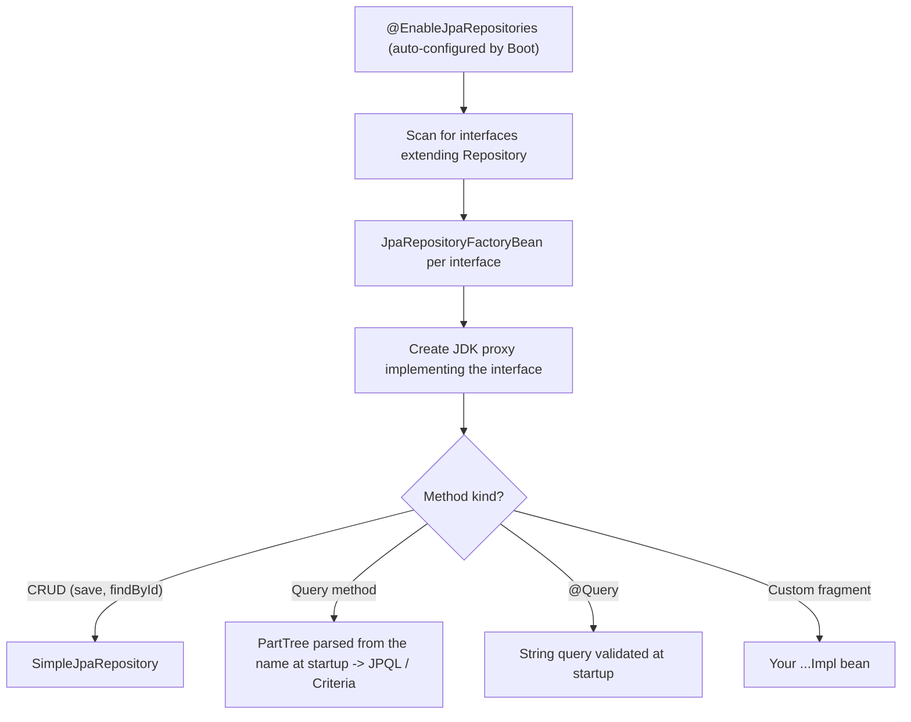
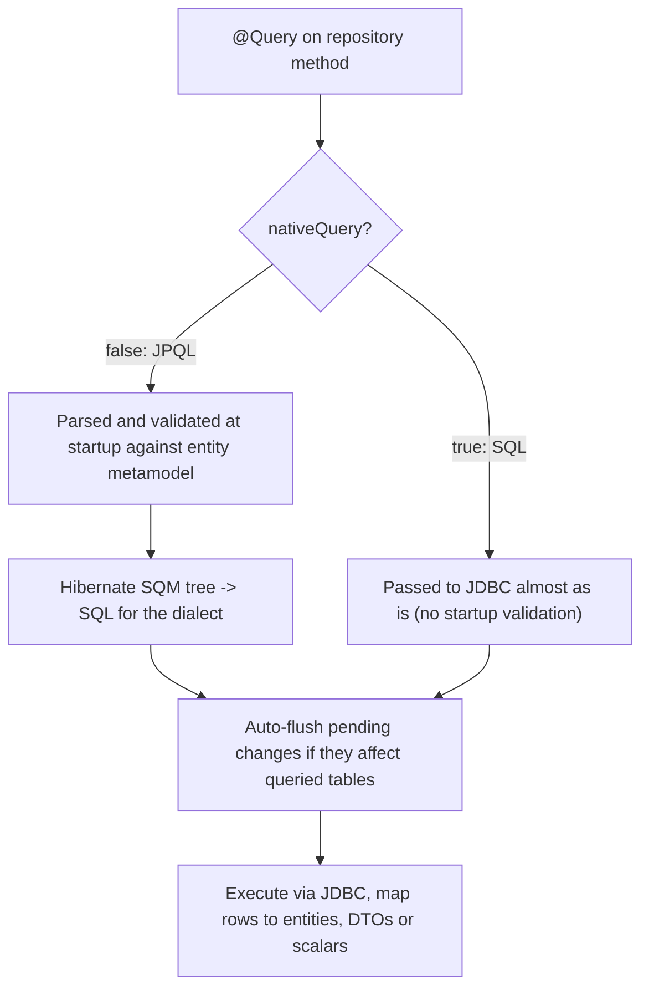
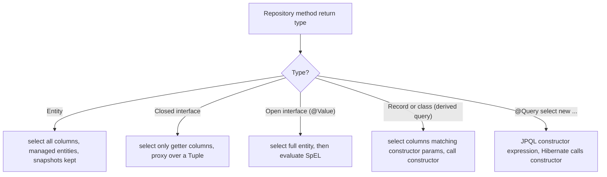

@@ 2 | MODULE | Repositories | Spring Data repository interfaces, derived queries, JPQL, native SQL and projections | MUST
# Repositories

**Shared analogy: a library help desk.** The repository is the help desk: you never walk into the stacks yourself. For common requests you just say the request in a standard phrase ("books by author Rowling, sorted by title") and the librarian understands it from the wording alone (derived queries). For unusual requests you hand over a written request slip in the library's own catalogue language (JPQL with `@Query`) or, if you know the shelf layout, in raw shelf codes (native SQL). And if you only need the titles and not the whole books, the librarian photocopies just that page (projections), which is lighter to carry.

@@ 3 | TOPIC | Repositories and Derived Queries | Repository interface hierarchy, CRUD, query derivation from method names, paging, sorting and custom fragments | MUST
# Repositories and Derived Queries

**Level: Intermediate | Phase 12 | Priority: MUST | Since: Spring Data JPA 1.0 (`ListCrudRepository` Spring Data 3.0, Boot 3)**

> **30-second interview answer:** A Spring Data repository is an interface such as `JpaRepository<Product, Long>`; Spring generates the implementation at startup as a proxy backed by `SimpleJpaRepository`. Besides inherited CRUD, paging and sorting, I can declare query methods whose names are parsed into JPQL, like `findByStatusAndPriceLessThanOrderByPriceAsc`. Invalid names fail at startup. When the name gets too long or I need joins and fetches, I switch to `@Query`, and for logic that does not fit at all I add a custom fragment implemented with the `EntityManager`.

## 1. Concept in Simple Words
### Analogy
Ordering coffee with a standard phrase.

| Coffee shop | Spring Data |
|---|---|
| The menu board of standard drinks | Inherited CRUD methods: `findById`, `save`, `delete` |
| "Large oat latte, extra hot" understood from the words alone | Derived query `findByStatusAndPriceLessThan` |
| The barista knows the grammar: size, milk, drink, extras | Spring Data's method-name parser: subject, predicate, keywords |
| A phrase the barista does not understand is rejected at the counter, not after brewing | Invalid method names fail at application startup |
| A handwritten special order | `@Query` |
| A secret recipe only the head barista makes | Custom repository fragment with `EntityManager` |

### What it is
Repository interface hierarchy:
```text
Repository<T, ID>                       marker, no methods
  CrudRepository / ListCrudRepository   save, findById, findAll, deleteById, count, existsById
  PagingAndSortingRepository / ListPagingAndSortingRepository   findAll(Sort), findAll(Pageable)
    JpaRepository<T, ID>                flush, saveAndFlush, deleteAllInBatch, getReferenceById, findAll(Example)
```
- **`List*` variants** (Spring Data 3) return `List` instead of `Iterable`. `JpaRepository` extends them.
- **Derived query:** a method whose name follows the grammar `find...By` / `exists...By` / `count...By` / `delete...By` plus property expressions and keywords: `And`, `Or`, `Between`, `LessThan`, `GreaterThanEqual`, `Like`, `Containing`, `StartingWith`, `IgnoreCase`, `In`, `IsNull`, `True`, `OrderBy...Asc/Desc`, `Top10`, `First`, `Distinct`.
- **Return types:** entity, `Optional<T>`, `List<T>`, `Stream<T>` (inside a transaction, must be closed), `Page<T>` (runs an extra count query), `Slice<T>` (fetches one extra row instead of counting), `boolean` for `exists`, `long` for `count`.
- **`Pageable` and `Sort`:** parameters that add `limit/offset` and `order by`.
- **Custom fragment:** an interface plus an `Impl` class you write; the repository extends both and Spring merges them.
- **`@Modifying` delete/update:** bulk operations with `@Query` (next topic).

### Why it exists
Before Spring Data, each entity had a DAO class with the same CRUD code and similar finder methods. Spring Data turned those into declarations: less code, consistent behaviour, and queries validated at startup.

## 2. How It Works


Parsing `findTop5ByStatusAndPriceLessThanOrderByPriceAsc(Status s, BigDecimal max)`:
```text
find          -> subject: select
Top5          -> limit 5
By            -> start of criteria
Status        -> property "status"          = ?1
And
PriceLessThan -> property "price" keyword LessThan  < ?2
OrderByPriceAsc -> order by price asc

=> select p from Product p where p.status = ?1 and p.price < ?2 order by p.price asc  (limit 5)
```
Property paths traverse relations: `findByCustomerEmail` becomes `where o.customer.email = ?1` with an implicit join. Use `_` to disambiguate (`findByCustomer_Email`).

Transactions: `SimpleJpaRepository` is annotated `@Transactional(readOnly = true)` at class level and `@Transactional` on write methods, so every repository call runs in a transaction, joining yours if one exists. Derived query methods inherit the read-only default.

## 3. Code Example
### Code
```java
package com.orderhub.product;

import org.springframework.data.domain.Page;
import org.springframework.data.domain.Pageable;
import org.springframework.data.domain.Slice;
import org.springframework.data.domain.Sort;
import org.springframework.data.jpa.repository.JpaRepository;

import java.math.BigDecimal;
import java.util.Collection;
import java.util.List;
import java.util.Optional;

public interface ProductRepository extends JpaRepository<Product, Long>, ProductSearchFragment {

    Optional<Product> findBySku(String sku);

    boolean existsBySku(String sku);

    List<Product> findByStatusAndPriceLessThanOrderByPriceAsc(Product.Status status, BigDecimal max);

    List<Product> findByNameContainingIgnoreCase(String text, Sort sort);

    Page<Product> findByStatus(Product.Status status, Pageable pageable);     // + count query

    Slice<Product> findByStockLessThan(int threshold, Pageable pageable);    // no count query

    List<Product> findTop3ByStatusOrderByCreatedAtDesc(Product.Status status);

    List<Product> findBySkuIn(Collection<String> skus);

    long countByStatus(Product.Status status);

    // Property path through a many-to-many: products in a category by name
    List<Product> findByCategoriesName(String categoryName);
}
```

Custom fragment for a dynamic search that a method name cannot express:
```java
package com.orderhub.product;

import java.math.BigDecimal;
import java.util.List;

public interface ProductSearchFragment {
    List<Product> search(String text, BigDecimal minPrice, BigDecimal maxPrice);
}
```

```java
package com.orderhub.product;

import jakarta.persistence.EntityManager;
import jakarta.persistence.criteria.CriteriaBuilder;
import jakarta.persistence.criteria.CriteriaQuery;
import jakarta.persistence.criteria.Predicate;
import jakarta.persistence.criteria.Root;

import java.math.BigDecimal;
import java.util.ArrayList;
import java.util.List;

// Name must be <FragmentInterface>Impl so Spring Data finds it
class ProductSearchFragmentImpl implements ProductSearchFragment {
    private final EntityManager em;

    ProductSearchFragmentImpl(EntityManager em) { this.em = em; }

    @Override
    public List<Product> search(String text, BigDecimal minPrice, BigDecimal maxPrice) {
        CriteriaBuilder cb = em.getCriteriaBuilder();
        CriteriaQuery<Product> q = cb.createQuery(Product.class);
        Root<Product> p = q.from(Product.class);
        List<Predicate> where = new ArrayList<>();
        if (text != null) where.add(cb.like(cb.lower(p.get("name")), "%" + text.toLowerCase() + "%"));
        if (minPrice != null) where.add(cb.greaterThanOrEqualTo(p.get("price"), minPrice));
        if (maxPrice != null) where.add(cb.lessThanOrEqualTo(p.get("price"), maxPrice));
        q.where(where.toArray(Predicate[]::new)).orderBy(cb.asc(p.get("name")));
        return em.createQuery(q).getResultList();
    }
}
```

Controller using paging (Phase 11 style):
```java
package com.orderhub.product;

import org.springframework.data.domain.Page;
import org.springframework.data.domain.Pageable;
import org.springframework.data.web.PageableDefault;
import org.springframework.data.domain.Sort;
import org.springframework.web.bind.annotation.GetMapping;
import org.springframework.web.bind.annotation.RequestMapping;
import org.springframework.web.bind.annotation.RequestParam;
import org.springframework.web.bind.annotation.RestController;

import java.math.BigDecimal;
import java.util.List;

@RestController
@RequestMapping("/api/products")
class ProductQueryController {
    private final ProductRepository products;
    ProductQueryController(ProductRepository products) { this.products = products; }

    @GetMapping
    Page<ProductDto> active(@PageableDefault(size = 2, sort = "price", direction = Sort.Direction.ASC) Pageable pageable) {
        return products.findByStatus(Product.Status.ACTIVE, pageable).map(ProductDto::from);
    }

    @GetMapping("/search")
    List<ProductDto> search(@RequestParam(required = false) String q,
                            @RequestParam(required = false) BigDecimal min,
                            @RequestParam(required = false) BigDecimal max) {
        return products.search(q, min, max).stream().map(ProductDto::from).toList();
    }
}
```

`application.yml` to make page JSON stable (Spring Data 3.3+):
```yaml
spring:
  data:
    web:
      pageable:
        max-page-size: 100
  jpa:
    show-sql: true
```
And on the application class: `@EnableSpringDataWebSupport(pageSerializationMode = VIA_DTO)` so `Page` is serialised as a stable `PagedModel` JSON instead of the internal `PageImpl` structure (Boot warns otherwise).

### Walkthrough
- `findBySku` returns `Optional`, so "not found" is explicit.
- `findByStatusAndPriceLessThanOrderByPriceAsc` is parsed at startup into JPQL with two parameters and an order by.
- `findByStatus(..., Pageable)` returns a `Page`: Spring Data runs the content query with `offset ... fetch first ...` and a second `count` query.
- `findByStockLessThan` returns a `Slice`: it asks for `size + 1` rows to know whether there is a next page, without counting. Good for infinite scrolling.
- `findByCategoriesName` walks the many-to-many: Spring Data adds the join for you.
- `ProductSearchFragmentImpl` handles optional filters with the Criteria API; Spring Data wires it in because the class name ends with `Impl`.

### Output
`GET /api/products?page=0&size=2&sort=price,asc`:
```text
Hibernate: select p1_0.id,p1_0.created_at,p1_0.name,p1_0.price,p1_0.sku,p1_0.status,p1_0.stock from product p1_0 where p1_0.status=? order by p1_0.price offset ? rows fetch first ? rows only
Hibernate: select count(p1_0.id) from product p1_0 where p1_0.status=?
```
```http
HTTP/1.1 200 OK
Content-Type: application/json

{
  "content": [
    { "id": 2, "sku": "MS-01", "name": "Mouse", "price": 19.90 },
    { "id": 1, "sku": "KB-01", "name": "Keyboard", "price": 49.90 }
  ],
  "page": { "size": 2, "number": 0, "totalElements": 3, "totalPages": 2 }
}
```
`GET /api/products/search?q=mon&max=300`:
```text
Hibernate: select p1_0.id,p1_0.created_at,p1_0.name,p1_0.price,p1_0.sku,p1_0.status,p1_0.stock from product p1_0 where lower(p1_0.name) like ? escape '' and p1_0.price<=? order by p1_0.name
```
A misspelt method such as `findByStatsu` stops the application at startup:
```text
org.springframework.data.repository.query.QueryCreationException: Could not create query for public abstract java.util.List com.orderhub.product.ProductRepository.findByStatsu(...); Reason: No property 'statsu' found for type 'Product'
```

### Compare
| Approach | Good for | Breaks down when |
|---|---|---|
| Derived query | 1 to 3 simple conditions | Names get long, joins with fetch, aggregates |
| `@Query` JPQL | Joins, fetches, aggregates, DTOs | Dynamic optional filters |
| Specifications or Criteria | Dynamic filters | Simple static queries (too verbose) |
| Query by Example | Simple equality filters from a probe object | Ranges, OR conditions |
| Custom fragment | Anything, full `EntityManager` access | Overused for simple things |

## 4. Interview Questions
**Basic**
1. **What is the difference between `CrudRepository` and `JpaRepository`?**
   `CrudRepository` offers generic CRUD (`save`, `findById`, `findAll`, `delete`, `count`). `JpaRepository` extends the list and paging variants and adds JPA-specific methods: `flush`, `saveAndFlush`, `deleteAllInBatch`, `getReferenceById` and query by example. Use `JpaRepository` in JPA projects, or a narrower interface if you want to restrict what callers can do.
2. **What are derived query methods?**
   Repository methods whose names Spring Data parses into queries, such as `findByEmailIgnoreCase` or `countByStatus`. The name has a subject (`find`, `exists`, `count`, `delete`), optional limiting (`Top5`, `Distinct`) and criteria on entity properties joined with `And` and `Or`, plus optional ordering.
3. **`Page` vs `Slice`?**
   `Page` contains total elements and total pages, so Spring Data runs an extra count query. `Slice` only knows whether a next slice exists, fetching one extra row instead. Use `Slice` for infinite scroll or large tables where counting is expensive.

**Follow-up**
4. **When are derived query methods validated?**
   At application startup, when the repository proxy is created. A property name that does not exist on the entity causes a `QueryCreationException` and the context fails to start. That is a big advantage over string queries discovered broken at runtime.
5. **How do you add custom logic to a Spring Data repository?**
   Create a fragment interface, implement it in a class named `<Fragment>Impl` (injecting `EntityManager` or `JdbcClient`), and make the repository extend the fragment. Spring Data detects the implementation and routes those calls to it while the rest stays generated.
6. **Are repository methods transactional?**
   Yes. `SimpleJpaRepository` is `@Transactional(readOnly = true)` with read-write transactions on modifying methods, and query methods are read-only by default. If a service transaction already exists, repository calls join it. Your custom fragment methods are not transactional unless you annotate them or call them from a transactional service.

**Tricky / scenario**
7. **What is wrong with `findByCustomerIdAndStatusAndCreatedAtBetweenAndTotalGreaterThanOrderByCreatedAtDesc`?**
   It works but is unreadable, hard to review and impossible to change without touching every caller. Switch to `@Query` with a readable name such as `findRecentLargeOrders`, or to a Specification if the filters are optional.
8. **`deleteByStatus(Status.CANCELLED)` is slow for 100 000 rows. Why?**
   Derived delete methods load all matching entities and delete them one by one through `em.remove`, so that lifecycle callbacks and cascades run. For bulk work use `@Modifying @Query("delete from Order o where o.status = :status")` or `deleteAllInBatch`, knowing they bypass cascades and the persistence context.
9. **`findById` vs `getReferenceById`: which do you use to set a foreign key?**
   `getReferenceById` returns a lazy proxy without hitting the database, ideal for `order.setCustomer(customers.getReferenceById(id))`. `findById` runs a SELECT and returns `Optional`. If the id does not exist, the proxy only fails later (with a foreign key violation or `EntityNotFoundException` on access), so use `findById` when you must validate existence.

**What the interviewer is really testing:** whether you know what Spring Data generates, its costs (count queries, entity-by-entity deletes) and when to step outside method-name queries.

## 5. Pitfalls & Best Practices
### Common mistakes
| Mistake | What goes wrong | Fix |
|---|---|---|
| Very long derived method names | Unreadable, brittle | `@Query` with a clear name |
| Returning `Page` for huge tables | Expensive `count(*)` on every request | `Slice` or keyset pagination |
| Derived `deleteBy...` for bulk deletes | Loads and deletes each row | `@Modifying` bulk JPQL |
| `Stream<T>` without try-with-resources or transaction | Connection leak or exception | Use inside `@Transactional`, close the stream |
| Exposing entities from repository straight to controllers | Lazy loading in JSON, leaking schema | Map to DTOs in the service |
| `findAll()` on large tables | Loads everything into memory | Paging or streaming |

### Best practices
- Prefer `Optional<T>` for single results.
- Keep derived queries to two or three conditions.
- Use `existsBy...` instead of `findBy...().isPresent()`: it selects only a constant with limit 1.
- Put a hard maximum page size (`spring.data.web.pageable.max-page-size`).
- Keep repositories per aggregate root (`OrderRepository`, not `OrderLineRepository`).

### Compare with
| Spring Data module | Store | Same repository model? |
|---|---|---|
| Spring Data JPA | Relational via JPA | Yes, with persistence context and lazy loading |
| Spring Data JDBC | Relational via JDBC | Yes, aggregates, no lazy loading |
| Spring Data MongoDB | MongoDB | Yes, document queries |
| Spring Data Redis | Redis | Yes, key-value |
| Spring Data R2DBC | Relational, reactive | Yes, returns `Mono` and `Flux` |

## 6. Hands-on Exercise
Create `CustomerRepository` for OrderHub with:
- lookup by email ignoring case,
- check whether an email is taken,
- the 10 newest GOLD customers,
- customers whose name contains a text, paged as a `Slice`,
- number of customers per tier,
- a custom fragment `findByFilter(CustomerFilter f)` where every field of the filter is optional (`tier`, `emailDomain`, `createdAfter`).

Acceptance criteria: all methods compile against the `Customer` entity from the Entity Mapping topic, and none loads entities just to count or check existence.

<details><summary>Solution</summary>

```java
package com.orderhub.customer;

import jakarta.persistence.EntityManager;
import jakarta.persistence.criteria.CriteriaBuilder;
import jakarta.persistence.criteria.CriteriaQuery;
import jakarta.persistence.criteria.Predicate;
import jakarta.persistence.criteria.Root;
import org.springframework.data.domain.Pageable;
import org.springframework.data.domain.Slice;
import org.springframework.data.jpa.repository.JpaRepository;

import java.time.Instant;
import java.util.ArrayList;
import java.util.List;
import java.util.Optional;

public interface CustomerRepository extends JpaRepository<Customer, Long>, CustomerFilterFragment {
    Optional<Customer> findByEmailIgnoreCase(String email);
    boolean existsByEmailIgnoreCase(String email);
    List<Customer> findTop10ByTierOrderByCreatedAtDesc(Customer.Tier tier);
    Slice<Customer> findByFullNameContainingIgnoreCase(String text, Pageable pageable);
    long countByTier(Customer.Tier tier);
}

record CustomerFilter(Customer.Tier tier, String emailDomain, Instant createdAfter) { }

interface CustomerFilterFragment {
    List<Customer> findByFilter(CustomerFilter filter);
}

class CustomerFilterFragmentImpl implements CustomerFilterFragment {
    private final EntityManager em;
    CustomerFilterFragmentImpl(EntityManager em) { this.em = em; }

    @Override
    public List<Customer> findByFilter(CustomerFilter f) {
        CriteriaBuilder cb = em.getCriteriaBuilder();
        CriteriaQuery<Customer> q = cb.createQuery(Customer.class);
        Root<Customer> c = q.from(Customer.class);
        List<Predicate> where = new ArrayList<>();
        if (f.tier() != null) where.add(cb.equal(c.get("tier"), f.tier()));
        if (f.emailDomain() != null) where.add(cb.like(c.get("email"), "%@" + f.emailDomain().toLowerCase()));
        if (f.createdAfter() != null) where.add(cb.greaterThan(c.get("createdAt"), f.createdAfter()));
        q.where(where.toArray(Predicate[]::new)).orderBy(cb.asc(c.get("email")));
        return em.createQuery(q).getResultList();
    }
}
```
`existsByEmailIgnoreCase` generates `select c.id from customer c where upper(c.email)=upper(?) fetch first 1 rows only`, and `countByTier` generates `select count(c.id) ...`, so neither loads entities. A Specification (`JpaSpecificationExecutor`) is an equally good answer for the dynamic filter.
</details>

## 7. Recall
Q: How does Spring Data JPA implement a repository interface?
A: At startup it creates a JDK proxy per interface; CRUD calls go to `SimpleJpaRepository`, query methods are parsed into JPQL, and custom fragments go to your `Impl` class.

Q: What is the difference between Page and Slice in Spring Data?
A: Page includes totals and runs an extra count query; Slice only knows if a next slice exists by fetching one extra row.

Q: When does Spring Data validate derived query method names?
A: At application startup; an unknown property makes the context fail with `QueryCreationException`.

Q: Why is a derived deleteBy method slow for bulk deletes?
A: It loads every matching entity and removes them one by one; use a `@Modifying` bulk query instead.

Q: What does getReferenceById return in Spring Data JPA?
A: A lazy proxy with only the id set, without a SELECT, useful for setting foreign keys.

**Related:** [[@Query, JPQL and Native Queries]] · [[Projections and DTO Queries]] · [[Pagination and Sorting]] · [[JPA vs Hibernate vs Spring Data JPA]]

@@ 3 | TOPIC | @Query, JPQL and Native Queries | Writing JPQL and native SQL in repositories, parameters, bulk updates with @Modifying and their traps | MUST
# @Query, JPQL and Native Queries

**Level: Intermediate | Phase 12 | Priority: MUST | Since: JPA 1.0 (JPQL), Spring Data JPA 1.0 (`@Query`), Hibernate 6 HQL improvements**

> **30-second interview answer:** `@Query` lets me write the query myself on a repository method. By default it is JPQL, which queries entities and fields, not tables and columns, so it is portable and Hibernate translates it to SQL. With `nativeQuery = true` I write real SQL for database-specific features. I always bind parameters with `:name`, use `@Modifying` for bulk updates and deletes, and remember those bypass the persistence context, so I add `clearAutomatically = true` or reload entities afterwards.

## 1. Concept in Simple Words
### Analogy
Asking for directions.

| Directions | Queries |
|---|---|
| "Take me to the Central Library" (by name, any taxi understands) | JPQL: `select p from Product p` (entity names) |
| "Go to 52.5200 N, 13.4050 E" (exact coordinates, only works on this map) | Native SQL: `select * from product` (table names, vendor syntax) |
| The taxi driver translates the name into a route | Hibernate translates JPQL into SQL for the dialect |
| Filling in blanks on a form instead of writing a new sentence | Bound parameters `:status` |
| A city-wide road closure that maps in passengers' phones do not know about yet | Bulk `@Modifying` update that the persistence context does not see |

### What it is
- **JPQL (Jakarta Persistence Query Language):** SQL-like language over the entity model: `select o from Order o join o.customer c where c.email = :email`. Uses entity and field names, navigates relations with dots, supports `join fetch`, `new` constructor expressions, functions and subqueries.
- **HQL:** Hibernate's superset of JPQL. Hibernate 6 added many SQL features: `limit`/`offset`, window functions, `cast`, set operations (`union`), CTEs.
- **Native query:** `@Query(value = "...", nativeQuery = true)`: real SQL, returned as entities, projections or scalars. Not validated at startup.
- **Parameters:** named `:email` with `@Param("email")` (or compiled with `-parameters`, which Boot's Maven plugin does), positional `?1`, SpEL like `:#{#filter.status}`.
- **`@Modifying`:** required for `update`, `delete` and `insert` statements. Returns the affected row count. Options: `clearAutomatically` (clear the persistence context after) and `flushAutomatically` (flush pending changes before).
- **`countQuery`:** a separate count for paged `@Query` methods when the generated count is wrong or slow.
- **Named queries:** `@NamedQuery` on the entity, matched by `Entity.methodName`; mostly legacy now.

### Why it exists
Derived names cannot express joins with fetch, aggregates, subqueries, or bulk updates. JPQL keeps those queries portable and checked against the entity model; native SQL covers what JPQL cannot (window functions in older versions, `ON CONFLICT`, JSON operators, full-text search, hints).

## 2. How It Works


Important behaviours:
1. **Auto flush:** before running a JPQL query, Hibernate flushes pending changes to tables the query touches (FlushMode AUTO), so the query sees your unsaved changes. For native queries Hibernate cannot always tell which tables are touched and, in Hibernate's native mode, flushes the whole session.
2. **Bulk operations skip the persistence context:** `update Product p set p.price = ...` changes rows directly. Entities already loaded in the current persistence context keep their old values, and a later flush could even overwrite the new value with the stale one.
3. **Pagination with `@Query`:** Spring Data derives a count query from your JPQL by rewriting the select clause. For complex queries supply `countQuery`.
4. **Sorting:** a `Sort` or `Pageable` parameter appends `order by`; for native queries only properties that are real columns work.

```text
Persistence context before bulk update:  Product#1 price=49.90 (managed)
update Product p set p.price = p.price * 1.1        -> DB row price=54.89
product1.getPrice()                                 -> still 49.90 (stale!)
with clearAutomatically = true -> context cleared   -> next findById reloads 54.89
```

## 3. Code Example
### Code
```java
package com.orderhub.order;

import org.springframework.data.domain.Page;
import org.springframework.data.domain.Pageable;
import org.springframework.data.jpa.repository.JpaRepository;
import org.springframework.data.jpa.repository.Modifying;
import org.springframework.data.jpa.repository.Query;
import org.springframework.data.repository.query.Param;

import java.math.BigDecimal;
import java.time.Instant;
import java.util.List;
import java.util.Optional;

public interface OrderRepository extends JpaRepository<Order, Long> {

    // JPQL with joins, named parameters and a fetch
    @Query("""
           select o from Order o
           join fetch o.customer c
           where c.email = :email and o.createdAt >= :since
           order by o.createdAt desc
           """)
    List<Order> findRecentByCustomerEmail(@Param("email") String email, @Param("since") Instant since);

    // Aggregate returning a scalar
    @Query("select coalesce(sum(o.total), 0) from Order o where o.customer.id = :customerId and o.status = 'PAID'")
    BigDecimal totalSpent(@Param("customerId") Long customerId);

    // Subquery: customers' orders larger than their average
    @Query("""
           select o from Order o
           where o.total > (select avg(o2.total) from Order o2 where o2.customer = o.customer)
           """)
    List<Order> findAboveCustomerAverage();

    // Paged JPQL with an explicit count query
    @Query(value = "select o from Order o join o.customer c where c.tier = :tier",
           countQuery = "select count(o) from Order o where o.customer.tier = :tier")
    Page<Order> findByCustomerTier(@Param("tier") com.orderhub.customer.Customer.Tier tier, Pageable pageable);

    // Bulk update: bypasses the persistence context
    @Modifying(clearAutomatically = true, flushAutomatically = true)
    @Query("update Order o set o.status = 'CANCELLED' where o.status = 'NEW' and o.createdAt < :before")
    int cancelStaleOrders(@Param("before") Instant before);

    // Native SQL: PostgreSQL window function, mapped to an interface projection
    @Query(value = """
           select o.id as id, o.total as total,
                  rank() over (partition by o.customer_id order by o.total desc) as rankForCustomer
           from orders o
           where o.customer_id = :customerId
           """, nativeQuery = true)
    List<RankedOrder> rankOrders(@Param("customerId") Long customerId);

    interface RankedOrder {
        Long getId();
        BigDecimal getTotal();
        Integer getRankForCustomer();
    }
}
```

Native upsert on products (database-specific, so native):
```java
package com.orderhub.product;

import org.springframework.data.jpa.repository.JpaRepository;
import org.springframework.data.jpa.repository.Modifying;
import org.springframework.data.jpa.repository.Query;
import org.springframework.data.repository.query.Param;

import java.math.BigDecimal;

public interface ProductImportRepository extends JpaRepository<Product, Long> {

    @Modifying
    @Query(value = """
           insert into product (id, sku, name, price, stock, status, created_at)
           values (nextval('product_seq'), :sku, :name, :price, :stock, 'ACTIVE', now())
           on conflict (sku) do update
              set name = excluded.name, price = excluded.price, stock = excluded.stock
           """, nativeQuery = true)
    int upsert(@Param("sku") String sku, @Param("name") String name,
               @Param("price") BigDecimal price, @Param("stock") int stock);
}
```

Service that uses the bulk update safely:
```java
package com.orderhub.order;

import org.springframework.scheduling.annotation.Scheduled;
import org.springframework.stereotype.Service;
import org.springframework.transaction.annotation.Transactional;

import java.time.Duration;
import java.time.Instant;

@Service
public class StaleOrderJob {
    private final OrderRepository orders;
    public StaleOrderJob(OrderRepository orders) { this.orders = orders; }

    @Scheduled(cron = "0 0 * * * *")          // hourly; needs @EnableScheduling
    @Transactional
    public void cancelStale() {
        int n = orders.cancelStaleOrders(Instant.now().minus(Duration.ofHours(24)));
        System.out.println("cancelled " + n + " stale orders");
    }
}
```

### Walkthrough
- `findRecentByCustomerEmail` is JPQL: `Order`, `customer`, `email`, `createdAt` are entity and field names. Text blocks keep long queries readable.
- `totalSpent` uses `coalesce` so a customer without paid orders gets 0, not null. Enum literals in JPQL can be written as strings in Hibernate 6 when compared to an enum field.
- `findAboveCustomerAverage` shows a correlated subquery in JPQL.
- `findByCustomerTier` supplies `countQuery` so the count does not include an unnecessary join.
- `cancelStaleOrders` is a bulk update: one SQL statement for all rows. `flushAutomatically` pushes pending changes first, `clearAutomatically` clears stale entities afterwards.
- `rankOrders` uses a PostgreSQL window function in native SQL and maps columns to an interface projection by alias.
- `upsert` uses PostgreSQL's `on conflict`, impossible in JPQL.

### Output
`findRecentByCustomerEmail("ana@example.com", since)`:
```text
Hibernate: select o1_0.id,c1_0.id,c1_0.created_at,c1_0.email,c1_0.full_name,c1_0.tier,o1_0.created_at,o1_0.order_number,o1_0.status,o1_0.total from orders o1_0 join customer c1_0 on c1_0.id=o1_0.customer_id where c1_0.email=? and o1_0.created_at>=? order by o1_0.created_at desc
```
`cancelStale()` with 3 stale orders:
```text
Hibernate: update orders set status='CANCELLED' where status='NEW' and created_at<?
cancelled 3 stale orders
```
`rankOrders(7L)`:
```text
Hibernate: select o.id as id, o.total as total, rank() over (partition by o.customer_id order by o.total desc) as rankForCustomer from orders o where o.customer_id = ?
```
A typo in JPQL (`select o from Orders o`) fails at startup:
```text
Caused by: java.lang.IllegalArgumentException: org.hibernate.query.sqm.UnknownEntityException: Could not resolve root entity 'Orders'
```

### Compare
| | JPQL `@Query` | Native `@Query` |
|---|---|---|
| Refers to | Entities and fields | Tables and columns |
| Validated at startup | Yes | No |
| Portable | Yes | No |
| Join fetch, entity graphs | Yes | No (manual mapping) |
| Vendor features (upsert, JSON, full text) | Limited | Full |
| Sorting with `Sort` | Any property | Real column names only |

## 4. Interview Questions
**Basic**
1. **What is the difference between JPQL and SQL?**
   JPQL queries the entity model: entity names, field names and relationship navigation (`o.customer.email`), and returns entities or DTOs. SQL queries tables and columns. Hibernate translates JPQL into SQL for the configured database dialect, so JPQL is portable and checked against the mapping.
2. **When do you use a native query?**
   When you need a database-specific feature JPQL does not support well: `on conflict` upserts, JSON operators, full-text search, recursive CTEs in older versions, or query hints. Native queries are not validated at startup and lose portability, so keep them few and tested.
3. **Why is `@Modifying` needed?**
   Spring Data executes `@Query` methods as selects by default. `@Modifying` tells it to call `executeUpdate()` instead and return the number of affected rows. The method must run inside a read-write transaction.

**Follow-up**
4. **What is the risk of bulk updates and deletes?**
   They go straight to the database and bypass the persistence context: no dirty checking, no cascades, no lifecycle callbacks, no `@Version` increment unless you write `set o.version = o.version + 1`. Entities already loaded keep stale state, so use `clearAutomatically = true` or reload them.
5. **How do you prevent SQL injection with `@Query`?**
   Always bind values as parameters (`:name` or `?1`); Spring and Hibernate send them as JDBC parameters. Never concatenate request data into the query string, including dynamic `order by` columns, which you should whitelist or pass through `Sort` with validated properties.
6. **Why does Hibernate flush before running a query?**
   With the default FlushMode AUTO, Hibernate flushes pending changes that could affect the query result so the query sees your own uncommitted modifications. This can surprise you with UPDATE statements appearing just before a SELECT.

**Tricky / scenario**
7. **After `cancelStaleOrders`, the same transaction reads an order with `findById` and still sees status NEW. Why?**
   The order was already managed in the persistence context, and `findById` returns the cached instance without querying. The bulk update changed only the database row. Use `@Modifying(clearAutomatically = true)` or `entityManager.refresh(order)`.
8. **A paged native query fails with an error about the count query. What do you do?**
   Spring Data tries to derive a count from the native SQL, which often breaks with complex SQL. Provide `countQuery` explicitly (also native), or use `Slice` so no count is needed.
9. **Your JPQL `select o from Order o left join fetch o.lines where size(o.lines) > 0` returns each order several times on Hibernate 5 but not on Hibernate 6. Why?**
   A collection join returns one SQL row per line. Hibernate 5 returned the root entity once per row unless you used `distinct`; Hibernate 6 deduplicates root entities automatically for entity results. `distinct` still matters if you return scalars or DTOs.

**What the interviewer is really testing:** whether you can write safe, correct queries and know the consequences of bypassing the persistence context.

## 5. Pitfalls & Best Practices
### Common mistakes
| Mistake | What goes wrong | Fix |
|---|---|---|
| Concatenating input into `@Query` strings | SQL or JPQL injection | Bind parameters only |
| `@Modifying` without `clearAutomatically` | Stale entities in the same transaction | `clearAutomatically = true` or refresh |
| Native SQL everywhere | No startup validation, no portability | JPQL by default, native only when needed |
| Forgetting `@Transactional` around `@Modifying` calls | `TransactionRequiredException` | Call from a transactional service |
| Paged native query without `countQuery` | Broken or slow count | Provide `countQuery` or use `Slice` |
| Bulk update on versioned entities without bumping version | Optimistic locking does not detect the change | Add `version = version + 1` |

### Best practices
- Write queries as text blocks and give methods intention-revealing names.
- Prefer JPQL; isolate native SQL in clearly named methods with integration tests (Testcontainers).
- Return DTOs or interface projections from read queries.
- Keep bulk operations in dedicated methods with `@Modifying(clearAutomatically = true, flushAutomatically = true)`.
- Check the generated SQL for every new query.

### Compare with
| Tool | Typed | Dynamic | Best for |
|---|---|---|---|
| Derived query | Checked at startup | No | Simple finders |
| `@Query` JPQL | Checked at startup | No | Static complex queries |
| `@Query` native | No | No | Vendor features |
| Criteria API or Specifications | Yes (with metamodel) | Yes | Optional filters |
| Querydsl or jOOQ | Yes | Yes | Large query-heavy codebases |

## 6. Hands-on Exercise
Add to OrderHub:
1. `GET /api/customers/{id}/stats` returning `{ "orders": 12, "spent": 840.50, "lastOrderAt": "..." }` using one JPQL query.
2. A nightly bulk job that marks products with zero stock as `DISCONTINUED` if they were not ordered in the last 90 days, using one `@Modifying` JPQL statement with a subquery.

Acceptance criteria: one SQL statement per feature; parameters bound; the bulk method clears the persistence context.

<details><summary>Solution</summary>

```java
package com.orderhub.customer;

import com.orderhub.order.Order;
import org.springframework.data.jpa.repository.JpaRepository;
import org.springframework.data.jpa.repository.Query;
import org.springframework.data.repository.query.Param;

import java.math.BigDecimal;
import java.time.Instant;

public interface CustomerStatsRepository extends JpaRepository<Order, Long> {

    record CustomerStats(long orders, BigDecimal spent, Instant lastOrderAt) { }

    @Query("""
           select new com.orderhub.customer.CustomerStatsRepository.CustomerStats(
                  count(o), coalesce(sum(o.total), 0), max(o.createdAt))
           from Order o
           where o.customer.id = :customerId and o.status <> 'CANCELLED'
           """)
    CustomerStats statsFor(@Param("customerId") Long customerId);
}
```

```java
package com.orderhub.product;

import org.springframework.data.jpa.repository.JpaRepository;
import org.springframework.data.jpa.repository.Modifying;
import org.springframework.data.jpa.repository.Query;
import org.springframework.data.repository.query.Param;

import java.time.Instant;

public interface ProductMaintenanceRepository extends JpaRepository<Product, Long> {

    @Modifying(clearAutomatically = true, flushAutomatically = true)
    @Query("""
           update Product p set p.status = 'DISCONTINUED'
           where p.stock = 0 and p.status = 'ACTIVE'
             and not exists (select 1 from OrderLine l
                             where l.product = p and l.order.createdAt >= :since)
           """)
    int discontinueUnsold(@Param("since") Instant since);
}
```
The constructor expression uses the fully qualified name of the nested record (JPQL needs it). For the bulk update, call `discontinueUnsold(Instant.now().minus(Duration.ofDays(90)))` from a `@Transactional @Scheduled` service method; the generated SQL is a single `update product set status='DISCONTINUED' where ... and not exists(select 1 from order_line l1_0 join orders o1_0 on ... )`.
</details>

## 7. Recall
Q: What is the difference between JPQL and native queries in Spring Data JPA?
A: JPQL uses entity and field names, is portable and validated at startup; native queries use real SQL tables and columns and are not validated.

Q: Why must a bulk update @Query be annotated with @Modifying?
A: So Spring Data runs `executeUpdate()` and returns the affected row count instead of treating it as a select.

Q: Why can entities be stale after a JPA bulk update?
A: Bulk statements bypass the persistence context, so already managed entities keep their old values unless the context is cleared or refreshed.

Q: What does @Modifying(clearAutomatically = true) do?
A: It clears the persistence context after the bulk statement so later reads load fresh data.

Q: How do you avoid SQL injection in Spring Data @Query methods?
A: Bind every value as a named or positional parameter and never concatenate input into the query string.

**Related:** [[Repositories and Derived Queries]] · [[Projections and DTO Queries]] · [[Fetch Types and the N+1 Problem]] · [[Persistence Context and Entity States]]

@@ 3 | TOPIC | Projections and DTO Queries | Interface, class and dynamic projections, constructor expressions and why read models should not load entities | SHOULD
# Projections and DTO Queries

**Level: Intermediate | Phase 12 | Priority: SHOULD | Since: Spring Data JPA 1.10 (projections), JPA 1.0 (constructor expressions)**

> **30-second interview answer:** A projection returns only the columns a use case needs instead of whole managed entities. Spring Data supports interface projections (an interface with getters, backed by a proxy), class or record projections (DTOs, built with a constructor expression), and dynamic projections where the caller passes the type. DTO queries are faster, use less memory, skip dirty checking and cannot trigger lazy loading, so I use them for read-only screens and APIs and load entities only when I am going to change them.

## 1. Concept in Simple Words
### Analogy
Buying a newspaper versus reading the headline board.

| Newsstand | JPA |
|---|---|
| Buying the whole newspaper to read one headline | Loading full entities for a list screen |
| Carrying the newspaper around all day | Entities tracked in the persistence context with snapshots |
| A headline board with just titles and prices | DTO or projection with selected columns |
| You cannot edit the board, only read it | Projections are read-only, never dirty-checked |
| Pointing at a board and asking "same, but in short form" | Dynamic projection: same query, caller chooses the shape |

### What it is
- **Interface-based projection (closed):** an interface whose getters match entity properties (`String getName()`). Spring Data selects only those columns and returns proxies.
- **Open projection:** getters annotated with `@Value("#{target.firstName + ' ' + target.lastName}")`. Spring cannot know which columns are needed, so it loads the entity; avoid for performance.
- **Nested projection:** a getter returning another projection (`CustomerView getCustomer()`), which traverses a relation.
- **Class-based projection (DTO):** a record or class whose constructor parameters match the selected values. With derived queries Spring Data maps by constructor parameter names; with `@Query` you write `select new com.orderhub.X(...)` (constructor expression).
- **Dynamic projection:** a generic method `<T> List<T> findByStatus(Status s, Class<T> type)`.
- **Tuple and scalar results:** `List<Object[]>` or `jakarta.persistence.Tuple`, lowest-level.

### Why it exists
Loading entities for read-only views has costs: every column is selected, Hibernate keeps a snapshot copy of each entity for dirty checking, lazy relations can trigger N+1 when mapping to JSON, and memory grows with the result. A list screen with 500 orders needs maybe five columns. Projections make the query fetch exactly that.

## 2. How It Works


Memory per row, roughly:
```text
Entity result        : entity object + loaded-state snapshot array + entity entry in context
                       (and a proxy or collection wrapper per relation)
DTO or projection    : one small object, not tracked, garbage collected after use
```

Hibernate 6 notes:
- In HQL you can write `select new OrderSummary(...)` with the simple class name only if the class is registered or imported; the fully qualified name always works.
- Read-only alternative when you do need entities: `@Transactional(readOnly = true)` makes Spring set the Hibernate session to read-only and flush mode MANUAL, so no snapshots are kept and no dirty checking happens.

## 3. Code Example
### Code
Projections for OrderHub:
```java
package com.orderhub.order;

import java.math.BigDecimal;
import java.time.Instant;

// 1. Closed interface projection, with a nested projection
public interface OrderListItem {
    Long getId();
    String getOrderNumber();
    Order.Status getStatus();
    BigDecimal getTotal();
    CustomerSummary getCustomer();          // nested: traverses order.customer

    interface CustomerSummary {
        String getEmail();
    }
}
```

```java
package com.orderhub.order;

import java.math.BigDecimal;
import java.time.Instant;

// 2. Record DTO for constructor expression
public record OrderReportRow(String orderNumber, String customerEmail, long lineCount,
                             BigDecimal total, Instant createdAt) { }
```

```java
package com.orderhub.order;

import org.springframework.data.domain.Page;
import org.springframework.data.domain.Pageable;
import org.springframework.data.jpa.repository.JpaRepository;
import org.springframework.data.jpa.repository.Query;
import org.springframework.data.repository.query.Param;

import java.time.Instant;
import java.util.List;

public interface OrderReadRepository extends JpaRepository<Order, Long> {

    // Interface projection on a derived query: only the needed columns are selected
    Page<OrderListItem> findByStatus(Order.Status status, Pageable pageable);

    // Record projection on a derived query: Spring maps by constructor parameter names
    List<OrderNumberAndTotal> findByCreatedAtAfter(Instant since);

    record OrderNumberAndTotal(String orderNumber, java.math.BigDecimal total) { }

    // Constructor expression with joins and aggregates
    @Query("""
           select new com.orderhub.order.OrderReportRow(
                  o.orderNumber, c.email, count(l), o.total, o.createdAt)
           from Order o join o.customer c left join o.lines l
           where o.createdAt between :from and :to
           group by o.orderNumber, c.email, o.total, o.createdAt
           order by o.createdAt
           """)
    List<OrderReportRow> report(@Param("from") Instant from, @Param("to") Instant to);

    // Dynamic projection: caller picks the shape
    <T> List<T> findByCustomerId(Long customerId, Class<T> type);
}
```

Service and controller:
```java
package com.orderhub.order;

import org.springframework.data.domain.Page;
import org.springframework.data.domain.Pageable;
import org.springframework.stereotype.Service;
import org.springframework.transaction.annotation.Transactional;
import org.springframework.web.bind.annotation.GetMapping;
import org.springframework.web.bind.annotation.RequestMapping;
import org.springframework.web.bind.annotation.RequestParam;
import org.springframework.web.bind.annotation.RestController;

import java.time.Instant;
import java.util.List;

@Service
@Transactional(readOnly = true)
class OrderReadService {
    private final OrderReadRepository orders;
    OrderReadService(OrderReadRepository orders) { this.orders = orders; }

    Page<OrderListItem> list(Pageable pageable) { return orders.findByStatus(Order.Status.NEW, pageable); }
    List<OrderReportRow> report(Instant from, Instant to) { return orders.report(from, to); }
    List<OrderReadRepository.OrderNumberAndTotal> ofCustomer(Long id) {
        return orders.findByCustomerId(id, OrderReadRepository.OrderNumberAndTotal.class);
    }
}

@RestController
@RequestMapping("/api/orders")
class OrderReadController {
    private final OrderReadService service;
    OrderReadController(OrderReadService service) { this.service = service; }

    @GetMapping
    Page<OrderListItem> list(Pageable pageable) { return service.list(pageable); }

    @GetMapping("/report")
    List<OrderReportRow> report(@RequestParam Instant from, @RequestParam Instant to) {
        return service.report(from, to);
    }
}
```

### Walkthrough
- `OrderListItem` is a closed projection; Spring Data generates a select with only `id`, `order_number`, `status`, `total` and the joined customer's `email`. Jackson serialises the proxy through its getters.
- `OrderNumberAndTotal` is a record used by a derived query: Spring Data selects the two matching properties and calls the canonical constructor.
- `report` uses a JPQL constructor expression with joins, `count` and `group by`: one SQL statement, results are plain records.
- `findByCustomerId(..., Class<T>)` is a dynamic projection: the same method can return entities, records or interfaces.
- Everything is in a `readOnly` transaction; nothing is tracked or dirty-checked.

### Output
`GET /api/orders?page=0&size=2`:
```text
Hibernate: select o1_0.id,o1_0.order_number,o1_0.status,o1_0.total,c1_0.email from orders o1_0 join customer c1_0 on c1_0.id=o1_0.customer_id where o1_0.status=? offset ? rows fetch first ? rows only
Hibernate: select count(o1_0.id) from orders o1_0 where o1_0.status=?
```
```http
HTTP/1.1 200 OK
Content-Type: application/json

{
  "content": [
    { "id": 51, "orderNumber": "OH-0051", "status": "NEW", "total": 109.60, "customer": { "email": "ana@example.com" } },
    { "id": 52, "orderNumber": "OH-0052", "status": "NEW", "total": 19.90, "customer": { "email": "ben@example.com" } }
  ],
  "page": { "size": 2, "number": 0, "totalElements": 5, "totalPages": 3 }
}
```
`report(from, to)`:
```text
Hibernate: select o1_0.order_number,c1_0.email,count(l1_0.id),o1_0.total,o1_0.created_at from orders o1_0 join customer c1_0 on c1_0.id=o1_0.customer_id left join order_line l1_0 on o1_0.id=l1_0.order_id where o1_0.created_at between ? and ? group by o1_0.order_number,c1_0.email,o1_0.total,o1_0.created_at order by o1_0.created_at
```

### Compare
| Projection type | Columns selected | Tracked | Works with derived queries | Best for |
|---|---|---|---|---|
| Entity | All | Yes | Yes | Use cases that modify data |
| Closed interface | Only getters | No | Yes | Quick read models, nested views |
| Open interface (`@Value`) | All (entity loaded) | No | Yes | Rarely; convenience only |
| Record or class DTO | Constructor params | No | Yes (by param names) | APIs, reports |
| `select new` in `@Query` | Whatever you select | No | No, `@Query` only | Aggregates, joins |
| `Tuple` or `Object[]` | Whatever you select | No | No | Low-level dynamic queries |

## 4. Interview Questions
**Basic**
1. **What is a projection in Spring Data JPA?**
   A return type that exposes only part of an entity, so the query selects just those columns. It can be an interface with getters, a record or class DTO, or chosen dynamically by passing a `Class<T>`. Projections are read-only and not managed by the persistence context.
2. **Interface vs class-based projections?**
   Interface projections are proxies generated by Spring Data and support nesting through relations. Class or record projections are real objects built through a constructor, which are faster, easier to test and serialise predictably. Both select only the needed columns when used as closed projections.
3. **What is a JPQL constructor expression?**
   `select new com.example.Dto(o.id, c.email, count(l))` in a JPQL query. Hibernate calls the constructor for each row, so the result is a list of DTOs instead of entities. The class must have a matching constructor and is referenced by its fully qualified name.

**Follow-up**
4. **Why are DTO queries faster than loading entities?**
   They select fewer columns, skip creating the loaded-state snapshot used for dirty checking, are not registered in the persistence context, and cannot trigger lazy loading. On large lists that cuts memory and CPU significantly and removes a whole class of N+1 bugs.
5. **What is an open projection and why is it slow?**
   An interface projection with a `@Value` SpEL expression that combines fields. Because Spring cannot know which properties the expression uses, it loads the full entity and evaluates SpEL per row, losing the performance benefit.
6. **What does `@Transactional(readOnly = true)` do for Hibernate?**
   Spring sets the session to read-only and the flush mode to MANUAL, so Hibernate keeps no snapshots and never flushes. It also gives the JDBC driver a read-only hint, which routing datasources can use to send the query to a replica. It reduces the cost of reading entities but is still heavier than a projection.

**Tricky / scenario**
7. **A list endpoint returns 200 orders as entities and runs 401 queries. How would you fix it with projections?**
   Replace the entity return type with a closed interface or DTO projection that includes the customer email and line count, built in one query with joins and `group by`. The query then selects exactly the displayed columns, and there are no lazy relations left to trigger.
8. **Your record projection in a derived query returns null fields. What could be wrong?**
   Spring Data maps by constructor parameter names, which requires compiling with `-parameters` (Boot's Maven and Gradle setups do it) and parameter names that match entity property names exactly. A mismatch like `customerEmail` vs a nested path is not resolved automatically for derived queries; use `@Query` with a constructor expression instead.
9. **When would you still load entities instead of DTOs?**
   When the use case changes data: you need dirty checking, invariants in domain methods, cascades and optimistic locking. Rule of thumb: commands load entities (aggregates), queries return projections. This is the core of the CQRS idea at a small scale.

**What the interviewer is really testing:** whether you separate read models from write models and understand the hidden cost of managed entities.

## 5. Pitfalls & Best Practices
### Common mistakes
| Mistake | What goes wrong | Fix |
|---|---|---|
| Loading entities for list screens | Memory, snapshots, N+1 | Projections or DTO queries |
| Open projections with `@Value` | Full entity loaded anyway | Closed projections or DTOs |
| Short class name in `select new` | Hibernate cannot resolve the class | Fully qualified name |
| Constructor parameters in the wrong order | Wrong values or type errors at startup | Match the select order exactly |
| Modifying a projection and expecting persistence | Nothing saved | Load the entity for writes |

### Best practices
- Commands load aggregates; queries return projections.
- Prefer records for DTO projections: immutable, compact, clear constructors.
- Keep projection types close to the API they serve (a `view` or `query` package).
- Use dynamic projections to reuse one query with several shapes.
- Measure: compare statement count and response time before and after switching to projections.

### Compare with
| Read approach | Speed | Flexibility | When |
|---|---|---|---|
| Entities with `readOnly` transaction | Medium | High | Need domain logic on read |
| Spring Data projections | Fast | Medium | Typical API lists |
| JPQL constructor expressions | Fast | High | Aggregates and joins |
| JdbcClient to records | Fastest | Full SQL | Reports, dashboards |

## 6. Hands-on Exercise
Build OrderHub's admin product list `GET /api/admin/products` returning `sku`, `name`, `price`, `stock`, the list of category names, and the total quantity sold, paged.

Acceptance criteria:
- At most two SQL statements per page (content and count), regardless of page size.
- No entity returned from the controller.
- Category names returned as a comma-separated string built in the query.

<details><summary>Solution</summary>

```java
package com.orderhub.product;

import org.springframework.data.domain.Page;
import org.springframework.data.domain.Pageable;
import org.springframework.data.jpa.repository.JpaRepository;
import org.springframework.data.jpa.repository.Query;
import org.springframework.stereotype.Service;
import org.springframework.transaction.annotation.Transactional;
import org.springframework.web.bind.annotation.GetMapping;
import org.springframework.web.bind.annotation.RestController;

import java.math.BigDecimal;

record AdminProductRow(String sku, String name, BigDecimal price, int stock,
                       String categories, long sold) { }

interface AdminProductRepository extends JpaRepository<Product, Long> {

    @Query(value = """
           select new com.orderhub.product.AdminProductRow(
                  p.sku, p.name, p.price, p.stock,
                  coalesce(listagg(c.name, ', '), ''),
                  coalesce((select sum(l.quantity) from OrderLine l where l.product = p), 0))
           from Product p left join p.categories c
           group by p.id, p.sku, p.name, p.price, p.stock
           """,
           countQuery = "select count(p) from Product p")
    Page<AdminProductRow> adminList(Pageable pageable);
}

@Service
@Transactional(readOnly = true)
class AdminProductService {
    private final AdminProductRepository repo;
    AdminProductService(AdminProductRepository repo) { this.repo = repo; }
    Page<AdminProductRow> list(Pageable p) { return repo.adminList(p); }
}

@RestController
class AdminProductController {
    private final AdminProductService service;
    AdminProductController(AdminProductService service) { this.service = service; }

    @GetMapping("/api/admin/products")
    Page<AdminProductRow> list(Pageable pageable) { return service.list(pageable); }
}
```
`listagg` is an HQL function in Hibernate 6 that renders as `string_agg` on PostgreSQL. The subquery computes quantity sold per product, and the explicit `countQuery` keeps the count simple. Sorting through `Pageable` works for properties of `Product` such as `?sort=price,desc`.
</details>

## 7. Recall
Q: What is a Spring Data JPA projection?
A: A return type exposing only part of an entity so the query selects just those columns, returned as read-only, untracked objects.

Q: What are the three main kinds of Spring Data projections?
A: Interface-based (closed or open), class or record based (DTO), and dynamic projections chosen with a `Class<T>` parameter.

Q: Why do open interface projections lose the performance benefit?
A: Their `@Value` SpEL expressions may use any property, so Spring Data loads the full entity.

Q: What is a JPQL constructor expression?
A: `select new fully.qualified.Dto(...)` in JPQL, which makes Hibernate build DTOs instead of entities.

Q: When should you load entities instead of projections?
A: When the use case modifies data and needs dirty checking, domain invariants, cascades and optimistic locking.

**Related:** [[Fetch Types and the N+1 Problem]] · [[@Query, JPQL and Native Queries]] · [[Repositories and Derived Queries]] · [[DTOs and Mapping]]
