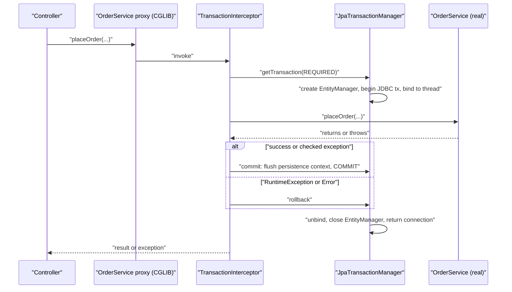
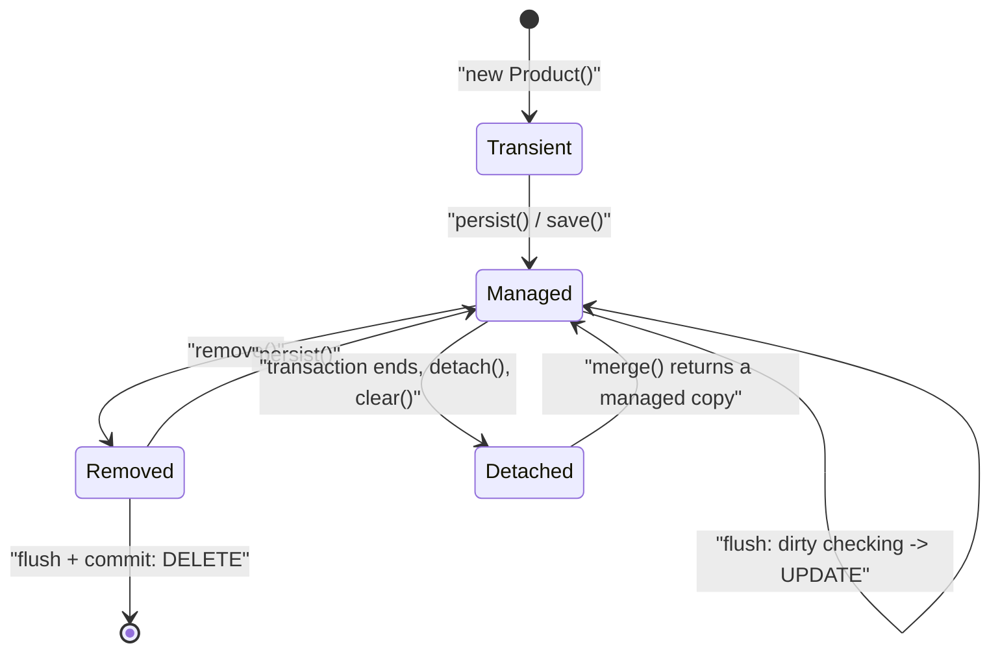

@@ 2 | MODULE | Transactions and state | Transaction boundaries, propagation, isolation, the persistence context, locking, migrations and auditing | MUST
# Transactions and state

**Shared analogy: a bank's teller counter.** A transaction is one visit to the counter: either every slip you hand over is processed or none is (atomicity). Propagation is what happens when a second clerk is called in during your visit: does she work on the same visit or open her own? Isolation is how much you can see of other customers' half-finished visits. The persistence context is the teller's working tray: everything you touched during the visit lies there and is written to the ledger when the visit ends. Locking decides what happens when two tellers try to change the same account at once, Flyway is the numbered list of renovations done to the bank building, and auditing is the stamp on every form saying who changed it and when.

@@ 3 | TOPIC | @Transactional and Propagation | How Spring transactions work through proxies, rollback rules, propagation types and the classic traps | MUST
# @Transactional and Propagation

**Level: Intermediate | Phase 12 | Priority: MUST | Since: Spring 1.2 (annotation-driven transactions 2.0)**

> **30-second interview answer:** `@Transactional` makes Spring wrap the bean in a proxy; the proxy's `TransactionInterceptor` asks the `PlatformTransactionManager` to begin a transaction before the method and commits or rolls back after it. By default it rolls back on unchecked exceptions and errors, not on checked exceptions. Propagation decides what happens when a transactional method calls another: `REQUIRED` joins the existing transaction, `REQUIRES_NEW` suspends it and starts an independent one, `NESTED` uses a savepoint. The classic traps are self-invocation, non-public methods and swallowed exceptions, because those bypass or confuse the proxy.

## 1. Concept in Simple Words
### Analogy
A wedding planner.

| Wedding | Spring transaction |
|---|---|
| You talk to the planner, never directly to the venue, caterer and band | Callers talk to the proxy, not the real bean |
| The planner books everything or cancels everything | Commit or rollback of all statements |
| A caterer cancelling (a disaster) cancels the whole wedding | Unchecked exception: rollback |
| A guest sending a polite "maybe" note does not cancel it | Checked exception: commit by default |
| The photographer is booked on a separate contract that survives a cancellation | `REQUIRES_NEW` (audit log survives rollback) |
| The bride calling the caterer herself, without the planner | Self-invocation: no proxy, no transaction rules |

### What it is
- **Transaction:** a unit of work with ACID properties (atomic, consistent, isolated, durable).
- **`@Transactional`:** declarative transaction demarcation on a class or public method. Attributes: `propagation`, `isolation`, `readOnly`, `timeout`, `rollbackFor`, `noRollbackFor`, `transactionManager`.
- **`PlatformTransactionManager`:** the strategy interface. `JpaTransactionManager` (Boot default with JPA) manages both JPA and JDBC on the same `DataSource`; `DataSourceTransactionManager` for plain JDBC.
- **Rollback rules:** default rollback for `RuntimeException` and `Error`; checked exceptions commit unless listed in `rollbackFor`.
- **Propagation types:**

| Propagation | Existing transaction | No transaction |
|---|---|---|
| `REQUIRED` (default) | Join it | Create one |
| `REQUIRES_NEW` | Suspend it, create a new independent one | Create one |
| `NESTED` | Savepoint inside it (JDBC savepoints; not with JPA flush semantics) | Create one |
| `SUPPORTS` | Join it | Run without |
| `MANDATORY` | Join it | Throw exception |
| `NOT_SUPPORTED` | Suspend it, run without | Run without |
| `NEVER` | Throw exception | Run without |

- **Rollback-only:** when an inner `REQUIRED` method throws, the shared transaction is marked rollback-only even if the outer method catches the exception; the outer commit then fails with `UnexpectedRollbackException`.

### Why it exists
Without declarative transactions, every service method would get a connection, set auto-commit off, commit or roll back in `try/catch/finally`, and pass the connection down to every DAO. `@Transactional` moves that plumbing into one interceptor and binds the transaction to the thread, so repositories automatically join it.

## 2. How It Works


What Spring does behind the annotation:
1. `@EnableTransactionManagement` (auto-configured by Boot) registers an advisor: `AnnotationTransactionAttributeSource` reads `@Transactional`, and `TransactionInterceptor` implements the around advice.
2. A `BeanPostProcessor` (the auto-proxy creator) wraps every bean with `@Transactional` methods in a proxy (CGLIB subclass by default in Boot).
3. The interceptor stores the transaction in `TransactionSynchronizationManager` (thread-locals): the `EntityManager` and JDBC connection are bound to the current thread, which is how repositories and `JdbcClient` find them.
4. On commit, `JpaTransactionManager` flushes Hibernate, commits the JDBC connection, runs `afterCommit` synchronisations (for example `@TransactionalEventListener`), then releases resources.

Why the traps happen:
```text
Self-invocation:   controller -> proxy.placeOrder() -> this.saveAudit()   <- "this" is the real object,
                                                                             not the proxy: @Transactional
                                                                             on saveAudit is ignored
Private method:    proxies can only intercept overridable public (or protected/package in CGLIB since 6.0)
                   methods; private ones are never intercepted
Swallowed error:   try { repo.save(x); } catch (Exception e) { log }   -> interceptor sees success -> commit
Checked exception: throws IOException -> commit by default unless rollbackFor = Exception.class
New thread:        @Async or executor -> thread-local transaction not visible in the other thread
```

## 3. Code Example
### Code
`application.yml` to see what the transaction manager does:
```yaml
logging:
  level:
    org.springframework.orm.jpa.JpaTransactionManager: DEBUG
spring:
  jpa:
    show-sql: true
```

Audit log in its own transaction:
```java
package com.orderhub.audit;

import jakarta.persistence.*;
import org.springframework.data.jpa.repository.JpaRepository;
import org.springframework.stereotype.Service;
import org.springframework.transaction.annotation.Propagation;
import org.springframework.transaction.annotation.Transactional;

import java.time.Instant;

@Entity
@Table(name = "audit_log")
class AuditEntry {
    @Id @GeneratedValue(strategy = GenerationType.IDENTITY) Long id;
    String action;
    String details;
    Instant at = Instant.now();
    protected AuditEntry() { }
    AuditEntry(String action, String details) { this.action = action; this.details = details; }
}

interface AuditRepository extends JpaRepository<AuditEntry, Long> { }

@Service
public class AuditService {
    private final AuditRepository repo;
    public AuditService(AuditRepository repo) { this.repo = repo; }

    // Independent transaction: committed even if the caller rolls back
    @Transactional(propagation = Propagation.REQUIRES_NEW)
    public void record(String action, String details) {
        repo.save(new AuditEntry(action, details));
    }
}
```

Order placement:
```java
package com.orderhub.order;

import com.orderhub.audit.AuditService;
import com.orderhub.customer.CustomerRepository;
import com.orderhub.product.Product;
import com.orderhub.product.ProductRepository;
import org.springframework.stereotype.Service;
import org.springframework.transaction.annotation.Transactional;

public class OutOfStockException extends RuntimeException {
    public OutOfStockException(String sku) { super("Out of stock: " + sku); }
}

@Service
class OrderPlacementService {
    private final OrderRepository orders;
    private final ProductRepository products;
    private final CustomerRepository customers;
    private final AuditService audit;

    OrderPlacementService(OrderRepository orders, ProductRepository products,
                          CustomerRepository customers, AuditService audit) {
        this.orders = orders; this.products = products; this.customers = customers; this.audit = audit;
    }

    @Transactional                                        // REQUIRED
    public Long placeOrder(Long customerId, Long productId, int qty) {
        audit.record("PLACE_ORDER_ATTEMPT", "customer=" + customerId + " product=" + productId);
        Product product = products.findById(productId).orElseThrow();
        product.decreaseStock(qty);                       // throws OutOfStockException (unchecked)
        Order order = new Order(customers.getReferenceById(customerId));
        order.addLine(product, qty);
        return orders.save(order).getId();
    }
}
```
With, in `Product`:
```java
public void decreaseStock(int qty) {
    if (qty > stock) throw new com.orderhub.order.OutOfStockException(sku);
    stock -= qty;
}
```

The self-invocation trap and its fix:
```java
package com.orderhub.order;

import org.springframework.stereotype.Service;
import org.springframework.transaction.annotation.Transactional;

import java.util.List;

@Service
class BulkImportService {
    private final OrderPlacementService placement;     // another bean: calls go through its proxy

    BulkImportService(OrderPlacementService placement) { this.placement = placement; }

    // WRONG: no transaction here, and importOne's @Transactional is ignored (self-invocation)
    public void importAllBroken(List<long[]> rows) {
        rows.forEach(r -> importOne(r));
    }

    @Transactional
    public void importOne(long[] row) { placement.placeOrder(row[0], row[1], (int) row[2]); }

    // RIGHT: each row in its own transaction because the call crosses a proxy
    public int importAll(List<long[]> rows) {
        int ok = 0;
        for (long[] r : rows) {
            try { placement.placeOrder(r[0], r[1], (int) r[2]); ok++; }
            catch (OutOfStockException e) { System.out.println("skipped: " + e.getMessage()); }
        }
        return ok;
    }
}
```

The rollback-only trap:
```java
package com.orderhub.order;

import org.springframework.stereotype.Service;
import org.springframework.transaction.annotation.Transactional;

@Service
class CheckoutService {
    private final OrderPlacementService placement;
    CheckoutService(OrderPlacementService placement) { this.placement = placement; }

    @Transactional
    public String checkout(Long customerId, Long productId, int qty) {
        try {
            placement.placeOrder(customerId, productId, qty);   // joins THIS transaction (REQUIRED)
            return "placed";
        } catch (OutOfStockException e) {
            return "out of stock";   // too late: the shared tx was marked rollback-only by the inner proxy
        }
    }
}
```

### Walkthrough
- `AuditService.record` uses `REQUIRES_NEW`: Spring suspends the order transaction, opens a second connection, commits the audit row, then resumes. The audit survives a later rollback.
- `placeOrder` is `REQUIRED`. `decreaseStock` throws an unchecked exception, so the interceptor rolls back the order and the stock change.
- `importAllBroken` calls `importOne` through `this`, so no proxy is involved and `@Transactional` on `importOne` does nothing. `importAll` calls another bean, so each `placeOrder` gets its own transaction (there is no outer one).
- `checkout` catches the exception, but the inner proxy already marked the shared transaction rollback-only. On commit Spring throws `UnexpectedRollbackException`. Fix: let the exception propagate, check stock before calling, or make the inner call `REQUIRES_NEW` if its failure really should be independent.

### Output
`placeOrder(7, 3, 99)` when product 3 has only 4 units:
```text
DEBUG o.s.orm.jpa.JpaTransactionManager : Creating new transaction with name [com.orderhub.order.OrderPlacementService.placeOrder]: PROPAGATION_REQUIRED,ISOLATION_DEFAULT
DEBUG o.s.orm.jpa.JpaTransactionManager : Suspending current transaction, creating new transaction with name [com.orderhub.audit.AuditService.record]
Hibernate: insert into audit_log (action,at,details) values (?,?,?)
DEBUG o.s.orm.jpa.JpaTransactionManager : Initiating transaction commit
DEBUG o.s.orm.jpa.JpaTransactionManager : Resuming suspended transaction after completion of inner transaction
DEBUG o.s.orm.jpa.JpaTransactionManager : Participating in existing transaction
Hibernate: select p1_0.id,p1_0.created_at,p1_0.name,p1_0.price,p1_0.sku,p1_0.status,p1_0.stock from product p1_0 where p1_0.id=?
DEBUG o.s.orm.jpa.JpaTransactionManager : Initiating transaction rollback
com.orderhub.order.OutOfStockException: Out of stock: MN-27
```
The audit row is committed; no order, no stock change.

`checkout(7, 3, 99)`:
```text
DEBUG o.s.orm.jpa.JpaTransactionManager : Creating new transaction with name [com.orderhub.order.CheckoutService.checkout]: PROPAGATION_REQUIRED,ISOLATION_DEFAULT
DEBUG o.s.orm.jpa.JpaTransactionManager : Participating in existing transaction
DEBUG o.s.orm.jpa.JpaTransactionManager : Participating transaction failed - marking existing transaction as rollback-only
DEBUG o.s.orm.jpa.JpaTransactionManager : Initiating transaction rollback
org.springframework.transaction.UnexpectedRollbackException: Transaction silently rolled back because it has been marked as rollback-only
```

### Compare
| Manual JDBC transaction | `TransactionTemplate` (programmatic) | `@Transactional` (declarative) |
|---|---|---|
| `setAutoCommit(false)`, commit, rollback, finally | `template.execute(status -> ...)` | Annotation on method or class |
| Connection passed around | Thread-bound | Thread-bound |
| Full control, very verbose | Fine-grained boundaries inside a method | Cleanest; method-level granularity |
| Easy to forget rollback | Rollback on exception or `status.setRollbackOnly()` | Rollback rules by exception type |

## 4. Interview Questions
**Basic**
1. **How does `@Transactional` work?**
   Spring creates a proxy around the bean. When a transactional method is called through the proxy, `TransactionInterceptor` gets a transaction from the `PlatformTransactionManager` (creating or joining one depending on propagation), calls the method, and commits on normal return or rolls back on an unchecked exception. The transaction resources are bound to the current thread so repositories join automatically.
2. **Which exceptions trigger a rollback by default?**
   `RuntimeException` and `Error`. Checked exceptions commit the transaction unless you add `rollbackFor = SomeCheckedException.class` (or `Exception.class`). This follows the EJB convention that checked exceptions are "business outcomes".
3. **`REQUIRED` vs `REQUIRES_NEW`?**
   `REQUIRED` joins the caller's transaction or creates one if none exists, so everything commits or rolls back together. `REQUIRES_NEW` always suspends the current transaction and runs in a new, independent one with its own connection, committing or rolling back separately. Use it for audit logs or "record the failure" logic that must survive the outer rollback.

**Follow-up**
4. **Why does `@Transactional` not work on a method called from the same class?**
   Self-invocation goes through `this`, the real object, not through the proxy, so the interceptor never runs. Fixes: move the method to another bean, inject the bean's own proxy (`@Lazy` self-injection), use `TransactionTemplate`, or use AspectJ weaving instead of proxies.
5. **What does `readOnly = true` do?**
   It is a hint: Spring sets the JDBC connection read-only and, with JPA, sets the Hibernate session flush mode to MANUAL and read-only, so no dirty checking or snapshots. It can be used by routing datasources to send reads to replicas. It does not stop you from calling `save` on a new entity with every driver, so it is an optimisation, not a security feature.
6. **What is `UnexpectedRollbackException`?**
   An inner `REQUIRED` method threw, so the shared transaction was marked rollback-only. The outer method caught the exception and tried to commit, and Spring refuses, throwing `UnexpectedRollbackException` to tell you the work was not saved. Either let the exception propagate, or isolate the inner work in `REQUIRES_NEW` if its failure should not affect the outer transaction.

**Tricky / scenario**
7. **A service method sends an email and then the transaction rolls back. The customer got a confirmation for an order that does not exist. How do you fix it?**
   Do side effects after commit: publish an application event and handle it with `@TransactionalEventListener(phase = AFTER_COMMIT)`, or register a `TransactionSynchronization.afterCommit`. For reliability across crashes use the transactional outbox pattern (Phase 20).
8. **A `@Transactional` method calls an HTTP API that takes 10 seconds. What problems does that cause?**
   The transaction keeps a database connection and possibly row locks for 10 seconds; under load the HikariCP pool is exhausted and other requests time out. Make the remote call outside the transaction (before it, or after commit), keep transactions short, and set a `timeout`.
9. **`@Transactional` on a method that runs work in `CompletableFuture.supplyAsync`. Is the async work in the transaction?**
   No. Transactions are bound to the thread through thread-locals; the other thread has no transaction, and lazy loading there fails. The async code must start its own transaction (call a transactional bean method) and must not use entities from the original persistence context.
10. **Where do you put `@Transactional`: controller, service or repository?**
   On the service layer, which defines the business use case and the unit of work. Repositories are already transactional per call, but a use case spanning several repository calls needs one service-level transaction. Controllers should not hold transactions, especially with remote calls and serialisation.

**What the interviewer is really testing:** whether you understand the proxy mechanism well enough to predict when transactions apply, roll back or silently do nothing.

## 5. Pitfalls & Best Practices
### Common mistakes
| Mistake | What goes wrong | Fix |
|---|---|---|
| Self-invocation of a `@Transactional` method | No transaction or wrong propagation | Call through another bean or use `TransactionTemplate` |
| `@Transactional` on private methods | Silently ignored | Public methods on Spring beans |
| Catching and swallowing exceptions inside | Commits partial work | Rethrow, or `setRollbackOnly()` |
| Checked exception expected to roll back | Data committed | `rollbackFor = Exception.class` or unchecked exceptions |
| Remote calls or long work inside a transaction | Pool exhaustion, lock contention | Keep transactions short; side effects after commit |
| `REQUIRES_NEW` inside a loop under load | Two connections per call, pool deadlock | Size the pool or restructure |

### Best practices
- Put `@Transactional(readOnly = true)` on the service class and `@Transactional` on write methods.
- Keep transactions short and free of network calls.
- Use domain-specific unchecked exceptions so rollback is automatic.
- Use `@TransactionalEventListener(phase = AFTER_COMMIT)` for emails, messages and cache evictions.
- Turn on `JpaTransactionManager` DEBUG logging when unsure where a transaction starts.

### Compare with
| Propagation | Typical use |
|---|---|
| `REQUIRED` | Normal service methods |
| `REQUIRES_NEW` | Audit logs, failure records, sequence or outbox writes that must survive |
| `NESTED` | Partial rollback with savepoints (JDBC only) |
| `MANDATORY` | Methods that must never start their own transaction (domain invariants) |
| `NOT_SUPPORTED` | Long read-only work that should not hold a transaction |

## 6. Hands-on Exercise
In OrderHub, implement `PaymentService.pay(orderId)`:
- Load the order, mark it PAID and create a `Payment`, all in one transaction.
- Call `FakePaymentGateway.charge(amount)`, which throws a checked `PaymentDeclinedException` on failure; a declined payment must roll back the order changes.
- Always record a `PAYMENT_ATTEMPT` audit row, even on failure.
- Send a confirmation email only after a successful commit.

Acceptance criteria: declined payment leaves the order NEW with no payment row, but the audit row exists; email is never sent for a rolled-back payment.

<details><summary>Solution</summary>

```java
package com.orderhub.payment;

import com.orderhub.audit.AuditService;
import com.orderhub.order.Order;
import com.orderhub.order.OrderRepository;
import org.springframework.context.ApplicationEventPublisher;
import org.springframework.stereotype.Component;
import org.springframework.stereotype.Service;
import org.springframework.transaction.annotation.Transactional;
import org.springframework.transaction.event.TransactionPhase;
import org.springframework.transaction.event.TransactionalEventListener;

import java.math.BigDecimal;

class PaymentDeclinedException extends Exception {
    PaymentDeclinedException(String msg) { super(msg); }
}

@Component
class FakePaymentGateway {
    void charge(BigDecimal amount) throws PaymentDeclinedException {
        if (amount.compareTo(new BigDecimal("1000")) > 0) throw new PaymentDeclinedException("limit exceeded");
    }
}

record OrderPaidEvent(Long orderId) { }

@Service
class PaymentService {
    private final OrderRepository orders;
    private final PaymentRepository payments;
    private final FakePaymentGateway gateway;
    private final AuditService audit;
    private final ApplicationEventPublisher events;

    PaymentService(OrderRepository orders, PaymentRepository payments, FakePaymentGateway gateway,
                   AuditService audit, ApplicationEventPublisher events) {
        this.orders = orders; this.payments = payments; this.gateway = gateway;
        this.audit = audit; this.events = events;
    }

    @Transactional(rollbackFor = PaymentDeclinedException.class)   // checked exception must roll back
    public void pay(Long orderId) throws PaymentDeclinedException {
        audit.record("PAYMENT_ATTEMPT", "order=" + orderId);       // REQUIRES_NEW: survives rollback
        Order order = orders.findById(orderId).orElseThrow();
        order.markPaid();
        payments.save(new Payment(order, order.getTotal(), Payment.Method.CARD));
        gateway.charge(order.getTotal());                          // may throw checked exception
        events.publishEvent(new OrderPaidEvent(orderId));          // delivered only after commit
    }
}

@Component
class PaymentEmailListener {
    @TransactionalEventListener(phase = TransactionPhase.AFTER_COMMIT)
    void onPaid(OrderPaidEvent e) {
        System.out.println("email: order " + e.orderId() + " is paid");
    }
}
```
`rollbackFor` makes the checked `PaymentDeclinedException` roll back the order and payment changes. The audit row commits in its own `REQUIRES_NEW` transaction. The event is published inside the transaction but the listener runs only after a successful commit, so a rolled-back payment never sends an email. (In a real system the gateway call would happen outside the database transaction or with an idempotency key; Phase 20 covers that.)
</details>

## 7. Recall
Q: How does Spring's @Transactional work internally?
A: A proxy's `TransactionInterceptor` asks the `PlatformTransactionManager` to begin or join a transaction bound to the thread, invokes the method, then commits or rolls back.

Q: Which exceptions roll back a Spring @Transactional method by default?
A: Unchecked exceptions (`RuntimeException`) and `Error`; checked exceptions commit unless listed in `rollbackFor`.

Q: What is the difference between REQUIRED and REQUIRES_NEW propagation?
A: REQUIRED joins the existing transaction or creates one; REQUIRES_NEW suspends the current one and runs in a new independent transaction.

Q: Why is @Transactional ignored on self-invocation?
A: The call goes through `this`, not through the Spring proxy, so the transaction interceptor never runs.

Q: What causes UnexpectedRollbackException in Spring?
A: An inner REQUIRED method failed and marked the shared transaction rollback-only, but the outer method caught the exception and tried to commit.

**Related:** [[How @Transactional Really Works]] · [[Isolation Levels and Read Phenomena]] · [[Persistence Context and Entity States]] · [[Spring Application Events]]

@@ 3 | TOPIC | Isolation Levels and Read Phenomena | Dirty, non-repeatable and phantom reads, lost updates, the four isolation levels and how PostgreSQL implements them | MUST
# Isolation Levels and Read Phenomena

**Level: Intermediate | Phase 12 | Priority: MUST | Since: SQL-92 standard; Spring `Isolation` enum Spring 1.2**

> **30-second interview answer:** Isolation decides what one transaction can see of other concurrent transactions. The SQL standard defines four levels by the anomalies they prevent: `READ UNCOMMITTED` allows dirty reads, `READ COMMITTED` prevents dirty reads, `REPEATABLE READ` also prevents non-repeatable reads, and `SERIALIZABLE` prevents phantoms and behaves as if transactions ran one after another. PostgreSQL defaults to `READ COMMITTED` and MySQL InnoDB to `REPEATABLE READ`. Higher levels are safer but cause more serialization failures you must retry, so in practice I keep the default and protect critical updates with optimistic or pessimistic locking.

## 1. Concept in Simple Words
### Analogy
Editing a shared document in an office.

| Office | Isolation |
|---|---|
| Reading a colleague's draft before she saves it, then she deletes her changes | Dirty read |
| Reading a page twice and the number changed because someone saved in between | Non-repeatable read |
| Counting the rows of a table twice and a new row appeared | Phantom read |
| Two people both edit the same cell from the same old value; the last save wins | Lost update |
| Each person gets a photocopy of the document at the moment they start | Snapshot (MVCC) used by PostgreSQL `REPEATABLE READ` |
| Only one person may work on the document at a time | `SERIALIZABLE` (in effect) |

### What it is
- **Dirty read:** reading data written by a transaction that has not committed (and may roll back).
- **Non-repeatable read:** reading the same row twice in one transaction and getting different values because another transaction committed an update in between.
- **Phantom read:** running the same query twice and getting a different set of rows because another transaction inserted or deleted matching rows.
- **Lost update:** two transactions read the same value, both compute a new value from it, and the second write overwrites the first.
- **Write skew:** two transactions read overlapping data, each writes a different row based on what it read, and together they break a rule ("at least one doctor on call").
- **MVCC (multi-version concurrency control):** PostgreSQL keeps old row versions so readers see a consistent snapshot without blocking writers.
- **Spring `Isolation`:** `DEFAULT` (use the database default), `READ_UNCOMMITTED`, `READ_COMMITTED`, `REPEATABLE_READ`, `SERIALIZABLE`, set with `@Transactional(isolation = ...)`.

| Level | Dirty read | Non-repeatable read | Phantom read | PostgreSQL behaviour |
|---|---|---|---|---|
| `READ UNCOMMITTED` | Possible | Possible | Possible | Treated as READ COMMITTED |
| `READ COMMITTED` | Prevented | Possible | Possible | Default; new snapshot per statement |
| `REPEATABLE READ` | Prevented | Prevented | Possible (standard) | Snapshot per transaction; phantoms also prevented; update conflicts fail with 40001 |
| `SERIALIZABLE` | Prevented | Prevented | Prevented | SSI; also prevents write skew; may fail with 40001 |

### Why it exists
Full serial execution would be correct but slow. Isolation levels let you trade correctness guarantees for concurrency. Knowing which anomalies your level allows tells you where you need extra protection (locks, version columns, constraints).

## 2. How It Works
Lost update under `READ COMMITTED` (OrderHub stock, starting at 5):
```text
time   T1 (order A, qty 2)                    T2 (order B, qty 3)
----   ------------------------------------   ------------------------------------
t1     BEGIN                                  BEGIN
t2     SELECT stock FROM product WHERE id=1   
       -> 5                                   
t3                                            SELECT stock FROM product WHERE id=1
                                              -> 5
t4     UPDATE product SET stock=3 WHERE id=1  
t5     COMMIT                                 
t6                                            UPDATE product SET stock=2 WHERE id=1
                                              (blocks? no: T1 already committed)
t7                                            COMMIT
Result: stock = 2, but 5 units were sold out of 5 -> should be 0. T1's update is lost.
```

The same under PostgreSQL `REPEATABLE READ`:
```text
t6                                            UPDATE product SET stock=2 WHERE id=1
                                              ERROR: could not serialize access due to concurrent update
                                              (SQLSTATE 40001) -> transaction must be retried
```

How PostgreSQL implements levels with MVCC:
```text
READ COMMITTED  : each statement takes a fresh snapshot of committed data
REPEATABLE READ : the first statement's snapshot is reused for the whole transaction;
                  if you try to update a row changed by a transaction committed after
                  your snapshot -> 40001 serialization failure
SERIALIZABLE    : snapshot + predicate tracking (SSI); dangerous read/write patterns
                  between concurrent transactions -> 40001 at commit or statement
```

What Spring does with `isolation`: `JpaTransactionManager` passes it to `HibernateJpaDialect.beginTransaction`, which calls `connection.setTransactionIsolation(...)` before beginning and resets it when the connection returns to the pool. Isolation on an inner `REQUIRED` method that joins an existing transaction is ignored (it cannot change mid-transaction), unless `validateExistingTransaction` is set on the manager.

## 3. Code Example
### Code
Naive stock decrement vs safer variants:
```java
package com.orderhub.inventory;

import com.orderhub.product.Product;
import com.orderhub.product.ProductRepository;
import org.springframework.dao.ConcurrencyFailureException;
import org.springframework.data.jpa.repository.JpaRepository;
import org.springframework.data.jpa.repository.Modifying;
import org.springframework.data.jpa.repository.Query;
import org.springframework.data.repository.query.Param;
import org.springframework.stereotype.Service;
import org.springframework.transaction.annotation.Isolation;
import org.springframework.transaction.annotation.Transactional;
import org.springframework.transaction.support.TransactionTemplate;

interface StockRepository extends JpaRepository<Product, Long> {
    // Atomic conditional update: the database does read-check-write in one statement
    @Modifying
    @Query("update Product p set p.stock = p.stock - :qty where p.id = :id and p.stock >= :qty")
    int decrementIfAvailable(@Param("id") Long id, @Param("qty") int qty);
}

@Service
public class InventoryService {
    private final ProductRepository products;
    private final StockRepository stock;
    private final TransactionTemplate tx;

    public InventoryService(ProductRepository products, StockRepository stock, TransactionTemplate tx) {
        this.products = products; this.stock = stock; this.tx = tx;
    }

    // 1. READ COMMITTED (default): read-modify-write is vulnerable to lost updates
    @Transactional
    public void reserveNaive(Long productId, int qty) {
        Product p = products.findById(productId).orElseThrow();
        p.decreaseStock(qty);                     // UPDATE stock = <value computed in Java>
    }

    // 2. REPEATABLE READ: PostgreSQL detects the conflict; caller must retry
    @Transactional(isolation = Isolation.REPEATABLE_READ)
    public void reserveRepeatableRead(Long productId, int qty) {
        Product p = products.findById(productId).orElseThrow();
        p.decreaseStock(qty);
    }

    // Retry wrapper: each attempt is a NEW transaction (TransactionTemplate), never retry inside one
    public void reserveWithRetry(Long productId, int qty) {
        tx.setIsolationLevel(org.springframework.transaction.TransactionDefinition.ISOLATION_REPEATABLE_READ);
        for (int attempt = 1; ; attempt++) {
            try {
                tx.executeWithoutResult(s -> products.findById(productId).orElseThrow().decreaseStock(qty));
                return;
            } catch (ConcurrencyFailureException e) {   // 40001 translated by Spring
                if (attempt == 3) throw e;
                System.out.println("serialization failure, retry " + attempt);
            }
        }
    }

    // 3. Atomic SQL: correct under READ COMMITTED, no retry needed
    @Transactional
    public boolean reserveAtomic(Long productId, int qty) {
        return stock.decrementIfAvailable(productId, qty) == 1;
    }
}
```

A test-style demonstration of the lost update with two threads:
```java
package com.orderhub.inventory;

import com.orderhub.product.ProductRepository;
import org.springframework.boot.CommandLineRunner;
import org.springframework.context.annotation.Bean;
import org.springframework.context.annotation.Configuration;
import org.springframework.context.annotation.Profile;

import java.util.concurrent.CountDownLatch;
import java.util.concurrent.ExecutorService;
import java.util.concurrent.Executors;

@Configuration
@Profile("isolation-demo")
class IsolationDemo {
    @Bean
    CommandLineRunner run(InventoryService inventory, ProductRepository products) {
        return args -> {
            // product 1 starts with stock 100; 50 concurrent reservations of 1 unit each
            ExecutorService pool = Executors.newFixedThreadPool(10);
            CountDownLatch done = new CountDownLatch(50);
            for (int i = 0; i < 50; i++) {
                pool.submit(() -> { try { inventory.reserveNaive(1L, 1); } finally { done.countDown(); } });
            }
            done.await();
            System.out.println("naive: stock = " + products.findById(1L).orElseThrow().getStock());
            pool.shutdown();
        };
    }
}
```

### Walkthrough
- `reserveNaive` reads the stock into Java, subtracts and writes the computed value. Under `READ COMMITTED` two transactions can read the same value and one update overwrites the other.
- `reserveRepeatableRead` uses a transaction-wide snapshot. On PostgreSQL the second writer gets SQLSTATE 40001, which Spring and Hibernate translate into a `ConcurrencyFailureException` subclass (typically `CannotAcquireLockException`).
- `reserveWithRetry` retries the whole transaction up to three times with `TransactionTemplate`; retrying inside the same failed transaction is impossible.
- `reserveAtomic` is often the best answer: a single conditional UPDATE is atomic in the database, so the default isolation is enough and you learn whether stock was sufficient from the row count.
- `IsolationDemo` fires 50 concurrent single-unit reservations at the naive method to show lost updates.

### Output
Running the demo with the naive method (expected 50, result varies between runs):
```text
naive: stock = 63
```
Thirteen units were "sold" but never subtracted. With `reserveAtomic` the result is always:
```text
atomic: stock = 50
```
With `reserveWithRetry` the log shows conflicts being retried:
```text
Hibernate: select p1_0.id,p1_0.created_at,p1_0.name,p1_0.price,p1_0.sku,p1_0.status,p1_0.stock from product p1_0 where p1_0.id=?
Hibernate: update product set created_at=?,name=?,price=?,sku=?,status=?,stock=? where id=?
WARN  o.h.engine.jdbc.spi.SqlExceptionHelper : SQL Error: 0, SQLState: 40001
ERROR o.h.engine.jdbc.spi.SqlExceptionHelper : ERROR: could not serialize access due to concurrent update
serialization failure, retry 1
```

### Compare
| Protection | Prevents lost update? | Cost |
|---|---|---|
| `READ COMMITTED` read-modify-write | No | None |
| Atomic conditional UPDATE | Yes | Logic moves into SQL |
| `REPEATABLE READ` (PostgreSQL) | Yes, by failing one transaction | Retries needed |
| `SERIALIZABLE` | Yes, plus write skew | More failures, retries needed |
| Optimistic locking (`@Version`) | Yes, by failing one transaction | Retry or tell the user |
| Pessimistic lock (`SELECT ... FOR UPDATE`) | Yes, by waiting | Blocking, deadlock risk |

## 4. Interview Questions
**Basic**
1. **What are the four isolation levels?**
   `READ UNCOMMITTED`, `READ COMMITTED`, `REPEATABLE READ` and `SERIALIZABLE`, defined by which anomalies they prevent: dirty reads, non-repeatable reads and phantom reads. Each higher level prevents everything the lower one does, plus more.
2. **Explain dirty read, non-repeatable read and phantom read.**
   A dirty read sees uncommitted data from another transaction. A non-repeatable read gets different values when reading the same row twice because another transaction committed an update in between. A phantom read gets a different set of rows for the same query because another transaction inserted or deleted matching rows.
3. **What is the default isolation level of PostgreSQL and MySQL?**
   PostgreSQL uses `READ COMMITTED`; MySQL InnoDB uses `REPEATABLE READ`. In Spring, `Isolation.DEFAULT` means "whatever the database default is".

**Follow-up**
4. **Does `REPEATABLE READ` prevent lost updates?**
   Not by the SQL standard's definition, and it depends on the database. PostgreSQL's snapshot-based `REPEATABLE READ` detects concurrent updates to the same row and aborts the second transaction with SQLSTATE 40001. MySQL InnoDB's `REPEATABLE READ` does not abort: the UPDATE reads the latest committed row, so a read-modify-write in Java can still lose updates unless you lock.
5. **What is write skew and which level prevents it?**
   Two transactions read overlapping data and each updates a different row so that together they break an invariant, for example two doctors both going off call after each saw the other still on call. Snapshot isolation does not catch it because they write different rows. Only `SERIALIZABLE` (or explicit locks or constraints) prevents it.
6. **How do you set the isolation level in Spring and when is it ignored?**
   `@Transactional(isolation = Isolation.SERIALIZABLE)` on the method that starts the transaction. If the method joins an existing transaction (`REQUIRED` called from another transactional method), the inner isolation is ignored because the level cannot change mid-transaction.

**Tricky / scenario**
7. **Two users buy the last item at the same time and both succeed. The code reads stock, checks it, and saves. What happened and how do you fix it?**
   A lost update under `READ COMMITTED`: both read stock 1, both passed the check, both wrote 0. Fix with an atomic conditional update (`update ... set stock = stock - 1 where id = ? and stock >= 1`), optimistic locking with `@Version` and retry, or a pessimistic `SELECT ... FOR UPDATE`. Raising the isolation level also works on PostgreSQL but requires retry logic.
8. **You switch a service to `SERIALIZABLE` and production errors increase. Why?**
   Under contention, PostgreSQL's serializable mode aborts transactions with serialization failures that the application must retry. Without retry logic every conflict becomes a user-facing error, and long transactions make conflicts more likely. Add retries with backoff, keep transactions short, or use a more targeted mechanism.
9. **A report runs two queries (count, then list) and the numbers do not match. Why, and how do you fix it?**
   Under `READ COMMITTED` each statement sees a fresh snapshot, so inserts committed between the two queries make the count and list disagree. Run the report in a `REPEATABLE READ` read-only transaction (PostgreSQL gives a consistent snapshot for the whole transaction), or compute both from one query.

**What the interviewer is really testing:** whether you can name the anomaly behind a concurrency bug and choose a fix that matches your database's real behaviour.

## 5. Pitfalls & Best Practices
### Common mistakes
| Mistake | What goes wrong | Fix |
|---|---|---|
| Read-modify-write in Java under READ COMMITTED | Lost updates | Atomic UPDATE, `@Version`, or lock |
| Raising isolation without retry logic | Serialization failures reach users | Retry the whole transaction |
| Retrying inside the failed transaction | Transaction is already aborted | Retry with a new transaction |
| Assuming MySQL and PostgreSQL REPEATABLE READ behave the same | Wrong guarantees | Know your database |
| Setting isolation on an inner joined method | Silently ignored | Set it where the transaction starts |

### Best practices
- Keep the database default and protect specific invariants with constraints, atomic updates or locking.
- Use unique constraints and check constraints as the last line of defence (`check (stock >= 0)`).
- When you raise isolation, add a retry policy for `ConcurrencyFailureException`.
- Keep transactions short so conflict windows are small.
- Test concurrency with real PostgreSQL (Testcontainers) and parallel threads.

### Compare with
| Database | Default level | REPEATABLE READ implementation |
|---|---|---|
| PostgreSQL | READ COMMITTED | Snapshot isolation, aborts on write conflict |
| MySQL InnoDB | REPEATABLE READ | Consistent reads plus next-key locks; updates read latest data |
| Oracle | READ COMMITTED | Not offered (READ COMMITTED and SERIALIZABLE only) |
| SQL Server | READ COMMITTED (locking; RCSI optional) | Shared locks held until commit |

## 6. Hands-on Exercise
Add a check constraint and a safe reservation endpoint to OrderHub:
1. Migration `V5__stock_check.sql` adding `check (stock >= 0)` to `product`.
2. `POST /api/inventory/{productId}/reserve?qty=2` that returns 200 when reserved and 409 when not enough stock, correct under 50 concurrent requests.

Acceptance criteria: no lost updates; no negative stock even if a bug bypasses the service; no retries needed.

<details><summary>Solution</summary>

```sql
-- V5__stock_check.sql
alter table product add constraint chk_product_stock_non_negative check (stock >= 0);
```

```java
package com.orderhub.inventory;

import org.springframework.http.HttpStatus;
import org.springframework.http.ResponseEntity;
import org.springframework.web.bind.annotation.PathVariable;
import org.springframework.web.bind.annotation.PostMapping;
import org.springframework.web.bind.annotation.RequestMapping;
import org.springframework.web.bind.annotation.RequestParam;
import org.springframework.web.bind.annotation.RestController;

@RestController
@RequestMapping("/api/inventory")
class InventoryController {
    private final InventoryService inventory;
    InventoryController(InventoryService inventory) { this.inventory = inventory; }

    @PostMapping("/{productId}/reserve")
    ResponseEntity<String> reserve(@PathVariable Long productId, @RequestParam int qty) {
        return inventory.reserveAtomic(productId, qty)
                ? ResponseEntity.ok("reserved")
                : ResponseEntity.status(HttpStatus.CONFLICT).body("not enough stock");
    }
}
```
`reserveAtomic` runs `update product set stock = stock - ? where id = ? and stock >= ?`. PostgreSQL row-locks the row during the UPDATE, so concurrent reservations queue on that row and each re-checks `stock >= qty` against the latest committed value. The check constraint guarantees stock never goes negative even if another code path writes a bad value. Because the update is a single statement, no retry is needed.
</details>

## 7. Recall
Q: What anomalies do the four SQL isolation levels prevent?
A: READ COMMITTED prevents dirty reads; REPEATABLE READ also prevents non-repeatable reads; SERIALIZABLE also prevents phantoms; READ UNCOMMITTED prevents none.

Q: What is a lost update in database concurrency?
A: Two transactions read the same value, compute new values from it, and the later write overwrites the earlier one.

Q: What is PostgreSQL's default isolation level and how does its REPEATABLE READ behave on conflicting updates?
A: READ COMMITTED; under REPEATABLE READ the second updater fails with SQLSTATE 40001 and must retry.

Q: What is write skew and which isolation level prevents it?
A: Two transactions update different rows based on overlapping reads and together break an invariant; only SERIALIZABLE prevents it.

Q: Why must a serialization failure be retried in a new transaction?
A: The failed transaction is aborted, so the whole unit of work has to be re-run from the start.

**Related:** [[Optimistic vs Pessimistic Locking]] · [[@Transactional and Propagation]] · [[Race Conditions and synchronized]]

@@ 3 | TOPIC | Persistence Context and Entity States | First-level cache, transient, managed, detached and removed states, dirty checking, flush, persist vs merge | MUST
# Persistence Context and Entity States

**Level: Intermediate | Phase 12 | Priority: MUST | Since: JPA 1.0**

> **30-second interview answer:** The persistence context is the set of managed entity instances an `EntityManager` tracks, usually one per transaction in Spring. It acts as a first-level cache with an identity guarantee (one Java object per database row), and it does dirty checking: at flush it compares managed entities with their loaded snapshots and writes the changes. An entity is transient when new, managed after `persist` or load, detached after the context closes, and removed after `remove`. `merge` copies a detached entity's state onto a managed instance and returns that instance; the argument stays detached.

## 1. Concept in Simple Words
### Analogy
A shop's shopping basket during one visit.

| Shopping | Persistence context |
|---|---|
| Items on the shelf | Rows in the database |
| Items you put in the basket | Managed entities |
| Picking the same item twice gives you the same item from your basket | First-level cache and identity guarantee |
| A photo of each item when you picked it | Loaded-state snapshot used for dirty checking |
| At the till, the cashier scans what changed | Flush with dirty checking |
| An item you brought from home, not yet scanned | Transient entity |
| An item you took home yesterday; the shop no longer tracks it | Detached entity |
| An item you put on the "return" pile | Removed entity |

### What it is
- **Persistence context:** a map of `(entity type, id) -> managed instance`, plus snapshots and pending actions. In Spring, scoped to the transaction (transaction-scoped context); with OSIV, scoped to the request.
- **Entity states:**
  - **Transient (new):** created with `new`, no id, unknown to the context.
  - **Managed (persistent):** in the context; changes are tracked and flushed.
  - **Detached:** has an id, but the context that loaded it is closed or it was evicted (`detach`, `clear`). Changes are not tracked.
  - **Removed:** scheduled for deletion at flush.
- **First-level cache:** `find` by id returns the managed instance without SQL if it is already in the context. Queries always go to the database but return the existing instances for rows already managed.
- **Dirty checking:** at flush, Hibernate compares each managed entity's current field values with its snapshot and generates UPDATEs.
- **Flush:** synchronising pending changes to the database (SQL sent, not committed). Happens before commit, before queries that may be affected (`FlushMode.AUTO`), or on `em.flush()`.
- **Flush order:** inserts, updates, collection element deletions, collection inserts, deletes, in roughly that order, regardless of the order you called methods.
- **`persist` vs `merge`:** `persist` makes a transient instance managed (the same object). `merge` copies the state of a detached (or transient) object onto a managed copy, loading it if necessary, and returns the managed copy.

### Why it exists
It gives you consistent object identity within a unit of work (no two Java objects for the same row), avoids repeated SELECTs, batches writes until flush, and lets you change objects naturally without calling `update` for every change.

## 2. How It Works


Inside the persistence context:
```text
PersistenceContext (one per transaction)
+-----------------------------------------------------------------+
| entitiesByKey                                                   |
|   EntityKey(Product, 1) -> Product@a1 {price=49.90, stock=10}   |
|   EntityKey(Order, 51)  -> Order@b2   {status=NEW}              |
| snapshots (loaded state)                                        |
|   Product#1 -> [49.90, 10, "Keyboard", ...]                     |
|   Order#51  -> ["NEW", 109.60, ...]                             |
| actionQueue                                                     |
|   inserts: [OrderLine (new)]                                    |
|   deletes: []                                                   |
+-----------------------------------------------------------------+
flush(): for each managed entity compare fields with snapshot
         Product#1 price 44.90 != 49.90 -> UPDATE product ...
         then execute actionQueue in flush order
```

Spring's role: `JpaTransactionManager` creates an `EntityManager` when the transaction begins and closes it at the end; the shared `EntityManager` proxy injected into repositories always points to the current one. When the transaction ends, every entity you still hold becomes detached.

## 3. Code Example
### Code
```java
package com.orderhub.product;

import jakarta.persistence.EntityManager;
import jakarta.persistence.PersistenceContext;
import org.springframework.stereotype.Service;
import org.springframework.transaction.annotation.Transactional;

import java.math.BigDecimal;

@Service
public class PersistenceContextDemo {

    @PersistenceContext
    private EntityManager em;

    private final ProductRepository products;

    public PersistenceContextDemo(ProductRepository products) { this.products = products; }

    @Transactional
    public Long lifecycle() {
        Product p = new Product("HD-01", "Headset", new BigDecimal("59.00"), 8);   // TRANSIENT
        System.out.println("1 contains? " + em.contains(p));

        em.persist(p);                                                            // MANAGED
        System.out.println("2 contains? " + em.contains(p) + ", id=" + p.getId());

        Product again = em.find(Product.class, p.getId());                        // first-level cache
        System.out.println("3 same instance? " + (again == p));

        p.changePrice(new BigDecimal("54.00"));                                  // tracked change
        em.flush();                                                               // INSERT then UPDATE sent now
        System.out.println("4 flushed");

        em.detach(p);                                                             // DETACHED
        p.changePrice(new BigDecimal("1.00"));                                   // not tracked
        System.out.println("5 contains? " + em.contains(p));
        return p.getId();
    }                                                                             // commit: nothing more to flush

    @Transactional
    public void mergeDetached(Product detached) {
        Product managed = em.merge(detached);                                     // SELECT, copy state
        System.out.println("6 merge returned same object? " + (managed == detached));
        System.out.println("7 managed price=" + managed.getPrice() + ", detached contains? " + em.contains(detached));
    }

    @Transactional
    public void removeIt(Long id) {
        Product p = products.findById(id).orElseThrow();
        em.remove(p);                                                             // REMOVED
        System.out.println("8 contains after remove? " + em.contains(p));
    }                                                                             // DELETE at commit
}
```

Caller:
```java
package com.orderhub.product;

import org.springframework.boot.CommandLineRunner;
import org.springframework.context.annotation.Bean;
import org.springframework.context.annotation.Configuration;
import org.springframework.context.annotation.Profile;

@Configuration
@Profile("pc-demo")
class PersistenceContextRunner {
    @Bean
    CommandLineRunner pcDemo(PersistenceContextDemo demo, ProductRepository products) {
        return args -> {
            Long id = demo.lifecycle();
            Product detached = products.findById(id).orElseThrow();   // loaded in its own short tx -> detached now
            detached.changePrice(new java.math.BigDecimal("49.00"));
            demo.mergeDetached(detached);
            demo.removeIt(id);
        };
    }
}
```

### Walkthrough
- Step 1: a new object is transient; the context does not know it.
- Step 2: `persist` makes it managed. With a SEQUENCE id, the id is assigned at `persist` (from the pooled block) but no INSERT is sent yet.
- Step 3: `find` returns the same Java instance from the first-level cache, no SELECT.
- Step 4: the price change is tracked. `flush` sends the pending INSERT using the entity state at flush time, so you see one INSERT with price 54.00 and no separate UPDATE (dirty checking does not generate an UPDATE for an entity inserted in the same flush).
- Step 5: after `detach`, changes are invisible to Hibernate: the price 1.00 is never saved.
- Steps 6 and 7: `merge` loads the row (SELECT), copies the detached state onto a new managed instance and returns it; the argument stays detached. The changed price is written at commit.
- Step 8: `remove` schedules a DELETE; the entity is no longer "contained".

### Output
```text
1 contains? false
2 contains? true, id=101
3 same instance? true
Hibernate: insert into product (created_at,name,price,sku,status,stock,id) values (?,?,?,?,?,?,?)
4 flushed
5 contains? false
Hibernate: select p1_0.id,p1_0.created_at,p1_0.name,p1_0.price,p1_0.sku,p1_0.status,p1_0.stock from product p1_0 where p1_0.id=?
Hibernate: select p1_0.id,p1_0.created_at,p1_0.name,p1_0.price,p1_0.sku,p1_0.status,p1_0.stock from product p1_0 where p1_0.id=?
6 merge returned same object? false
7 managed price=49.00, detached contains? false
Hibernate: update product set name=?,price=?,status=?,stock=? where id=?
Hibernate: select p1_0.id,p1_0.created_at,p1_0.name,p1_0.price,p1_0.sku,p1_0.status,p1_0.stock from product p1_0 where p1_0.id=?
8 contains after remove? false
Hibernate: delete from product where id=?
```
The first SELECT after step 5 is `products.findById` in the runner; the second is `merge` loading the current row. The UPDATE has no `sku` or `created_at` because those columns are `updatable = false`. Only one INSERT appears in the lifecycle: the persisted state at flush already contained the new price.

### Compare
| Operation | Argument becomes | Returns | SQL |
|---|---|---|---|
| `persist(new)` | Managed | void | INSERT at flush (immediately for IDENTITY) |
| `merge(detached)` | Stays detached | Managed copy | SELECT (if not in context), UPDATE at flush if changed |
| `find(id)` | n/a | Managed or null | SELECT unless cached |
| `getReference(id)` | n/a | Uninitialised proxy | None until accessed |
| `remove(managed)` | Removed | void | DELETE at flush |
| `detach(managed)` / `clear()` | Detached | void | None; pending changes for it are dropped |
| `refresh(managed)` | Managed, overwritten from DB | void | SELECT |

## 4. Interview Questions
**Basic**
1. **What is the persistence context?**
   The set of managed entity instances tracked by an `EntityManager`, typically one per transaction in Spring. It guarantees one instance per row, caches entities by id, and tracks changes so they can be flushed automatically.
2. **What are the entity states in JPA?**
   Transient (new, not associated), managed (in the persistence context and tracked), detached (has an identity but is no longer tracked) and removed (scheduled for deletion). Transitions happen through `persist`, `merge`, `remove`, `detach`, `clear` and the end of the transaction.
3. **What is dirty checking?**
   At flush, Hibernate compares each managed entity's current state with the snapshot taken when it was loaded or persisted, and issues UPDATE statements for changed entities. You do not call any "update" method; changing a field of a managed entity is enough.

**Follow-up**
4. **What is the difference between flush and commit?**
   Flush sends pending SQL to the database inside the current transaction; the changes are visible to that transaction but not to others and can still be rolled back. Commit ends the transaction and makes the changes durable and visible. Commit triggers a flush first.
5. **`persist` vs `merge`?**
   `persist` takes a new instance and makes that same instance managed; it fails for detached entities. `merge` works with detached or new instances: it finds or loads the managed instance with the same id, copies the state onto it and returns the managed instance, leaving the argument detached. Using the argument after `merge` and expecting changes to be tracked is a classic bug.
6. **Is the first-level cache used by JPQL queries?**
   The query itself always runs SQL. But when rows come back, Hibernate checks the persistence context and returns the already managed instance for each id, ignoring the fresh column values (repeatable read at the object level). Only `find` and `getReference` by id can skip SQL entirely.

**Tricky / scenario**
7. **A batch job loads and modifies 1 million products in one transaction and runs out of memory. Why and how do you fix it?**
   Every loaded entity stays managed with a snapshot until the transaction ends, so the persistence context grows without bound and dirty checking gets slower. Process in chunks: every N entities call `em.flush()` and `em.clear()`, or use separate transactions per chunk, a `StatelessSession`, or bulk SQL updates.
8. **A REST `PUT` endpoint does `repository.save(dtoMappedToNewEntity)` and some columns become null. Why?**
   `save` with an id calls `merge`, which copies every field of the passed object, including fields the DTO did not set, onto the managed entity. Load the managed entity, apply only the changed fields (domain methods), and let dirty checking write the update.
9. **In one transaction you call `findById(1)`, another transaction updates row 1 and commits, then you call `findById(1)` again. What do you see?**
   The old values: the second `findById` returns the managed instance from the first-level cache without SQL. Even a JPQL query would return the same managed instance with old values. Use `em.refresh(entity)` if you need the latest state.

**What the interviewer is really testing:** whether you can predict when SQL is issued and which object Hibernate is actually tracking.

## 5. Pitfalls & Best Practices
### Common mistakes
| Mistake | What goes wrong | Fix |
|---|---|---|
| Using the argument after `merge` | Later changes not saved | Use the returned managed instance |
| Huge persistence context in batch jobs | OutOfMemoryError, slow flushes | `flush()` and `clear()` every N items, or chunks |
| Modifying a detached entity and expecting persistence | Nothing saved | Load inside the transaction and modify the managed entity |
| `save(entityBuiltFromDto)` for partial updates | Unset fields overwritten with null | Load, then apply changes |
| Expecting a query to see another transaction's update for a managed entity | Stale values | `refresh` or a new transaction |

### Best practices
- One persistence context per business transaction; keep it small and short-lived.
- Modify managed entities through domain methods; do not call `save` after every change.
- In batch jobs flush and clear periodically and enable JDBC batching.
- Prefer `getReferenceById` to set relations without loading.
- Use read-only transactions or projections for large reads to avoid snapshots.

### Compare with
| Cache | Scope | Enabled by default | Holds |
|---|---|---|---|
| Persistence context (first-level) | One `EntityManager` / transaction | Always | Managed entities |
| Second-level cache | `EntityManagerFactory`, shared across transactions | No | Entity data (dehydrated state) |
| Query cache | Factory | No | Query result ids |
| Spring Cache (`@Cacheable`) | Application | No | Method results (often DTOs) |

## 6. Hands-on Exercise
Write an OrderHub job `PriceIndexJob.applyInflation(BigDecimal percent)` that updates the price of all 200 000 active products by the percentage, using entities (because `changePrice` has validation logic), without running out of memory.

Acceptance criteria:
- Products processed in chunks of 500, each chunk in its own transaction.
- Persistence context cleared between chunks; JDBC batch updates enabled.
- Progress printed per chunk.

<details><summary>Solution</summary>

```java
package com.orderhub.product;

import org.springframework.data.domain.PageRequest;
import org.springframework.data.domain.Slice;
import org.springframework.data.domain.Sort;
import org.springframework.data.jpa.repository.JpaRepository;
import org.springframework.stereotype.Service;
import org.springframework.transaction.support.TransactionTemplate;

import java.math.BigDecimal;
import java.math.RoundingMode;

interface ProductBatchRepository extends JpaRepository<Product, Long> {
    Slice<Product> findByStatusAndIdGreaterThan(Product.Status status, Long afterId, org.springframework.data.domain.Pageable p);
}

@Service
class PriceIndexJob {
    private static final int CHUNK = 500;
    private final ProductBatchRepository products;
    private final TransactionTemplate tx;

    PriceIndexJob(ProductBatchRepository products, TransactionTemplate tx) {
        this.products = products; this.tx = tx;
    }

    void applyInflation(BigDecimal percent) {
        BigDecimal factor = BigDecimal.ONE.add(percent.movePointLeft(2));
        long lastId = 0;
        int total = 0;
        while (true) {
            final long after = lastId;
            Long newLast = tx.execute(status -> {                 // one transaction per chunk
                Slice<Product> chunk = products.findByStatusAndIdGreaterThan(
                        Product.Status.ACTIVE, after, PageRequest.of(0, CHUNK, Sort.by("id")));
                chunk.forEach(p -> p.changePrice(p.getPrice().multiply(factor).setScale(2, RoundingMode.HALF_EVEN)));
                return chunk.isEmpty() ? null : chunk.getContent().get(chunk.getNumberOfElements() - 1).getId();
            });                                                    // commit: flush batch of UPDATEs, context closed
            if (newLast == null) break;
            lastId = newLast;
            total += CHUNK;
            System.out.println("processed up to id " + lastId + " (~" + total + ")");
        }
    }
}
```

```yaml
spring:
  jpa:
    properties:
      hibernate:
        jdbc.batch_size: 50
        order_updates: true
```
Keyset pagination (`id > lastId order by id`) avoids slow large offsets and is not affected by rows changing during the job. Each `TransactionTemplate.execute` has its own persistence context, which is discarded at commit, so memory stays flat. With `jdbc.batch_size` the 500 UPDATEs per chunk are sent in 10 JDBC batches.
</details>

## 7. Recall
Q: What is the JPA persistence context?
A: The set of managed entities tracked by an EntityManager, acting as a first-level cache with one instance per row and dirty checking.

Q: What are the four JPA entity states?
A: Transient, managed, detached and removed.

Q: What is the difference between flush and commit in JPA?
A: Flush sends pending SQL within the transaction; commit ends the transaction and makes changes durable and visible.

Q: What does EntityManager.merge return and what happens to its argument?
A: It returns a managed instance with the copied state; the argument stays detached.

Q: How do you avoid OutOfMemoryError when processing many entities in JPA?
A: Process in chunks with `flush()` and `clear()` or separate transactions, so the persistence context stays small.

**Related:** [[@Transactional and Propagation]] · [[JPA vs Hibernate vs Spring Data JPA]] · [[Owning Side, Cascade and orphanRemoval]] · [[Hibernate Second-Level Cache]]
