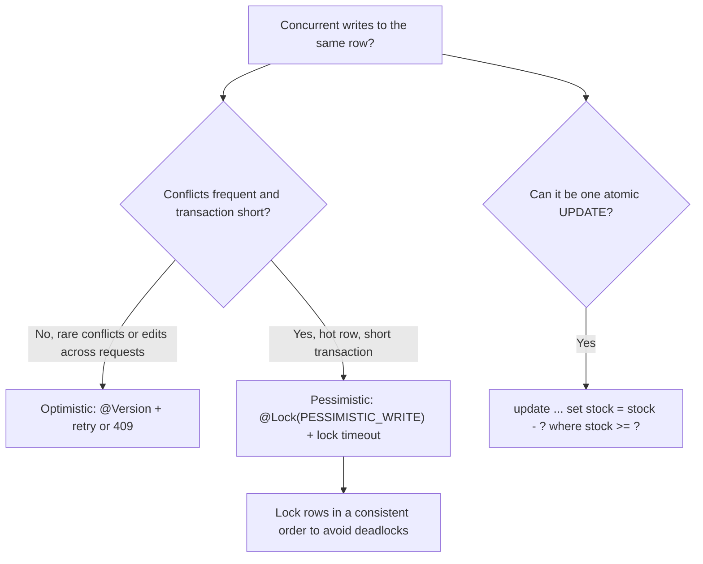
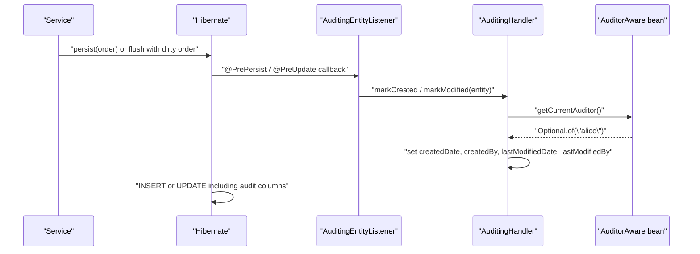

@@ 3 | TOPIC | Optimistic vs Pessimistic Locking | @Version and optimistic lock failures, SELECT FOR UPDATE with @Lock, lock timeouts, deadlocks and when to use which | MUST
# Optimistic vs Pessimistic Locking

**Level: Intermediate | Phase 12 | Priority: MUST | Since: JPA 1.0 (`@Version`), JPA 2.0 (`LockModeType.PESSIMISTIC_*`), Spring Data JPA `@Lock` 1.6**

> **30-second interview answer:** Optimistic locking assumes conflicts are rare: a `@Version` column is checked and incremented on every update with `where id = ? and version = ?`, and if another transaction changed the row first, zero rows match and Hibernate throws an optimistic lock exception, which I retry or report as 409. Pessimistic locking assumes conflicts are likely: `@Lock(PESSIMISTIC_WRITE)` issues `SELECT ... FOR UPDATE`, so other writers wait until I commit. I use optimistic locking by default, especially for user edits that span requests, and pessimistic locking for short, hot, contended updates like stock or account balances.

## 1. Concept in Simple Words
### Analogy
Editing a shared wiki page versus booking a meeting room.

| Real world | Locking |
|---|---|
| A wiki lets everyone edit; on save it checks "has the page changed since you opened it?" | Optimistic locking with a version number |
| "Someone else edited this page, please merge" message | `ObjectOptimisticLockingFailureException`, HTTP 409 |
| The page's revision number | The `@Version` column |
| A meeting room key: whoever holds it, others wait at the door | Pessimistic lock: `SELECT ... FOR UPDATE` |
| Waiting at the door too long and giving up | Lock timeout |
| Two people each holding one room key and waiting for the other's | Deadlock |

### What it is
- **Optimistic locking:** no database lock while reading. On update, Hibernate adds the version to the WHERE clause and increments it. A mismatch means a concurrent modification.
- **`@Version`:** a numeric (`int`, `long`, `Integer`, `Long`) or timestamp field managed by Hibernate. Never set it yourself.
- **Exceptions:** Hibernate throws `StaleObjectStateException` / JPA `OptimisticLockException`; Spring translates to `ObjectOptimisticLockingFailureException` (a subclass of `OptimisticLockingFailureException`).
- **Pessimistic locking:** a real database row lock. `LockModeType.PESSIMISTIC_READ` (shared lock, `for share`), `PESSIMISTIC_WRITE` (exclusive, `for update`), `PESSIMISTIC_FORCE_INCREMENT` (exclusive plus version bump).
- **`@Lock`:** Spring Data annotation on a repository method to apply a lock mode.
- **Lock timeout:** `jakarta.persistence.lock.timeout` hint in milliseconds; `0` means `NOWAIT` (fail immediately), `-2` means `SKIP LOCKED` in Hibernate.
- **`OPTIMISTIC_FORCE_INCREMENT`:** bump the version of an aggregate root even if only a child changed, so concurrent edits of the same order's lines conflict.

### Why it exists
Isolation levels alone do not stop lost updates in read-modify-write code (previous topic). Locking makes the conflict explicit: either detect it (optimistic) or prevent it by making others wait (pessimistic). Optimistic locking also works across HTTP requests, where holding a database lock while a user thinks is impossible.

## 2. How It Works
Optimistic locking timeline:
```text
time  T1 (admin A edits price)                     T2 (admin B edits price)
t1    SELECT ... product id=1  -> version=3
t2                                                  SELECT ... product id=1 -> version=3
t3    UPDATE product SET price=44, version=4
      WHERE id=1 AND version=3      -> 1 row
t4    COMMIT
t5                                                  UPDATE product SET price=39, version=4
                                                    WHERE id=1 AND version=3 -> 0 rows
                                                    -> Hibernate: StaleObjectStateException
                                                    -> Spring: ObjectOptimisticLockingFailureException
```

Pessimistic locking timeline:
```text
time  T1                                            T2
t1    SELECT ... WHERE id=1 FOR UPDATE  (lock)
t2                                                  SELECT ... WHERE id=1 FOR UPDATE
                                                    (waits for T1's lock)
t3    UPDATE product SET stock=3 WHERE id=1
t4    COMMIT (lock released)
t5                                                  gets the row with stock=3 (fresh value)
```



Behind `@Version`: Hibernate includes the version in the UPDATE and DELETE WHERE clauses, checks the JDBC update count, increments the version in the entity, and also uses a null version to decide that `save` should persist. Behind `@Lock`: Spring Data calls `query.setLockMode(...)`, and Hibernate's dialect appends `for update` (or `for no key update` / `for share` depending on dialect and mode) plus `nowait` or `skip locked` based on the timeout hint.

## 3. Code Example
### Code
Migration `V6__locking.sql`:
```sql
alter table product add column version bigint not null default 0;
alter table orders  add column version bigint not null default 0;
```

Entity change:
```java
// inside Product
@jakarta.persistence.Version
private long version;            // managed by Hibernate; never set it manually
public long getVersion() { return version; }
```

Repository with lock modes:
```java
package com.orderhub.product;

import jakarta.persistence.LockModeType;
import jakarta.persistence.QueryHint;
import org.springframework.data.jpa.repository.JpaRepository;
import org.springframework.data.jpa.repository.Lock;
import org.springframework.data.jpa.repository.Query;
import org.springframework.data.jpa.repository.QueryHints;
import org.springframework.data.repository.query.Param;

import java.util.List;
import java.util.Optional;

public interface LockingProductRepository extends JpaRepository<Product, Long> {

    @Lock(LockModeType.PESSIMISTIC_WRITE)
    @QueryHints(@QueryHint(name = "jakarta.persistence.lock.timeout", value = "3000"))  // wait max 3 s
    @Query("select p from Product p where p.id = :id")
    Optional<Product> findByIdForUpdate(@Param("id") Long id);

    // Lock several rows in a consistent order (by id) to avoid deadlocks
    @Lock(LockModeType.PESSIMISTIC_WRITE)
    @Query("select p from Product p where p.id in :ids order by p.id")
    List<Product> findAllByIdForUpdate(@Param("ids") List<Long> ids);
}
```

Services:
```java
package com.orderhub.product;

import org.springframework.orm.ObjectOptimisticLockingFailureException;
import org.springframework.stereotype.Service;
import org.springframework.transaction.annotation.Transactional;

import java.math.BigDecimal;
import java.util.Comparator;
import java.util.List;
import java.util.Map;

@Service
public class ProductAdminService {
    private final LockingProductRepository products;
    public ProductAdminService(LockingProductRepository products) { this.products = products; }

    // Optimistic, across HTTP requests: client sends the version it saw
    @Transactional
    public ProductDto updatePrice(Long id, BigDecimal price, long expectedVersion) {
        Product p = products.findById(id).orElseThrow();
        if (p.getVersion() != expectedVersion) {
            // the row changed since the client loaded it
            throw new ObjectOptimisticLockingFailureException(Product.class, id);
        }
        p.changePrice(price);          // UPDATE ... where id=? and version=? at commit
        return ProductDto.from(p);
    }
}

@Service
class StockReservationService {
    private final LockingProductRepository products;
    StockReservationService(LockingProductRepository products) { this.products = products; }

    // Pessimistic: hot row, short transaction
    @Transactional
    public void reserve(Long productId, int qty) {
        Product p = products.findByIdForUpdate(productId).orElseThrow();   // SELECT ... FOR UPDATE
        p.decreaseStock(qty);                                             // safe: we hold the row lock
    }

    // Multi-row: lock in id order so two orders with the same products cannot deadlock
    @Transactional
    public void reserveAll(Map<Long, Integer> qtyByProduct) {
        List<Long> ids = qtyByProduct.keySet().stream().sorted(Comparator.naturalOrder()).toList();
        for (Product p : products.findAllByIdForUpdate(ids)) {
            p.decreaseStock(qtyByProduct.get(p.getId()));
        }
    }
}
```

Mapping the optimistic failure to HTTP 409 (Phase 11 handler):
```java
package com.orderhub.web;

import org.springframework.http.HttpStatus;
import org.springframework.http.ProblemDetail;
import org.springframework.orm.ObjectOptimisticLockingFailureException;
import org.springframework.dao.PessimisticLockingFailureException;
import org.springframework.web.bind.annotation.ExceptionHandler;
import org.springframework.web.bind.annotation.RestControllerAdvice;

@RestControllerAdvice
class LockingExceptionHandler {
    @ExceptionHandler(ObjectOptimisticLockingFailureException.class)
    ProblemDetail optimistic(ObjectOptimisticLockingFailureException e) {
        ProblemDetail pd = ProblemDetail.forStatusAndDetail(HttpStatus.CONFLICT,
                "The resource was modified by someone else. Reload and try again.");
        pd.setTitle("Concurrent modification");
        return pd;
    }

    @ExceptionHandler(PessimisticLockingFailureException.class)
    ProblemDetail pessimistic(PessimisticLockingFailureException e) {
        return ProblemDetail.forStatusAndDetail(HttpStatus.SERVICE_UNAVAILABLE, "Resource busy, retry shortly.");
    }
}
```

Controller using `ETag` / `If-Match` for the version:
```java
package com.orderhub.product;

import org.springframework.http.ResponseEntity;
import org.springframework.web.bind.annotation.*;

import java.math.BigDecimal;

@RestController
@RequestMapping("/api/admin/products")
class ProductAdminController {
    private final ProductAdminService service;
    ProductAdminController(ProductAdminService service) { this.service = service; }

    record PriceChange(BigDecimal price) { }

    @PatchMapping("/{id}/price")
    ResponseEntity<ProductDto> changePrice(@PathVariable Long id,
                                           @RequestHeader("If-Match") String ifMatch,
                                           @RequestBody PriceChange body) {
        long version = Long.parseLong(ifMatch.replace("\"", ""));
        ProductDto dto = service.updatePrice(id, body.price(), version);
        return ResponseEntity.ok().eTag("\"" + dto.version() + "\"").body(dto);
    }
}
```
(`ProductDto` here gains a `version` component.)

### Walkthrough
- `@Version long version` makes every UPDATE check and bump the version.
- `updatePrice` compares the client's version with the current one, so a stale browser tab gets 409 even if the two requests were minutes apart. If two requests race within the same moment, Hibernate's `where version=?` check catches it at commit.
- `findByIdForUpdate` issues `SELECT ... FOR UPDATE` with a 3-second lock timeout; concurrent reservations queue instead of losing updates.
- `reserveAll` locks multiple rows in ascending id order. If order A locks products 1 then 2 and order B locks 2 then 1, they deadlock; consistent ordering prevents that.
- The advice maps optimistic conflicts to 409 and lock timeouts to 503.

### Output
Two admins editing the same product (both loaded version 3):
```text
Hibernate: select p1_0.id,p1_0.created_at,p1_0.name,p1_0.price,p1_0.sku,p1_0.status,p1_0.stock,p1_0.version from product p1_0 where p1_0.id=?
Hibernate: update product set name=?,price=?,status=?,stock=?,version=? where id=? and version=?
```
```http
PATCH /api/admin/products/1/price
If-Match: "3"
Content-Type: application/json

{ "price": 39.00 }

HTTP/1.1 409 Conflict
Content-Type: application/problem+json

{ "type": "about:blank", "title": "Concurrent modification", "status": 409,
  "detail": "The resource was modified by someone else. Reload and try again.",
  "instance": "/api/admin/products/1/price" }
```
When the race happens inside the same instant, the UPDATE matches 0 rows:
```text
Hibernate: update product set name=?,price=?,status=?,stock=?,version=? where id=? and version=?
org.springframework.orm.ObjectOptimisticLockingFailureException: Row was updated or deleted by another transaction (or unsaved-value mapping was incorrect) : [com.orderhub.product.Product#1]
```
Pessimistic reservation:
```text
Hibernate: select p1_0.id,p1_0.created_at,p1_0.name,p1_0.price,p1_0.sku,p1_0.status,p1_0.stock,p1_0.version from product p1_0 where p1_0.id=? for no key update
Hibernate: update product set name=?,price=?,status=?,stock=?,version=? where id=? and version=?
```
On PostgreSQL, Hibernate 6.x renders `PESSIMISTIC_WRITE` as `for no key update` (a slightly weaker exclusive lock that does not block inserts referencing the row); other dialects show `for update`. With the timeout hint, Hibernate first runs `set local lock_timeout = 3000`. A blocked request that exceeds it fails with:
```text
ERROR: canceling statement due to lock timeout
org.springframework.dao.PessimisticLockingFailureException: could not obtain pessimistic lock
```

### Compare
| | Optimistic | Pessimistic |
|---|---|---|
| Mechanism | Version check in UPDATE | Database row lock (`FOR UPDATE`) |
| Blocking | Never | Others wait |
| On conflict | Exception at commit: retry or 409 | Wait, or timeout exception |
| Works across HTTP requests | Yes (version in ETag or DTO) | No |
| Deadlock risk | None | Yes, lock in consistent order |
| Best for | Low contention, user edits | High contention, short critical sections |

## 4. Interview Questions
**Basic**
1. **What is optimistic locking and how does JPA implement it?**
   It detects concurrent modifications instead of preventing them. With a `@Version` field, Hibernate adds `and version = ?` to every UPDATE and DELETE and increments the version. If no row matches, another transaction changed it first and an `OptimisticLockException` (Spring: `ObjectOptimisticLockingFailureException`) is thrown.
2. **What is pessimistic locking?**
   Taking a real database lock when reading, typically `SELECT ... FOR UPDATE`, so other transactions that want to lock or update the row wait until you commit. In Spring Data you use `@Lock(LockModeType.PESSIMISTIC_WRITE)` on a repository method.
3. **When do you choose optimistic over pessimistic?**
   Optimistic for low contention and for edits that span user think time or several requests, because it holds no locks. Pessimistic for short transactions on hot rows where conflicts are frequent and retries would be wasteful, like stock counters or wallet balances.

**Follow-up**
4. **How do you handle an `ObjectOptimisticLockingFailureException`?**
   For automated processes, retry the whole transaction (reload, reapply, save), usually a few times with backoff. For user edits, return 409 Conflict and let the user reload and reapply. Never retry inside the same transaction, which is already marked for rollback.
5. **How does optimistic locking work across two HTTP requests?**
   Send the version to the client (in the DTO or as an `ETag`), and require it back (`If-Match` header or a field). On update, compare it with the current version or set it on the entity before flushing; a mismatch means someone else changed the resource in between.
6. **What are the risks of pessimistic locking?**
   Blocked threads and connections under contention, lock timeouts, and deadlocks when transactions lock rows in different orders. Keep the locked section short, always set a lock timeout, lock in a consistent order, and never do remote calls while holding locks.

**Tricky / scenario**
7. **Two users edit different lines of the same order at the same time; both succeed and the total is wrong. `Order` has `@Version`. Why?**
   Only `OrderLine` rows changed, so the order's version was not incremented and no conflict was detected. Bump the aggregate root's version whenever a child changes: modify a field on the order (like the total) or lock it with `OPTIMISTIC_FORCE_INCREMENT`.
8. **Your logs show "deadlock detected" (SQLSTATE 40P01) during checkout. How do you diagnose and fix it?**
   Two transactions locked the same rows in different orders: for example, products of two carts processed in cart order. PostgreSQL kills one transaction; Spring throws a `CannotAcquireLockException` (a `PessimisticLockingFailureException`). Lock rows in a deterministic order (sort by id), keep transactions short, and retry the victim.
9. **How would you build a job queue in a table where several app instances pick jobs without taking the same one?**
   Use `select ... for update skip locked` with a limit: each worker locks a few unlocked rows and the others skip them. In JPA, `@Lock(PESSIMISTIC_WRITE)` with the lock timeout hint `-2` (Hibernate's SKIP_LOCKED) or a native query.

**What the interviewer is really testing:** whether you can prevent lost updates in real scenarios and reason about the trade-offs of blocking versus detecting.

## 5. Pitfalls & Best Practices
### Common mistakes
| Mistake | What goes wrong | Fix |
|---|---|---|
| Setting `@Version` manually from a DTO on a managed entity | Hibernate ignores or misuses it | Compare versions explicitly or merge carefully |
| Retrying inside the same transaction | Transaction already rollback-only | Retry with a new transaction |
| Pessimistic lock without timeout | Threads wait forever under contention | Lock timeout hint or NOWAIT |
| Locking rows in arbitrary order | Deadlocks | Sort by id before locking |
| Bulk JPQL update without bumping version | Optimistic checks miss the change | `set version = version + 1` in the bulk update |
| Child changes without root version bump | Concurrent aggregate edits undetected | `OPTIMISTIC_FORCE_INCREMENT` or touch the root |

### Best practices
- Add `@Version` to every aggregate root by default.
- Return the version as an `ETag` and require `If-Match` on updates.
- Map optimistic failures to 409 with a clear message.
- Use pessimistic locks only in short, well-understood critical sections, with timeouts.
- Prefer a single atomic UPDATE when the logic fits in SQL.

### Compare with
| Technique | Detects or prevents | Typical use |
|---|---|---|
| `@Version` | Detects | Entity edits, REST updates |
| `PESSIMISTIC_WRITE` | Prevents (waits) | Stock, balances |
| `SKIP LOCKED` | Avoids contention | Job queues |
| Atomic conditional UPDATE | Prevents | Counters, reservations |
| `SERIALIZABLE` isolation | Detects | Complex invariants across rows |
| Distributed lock (Redis, ShedLock) | Prevents across services | Scheduled jobs in clusters |

## 6. Hands-on Exercise
Make OrderHub's `PATCH /api/orders/{id}` (change shipping address) safe for concurrent edits by customers and support staff, and make order line changes conflict with address changes.

Acceptance criteria:
- `GET /api/orders/{id}` returns an `ETag` with the order version.
- `PATCH` requires `If-Match`; a stale version returns 409; a missing header returns 428 Precondition Required.
- Adding or removing a line bumps the order version.

<details><summary>Solution</summary>

```java
// inside Order
@jakarta.persistence.Version
private long version;
public long getVersion() { return version; }

public void changeShipTo(Address newAddress) {
    if (status != Status.NEW) throw new IllegalStateException("Order already " + status);
    this.shipTo = newAddress;
}
// addLine and removeLine call recalculate(), which changes "total",
// so the order row is updated and its version bumped whenever lines change.
```

```java
package com.orderhub.order;

import org.springframework.http.HttpStatus;
import org.springframework.http.ResponseEntity;
import org.springframework.orm.ObjectOptimisticLockingFailureException;
import org.springframework.stereotype.Service;
import org.springframework.transaction.annotation.Transactional;
import org.springframework.web.bind.annotation.*;

@Service
class OrderAddressService {
    private final OrderRepository orders;
    OrderAddressService(OrderRepository orders) { this.orders = orders; }

    @Transactional
    long changeAddress(Long id, long expectedVersion, Address address) {
        Order o = orders.findById(id).orElseThrow(() -> new OrderNotFoundException(id));
        if (o.getVersion() != expectedVersion) throw new ObjectOptimisticLockingFailureException(Order.class, id);
        o.changeShipTo(address);
        orders.flush();                     // run the versioned UPDATE now to return the new version
        return o.getVersion();
    }

    @Transactional(readOnly = true)
    Order get(Long id) { return orders.findById(id).orElseThrow(() -> new OrderNotFoundException(id)); }
}

@RestController
@RequestMapping("/api/orders")
class OrderAddressController {
    private final OrderAddressService service;
    OrderAddressController(OrderAddressService service) { this.service = service; }

    @GetMapping("/{id}/version")
    ResponseEntity<Void> head(@PathVariable Long id) {
        return ResponseEntity.ok().eTag("\"" + service.get(id).getVersion() + "\"").build();
    }

    @PatchMapping("/{id}")
    ResponseEntity<Void> patch(@PathVariable Long id,
                               @RequestHeader(value = "If-Match", required = false) String ifMatch,
                               @RequestBody Address address) {
        if (ifMatch == null) return ResponseEntity.status(HttpStatus.PRECONDITION_REQUIRED).build();
        long newVersion = service.changeAddress(id, Long.parseLong(ifMatch.replace("\"", "")), address);
        return ResponseEntity.noContent().eTag("\"" + newVersion + "\"").build();
    }
}
```
The existing `LockingExceptionHandler` turns the optimistic failure into 409. Because line changes recalculate `total`, the order row itself is updated and its version incremented, so a concurrent address change based on the old version conflicts. If line changes did not touch the order row, you would call `entityManager.lock(order, LockModeType.OPTIMISTIC_FORCE_INCREMENT)`.
</details>

## 7. Recall
Q: How does JPA optimistic locking with @Version detect conflicts?
A: Hibernate adds `and version = ?` to UPDATE and DELETE and increments it; zero affected rows means a concurrent change and an optimistic lock exception.

Q: What SQL does Spring Data's @Lock(PESSIMISTIC_WRITE) produce?
A: A `SELECT ... FOR UPDATE` (on PostgreSQL Hibernate 6 may render `for no key update`), which makes other writers wait.

Q: When should you prefer optimistic locking over pessimistic locking?
A: When conflicts are rare or edits span user think time or several requests, because it holds no database locks.

Q: How do you prevent deadlocks with pessimistic locking?
A: Lock rows in a consistent order (for example by id), keep transactions short and set lock timeouts.

Q: How do you carry an optimistic lock version across HTTP requests?
A: Return it as an ETag or DTO field and require it back with `If-Match`, returning 409 on mismatch.

**Related:** [[Isolation Levels and Read Phenomena]] · [[@Transactional and Propagation]] · [[Idempotency and Safe Methods]] · [[Deadlock, Livelock and Starvation]]

@@ 3 | TOPIC | Schema Migrations with Flyway | Versioned SQL migrations, the flyway_schema_history table, naming rules, Boot integration and safe production changes | MUST
# Schema Migrations with Flyway

**Level: Intermediate | Phase 12 | Priority: MUST | Since: Flyway 1.0 (2010), Boot auto-configuration since Boot 1.x; Boot 3.5 ships Flyway 11**

> **30-second interview answer:** Flyway manages the database schema as numbered SQL scripts in `db/migration`, like `V1__init.sql` and `V2__add_payment.sql`. At startup it compares the scripts with its `flyway_schema_history` table, applies the pending ones in order inside transactions, and records each with a checksum, so every environment ends up with the same schema. Applied migrations are never edited; every change is a new version. I set Hibernate to `ddl-auto: validate` so Hibernate only checks the schema Flyway created.

## 1. Concept in Simple Words
### Analogy
A building's renovation logbook.

| Building | Flyway |
|---|---|
| Numbered renovation work orders: 1 foundation, 2 walls, 3 add a balcony | Versioned migrations `V1__`, `V2__`, `V3__` |
| The logbook at the reception listing what was done and when | `flyway_schema_history` table |
| A new building copy follows all work orders in order | A new database gets every migration from V1 |
| You never rewrite an old work order; you file a new one | Never edit applied migrations; add a new version |
| The inspector checks the log matches the papers | Checksum validation at startup |
| Repainting every year, not numbered | Repeatable migrations `R__` re-run when changed |

### What it is
- **Migration:** a script that changes the schema or data. Versioned (`V<version>__<description>.sql`) or repeatable (`R__<description>.sql`, re-applied when its checksum changes, applied after versioned ones; good for views and functions).
- **Naming:** prefix `V`, version (`1`, `1.1`, `20261124.1`), two underscores, description with underscores. Default location `classpath:db/migration`.
- **`flyway_schema_history`:** table with version, description, script, checksum, installed_on, execution time, success.
- **Validate:** at startup Flyway checks that applied scripts still have the same checksum; editing an applied script fails validation.
- **Baseline:** start using Flyway on an existing database (`spring.flyway.baseline-on-migrate=true`, `baseline-version`).
- **Java migrations:** classes extending `BaseJavaMigration` for complex data changes.
- **Boot integration:** with `flyway-core` (and for PostgreSQL `flyway-database-postgresql`, required since Flyway 10) on the classpath, `FlywayAutoConfiguration` runs migrations before the `EntityManagerFactory` is created.
- **Liquibase:** the main alternative, with changelogs in XML, YAML or SQL and rollback support.

### Why it exists
`ddl-auto: update` cannot rename columns, never drops anything, cannot migrate data, is not reviewed and differs between environments. Hand-run scripts get forgotten. Flyway makes schema changes code: reviewed in pull requests, versioned in Git, applied automatically and identically everywhere.

## 2. How It Works
```mermaid
sequenceDiagram
    participant B as "Spring Boot startup"
    participant F as "Flyway"
    participant DB as "PostgreSQL"
    participant H as "Hibernate (ddl-auto: validate)"
    B->>F: "FlywayAutoConfiguration: migrate() before EntityManagerFactory"
    F->>DB: "create flyway_schema_history if missing, take advisory lock"
    F->>DB: "read applied versions and checksums"
    F->>F: "scan classpath:db/migration, validate checksums"
    loop "each pending version in order"
        F->>DB: "BEGIN; run script; insert history row; COMMIT"
    end
    F-->>B: "schema at latest version"
    B->>H: "build EntityManagerFactory"
    H->>DB: "validate entities against tables and columns"
```

State of the history table after OrderHub's migrations:
```text
installed_rank | version | description     | script                 | checksum    | success
---------------+---------+-----------------+------------------------+-------------+--------
1              | 1       | init            | V1__init.sql           | 1739812345  | t
2              | 2       | customer        | V2__customer.sql       | -88213001   | t
3              | 3       | relationships   | V3__relationships.sql  | 455120987   | t
4              | 4       | payment         | V4__payment.sql        | 90233411    | t
5              | 5       | stock check     | V5__stock_check.sql    | -12093344   | t
6              | 6       | locking         | V6__locking.sql        | 300119882   | t
```

Safe production changes (expand and contract), because during a rolling deployment old and new app versions run against the same schema:
```text
Rename column full_name -> display_name without downtime:
release 1: V7  add column display_name; backfill; app writes both, reads old
release 2: app reads display_name
release 3: V8  drop column full_name
```

PostgreSQL runs DDL inside transactions, so a failed migration rolls back cleanly. On MySQL, DDL auto-commits, so a failure halfway leaves a partial change and a failed history row that you must repair (`flyway repair`).

## 3. Code Example
### Code
`pom.xml`:
```xml
<dependency>
    <groupId>org.flywaydb</groupId>
    <artifactId>flyway-core</artifactId>
</dependency>
<dependency>
    <groupId>org.flywaydb</groupId>
    <artifactId>flyway-database-postgresql</artifactId>   <!-- required for PostgreSQL since Flyway 10 -->
</dependency>
```

`application.yml`:
```yaml
spring:
  flyway:
    enabled: true
    locations: classpath:db/migration
    baseline-on-migrate: false        # true only when adopting Flyway on an existing database
    clean-disabled: true              # never allow "clean" (drop everything) by accident
  jpa:
    hibernate:
      ddl-auto: validate              # Flyway owns the schema
```

Project layout:
```text
src/main/resources/db/migration/
  V1__init.sql
  V2__customer.sql
  V3__relationships.sql
  V4__payment.sql
  V5__stock_check.sql
  V6__locking.sql
  V7__order_number_index.sql
  R__order_summary_view.sql
```

`V7__order_number_index.sql` (a production-safe index build):
```sql
-- flyway:executeInTransaction=false is needed because CREATE INDEX CONCURRENTLY cannot run in a transaction
create index concurrently if not exists idx_orders_status_created on orders (status, created_at);
```
With the matching script configuration file `V7__order_number_index.sql.conf`:
```properties
executeInTransaction=false
```

Repeatable view, re-applied whenever its content changes:
```sql
-- R__order_summary_view.sql
create or replace view order_summary as
select o.id, o.order_number, c.email, o.status, o.total, o.created_at
from orders o
join customer c on c.id = o.customer_id;
```

A Java migration for a data backfill that SQL alone makes awkward:
```java
package db.migration;

import org.flywaydb.core.api.migration.BaseJavaMigration;
import org.flywaydb.core.api.migration.Context;

import java.sql.PreparedStatement;
import java.sql.ResultSet;
import java.sql.Statement;

// Class name follows the same convention: V8__Backfill_order_numbers
public class V8__Backfill_order_numbers extends BaseJavaMigration {
    @Override
    public void migrate(Context context) throws Exception {
        try (Statement select = context.getConnection().createStatement();
             ResultSet rs = select.executeQuery("select id from orders where order_number is null order by id");
             PreparedStatement update = context.getConnection()
                     .prepareStatement("update orders set order_number = ? where id = ?")) {
            while (rs.next()) {
                long id = rs.getLong(1);
                update.setString(1, String.format("OH-%06d", id));
                update.setLong(2, id);
                update.addBatch();
            }
            update.executeBatch();
        }
    }
}
```

Running Flyway outside the app (CI or ops) with the Maven plugin:
```bash
./mvnw flyway:info -Dflyway.url=jdbc:postgresql://localhost:5432/orderhub -Dflyway.user=orderhub -Dflyway.password=orderhub
./mvnw flyway:migrate -Dflyway.url=jdbc:postgresql://localhost:5432/orderhub -Dflyway.user=orderhub -Dflyway.password=orderhub
```

### Walkthrough
- `flyway-database-postgresql` is a separate module since Flyway 10; without it Boot fails with "Unsupported Database: PostgreSQL 17".
- `clean-disabled: true` protects against `flyway clean`, which drops every object in the schema.
- `ddl-auto: validate` lets Hibernate fail fast if an entity and the migrated schema disagree.
- `V7` builds an index with `concurrently` so writes are not blocked during the build; that statement cannot run inside a transaction, so the script's `.conf` file disables the transaction for this one migration.
- `R__order_summary_view.sql` is re-run whenever its checksum changes, which suits views and functions that are replaced as a whole.
- `V8__Backfill_order_numbers` is a Java migration found in the `db.migration` package; Flyway records it in the history like a SQL migration.

### Output
First startup against an empty database:
```text
INFO  o.f.c.i.license.VersionPrinter      : Flyway Community Edition 11.7.2 by Redgate
INFO  o.f.c.i.database.base.BaseDatabaseType : Database: jdbc:postgresql://localhost:5432/orderhub (PostgreSQL 17.2)
INFO  o.f.core.internal.command.DbValidate : Successfully validated 9 migrations (execution time 00:00.031s)
INFO  o.f.c.i.s.JdbcTableSchemaHistory    : Creating Schema History table "public"."flyway_schema_history"
INFO  o.f.core.internal.command.DbMigrate : Current version of schema "public": << Empty Schema >>
INFO  o.f.core.internal.command.DbMigrate : Migrating schema "public" to version "1 - init"
INFO  o.f.core.internal.command.DbMigrate : Migrating schema "public" to version "2 - customer"
INFO  o.f.core.internal.command.DbMigrate : Migrating schema "public" to version "3 - relationships"
INFO  o.f.core.internal.command.DbMigrate : Migrating schema "public" to version "4 - payment"
INFO  o.f.core.internal.command.DbMigrate : Migrating schema "public" to version "5 - stock check"
INFO  o.f.core.internal.command.DbMigrate : Migrating schema "public" to version "6 - locking"
INFO  o.f.core.internal.command.DbMigrate : Migrating schema "public" to version "7 - order number index" [non-transactional]
INFO  o.f.core.internal.command.DbMigrate : Migrating schema "public" to version "8 - Backfill order numbers"
INFO  o.f.core.internal.command.DbMigrate : Migrating schema "public" with repeatable migration "order summary view"
INFO  o.f.core.internal.command.DbMigrate : Successfully applied 9 migrations to schema "public", now at version v8 (execution time 00:00.412s)
```
Someone edits `V3__relationships.sql` after it was applied:
```text
org.flywaydb.core.api.exception.FlywayValidateException: Validate failed: Migrations have failed validation
Migration checksum mismatch for migration version 3
-> Applied to database : 455120987
-> Resolved locally    : -1290033412
Either revert the changes to the migration, or run repair to update the schema history.
```

### Compare
| | `ddl-auto: update` | Flyway | Liquibase |
|---|---|---|---|
| Format | Generated by Hibernate | Plain SQL (or Java) | XML, YAML, JSON or SQL changelogs |
| Reviewable | No | Yes | Yes |
| Renames, data migration | No | Yes | Yes |
| Rollback | No | Undo only in paid editions; write a new forward migration | Rollback blocks supported |
| History table | None | `flyway_schema_history` | `databasechangelog` |
| Production use | Never | Yes | Yes |

## 4. Interview Questions
**Basic**
1. **What is Flyway and why use it?**
   A database migration tool that applies versioned SQL scripts in order and records them in a history table. It makes schema changes repeatable, reviewable and identical across environments, replacing `ddl-auto` and manual scripts.
2. **What is the naming convention for Flyway migrations?**
   `V<version>__<description>.sql` for versioned migrations, such as `V3__add_payment_table.sql`, with two underscores. `R__<description>.sql` for repeatable migrations, re-applied when their checksum changes. Undo migrations use `U` (paid editions).
3. **How does Spring Boot run Flyway?**
   When `flyway-core` is on the classpath and a `DataSource` exists, `FlywayAutoConfiguration` creates a `Flyway` bean and runs `migrate()` during startup, before JPA's `EntityManagerFactory` is initialised. Settings come from `spring.flyway.*`.

**Follow-up**
4. **What happens if you modify a migration that was already applied?**
   The checksum stored in `flyway_schema_history` no longer matches the file, so validation fails at startup and the app does not start. Revert the change and add a new migration; use `flyway repair` only to realign checksums when you deliberately accept the edit (for example a comment change in development).
5. **How do you introduce Flyway to an existing production database?**
   Export the current schema as `V1__baseline.sql` for new environments, and on existing databases baseline at version 1 (`baseline-on-migrate=true`, `baseline-version=1`), so Flyway marks V1 as applied without running it. Subsequent changes start at V2.
6. **What is the relationship between Flyway and `ddl-auto`?**
   Flyway creates and evolves the schema; Hibernate should only validate it with `ddl-auto: validate` (or `none`). Running both `update` and Flyway leads to drift: Hibernate makes changes that are not in any migration.

**Tricky / scenario**
7. **You need to rename a column used by the running application without downtime. How?**
   Expand and contract: add the new column and backfill it, deploy code that writes both and reads the new one, then in a later release drop the old column. A single rename migration would break the old app instances still running during a rolling deployment.
8. **Two developers create a `V7__` migration (`V7__coupon.sql` and `V7__tags.sql`) on different branches. What happens and how do teams avoid it?**
   After merging, Flyway sees two migrations with version 7 and fails with "Found more than one migration with version 7". Teams use timestamps as versions (`V20261124_1015__add_tags.sql`), or a CI check, and enable `outOfOrder` carefully if migrations can be merged late.
9. **A migration adds an index on a 200 million row table and production writes stall during deployment. Why, and what do you do?**
   A plain `CREATE INDEX` takes a lock that blocks writes for the whole build. Use `CREATE INDEX CONCURRENTLY` in a non-transactional migration, or run it separately ahead of the deployment. Also review migrations for long locks (adding a column with a volatile default, changing a column type) before release.

**What the interviewer is really testing:** whether you treat schema changes as versioned code and know how to change a live database safely.

## 5. Pitfalls & Best Practices
### Common mistakes
| Mistake | What goes wrong | Fix |
|---|---|---|
| Editing an applied migration | Checksum mismatch, startup fails | Add a new migration |
| `ddl-auto: update` alongside Flyway | Schema drift | `ddl-auto: validate` |
| Missing `flyway-database-postgresql` with Flyway 10+ | "Unsupported Database" at startup | Add the database module |
| Destructive changes in one release | Old app instances break during rollout | Expand and contract |
| `CREATE INDEX` on huge tables inside a migration | Writes blocked | `CONCURRENTLY` in a non-transactional migration |
| Leaving `clean` enabled | One command wipes the schema | `spring.flyway.clean-disabled: true` |

### Best practices
- One logical change per migration, small and reviewed like code.
- Test migrations against real PostgreSQL in CI with Testcontainers (Phase 13).
- Use repeatable migrations for views and functions.
- Never put environment-specific data in versioned migrations; use separate locations per profile if needed.
- Check `flyway info` as part of deployment pipelines.

### Compare with
| Approach | Who changes the schema | Risk |
|---|---|---|
| Manual DBA scripts | People | Forgotten or inconsistent steps |
| Hibernate `ddl-auto` | ORM at startup | Unreviewed, no data migration |
| Flyway | Versioned SQL in Git | Low, if migrations are reviewed |
| Liquibase | Versioned changelogs | Low; more abstraction and rollback support |

## 6. Hands-on Exercise
OrderHub needs a `discount_code` on orders and a `coupon` table. Write the migrations for:
1. `coupon(id, code unique, percent between 1 and 90, valid_until)`.
2. `orders.coupon_id` foreign key (nullable), indexed.
3. A repeatable view `active_coupons` listing coupons still valid.
Then map `Coupon` and add `@ManyToOne(fetch = LAZY) Coupon coupon` to `Order`.

Acceptance criteria: app starts with `ddl-auto: validate`; history table shows the new versions; the view is re-applied when edited.

<details><summary>Solution</summary>

```sql
-- V9__coupon.sql
create sequence coupon_seq start with 1 increment by 50;
create table coupon (
    id          bigint primary key,
    code        varchar(30) not null unique,
    percent     integer not null check (percent between 1 and 90),
    valid_until timestamp with time zone not null
);

-- V10__order_coupon.sql
alter table orders add column coupon_id bigint references coupon(id);
create index idx_orders_coupon on orders(coupon_id);
```

```sql
-- R__active_coupons_view.sql
create or replace view active_coupons as
select id, code, percent, valid_until
from coupon
where valid_until > now();
```

```java
package com.orderhub.coupon;

import jakarta.persistence.*;
import java.time.Instant;

@Entity
@Table(name = "coupon")
public class Coupon {
    @Id
    @GeneratedValue(strategy = GenerationType.SEQUENCE, generator = "coupon_gen")
    @SequenceGenerator(name = "coupon_gen", sequenceName = "coupon_seq", allocationSize = 50)
    private Long id;

    @Column(nullable = false, unique = true, length = 30)
    private String code;

    @Column(nullable = false)
    private int percent;

    @Column(name = "valid_until", nullable = false)
    private Instant validUntil;

    protected Coupon() { }
    public Coupon(String code, int percent, Instant validUntil) {
        this.code = code; this.percent = percent; this.validUntil = validUntil;
    }
    public boolean isValidAt(Instant now) { return now.isBefore(validUntil); }
    public int getPercent() { return percent; }
}
```

```java
// inside Order
@ManyToOne(fetch = FetchType.LAZY)
@JoinColumn(name = "coupon_id")
private com.orderhub.coupon.Coupon coupon;
```
Starting the app logs "Migrating schema "public" to version "9 - coupon"" and "10 - order coupon", then the repeatable migration. Hibernate validation passes because the column types match the mapping (`integer` for `int`, `timestamp with time zone` for `Instant`).
</details>

## 7. Recall
Q: What is the Flyway naming convention for versioned and repeatable migrations?
A: `V<version>__<description>.sql` for versioned and `R__<description>.sql` for repeatable migrations.

Q: What does Flyway store in flyway_schema_history?
A: Each applied migration's version, description, script, checksum, install time, execution time and success flag.

Q: What happens when an applied Flyway migration is edited?
A: Checksum validation fails at startup; add a new migration instead (or `repair` deliberately).

Q: Which ddl-auto value should be used together with Flyway?
A: `validate` (or `none`), so Hibernate checks but never changes the schema.

Q: How do you rename a column with Flyway without downtime?
A: Expand and contract: add and backfill the new column, switch the code, then drop the old column in a later release.

**Related:** [[Entity Mapping]] · [[Testcontainers]] · [[Query Performance and Indexes]] · [[CI/CD Pipeline for a Spring App]]

@@ 3 | TOPIC | Auditing | Automatic createdAt, updatedAt, createdBy and lastModifiedBy with Spring Data JPA auditing, AuditorAware and Envers | SHOULD
# Auditing

**Level: Intermediate | Phase 12 | Priority: SHOULD | Since: Spring Data JPA 1.5 (auditing), Hibernate Envers 3.5**

> **30-second interview answer:** Spring Data JPA auditing fills `@CreatedDate`, `@LastModifiedDate`, `@CreatedBy` and `@LastModifiedBy` fields automatically. I enable it with `@EnableJpaAuditing`, register `AuditingEntityListener` on the entities, usually through a `@MappedSuperclass` base class, and provide an `AuditorAware` bean that returns the current user from Spring Security. That records who last touched a row and when; if I need the full history of every change, I use Hibernate Envers, which writes each revision to audit tables.

## 1. Concept in Simple Words
### Analogy
A hotel's guest register and stamp.

| Hotel | Auditing |
|---|---|
| The receptionist stamps the date when you check in | `@CreatedDate` |
| Every room service visit updates "last serviced at" on the door card | `@LastModifiedDate` |
| The stamp includes the receptionist's initials | `@CreatedBy` and `@LastModifiedBy` |
| The receptionist knows who is on shift | `AuditorAware` returns the current user |
| A CCTV archive of every change in the room | Hibernate Envers revision history |

### What it is
- **`@EnableJpaAuditing`:** turns on Spring Data's auditing infrastructure; options `auditorAwareRef`, `dateTimeProviderRef`, `modifyOnCreate`.
- **`AuditingEntityListener`:** a JPA entity listener (`@EntityListeners`) whose `@PrePersist` and `@PreUpdate` callbacks set the audit fields.
- **Annotations:** `@CreatedDate`, `@LastModifiedDate` (types `Instant`, `LocalDateTime`, `long`, `Date`), `@CreatedBy`, `@LastModifiedBy` (any type, typically `String` or a user id).
- **`AuditorAware<T>`:** your bean that returns `Optional<T>` with the current auditor.
- **`DateTimeProvider`:** optional bean to control "now" (useful in tests with a fixed clock).
- **`@MappedSuperclass`:** a base class whose mapped fields are inherited by entities but which has no table of its own.
- **Hibernate Envers:** `@Audited` on an entity creates `<table>_aud` tables and a `revinfo` table storing every version; Spring Data offers `RevisionRepository` for querying.
- **Hibernate alternatives:** `@CreationTimestamp` and `@UpdateTimestamp` (Hibernate-only, no "by").

### Why it exists
"Who changed this order and when?" is one of the first questions support and compliance teams ask. Setting timestamps by hand in every service method is repetitive and easy to forget; auditing makes it automatic and consistent for every write path that goes through JPA.

## 2. How It Works


Details:
1. `@EnableJpaAuditing` registers an `AuditingHandler` bean and makes `AuditingEntityListener` able to reach it (the listener is instantiated by Hibernate, and Spring injects the handler through `@Configurable`-style support).
2. On `@PrePersist`, created and modified fields are set (modified too, because `modifyOnCreate` defaults to true).
3. On `@PreUpdate`, only modified fields change. `@PreUpdate` runs only if Hibernate detected a dirty field, so "touching" an entity without changes does not update the timestamp.
4. Bulk JPQL updates and native SQL bypass entity callbacks: audit fields are not updated by them.

```text
Base class hierarchy
AuditableEntity (@MappedSuperclass, @EntityListeners(AuditingEntityListener.class))
   createdAt, updatedAt, createdBy, updatedBy
     ^              ^              ^
   Product        Order         Customer     (each table has the four columns)
```

## 3. Code Example
### Code
Migration `V11__audit_columns.sql`:
```sql
alter table product  add column updated_at timestamp with time zone,
                     add column created_by varchar(100),
                     add column updated_by varchar(100);
alter table orders   add column updated_at timestamp with time zone,
                     add column created_by varchar(100),
                     add column updated_by varchar(100);
```

Base class:
```java
package com.orderhub.common;

import jakarta.persistence.Column;
import jakarta.persistence.EntityListeners;
import jakarta.persistence.MappedSuperclass;
import org.springframework.data.annotation.CreatedBy;
import org.springframework.data.annotation.CreatedDate;
import org.springframework.data.annotation.LastModifiedBy;
import org.springframework.data.annotation.LastModifiedDate;
import org.springframework.data.jpa.domain.support.AuditingEntityListener;

import java.time.Instant;

@MappedSuperclass
@EntityListeners(AuditingEntityListener.class)
public abstract class AuditableEntity {

    @CreatedDate
    @Column(name = "created_at", nullable = false, updatable = false)
    private Instant createdAt;

    @LastModifiedDate
    @Column(name = "updated_at")
    private Instant updatedAt;

    @CreatedBy
    @Column(name = "created_by", updatable = false, length = 100)
    private String createdBy;

    @LastModifiedBy
    @Column(name = "updated_by", length = 100)
    private String updatedBy;

    public Instant getCreatedAt() { return createdAt; }
    public Instant getUpdatedAt() { return updatedAt; }
    public String getCreatedBy() { return createdBy; }
    public String getUpdatedBy() { return updatedBy; }
}
```

Configuration with an `AuditorAware` that reads Spring Security (Phase 14) and falls back to "system":
```java
package com.orderhub.config;

import org.springframework.context.annotation.Bean;
import org.springframework.context.annotation.Configuration;
import org.springframework.data.auditing.DateTimeProvider;
import org.springframework.data.domain.AuditorAware;
import org.springframework.data.jpa.repository.config.EnableJpaAuditing;
import org.springframework.security.core.Authentication;
import org.springframework.security.core.context.SecurityContextHolder;

import java.time.Clock;
import java.util.Optional;

@Configuration
@EnableJpaAuditing(auditorAwareRef = "auditorAware", dateTimeProviderRef = "auditingDateTimeProvider")
class AuditingConfig {

    @Bean
    Clock clock() { return Clock.systemUTC(); }

    @Bean
    AuditorAware<String> auditorAware() {
        return () -> Optional.ofNullable(SecurityContextHolder.getContext().getAuthentication())
                .filter(Authentication::isAuthenticated)
                .map(Authentication::getName)
                .or(() -> Optional.of("system"));      // scheduled jobs, migrations, tests
    }

    @Bean
    DateTimeProvider auditingDateTimeProvider(Clock clock) {
        return () -> Optional.of(clock.instant());      // testable "now"
    }
}
```

Entity using it:
```java
package com.orderhub.product;

import com.orderhub.common.AuditableEntity;
import jakarta.persistence.*;
import java.math.BigDecimal;

@Entity
@Table(name = "product")
public class Product extends AuditableEntity {
    @Id
    @GeneratedValue(strategy = GenerationType.SEQUENCE, generator = "product_gen")
    @SequenceGenerator(name = "product_gen", sequenceName = "product_seq", allocationSize = 50)
    private Long id;

    @Column(nullable = false, unique = true, updatable = false, length = 40)
    private String sku;

    @Column(nullable = false, length = 120)
    private String name;

    @Column(nullable = false, precision = 12, scale = 2)
    private BigDecimal price;

    private int stock;

    @Version
    private long version;

    protected Product() { }
    public Product(String sku, String name, BigDecimal price, int stock) {
        this.sku = sku; this.name = name; this.price = price; this.stock = stock;
    }
    public void changePrice(BigDecimal p) { this.price = p; }
    public Long getId() { return id; }
    public BigDecimal getPrice() { return price; }
}
```

Optional full history with Envers:
```xml
<dependency>
    <groupId>org.hibernate.orm</groupId>
    <artifactId>hibernate-envers</artifactId>
</dependency>
```
```java
package com.orderhub.order;

import org.springframework.data.repository.history.RevisionRepository;
import org.springframework.data.jpa.repository.JpaRepository;

// Order is annotated with @org.hibernate.envers.Audited; Flyway creates orders_aud and revinfo.
// Requires @EnableJpaRepositories(repositoryFactoryBeanClass = EnversRevisionRepositoryFactoryBean.class)
public interface OrderHistoryRepository extends JpaRepository<Order, Long>, RevisionRepository<Order, Long, Long> { }
```

Using auditing in a demo runner:
```java
package com.orderhub.product;

import org.springframework.boot.CommandLineRunner;
import org.springframework.context.annotation.Bean;
import org.springframework.context.annotation.Configuration;
import org.springframework.context.annotation.Profile;
import org.springframework.transaction.support.TransactionTemplate;

import java.math.BigDecimal;

@Configuration
@Profile("audit-demo")
class AuditDemo {
    @Bean
    CommandLineRunner auditRun(ProductRepository repo, TransactionTemplate tx) {
        return args -> {
            Product p = repo.save(new Product("WC-01", "Webcam", new BigDecimal("69.00"), 5));
            System.out.println("created by " + p.getCreatedBy() + " at " + p.getCreatedAt());
            tx.executeWithoutResult(s -> repo.findById(p.getId()).orElseThrow().changePrice(new BigDecimal("64.00")));
            Product reloaded = repo.findById(p.getId()).orElseThrow();
            System.out.println("updated by " + reloaded.getUpdatedBy()
                    + ", updatedAt after createdAt? " + reloaded.getUpdatedAt().isAfter(reloaded.getCreatedAt()));
        };
    }
}
```

### Walkthrough
- `AuditableEntity` is a `@MappedSuperclass`: its fields are columns in each subclass's table, and the listener is inherited.
- `createdAt` and `createdBy` are `updatable = false`, so even a buggy merge cannot overwrite them.
- `AuditorAware` returns the authenticated user's name, or "system" for background work; returning empty would leave the "by" fields null.
- `DateTimeProvider` uses an injectable `Clock`, so tests can fix time.
- The runner saves a product (created and modified fields set), changes the price in a second transaction (only modified fields change), and reloads it.
- Envers is optional: it keeps every revision, while Spring Data auditing keeps only the latest "who and when".

### Output
Run with the `audit-demo` profile at startup (no logged-in user):
```text
Hibernate: select nextval('product_seq')
Hibernate: insert into product (created_at,created_by,name,price,sku,stock,updated_at,updated_by,version,id) values (?,?,?,?,?,?,?,?,?,?)
created by system at 2026-11-24T09:15:02.481Z
Hibernate: select p1_0.id,p1_0.created_at,p1_0.created_by,p1_0.name,p1_0.price,p1_0.sku,p1_0.stock,p1_0.updated_at,p1_0.updated_by,p1_0.version from product p1_0 where p1_0.id=?
Hibernate: update product set name=?,price=?,stock=?,updated_at=?,updated_by=?,version=? where id=? and version=?
Hibernate: select p1_0.id,p1_0.created_at,p1_0.created_by,p1_0.name,p1_0.price,p1_0.sku,p1_0.stock,p1_0.updated_at,p1_0.updated_by,p1_0.version from product p1_0 where p1_0.id=?
updated by system, updatedAt after createdAt? true
```
The exact timestamp differs per run.

### Compare
| Approach | Records | Who | Effort |
|---|---|---|---|
| Manual `setUpdatedAt(Instant.now())` | Latest timestamp | Manual | Repetitive, error-prone |
| Hibernate `@CreationTimestamp` and `@UpdateTimestamp` | Latest timestamps | No | Minimal, Hibernate-specific |
| Spring Data auditing | Latest timestamps and users | `AuditorAware` | Small config |
| Hibernate Envers | Full revision history | Custom revision entity | Extra tables and storage |
| Database triggers or CDC (Debezium) | Every change, any writer | Database user or app-provided | Infrastructure work |

## 4. Interview Questions
**Basic**
1. **How do you enable auditing in Spring Data JPA?**
   Add `@EnableJpaAuditing` on a configuration class, annotate entities (or a `@MappedSuperclass`) with `@EntityListeners(AuditingEntityListener.class)`, and mark fields with `@CreatedDate`, `@LastModifiedDate`, `@CreatedBy` and `@LastModifiedBy`. For the "by" fields, provide an `AuditorAware` bean.
2. **What is `AuditorAware`?**
   A functional interface you implement to return the current auditor as `Optional<T>`. In secured apps it reads the `Authentication` from `SecurityContextHolder`; for background jobs it can return a technical user like "system".
3. **Why use a `@MappedSuperclass` for audit fields?**
   It declares the fields and the listener once; every entity that extends it gets the columns in its own table. There is no separate table and no inheritance mapping cost.

**Follow-up**
4. **Do bulk JPQL updates update `@LastModifiedDate`?**
   No. Auditing relies on entity lifecycle callbacks (`@PrePersist`, `@PreUpdate`), and bulk updates bypass the persistence context and callbacks. Set the audit columns explicitly in the bulk statement, for example `set p.updatedAt = :now`.
5. **Spring Data auditing vs Hibernate Envers?**
   Spring Data auditing stores only creation and last modification info on the row itself. Envers stores a full copy of each changed entity per revision in audit tables, so you can see every past state and who made each change. Envers costs extra writes and storage.
6. **How do you test code that depends on audit timestamps?**
   Provide a `DateTimeProvider` backed by a `Clock` bean and replace it in tests with `Clock.fixed(...)`. Then assertions on `createdAt` are deterministic.

**Tricky / scenario**
7. **`updatedAt` does not change when you call `save(entity)` without changing anything. Is that a bug?**
   No. `@PreUpdate` runs only when Hibernate's dirty check finds a changed field and decides to issue an UPDATE. No change means no UPDATE and no callback. If you need "last touched" semantics, change a real field or use a dedicated column updated explicitly.
8. **After upgrading to Boot 3, auditing stopped filling `createdBy` in async jobs. Why?**
   The security context is thread-local, so `@Async` or executor threads do not have the authentication, and `AuditorAware` returns empty. Propagate the context with `DelegatingSecurityContextExecutor` (or a task decorator), or fall back to a technical user.
9. **Compliance requires an audit trail even for changes made by DBAs with SQL. Is JPA auditing enough?**
   No; JPA auditing only sees changes made through Hibernate. Use database-level mechanisms: triggers writing to audit tables, PostgreSQL logical decoding with Debezium (change data capture), or `pgaudit`. JPA auditing remains useful for application-level "who and when".

**What the interviewer is really testing:** whether you can add cross-cutting audit data cleanly and know its limits (bulk updates, async threads, non-JPA writers).

## 5. Pitfalls & Best Practices
### Common mistakes
| Mistake | What goes wrong | Fix |
|---|---|---|
| Forgetting `@EnableJpaAuditing` | Audit fields stay null | Add it to a configuration class |
| Forgetting `@EntityListeners(AuditingEntityListener.class)` | Fields stay null for that entity | Put it on the base class |
| `AuditorAware` returning empty in jobs | `createdBy` null | Fallback technical user |
| `createdAt` updatable | Overwritten by merges | `updatable = false` |
| Expecting bulk updates to set audit fields | Stale `updatedAt` | Set columns in the bulk query |
| `@EnableJpaAuditing` on the main class plus `@WebMvcTest` | Slice tests fail looking for JPA beans | Put it on a separate `@Configuration` class |

### Best practices
- Put audit fields in a `@MappedSuperclass` and extend it from aggregate roots.
- Store `Instant` in `timestamp with time zone` columns.
- Use a `Clock` bean for testable timestamps.
- Use Envers or CDC only when you truly need history; it multiplies writes.
- Expose audit fields read-only in admin APIs; never accept them from clients.

### Compare with
| Field type | Spring Data annotation | Hibernate-only alternative |
|---|---|---|
| Creation time | `@CreatedDate` | `@CreationTimestamp` |
| Update time | `@LastModifiedDate` | `@UpdateTimestamp` |
| Creator | `@CreatedBy` | none |
| Last modifier | `@LastModifiedBy` | none |
| Full history | none | `@Audited` (Envers) |

## 6. Hands-on Exercise
Apply auditing to OrderHub's `Order` and `Customer`, and add `GET /api/admin/orders/{id}/audit` returning `createdAt`, `createdBy`, `updatedAt`, `updatedBy`. Write a test-style check that, with a fixed clock at `2026-01-01T10:00:00Z`, a new order has `createdAt` equal to that instant and `createdBy` equal to "system".

Acceptance criteria: both entities extend `AuditableEntity`; `@EnableJpaAuditing` is on a dedicated configuration class; the clock is replaceable.

<details><summary>Solution</summary>

```java
package com.orderhub.order;

import org.springframework.web.bind.annotation.GetMapping;
import org.springframework.web.bind.annotation.PathVariable;
import org.springframework.web.bind.annotation.RestController;

import java.time.Instant;

record AuditView(Instant createdAt, String createdBy, Instant updatedAt, String updatedBy) { }

@RestController
class OrderAuditController {
    private final OrderRepository orders;
    OrderAuditController(OrderRepository orders) { this.orders = orders; }

    @GetMapping("/api/admin/orders/{id}/audit")
    AuditView audit(@PathVariable Long id) {
        Order o = orders.findById(id).orElseThrow(() -> new OrderNotFoundException(id));
        return new AuditView(o.getCreatedAt(), o.getCreatedBy(), o.getUpdatedAt(), o.getUpdatedBy());
    }
}
```
`Order` and `Customer` change their declaration to `extends AuditableEntity` and drop their own `createdAt` fields.

```java
package com.orderhub.order;

import com.orderhub.customer.Customer;
import com.orderhub.customer.CustomerRepository;
import org.junit.jupiter.api.Test;
import org.springframework.beans.factory.annotation.Autowired;
import org.springframework.boot.test.autoconfigure.orm.jpa.DataJpaTest;
import org.springframework.boot.test.context.TestConfiguration;
import org.springframework.context.annotation.Bean;
import org.springframework.context.annotation.Import;
import org.springframework.context.annotation.Primary;

import java.time.Clock;
import java.time.Instant;
import java.time.ZoneOffset;

import static org.assertj.core.api.Assertions.assertThat;

@DataJpaTest
@Import({com.orderhub.config.AuditingConfig.class, OrderAuditingTest.FixedClock.class})
class OrderAuditingTest {

    @TestConfiguration
    static class FixedClock {
        @Bean @Primary
        Clock fixedClock() { return Clock.fixed(Instant.parse("2026-01-01T10:00:00Z"), ZoneOffset.UTC); }
    }

    @Autowired OrderRepository orders;
    @Autowired CustomerRepository customers;

    @Test
    void newOrderIsAudited() {
        Customer c = customers.save(new Customer("ana@example.com", "Ana", null));
        Order o = orders.saveAndFlush(new Order(c));
        assertThat(o.getCreatedAt()).isEqualTo(Instant.parse("2026-01-01T10:00:00Z"));
        assertThat(o.getCreatedBy()).isEqualTo("system");
    }
}
```
`AuditingConfig` must be public (or in the same package) to be imported. `@DataJpaTest` does not load arbitrary `@Configuration` classes, so the test imports the auditing configuration explicitly and overrides the `Clock` with a `@Primary` fixed clock. Because no user is authenticated, the `AuditorAware` fallback returns "system".
</details>

## 7. Recall
Q: Which annotations does Spring Data JPA auditing provide?
A: `@CreatedDate`, `@LastModifiedDate`, `@CreatedBy` and `@LastModifiedBy`.

Q: What three things are needed to make Spring Data JPA auditing work?
A: `@EnableJpaAuditing`, `@EntityListeners(AuditingEntityListener.class)` on the entity or base class, and an `AuditorAware` bean for the "by" fields.

Q: Why do bulk JPQL updates not update @LastModifiedDate?
A: Auditing uses entity lifecycle callbacks, and bulk updates bypass the persistence context and callbacks.

Q: What is the difference between Spring Data JPA auditing and Hibernate Envers?
A: Auditing keeps only creation and last-modification info on the row; Envers stores every revision in audit tables.

Q: How do you make audit timestamps deterministic in tests?
A: Back the `DateTimeProvider` with a `Clock` bean and replace it with `Clock.fixed(...)` in tests.

**Related:** [[Entity Mapping]] · [[Schema Migrations with Flyway]] · [[Method Security with @PreAuthorize]] · [[@DataJpaTest for Repositories]]
