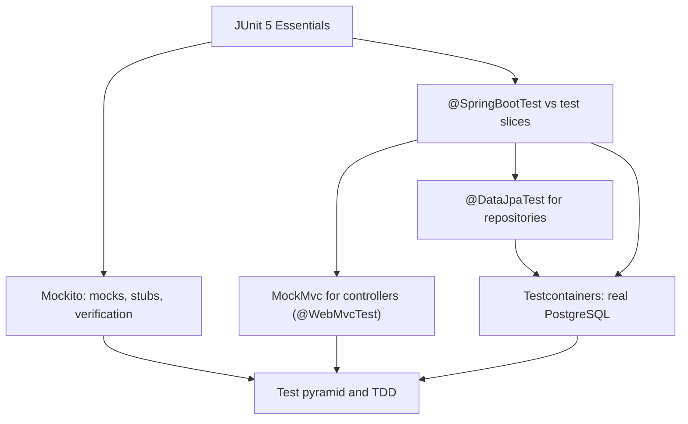
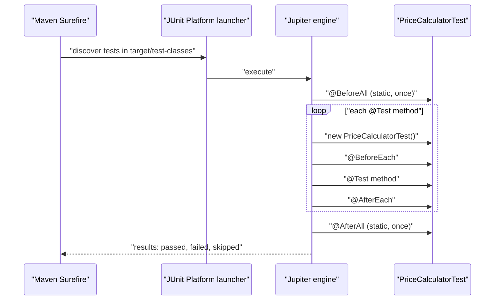
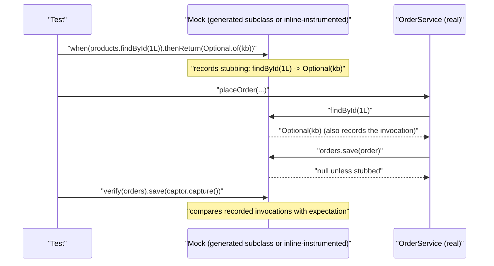

@@ 1 | MODULE | Phase 13 — Testing (Intermediate) | JUnit 5, Mockito, Spring Boot test slices, MockMvc, @DataJpaTest, Testcontainers, the test pyramid and TDD | MUST
# Phase 13: Testing (Intermediate)

Every serious Java team expects you to write tests, and interviewers check it in two ways: they ask concept questions ("mock vs stub", "`@SpringBootTest` vs `@WebMvcTest`", "how do you test a repository?") and they ask you to write a test live, often for code they just had you write. This phase gives OrderHub a real test suite: fast unit tests for the domain and services with JUnit 5 and Mockito, slice tests for controllers (MockMvc) and repositories (`@DataJpaTest`), integration tests against real PostgreSQL with Testcontainers, and the strategy that ties them together (test pyramid and TDD).



**What OrderHub gains in this phase**

| Layer | Test type | Tools |
|---|---|---|
| Domain (`Order`, `PriceCalculator`) | Plain unit tests | JUnit 5, AssertJ |
| Services (`OrderService`) | Unit tests with test doubles | Mockito |
| Controllers | Web slice tests | `@WebMvcTest`, MockMvc, `@MockitoBean` |
| Repositories | JPA slice tests on real PostgreSQL | `@DataJpaTest`, Testcontainers, Flyway |
| Whole app | A few end-to-end integration tests | `@SpringBootTest`, Testcontainers, `@ServiceConnection` |

**Prerequisites:** Phase 5 (layered architecture), Phase 10 (DI and beans: tests replace beans), Phase 11 (controllers, validation, `ProblemDetail`), Phase 12 (JPA, repositories, transactions, Flyway).

**Versions:** Spring Boot 3.5 ships JUnit Jupiter 5.12, Mockito 5, AssertJ 3.27 and Testcontainers 1.21 through `spring-boot-starter-test` and `spring-boot-testcontainers`. `@MockBean` is deprecated since Boot 3.4 in favour of Spring Framework's `@MockitoBean`; `Boot 4` removes `@MockBean`, moves test slice annotations into per-technology modules, and supports JUnit 6.

**The 5 questions from this phase that come up most often**
1. What is the difference between a mock, a stub and a spy, and when do you use `verify`?
2. `@SpringBootTest` vs `@WebMvcTest` vs `@DataJpaTest`: what does each load and when do you use it?
3. How do you test a REST controller, including validation errors?
4. How do you test a repository? Why is H2 not enough, and what is Testcontainers?
5. What is the test pyramid, and do you practise TDD?

@@ 2 | MODULE | Unit tests | Fast, isolated tests of single classes with JUnit 5 and Mockito | MUST
# Unit tests

**Shared analogy: a car-parts test bench.** Before a gearbox goes into a car, engineers clamp it to a bench, spin the input shaft and measure the output. They do not need the engine or the wheels; a motor and a sensor stand in for them. JUnit 5 is the bench with its clamps, gauges and test schedule. Mockito makes the stand-in parts: a fake engine that spins exactly as told (stub) and a sensor that records what the gearbox did (mock with verification). Unit tests are cheap, fast and precise, so you run thousands of them on every build.

@@ 3 | TOPIC | JUnit 5 Essentials | Test structure, lifecycle, assertions, AssertJ, parameterized and nested tests, extensions and naming | MUST
# JUnit 5 Essentials

**Level: Intermediate | Phase 13 | Priority: MUST | Since: JUnit 5.0 (2017); Boot 3.5 ships Jupiter 5.12; JUnit 6 with `Boot 4`**

> **30-second interview answer:** JUnit 5 is the standard Java test framework, made of the Platform (launcher used by Maven and IDEs), Jupiter (the API I write tests with) and Vintage (runs old JUnit 4 tests). A test is a method annotated with `@Test`; `@BeforeEach` and `@AfterEach` run around each test, and a new test class instance is created per test by default, so tests stay independent. I use `assertThrows` and `assertAll` from JUnit or, more often, AssertJ's fluent `assertThat`, `@ParameterizedTest` with `@CsvSource` for input tables, `@Nested` to group scenarios, and `@ExtendWith` to plug in Mockito or Spring.

## 1. Concept in Simple Words
### Analogy
A driving test.

| Driving test | JUnit 5 |
|---|---|
| The examiner's checklist of manoeuvres | Test class with `@Test` methods |
| Adjusting mirrors and seat before each manoeuvre | `@BeforeEach` |
| A fresh car for every candidate so nobody inherits a mess | New test instance per method (default lifecycle) |
| "Parked within 30 cm of the kerb: pass or fail" | Assertions |
| The same manoeuvre on five different streets | `@ParameterizedTest` |
| Sections of the test: city, highway, parking | `@Nested` classes |
| The examining authority that schedules and runs tests | JUnit Platform and Maven Surefire |

### What it is
- **Platform:** `junit-platform-launcher`, which discovers and runs tests for build tools and IDEs.
- **Jupiter:** the programming model: `@Test`, `@BeforeEach`, `@AfterEach`, `@BeforeAll`, `@AfterAll` (static by default), `@DisplayName`, `@Disabled`, `@Tag`, `@Nested`, `@ParameterizedTest`, `@RepeatedTest`, `@Timeout`, `@TempDir`, `@ExtendWith`.
- **Vintage:** engine for JUnit 3 and 4 tests (not included by default in Boot).
- **Assertions:** `assertEquals(expected, actual)`, `assertTrue`, `assertThrows`, `assertAll` (reports all failures together), `assertTimeout`. **AssertJ** (`assertThat(actual).isEqualTo(...)`) reads left to right, has rich collection and exception assertions, and is included in `spring-boot-starter-test`.
- **Test lifecycle:** `PER_METHOD` (default, new instance per test) or `PER_CLASS` (`@TestInstance(Lifecycle.PER_CLASS)`, one instance, allows non-static `@BeforeAll`).
- **Parameterized sources:** `@ValueSource`, `@CsvSource`, `@CsvFileSource`, `@MethodSource`, `@EnumSource`, `@NullAndEmptySource`.
- **Extensions:** the plug-in model replacing JUnit 4 runners and rules: `MockitoExtension`, `SpringExtension`, `TestcontainersExtension`.
- **Structure:** Arrange, Act, Assert (or Given, When, Then). One behaviour per test.
- **Surefire and Failsafe:** Maven plugins. Surefire runs `*Test` classes in `test`; Failsafe runs `*IT` classes in `integration-test` and `verify`.

### Why it exists
Tests are the safety net that lets you refactor and deploy without fear, and the documentation of how code is meant to behave. JUnit 4 had a single runner per class (so Mockito and Spring could not be combined easily) and required public methods; JUnit 5 introduced extensions, parameterized tests as a first-class feature, nested tests, display names and Java 8+ lambdas in assertions.

## 2. How It Works


Key mechanics:
1. Test methods need not be public in JUnit 5 (package-private is idiomatic).
2. A failed assertion throws `AssertionFailedError`; any other exception is an error. Both fail the test; the remaining tests continue.
3. Test order is deterministic but intentionally not obvious; never rely on it (use `@TestMethodOrder` only for special cases).
4. Extensions hook into the lifecycle through callbacks (`BeforeEachCallback`, `ParameterResolver`, `TestInstancePostProcessor`). That is how `@Mock` fields get created and how Spring injects `@Autowired` fields into test classes.

```text
Arrange-Act-Assert in one test
------------------------------
// Arrange: build inputs and collaborators
PriceCalculator calc = new PriceCalculator();
// Act: call exactly one behaviour
BigDecimal total = calc.total(lines, Tier.GOLD);
// Assert: check the outcome, not the implementation
assertThat(total).isEqualByComparingTo("90.00");
```

## 3. Code Example
### Code
Class under test (OrderHub pricing rules):
```java
package com.orderhub.pricing;

import java.math.BigDecimal;
import java.math.RoundingMode;
import java.util.List;

public class PriceCalculator {

    public enum Tier { STANDARD, GOLD, PLATINUM }

    public record Line(String sku, BigDecimal unitPrice, int quantity) {
        public Line {
            if (quantity <= 0) throw new IllegalArgumentException("quantity must be positive: " + quantity);
            if (unitPrice.signum() < 0) throw new IllegalArgumentException("negative price");
        }
        BigDecimal subtotal() { return unitPrice.multiply(BigDecimal.valueOf(quantity)); }
    }

    // GOLD 10% off, PLATINUM 15% off; orders of 100.00 or more get free shipping, otherwise 4.99
    public BigDecimal total(List<Line> lines, Tier tier) {
        if (lines.isEmpty()) throw new IllegalArgumentException("order has no lines");
        BigDecimal subtotal = lines.stream().map(Line::subtotal).reduce(BigDecimal.ZERO, BigDecimal::add);
        BigDecimal discount = switch (tier) {
            case STANDARD -> BigDecimal.ZERO;
            case GOLD -> new BigDecimal("0.10");
            case PLATINUM -> new BigDecimal("0.15");
        };
        BigDecimal discounted = subtotal.subtract(subtotal.multiply(discount));
        BigDecimal shipping = discounted.compareTo(new BigDecimal("100.00")) >= 0 ? BigDecimal.ZERO : new BigDecimal("4.99");
        return discounted.add(shipping).setScale(2, RoundingMode.HALF_EVEN);
    }
}
```

Test class:
```java
package com.orderhub.pricing;

import com.orderhub.pricing.PriceCalculator.Line;
import com.orderhub.pricing.PriceCalculator.Tier;
import org.junit.jupiter.api.BeforeEach;
import org.junit.jupiter.api.DisplayName;
import org.junit.jupiter.api.Nested;
import org.junit.jupiter.api.Test;
import org.junit.jupiter.params.ParameterizedTest;
import org.junit.jupiter.params.provider.CsvSource;
import org.junit.jupiter.params.provider.ValueSource;

import java.math.BigDecimal;
import java.util.List;

import static org.assertj.core.api.Assertions.assertThat;
import static org.assertj.core.api.Assertions.assertThatThrownBy;
import static org.junit.jupiter.api.Assertions.assertAll;
import static org.junit.jupiter.api.Assertions.assertEquals;
import static org.junit.jupiter.api.Assertions.assertThrows;

@DisplayName("PriceCalculator")
class PriceCalculatorTest {

    private PriceCalculator calculator;

    @BeforeEach
    void setUp() {
        calculator = new PriceCalculator();        // fresh object for every test
    }

    @Test
    @DisplayName("standard customer pays subtotal plus shipping below 100")
    void standardBelowThreshold() {
        // Arrange
        List<Line> lines = List.of(new Line("MS-01", new BigDecimal("19.90"), 2));
        // Act
        BigDecimal total = calculator.total(lines, Tier.STANDARD);
        // Assert (JUnit style)
        assertEquals(new BigDecimal("44.79"), total);
    }

    @ParameterizedTest(name = "{0} customer, subtotal {1} -> total {2}")
    @CsvSource({
            "STANDARD, 100.00, 100.00",
            "GOLD,     100.00, 94.99",
            "PLATINUM, 200.00, 170.00",
            "GOLD,     120.00, 108.00"
    })
    void discountsAndShipping(Tier tier, BigDecimal subtotal, BigDecimal expected) {
        BigDecimal total = calculator.total(List.of(new Line("X", subtotal, 1)), tier);
        assertThat(total).isEqualByComparingTo(expected);       // AssertJ: compares numerically
    }

    @Nested
    @DisplayName("invalid input")
    class InvalidInput {

        @Test
        void emptyOrderIsRejected() {
            IllegalArgumentException e = assertThrows(IllegalArgumentException.class,
                    () -> calculator.total(List.of(), Tier.GOLD));
            assertEquals("order has no lines", e.getMessage());
        }

        @ParameterizedTest
        @ValueSource(ints = {0, -1, -100})
        void nonPositiveQuantityIsRejected(int qty) {
            assertThatThrownBy(() -> new Line("X", BigDecimal.TEN, qty))
                    .isInstanceOf(IllegalArgumentException.class)
                    .hasMessageContaining("quantity must be positive");
        }
    }

    @Test
    void multipleLinesAreSummedBeforeDiscount() {
        List<Line> lines = List.of(
                new Line("KB-01", new BigDecimal("49.90"), 1),
                new Line("MN-27", new BigDecimal("229.00"), 1));
        BigDecimal total = calculator.total(lines, Tier.PLATINUM);
        assertAll("platinum order",                              // reports every failing check
                () -> assertThat(total).isEqualByComparingTo("237.07"),
                () -> assertThat(total.scale()).isEqualTo(2));
    }
}
```

`pom.xml` (already present in every Boot project):
```xml
<dependency>
    <groupId>org.springframework.boot</groupId>
    <artifactId>spring-boot-starter-test</artifactId>
    <scope>test</scope>
</dependency>
```

### Walkthrough
- `@BeforeEach` creates a new calculator before each test; combined with JUnit's per-method instances, no test can leak state to another.
- `standardBelowThreshold` follows Arrange-Act-Assert. `assertEquals` on `BigDecimal` also compares scale, which is intended here (the method promises scale 2).
- `discountsAndShipping` runs four times with values from `@CsvSource`; JUnit converts the strings to `Tier` and `BigDecimal`. The `name` attribute makes each run readable in reports. GOLD 100.00 becomes 90.00 after discount, which is below the free-shipping threshold, so 4.99 is added: a boundary case worth having.
- `isEqualByComparingTo` compares `BigDecimal` with `compareTo`, ignoring scale.
- `@Nested InvalidInput` groups error cases; inner classes share the outer `setUp`.
- `assertThatThrownBy` checks type and message fluently.
- `assertAll` executes all checks and reports every failure, not just the first.

### Output
`./mvnw test -Dtest=PriceCalculatorTest`:
```text
[INFO] -------------------------------------------------------
[INFO]  T E S T S
[INFO] -------------------------------------------------------
[INFO] Running com.orderhub.pricing.PriceCalculatorTest
[INFO] Running com.orderhub.pricing.PriceCalculatorTest$InvalidInput
[INFO] Tests run: 4, Failures: 0, Errors: 0, Skipped: 0, Time elapsed: 0.031 s -- in com.orderhub.pricing.PriceCalculatorTest$InvalidInput
[INFO] Tests run: 6, Failures: 0, Errors: 0, Skipped: 0, Time elapsed: 0.072 s -- in com.orderhub.pricing.PriceCalculatorTest
[INFO]
[INFO] Results:
[INFO]
[INFO] Tests run: 10, Failures: 0, Errors: 0, Skipped: 0
[INFO]
[INFO] BUILD SUCCESS
```
The outer class counts 6 (two plain tests plus four parameterized runs), the nested class 4 (one plain test plus three parameterized runs). If the GOLD row expected 90.00 instead of 94.99, the report would say:
```text
[ERROR] PriceCalculatorTest.discountsAndShipping:58
Expecting actual:
  94.99
to be equal to:
  90.00
when comparing values using 'BigDecimal::compareTo'
```

### Compare
| JUnit 4 | JUnit 5 (Jupiter) |
|---|---|
| `@Before`, `@After`, `@BeforeClass`, `@AfterClass` | `@BeforeEach`, `@AfterEach`, `@BeforeAll`, `@AfterAll` |
| `@RunWith` (one runner per class) | `@ExtendWith` (many extensions) |
| `@Rule`, `@ClassRule` | Extensions, `@TempDir` |
| `@Test(expected = X.class)` | `assertThrows(X.class, () -> ...)` |
| `@Ignore` | `@Disabled` |
| `@Category` | `@Tag` |
| Public classes and methods | Package-private allowed |
| Parameterized runner, clumsy | `@ParameterizedTest` with many sources |

## 4. Interview Questions
**Basic**
1. **What are the main parts of JUnit 5?**
   The Platform, which launches tests and integrates with build tools and IDEs; Jupiter, the new programming and extension model; and Vintage, an engine that runs JUnit 3 and 4 tests on the Platform. You write tests against Jupiter.
2. **What is the lifecycle of a JUnit 5 test class?**
   By default JUnit creates a new instance of the test class for each test method. `@BeforeAll` runs once before all tests (static unless `PER_CLASS` lifecycle), `@BeforeEach` before each test, then the test, then `@AfterEach`, and `@AfterAll` once at the end.
3. **How do you test that a method throws an exception?**
   `assertThrows(IllegalArgumentException.class, () -> code())` returns the exception so you can check its message. With AssertJ: `assertThatThrownBy(() -> code()).isInstanceOf(...).hasMessageContaining(...)`.

**Follow-up**
4. **Why does JUnit create a new instance per test by default?**
   To keep tests independent: fields set in one test cannot affect another, and tests can run in any order or in parallel. `PER_CLASS` is useful when setup is expensive or for non-static `@BeforeAll` (common in Kotlin), but you must reset state yourself.
5. **What are parameterized tests and their sources?**
   One test method executed with several argument sets. Sources: `@ValueSource` (literals), `@CsvSource` and `@CsvFileSource` (tables), `@MethodSource` (a factory method returning a `Stream<Arguments>`), `@EnumSource`, and `@NullAndEmptySource`. They make boundary and table-driven tests concise.
6. **Why use AssertJ instead of JUnit assertions?**
   Fluent, readable assertions that read like sentences, autocomplete for the type under test, rich collection, exception, date and `Optional` assertions, and better failure messages. JUnit assertions are fine for simple checks; AssertJ is the Spring Boot default choice.

**Tricky / scenario**
7. **`assertEquals(new BigDecimal("2.0"), new BigDecimal("2.00"))` fails. Why, and how do you assert money values?**
   `BigDecimal.equals` compares value and scale, and those scales differ. Use `compareTo` (AssertJ `isEqualByComparingTo`) when only the value matters, or `assertEquals` when the scale is part of the contract, as for a money result rounded to two decimals.
8. **A test passes alone but fails when the whole suite runs. What are typical causes?**
   Shared mutable state: static fields, singletons, a shared database without cleanup, system properties, the default time zone or locale, or a fixed port. Tests must not depend on order; reset state in `@AfterEach`, avoid statics, inject a `Clock`, and give each test its own data.
9. **How would you test code that uses `LocalDate.now()`?**
   Inject a `java.time.Clock` into the class and call `LocalDate.now(clock)`. In tests pass `Clock.fixed(Instant.parse("2026-01-01T10:00:00Z"), ZoneOffset.UTC)`. Without injection the result depends on the real date and the test becomes flaky.

**What the interviewer is really testing:** whether your tests are independent, readable and focused on behaviour, and whether you know the modern JUnit 5 toolset.

## 5. Pitfalls & Best Practices
### Common mistakes
| Mistake | What goes wrong | Fix |
|---|---|---|
| Several behaviours in one test | Hard to see what broke | One behaviour per test, clear name |
| Shared static state between tests | Order-dependent failures | Per-test setup, no mutable statics |
| `assertEquals` with arguments swapped | Misleading failure messages | Expected first, actual second (or AssertJ) |
| No assertion at all | Test passes even when code is wrong | Assert outcomes; review coverage of assertions |
| Testing private methods via reflection | Brittle tests tied to implementation | Test through the public API |
| Using real time, random or network | Flaky tests | Inject `Clock`, seeded random, stub network |

### Best practices
- Name tests by behaviour: `rejectsEmptyOrder`, `goldCustomerGetsTenPercentOff`, and use `@DisplayName` for reports.
- Keep unit tests fast (milliseconds) so the full suite runs on every build.
- Use parameterized tests for boundary values (just below and at thresholds).
- Prefer AssertJ for readable assertions and better messages.
- Tag slow tests (`@Tag("integration")`) or name them `*IT` and run them with Failsafe.

### Compare with
| Framework | Notes |
|---|---|
| JUnit 5 | Standard for Java and Spring Boot |
| JUnit 4 | Legacy; run through the Vintage engine |
| TestNG | Groups, dependencies between tests; less common in Spring projects |
| Spock | Groovy-based, BDD style, data tables |
| AssertJ, Hamcrest | Assertion libraries used with any of the above |

## 6. Hands-on Exercise
Write tests for OrderHub's `Order` aggregate from Phase 12 (`addLine`, `removeLine`, `markPaid`, total recalculation).

Acceptance criteria:
- A `@Nested` class per state (`NewOrder`, `PaidOrder`).
- A parameterized test for the total with at least four rows.
- An exception test for paying an empty order and for adding a line to a paid order.
- No Spring, no database: tests run in milliseconds.

<details><summary>Solution</summary>

```java
package com.orderhub.order;

import com.orderhub.customer.Customer;
import com.orderhub.product.Product;
import org.junit.jupiter.api.BeforeEach;
import org.junit.jupiter.api.Nested;
import org.junit.jupiter.api.Test;
import org.junit.jupiter.params.ParameterizedTest;
import org.junit.jupiter.params.provider.CsvSource;

import java.math.BigDecimal;

import static org.assertj.core.api.Assertions.assertThat;
import static org.assertj.core.api.Assertions.assertThatThrownBy;

class OrderTest {

    private final Customer customer = new Customer("ana@example.com", "Ana", null);
    private final Product keyboard = new Product("KB-01", "Keyboard", new BigDecimal("49.90"), 10);

    @Nested
    class NewOrder {
        private Order order;

        @BeforeEach
        void create() { order = new Order(customer); }

        @ParameterizedTest(name = "{0} x {1} = {2}")
        @CsvSource({"1, 49.90, 49.90", "2, 49.90, 99.80", "3, 10.00, 30.00", "10, 0.99, 9.90"})
        void totalIsQuantityTimesPrice(int qty, BigDecimal price, BigDecimal expected) {
            order.addLine(new Product("X-" + qty, "X", price, 100), qty);
            assertThat(order.getTotal()).isEqualByComparingTo(expected);
        }

        @Test
        void payingAnEmptyOrderFails() {
            assertThatThrownBy(order::markPaid)
                    .isInstanceOf(IllegalStateException.class)
                    .hasMessageContaining("empty");
        }

        @Test
        void removingALineRecalculatesTotal() {
            order.addLine(keyboard, 2);
            order.addLine(new Product("MS-01", "Mouse", new BigDecimal("19.90"), 10), 1);
            order.removeLineAt(0);                    // index-based removal: ids are null before persist
            assertThat(order.getTotal()).isEqualByComparingTo("19.90");
            assertThat(order.getLines()).hasSize(1);
        }
    }

    @Nested
    class PaidOrder {
        private Order order;

        @BeforeEach
        void createAndPay() {
            order = new Order(customer);
            order.addLine(keyboard, 1);
            order.markPaid();
        }

        @Test
        void statusIsPaid() { assertThat(order.getStatus()).isEqualTo(Order.Status.PAID); }

        @Test
        void cannotAddLines() {
            assertThatThrownBy(() -> order.addLine(keyboard, 1)).isInstanceOf(IllegalStateException.class);
        }
    }
}
```
The `Order` methods used: `markPaid()` throws `IllegalStateException("empty order")` without lines and moves NEW to PAID; `addLine` checks `status == NEW`; `removeLineAt(int)` is a small addition because line ids are null before persisting (in production code `removeLine(Long id)` is used). Entities are plain Java objects, so no Spring context or database is needed.
</details>

## 7. Recall
Q: What are the three modules of JUnit 5?
A: JUnit Platform (launcher), JUnit Jupiter (programming and extension model) and JUnit Vintage (runs JUnit 3 and 4 tests).

Q: What is the default test instance lifecycle in JUnit 5?
A: PER_METHOD: a new instance of the test class is created for every test method.

Q: How do you assert an exception in JUnit 5?
A: `assertThrows(Type.class, () -> code())`, which returns the exception for further checks, or AssertJ `assertThatThrownBy`.

Q: What does @ParameterizedTest with @CsvSource do in JUnit 5?
A: Runs the same test method once per CSV row, converting each column into a method argument.

Q: Why use assertAll in JUnit 5?
A: It runs all grouped assertions and reports every failure instead of stopping at the first.

**Related:** [[Mockito: Mocks, Stubs and Verification]] · [[Test Pyramid and TDD]] · [[BigDecimal and Money]] · [[Date and Time API (java.time)]]

@@ 3 | TOPIC | Mockito: Mocks, Stubs and Verification | Test doubles, @Mock and @InjectMocks, stubbing, verify, argument captors, spies, strict stubs and BDD style | MUST
# Mockito: Mocks, Stubs and Verification

**Level: Intermediate | Phase 13 | Priority: MUST | Since: Mockito 1.0 (2008); Mockito 5 (2023) with inline mock maker by default**

> **30-second interview answer:** Mockito creates test doubles so I can unit test a class without its real collaborators. A mock is a fake object; I stub it with `when(...).thenReturn(...)` to control what it returns, and I verify interactions with `verify(mock).method(...)` when the side effect is the behaviour, such as "the payment gateway was charged once". With `@ExtendWith(MockitoExtension.class)`, `@Mock` creates doubles and `@InjectMocks` builds the class under test with them. I stub queries, verify commands, use `ArgumentCaptor` to inspect what was passed, and avoid mocking types I do not own or value objects.

## 1. Concept in Simple Words
### Analogy
A flight simulator.

| Flight simulator | Mockito |
|---|---|
| Pilot trains without a real plane, airport or weather | Class under test runs without real database or HTTP |
| The instructor scripts "engine 2 fails at 3 000 ft" | Stubbing: `when(gateway.charge(...)).thenThrow(...)` |
| The black box records every switch the pilot pressed | Mock records invocations |
| The debrief: "Did you lower the landing gear exactly once?" | `verify(gateway, times(1)).charge(...)` |
| Reading the exact radio message the pilot sent | `ArgumentCaptor` |
| A real cockpit with one gauge replaced by a fake | Spy (real object, some methods stubbed) |

### What it is
- **Test double:** any stand-in for a real dependency. Types (Gerard Meszaros):
  - **Dummy:** passed but never used.
  - **Stub:** returns canned answers to calls (queries).
  - **Mock:** records calls so you can verify them (commands).
  - **Spy:** wraps a real object, records calls, can stub selected methods.
  - **Fake:** a working lightweight implementation (in-memory repository).
- In Mockito, one `mock()` object can act as a stub and a mock.
- **`@Mock`, `@Spy`, `@InjectMocks`, `@Captor`:** annotations processed by `MockitoExtension`. `@InjectMocks` tries constructor injection first (largest constructor), then setters, then fields.
- **Stubbing:** `when(mock.call(args)).thenReturn(v)`, `.thenThrow(e)`, `.thenAnswer(inv -> ...)`; for void methods `doThrow(e).when(mock).call()`.
- **Argument matchers:** `any()`, `anyLong()`, `eq(x)`, `argThat(predicate)`; if one argument uses a matcher, all must.
- **Verification:** `verify(mock).call(args)`, `times(n)`, `never()`, `atLeastOnce()`, `verifyNoMoreInteractions(mock)`, `inOrder(a, b)`.
- **Strict stubs:** default with `MockitoExtension`: unused stubs fail the test with `UnnecessaryStubbingException`, and stubbing with different arguments reports `PotentialStubbingProblem`.
- **Defaults:** unstubbed methods return empty values: `null`, 0, false, empty collections, empty `Optional`.
- **Mockito 5:** inline mock maker by default, so final classes and methods can be mocked; static mocking with `mockStatic`. On JDK 21+ Mockito warns about dynamic agent loading unless you configure it as a `-javaagent` in Surefire.
- **BDD style:** `given(...).willReturn(...)` and `then(mock).should().call()` from `BDDMockito`, matching Given-When-Then.

### Why it exists
Unit tests must be fast and deterministic. Real collaborators (database, payment provider, email server, clock) are slow, flaky, hard to put in specific states (declined card, timeout) and have side effects. Mocks let you simulate every scenario in milliseconds and check exactly how your class talks to its collaborators.

## 2. How It Works


Internals:
1. `mock(Foo.class)` creates an instance whose methods are intercepted. Mockito 5 uses the inline mock maker (Byte Buddy plus the instrumentation API) to rewrite the class bytecode, which is why finals can be mocked.
2. Every call is recorded with its arguments. `when(mock.call(x))` works because the call inside `when` is recorded as "the last invocation", and `thenReturn` attaches an answer to it.
3. Matching uses `equals` on arguments unless matchers are used.
4. `verify` checks recorded invocations after the fact; it does not change behaviour.
5. `MockitoExtension` initialises annotated fields before each test and validates usage (strictness) after each test.

```text
Stub queries, verify commands
-----------------------------
products.findById(1L)   -> query   -> stub it (when/thenReturn), do not verify it
gateway.charge(...)     -> command -> verify it was called with the right data
orders.save(order)      -> command -> verify, often with an ArgumentCaptor
```

## 3. Code Example
### Code
Class under test:
```java
package com.orderhub.order;

import com.orderhub.customer.Customer;
import com.orderhub.customer.CustomerRepository;
import com.orderhub.product.Product;
import com.orderhub.product.ProductRepository;
import org.springframework.stereotype.Service;
import org.springframework.transaction.annotation.Transactional;

import java.math.BigDecimal;

public interface PaymentGateway {
    String charge(String customerEmail, BigDecimal amount);   // returns a payment reference
}

public interface NotificationSender {
    void orderConfirmed(String email, Long orderId);
}

@Service
public class OrderService {
    private final ProductRepository products;
    private final CustomerRepository customers;
    private final OrderRepository orders;
    private final PaymentGateway gateway;
    private final NotificationSender notifications;

    public OrderService(ProductRepository products, CustomerRepository customers, OrderRepository orders,
                        PaymentGateway gateway, NotificationSender notifications) {
        this.products = products; this.customers = customers; this.orders = orders;
        this.gateway = gateway; this.notifications = notifications;
    }

    @Transactional
    public Long placeAndPay(Long customerId, Long productId, int qty) {
        Customer customer = customers.findById(customerId)
                .orElseThrow(() -> new IllegalArgumentException("unknown customer " + customerId));
        Product product = products.findById(productId)
                .orElseThrow(() -> new IllegalArgumentException("unknown product " + productId));
        product.decreaseStock(qty);                               // throws OutOfStockException
        Order order = new Order(customer);
        order.addLine(product, qty);
        Order saved = orders.save(order);
        gateway.charge(customer.getEmail(), saved.getTotal());   // may throw PaymentFailedException
        saved.markPaid();
        notifications.orderConfirmed(customer.getEmail(), saved.getId());
        return saved.getId();
    }
}
```

Test:
```java
package com.orderhub.order;

import com.orderhub.customer.Customer;
import com.orderhub.customer.CustomerRepository;
import com.orderhub.product.Product;
import com.orderhub.product.ProductRepository;
import org.junit.jupiter.api.Test;
import org.junit.jupiter.api.extension.ExtendWith;
import org.mockito.ArgumentCaptor;
import org.mockito.Captor;
import org.mockito.InjectMocks;
import org.mockito.Mock;
import org.mockito.junit.jupiter.MockitoExtension;

import java.math.BigDecimal;
import java.util.Optional;

import static org.assertj.core.api.Assertions.assertThat;
import static org.assertj.core.api.Assertions.assertThatThrownBy;
import static org.mockito.ArgumentMatchers.any;
import static org.mockito.ArgumentMatchers.anyString;
import static org.mockito.ArgumentMatchers.eq;
import static org.mockito.BDDMockito.given;
import static org.mockito.BDDMockito.then;
import static org.mockito.Mockito.never;
import static org.mockito.Mockito.verify;
import static org.mockito.Mockito.verifyNoInteractions;
import static org.mockito.Mockito.when;

@ExtendWith(MockitoExtension.class)
class OrderServiceTest {

    @Mock ProductRepository products;
    @Mock CustomerRepository customers;
    @Mock OrderRepository orders;
    @Mock PaymentGateway gateway;
    @Mock NotificationSender notifications;

    @InjectMocks OrderService service;          // built with the five mocks via its constructor

    @Captor ArgumentCaptor<Order> orderCaptor;

    private final Customer ana = new Customer("ana@example.com", "Ana", null);
    private final Product keyboard = new Product("KB-01", "Keyboard", new BigDecimal("49.90"), 10);

    @Test
    void placesChargesAndNotifies() {
        // Arrange: stub the queries
        when(customers.findById(7L)).thenReturn(Optional.of(ana));
        when(products.findById(1L)).thenReturn(Optional.of(keyboard));
        when(orders.save(any(Order.class))).thenAnswer(inv -> inv.getArgument(0));   // return what was saved

        // Act
        service.placeAndPay(7L, 1L, 2);

        // Assert: verify the commands and inspect arguments
        verify(orders).save(orderCaptor.capture());
        Order saved = orderCaptor.getValue();
        assertThat(saved.getLines()).hasSize(1);
        assertThat(saved.getTotal()).isEqualByComparingTo("99.80");
        assertThat(saved.getStatus()).isEqualTo(Order.Status.PAID);
        assertThat(keyboard.getStock()).isEqualTo(8);

        verify(gateway).charge(eq("ana@example.com"), eq(new BigDecimal("99.80")));
        verify(notifications).orderConfirmed(eq("ana@example.com"), any());
    }

    @Test
    void declinedPaymentDoesNotNotify() {
        given(customers.findById(7L)).willReturn(Optional.of(ana));                    // BDD style
        given(products.findById(1L)).willReturn(Optional.of(keyboard));
        given(orders.save(any(Order.class))).willAnswer(inv -> inv.getArgument(0));
        given(gateway.charge(anyString(), any())).willThrow(new PaymentFailedException("card declined"));

        assertThatThrownBy(() -> service.placeAndPay(7L, 1L, 1))
                .isInstanceOf(PaymentFailedException.class)
                .hasMessage("card declined");

        then(notifications).should(never()).orderConfirmed(anyString(), any());
    }

    @Test
    void outOfStockStopsBeforeSavingOrCharging() {
        when(customers.findById(7L)).thenReturn(Optional.of(ana));
        when(products.findById(1L)).thenReturn(Optional.of(keyboard));

        assertThatThrownBy(() -> service.placeAndPay(7L, 1L, 99))
                .isInstanceOf(OutOfStockException.class);

        verify(orders, never()).save(any());
        verifyNoInteractions(gateway, notifications);
    }

    @Test
    void unknownCustomerIsRejected() {
        when(customers.findById(42L)).thenReturn(Optional.empty());

        assertThatThrownBy(() -> service.placeAndPay(42L, 1L, 1))
                .isInstanceOf(IllegalArgumentException.class)
                .hasMessage("unknown customer 42");
        verifyNoInteractions(products, orders, gateway, notifications);
    }
}
```
With `PaymentFailedException` defined as:
```java
package com.orderhub.order;

public class PaymentFailedException extends RuntimeException {
    public PaymentFailedException(String message) { super(message); }
}
```

### Walkthrough
- `@ExtendWith(MockitoExtension.class)` creates the `@Mock` fields, the `@Captor`, and `@InjectMocks` calls `OrderService`'s constructor with the five mocks. No Spring context starts.
- Repositories are stubbed (queries). `orders.save` uses `thenAnswer` to return its argument, mimicking JPA's behaviour of returning the saved entity.
- `verify(orders).save(orderCaptor.capture())` both checks the call and captures the `Order`, so the test can assert its lines, total and status.
- `verify(gateway).charge(eq(...), eq(...))` checks the command with exact arguments; because one argument uses a matcher, all must (`eq`).
- The declined test uses BDD style (`given`, `then(...).should(never())`) and checks that no confirmation was sent.
- The out-of-stock test proves nothing downstream happened with `never()` and `verifyNoInteractions`.
- Real entities (`Customer`, `Product`) are used, not mocked: they are value-rich domain objects that are cheap to create.

### Output
```text
[INFO] Running com.orderhub.order.OrderServiceTest
[INFO] Tests run: 4, Failures: 0, Errors: 0, Skipped: 0, Time elapsed: 0.612 s -- in com.orderhub.order.OrderServiceTest
```
If someone adds an unused stub, strict stubs fail the test:
```text
org.mockito.exceptions.misusing.UnnecessaryStubbingException:
Unnecessary stubbings detected.
Clean & maintainable test code requires zero unnecessary code.
Following stubbings are unnecessary (click to navigate to relevant line of code):
  1. -> at com.orderhub.order.OrderServiceTest.unknownCustomerIsRejected(OrderServiceTest.java:104)
Please remove unnecessary stubbings or use 'lenient' strictness.
```
If the notification were sent despite the decline:
```text
org.mockito.exceptions.verification.NeverWantedButInvoked:
notificationSender.orderConfirmed(<any string>, <any>);
Never wanted here:
-> at com.orderhub.order.OrderServiceTest.declinedPaymentDoesNotNotify(OrderServiceTest.java:86)
But invoked here:
-> at com.orderhub.order.OrderService.placeAndPay(OrderService.java:48) with arguments: ["ana@example.com", null]
```

### Compare
| Double | Behaviour | Verify calls? | Mockito API |
|---|---|---|---|
| Stub | Canned answers | No | `when().thenReturn()` |
| Mock | Records calls | Yes | `verify()` |
| Spy | Real object, partial stubbing | Yes | `spy()`, `doReturn().when(spy)` |
| Fake | Simple working implementation | No | Hand-written (in-memory repository) |
| Dummy | Fills a parameter | No | `mock()` never used |

## 4. Interview Questions
**Basic**
1. **What is the difference between a mock and a stub?**
   A stub provides canned answers so the code under test can run (state-based testing); a mock records interactions so you can verify the code called it correctly (behaviour verification). In Mockito the same object can do both: you stub with `when` and verify with `verify`. Rule of thumb: stub queries, verify commands.
2. **What do `@Mock` and `@InjectMocks` do?**
   `@Mock` creates a mock for the field's type. `@InjectMocks` creates the class under test and injects the mocks, trying constructor injection first, then setter, then field injection. They are processed by `MockitoExtension` (or `MockitoAnnotations.openMocks`).
3. **What is a spy?**
   A wrapper around a real object: unstubbed methods call the real implementation, and you can stub selected methods and verify calls. For spies use `doReturn(x).when(spy).method()` instead of `when(spy.method())`, because the latter calls the real method while stubbing.

**Follow-up**
4. **What is an `ArgumentCaptor` and when do you need it?**
   It captures the argument passed to a mocked method so you can make detailed assertions on it, such as the order passed to `save` or the event passed to a publisher. Use it when the object is created inside the method under test and you cannot reference it from the test.
5. **What are strict stubs and `UnnecessaryStubbingException`?**
   With `MockitoExtension`, Mockito fails a test that stubs methods it never uses, and reports argument mismatches between stubbing and actual calls. That keeps tests clean and catches stubs set up with the wrong arguments. Use `lenient()` only for shared setup that some tests do not need.
6. **Why should you not mock everything?**
   Over-mocking ties tests to implementation details: every refactor breaks tests even when behaviour is unchanged. Do not mock value objects, entities, records or simple collaborators; do not mock types you do not own (wrap them in your own interface and test the wrapper with an integration test). Mock at architectural boundaries: repositories, gateways, clocks, message publishers.

**Tricky / scenario**
7. **`when(repo.findById(anyLong())).thenReturn(Optional.of(p))` compiles, but `when(repo.find(anyLong(), 5))` throws `InvalidUseOfMatchersException`. Why?**
   If any argument uses a matcher, all arguments must use matchers. Write `when(repo.find(anyLong(), eq(5)))`. Matchers work by side effects on a thread-local stack, so mixing raw values and matchers confuses Mockito.
8. **A service creates `new PaymentClient()` inside the method. How do you test it with Mockito?**
   You cannot easily inject a mock because the dependency is created internally. The right fix is to refactor: inject `PaymentGateway` through the constructor. As a last resort Mockito 5 has `mockConstruction(PaymentClient.class)`, but needing it is a design smell.
9. **Your test verifies `verify(repo, times(1)).findById(1L)` and breaks after adding caching. What went wrong in the test design?**
   It verified a query, which is an implementation detail; the behaviour (correct result) did not change. Verify commands with visible side effects (save, charge, publish) and assert on returned values for queries.

**What the interviewer is really testing:** whether you can isolate a class meaningfully, verify the right interactions, and avoid brittle, over-mocked tests.

## 5. Pitfalls & Best Practices
### Common mistakes
| Mistake | What goes wrong | Fix |
|---|---|---|
| Verifying queries and every call | Tests break on harmless refactors | Stub queries, verify commands |
| Mocking entities, DTOs or records | Verbose, unrealistic tests | Create real instances |
| Mixing raw values and matchers | `InvalidUseOfMatchersException` | Use `eq()` for raw values |
| `when(spy.method())` on a spy | Real method runs during stubbing | `doReturn().when(spy).method()` |
| Mocking third-party APIs directly | Tests pass but real integration fails | Wrap in your own interface; integration-test the wrapper |
| `lenient()` everywhere | Hides wrong stubs | Keep strict stubs; remove unused stubbing |

### Best practices
- Use constructor injection in production code so tests can pass mocks without reflection.
- One `@ExtendWith(MockitoExtension.class)` test class per unit; no Spring context for unit tests.
- Use `ArgumentCaptor` for objects created inside the method under test.
- Prefer BDD style (`given`, `then`) if your team writes Given-When-Then tests.
- Configure Mockito as a Java agent in Surefire on JDK 21+ to avoid dynamic agent warnings.

### Compare with
| Tool | Purpose |
|---|---|
| Mockito | Mocks and stubs in unit tests |
| `@MockitoBean` (Spring 6.2) | Replace a bean in a Spring test context with a Mockito mock |
| WireMock | Fake HTTP server for testing HTTP clients |
| Testcontainers | Real infrastructure (database, Kafka) in Docker |
| Hand-written fakes | In-memory implementations for richer behaviour |

## 6. Hands-on Exercise
Write unit tests for OrderHub's `RefundService.refund(orderId)`:
- loads the order (`OrderRepository.findById`), which must be PAID,
- calls `PaymentGateway.refund(paymentReference, amount)`,
- marks the order REFUNDED and publishes an `OrderRefundedEvent` through `ApplicationEventPublisher`,
- if the gateway throws, the order stays PAID and no event is published.

Acceptance criteria: Mockito only (no Spring context); an `ArgumentCaptor` checks the event's order id and amount; a test proves a NEW order cannot be refunded.

<details><summary>Solution</summary>

```java
package com.orderhub.payment;

import com.orderhub.order.Order;
import com.orderhub.order.OrderRepository;
import org.springframework.context.ApplicationEventPublisher;
import org.springframework.stereotype.Service;
import org.springframework.transaction.annotation.Transactional;

import java.math.BigDecimal;

interface RefundGateway { void refund(String paymentReference, BigDecimal amount); }

record OrderRefundedEvent(Long orderId, BigDecimal amount) { }

@Service
class RefundService {
    private final OrderRepository orders;
    private final RefundGateway gateway;
    private final ApplicationEventPublisher events;

    RefundService(OrderRepository orders, RefundGateway gateway, ApplicationEventPublisher events) {
        this.orders = orders; this.gateway = gateway; this.events = events;
    }

    @Transactional
    public void refund(Long orderId) {
        Order order = orders.findById(orderId).orElseThrow();
        if (order.getStatus() != Order.Status.PAID) throw new IllegalStateException("order is " + order.getStatus());
        gateway.refund(order.getPaymentReference(), order.getTotal());
        order.markRefunded();
        events.publishEvent(new OrderRefundedEvent(orderId, order.getTotal()));
    }
}
```

```java
package com.orderhub.payment;

import com.orderhub.customer.Customer;
import com.orderhub.order.Order;
import com.orderhub.order.OrderRepository;
import com.orderhub.product.Product;
import org.junit.jupiter.api.BeforeEach;
import org.junit.jupiter.api.Test;
import org.junit.jupiter.api.extension.ExtendWith;
import org.mockito.ArgumentCaptor;
import org.mockito.InjectMocks;
import org.mockito.Mock;
import org.mockito.junit.jupiter.MockitoExtension;
import org.springframework.context.ApplicationEventPublisher;

import java.math.BigDecimal;
import java.util.Optional;

import static org.assertj.core.api.Assertions.assertThat;
import static org.assertj.core.api.Assertions.assertThatThrownBy;
import static org.mockito.ArgumentMatchers.any;
import static org.mockito.Mockito.doThrow;
import static org.mockito.Mockito.verify;
import static org.mockito.Mockito.verifyNoInteractions;
import static org.mockito.Mockito.when;

@ExtendWith(MockitoExtension.class)
class RefundServiceTest {
    @Mock OrderRepository orders;
    @Mock RefundGateway gateway;
    @Mock ApplicationEventPublisher events;
    @InjectMocks RefundService service;

    private Order order;

    @BeforeEach
    void paidOrder() {
        order = new Order(new Customer("ana@example.com", "Ana", null));
        order.addLine(new Product("KB-01", "Keyboard", new BigDecimal("49.90"), 5), 2);
    }

    @Test
    void refundsPaidOrderAndPublishesEvent() {
        order.markPaid("PAY-123");
        when(orders.findById(51L)).thenReturn(Optional.of(order));

        service.refund(51L);

        verify(gateway).refund("PAY-123", new BigDecimal("99.80"));
        ArgumentCaptor<OrderRefundedEvent> captor = ArgumentCaptor.forClass(OrderRefundedEvent.class);
        verify(events).publishEvent(captor.capture());
        assertThat(captor.getValue().orderId()).isEqualTo(51L);
        assertThat(captor.getValue().amount()).isEqualByComparingTo("99.80");
        assertThat(order.getStatus()).isEqualTo(Order.Status.REFUNDED);
    }

    @Test
    void gatewayFailureKeepsOrderPaid() {
        order.markPaid("PAY-123");
        when(orders.findById(51L)).thenReturn(Optional.of(order));
        doThrow(new IllegalStateException("gateway down")).when(gateway).refund(any(), any());   // void method

        assertThatThrownBy(() -> service.refund(51L)).hasMessage("gateway down");

        assertThat(order.getStatus()).isEqualTo(Order.Status.PAID);
        verifyNoInteractions(events);
    }

    @Test
    void newOrderCannotBeRefunded() {
        when(orders.findById(51L)).thenReturn(Optional.of(order));

        assertThatThrownBy(() -> service.refund(51L)).isInstanceOf(IllegalStateException.class);
        verifyNoInteractions(gateway, events);
    }
}
```
`doThrow(...).when(gateway).refund(...)` is the stubbing form for void methods. `publishEvent` is overloaded (`Object` and `ApplicationEvent`), so the captor's type selects the `Object` overload. The order uses `markPaid(String reference)` to store the payment reference and `markRefunded()` to move PAID to REFUNDED.
</details>

## 7. Recall
Q: What is the difference between a mock and a stub in Mockito testing?
A: A stub returns canned answers for queries; a mock records interactions so commands can be verified. One Mockito object can do both.

Q: What do @Mock and @InjectMocks do with MockitoExtension?
A: `@Mock` creates mock fields; `@InjectMocks` creates the class under test and injects the mocks, preferring constructor injection.

Q: Why does Mockito throw InvalidUseOfMatchersException?
A: An invocation mixes argument matchers with raw values; when one argument uses a matcher, all must (use `eq()`).

Q: What is a Mockito ArgumentCaptor used for?
A: Capturing an argument passed to a mock, typically an object created inside the method under test, to assert on its contents.

Q: How do you stub a void method to throw in Mockito?
A: `doThrow(exception).when(mock).voidMethod(args)`.

Q: What does UnnecessaryStubbingException mean in Mockito?
A: Strict stubs detected a stubbing the test never used; remove it or mark it `lenient()` if truly shared.

**Related:** [[JUnit 5 Essentials]] · [[@SpringBootTest vs Test Slices]] · [[Constructor vs Setter vs Field Injection]] · [[Test Pyramid and TDD]]
