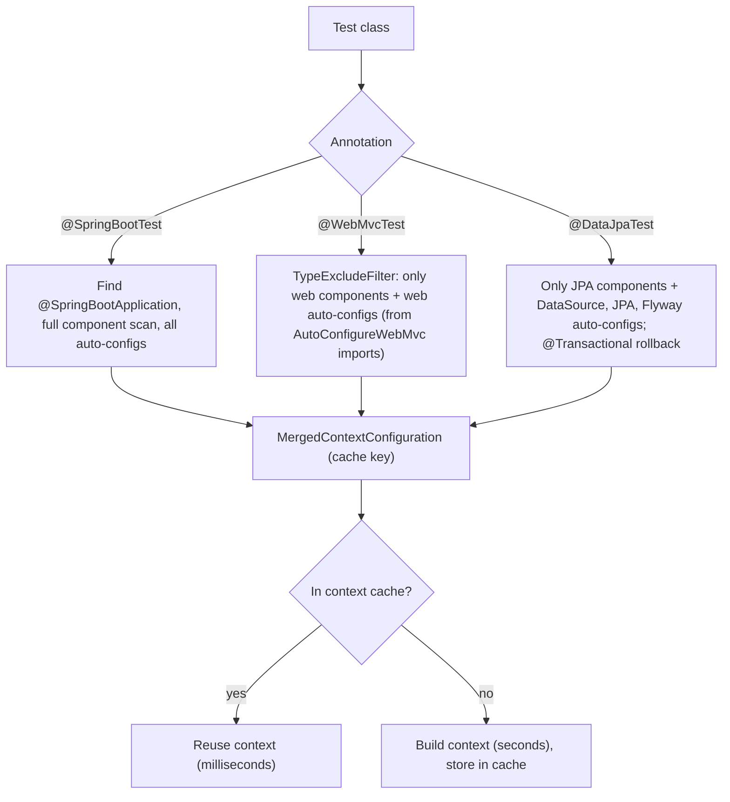
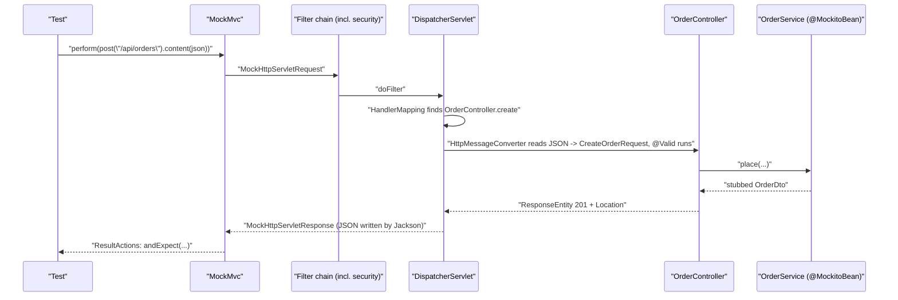
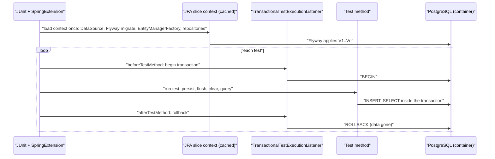

@@ 2 | MODULE | Spring tests | Tests that start a Spring context: full or sliced, web layer, JPA layer and real infrastructure in containers | MUST
# Spring tests

**Shared analogy: rehearsing a theatre play.** A full dress rehearsal on the main stage with lights, orchestra and costumes is `@SpringBootTest`: realistic but expensive, so you do it rarely. Most rehearsals are partial: the actors rehearse only Act 2 in a small room with a stand-in for the orchestra (a test slice such as `@WebMvcTest` with mocked services), or the lighting crew tests only the lights (`@DataJpaTest`). MockMvc is a pretend audience that reacts like a real one without opening the doors. Testcontainers brings in the real orchestra, in a portable box, whenever you need the real sound. The director reuses the same set between rehearsals if nothing changed: Spring's test context cache.

@@ 3 | TOPIC | @SpringBootTest vs Test Slices | What a full context test loads, what each slice loads, @MockitoBean, context caching and choosing the right test type | MUST
# @SpringBootTest vs Test Slices

**Level: Intermediate | Phase 13 | Priority: MUST | Since: Boot 1.4 (`@SpringBootTest`, slices), Spring 6.2 / Boot 3.4 (`@MockitoBean` replaces `@MockBean`)**

> **30-second interview answer:** `@SpringBootTest` starts the whole application context, every bean and every auto-configuration, optionally with a real embedded server, so it is the most realistic and the slowest test. Test slices start only one layer: `@WebMvcTest` loads controllers, advice, filters and Jackson but no services or repositories; `@DataJpaTest` loads JPA, repositories and Flyway with a transaction rolled back after each test. In slices I replace missing beans with `@MockitoBean`. Spring caches contexts between test classes with the same configuration, so I keep configurations consistent to avoid restarting the context again and again.

## 1. Concept in Simple Words
### Analogy
Inspecting a building.

| Building inspection | Spring tests |
|---|---|
| Inspecting the whole occupied building with power and water on | `@SpringBootTest` with a real server |
| Inspecting only the electrical system with a test generator | `@WebMvcTest` (web layer, services mocked) |
| Inspecting only the plumbing with water from a tank | `@DataJpaTest` (JPA layer, real or embedded database) |
| A cardboard stand-in for a missing elevator | `@MockitoBean` |
| Leaving the scaffolding up between two similar inspections | Context caching |
| Changing the scaffolding for every inspection | Different configurations per class: new context each time |

### What it is
- **`@SpringBootTest`:** finds the `@SpringBootConfiguration` (your main class) and starts a full `ApplicationContext`. `webEnvironment`: `MOCK` (default, mock servlet environment, use MockMvc), `RANDOM_PORT` or `DEFINED_PORT` (real embedded Tomcat, use `TestRestTemplate` or `RestClient`/`WebTestClient`), `NONE`.
- **Test slices:** annotations that enable a filtered component scan and only the auto-configurations relevant to one layer:

| Slice | Loads | Does not load |
|---|---|---|
| `@WebMvcTest(Controller.class)` | Controllers, `@ControllerAdvice`, filters, converters, Jackson, validation, `MockMvc`, Spring Security config | `@Service`, `@Repository`, JPA, DataSource |
| `@DataJpaTest` | Entities, repositories, `EntityManager`, `TestEntityManager`, DataSource, Flyway or Liquibase | Controllers, services |
| `@JsonTest` | Jackson `ObjectMapper`, `JacksonTester` | Everything else |
| `@RestClientTest` | `RestClient.Builder`/`RestTemplateBuilder`, `MockRestServiceServer` | Web server, JPA |
| `@JdbcTest` | DataSource, `JdbcTemplate`, `JdbcClient` | JPA |
| `@DataMongoTest`, `@DataRedisTest`, `@WebFluxTest` | Their store or stack | Everything else |

- **`@MockitoBean` and `@MockitoSpyBean`:** Spring Framework 6.2 annotations that replace (or wrap) a bean in the test context with a Mockito mock (or spy). They replace Boot's `@MockBean` and `@SpyBean`, deprecated in Boot 3.4 and removed in `Boot 4`.
- **`@TestConfiguration`:** extra beans for tests; not picked up by component scan when nested and static, must be `@Import`ed when top-level.
- **Context caching:** the TestContext framework caches each context by its configuration key (classes, profiles, properties, mocked beans, initializers). Identical keys reuse the context; any difference creates a new one.
- **`@DirtiesContext`:** marks the context dirty so it is closed and rebuilt; slow, use rarely.
- **`@ActiveProfiles`, `@TestPropertySource`, `@DynamicPropertySource`:** control configuration for tests.

### Why it exists
Unit tests do not verify wiring, configuration, JSON mapping, validation, security or SQL. Full context tests do, but take seconds each and need all infrastructure. Slices sit in the middle: real Spring behaviour for one layer, fast enough to run many.

## 2. How It Works


How a slice works internally:
1. `@WebMvcTest` is meta-annotated with `@TypeExcludeFilters(WebMvcTypeExcludeFilter.class)`, which keeps only `@Controller`, `@ControllerAdvice`, `@JsonComponent`, `Converter`, `Filter`, `WebMvcConfigurer` and similar beans during component scanning.
2. It is also meta-annotated with `@AutoConfigureWebMvc`, `@AutoConfigureMockMvc` and others, each listing which auto-configurations to import (files under `META-INF/spring/org.springframework.boot.test.autoconfigure...imports`). Only those run.
3. Your main class is still used as the configuration root, so anything declared on it (for example `@EnableJpaAuditing` or `@EnableScheduling`) is applied to every slice. That is why such annotations belong on separate `@Configuration` classes.
4. `@MockitoBean` registers a bean override: the bean definition is replaced by a mock before the context refreshes, and the mock is reset after each test.

Context cache in a test suite:
```text
OrderControllerTest   @WebMvcTest(OrderController.class) + @MockitoBean OrderService   -> context A (built)
ProductControllerTest @WebMvcTest(ProductController.class) + @MockitoBean ProductService -> context B (built)
ProductRepoTest       @DataJpaTest                                                      -> context C (built)
OrderRepoTest         @DataJpaTest                                                      -> context C (reused)
CheckoutIT            @SpringBootTest                                                   -> context D (built)
PaymentIT             @SpringBootTest + @MockitoBean PaymentGateway                     -> context E (built: different mocks)
```
A different set of `@MockitoBean`s is a different key. Put shared mocks in a common base class or `@TestConfiguration` to reuse contexts.

## 3. Code Example
### Code
Full context test with a real server:
```java
package com.orderhub;

import com.orderhub.order.PaymentGateway;
import org.junit.jupiter.api.Test;
import org.springframework.beans.factory.annotation.Autowired;
import org.springframework.boot.test.context.SpringBootTest;
import org.springframework.boot.test.web.client.TestRestTemplate;
import org.springframework.boot.testcontainers.service.connection.ServiceConnection;
import org.springframework.context.annotation.Import;
import org.springframework.http.HttpStatus;
import org.springframework.http.ResponseEntity;
import org.springframework.test.context.bean.override.mockito.MockitoBean;

import java.math.BigDecimal;
import java.util.Map;

import static org.assertj.core.api.Assertions.assertThat;
import static org.mockito.ArgumentMatchers.any;
import static org.mockito.ArgumentMatchers.anyString;
import static org.mockito.Mockito.when;

@SpringBootTest(webEnvironment = SpringBootTest.WebEnvironment.RANDOM_PORT)
@Import(TestcontainersConfiguration.class)          // real PostgreSQL (see Testcontainers topic)
class CheckoutIT {

    @Autowired TestRestTemplate rest;               // pre-configured with the random port

    @MockitoBean PaymentGateway gateway;            // external system replaced, everything else real

    @Test
    void placesAnOrderEndToEnd() {
        when(gateway.charge(anyString(), any(BigDecimal.class))).thenReturn("PAY-1");

        ResponseEntity<Map> response = rest.postForEntity("/api/orders",
                Map.of("customerId", 1, "productId", 1, "quantity", 2), Map.class);

        assertThat(response.getStatusCode()).isEqualTo(HttpStatus.CREATED);
        assertThat(response.getHeaders().getLocation()).isNotNull();
        assertThat(response.getBody()).containsEntry("status", "PAID");
    }
}
```

Web slice:
```java
package com.orderhub.product;

import org.junit.jupiter.api.Test;
import org.springframework.beans.factory.annotation.Autowired;
import org.springframework.boot.test.autoconfigure.web.servlet.WebMvcTest;
import org.springframework.test.context.bean.override.mockito.MockitoBean;
import org.springframework.test.web.servlet.MockMvc;

import java.math.BigDecimal;

import static org.mockito.Mockito.when;
import static org.springframework.test.web.servlet.request.MockMvcRequestBuilders.get;
import static org.springframework.test.web.servlet.result.MockMvcResultMatchers.jsonPath;
import static org.springframework.test.web.servlet.result.MockMvcResultMatchers.status;

@WebMvcTest(ProductController.class)                // only this controller + web infrastructure
class ProductControllerSliceTest {

    @Autowired MockMvc mvc;
    @MockitoBean ProductService productService;     // the service bean does not exist in this slice

    @Test
    void returnsProduct() throws Exception {
        when(productService.findById(1L)).thenReturn(new ProductDto(1L, "KB-01", "Keyboard", new BigDecimal("49.90")));

        mvc.perform(get("/api/products/1"))
           .andExpect(status().isOk())
           .andExpect(jsonPath("$.sku").value("KB-01"));
    }
}
```

JPA slice:
```java
package com.orderhub.product;

import org.junit.jupiter.api.Test;
import org.springframework.beans.factory.annotation.Autowired;
import org.springframework.boot.test.autoconfigure.orm.jpa.DataJpaTest;
import org.springframework.boot.test.autoconfigure.jdbc.AutoConfigureTestDatabase;
import org.springframework.context.annotation.Import;

import java.math.BigDecimal;

import static org.assertj.core.api.Assertions.assertThat;

@DataJpaTest
@AutoConfigureTestDatabase(replace = AutoConfigureTestDatabase.Replace.NONE)   // keep our PostgreSQL
@Import(com.orderhub.TestcontainersConfiguration.class)
class ProductRepositorySliceTest {

    @Autowired ProductRepository products;

    @Test
    void findsBySku() {
        products.save(new Product("KB-01", "Keyboard", new BigDecimal("49.90"), 10));
        assertThat(products.findBySku("KB-01")).isPresent();
    }
}
```

Keeping the main class slice-friendly:
```java
package com.orderhub;

import org.springframework.boot.SpringApplication;
import org.springframework.boot.autoconfigure.SpringBootApplication;

@SpringBootApplication          // nothing else here: no @EnableJpaAuditing, no @EnableScheduling
public class OrderHubApplication {
    public static void main(String[] args) { SpringApplication.run(OrderHubApplication.class, args); }
}
```

Shared base class to maximise context reuse for full tests:
```java
package com.orderhub;

import com.orderhub.order.NotificationSender;
import com.orderhub.order.PaymentGateway;
import org.springframework.boot.test.context.SpringBootTest;
import org.springframework.context.annotation.Import;
import org.springframework.test.context.ActiveProfiles;
import org.springframework.test.context.bean.override.mockito.MockitoBean;

@SpringBootTest(webEnvironment = SpringBootTest.WebEnvironment.RANDOM_PORT)
@Import(TestcontainersConfiguration.class)
@ActiveProfiles("test")
public abstract class AbstractIntegrationTest {
    @MockitoBean protected PaymentGateway gateway;              // same mocks for every subclass
    @MockitoBean protected NotificationSender notifications;    // -> one cached context
}
```

### Walkthrough
- `CheckoutIT` boots the whole app on a random port with real PostgreSQL; only the external payment gateway is mocked. It proves wiring, JSON, validation, transactions and SQL together.
- `ProductControllerSliceTest` loads only `ProductController` and web infrastructure. `ProductService` is not in the slice, so it must be provided with `@MockitoBean`; otherwise the context fails with `NoSuchBeanDefinitionException`.
- `ProductRepositorySliceTest` loads JPA only. `@AutoConfigureTestDatabase(replace = NONE)` stops Boot from swapping in an embedded database, so the test runs on the Testcontainers PostgreSQL.
- The main class stays bare so slices do not pull in JPA auditing or schedulers.
- `AbstractIntegrationTest` puts the shared `@MockitoBean`s in one place so all integration tests share one cached context.

### Output
Running the suite (`./mvnw verify`), note the startup cost only appears when a new context is built:
```text
[INFO] Running com.orderhub.product.ProductControllerSliceTest
INFO  o.s.b.t.m.w.SpringBootMockServletContext : Initializing Spring TestDispatcherServlet ''
INFO  c.o.product.ProductControllerSliceTest   : Started ProductControllerSliceTest in 1.214 seconds
[INFO] Tests run: 1, Failures: 0, Errors: 0, Skipped: 0, Time elapsed: 1.902 s
[INFO] Running com.orderhub.product.ProductRepositorySliceTest
INFO  o.f.core.internal.command.DbMigrate      : Successfully applied 11 migrations to schema "public", now at version v11
INFO  c.o.product.ProductRepositorySliceTest   : Started ProductRepositorySliceTest in 2.871 seconds
[INFO] Tests run: 1, Failures: 0, Errors: 0, Skipped: 0, Time elapsed: 3.402 s
[INFO] Running com.orderhub.CheckoutIT
INFO  o.s.b.w.embedded.tomcat.TomcatWebServer  : Tomcat started on port 54617 (http) with context path '/'
INFO  com.orderhub.CheckoutIT                  : Started CheckoutIT in 4.906 seconds
[INFO] Tests run: 1, Failures: 0, Errors: 0, Skipped: 0, Time elapsed: 5.731 s
```
Forgetting the `@MockitoBean` in the web slice:
```text
Parameter 0 of constructor in com.orderhub.product.ProductController required a bean of type 'com.orderhub.product.ProductService' that could not be found.
```

### Compare
| | Unit test (Mockito) | Slice test | `@SpringBootTest` |
|---|---|---|---|
| Spring context | None | One layer | Everything |
| Typical time | Milliseconds | 1 to 3 s first, then cached | 3 to 10 s first, then cached |
| Verifies | Logic | Layer behaviour: HTTP mapping, JSON, validation, SQL | Wiring and end-to-end flows |
| Doubles | `@Mock` | `@MockitoBean` for other layers | Mock only external systems |
| How many | Many | Some | Few |

## 4. Interview Questions
**Basic**
1. **What does `@SpringBootTest` do?**
   It bootstraps the full application context using your `@SpringBootApplication` class, with all beans and auto-configurations, and integrates with JUnit 5 through `SpringExtension`. With `webEnvironment = RANDOM_PORT` it starts a real embedded server; by default it uses a mock servlet environment.
2. **What are test slices? Name a few.**
   Annotations that load only the part of the context needed for one layer: `@WebMvcTest` (controllers), `@DataJpaTest` (JPA repositories), `@JsonTest` (Jackson), `@RestClientTest` (HTTP clients), `@JdbcTest`, `@WebFluxTest`, `@DataMongoTest`. They are faster and more focused than full context tests.
3. **What is `@MockitoBean`?**
   A Spring Framework 6.2 annotation that replaces a bean in the test application context with a Mockito mock (adding it if missing). It is the successor of Boot's `@MockBean`, deprecated in Boot 3.4. Unlike `@Mock`, it affects the Spring context and is used in slice and integration tests.

**Follow-up**
4. **What is the difference between `@Mock` and `@MockitoBean`?**
   `@Mock` creates a plain Mockito mock with no Spring involvement, for unit tests with `MockitoExtension`. `@MockitoBean` registers the mock as a bean in the Spring test context, replacing the real bean, so other beans get it injected. It also changes the context cache key.
5. **How does Spring's test context caching work and how can you break it?**
   The TestContext framework stores each started context in a static cache keyed by its merged configuration: configuration classes, active profiles, properties, context customizers (including bean overrides). Test classes with the same key reuse the context. Each different combination of `@MockitoBean`, `@TestPropertySource` or profiles creates another context, and `@DirtiesContext` forces a rebuild, both of which slow suites down.
6. **Why does my `@WebMvcTest` fail with a JPA-related error?**
   Usually because the main application class has JPA-related annotations such as `@EnableJpaAuditing` or `@EnableJpaRepositories`, which are applied in every slice and need JPA beans that a web slice does not have. Move them to dedicated `@Configuration` classes.

**Tricky / scenario**
7. **Your CI test suite takes 25 minutes and logs "Started ... in 6 seconds" 80 times. What do you do?**
   The context is rebuilt for most test classes. Unify configurations: put shared `@MockitoBean`s in a base class, avoid per-class properties and profiles, remove unnecessary `@DirtiesContext`, and move logic tests to plain unit tests or slices. Also check `spring.test.context.cache.maxSize` (default 32) and reuse containers with the singleton pattern.
8. **Should integration tests use `@Transactional` to roll back?**
   With `MOCK` web environment, test-managed transactions roll back cleanly. With `RANDOM_PORT`, the HTTP request runs on a server thread in its own transaction, so a test transaction does not roll it back, and `@Transactional` on the test can hide lazy-loading bugs by keeping a session open. Prefer explicit cleanup (truncate tables) or unique data per test for full integration tests.
9. **When would you write a `@SpringBootTest` instead of slices?**
   For a few critical flows that cross layers (place order, pay, notify), for checking that configuration and security wiring work as a whole, and for smoke tests that the context starts. Logic belongs in unit tests and layer behaviour in slices; a suite of only `@SpringBootTest`s is slow and makes failures hard to locate.

**What the interviewer is really testing:** whether you choose the cheapest test that gives confidence and keep a Spring test suite fast.

## 5. Pitfalls & Best Practices
### Common mistakes
| Mistake | What goes wrong | Fix |
|---|---|---|
| `@SpringBootTest` for every test | Slow suite, hard-to-locate failures | Unit tests and slices for most cases |
| Feature annotations on the main class | Slices load unwanted beans and fail | Separate `@Configuration` classes |
| Different `@MockitoBean` sets per class | Many contexts built | Shared base class or test configuration |
| Overusing `@DirtiesContext` | Context rebuilt each time | Clean data instead of the context |
| Still using `@MockBean` | Deprecation warnings; removed in Boot 4 | `@MockitoBean` |
| `@Transactional` on `RANDOM_PORT` tests | No rollback of server-side work; hidden lazy bugs | Explicit cleanup |

### Best practices
- Unit tests for logic, slices for each layer, a handful of `@SpringBootTest` flows.
- Mock only what is outside your system boundary in full tests (payment, email).
- Keep one test configuration (profile, properties, containers) shared by all integration tests.
- Name full tests `*IT` and run them with Failsafe in `verify`.
- Use `@TestConfiguration` for test-only beans such as a fixed `Clock`.

### Compare with
| Annotation | Purpose |
|---|---|
| `@SpringBootTest` | Full context |
| `@WebMvcTest` | Spring MVC slice |
| `@DataJpaTest` | JPA slice |
| `@JsonTest` | JSON serialisation slice |
| `@RestClientTest` | HTTP client slice with `MockRestServiceServer` |
| `@ContextConfiguration` | Plain Spring context with chosen classes, no Boot auto-configuration |

## 6. Hands-on Exercise
Set up OrderHub's test architecture:
1. `AbstractIntegrationTest` with real PostgreSQL, the `test` profile and shared mocks for `PaymentGateway` and `NotificationSender`.
2. A `@JsonTest` that checks `ProductDto` serialises `price` as a number with two decimals and that `OrderDto` omits null `paidAt`.
3. A `@RestClientTest` for an `ExchangeRateClient` built with `RestClient` that calls `GET https://rates.example.com/latest?base=EUR`.

Acceptance criteria: the JSON and client tests start no database; integration tests share one context.

<details><summary>Solution</summary>

```java
package com.orderhub.product;

import org.junit.jupiter.api.Test;
import org.springframework.beans.factory.annotation.Autowired;
import org.springframework.boot.test.autoconfigure.json.JsonTest;
import org.springframework.boot.test.json.JacksonTester;
import org.springframework.boot.test.json.JsonContent;

import java.math.BigDecimal;

import static org.assertj.core.api.Assertions.assertThat;

@JsonTest
class ProductDtoJsonTest {
    @Autowired JacksonTester<ProductDto> json;

    @Test
    void serialisesPriceAsNumber() throws Exception {
        JsonContent<ProductDto> content = json.write(new ProductDto(1L, "KB-01", "Keyboard", new BigDecimal("49.90")));
        assertThat(content).extractingJsonPathNumberValue("$.price").isEqualTo(49.90);
        assertThat(content).hasJsonPathStringValue("$.sku", "KB-01");
    }
}
```

```java
package com.orderhub.rates;

import org.junit.jupiter.api.Test;
import org.springframework.beans.factory.annotation.Autowired;
import org.springframework.boot.test.autoconfigure.web.client.RestClientTest;
import org.springframework.http.MediaType;
import org.springframework.stereotype.Component;
import org.springframework.test.web.client.MockRestServiceServer;
import org.springframework.web.client.RestClient;

import java.math.BigDecimal;
import java.util.Map;

import static org.assertj.core.api.Assertions.assertThat;
import static org.springframework.test.web.client.match.MockRestRequestMatchers.requestTo;
import static org.springframework.test.web.client.response.MockRestResponseCreators.withSuccess;

@Component
class ExchangeRateClient {
    record Rates(String base, Map<String, BigDecimal> rates) { }
    private final RestClient client;
    ExchangeRateClient(RestClient.Builder builder) { this.client = builder.baseUrl("https://rates.example.com").build(); }
    Rates latest(String base) {
        return client.get().uri("/latest?base={b}", base).retrieve().body(Rates.class);
    }
}

@RestClientTest(ExchangeRateClient.class)
class ExchangeRateClientTest {
    @Autowired ExchangeRateClient client;
    @Autowired MockRestServiceServer server;     // bound to the auto-configured RestClient.Builder

    @Test
    void parsesRates() {
        server.expect(requestTo("https://rates.example.com/latest?base=EUR"))
              .andRespond(withSuccess("{\"base\":\"EUR\",\"rates\":{\"USD\":1.08}}", MediaType.APPLICATION_JSON));

        ExchangeRateClient.Rates rates = client.latest("EUR");

        assertThat(rates.rates()).containsEntry("USD", new BigDecimal("1.08"));
        server.verify();
    }
}
```
`AbstractIntegrationTest` is exactly the base class shown in the Code section. `@JsonTest` loads only Jackson and `JacksonTester`; `@RestClientTest` loads the client bean, the `RestClient.Builder` and a `MockRestServiceServer` bound to it, so neither touches the database. For the `OrderDto` part, annotate the record with `@JsonInclude(JsonInclude.Include.NON_NULL)` and assert `assertThat(content).doesNotHaveJsonPath("$.paidAt")`.
</details>

## 7. Recall
Q: What does @SpringBootTest load compared to a test slice?
A: The full application context with all beans and auto-configurations; a slice loads only the beans and auto-configurations for one layer.

Q: What does @WebMvcTest load and not load?
A: Controllers, advice, filters, converters, Jackson, validation and MockMvc; not services, repositories or the DataSource.

Q: What replaced @MockBean in Spring Boot 3.4 and later?
A: Spring Framework 6.2's `@MockitoBean` (and `@MockitoSpyBean` for spies); `@MockBean` is removed in Boot 4.

Q: How does Spring's test context cache decide whether to reuse a context?
A: By the merged configuration key (classes, profiles, properties, bean overrides); identical keys reuse the cached context.

Q: Why should feature annotations like @EnableJpaAuditing not be on the main application class?
A: The main class configures every slice, so those annotations make slices load beans they do not have and fail.

**Related:** [[MockMvc for Controllers]] · [[@DataJpaTest for Repositories]] · [[Testcontainers]] · [[Mockito: Mocks, Stubs and Verification]]

@@ 3 | TOPIC | MockMvc for Controllers | Testing Spring MVC controllers without a server: requests, JSON assertions, validation errors, ProblemDetail and MockMvcTester | MUST
# MockMvc for Controllers

**Level: Intermediate | Phase 13 | Priority: MUST | Since: Spring 3.2 (MockMvc), Spring 6.2 (`MockMvcTester` with AssertJ)**

> **30-second interview answer:** MockMvc sends fake HTTP requests through the real `DispatcherServlet` without starting a server, so my test exercises request mapping, path variables, JSON conversion, validation, exception handlers and filters. I usually use it in a `@WebMvcTest` slice with the service mocked through `@MockitoBean`, then `perform(post(...).contentType(JSON).content(body))` and assert the status, headers and JSON with `jsonPath`. Since Spring 6.2 there is also `MockMvcTester`, an AssertJ-based API that reads more fluently.

## 1. Concept in Simple Words
### Analogy
A flight simulator for the front desk of a hotel.

| Hotel front desk | MockMvc |
|---|---|
| Real guests walking in from the street | Real HTTP clients over the network |
| A trainer playing a guest at the desk, no doors opened | MockMvc request, no TCP server |
| The receptionist follows the real procedures | Real `DispatcherServlet`, handler mapping, message converters |
| The back office is a person reading from a script | Mocked service (`@MockitoBean`) |
| Checking the receptionist's answer, tone and the form handed back | Asserting status, headers and JSON body |
| A guest with a wrong booking form | Invalid request body: 400 with `ProblemDetail` |

### What it is
- **`MockMvc`:** entry point that performs requests against a `DispatcherServlet` built on a mock servlet environment. Injected automatically in `@WebMvcTest`, or with `@AutoConfigureMockMvc` in `@SpringBootTest`.
- **Request builders:** `get`, `post`, `put`, `patch`, `delete` from `MockMvcRequestBuilders`, with `.contentType`, `.content`, `.param`, `.header`, `.accept`, `.with(...)` (security post-processors).
- **Result matchers:** `status()`, `header()`, `content()`, `jsonPath("$.field")`, `model()`.
- **`andDo(print())`:** prints the full request and response, useful when a test fails.
- **`MockMvcTester`** (Spring 6.2): `assertThat(mvc.get().uri("/api/products/1")).hasStatusOk().bodyJson().extractingPath("$.sku").isEqualTo("KB-01")`.
- **`jsonPath`:** JsonPath expressions like `$.content[0].sku`, `$.errors.length()`.
- **Standalone setup:** `MockMvcBuilders.standaloneSetup(new ProductController(service))` without any Spring context; fast but you must register advice and converters manually.

### Why it exists
Controllers have behaviour that unit tests calling the method directly cannot see: URL mapping, HTTP method, content negotiation, JSON (de)serialisation, `@Valid` validation, `@ControllerAdvice` error mapping, status codes and headers. Starting a real server for each test is slow. MockMvc tests all of that in-process in milliseconds.

## 2. How It Works


What is real and what is not:
```text
Real in MockMvc:   DispatcherServlet, handler mapping, argument resolvers, Jackson, Bean Validation,
                   @ControllerAdvice, interceptors, servlet filters registered as beans, Spring Security
Not real:          TCP, Tomcat, the network, servlet container specifics (error pages forwarded by Tomcat),
                   HTTP/2, real compression
```
Validation failures throw `MethodArgumentNotValidException` before the controller runs; your Phase 11 `@RestControllerAdvice` (or Spring's `ResponseEntityExceptionHandler`) turns it into a `ProblemDetail` with status 400, and MockMvc shows that response.

## 3. Code Example
### Code
Controller from Phase 11 (abridged to what the tests use):
```java
package com.orderhub.order;

import jakarta.validation.Valid;
import jakarta.validation.constraints.Min;
import jakarta.validation.constraints.NotNull;
import org.springframework.http.ResponseEntity;
import org.springframework.web.bind.annotation.*;
import org.springframework.web.servlet.support.ServletUriComponentsBuilder;

import java.math.BigDecimal;
import java.net.URI;

record CreateOrderRequest(@NotNull Long customerId, @NotNull Long productId, @Min(1) int quantity) { }
record OrderDto(Long id, String status, BigDecimal total) { }

@RestController
@RequestMapping("/api/orders")
class OrderController {
    private final OrderFacade orders;
    OrderController(OrderFacade orders) { this.orders = orders; }

    @PostMapping
    ResponseEntity<OrderDto> create(@Valid @RequestBody CreateOrderRequest req) {
        OrderDto dto = orders.place(req);
        URI location = ServletUriComponentsBuilder.fromCurrentRequest().path("/{id}").buildAndExpand(dto.id()).toUri();
        return ResponseEntity.created(location).body(dto);
    }

    @GetMapping("/{id}")
    OrderDto get(@PathVariable Long id) { return orders.get(id); }
}

interface OrderFacade {
    OrderDto place(CreateOrderRequest req);
    OrderDto get(Long id);
}
```

Exception handler (Phase 11):
```java
package com.orderhub.web;

import com.orderhub.order.OrderNotFoundException;
import com.orderhub.order.OutOfStockException;
import org.springframework.http.HttpStatus;
import org.springframework.http.ProblemDetail;
import org.springframework.web.bind.annotation.ExceptionHandler;
import org.springframework.web.bind.annotation.RestControllerAdvice;
import org.springframework.web.servlet.mvc.method.annotation.ResponseEntityExceptionHandler;

@RestControllerAdvice
class GlobalExceptionHandler extends ResponseEntityExceptionHandler {   // handles validation as ProblemDetail
    @ExceptionHandler(OrderNotFoundException.class)
    ProblemDetail notFound(OrderNotFoundException e) {
        return ProblemDetail.forStatusAndDetail(HttpStatus.NOT_FOUND, e.getMessage());
    }

    @ExceptionHandler(OutOfStockException.class)
    ProblemDetail outOfStock(OutOfStockException e) {
        return ProblemDetail.forStatusAndDetail(HttpStatus.CONFLICT, e.getMessage());
    }
}
```

The test:
```java
package com.orderhub.order;

import com.orderhub.web.GlobalExceptionHandler;
import org.junit.jupiter.api.Test;
import org.springframework.beans.factory.annotation.Autowired;
import org.springframework.boot.test.autoconfigure.web.servlet.WebMvcTest;
import org.springframework.context.annotation.Import;
import org.springframework.http.MediaType;
import org.springframework.test.context.bean.override.mockito.MockitoBean;
import org.springframework.test.web.servlet.MockMvc;
import org.springframework.test.web.servlet.assertj.MockMvcTester;

import java.math.BigDecimal;

import static org.assertj.core.api.Assertions.assertThat;
import static org.mockito.ArgumentMatchers.any;
import static org.mockito.Mockito.never;
import static org.mockito.Mockito.verify;
import static org.mockito.Mockito.when;
import static org.springframework.test.web.servlet.request.MockMvcRequestBuilders.get;
import static org.springframework.test.web.servlet.request.MockMvcRequestBuilders.post;
import static org.springframework.test.web.servlet.result.MockMvcResultHandlers.print;
import static org.springframework.test.web.servlet.result.MockMvcResultMatchers.header;
import static org.springframework.test.web.servlet.result.MockMvcResultMatchers.jsonPath;
import static org.springframework.test.web.servlet.result.MockMvcResultMatchers.status;

@WebMvcTest(OrderController.class)
@Import(GlobalExceptionHandler.class)        // advice is picked up by the slice anyway; explicit for clarity
class OrderControllerTest {

    @Autowired MockMvc mvc;
    @Autowired MockMvcTester tester;          // Spring 6.2 AssertJ flavour, auto-configured alongside MockMvc
    @MockitoBean OrderFacade orders;

    @Test
    void createReturns201WithLocationAndBody() throws Exception {
        when(orders.place(any())).thenReturn(new OrderDto(51L, "PAID", new BigDecimal("99.80")));

        mvc.perform(post("/api/orders")
                        .contentType(MediaType.APPLICATION_JSON)
                        .content("""
                                 { "customerId": 7, "productId": 1, "quantity": 2 }
                                 """))
           .andDo(print())
           .andExpect(status().isCreated())
           .andExpect(header().string("Location", "http://localhost/api/orders/51"))
           .andExpect(jsonPath("$.id").value(51))
           .andExpect(jsonPath("$.status").value("PAID"))
           .andExpect(jsonPath("$.total").value(99.80));
    }

    @Test
    void invalidBodyReturns400ProblemDetail() throws Exception {
        mvc.perform(post("/api/orders")
                        .contentType(MediaType.APPLICATION_JSON)
                        .content("""
                                 { "customerId": 7, "quantity": 0 }
                                 """))
           .andExpect(status().isBadRequest())
           .andExpect(header().string("Content-Type", "application/problem+json"))
           .andExpect(jsonPath("$.title").value("Bad Request"))
           .andExpect(jsonPath("$.status").value(400));

        verify(orders, never()).place(any());     // controller never reached
    }

    @Test
    void outOfStockMapsTo409() throws Exception {
        when(orders.place(any())).thenThrow(new OutOfStockException("MN-27"));

        mvc.perform(post("/api/orders").contentType(MediaType.APPLICATION_JSON)
                        .content("{\"customerId\":7,\"productId\":3,\"quantity\":99}"))
           .andExpect(status().isConflict())
           .andExpect(jsonPath("$.detail").value("Out of stock: MN-27"));
    }

    @Test
    void unknownOrderReturns404_withMockMvcTester() {
        when(orders.get(999L)).thenThrow(new OrderNotFoundException(999L));

        assertThat(tester.get().uri("/api/orders/{id}", 999))
                .hasStatus(404)
                .bodyJson().extractingPath("$.detail").isEqualTo("Order 999 not found");
    }
}
```

### Walkthrough
- `@WebMvcTest(OrderController.class)` loads just this controller plus the web stack; `OrderFacade` is replaced by `@MockitoBean`.
- The first test sends a JSON body, checks 201, the `Location` header (MockMvc's default host is `localhost` on port 80, so no port appears) and three JSON fields. `andDo(print())` dumps the exchange to the console.
- The second test sends an invalid body (missing `productId`, quantity 0). Bean Validation fails before the controller is called; `ResponseEntityExceptionHandler` produces a 400 `ProblemDetail`. `verify(..., never())` proves the controller logic never ran.
- The third test checks the mapping of a domain exception to 409 by the advice.
- The fourth test uses `MockMvcTester`: no checked exception, AssertJ-style chain, JSON path extraction.

### Output
Excerpt of the `andDo(print())` output from the first test (the Handler, Async and FlashMap sections are omitted here):
```text
MockHttpServletRequest:
      HTTP Method = POST
      Request URI = /api/orders
          Headers = [Content-Type:"application/json;charset=UTF-8", Content-Length:"52"]
             Body = { "customerId": 7, "productId": 1, "quantity": 2 }

MockHttpServletResponse:
           Status = 201
    Error message = null
          Headers = [Location:"http://localhost/api/orders/51", Content-Type:"application/json"]
     Content type = application/json
             Body = {"id":51,"status":"PAID","total":99.80}
```
Response body of the validation test:
```json
{
  "type": "about:blank",
  "title": "Bad Request",
  "status": 400,
  "detail": "Invalid request content.",
  "instance": "/api/orders"
}
```
Surefire summary:
```text
[INFO] Running com.orderhub.order.OrderControllerTest
[INFO] Tests run: 4, Failures: 0, Errors: 0, Skipped: 0, Time elapsed: 1.874 s -- in com.orderhub.order.OrderControllerTest
```

### Compare
| Approach | Server | Spring context | Speed | Covers |
|---|---|---|---|---|
| Call controller method directly | No | No | Fastest | Only Java logic, no HTTP |
| MockMvc standalone setup | No | No (manual) | Very fast | Mapping, JSON if configured, manual advice |
| MockMvc in `@WebMvcTest` | No | Web slice | Fast | Full MVC behaviour of one controller |
| MockMvc in `@SpringBootTest` | No | Full | Slower | MVC plus real services and database |
| `TestRestTemplate` or `RestClient` with `RANDOM_PORT` | Yes | Full | Slowest | Real HTTP, container behaviour |

## 4. Interview Questions
**Basic**
1. **What is MockMvc?**
   A Spring test tool that performs requests against the real `DispatcherServlet` in a mock servlet environment, without starting a server. It exercises request mapping, argument binding, JSON conversion, validation, exception handling and filters, and lets you assert the response status, headers and body.
2. **How do you test a POST endpoint with a JSON body?**
   `mvc.perform(post("/api/orders").contentType(MediaType.APPLICATION_JSON).content(json))` and then `andExpect(status().isCreated())`, `andExpect(jsonPath("$.id").value(51))`. The JSON can be a text block or produced by an injected `ObjectMapper` from a request record.
3. **How do you check JSON fields in the response?**
   With `jsonPath("$.field").value(x)`, `jsonPath("$.items.length()").value(3)`, `jsonPath("$.items[0].sku").value("KB-01")`, or `content().json(expectedJson)` for a lenient full comparison. With `MockMvcTester`, `bodyJson().extractingPath(...)`.

**Follow-up**
4. **How do you test validation errors?**
   Send an invalid body or parameter and expect 400 and the `ProblemDetail` or error structure your advice produces, for example `jsonPath("$.errors.quantity")` if you add field errors. Also verify the service mock was never called, proving validation stopped the request before business logic.
5. **What is the difference between MockMvc and `TestRestTemplate`?**
   MockMvc runs in-process against a mock servlet environment: fast, no network, and works in slices. `TestRestTemplate` sends real HTTP to a server started with `RANDOM_PORT`, covering the servlet container, real serialisation over the wire and error page handling, at the cost of speed and a full context.
6. **How do you test secured endpoints with MockMvc?**
   Spring Security's filter chain is included in `@WebMvcTest` if the security configuration is imported. Use `.with(user("ana").roles("ADMIN"))`, `@WithMockUser`, or `.with(jwt())` from `spring-security-test`, and `.with(csrf())` for state-changing requests when CSRF is enabled. Phase 14 covers this.

**Tricky / scenario**
7. **Your test expects `jsonPath("$.total").value(99.80)` but fails with "expected 99.8 but was 99.80". What is going on?**
   JsonPath parses the number into a `Double` or `BigDecimal` depending on configuration, and comparing a `BigDecimal` with a `Double` or different scale fails. Compare with the same type (`value(99.8)` as double, or `value(new BigDecimal("99.80"))` with JsonPath configured for BigDecimal), or assert on the string with `content().json(...)`.
8. **A controller test passes with MockMvc but the real app returns 404 for the same URL. How is that possible?**
   MockMvc ignores the servlet context path and container-level configuration such as `server.servlet.context-path`, so `/api/orders` works in the test while the real URL is `/orderhub/api/orders`. Other gaps: Tomcat-specific error pages, reverse proxies and filters not registered as beans. A small number of `RANDOM_PORT` tests covers these.
9. **Should controller tests verify business rules like "GOLD customers get 10% off"?**
   No. Controller tests should verify HTTP concerns: mapping, status codes, validation, error mapping and the JSON contract. Business rules belong in unit tests of the domain and service. Duplicating them makes controller tests brittle and slow.

**What the interviewer is really testing:** whether you can test the HTTP contract of an API precisely, including errors, without testing business logic twice.

## 5. Pitfalls & Best Practices
### Common mistakes
| Mistake | What goes wrong | Fix |
|---|---|---|
| Missing `contentType(APPLICATION_JSON)` | 415 Unsupported Media Type | Always set the content type for bodies |
| Testing business rules through MockMvc | Slow, duplicated tests | Unit-test rules, controller-test HTTP |
| Asserting the whole JSON string exactly | Breaks on field order or formatting | `jsonPath` or lenient `content().json` |
| Forgetting `@MockitoBean` for controller dependencies | Context fails to start | Mock every collaborator outside the web layer |
| Comparing numbers with mismatched types in `jsonPath` | Confusing failures | Match the numeric type or compare strings |
| Not testing error responses | Broken error contract in production | Test 400, 404, 409 paths explicitly |

### Best practices
- One `@WebMvcTest` per controller; mock its service.
- Test the happy path, each validation rule category, and each mapped exception.
- Use text blocks or an `ObjectMapper` with request records to build bodies.
- Use `andDo(print())` while writing a test, remove it afterwards.
- Consider `MockMvcTester` for new tests: AssertJ style and no checked exceptions.

### Compare with
| Tool | Stack | Style |
|---|---|---|
| `MockMvc` | Spring MVC | Hamcrest-style matchers |
| `MockMvcTester` | Spring MVC (6.2+) | AssertJ |
| `WebTestClient` | WebFlux, also MVC through MockMvc binding | Fluent, reactive-friendly |
| `TestRestTemplate` or `RestClient` | Any, real HTTP | Plain client calls |
| REST Assured | Any, real HTTP or MockMvc module | Given-When-Then DSL |

## 6. Hands-on Exercise
Write `ProductControllerTest` for OrderHub's product API:
- `GET /api/products?page=0&size=2` returns a page with two items and `page.totalElements`.
- `POST /api/products` with a duplicate SKU returns 409 (`DuplicateSkuException` mapped by the advice).
- `POST /api/products` with a negative price returns 400 and a field error for `price` in the `ProblemDetail` `errors` property.
- `DELETE /api/products/{id}` returns 204 and calls the service once.

Acceptance criteria: `@WebMvcTest` only; service mocked; every test asserts status and at least one body or header detail.

<details><summary>Solution</summary>

```java
package com.orderhub.web;

import org.springframework.http.HttpHeaders;
import org.springframework.http.HttpStatus;
import org.springframework.http.HttpStatusCode;
import org.springframework.http.ProblemDetail;
import org.springframework.http.ResponseEntity;
import org.springframework.web.bind.MethodArgumentNotValidException;
import org.springframework.web.bind.annotation.RestControllerAdvice;
import org.springframework.web.context.request.WebRequest;
import org.springframework.web.servlet.mvc.method.annotation.ResponseEntityExceptionHandler;

import java.util.Map;
import java.util.stream.Collectors;

// Extension of the Phase 11 advice: adds field errors to validation ProblemDetails
@RestControllerAdvice
class ValidationAdvice extends ResponseEntityExceptionHandler {
    @Override
    protected ResponseEntity<Object> handleMethodArgumentNotValid(MethodArgumentNotValidException ex, HttpHeaders headers,
                                                                  HttpStatusCode status, WebRequest request) {
        ProblemDetail pd = ex.getBody();
        Map<String, String> errors = ex.getBindingResult().getFieldErrors().stream()
                .collect(Collectors.toMap(fe -> fe.getField(), fe -> String.valueOf(fe.getDefaultMessage()), (a, b) -> a));
        pd.setProperty("errors", errors);
        return ResponseEntity.status(HttpStatus.BAD_REQUEST).body(pd);
    }
}
```

```java
package com.orderhub.product;

import com.orderhub.web.ValidationAdvice;
import org.junit.jupiter.api.Test;
import org.springframework.beans.factory.annotation.Autowired;
import org.springframework.boot.test.autoconfigure.web.servlet.WebMvcTest;
import org.springframework.context.annotation.Import;
import org.springframework.data.domain.PageImpl;
import org.springframework.data.domain.PageRequest;
import org.springframework.http.MediaType;
import org.springframework.test.context.bean.override.mockito.MockitoBean;
import org.springframework.test.web.servlet.MockMvc;

import java.math.BigDecimal;
import java.util.List;

import static org.mockito.ArgumentMatchers.any;
import static org.mockito.Mockito.verify;
import static org.mockito.Mockito.when;
import static org.springframework.test.web.servlet.request.MockMvcRequestBuilders.delete;
import static org.springframework.test.web.servlet.request.MockMvcRequestBuilders.get;
import static org.springframework.test.web.servlet.request.MockMvcRequestBuilders.post;
import static org.springframework.test.web.servlet.result.MockMvcResultMatchers.jsonPath;
import static org.springframework.test.web.servlet.result.MockMvcResultMatchers.status;

@WebMvcTest(ProductController.class)
@Import(ValidationAdvice.class)
class ProductControllerTest {
    @Autowired MockMvc mvc;
    @MockitoBean ProductService service;

    @Test
    void listsAPage() throws Exception {
        var items = List.of(new ProductDto(2L, "MS-01", "Mouse", new BigDecimal("19.90")),
                            new ProductDto(1L, "KB-01", "Keyboard", new BigDecimal("49.90")));
        when(service.list(any())).thenReturn(new PageImpl<>(items, PageRequest.of(0, 2), 3));

        mvc.perform(get("/api/products").param("page", "0").param("size", "2"))
           .andExpect(status().isOk())
           .andExpect(jsonPath("$.content.length()").value(2))
           .andExpect(jsonPath("$.content[0].sku").value("MS-01"))
           .andExpect(jsonPath("$.page.totalElements").value(3));
    }

    @Test
    void duplicateSkuIs409() throws Exception {
        when(service.create(any())).thenThrow(new DuplicateSkuException("KB-01"));

        mvc.perform(post("/api/products").contentType(MediaType.APPLICATION_JSON)
                        .content("{\"sku\":\"KB-01\",\"name\":\"Keyboard\",\"price\":49.90}"))
           .andExpect(status().isConflict())
           .andExpect(jsonPath("$.detail").value("SKU already exists: KB-01"));
    }

    @Test
    void negativePriceIs400WithFieldError() throws Exception {
        mvc.perform(post("/api/products").contentType(MediaType.APPLICATION_JSON)
                        .content("{\"sku\":\"KB-02\",\"name\":\"Keyboard\",\"price\":-1}"))
           .andExpect(status().isBadRequest())
           .andExpect(jsonPath("$.errors.price").exists());
    }

    @Test
    void deleteIs204() throws Exception {
        mvc.perform(delete("/api/products/{id}", 5))
           .andExpect(status().isNoContent());
        verify(service).delete(5L);
    }
}
```
`CreateProductRequest` carries `@Positive BigDecimal price` and the controller uses `@Valid`, so the negative price fails validation and the advice adds the `errors` map. The page JSON uses the `page` object because the application enables `VIA_DTO` page serialisation (Phase 12). `DuplicateSkuException` is mapped to 409 by the global handler from Phase 11, which the slice loads automatically because `@WebMvcTest` includes all `@ControllerAdvice` beans.
</details>

## 7. Recall
Q: What does MockMvc exercise in a Spring MVC controller test?
A: The real DispatcherServlet: mapping, argument binding, JSON conversion, validation, exception handlers and filters, without a server.

Q: How do you send a JSON body with MockMvc?
A: `perform(post(url).contentType(MediaType.APPLICATION_JSON).content(json))`.

Q: How do you assert a JSON field in a MockMvc response?
A: `andExpect(jsonPath("$.field").value(expected))`.

Q: What is MockMvcTester in Spring Framework 6.2?
A: An AssertJ-based alternative to MockMvc with fluent assertions and no checked exceptions.

Q: Why might a MockMvc test pass while the real URL returns 404?
A: MockMvc ignores the servlet context path and container-level configuration, so the real URL can differ.

**Related:** [[@SpringBootTest vs Test Slices]] · [[Global Exception Handling and ProblemDetail]] · [[Bean Validation]] · [[@RestController and Request Mapping Deep Dive]]

@@ 3 | TOPIC | @DataJpaTest for Repositories | Testing repositories, queries and mappings with the JPA slice, TestEntityManager, flush and clear, rollback and real databases | MUST
# @DataJpaTest for Repositories

**Level: Intermediate | Phase 13 | Priority: MUST | Since: Boot 1.4; Boot 3.1 `@ServiceConnection` for containers**

> **30-second interview answer:** `@DataJpaTest` starts only the JPA layer: entities, repositories, the `EntityManager`, the DataSource and Flyway, and wraps each test in a transaction that is rolled back afterwards. By default it replaces my DataSource with an embedded database, but I use `@AutoConfigureTestDatabase(replace = NONE)` with Testcontainers PostgreSQL so native SQL, constraints and migrations are tested on the real engine. Inside the test I call `flush()` and `clear()` on the `TestEntityManager` so queries really hit the database instead of the first-level cache.

## 1. Concept in Simple Words
### Analogy
Testing a library's filing system.

| Library | `@DataJpaTest` |
|---|---|
| Testing only the shelves and the catalogue, not the front desk | Only repositories and JPA, no controllers or services |
| A practice room with real shelves that is reset after each drill | Transaction rolled back after each test |
| A cardboard model of the shelves | Embedded H2 database (default) |
| The real shelving system brought into the practice room | Testcontainers PostgreSQL with `replace = NONE` |
| The librarian remembers what you just shelved and does not look | First-level cache answering without SQL |
| Making the librarian forget and look at the shelf | `flush()` and `clear()` |

### What it is
- **`@DataJpaTest`:** slice annotation that enables JPA auto-configuration, repository scanning, Flyway or Liquibase, `TestEntityManager`, SQL logging (`spring.jpa.show-sql=true` by default) and makes every test `@Transactional` with rollback.
- **`@AutoConfigureTestDatabase`:** by default `replace = ANY` swaps any DataSource for an embedded one (H2, HSQLDB, Derby) if available on the classpath. `replace = NONE` keeps the configured or container DataSource. With `@ServiceConnection` containers Boot detects the connection and does not replace it.
- **`TestEntityManager`:** test helper around `EntityManager`: `persist`, `persistAndFlush`, `persistAndGetId`, `find`, `flush`, `clear`.
- **Flush and clear:** `flush` sends pending SQL (so constraints are checked); `clear` empties the persistence context so the next read issues a real SELECT.
- **`@Sql`:** run SQL scripts before or after a test method (test data).
- **Rollback:** after each test the transaction is rolled back, so tests do not see each other's data. `@Commit` or `@Rollback(false)` changes that.
- **What to test:** custom queries (`@Query`, derived queries with tricky names, native SQL), mappings (relations, cascades, embeddables, converters), constraints, projections, N+1 behaviour with statement counts. Not CRUD methods of `JpaRepository` itself.

### Why it exists
Query and mapping bugs only show up against a database: a misspelt JPQL property, a wrong join, a cascade that does not persist, a unique constraint, a native query that only works on PostgreSQL. Unit tests with mocked repositories cannot catch them. `@DataJpaTest` tests exactly that layer in seconds.

## 2. How It Works


Why flush and clear matter:
```text
Without flush/clear                       With flush/clear
----------------------                    ----------------
em.persist(order)                         em.persist(order)
repo.findById(id)                         em.flush()    -> INSERT runs, constraints checked
 -> returned from first-level cache       em.clear()    -> context empty
 -> no SQL, mapping never read back       repo.findById(id)
 -> test passes even if a column             -> SELECT runs, entity rebuilt from the row
    mapping is broken                        -> broken mapping or lazy problem shows up
```

The embedded database trap: H2 accepts many SQL dialects in compatibility mode but not PostgreSQL's `on conflict`, window functions in some forms, `jsonb`, partial indexes or `for no key update`. Flyway scripts written for PostgreSQL may not even run on H2. That is why OrderHub tests repositories on PostgreSQL in a container.

## 3. Code Example
### Code
Test configuration shared by repository tests (details in the Testcontainers topic):
```java
package com.orderhub;

import org.springframework.boot.test.context.TestConfiguration;
import org.springframework.boot.testcontainers.service.connection.ServiceConnection;
import org.springframework.context.annotation.Bean;
import org.testcontainers.containers.PostgreSQLContainer;

@TestConfiguration(proxyBeanMethods = false)
public class TestcontainersConfiguration {
    @Bean
    @ServiceConnection                          // Boot builds the DataSource from the container
    PostgreSQLContainer<?> postgres() {
        return new PostgreSQLContainer<>("postgres:17-alpine");
    }
}
```

Repository under test (from Phase 12):
```java
package com.orderhub.order;

import org.springframework.data.jpa.repository.EntityGraph;
import org.springframework.data.jpa.repository.JpaRepository;
import org.springframework.data.jpa.repository.Modifying;
import org.springframework.data.jpa.repository.Query;
import org.springframework.data.repository.query.Param;

import java.math.BigDecimal;
import java.time.Instant;
import java.util.List;
import java.util.Optional;

public interface OrderRepository extends JpaRepository<Order, Long> {
    @EntityGraph(attributePaths = {"customer", "lines"})
    Optional<Order> findWithDetailsById(Long id);

    @Query("select coalesce(sum(o.total), 0) from Order o where o.customer.id = :customerId and o.status = 'PAID'")
    BigDecimal totalSpent(@Param("customerId") Long customerId);

    @Modifying(clearAutomatically = true, flushAutomatically = true)
    @Query("update Order o set o.status = 'CANCELLED' where o.status = 'NEW' and o.createdAt < :before")
    int cancelStaleOrders(@Param("before") Instant before);
}
```

The test:
```java
package com.orderhub.order;

import com.orderhub.TestcontainersConfiguration;
import com.orderhub.customer.Customer;
import com.orderhub.product.Product;
import jakarta.persistence.EntityManagerFactory;
import org.hibernate.SessionFactory;
import org.hibernate.stat.Statistics;
import org.junit.jupiter.api.BeforeEach;
import org.junit.jupiter.api.Test;
import org.springframework.beans.factory.annotation.Autowired;
import org.springframework.boot.test.autoconfigure.jdbc.AutoConfigureTestDatabase;
import org.springframework.boot.test.autoconfigure.orm.jpa.DataJpaTest;
import org.springframework.boot.test.autoconfigure.orm.jpa.TestEntityManager;
import org.springframework.context.annotation.Import;
import org.springframework.dao.DataIntegrityViolationException;
import org.springframework.test.context.TestPropertySource;

import java.math.BigDecimal;
import java.time.Instant;
import java.time.temporal.ChronoUnit;

import static org.assertj.core.api.Assertions.assertThat;
import static org.assertj.core.api.Assertions.assertThatThrownBy;

@DataJpaTest
@AutoConfigureTestDatabase(replace = AutoConfigureTestDatabase.Replace.NONE)
@Import(TestcontainersConfiguration.class)
@TestPropertySource(properties = "spring.jpa.properties.hibernate.generate_statistics=true")
class OrderRepositoryTest {

    @Autowired OrderRepository orders;
    @Autowired TestEntityManager em;
    @Autowired EntityManagerFactory emf;

    private Customer ana;
    private Product keyboard;

    @BeforeEach
    void data() {
        ana = em.persist(new Customer("ana@example.com", "Ana", null));
        keyboard = em.persist(new Product("KB-01", "Keyboard", new BigDecimal("49.90"), 10));
    }

    @Test
    void cascadePersistsLinesAndGraphLoadsInOneQuery() {
        Order order = new Order(ana);
        order.addLine(keyboard, 2);
        Long id = orders.save(order).getId();
        em.flush();                     // INSERT order and line now
        em.clear();                     // forget everything: next read must hit the database

        Statistics stats = emf.unwrap(SessionFactory.class).getStatistics();
        stats.clear();

        Order loaded = orders.findWithDetailsById(id).orElseThrow();

        assertThat(loaded.getLines()).hasSize(1);
        assertThat(loaded.getCustomer().getEmail()).isEqualTo("ana@example.com");
        assertThat(stats.getPrepareStatementCount()).isEqualTo(1);    // entity graph: no N+1
    }

    @Test
    void totalSpentCountsOnlyPaidOrders() {
        Order paid = new Order(ana);
        paid.addLine(keyboard, 1);
        paid.markPaid("PAY-1");
        Order open = new Order(ana);
        open.addLine(keyboard, 3);
        orders.save(paid);
        orders.save(open);
        em.flush();

        assertThat(orders.totalSpent(ana.getId())).isEqualByComparingTo("49.90");
    }

    @Test
    void bulkCancelOnlyTouchesStaleNewOrders() {
        Order stale = new Order(ana);
        stale.addLine(keyboard, 1);
        orders.save(stale);
        em.flush();
        // created_at is not updatable through the entity, so age the row with SQL
        em.getEntityManager().createNativeQuery("update orders set created_at = now() - interval '2 days'").executeUpdate();

        int cancelled = orders.cancelStaleOrders(Instant.now().minus(1, ChronoUnit.DAYS));

        assertThat(cancelled).isEqualTo(1);
        assertThat(orders.findById(stale.getId()).orElseThrow().getStatus()).isEqualTo(Order.Status.CANCELLED);
    }

    @Test
    void duplicateSkuViolatesUniqueConstraint() {
        em.persist(new Product("KB-01", "Clone", BigDecimal.ONE, 1));
        assertThatThrownBy(() -> em.flush())                     // constraint checked only at flush
                .isInstanceOf(jakarta.persistence.PersistenceException.class);
    }
}
```

Test-specific properties (`src/test/resources/application-test.yml` is optional; `@DataJpaTest` already enables SQL logging):
```yaml
logging:
  level:
    org.hibernate.orm.jdbc.bind: TRACE     # show bound parameter values (Hibernate 6)
```

### Walkthrough
- `@DataJpaTest` + `replace = NONE` + the imported container configuration: JPA slice on real PostgreSQL 17; Flyway runs the same migrations as production.
- `@BeforeEach` persists shared data through `TestEntityManager`; it is rolled back after every test.
- The first test saves an order (cascade persists the line), flushes, clears, then loads with the entity graph and asserts exactly one SQL statement: a regression guard against N+1.
- The second test checks the JPQL aggregate only counts PAID orders.
- The third test ages a row with native SQL because `created_at` is `updatable = false`, then calls the bulk update and re-reads (works because of `clearAutomatically`).
- The fourth test proves the unique constraint exists in the schema. The exception appears at `flush`, not `persist`. Through `TestEntityManager` it is a JPA `PersistenceException` (Hibernate's `ConstraintViolationException`); through a Spring Data repository it would be translated to `DataIntegrityViolationException`.

### Output
```text
INFO  tc.postgres:17-alpine                  : Container postgres:17-alpine started in PT1.9S
INFO  o.f.core.internal.command.DbMigrate    : Successfully applied 11 migrations to schema "public", now at version v11
Hibernate: insert into customer (billing_city,billing_street,billing_zip,created_at,created_by,email,full_name,tier,updated_at,updated_by,id) values (?,?,?,?,?,?,?,?,?,?,?)
Hibernate: insert into product (created_at,created_by,name,price,sku,stock,updated_at,updated_by,version,id) values (?,?,?,?,?,?,?,?,?,?)
Hibernate: insert into orders (coupon_id,created_at,created_by,customer_id,order_number,ship_city,ship_street,ship_zip,status,total,updated_at,updated_by,version,id) values (?,?,?,?,?,?,?,?,?,?,?,?,?,?)
Hibernate: insert into order_line (order_id,product_id,quantity,unit_price,id) values (?,?,?,?,?)
Hibernate: select o1_0.id,c1_0.id,c1_0.billing_city,c1_0.billing_street,c1_0.billing_zip,c1_0.created_at,c1_0.created_by,c1_0.email,c1_0.full_name,c1_0.tier,c1_0.updated_at,c1_0.updated_by,o1_0.coupon_id,o1_0.created_at,o1_0.created_by,l1_0.order_id,l1_0.id,l1_0.product_id,l1_0.quantity,l1_0.unit_price,o1_0.order_number,o1_0.ship_city,o1_0.ship_street,o1_0.ship_zip,o1_0.status,o1_0.total,o1_0.updated_at,o1_0.updated_by,o1_0.version from orders o1_0 join customer c1_0 on c1_0.id=o1_0.customer_id left join order_line l1_0 on o1_0.id=l1_0.order_id where o1_0.id=?
WARN  o.h.engine.jdbc.spi.SqlExceptionHelper : SQL Error: 0, SQLState: 23505
ERROR o.h.engine.jdbc.spi.SqlExceptionHelper : ERROR: duplicate key value violates unique constraint "product_sku_key"
[INFO] Tests run: 4, Failures: 0, Errors: 0, Skipped: 0, Time elapsed: 6.218 s -- in com.orderhub.order.OrderRepositoryTest
```
The INSERT and SELECT lines are from the first test; the duplicate key error is the expected outcome of the fourth.

### Compare
| Repository testing approach | Speed | Realism | Catches |
|---|---|---|---|
| Mocked repository in unit tests | Fastest | None | Nothing about SQL or mapping |
| `@DataJpaTest` on H2 | Fast | Partial | JPQL and mapping errors; misses vendor SQL and real constraints |
| `@DataJpaTest` on Testcontainers PostgreSQL | Medium | High | Everything in the JPA layer, native SQL, migrations |
| `@SpringBootTest` with Testcontainers | Slow | Highest | Plus service transactions and wiring |

## 4. Interview Questions
**Basic**
1. **What does `@DataJpaTest` configure?**
   Only the JPA layer: entities, Spring Data repositories, `EntityManager` and `TestEntityManager`, DataSource, transaction manager and Flyway or Liquibase. Each test runs in a transaction that is rolled back at the end, and SQL logging is enabled. Controllers, services and other components are not loaded.
2. **Does `@DataJpaTest` use my real database?**
   Not by default: `@AutoConfigureTestDatabase` replaces the DataSource with an embedded database if one is on the classpath. Use `replace = NONE` (or a `@ServiceConnection` container) to test against PostgreSQL. I prefer the real engine so native SQL, constraints and migrations are covered.
3. **What is `TestEntityManager`?**
   A test helper wrapping the `EntityManager` with convenient methods like `persist`, `persistAndFlush`, `persistAndGetId`, `find`, `flush` and `clear`. It is used to set up data independently of the repository under test.

**Follow-up**
4. **Why call `flush()` and `clear()` in repository tests?**
   `flush` forces the SQL to run so constraint violations and SQL errors appear inside the test. `clear` empties the persistence context so the following query reads from the database instead of returning cached instances, which verifies the mapping and reveals lazy-loading or N+1 issues.
5. **Which repository methods should you test?**
   Your own: derived queries with non-trivial names, `@Query` JPQL and native queries, projections, bulk updates, specifications and custom fragments, plus mappings (cascades, orphan removal, converters) and constraints. Do not test `save` or `findById` of `JpaRepository` itself; the framework is already tested.
6. **Why is H2 risky for repository tests?**
   It is a different database: different SQL dialect, types, locking, constraint naming and functions. Native queries and PostgreSQL-specific Flyway scripts may fail or, worse, pass on H2 and fail in production. Testcontainers gives the same engine and version as production.

**Tricky / scenario**
7. **A test saves an entity and reads it back with `findById`; it passes, but production shows a column always null. How could the test miss it?**
   The read came from the first-level cache, returning the same Java object that was saved, so the column mapping was never read from the database. Flush and clear before reading back so the entity is rebuilt from the row.
8. **A unique-constraint test expects an exception at `repository.save(...)`, but it never throws. Why?**
   With SEQUENCE ids, `save` only schedules the INSERT; it runs at flush, which in a rolled-back test transaction never happens unless you flush. Use `saveAndFlush` or `em.flush()` inside the assertion.
9. **Your service test with `@DataJpaTest` and `@Import(OrderService.class)` passes, but in production `LazyInitializationException` appears. Why?**
   The test method is transactional, so the persistence context stays open for the whole test, and lazy loading in the service or assertions works. In production, the service transaction ends and the controller touches lazy data. Use `@Transactional(propagation = NOT_SUPPORTED)` on such tests or assert inside explicit `TransactionTemplate` blocks to reproduce production boundaries.

**What the interviewer is really testing:** whether your repository tests actually reach the database and catch the mapping and query bugs that matter.

## 5. Pitfalls & Best Practices
### Common mistakes
| Mistake | What goes wrong | Fix |
|---|---|---|
| Reading back without `clear()` | First-level cache hides mapping bugs | `flush()` and `clear()` before reads |
| Expecting constraint errors without flush | No exception, false failure | `saveAndFlush` or `em.flush()` |
| H2 for PostgreSQL-specific SQL | Passes in tests, fails in production | Testcontainers PostgreSQL |
| Testing inherited CRUD methods | Wasted time | Test custom queries and mappings |
| Relying on test transactions for lazy loading | Hides `LazyInitializationException` | `NOT_SUPPORTED` propagation for boundary tests |
| Data from other tests assumed present | Order-dependent tests | Arrange data in each test or `@BeforeEach` |

### Best practices
- Run Flyway migrations in repository tests: they double as migration tests.
- Assert statement counts for queries that must not cause N+1.
- Keep test data minimal and built with small factory methods.
- Share one container across all test classes (singleton or `@ServiceConnection` bean in a shared configuration) for speed.
- Use `@Sql` for complex datasets that are easier in SQL than in Java.

### Compare with
| Slice | For |
|---|---|
| `@DataJpaTest` | JPA repositories, entities, JPQL |
| `@JdbcTest` | `JdbcTemplate` and `JdbcClient` code |
| `@DataJdbcTest` | Spring Data JDBC repositories |
| `@DataMongoTest` | MongoDB repositories |
| `@DataRedisTest` | Redis repositories |

## 6. Hands-on Exercise
Write `ProductRepositoryTest` for OrderHub covering:
1. `findByCategoriesNameOrderByPriceAsc` returns products of a category sorted by price.
2. The native `upsert` from Phase 12 inserts a new product and updates an existing one by SKU.
3. Optimistic locking: two copies of the same product loaded in different persistence contexts; saving the second after the first fails with `ObjectOptimisticLockingFailureException`.
4. The check constraint `stock >= 0` rejects negative stock at flush.

Acceptance criteria: real PostgreSQL via Testcontainers; every read-back after flush and clear.

<details><summary>Solution</summary>

```java
package com.orderhub.product;

import com.orderhub.TestcontainersConfiguration;
import org.junit.jupiter.api.Test;
import org.springframework.beans.factory.annotation.Autowired;
import org.springframework.boot.test.autoconfigure.jdbc.AutoConfigureTestDatabase;
import org.springframework.boot.test.autoconfigure.orm.jpa.DataJpaTest;
import org.springframework.boot.test.autoconfigure.orm.jpa.TestEntityManager;
import org.springframework.context.annotation.Import;
import org.springframework.orm.ObjectOptimisticLockingFailureException;
import org.springframework.transaction.annotation.Propagation;
import org.springframework.transaction.annotation.Transactional;
import org.springframework.transaction.support.TransactionTemplate;

import java.math.BigDecimal;

import static org.assertj.core.api.Assertions.assertThat;
import static org.assertj.core.api.Assertions.assertThatThrownBy;

@DataJpaTest
@AutoConfigureTestDatabase(replace = AutoConfigureTestDatabase.Replace.NONE)
@Import(TestcontainersConfiguration.class)
class ProductRepositoryTest {

    @Autowired ProductRepository products;
    @Autowired ProductImportRepository imports;
    @Autowired TestEntityManager em;

    @Test
    void findsByCategorySortedByPrice() {
        Category peripherals = em.persist(new Category("peripherals"));
        Product kb = new Product("KB-01", "Keyboard", new BigDecimal("49.90"), 5);
        Product ms = new Product("MS-01", "Mouse", new BigDecimal("19.90"), 5);
        kb.addCategory(peripherals);
        ms.addCategory(peripherals);
        em.persist(kb);
        em.persist(ms);
        em.flush();
        em.clear();

        assertThat(products.findByCategoriesNameOrderByPriceAsc("peripherals"))
                .extracting(Product::getSku).containsExactly("MS-01", "KB-01");
    }

    @Test
    void upsertInsertsThenUpdates() {
        imports.upsert("HD-01", "Headset", new BigDecimal("59.00"), 3);
        imports.upsert("HD-01", "Headset Pro", new BigDecimal("79.00"), 7);
        em.clear();

        Product p = products.findBySku("HD-01").orElseThrow();
        assertThat(p.getName()).isEqualTo("Headset Pro");
        assertThat(p.getStock()).isEqualTo(7);
    }

    @Test
    void negativeStockViolatesCheckConstraint() {
        em.persist(new Product("BAD-1", "Broken", BigDecimal.ONE, -1));
        assertThatThrownBy(() -> em.flush()).hasMessageContaining("chk_product_stock_non_negative");
    }
}

// Optimistic locking needs two real transactions, so this class opts out of the test transaction
@DataJpaTest
@AutoConfigureTestDatabase(replace = AutoConfigureTestDatabase.Replace.NONE)
@Import(TestcontainersConfiguration.class)
@Transactional(propagation = Propagation.NOT_SUPPORTED)
class ProductOptimisticLockTest {

    @Autowired ProductRepository products;
    @Autowired TransactionTemplate tx;

    @Test
    void secondStaleUpdateFails() {
        Long id = products.save(new Product("LK-01", "Lamp", new BigDecimal("30.00"), 2)).getId();

        Product copyA = products.findById(id).orElseThrow();     // each call: own transaction, detached result
        Product copyB = products.findById(id).orElseThrow();

        copyA.changePrice(new BigDecimal("31.00"));
        products.save(copyA);                                    // version 0 -> 1

        copyB.changePrice(new BigDecimal("29.00"));
        assertThatThrownBy(() -> products.save(copyB))           // merge with version 0: stale
                .isInstanceOf(ObjectOptimisticLockingFailureException.class);

        tx.executeWithoutResult(s -> products.deleteById(id));   // manual cleanup: nothing is rolled back
    }
}
```
The first class keeps the default rollback per test. The optimistic locking test needs two separate commits, so it disables the test transaction with `NOT_SUPPORTED` and cleans up manually. The check-constraint name comes from migration `V5__stock_check.sql`. `upsert` runs native SQL directly, so `em.clear()` is enough before reading back; there was nothing pending to flush.
</details>

## 7. Recall
Q: What does @DataJpaTest load and how does it treat each test?
A: Only the JPA layer (entities, repositories, EntityManager, DataSource, Flyway) and runs each test in a transaction rolled back afterwards.

Q: How do you make @DataJpaTest use PostgreSQL instead of an embedded database?
A: Use `@AutoConfigureTestDatabase(replace = Replace.NONE)` with a configured or Testcontainers DataSource (a `@ServiceConnection` container).

Q: Why flush and clear the persistence context in repository tests?
A: Flush runs the SQL and checks constraints; clear forces later reads to come from the database instead of the first-level cache.

Q: Why might a unique constraint violation not throw at repository.save in a @DataJpaTest?
A: The INSERT is deferred until flush, and the rolled-back test transaction never flushes unless you call `flush` or `saveAndFlush`.

Q: Which repository code is worth testing with @DataJpaTest?
A: Custom queries, native SQL, projections, bulk updates, mappings, cascades and constraints, not inherited CRUD methods.

**Related:** [[Testcontainers]] · [[@SpringBootTest vs Test Slices]] · [[Persistence Context and Entity States]] · [[Fetch Types and the N+1 Problem]]
