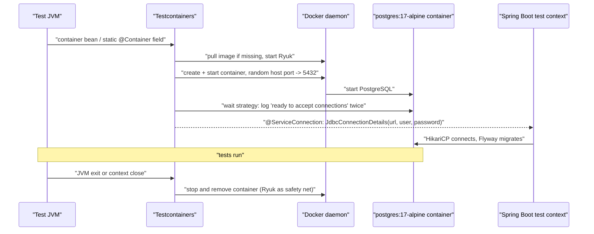
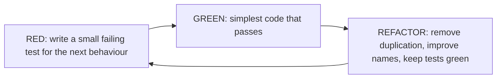

@@ 3 | TOPIC | Testcontainers | Real PostgreSQL, Kafka or Redis in Docker for tests, @ServiceConnection, singleton containers, reuse and CI | SHOULD
# Testcontainers

**Level: Intermediate | Phase 13 | Priority: SHOULD | Since: Testcontainers 1.0 (2015); Boot 3.1 `@ServiceConnection` and `spring-boot-testcontainers`; Testcontainers 2.0 with `Boot 4`**

> **30-second interview answer:** Testcontainers is a Java library that starts real infrastructure such as PostgreSQL, Kafka or Redis in throwaway Docker containers during tests and removes them afterwards. Instead of H2 or mocks, my tests run against the same database engine and version as production. Since Boot 3.1 I declare the container as a bean or static field with `@ServiceConnection`, and Boot wires the DataSource from it automatically; I share one container across the whole suite so it starts once.

## 1. Concept in Simple Words
### Analogy
A pop-up kitchen for a cooking exam.

| Cooking exam | Testcontainers |
|---|---|
| Practising on a toy kitchen | Testing against H2 or mocks |
| A real professional kitchen delivered in a container to the exam hall | PostgreSQL in a Docker container |
| Same oven brand as the restaurant | Same image and version as production (`postgres:17-alpine`) |
| The organisers hand the candidate the address and keys | `@ServiceConnection` gives Boot the JDBC URL and credentials |
| The kitchen is taken away after the exam | Container stopped and removed (Ryuk cleans up) |
| One kitchen shared by all candidates of the day | Singleton container shared by all test classes |

### What it is
- **Testcontainers:** library controlling Docker through its API. Modules for databases (`postgresql`, `mysql`, `oracle-free`), messaging (`kafka`, `rabbitmq`), `redis` through `GenericContainer`, `localstack`, `elasticsearch`, and more.
- **`GenericContainer`:** any image, with exposed ports, environment, wait strategies (`Wait.forListeningPort()`, `forLogMessage`, `forHttp`).
- **JUnit 5 integration:** `@Testcontainers` and `@Container` start and stop containers around a test class (static field: once per class; instance field: per test).
- **Ryuk:** a sidecar container that removes containers if the JVM dies.
- **`spring-boot-testcontainers`:** Boot module with `@ServiceConnection`: Boot creates `ConnectionDetails` beans (for example `JdbcConnectionDetails`) from the container, so no `spring.datasource.url` is needed. Supported for PostgreSQL, MySQL, Kafka, Redis, RabbitMQ, MongoDB, Elasticsearch and others.
- **`@DynamicPropertySource`:** older (pre-3.1) way to register container properties, still useful for unsupported services.
- **Development time use:** `SpringApplication.from(OrderHubApplication::main).with(TestcontainersConfiguration.class).run(args)` in a `TestOrderHubApplication` class starts the app locally with containers.
- **Reuse:** `.withReuse(true)` plus `testcontainers.reuse.enable=true` in `~/.testcontainers.properties` keeps a container between runs on a developer machine (not for CI).
- **Versions:** Boot 3.5 manages Testcontainers 1.21 (`org.testcontainers.containers.PostgreSQLContainer`). Testcontainers 2.0, used by `Boot 4`, moves modules to `org.testcontainers.postgresql.PostgreSQLContainer` and drops the self-type generic.

### Why it exists
Embedded databases differ from production (SQL dialect, types, locking, extensions), and mocks of Kafka or Redis do not behave like the real thing. Shared test databases on a server get polluted and break parallel builds. Testcontainers gives each build a clean, real, identical environment with nothing installed but Docker.

## 2. How It Works


Key details:
1. Ports are mapped to random free host ports, so parallel builds never collide; always use `getJdbcUrl()` or `@ServiceConnection`, never `localhost:5432`.
2. Container lifecycle options:
```text
@Container on an instance field      -> new container per test method (slow, rarely wanted)
@Container on a static field         -> one container per test class
@Bean @ServiceConnection in a shared @TestConfiguration
                                     -> one container per Spring test context (shared via context cache)
static field started in a static block of a base class (singleton pattern)
                                     -> one container for the whole JVM / test suite
```
3. `@ServiceConnection` beans are started by Spring before dependent beans (the DataSource), and stopped when the context closes.
4. Test isolation is still your job: either rely on `@DataJpaTest` rollback, or clean tables between full integration tests.

## 3. Code Example
### Code
`pom.xml`:
```xml
<dependency>
    <groupId>org.springframework.boot</groupId>
    <artifactId>spring-boot-testcontainers</artifactId>
    <scope>test</scope>
</dependency>
<dependency>
    <groupId>org.testcontainers</groupId>
    <artifactId>postgresql</artifactId>
    <scope>test</scope>
</dependency>
<dependency>
    <groupId>org.testcontainers</groupId>
    <artifactId>junit-jupiter</artifactId>
    <scope>test</scope>
</dependency>
```

Shared configuration (one PostgreSQL per cached context):
```java
package com.orderhub;

import org.springframework.boot.test.context.TestConfiguration;
import org.springframework.boot.testcontainers.service.connection.ServiceConnection;
import org.springframework.context.annotation.Bean;
import org.testcontainers.containers.GenericContainer;
import org.testcontainers.containers.PostgreSQLContainer;
import org.testcontainers.utility.DockerImageName;

@TestConfiguration(proxyBeanMethods = false)
public class TestcontainersConfiguration {

    @Bean
    @ServiceConnection
    PostgreSQLContainer<?> postgres() {
        return new PostgreSQLContainer<>(DockerImageName.parse("postgres:17-alpine"))
                .withDatabaseName("orderhub")
                .withReuse(true);                                   // only effective if enabled locally
    }

    @Bean
    @ServiceConnection(name = "redis")                              // for Phase 19 caching
    GenericContainer<?> redis() {
        return new GenericContainer<>(DockerImageName.parse("redis:7-alpine")).withExposedPorts(6379);
    }
}
```

Classic JUnit style with a static container (useful without a Spring context or in older code):
```java
package com.orderhub.report;

import org.junit.jupiter.api.Test;
import org.springframework.jdbc.core.simple.JdbcClient;
import org.springframework.jdbc.datasource.DriverManagerDataSource;
import org.testcontainers.containers.PostgreSQLContainer;
import org.testcontainers.junit.jupiter.Container;
import org.testcontainers.junit.jupiter.Testcontainers;

import static org.assertj.core.api.Assertions.assertThat;

@Testcontainers
class PostgresFeaturesTest {

    @Container
    static PostgreSQLContainer<?> postgres = new PostgreSQLContainer<>("postgres:17-alpine");   // once per class

    @Test
    void windowFunctionWorks() {
        var ds = new DriverManagerDataSource(postgres.getJdbcUrl(), postgres.getUsername(), postgres.getPassword());
        JdbcClient jdbc = JdbcClient.create(ds);
        Integer rank = jdbc.sql("select rank() over (order by x desc) from (values (3),(5),(1)) t(x) limit 1")
                           .query(Integer.class).single();
        assertThat(rank).isEqualTo(1);
        System.out.println("JDBC URL: " + postgres.getJdbcUrl());
    }
}
```

Full integration test with data cleanup:
```java
package com.orderhub;

import com.orderhub.order.PaymentGateway;
import org.junit.jupiter.api.AfterEach;
import org.junit.jupiter.api.Test;
import org.springframework.beans.factory.annotation.Autowired;
import org.springframework.boot.test.context.SpringBootTest;
import org.springframework.boot.test.web.client.TestRestTemplate;
import org.springframework.context.annotation.Import;
import org.springframework.http.HttpStatus;
import org.springframework.jdbc.core.simple.JdbcClient;
import org.springframework.test.context.bean.override.mockito.MockitoBean;

import java.math.BigDecimal;
import java.util.Map;

import static org.assertj.core.api.Assertions.assertThat;
import static org.mockito.ArgumentMatchers.any;
import static org.mockito.ArgumentMatchers.anyString;
import static org.mockito.Mockito.when;

@SpringBootTest(webEnvironment = SpringBootTest.WebEnvironment.RANDOM_PORT)
@Import(TestcontainersConfiguration.class)
class OrderFlowIT {

    @Autowired TestRestTemplate rest;
    @Autowired JdbcClient jdbc;
    @MockitoBean PaymentGateway gateway;

    @AfterEach
    void cleanUp() {
        jdbc.sql("truncate order_line, payment, orders, product, customer restart identity cascade").update();
    }

    @Test
    void createProductThenOrderIt() {
        when(gateway.charge(anyString(), any(BigDecimal.class))).thenReturn("PAY-1");
        jdbc.sql("insert into customer (id, email, full_name, tier, created_at) values (1, 'ana@example.com', 'Ana', 'GOLD', now())").update();

        var created = rest.postForEntity("/api/products",
                Map.of("sku", "KB-01", "name", "Keyboard", "price", 49.90, "stock", 5), Map.class);
        assertThat(created.getStatusCode()).isEqualTo(HttpStatus.CREATED);
        Number productId = (Number) created.getBody().get("id");

        var order = rest.postForEntity("/api/orders",
                Map.of("customerId", 1, "productId", productId, "quantity", 2), Map.class);
        assertThat(order.getStatusCode()).isEqualTo(HttpStatus.CREATED);

        Integer stock = jdbc.sql("select stock from product where id = ?").param(productId).query(Integer.class).single();
        assertThat(stock).isEqualTo(3);
    }
}
```

Running the app locally with containers (`src/test/java`):
```java
package com.orderhub;

import org.springframework.boot.SpringApplication;

public class TestOrderHubApplication {
    public static void main(String[] args) {
        SpringApplication.from(OrderHubApplication::main)
                .with(TestcontainersConfiguration.class)     // same containers as the tests
                .run(args);
    }
}
```

CI (GitHub Actions) needs nothing special because hosted Ubuntu runners have Docker:
```yaml
name: build
on: [push, pull_request]
jobs:
  test:
    runs-on: ubuntu-latest
    steps:
      - uses: actions/checkout@v4
      - uses: actions/setup-java@v4
        with:
          distribution: temurin
          java-version: "21"
          cache: maven
      - run: ./mvnw -B verify          # Surefire unit/slice tests + Failsafe *IT tests with Testcontainers
```

### Walkthrough
- `TestcontainersConfiguration` declares containers as beans with `@ServiceConnection`; Boot derives `JdbcConnectionDetails` and Redis connection details, so there is no URL in any properties file. Because the configuration is shared and imported identically, the context cache shares one PostgreSQL across all tests that import it.
- `PostgresFeaturesTest` shows the plain JUnit extension: the static `@Container` starts once for the class, and `getJdbcUrl()` returns the URL with the random mapped port.
- `OrderFlowIT` runs the real app on a random port against PostgreSQL. HTTP requests run in server threads with their own transactions, so cleanup is explicit with `truncate ... cascade`.
- `TestOrderHubApplication` lets you run OrderHub from the IDE with the same containers: no local PostgreSQL install.
- The CI workflow simply runs `verify`; Testcontainers finds the Docker daemon on the runner.

### Output
```text
INFO  org.testcontainers.DockerClientFactory  : Connected to docker:
  Server Version: 27.3.1
  API Version: 1.47
INFO  tc.testcontainers/ryuk:0.11.0           : Container testcontainers/ryuk:0.11.0 started in PT0.6S
INFO  tc.postgres:17-alpine                   : Creating container for image: postgres:17-alpine
INFO  tc.postgres:17-alpine                   : Container postgres:17-alpine started in PT1.8S
INFO  tc.postgres:17-alpine                   : Container is started (JDBC URL: jdbc:postgresql://localhost:55012/test?loggerLevel=OFF)
JDBC URL: jdbc:postgresql://localhost:55012/test?loggerLevel=OFF
[INFO] Tests run: 1, Failures: 0, Errors: 0, Skipped: 0, Time elapsed: 3.214 s -- in com.orderhub.report.PostgresFeaturesTest
```
The port (55012 here) is random on every run. Without Docker running:
```text
java.lang.IllegalStateException: Could not find a valid Docker environment. Please see logs and check configuration
```

### Compare
| Option | Realism | Setup | Isolation | Speed |
|---|---|---|---|---|
| Mocks | None | None | Perfect | Fastest |
| H2 in PostgreSQL mode | Partial | None | Per test JVM | Fast |
| Shared test database server | Real | Ops work | Poor (shared state, parallel builds) | Medium |
| Embedded Postgres libraries | Real binary, fewer versions | Library | Good | Medium |
| Testcontainers | Real, exact version | Docker only | Excellent | Seconds to start, then fast |

## 4. Interview Questions
**Basic**
1. **What is Testcontainers?**
   A Java library that starts real services such as databases, message brokers and caches in Docker containers for the duration of tests, with random ports and automatic cleanup. Tests run against the same technology and version as production without installing anything except Docker.
2. **What does `@ServiceConnection` do?**
   Added in Boot 3.1, it marks a container (bean or static field) so Boot creates the matching `ConnectionDetails` bean from it, for example JDBC URL and credentials for PostgreSQL. Auto-configuration then uses those instead of `spring.datasource.*`, so no dynamic property code is needed.
3. **Why not just use H2 for tests?**
   H2 is a different engine: SQL features, types, functions, locking and constraint behaviour differ from PostgreSQL. Native queries and PostgreSQL-specific migrations may fail on H2, or pass there and fail in production. Testcontainers removes that gap.

**Follow-up**
4. **How do you avoid starting a new container for every test class?**
   Declare containers as `@Bean @ServiceConnection` in one shared `@TestConfiguration` imported the same way everywhere, so Spring's context cache reuses them, or use the singleton pattern: a static container started once in a base class and shared by the JVM. Locally, `withReuse(true)` can keep it across runs.
5. **How do you isolate data between integration tests that share a container?**
   Slice tests roll back their transaction. For full `RANDOM_PORT` tests, truncate tables in `@AfterEach`, use unique data (random emails or SKUs) per test, or run Flyway `clean` plus `migrate` between classes when clean is acceptable in tests. Never rely on test order.
6. **What was used before `@ServiceConnection`?**
   `@DynamicPropertySource` with a static method registering `spring.datasource.url`, username and password from the container's getters. It still works and is needed for services Boot does not support with `ConnectionDetails`.

**Tricky / scenario**
7. **The test suite is fast locally but takes 15 minutes on CI. Logs show PostgreSQL starting 40 times. What do you fix?**
   Containers are tied to contexts or classes that are not shared: different `@Import`s, per-class static containers, or many different context configurations. Centralise one container configuration, align context configuration so the cache works, or switch to a JVM-wide singleton container. Also pre-pull images and enable Maven caching.
8. **Your team cannot run Docker on developer laptops. What are the options?**
   Testcontainers Cloud or a remote Docker host (`DOCKER_HOST`), Podman with the Docker-compatible socket, or running container tests only in CI with a Maven profile while laptops run unit and slice tests. Embedded alternatives are a last resort.
9. **How would you test a Kafka consumer that writes to the database?**
   Start Kafka and PostgreSQL with Testcontainers (`KafkaContainer` with `@ServiceConnection`), run a `@SpringBootTest`, publish a message with a `KafkaTemplate`, and poll the database until the expected row appears, using Awaitility (`await().atMost(10, SECONDS).untilAsserted(...)`) because consumption is asynchronous.

**What the interviewer is really testing:** whether you can make integration tests realistic and still fast and reliable in CI.

## 5. Pitfalls & Best Practices
### Common mistakes
| Mistake | What goes wrong | Fix |
|---|---|---|
| Hard-coding `localhost:5432` | Fails because ports are random | `@ServiceConnection` or `getJdbcUrl()` |
| Container per test method | Very slow suites | Static, bean or singleton containers |
| `latest` image tag | Tests break when the image changes | Pin the production version (`postgres:17-alpine`) |
| No data cleanup in full tests | Order-dependent failures | Truncate or unique data per test |
| `Thread.sleep` waiting for async results | Flaky and slow | Awaitility with a timeout |
| Reuse enabled in CI | Leaked state between builds | Reuse only on developer machines |

### Best practices
- Use the same image version as production and keep it in one place.
- Share containers across the suite; let Spring's context cache do the work.
- Run Flyway migrations in container tests so schema changes are tested on every build.
- Keep container tests in `*IT` classes run by Failsafe, and unit tests in Surefire for quick feedback.
- Provide `TestOrderHubApplication` so developers run the app locally with containers.

### Compare with
| Way to wire a container into Spring | Since | Notes |
|---|---|---|
| `@DynamicPropertySource` | Spring 5.2.5 | Manual property registration, universal |
| `@ServiceConnection` on static field | Boot 3.1 | Simple, per class |
| `@Bean @ServiceConnection` in `@TestConfiguration` | Boot 3.1 | Shared and reusable, also for dev-time app runs |
| Docker Compose support (`spring-boot-docker-compose`) | Boot 3.1 | Uses your `compose.yaml` at dev time; not for isolated tests |

## 6. Hands-on Exercise
Make OrderHub's whole suite use one PostgreSQL container:
1. Create `TestcontainersConfiguration` with PostgreSQL 17 and `@ServiceConnection`.
2. Make all `@DataJpaTest` classes and `AbstractIntegrationTest` import it.
3. Add a test that verifies Flyway ended at the latest version by querying `flyway_schema_history`.
4. Add `TestOrderHubApplication` for local runs.

Acceptance criteria: running `./mvnw verify` shows "Container postgres:17-alpine started" at most twice (once for the JPA slice context, once for the full context); the Flyway test passes.

<details><summary>Solution</summary>

```java
package com.orderhub;

import org.junit.jupiter.api.Test;
import org.springframework.beans.factory.annotation.Autowired;
import org.springframework.boot.test.autoconfigure.jdbc.AutoConfigureTestDatabase;
import org.springframework.boot.test.autoconfigure.orm.jpa.DataJpaTest;
import org.springframework.context.annotation.Import;
import org.springframework.jdbc.core.simple.JdbcClient;

import javax.sql.DataSource;

import static org.assertj.core.api.Assertions.assertThat;

@DataJpaTest
@AutoConfigureTestDatabase(replace = AutoConfigureTestDatabase.Replace.NONE)
@Import(TestcontainersConfiguration.class)
class FlywayMigrationTest {

    @Autowired DataSource dataSource;

    @Test
    void allMigrationsAppliedSuccessfully() {
        JdbcClient jdbc = JdbcClient.create(dataSource);
        String latest = jdbc.sql("""
                select version from flyway_schema_history
                where success and version is not null
                order by installed_rank desc limit 1
                """).query(String.class).single();
        Integer failed = jdbc.sql("select count(*) from flyway_schema_history where not success")
                .query(Integer.class).single();

        assertThat(latest).isEqualTo("11");
        assertThat(failed).isZero();
    }
}
```
All `@DataJpaTest` classes share exactly the same annotations (`@DataJpaTest`, `replace = NONE`, `@Import(TestcontainersConfiguration.class)`) and therefore one cached context with one container. All full tests extend `AbstractIntegrationTest`, which imports the same configuration with the same mocks, giving a second context and container. `TestOrderHubApplication` is the class from the Code section. If you want literally one container for both contexts, replace the bean with a JVM-wide static singleton container referenced from a `@ServiceConnection` static field in a shared interface.
</details>

## 7. Recall
Q: What is Testcontainers used for in Spring Boot tests?
A: Starting real services like PostgreSQL, Kafka or Redis in throwaway Docker containers so tests run against production-like infrastructure.

Q: What does @ServiceConnection do in Spring Boot 3.1+?
A: It makes Boot create ConnectionDetails (URL, credentials) from a container so auto-configuration connects to it without properties.

Q: Why should tests never hard-code localhost:5432 with Testcontainers?
A: Containers are mapped to random host ports; use `getJdbcUrl()` or `@ServiceConnection`.

Q: How do you share one Testcontainers database across many Spring test classes?
A: Declare it as a `@Bean @ServiceConnection` in one shared `@TestConfiguration` so the context cache reuses it, or use a static singleton container.

Q: How do you wait for asynchronous results in Testcontainers integration tests?
A: Use Awaitility with a timeout instead of `Thread.sleep`.

**Related:** [[@DataJpaTest for Repositories]] · [[@SpringBootTest vs Test Slices]] · [[Schema Migrations with Flyway]] · [[Docker Images for Spring Boot]]

@@ 3 | TOPIC | Test Pyramid and TDD | Balancing unit, slice and end-to-end tests, coverage, test smells, and the red-green-refactor cycle | SHOULD
# Test Pyramid and TDD

**Level: Intermediate | Phase 13 | Priority: SHOULD | Since: Test pyramid (Mike Cohn, 2009), TDD (Kent Beck, 2002)**

> **30-second interview answer:** The test pyramid says most tests should be fast, isolated unit tests, fewer should be integration or slice tests, and only a handful should be slow end-to-end tests, because cost and flakiness grow as you go up. In a Spring app that means many JUnit and Mockito tests for domain and services, some `@WebMvcTest` and `@DataJpaTest` tests with Testcontainers, and a few `@SpringBootTest` flows. TDD is a way of writing code: write a failing test (red), make it pass with the simplest code (green), then refactor with the tests as a safety net. I use TDD for domain logic and bug fixes, where it pays off most.

## 1. Concept in Simple Words
### Analogy
Quality control in a car factory.

| Car factory | Testing |
|---|---|
| Thousands of cheap checks on each bolt and part | Unit tests (base of the pyramid) |
| Checks of assembled subsystems: engine on a bench | Integration and slice tests (middle) |
| A few full test drives on a track | End-to-end tests (top) |
| Test drives are expensive and when one fails you do not know which part broke | E2E tests are slow and hard to diagnose |
| Engineers write the part specification before machining the part | TDD: test first, then code |
| Measure, cut, re-measure, polish | Red, green, refactor |

### What it is
- **Unit test:** one class or a small cluster, no Spring context, no I/O. Milliseconds.
- **Integration test:** several real components together: slices (`@WebMvcTest`, `@DataJpaTest`), Testcontainers, `@SpringBootTest`. Seconds.
- **End-to-end (E2E) test:** the deployed system through its public interface (HTTP API or UI). Minutes, fragile.
- **Contract test:** verifies an API's agreed request and response format between services (Spring Cloud Contract, Pact); covered more in Phase 20.
- **Test pyramid:** many unit, fewer integration, very few E2E. Anti-pattern: the **ice-cream cone** (mostly manual and E2E tests). Alternative shape: the **testing trophy**, which emphasises integration tests; both agree on "few E2E".
- **TDD (test-driven development):** short cycles of red (failing test that defines the next behaviour), green (minimum code to pass), refactor (clean code with tests green).
- **Coverage:** line or branch percentage executed by tests (JaCoCo). Useful to find untested code, not a quality goal by itself.
- **Mutation testing:** PIT changes your code (flips conditions) and checks tests fail; measures test strength.
- **Test smells:** flaky tests, tests that test mocks, giant setup, assertions-free tests, sleeping, order dependence, testing private methods.
- **FIRST:** good unit tests are Fast, Isolated, Repeatable, Self-validating, Timely.

### Why it exists
Teams that rely on slow E2E or manual tests release rarely and fear refactoring. A pyramid gives fast feedback on every commit and pinpoints failures. TDD keeps design simple and testable, produces tests that describe behaviour, and prevents "I'll write tests later" (which usually means never).

## 2. How It Works
```text
                    /\
                   /  \        E2E: 5-10 flows (deployed app, real HTTP)
                  /____\       minutes, flaky, broad confidence
                 /      \
                /        \     Integration: @SpringBootTest + Testcontainers,
               /          \    @WebMvcTest, @DataJpaTest   (tens to low hundreds)
              /____________\   seconds, real wiring and SQL
             /              \
            /                \ Unit: JUnit + Mockito, domain and services
           /                  \ (hundreds to thousands)
          /____________________\ milliseconds, precise failures
```

OrderHub test map after this phase:

| Layer | Example | Count (typical) | Tool |
|---|---|---|---|
| Domain | `OrderTest`, `PriceCalculatorTest` | 100+ | JUnit 5 |
| Service | `OrderServiceTest`, `RefundServiceTest` | 50+ | Mockito |
| Web | `OrderControllerTest`, `ProductControllerTest` | 20+ | `@WebMvcTest` |
| Persistence | `OrderRepositoryTest`, `FlywayMigrationTest` | 15+ | `@DataJpaTest`, Testcontainers |
| Flows | `OrderFlowIT`, `CheckoutIT` | 3-5 | `@SpringBootTest` |

The TDD cycle:


Rules of thumb: each cycle takes minutes; never write production code without a failing test that needs it; take the smallest next step ("fake it till you make it", then triangulate with a second example); refactor both code and tests.

## 3. Code Example
### Code
A TDD session for OrderHub's coupon rules: "a coupon gives a percentage discount, cannot be used after its expiry, and cannot reduce the total below 1.00". Each step shows the test added and the code that made it pass.

Step 1 (red, then green): percentage discount.
```java
package com.orderhub.coupon;

import org.junit.jupiter.api.Test;

import java.math.BigDecimal;
import java.time.Clock;
import java.time.Instant;
import java.time.ZoneOffset;

import static org.assertj.core.api.Assertions.assertThat;
import static org.assertj.core.api.Assertions.assertThatThrownBy;

class CouponCalculatorTest {

    private final Clock clock = Clock.fixed(Instant.parse("2026-06-01T12:00:00Z"), ZoneOffset.UTC);
    private final CouponCalculator calculator = new CouponCalculator(clock);
    private final Instant nextYear = Instant.parse("2027-01-01T00:00:00Z");

    @Test
    void appliesPercentageDiscount() {                                            // step 1
        Coupon tenPercent = new Coupon("SAVE10", 10, nextYear);
        assertThat(calculator.apply(new BigDecimal("80.00"), tenPercent)).isEqualByComparingTo("72.00");
    }

    @Test
    void roundsToCents() {                                                        // step 2
        Coupon fifteen = new Coupon("SAVE15", 15, nextYear);
        assertThat(calculator.apply(new BigDecimal("9.99"), fifteen)).isEqualByComparingTo("8.49");
    }

    @Test
    void rejectsExpiredCoupon() {                                                 // step 3
        Coupon expired = new Coupon("OLD", 10, Instant.parse("2026-05-31T23:59:59Z"));
        assertThatThrownBy(() -> calculator.apply(new BigDecimal("50.00"), expired))
                .isInstanceOf(CouponExpiredException.class)
                .hasMessage("Coupon OLD expired");
    }

    @Test
    void neverGoesBelowMinimumTotal() {                                           // step 4
        Coupon ninety = new Coupon("BIG90", 90, nextYear);
        assertThat(calculator.apply(new BigDecimal("5.00"), ninety)).isEqualByComparingTo("1.00");
    }
}
```

Production code after step 4 and a refactor:
```java
package com.orderhub.coupon;

import java.math.BigDecimal;
import java.math.RoundingMode;
import java.time.Clock;
import java.time.Instant;

record Coupon(String code, int percent, Instant validUntil) { }

class CouponExpiredException extends RuntimeException {
    CouponExpiredException(String code) { super("Coupon " + code + " expired"); }
}

class CouponCalculator {
    private static final BigDecimal MINIMUM_TOTAL = new BigDecimal("1.00");
    private static final BigDecimal HUNDRED = BigDecimal.valueOf(100);
    private final Clock clock;

    CouponCalculator(Clock clock) { this.clock = clock; }

    BigDecimal apply(BigDecimal total, Coupon coupon) {
        if (!Instant.now(clock).isBefore(coupon.validUntil())) throw new CouponExpiredException(coupon.code());
        BigDecimal discount = total.multiply(BigDecimal.valueOf(coupon.percent())).divide(HUNDRED);
        BigDecimal result = total.subtract(discount).setScale(2, RoundingMode.HALF_EVEN);
        return result.max(MINIMUM_TOTAL);
    }
}
```

How the code evolved:
```text
Step 1 RED   : CouponCalculator does not exist -> compilation failure counts as red
Step 1 GREEN : return total.multiply(0.9)  ... too specific; written as
               total.subtract(total * percent / 100)
Step 2 RED   : 9.99 * 0.85 = 8.4915 -> expected 8.49, got 8.4915
Step 2 GREEN : add setScale(2, HALF_EVEN)
Step 3 RED   : expired coupon accepted
Step 3 GREEN : inject Clock, compare with validUntil, throw CouponExpiredException
Step 4 RED   : 5.00 with 90% -> 0.50, expected 1.00
Step 4 GREEN : result.max(MINIMUM_TOTAL)
REFACTOR     : extract constants MINIMUM_TOTAL and HUNDRED, rename variables
```

JaCoCo coverage report in the build:
```xml
<plugin>
    <groupId>org.jacoco</groupId>
    <artifactId>jacoco-maven-plugin</artifactId>
    <version>0.8.12</version>
    <executions>
        <execution><goals><goal>prepare-agent</goal></goals></execution>
        <execution>
            <id>report</id>
            <phase>verify</phase>
            <goals><goal>report</goal></goals>
        </execution>
    </executions>
</plugin>
```

Failsafe for `*IT` classes so the pyramid layers run separately:
```xml
<plugin>
    <groupId>org.apache.maven.plugins</groupId>
    <artifactId>maven-failsafe-plugin</artifactId>
    <executions>
        <execution><goals><goal>integration-test</goal><goal>verify</goal></goals></execution>
    </executions>
</plugin>
```

### Walkthrough
- The tests were written one at a time, each failing first. The first failure is a compile error: the class does not exist yet, which is a valid red.
- `Clock` is injected from step 3 because a test needed control over time; TDD pushes you toward testable design (dependency injection) naturally.
- Step 2 found a rounding requirement that might otherwise have been forgotten; step 4 found a business boundary.
- The refactor step changed names and constants with all four tests green, so it was safe.
- JaCoCo measures which lines and branches the tests executed; Failsafe runs slow `*IT` tests in a separate phase so `./mvnw test` stays fast.

### Output
`./mvnw verify`:
```text
[INFO] Running com.orderhub.coupon.CouponCalculatorTest
[INFO] Tests run: 4, Failures: 0, Errors: 0, Skipped: 0, Time elapsed: 0.048 s -- in com.orderhub.coupon.CouponCalculatorTest
[INFO] Tests run: 187, Failures: 0, Errors: 0, Skipped: 0
[INFO] --- failsafe:3.5.2:integration-test (default) @ orderhub ---
[INFO] Running com.orderhub.OrderFlowIT
[INFO] Tests run: 1, Failures: 0, Errors: 0, Skipped: 0, Time elapsed: 7.402 s -- in com.orderhub.OrderFlowIT
[INFO] Tests run: 4, Failures: 0, Errors: 0, Skipped: 0
[INFO] --- jacoco:0.8.12:report (report) @ orderhub ---
[INFO] Loading execution data file D:\orderhub\target\jacoco.exec
[INFO] Analyzed bundle 'orderhub' with 64 classes
[INFO] BUILD SUCCESS
```
Step 2's red run, before rounding was added:
```text
[ERROR] CouponCalculatorTest.roundsToCents:28
Expecting actual:
  8.4915
to be equal to:
  8.49
when comparing values using 'BigDecimal::compareTo'
```

### Compare
| | Test-first (TDD) | Test-after |
|---|---|---|
| When tests are written | Before each small piece of code | After the feature |
| Design pressure | Strong: code must be testable from the start | Weak: tests adapt to existing design |
| Coverage | Naturally high and meaningful | Often gaps, especially edge cases |
| Speed at first | Feels slower | Feels faster |
| Speed over months | Faster: fewer regressions, safe refactoring | Slower: fear of change |
| Best for | Domain logic, algorithms, bug fixes | Exploratory spikes, UI glue |

## 4. Interview Questions
**Basic**
1. **What is the test pyramid?**
   A guideline for the mix of tests: many fast unit tests at the base, fewer integration tests in the middle, and very few slow end-to-end tests at the top. Higher tests give broader confidence but cost more to write, run and debug, and are flakier.
2. **What is TDD?**
   Test-driven development: write a failing test for the next small behaviour, write the simplest code that makes it pass, then refactor while keeping tests green, repeating in short cycles. The tests become a specification and a safety net, and the design stays simple and testable.
3. **What is the difference between unit and integration tests in a Spring app?**
   Unit tests check one class with its collaborators mocked, without a Spring context or I/O, in milliseconds. Integration tests check several real parts together: Spring wiring, MVC, JPA with a real database, messaging; they use slices, `@SpringBootTest` and Testcontainers and take seconds.

**Follow-up**
4. **Is 100% code coverage a good goal?**
   No. Coverage shows what code was executed, not whether behaviour was checked; tests without meaningful assertions can reach 100%. Use coverage to find untested areas and set a reasonable floor (for example 70 to 80% on domain and services), and use mutation testing or reviews to judge test quality.
5. **What makes a test flaky, and how do you fix it?**
   Dependence on time, randomness, ordering, shared state, real networks, thread timing or sleeps. Fix by injecting `Clock` and seeds, isolating data, replacing sleeps with Awaitility, using Testcontainers instead of shared servers, and quarantining flaky tests until fixed rather than ignoring failures.
6. **When does TDD not fit well?**
   For exploratory spikes where you do not know the shape of the solution yet, thin glue code, UI layout, or code that mostly wires frameworks together. Many teams do TDD for domain logic and bug fixes, and write slice or integration tests after for wiring code.

**Tricky / scenario**
7. **A bug reaches production. What is your process?**
   First write a test that reproduces the bug and fails (red), at the lowest level that can show it. Then fix the code until it passes (green), and keep the test as a regression guard. Ask why existing tests missed it, for example a missing boundary case or an H2-only repository test.
8. **Your team's suite has 30 `@SpringBootTest` classes and 20 unit tests, takes 20 minutes, and fails randomly. How do you improve it?**
   Invert the cone: move logic checks to unit tests, controller behaviour to `@WebMvcTest`, query checks to `@DataJpaTest` with a shared container, and keep only a few end-to-end flows. Unify context configuration so the cache works, fix flaky causes (time, order, shared data), and run integration tests in a separate Failsafe phase.
9. **The interviewer asks you to TDD a function live, for example "split an order into shipments of at most 5 items". How do you approach it?**
   Start with the simplest case test (empty order gives no shipments), make it pass, then add one example at a time: one item, exactly five, six items, several products. Say the red-green-refactor steps aloud, keep each step tiny, and refactor once the tests describe the rule. Interviewers value the discipline and the edge cases more than the final code.

**What the interviewer is really testing:** whether you have a deliberate testing strategy that keeps feedback fast and confidence high, and whether you can drive code from tests.

## 5. Pitfalls & Best Practices
### Common mistakes
| Mistake | What goes wrong | Fix |
|---|---|---|
| Ice-cream cone: mostly E2E or manual tests | Slow, flaky, late feedback | Push tests down the pyramid |
| Chasing a coverage number | Assertion-free tests, false confidence | Coverage as a guide; mutation testing |
| Tests coupled to implementation (verifying every call) | Every refactor breaks tests | Test behaviour and outcomes |
| Skipping the refactor step in TDD | Messy code with tests | Always refactor while green |
| Large TDD steps | Long red phases, debugging | Smallest next test, minutes per cycle |
| Ignoring flaky tests | Team stops trusting the suite | Fix or quarantine immediately |

### Best practices
- Unit-test domain rules and services; slice-test web and persistence; a few full flows.
- Write a failing test first for every bug fix.
- Keep `./mvnw test` under a minute; run container tests in `verify`.
- Treat test code as production code: readable names, small helpers, no duplication.
- Review tests in pull requests as carefully as code.

### Compare with
| Practice | Focus |
|---|---|
| TDD | Unit-level design through tests |
| BDD | Behaviour described in business language (Given-When-Then, Cucumber) |
| ATDD | Acceptance tests agreed with stakeholders before development |
| Contract testing | API compatibility between services |
| Mutation testing (PIT) | Strength of existing tests |

## 6. Hands-on Exercise
Use TDD to build OrderHub's `ShipmentSplitter.split(List<OrderLine> lines, int maxItemsPerBox)` that returns a list of boxes, each a list of `(sku, qty)` with at most `maxItemsPerBox` items, keeping lines in order and splitting a line across boxes if needed.

Acceptance criteria:
- At least five tests added one at a time (empty input, single small line, exact fit, split one line, several lines).
- `maxItemsPerBox <= 0` rejected with `IllegalArgumentException`.
- The final implementation has no duplicated logic.

<details><summary>Solution</summary>

```java
package com.orderhub.shipping;

import java.util.ArrayList;
import java.util.List;

public class ShipmentSplitter {

    public record Item(String sku, int qty) { }

    public List<List<Item>> split(List<Item> lines, int maxItemsPerBox) {
        if (maxItemsPerBox <= 0) throw new IllegalArgumentException("maxItemsPerBox must be positive");
        List<List<Item>> boxes = new ArrayList<>();
        List<Item> current = new ArrayList<>();
        int space = maxItemsPerBox;
        for (Item line : lines) {
            int remaining = line.qty();
            while (remaining > 0) {
                int take = Math.min(remaining, space);
                current.add(new Item(line.sku(), take));
                remaining -= take;
                space -= take;
                if (space == 0) {                       // box full: close it
                    boxes.add(current);
                    current = new ArrayList<>();
                    space = maxItemsPerBox;
                }
            }
        }
        if (!current.isEmpty()) boxes.add(current);
        return boxes;
    }

    public static void main(String[] args) {
        ShipmentSplitter s = new ShipmentSplitter();
        System.out.println(s.split(List.of(), 5));
        System.out.println(s.split(List.of(new Item("KB", 3)), 5));
        System.out.println(s.split(List.of(new Item("KB", 5)), 5));
        System.out.println(s.split(List.of(new Item("KB", 7)), 5));
        System.out.println(s.split(List.of(new Item("KB", 3), new Item("MS", 4)), 5));
    }
}
```
Output of `main`:
```text
[]
[[Item[sku=KB, qty=3]]]
[[Item[sku=KB, qty=5]]]
[[Item[sku=KB, qty=5]], [Item[sku=KB, qty=2]]]
[[Item[sku=KB, qty=3], Item[sku=MS, qty=2]], [Item[sku=MS, qty=2]]]
```

The tests, in the order they were written:
```java
package com.orderhub.shipping;

import com.orderhub.shipping.ShipmentSplitter.Item;
import org.junit.jupiter.api.Test;

import java.util.List;

import static org.assertj.core.api.Assertions.assertThat;
import static org.assertj.core.api.Assertions.assertThatThrownBy;

class ShipmentSplitterTest {
    private final ShipmentSplitter splitter = new ShipmentSplitter();

    @Test void emptyOrderHasNoBoxes() { assertThat(splitter.split(List.of(), 5)).isEmpty(); }

    @Test void smallLineFitsInOneBox() {
        assertThat(splitter.split(List.of(new Item("KB", 3)), 5)).containsExactly(List.of(new Item("KB", 3)));
    }

    @Test void exactFitClosesTheBox() {
        assertThat(splitter.split(List.of(new Item("KB", 5)), 5)).hasSize(1);
    }

    @Test void largeLineIsSplitAcrossBoxes() {
        assertThat(splitter.split(List.of(new Item("KB", 7)), 5))
                .containsExactly(List.of(new Item("KB", 5)), List.of(new Item("KB", 2)));
    }

    @Test void severalLinesShareBoxesInOrder() {
        assertThat(splitter.split(List.of(new Item("KB", 3), new Item("MS", 4)), 5))
                .containsExactly(List.of(new Item("KB", 3), new Item("MS", 2)), List.of(new Item("MS", 2)));
    }

    @Test void nonPositiveCapacityIsRejected() {
        assertThatThrownBy(() -> splitter.split(List.of(), 0)).isInstanceOf(IllegalArgumentException.class);
    }
}
```
The first test was passed by returning an empty list; the second forced a single box; the third forced the "box full" check; the fourth forced the inner `while` loop; the fifth proved boxes are shared between lines, which the loop already handled (a test that passes immediately is fine when it documents a rule). The refactor merged two duplicated "close box" blocks into the single `if (space == 0)`.
</details>

## 7. Recall
Q: What does the test pyramid recommend?
A: Many fast unit tests, fewer integration tests and very few end-to-end tests, because cost and flakiness grow toward the top.

Q: What are the three steps of the TDD cycle?
A: Red (write a failing test), green (make it pass with the simplest code), refactor (clean up while tests stay green).

Q: Why is 100% code coverage not a quality guarantee?
A: Coverage only shows executed code; tests can run code without asserting meaningful behaviour.

Q: What is the first step when fixing a production bug in a TDD workflow?
A: Write a test that reproduces the bug and fails, then fix the code until it passes.

Q: What does FIRST stand for in unit testing?
A: Fast, Isolated, Repeatable, Self-validating and Timely.

**Related:** [[JUnit 5 Essentials]] · [[Mockito: Mocks, Stubs and Verification]] · [[@SpringBootTest vs Test Slices]] · [[CI/CD Pipeline for a Spring App]]

@@ 3 | TOPIC | Practice — Coding drill: Write the tests | Ten interview tasks: write unit, Mockito, MockMvc, @DataJpaTest and Testcontainers tests for OrderHub code | MUST
# Coding drill: Write the tests

Ten tasks where the interviewer hands you code and says "test this". For each one, decide first which test type is cheapest while still meaningful (unit, Mockito, slice, container), then write it. Solutions use JUnit 5, AssertJ, Mockito 5 and Spring Boot 3.5 test support.

## 1. Table-driven unit test
Test `ShippingFee.of(BigDecimal subtotal, String country)`: domestic ("DE") is free from 50.00, otherwise 4.90; EU countries ("FR", "NL") cost 9.90; others 19.90. Cover all boundaries in one parameterized test.

Hint: `@CsvSource` with the boundary values 49.99 and 50.00.

<details><summary>Solution</summary>

```java
class ShippingFeeTest {
    @ParameterizedTest(name = "{1} subtotal {0} -> fee {2}")
    @CsvSource({
            "49.99, DE, 4.90",
            "50.00, DE, 0.00",
            "10.00, FR, 9.90",
            "500.00, NL, 9.90",
            "10.00, US, 19.90"
    })
    void fee(BigDecimal subtotal, String country, BigDecimal expected) {
        assertThat(ShippingFee.of(subtotal, country)).isEqualByComparingTo(expected);
    }
}
```
One method, five readable cases, both sides of the free-shipping boundary. Use `isEqualByComparingTo` so `0.00` and `0` compare equal.
</details>

## 2. Exception and message
`AccountService.withdraw(id, amount)` throws `InsufficientFundsException("Balance 20.00 is less than 50.00")`. Write a test that checks type, message and that the balance did not change.

<details><summary>Solution</summary>

```java
@Test
void withdrawMoreThanBalanceFails() {
    Account account = new Account(1L, new BigDecimal("20.00"));
    AccountRepository repo = mock(AccountRepository.class);
    when(repo.findById(1L)).thenReturn(Optional.of(account));
    AccountService service = new AccountService(repo);

    assertThatThrownBy(() -> service.withdraw(1L, new BigDecimal("50.00")))
            .isInstanceOf(InsufficientFundsException.class)
            .hasMessage("Balance 20.00 is less than 50.00");

    assertThat(account.getBalance()).isEqualByComparingTo("20.00");
    verify(repo, never()).save(any());
}
```
Creating mocks with `mock(...)` instead of annotations is fine for a single test. The test checks the observable outcome (unchanged balance) and the absence of the side effect (no save).
</details>

## 3. Verify with ArgumentCaptor
`SignupService.register(email)` saves a `Customer` with lower-cased email and tier STANDARD, then publishes `CustomerRegistered(customerId)`. Test both effects.

<details><summary>Solution</summary>

```java
@ExtendWith(MockitoExtension.class)
class SignupServiceTest {
    @Mock CustomerRepository customers;
    @Mock ApplicationEventPublisher events;
    @InjectMocks SignupService service;

    @Test
    void savesNormalisedCustomerAndPublishesEvent() {
        when(customers.save(any(Customer.class))).thenAnswer(inv -> {
            Customer c = inv.getArgument(0);
            ReflectionTestUtils.setField(c, "id", 42L);       // simulate the generated id
            return c;
        });

        service.register("Ana@Example.COM");

        ArgumentCaptor<Customer> saved = ArgumentCaptor.forClass(Customer.class);
        verify(customers).save(saved.capture());
        assertThat(saved.getValue().getEmail()).isEqualTo("ana@example.com");
        assertThat(saved.getValue().getTier()).isEqualTo(Customer.Tier.STANDARD);
        verify(events).publishEvent(new CustomerRegistered(42L));
    }
}
```
`thenAnswer` mimics JPA assigning an id. `ReflectionTestUtils` (from `spring-test`) sets the private id field only inside the test. Because `CustomerRegistered` is a record, `verify` can compare it with `equals` directly.
</details>

## 4. Stub a void method and consecutive calls
`ReportMailer.send()` calls `MailClient.deliver(msg)` (void) and retries once if it throws `MailException`. Test: first call fails, second succeeds, `deliver` called twice.

<details><summary>Solution</summary>

```java
@Test
void retriesOnceAfterFailure() {
    MailClient client = mock(MailClient.class);
    doThrow(new MailException("timeout"))       // first call throws
            .doNothing()                          // second call succeeds
            .when(client).deliver(any());

    new ReportMailer(client).send();

    verify(client, times(2)).deliver(any());
}
```
Chained `doThrow(...).doNothing()` defines consecutive behaviours for a void method. For non-void methods the equivalent is `when(x.call()).thenThrow(e).thenReturn(v)`.
</details>

## 5. MockMvc happy path and 404
Test `GET /api/customers/{id}`: returns 200 with `email` for an existing customer, and 404 `ProblemDetail` with `detail` "Customer 9 not found" for a missing one.

<details><summary>Solution</summary>

```java
@WebMvcTest(CustomerController.class)
class CustomerControllerTest {
    @Autowired MockMvc mvc;
    @MockitoBean CustomerService service;

    @Test
    void found() throws Exception {
        when(service.get(1L)).thenReturn(new CustomerDto(1L, "ana@example.com", "GOLD"));
        mvc.perform(get("/api/customers/1"))
           .andExpect(status().isOk())
           .andExpect(jsonPath("$.email").value("ana@example.com"));
    }

    @Test
    void notFound() throws Exception {
        when(service.get(9L)).thenThrow(new CustomerNotFoundException(9L));
        mvc.perform(get("/api/customers/9"))
           .andExpect(status().isNotFound())
           .andExpect(content().contentType("application/problem+json"))
           .andExpect(jsonPath("$.detail").value("Customer 9 not found"));
    }
}
```
The `@RestControllerAdvice` is part of the web slice, so the exception mapping is tested too.
</details>

## 6. MockMvc validation
`POST /api/customers` requires a valid email and a non-blank name. Test that an invalid email returns 400 and the service is never called.

<details><summary>Solution</summary>

```java
@Test
void invalidEmailIs400() throws Exception {
    mvc.perform(post("/api/customers")
                    .contentType(MediaType.APPLICATION_JSON)
                    .content("""
                             { "email": "not-an-email", "fullName": "Ana" }
                             """))
       .andExpect(status().isBadRequest())
       .andExpect(jsonPath("$.status").value(400));

    verifyNoInteractions(service);
}
```
Validation runs during argument resolution, before the controller method, so the service mock must have no interactions. Add `jsonPath("$.errors.email").exists()` if the advice exposes field errors.
</details>

## 7. Repository query on real PostgreSQL
Test `CustomerRepository.findTop10ByTierOrderByCreatedAtDesc` returns only GOLD customers, newest first, at most 10.

<details><summary>Solution</summary>

```java
@DataJpaTest
@AutoConfigureTestDatabase(replace = AutoConfigureTestDatabase.Replace.NONE)
@Import(TestcontainersConfiguration.class)
class CustomerRepositoryTest {
    @Autowired CustomerRepository customers;
    @Autowired TestEntityManager em;

    @Test
    void newestGoldCustomers() {
        for (int i = 0; i < 12; i++) {
            Customer c = new Customer("gold" + i + "@example.com", "Gold " + i, null);
            c.upgradeTo(Customer.Tier.GOLD);
            em.persist(c);
        }
        em.persist(new Customer("std@example.com", "Std", null));
        em.flush();
        for (int i = 0; i < 12; i++) {
            em.getEntityManager().createNativeQuery("update customer set created_at = now() - make_interval(days => " + (12 - i) + ") where email = 'gold" + i + "@example.com'").executeUpdate();
        }
        em.clear();

        List<Customer> result = customers.findTop10ByTierOrderByCreatedAtDesc(Customer.Tier.GOLD);

        assertThat(result).hasSize(10)
                .allMatch(c -> c.getTier() == Customer.Tier.GOLD)
                .extracting(Customer::getEmail).first().isEqualTo("gold11@example.com");
    }
}
```
`created_at` is not updatable through the entity, so native updates age the rows after the flush: gold0 is the oldest and gold11 the newest. The loop values are test constants, not user input, so concatenating them is harmless here. `clear()` forces the derived query to read from PostgreSQL.
</details>

## 8. Assert no N+1
Write a test that fails if `OrderQueryService.recentSummaries()` runs more than 2 SQL statements for 20 orders.

<details><summary>Solution</summary>

```java
@DataJpaTest
@AutoConfigureTestDatabase(replace = AutoConfigureTestDatabase.Replace.NONE)
@Import({TestcontainersConfiguration.class, OrderQueryService.class})
@TestPropertySource(properties = "spring.jpa.properties.hibernate.generate_statistics=true")
class OrderQueryCountTest {
    @Autowired OrderQueryService service;
    @Autowired TestEntityManager em;
    @Autowired EntityManagerFactory emf;

    @Test
    void summariesUseAtMostTwoStatements() {
        Customer ana = em.persist(new Customer("ana@example.com", "Ana", null));
        Product kb = em.persist(new Product("KB-01", "Keyboard", new BigDecimal("49.90"), 100));
        for (int i = 0; i < 20; i++) {
            Order o = new Order(ana);
            o.addLine(kb, 1);
            em.persist(o);
        }
        em.flush();
        em.clear();

        Statistics stats = emf.unwrap(SessionFactory.class).getStatistics();
        stats.clear();

        assertThat(service.recentSummaries()).hasSize(20);
        assertThat(stats.getPrepareStatementCount()).isLessThanOrEqualTo(2);
    }
}
```
Hibernate statistics count prepared statements in the session factory. Clearing statistics after the setup isolates the method under test. If someone removes the fetch join or the projection, the test fails with a count of 41.
</details>

## 9. Full flow with Testcontainers and a mocked external system
Write an integration test: `POST /api/orders` for a product with stock 1, twice. The first returns 201, the second 409, and the payment gateway is charged exactly once.

<details><summary>Solution</summary>

```java
class OversellIT extends AbstractIntegrationTest {
    @Autowired TestRestTemplate rest;
    @Autowired JdbcClient jdbc;

    @AfterEach
    void clean() { jdbc.sql("truncate order_line, payment, orders, product, customer restart identity cascade").update(); }

    @Test
    void secondOrderForLastItemIsRejected() {
        when(gateway.charge(anyString(), any())).thenReturn("PAY-1");
        jdbc.sql("insert into customer (id, email, full_name, tier, created_at) values (1, 'ana@example.com', 'Ana', 'STANDARD', now())").update();
        jdbc.sql("insert into product (id, sku, name, price, stock, status, created_at, version) values (1, 'LAST-1', 'Last', 10.00, 1, 'ACTIVE', now(), 0)").update();
        Map<String, Object> body = Map.of("customerId", 1, "productId", 1, "quantity", 1);

        assertThat(rest.postForEntity("/api/orders", body, String.class).getStatusCode()).isEqualTo(HttpStatus.CREATED);
        assertThat(rest.postForEntity("/api/orders", body, String.class).getStatusCode()).isEqualTo(HttpStatus.CONFLICT);

        verify(gateway, times(1)).charge(anyString(), any());
    }
}
```
`AbstractIntegrationTest` provides the shared PostgreSQL container and the `gateway` mock, so this class reuses the cached context. Data is inserted with SQL to keep the test independent of other endpoints, and truncated afterwards because server-side transactions are committed.
</details>

## 10. Asynchronous listener
`OrderPaidListener` handles `OrderPaidEvent` with `@Async @TransactionalEventListener(AFTER_COMMIT)` and inserts a row into `notification_log`. Test that paying an order eventually creates the row.

<details><summary>Solution</summary>

```java
class NotificationIT extends AbstractIntegrationTest {
    @Autowired PaymentService payments;
    @Autowired JdbcClient jdbc;

    @Test
    void paymentEventuallyLogsNotification() throws Exception {
        Long orderId = TestData.newOrder(jdbc);              // helper inserting customer, product and order
        when(gateway.charge(anyString(), any())).thenReturn("PAY-9");

        payments.pay(orderId);

        await().atMost(Duration.ofSeconds(5)).untilAsserted(() ->
                assertThat(jdbc.sql("select count(*) from notification_log where order_id = ?")
                        .param(orderId).query(Integer.class).single()).isEqualTo(1));
    }
}
```
The listener runs after commit on another thread, so an immediate assertion would be flaky. Awaitility (`org.awaitility.Awaitility.await`, managed by Boot) polls until the condition holds or the timeout expires. The test must not be `@Transactional`, otherwise the commit (and therefore the event) never happens.
</details>

@@ 3 | TOPIC | Practice — Phase 13 review: Testing | Cheat sheet, key snippets, the 10 most likely questions and rapid-fire flashcards for JUnit, Mockito and Spring tests | MUST
# Phase 13 review: Testing

## Cheat sheet

| Idea | Remember |
|---|---|
| JUnit 5 parts | Platform (launcher), Jupiter (API), Vintage (old tests) |
| Lifecycle | New instance per test; `@BeforeEach`, `@AfterEach`, static `@BeforeAll` and `@AfterAll` |
| Assertions | AssertJ `assertThat`, `assertThatThrownBy`, `isEqualByComparingTo` for BigDecimal |
| Parameterized | `@ParameterizedTest` with `@CsvSource`, `@ValueSource`, `@MethodSource`, `@EnumSource` |
| Mockito setup | `@ExtendWith(MockitoExtension.class)`, `@Mock`, `@InjectMocks`, `@Captor` |
| Stub vs verify | Stub queries (`when`), verify commands (`verify`) |
| Matchers | If one argument uses a matcher, all must (`eq`) |
| Void methods | `doThrow().when(mock).method()` |
| Strict stubs | Unused stubs fail with `UnnecessaryStubbingException` |
| Full context | `@SpringBootTest`, `RANDOM_PORT` for real HTTP |
| Slices | `@WebMvcTest`, `@DataJpaTest`, `@JsonTest`, `@RestClientTest`, `@JdbcTest` |
| Bean mocks | `@MockitoBean` (Spring 6.2); `@MockBean` deprecated, removed in Boot 4 |
| Context cache | Same configuration key reuses the context; vary mocks and properties sparingly |
| MockMvc | Real DispatcherServlet, no server; `jsonPath`, `status`, `header`; `MockMvcTester` in 6.2 |
| `@DataJpaTest` | JPA only, rollback per test, embedded DB unless `replace = NONE` |
| Flush and clear | Flush to run SQL and constraints; clear to read from the database |
| Testcontainers | Real services in Docker; `@ServiceConnection`; share containers |
| Pyramid | Many unit, some integration, few E2E |
| TDD | Red, green, refactor in minutes-long cycles |
| Coverage | A guide, not a goal; mutation testing for strength |

### Key code snippets
```java
// Unit test with Mockito
@ExtendWith(MockitoExtension.class)
class OrderServiceTest {
    @Mock OrderRepository orders;
    @Mock PaymentGateway gateway;
    @InjectMocks OrderService service;

    @Test
    void chargesOnce() {
        when(orders.save(any())).thenAnswer(inv -> inv.getArgument(0));
        service.placeAndPay(7L, 1L, 2);
        verify(gateway).charge(eq("ana@example.com"), any());
    }
}
```

```java
// Web slice
@WebMvcTest(OrderController.class)
class OrderControllerTest {
    @Autowired MockMvc mvc;
    @MockitoBean OrderFacade orders;

    @Test
    void validation() throws Exception {
        mvc.perform(post("/api/orders").contentType(MediaType.APPLICATION_JSON).content("{\"quantity\":0}"))
           .andExpect(status().isBadRequest());
        verifyNoInteractions(orders);
    }
}
```

```java
// JPA slice on real PostgreSQL
@DataJpaTest
@AutoConfigureTestDatabase(replace = AutoConfigureTestDatabase.Replace.NONE)
@Import(TestcontainersConfiguration.class)
class ProductRepositoryTest {
    @Autowired ProductRepository products;
    @Autowired TestEntityManager em;

    @Test
    void findsBySku() {
        em.persist(new Product("KB-01", "Keyboard", new BigDecimal("49.90"), 5));
        em.flush();
        em.clear();
        assertThat(products.findBySku("KB-01")).isPresent();
    }
}
```

```java
// Shared container configuration
@TestConfiguration(proxyBeanMethods = false)
public class TestcontainersConfiguration {
    @Bean
    @ServiceConnection
    PostgreSQLContainer<?> postgres() { return new PostgreSQLContainer<>("postgres:17-alpine"); }
}
```

```xml
<!-- Test dependencies -->
<dependency>
    <groupId>org.springframework.boot</groupId>
    <artifactId>spring-boot-starter-test</artifactId>
    <scope>test</scope>
</dependency>
<dependency>
    <groupId>org.springframework.boot</groupId>
    <artifactId>spring-boot-testcontainers</artifactId>
    <scope>test</scope>
</dependency>
<dependency>
    <groupId>org.testcontainers</groupId>
    <artifactId>postgresql</artifactId>
    <scope>test</scope>
</dependency>
```

## The 10 most likely interview questions

1. **Mock vs stub vs spy?** Stub returns canned answers, mock records calls for verification, spy wraps a real object with partial stubbing.
2. **`@Mock` vs `@MockitoBean`?** Plain Mockito mock for unit tests vs a mock that replaces a bean in the Spring test context.
3. **`@SpringBootTest` vs `@WebMvcTest` vs `@DataJpaTest`?** Full context vs web layer only vs JPA layer only with rollback.
4. **How do you test a controller?** `@WebMvcTest` with MockMvc, mocked service, assertions on status, headers, JSON and error responses.
5. **How do you test a repository?** `@DataJpaTest` on real PostgreSQL with Testcontainers, flush and clear, test custom queries and mappings.
6. **Why Testcontainers instead of H2?** Same engine and version as production: native SQL, constraints and migrations behave identically.
7. **What is the test pyramid?** Many unit tests, fewer integration tests, very few E2E tests, for fast and precise feedback.
8. **What is TDD and do you use it?** Red, green, refactor; especially for domain logic and bug fixes.
9. **How do you keep a Spring test suite fast?** Unit tests for logic, slices for layers, shared context configuration for caching, shared containers, Failsafe for `*IT`.
10. **How do you test asynchronous code?** Inject executors or test synchronously where possible; otherwise Awaitility with timeouts, never `Thread.sleep`.

## Rapid-fire flashcards

Q: Which JUnit 5 annotation runs a test once per CSV row?
A: `@ParameterizedTest` combined with `@CsvSource`.

Q: Which AssertJ method compares BigDecimal values ignoring scale?
A: `isEqualByComparingTo`.

Q: Which Mockito exception signals a stub that was never used?
A: `UnnecessaryStubbingException`.

Q: How do you capture an argument passed to a Mockito mock?
A: With an `ArgumentCaptor` and `verify(mock).method(captor.capture())`.

Q: Which annotation replaced @MockBean in Spring Boot 3.4+?
A: `@MockitoBean`.

Q: What does @WebMvcTest not load?
A: Services, repositories and the DataSource.

Q: What does @DataJpaTest do after each test?
A: Rolls back the test transaction.

Q: Which annotation keeps your real DataSource in @DataJpaTest?
A: `@AutoConfigureTestDatabase(replace = Replace.NONE)`.

Q: Which Boot 3.1 annotation wires a Testcontainers container into auto-configuration?
A: `@ServiceConnection`.

Q: What are the three TDD steps?
A: Red, green, refactor.
