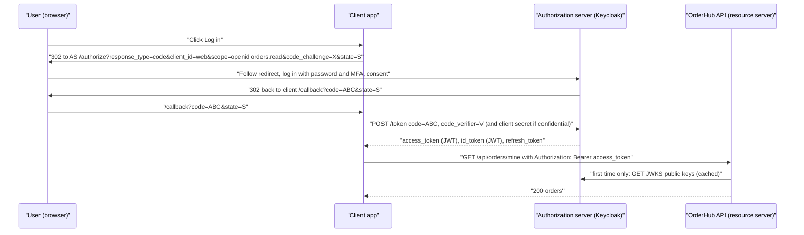
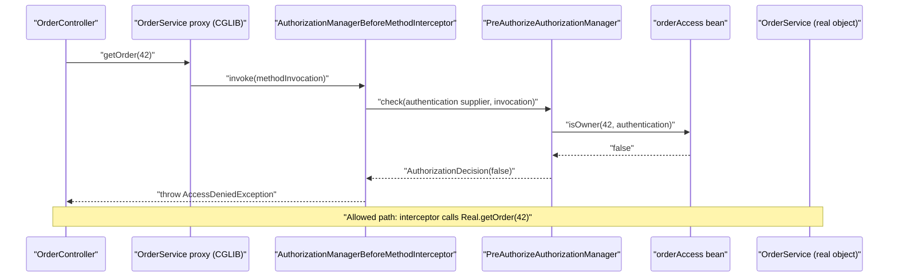

@@ 3 | TOPIC | OAuth2 and OpenID Connect | Roles, grant types, authorization code with PKCE, client credentials, ID tokens and Spring's client and resource server support | MUST
# OAuth2 and OpenID Connect

**Level: Intermediate | Phase 14 | Priority: MUST | Since: OAuth 2.0 RFC 6749 (2012), OpenID Connect 1.0 (2014), PKCE RFC 7636; Spring Security OAuth2 client 5.0, resource server 5.1**

> **30-second interview answer:** OAuth2 is an authorization framework that lets a client application get an access token to call an API on a user's behalf without ever seeing the user's password. The main roles are resource owner, client, authorization server and resource server, and the main flows are authorization code with PKCE for users and client credentials for service-to-service. OpenID Connect is a thin identity layer on top: it adds an ID token (a JWT about the user), a userinfo endpoint and discovery, so OAuth2 is "what may this app do" and OIDC is "who is the user". In Spring, `oauth2Login()` makes your app an OIDC client and `oauth2ResourceServer()` makes your API validate the tokens.

## 1. Concept in Simple Words
### Analogy
A hotel valet key.

| Hotel valet | OAuth2 and OIDC |
|---|---|
| You, the car owner | Resource owner (the user) |
| The valet who wants to drive your car | Client (the application) |
| The front desk that checks your ID and issues a limited valet key | Authorization server (Keycloak, Okta, Google) |
| The car | Resource server (the API holding your data) |
| Valet key: starts the engine, cannot open the trunk, works today only | Access token with limited scopes and expiry |
| The front desk never gives the valet your house keys | The client never sees your password |
| A card from the desk saying "this is Mr Rahman, verified" | OIDC ID token (identity) |
| The valet showing a hotel staff badge to move cars between garages, with no guest involved | Client credentials grant |

### What it is
- **Resource owner:** the user who owns the data.
- **Client:** the app requesting access; **confidential** (a backend that can keep a secret) or **public** (SPA, mobile app; cannot keep a secret).
- **Authorization server (AS):** authenticates the user, asks for consent, issues tokens. Examples: Keycloak, Okta, Auth0, Microsoft Entra ID, AWS Cognito, Spring Authorization Server.
- **Resource server (RS):** the API that accepts access tokens; OrderHub.
- **Scope:** a named permission the client asks for, such as `orders.read`. Spring maps scopes to `SCOPE_orders.read` authorities.
- **Grant types (flows):** **authorization code** (plus **PKCE**, mandatory in OAuth 2.1 for all clients), **client credentials** (machine to machine), **refresh token**, **device code** (TVs, CLIs). **Implicit** and **resource owner password** grants are deprecated and removed in OAuth 2.1.
- **PKCE (Proof Key for Code Exchange):** the client makes a random `code_verifier`, sends its SHA-256 hash (`code_challenge`) in the first request, and the raw verifier when exchanging the code, so a stolen code is useless.
- **OpenID Connect (OIDC):** adds the `openid` scope, an **ID token** (JWT with `sub`, `name`, `email`, `aud` = client id), a **userinfo** endpoint and **discovery** at `/.well-known/openid-configuration`.

### Why it exists
Before OAuth, a third-party app that wanted your Gmail contacts asked for your Gmail password, gaining full access forever. OAuth2 replaces passwords with scoped, expiring, revocable tokens issued by the party you already trust. OIDC came later because companies abused OAuth2 access tokens as login proof; it standardises how to learn who logged in. For a company, centralising login in one identity provider gives single sign-on, MFA, password policies and audit in one place, and every service just validates tokens.

## 2. How It Works
Authorization code flow with PKCE (a user logging in to OrderHub's web frontend through Keycloak):


Client credentials flow (the notification service calling OrderHub, no user):
```text
notification-service                     Keycloak                         OrderHub API
       |  POST /token                       |                                  |
       |  grant_type=client_credentials     |                                  |
       |  client_id + client_secret         |                                  |
       |  scope=orders.read                 |                                  |
       |----------------------------------->|                                  |
       |<-- access_token (sub = client id) -|                                  |
       |  GET /api/orders/42  Bearer token  |                                  |
       |------------------------------------------------------------------------>|
       |<------------------------------------------------------- 200 order -----|
```

What Spring does:
- **Resource server** (`spring-boot-starter-oauth2-resource-server`): with `spring.security.oauth2.resourceserver.jwt.issuer-uri`, Boot calls the issuer's discovery document at startup (or lazily), finds `jwks_uri`, builds a `NimbusJwtDecoder` that fetches and caches the public keys, and validates `iss` and timestamps. Unknown `kid` triggers a key refresh, which handles key rotation.
- **Client** (`spring-boot-starter-oauth2-client`): `oauth2Login()` adds `OAuth2AuthorizationRequestRedirectFilter` (builds the redirect to `/authorize` with `state`, `nonce` and PKCE), and `OAuth2LoginAuthenticationFilter` (handles `/login/oauth2/code/{registrationId}`, exchanges the code, validates the ID token, creates an `OidcUser` principal and an HTTP session). `OAuth2AuthorizedClientManager` stores tokens and refreshes them; `RestClient` or `WebClient` can attach them automatically.
- **Spring Authorization Server:** a separate Spring project for building your own authorization server; Spring Boot provides `spring-boot-starter-oauth2-authorization-server` for it since Boot 3.1.

## 3. Code Example
### Code
OrderHub as a resource server trusting Keycloak (replacing the self-issued HS256 tokens in production), plus a small service that calls OrderHub with client credentials.

```yaml
# OrderHub API: application.yml
spring:
  security:
    oauth2:
      resourceserver:
        jwt:
          issuer-uri: http://localhost:8180/realms/orderhub     # discovery + JWKS + iss validation
          audiences: orderhub-api                              # Boot 3.2+: reject tokens for other APIs
```

```java
package com.orderhub.security;

import java.util.ArrayList;
import java.util.Collection;
import java.util.List;
import java.util.Map;
import org.springframework.context.annotation.Bean;
import org.springframework.context.annotation.Configuration;
import org.springframework.context.annotation.Profile;
import org.springframework.core.convert.converter.Converter;
import org.springframework.http.HttpMethod;
import org.springframework.security.config.annotation.method.configuration.EnableMethodSecurity;
import org.springframework.security.config.annotation.web.builders.HttpSecurity;
import org.springframework.security.config.http.SessionCreationPolicy;
import org.springframework.security.core.GrantedAuthority;
import org.springframework.security.core.authority.SimpleGrantedAuthority;
import org.springframework.security.oauth2.jwt.Jwt;
import org.springframework.security.oauth2.server.resource.authentication.JwtAuthenticationConverter;
import org.springframework.security.oauth2.server.resource.authentication.JwtGrantedAuthoritiesConverter;
import org.springframework.security.web.SecurityFilterChain;

@Configuration
@Profile("keycloak")
@EnableMethodSecurity
public class KeycloakResourceServerConfig {

    @Bean
    SecurityFilterChain api(HttpSecurity http) throws Exception {
        return http
            .authorizeHttpRequests(auth -> auth
                .requestMatchers(HttpMethod.GET, "/api/products/**").permitAll()
                .requestMatchers(HttpMethod.GET, "/api/orders/**").hasAuthority("SCOPE_orders.read")
                .requestMatchers("/api/admin/**").hasRole("ADMIN")
                .anyRequest().authenticated())
            .oauth2ResourceServer(rs -> rs.jwt(jwt -> jwt.jwtAuthenticationConverter(keycloakConverter())))
            .sessionManagement(s -> s.sessionCreationPolicy(SessionCreationPolicy.STATELESS))
            .csrf(csrf -> csrf.disable())
            .build();
    }

    /** Keeps SCOPE_ authorities and adds ROLE_ authorities from Keycloak's realm_access.roles claim. */
    private JwtAuthenticationConverter keycloakConverter() {
        JwtGrantedAuthoritiesConverter scopes = new JwtGrantedAuthoritiesConverter();   // scope -> SCOPE_x
        Converter<Jwt, Collection<GrantedAuthority>> combined = jwt -> {
            List<GrantedAuthority> all = new ArrayList<>(scopes.convert(jwt));
            Map<String, Object> realmAccess = jwt.getClaimAsMap("realm_access");
            if (realmAccess != null && realmAccess.get("roles") instanceof Collection<?> roles) {
                roles.forEach(r -> all.add(new SimpleGrantedAuthority("ROLE_" + r.toString().toUpperCase())));
            }
            return all;
        };
        JwtAuthenticationConverter converter = new JwtAuthenticationConverter();
        converter.setJwtGrantedAuthoritiesConverter(combined);
        converter.setPrincipalClaimName("preferred_username");     // getName() returns the username, not the UUID sub
        return converter;
    }
}
```

```yaml
# notification-service: application.yml (a separate Spring Boot app)
spring:
  security:
    oauth2:
      client:
        registration:
          orderhub:
            provider: keycloak
            client-id: notification-service
            client-secret: ${NOTIFICATION_CLIENT_SECRET}
            authorization-grant-type: client_credentials
            scope: orders.read
        provider:
          keycloak:
            issuer-uri: http://localhost:8180/realms/orderhub
```

```java
package com.orderhub.notification;

import static org.springframework.security.oauth2.client.web.client.RequestAttributeClientRegistrationIdResolver.clientRegistrationId;

import org.springframework.context.annotation.Bean;
import org.springframework.context.annotation.Configuration;
import org.springframework.security.oauth2.client.OAuth2AuthorizedClientManager;
import org.springframework.security.oauth2.client.web.client.OAuth2ClientHttpRequestInterceptor;
import org.springframework.stereotype.Service;
import org.springframework.web.client.RestClient;

@Configuration
class OrderHubClientConfig {
    @Bean
    RestClient orderHubRestClient(RestClient.Builder builder, OAuth2AuthorizedClientManager manager) {
        // Interceptor (Spring Security 6.4+) fetches a token with client credentials, caches it until expiry, adds the Bearer header
        return builder.baseUrl("http://localhost:8080")
                      .requestInterceptor(new OAuth2ClientHttpRequestInterceptor(manager))
                      .build();
    }
}

record OrderView(Long id, String status, String customerEmail) { }

@Service
class OrderLookup {
    private final RestClient client;
    OrderLookup(RestClient orderHubRestClient) { this.client = orderHubRestClient; }

    OrderView find(long id) {
        return client.get().uri("/api/orders/{id}", id)
                     .attributes(clientRegistrationId("orderhub"))   // which registration to use
                     .retrieve()
                     .body(OrderView.class);
    }
}
```

And an OIDC login client (a server-side admin UI) is just configuration plus one line:
```yaml
spring:
  security:
    oauth2:
      client:
        registration:
          keycloak:
            client-id: orderhub-admin-ui
            client-secret: ${ADMIN_UI_SECRET}
            scope: openid, profile, email
        provider:
          keycloak:
            issuer-uri: http://localhost:8180/realms/orderhub
```
```java
package com.orderhub.adminui;

import java.util.Map;
import org.springframework.context.annotation.Bean;
import org.springframework.context.annotation.Configuration;
import org.springframework.security.config.Customizer;
import org.springframework.security.config.annotation.web.builders.HttpSecurity;
import org.springframework.security.core.annotation.AuthenticationPrincipal;
import org.springframework.security.oauth2.core.oidc.user.OidcUser;
import org.springframework.security.web.SecurityFilterChain;
import org.springframework.web.bind.annotation.GetMapping;
import org.springframework.web.bind.annotation.RestController;

@Configuration
class AdminUiSecurity {
    @Bean
    SecurityFilterChain ui(HttpSecurity http) throws Exception {
        return http.authorizeHttpRequests(a -> a.anyRequest().authenticated())
                   .oauth2Login(Customizer.withDefaults())      // redirect to Keycloak, session afterwards
                   .build();                                     // CSRF stays ON: this app uses a session cookie
    }
}

@RestController
class ProfileController {
    @GetMapping("/profile")
    Map<String, Object> profile(@AuthenticationPrincipal OidcUser user) {
        return Map.of("sub", user.getSubject(), "email", user.getEmail(), "name", user.getFullName());
    }
}
```

### Walkthrough
- **Resource server:** `issuer-uri` is all Boot needs: it reads `http://localhost:8180/realms/orderhub/.well-known/openid-configuration`, gets the JWKS URL, and validates RS256 signatures with cached public keys. `audiences` rejects tokens issued for other APIs in the same realm.
- **Converter:** Keycloak puts realm roles in `realm_access.roles`, which Spring does not know about, so the converter adds `ROLE_` authorities alongside the default `SCOPE_` ones. `preferred_username` becomes the principal name.
- **Client credentials:** the notification service registers OrderHub as a client registration with `client_credentials`. `OAuth2ClientHttpRequestInterceptor` asks the `OAuth2AuthorizedClientManager` for a token, which is fetched once and reused until expiry, then adds the `Authorization` header. No user is involved; the token's subject is the service.
- **OIDC login:** `oauth2Login()` creates the redirect and callback endpoints. After login the principal is an `OidcUser` built from the validated ID token. Because this app uses a session cookie, CSRF protection stays enabled.

### Output
```text
1. Browser: GET http://localhost:8081/profile
   -> 302 Location: /oauth2/authorization/keycloak
   -> 302 Location: http://localhost:8180/realms/orderhub/protocol/openid-connect/auth?response_type=code&client_id=orderhub-admin-ui&scope=openid%20profile%20email&state=Qm9...&redirect_uri=http://localhost:8081/login/oauth2/code/keycloak&nonce=Zx1...&code_challenge=E9Melhoa2OwvFrEMTJguCHaoeK1t8URWbuGJSstw-cM&code_challenge_method=S256
2. User logs in at Keycloak
   -> 302 Location: http://localhost:8081/login/oauth2/code/keycloak?state=Qm9...&code=8f3c2a
3. Spring exchanges the code at /token, validates the ID token, creates the session
   -> 302 Location: /profile
4. GET /profile (with JSESSIONID cookie)
   -> 200 {"sub":"5c1f0e7a-2b7d-4c55-9a3e-8f1d2c6b9e10","email":"alice@example.com","name":"Alice Khan"}
```
(The `state` and `nonce` values are random per login; `Qm9` and `Zx1` are the first characters.)
```http
GET /api/orders/42
Authorization: Bearer <access token from client credentials, scope "orders.read">

HTTP/1.1 200 OK
{"id":42,"status":"SHIPPED","customerEmail":"alice@example.com"}
```
```http
DELETE /api/orders/42
Authorization: Bearer <same token>

HTTP/1.1 403 Forbidden
WWW-Authenticate: Bearer error="insufficient_scope", error_description="The request requires higher privileges than provided by the access token.", error_uri="https://tools.ietf.org/html/rfc6750#section-3.1"
```

### Compare
| Grant type | Who is involved | Use it for | Status |
|---|---|---|---|
| Authorization code + PKCE | User, client, AS | Web apps, SPAs, mobile apps | Recommended |
| Client credentials | Client and AS only | Service to service, batch jobs | Recommended |
| Refresh token | Client and AS | Renew access tokens without re-login | Recommended (rotate) |
| Device code | User on a second device | TVs, CLIs | Recommended for input-limited devices |
| Implicit | Browser gets token in URL fragment | Old SPAs | Deprecated, removed in OAuth 2.1 |
| Resource owner password | Client collects the password | Legacy first-party apps | Deprecated, removed in OAuth 2.1 |

## 4. Interview Questions
**Basic**
1. **What is OAuth2 and what problem does it solve?**
   It is a delegated authorization framework: a client gets a limited, expiring access token to call an API on behalf of a user, without handling the user's password. It replaced the practice of giving third-party apps your password, and it centralises login in an authorization server.
2. **Name the four OAuth2 roles.**
   Resource owner (user), client (the app), authorization server (issues tokens), and resource server (the API that accepts tokens). In Spring, `oauth2Login` and `oauth2Client` make you a client, `oauth2ResourceServer` makes you a resource server.
3. **What is the difference between OAuth2 and OpenID Connect?**
   OAuth2 is about authorization: access tokens for APIs, which say nothing standard about the user. OIDC adds authentication on top: the `openid` scope, an ID token that is a JWT describing the user and meant for the client, a userinfo endpoint and discovery metadata.

**Follow-up**
4. **Why is the authorization code flow with PKCE recommended for SPAs and mobile apps?**
   Public clients cannot keep a client secret, and the authorization code travels through the browser where it could be intercepted. PKCE binds the code to a random verifier that only the original client knows, so a stolen code cannot be exchanged. OAuth 2.1 requires PKCE for every client.
5. **What is the difference between an ID token and an access token?**
   The ID token is for the client: it proves who logged in, its audience is the client id, and it should never be sent to APIs. The access token is for the resource server: it carries scopes or roles and may be a JWT or opaque. Using an ID token as an API credential is a common mistake.
6. **How does a Spring resource server validate a Keycloak token without calling Keycloak on every request?**
   At startup or on first use it reads the issuer's discovery document, downloads the JWKS public keys and caches them. Each token's signature is verified locally with the key matching its `kid`, and `iss`, `exp` and optionally `aud` are checked. An unknown `kid` triggers a refresh of the key set.

**Tricky / scenario**
7. **Service A calls service B on behalf of a user. Should A use client credentials?**
   Client credentials would lose the user's identity, so B could not enforce "own orders only". Either forward the user's access token (if B is in the token's audience), or use token exchange (RFC 8693) to get a token for B on behalf of the user. Client credentials fit only when no user context is needed.
8. **Your resource server accepts tokens from the same realm that were issued for a different application. What is missing?**
   Audience validation. Without checking `aud`, any token from the trusted issuer works on your API. Configure `spring.security.oauth2.resourceserver.jwt.audiences` or add a `JwtClaimValidator` for `aud`.
9. **Why might `hasRole("ADMIN")` fail for a Keycloak admin user while `hasAuthority("SCOPE_profile")` works?**
   By default Spring maps only the `scope` claim to `SCOPE_` authorities; Keycloak roles live in `realm_access.roles` or `resource_access.<client>.roles`, which Spring ignores. You need a custom `JwtAuthenticationConverter` that maps those claims to `ROLE_` authorities.

**What the interviewer is really testing:** whether you can name the flows and pick the right one, distinguish ID tokens from access tokens, and configure Spring as client versus resource server without confusing them.

## 5. Pitfalls & Best Practices
### Common mistakes
| Mistake | What goes wrong | Fix |
|---|---|---|
| Using the implicit or password grant in new apps | Tokens leak in URLs, passwords exposed to clients | Authorization code with PKCE |
| Sending the ID token to APIs | Wrong audience, no scopes | Send the access token |
| No audience check on the resource server | Tokens for other apps accepted | Configure `audiences` |
| Storing a client secret in a SPA or mobile app | Secret is public | Public client with PKCE or a BFF |
| Expecting roles to appear automatically | `hasRole` always fails | Custom `JwtAuthenticationConverter` |
| Disabling CSRF on an `oauth2Login` web app | Session cookie can be abused cross-site | Keep CSRF on for session-based apps |

### Best practices
- Buy or run a proper identity provider (Keycloak, Okta, Entra ID, Cognito); writing your own authorization server is rarely worth it.
- APIs are resource servers that only validate; let the gateway or BFF do the login dance.
- Request the minimum scopes; check scopes for coarse API permissions and roles or ownership for business rules.
- For SPAs, the backend-for-frontend pattern (the BFF is a confidential client and gives the browser a session cookie) keeps tokens out of JavaScript.
- Keep access tokens short-lived and rotate refresh tokens.

### Compare with
| Technology | What it does | Relation to OAuth2 |
|---|---|---|
| OAuth2 | Delegated authorization with access tokens | Base framework |
| OpenID Connect | Authentication and user identity | Layer on top of OAuth2 |
| SAML 2.0 | XML-based enterprise SSO | Older alternative to OIDC |
| JWT | Token format | Common format for OAuth2 access tokens and OIDC ID tokens |
| Self-issued JWT login | Your app checks passwords and signs tokens | Simpler, but no SSO, MFA or central policies |

## 6. Hands-on Exercise
Run Keycloak locally and make OrderHub accept its tokens under a `keycloak` profile.
1. Start Keycloak with Docker, create realm `orderhub`, client `orderhub-api` (audience), a public client `orderhub-web` with PKCE, a confidential client `notification-service` with client credentials, realm role `admin`, and client scope `orders.read`.
2. Configure OrderHub with `issuer-uri` and `audiences`.
3. Map `realm_access.roles` to `ROLE_` authorities.
4. Get a token with client credentials using curl and call `GET /api/orders/42`.

Acceptance criteria: a client-credentials token with `orders.read` can read orders but gets 403 on `/api/admin/**`; a token for a user with the `admin` role can use admin endpoints.

<details><summary>Solution</summary>

```bash
docker run -p 8180:8080 -e KC_BOOTSTRAP_ADMIN_USERNAME=admin -e KC_BOOTSTRAP_ADMIN_PASSWORD=admin \
  quay.io/keycloak/keycloak:26.0 start-dev

# after creating the realm and clients in the admin console (http://localhost:8180):
TOKEN=$(curl -s -X POST http://localhost:8180/realms/orderhub/protocol/openid-connect/token \
  -d grant_type=client_credentials \
  -d client_id=notification-service \
  -d client_secret=$NOTIFICATION_CLIENT_SECRET \
  -d scope=orders.read | jq -r .access_token)

curl -i -H "Authorization: Bearer $TOKEN" http://localhost:8080/api/orders/42      # 200
curl -i -H "Authorization: Bearer $TOKEN" http://localhost:8080/api/admin/users    # 403
```

```yaml
# application-keycloak.yml
spring:
  security:
    oauth2:
      resourceserver:
        jwt:
          issuer-uri: http://localhost:8180/realms/orderhub
          audiences: orderhub-api
```
Use `KeycloakResourceServerConfig` from the code example (activated with `--spring.profiles.active=keycloak`) and keep the HS256 `JwtConfig` and `SecurityConfig` under `@Profile("!keycloak")` so only one chain and one decoder exist. To get `orderhub-api` into the `aud` claim, add an "Audience" mapper to the `orders.read` client scope in Keycloak. For a quick test of the user flow, temporarily enable "Direct access grants" on a test client and request a token with `grant_type=password`; never do this in production, because the password grant is deprecated.
</details>

## 7. Recall
Q: What are the four roles in OAuth2?
A: Resource owner (user), client (application), authorization server (issues tokens) and resource server (API that accepts tokens).

Q: What does OpenID Connect add on top of OAuth2?
A: Authentication: the `openid` scope, an ID token describing the user, a userinfo endpoint and discovery metadata.

Q: Which OAuth2 flow should a SPA or mobile app use?
A: Authorization code with PKCE.

Q: Which OAuth2 grant type is used for service-to-service calls with no user?
A: Client credentials.

Q: How does a Spring Boot resource server find the public keys to validate tokens from an issuer?
A: It reads `issuer-uri/.well-known/openid-configuration`, follows `jwks_uri`, downloads and caches the JWKS keys, and selects one by the token's `kid`.

Q: What is the difference between an OIDC ID token and an OAuth2 access token?
A: The ID token tells the client who logged in (audience is the client); the access token authorizes calls to a resource server.

**Related:** [[JWT Stateless Authentication]] · [[Authentication vs Authorization]] · [[CSRF, CORS and Common Vulnerabilities]]

@@ 3 | TOPIC | Method Security with @PreAuthorize | @EnableMethodSecurity, SpEL expressions, ownership checks with beans, @PostAuthorize, filtering and the proxy pitfalls | SHOULD
# Method Security with @PreAuthorize

**Level: Intermediate | Phase 14 | Priority: SHOULD | Since: Spring Security 3.0 (@PreAuthorize); @EnableMethodSecurity 5.6/6.0 replacing @EnableGlobalMethodSecurity**

> **30-second interview answer:** Method security puts authorization rules on service or controller methods with annotations like `@PreAuthorize("hasRole('ADMIN') or @orderAccess.isOwner(#orderId, authentication)")`. You switch it on with `@EnableMethodSecurity`, and Spring wraps the bean in an AOP proxy that evaluates the SpEL expression before the method runs and throws `AccessDeniedException` if it is false. It complements URL rules: URLs give coarse access, method security enforces business rules such as "customers may only see their own orders". Because it is proxy-based, calls from inside the same class bypass it.

## 1. Concept in Simple Words
### Analogy
A bank teller window versus the bank's front door.

| Bank | Method security |
|---|---|
| The guard at the front door lets in anyone with a customer card | URL rules in `SecurityFilterChain` |
| The teller checks that the account you want to withdraw from is yours | `@PreAuthorize` with an ownership check |
| The teller checks the statement before handing it over, and keeps it if the name is wrong | `@PostAuthorize` on the return value |
| The teller crosses out lines you may not see on a shared report | `@PostFilter` |
| The rule card taped to the teller window | The SpEL expression on the annotation |
| An employee walking from the back office directly to the vault without passing the teller | Self-invocation: an internal call that skips the proxy |

### What it is
- **`@EnableMethodSecurity`:** turns on method security. `prePostEnabled` is true by default; `securedEnabled = true` enables `@Secured`; `jsr250Enabled = true` enables `@RolesAllowed`.
- **`@PreAuthorize(expr)`:** checks before the method runs. Arguments are available as `#name`.
- **`@PostAuthorize(expr)`:** runs the method, then checks; the result is available as `returnObject`. Use it when the decision depends on loaded data; the method's side effects still happened, so use it only on reads.
- **`@PreFilter` / `@PostFilter`:** remove elements from a collection argument or result (`filterObject`). Convenient but loads everything first; prefer filtering in the query.
- **SpEL (Spring Expression Language):** expressions like `hasRole('ADMIN')`, `authentication.name == #username`, `@beanName.method(#arg, authentication)`.
- **`AuthorizationManager`:** Spring Security 6's decision interface; each annotation is backed by one (`PreAuthorizeAuthorizationManager`).
- **`@Secured("ROLE_ADMIN")` / `@RolesAllowed("ADMIN")`:** simpler, role-only annotations without SpEL.

### Why it exists
URL patterns cannot express "this order belongs to this customer", and the same service may be reached by REST, a message listener and a scheduled job. Putting the rule on the service method protects it regardless of the entry point and keeps it next to the business logic, documented in one annotation. It also fixes the most common real-world vulnerability, broken object-level authorization (IDOR), where any logged-in user can read any id.

## 2. How It Works


Behind `@EnableMethodSecurity`:
1. It imports `PrePostMethodSecurityConfiguration`, which registers advisors: `AuthorizationManagerBeforeMethodInterceptor` for `@PreAuthorize` and `@PreFilter`, `AuthorizationManagerAfterMethodInterceptor` for `@PostAuthorize` and `@PostFilter`.
2. The auto-proxy creator (the same mechanism as `@Transactional`, Phase 10) wraps every bean that has these annotations in a proxy (JDK dynamic proxy for interfaces or CGLIB subclass).
3. On each call, the interceptor builds a `MethodSecurityExpressionRoot` with the current `Authentication` (from `SecurityContextHolder`), binds parameter names (needs the `-parameters` compiler flag, which the Spring Boot Maven plugin parent configures), and evaluates the expression.
4. Denied: `AccessDeniedException`, which propagates up through MVC to `ExceptionTranslationFilter` and becomes 403 (unless a `@ControllerAdvice` catches it first).

```text
Who sees the security check?
                    +--------------------------------------+
  controller ------>| proxy: check @PreAuthorize           |----> real.getOrder()
                    +--------------------------------------+          |
                                                                       | this.cancel(id)
                                                                       v
                                                  real.cancel()  <- NO proxy, NO check
```

## 3. Code Example
### Code
OrderHub: customers see and cancel only their own orders, admins see all, refunds need a permission, and the list endpoint returns only the caller's orders. Identity comes from the JWT (`cid` claim) set up in [[JWT Stateless Authentication]].

```java
package com.orderhub.security;

import org.springframework.security.core.Authentication;
import org.springframework.security.oauth2.jwt.Jwt;
import org.springframework.stereotype.Component;
import com.orderhub.order.OrderRepository;

/** Ownership rules, referenced from SpEL as @orderAccess. */
@Component("orderAccess")
public class OrderAccess {

    private final OrderRepository orders;

    public OrderAccess(OrderRepository orders) { this.orders = orders; }

    public boolean isOwner(Long orderId, Authentication auth) {
        Long cid = customerId(auth);
        return cid != null && orders.existsByIdAndCustomerId(orderId, cid);   // one cheap query
    }

    public static Long customerId(Authentication auth) {
        if (auth != null && auth.getPrincipal() instanceof Jwt jwt) {
            Object cid = jwt.getClaim("cid");
            return (cid instanceof Number n) ? n.longValue() : null;
        }
        return null;
    }
}
```

```java
package com.orderhub.order;

import java.lang.annotation.ElementType;
import java.lang.annotation.Retention;
import java.lang.annotation.RetentionPolicy;
import java.lang.annotation.Target;
import org.springframework.security.access.prepost.PreAuthorize;

/** Meta-annotation: reusable, readable, one place to change the rule. */
@Target(ElementType.METHOD)
@Retention(RetentionPolicy.RUNTIME)
@PreAuthorize("hasRole('ADMIN') or @orderAccess.isOwner(#orderId, authentication)")
public @interface AdminOrOrderOwner { }
```

```java
package com.orderhub.order;

import java.math.BigDecimal;
import java.util.List;
import com.orderhub.security.OrderAccess;
import org.springframework.security.access.prepost.PostAuthorize;
import org.springframework.security.access.prepost.PreAuthorize;
import org.springframework.security.core.Authentication;
import org.springframework.security.core.context.SecurityContextHolder;
import org.springframework.stereotype.Service;
import org.springframework.transaction.annotation.Transactional;

@Service
public class OrderService {

    private final OrderRepository repo;

    public OrderService(OrderRepository repo) { this.repo = repo; }

    @AdminOrOrderOwner
    @Transactional(readOnly = true)
    public OrderDto getOrder(Long orderId) {
        return repo.findById(orderId).map(OrderDto::from).orElseThrow(() -> new OrderNotFoundException(orderId));
    }

    @AdminOrOrderOwner
    @Transactional
    public OrderDto cancel(Long orderId) {
        Order order = repo.findById(orderId).orElseThrow(() -> new OrderNotFoundException(orderId));
        order.cancel();                                    // domain rule: only NEW or PAID can be cancelled
        return OrderDto.from(order);
    }

    @PreAuthorize("hasAuthority('orders:refund') and #amount <= 500")   // fine-grained permission plus a limit
    @Transactional
    public void refund(Long orderId, BigDecimal amount) {
        repo.findById(orderId).orElseThrow(() -> new OrderNotFoundException(orderId)).refund(amount);
    }

    /** Lists only the caller's orders: filtering in the query, not with @PostFilter. */
    @PreAuthorize("isAuthenticated()")
    @Transactional(readOnly = true)
    public List<OrderDto> myOrders() {
        Authentication auth = SecurityContextHolder.getContext().getAuthentication();
        return repo.findByCustomerIdOrderByCreatedAtDesc(OrderAccess.customerId(auth))
                   .stream().map(OrderDto::from).toList();
    }

    /** Checked after loading: invoice is visible to its customer or to admins. */
    @PostAuthorize("hasRole('ADMIN') or returnObject.customerId() == T(com.orderhub.security.OrderAccess).customerId(authentication)")
    @Transactional(readOnly = true)
    public InvoiceDto invoice(Long invoiceId) {
        return repo.findInvoice(invoiceId).orElseThrow();
    }
}
```

```java
package com.orderhub.order;

import java.math.BigDecimal;
import java.time.Instant;
import java.util.List;
import java.util.Optional;
import org.springframework.data.jpa.repository.JpaRepository;
import org.springframework.data.jpa.repository.Query;

public interface OrderRepository extends JpaRepository<Order, Long> {
    boolean existsByIdAndCustomerId(Long id, Long customerId);
    List<Order> findByCustomerIdOrderByCreatedAtDesc(Long customerId);

    @Query("select new com.orderhub.order.InvoiceDto(i.id, i.order.customerId, i.total) from Invoice i where i.id = :id")
    Optional<InvoiceDto> findInvoice(Long id);
}

record OrderDto(Long id, Long customerId, String status, BigDecimal total, Instant createdAt) {
    static OrderDto from(Order o) {
        return new OrderDto(o.getId(), o.getCustomerId(), o.getStatus().name(), o.getTotal(), o.getCreatedAt());
    }
}

record InvoiceDto(Long id, Long customerId, BigDecimal total) { }
```

```java
package com.orderhub.security;

import org.springframework.context.annotation.Configuration;
import org.springframework.security.config.annotation.method.configuration.EnableMethodSecurity;

@Configuration
@EnableMethodSecurity            // prePostEnabled = true by default
public class MethodSecurityConfig { }
```

### Walkthrough
- `OrderAccess` is a normal bean named `orderAccess`; SpEL calls it with `@orderAccess.isOwner(#orderId, authentication)`. Complex rules belong in Java, not in long strings, so they are testable and refactorable.
- `isOwner` uses `existsByIdAndCustomerId`, a single indexed query, instead of loading the order.
- `@AdminOrOrderOwner` is a meta-annotation, so the rule is written once and reused on `getOrder` and `cancel`. The parameter must still be named `orderId`.
- `refund` combines a permission (`orders:refund`, a non-role authority) with an argument check.
- `myOrders` filters in the database. `@PostFilter` would load every order and then drop most of them.
- `@PostAuthorize` on `invoice` checks the loaded object. `T()` calls a static method in SpEL.
- Both the security proxy and the transaction proxy wrap the same bean; the security check runs first, so a denied call never opens a transaction.

### Output
```http
GET /api/orders/101          (alice, cid 7, owns order 101)
Authorization: Bearer <alice token>
-> 200 OK {"id":101,"customerId":7,"status":"PAID","total":59.90,"createdAt":"2025-11-20T10:15:00Z"}

GET /api/orders/205          (order 205 belongs to customer 9)
Authorization: Bearer <alice token>
-> 403 Forbidden

POST /api/orders/101/refund?amount=50   (alice has no orders:refund)
-> 403 Forbidden

POST /api/orders/101/refund?amount=50   (support agent with orders:refund)
-> 204 No Content

POST /api/orders/101/refund?amount=900  (support agent, over the limit)
-> 403 Forbidden
```
DEBUG log (`logging.level.org.springframework.security.authorization=DEBUG`) for the denied call:
```text
o.s.s.a.m.AuthorizationManagerBeforeMethodInterceptor : Authorizing method invocation ReflectiveMethodInvocation: public com.orderhub.order.OrderDto com.orderhub.order.OrderService.getOrder(java.lang.Long)
o.s.s.a.m.AuthorizationManagerBeforeMethodInterceptor : Failed to authorize ReflectiveMethodInvocation: public com.orderhub.order.OrderDto com.orderhub.order.OrderService.getOrder(java.lang.Long) with authorization manager org.springframework.security.config.annotation.method.configuration.DeferringObservationAuthorizationManager and result ExpressionAuthorizationDecision [granted=false, expressionAttribute=hasRole('ADMIN') or @orderAccess.isOwner(#orderId, authentication)]
```

### Compare
| Without method security | With method security |
|---|---|
| `if (!order.getCustomerId().equals(currentUserCid())) throw new AccessDeniedException("not yours")` repeated in every method | One annotation, rule in one bean |
| Easy to forget on a new endpoint (IDOR) | Visible in code review next to the method |
| Message listeners and jobs bypass controller checks | Applies to every caller of the service bean |
| `@EnableGlobalMethodSecurity(prePostEnabled = true)` (old) | `@EnableMethodSecurity` (6.x, pre/post on by default) |

## 4. Interview Questions
**Basic**
1. **How do you enable `@PreAuthorize`?**
   Add `@EnableMethodSecurity` to a configuration class. In Spring Security 6 pre/post annotations are enabled by default; `@Secured` and `@RolesAllowed` need `securedEnabled` and `jsr250Enabled`. The old `@EnableGlobalMethodSecurity` is deprecated.
2. **What is the difference between `@PreAuthorize` and `@PostAuthorize`?**
   `@PreAuthorize` evaluates before the method and can use arguments. `@PostAuthorize` runs the method first and can inspect `returnObject`; if denied, the result is discarded, but side effects already happened, so use it only for reads.
3. **`@Secured` vs `@RolesAllowed` vs `@PreAuthorize`?**
   `@Secured` is Spring's older role-only annotation; `@RolesAllowed` is the Jakarta standard, also role-only; `@PreAuthorize` supports full SpEL with arguments, beans and authentication properties. Prefer `@PreAuthorize`.

**Follow-up**
4. **How does method security work internally?**
   Spring wraps the bean in an AOP proxy with an `AuthorizationManagerBeforeMethodInterceptor`. On each call, it reads the annotation, evaluates the SpEL against the current `Authentication` and the method arguments, and either proceeds or throws `AccessDeniedException`. It is the same proxy mechanism as `@Transactional`.
5. **How do you implement "users can only access their own orders"?**
   Write an `@PreAuthorize("hasRole('ADMIN') or @orderAccess.isOwner(#orderId, authentication)")` that calls a bean doing an indexed existence query. For lists, filter by the current user's id in the repository query instead of `@PostFilter`. Never trust a customer id from the request body.
6. **Should method security go on controllers or services?**
   Services, usually: they are reached from controllers, message listeners and schedulers, and the rule belongs with the business logic. Controller-level annotations work too and are fine for API-specific rules, but then other entry points are unprotected.

**Tricky / scenario**
7. **A method annotated with `@PreAuthorize("hasRole('ADMIN')")` is executed by a customer without error. Why?**
   Common causes: the call comes from another method in the same class (self-invocation bypasses the proxy); the method is `private` or `final` so the CGLIB proxy cannot intercept it; `@EnableMethodSecurity` is missing; or the object was created with `new` instead of being a Spring bean. Fix by moving the method to another bean or calling through the proxy.
8. **Denied `@PreAuthorize` calls return 500 instead of 403. Why?**
   A `@ControllerAdvice` with `@ExceptionHandler(Exception.class)` catches `AccessDeniedException` before it reaches `ExceptionTranslationFilter`. Add a specific handler that rethrows or returns 403, or exclude security exceptions from the catch-all.
9. **The expression `#orderId` is always null. What happened?**
   Parameter names are not available at runtime because the code was compiled without `-parameters` (common when building outside Spring Boot's Maven parent, or in some IDE setups). Spring Boot's parent POM sets it; otherwise add the flag or use `@P("orderId")` on the parameter.

**What the interviewer is really testing:** whether you can enforce object-level authorization correctly and know the proxy limitations that silently disable it.

## 5. Pitfalls & Best Practices
### Common mistakes
| Mistake | What goes wrong | Fix |
|---|---|---|
| Calling a secured method from the same class | Check skipped | Move to another bean or redesign |
| Long business logic inside SpEL strings | Untestable, typos fail only at runtime | Delegate to a named bean method |
| `@PostFilter` on large result sets | Loads everything, slow and memory-heavy | Filter in the query by user id |
| `@PostAuthorize` on methods that modify data | Change happens, then access denied | Use `@PreAuthorize` for writes |
| Catch-all `@ExceptionHandler(Exception.class)` | 403 becomes 500 | Handle `AccessDeniedException` explicitly |
| Securing only controllers | Listeners and jobs bypass rules | Secure the service layer |

### Best practices
- URL rules for coarse access, method security for business rules; together they give defense in depth.
- Create meta-annotations (`@AdminOrOrderOwner`) for repeated rules.
- Unit-test the access bean directly and integration-test annotated methods with `@WithMockUser` or `jwt()` request post-processors.
- Return 404 instead of 403 for other users' resources when you do not want to reveal that the id exists (a deliberate choice; document it).
- Spring Security 6.3 added `@AuthorizeReturnObject` (secure methods on returned objects) and `@HandleAuthorizationDenied` (custom result instead of exception, such as masking a field) for advanced cases.

### Compare with
| Mechanism | Granularity | Has access to | Typical rule |
|---|---|---|---|
| URL rules (`authorizeHttpRequests`) | Path and HTTP method | Request, authentication | "`/api/admin/**` needs ADMIN" |
| `@PreAuthorize` | Method call | Arguments, authentication, beans | "Owner or admin" |
| `@PostAuthorize` | Method result | Return value | "Invoice belongs to caller" |
| Query filtering | Data | Current user id in the query | "List my orders" |
| ACL module (`spring-security-acl`) | Per object, per permission, stored in tables | Object identity | Document-sharing apps |

## 6. Hands-on Exercise
Add method security to OrderHub's customer endpoints:
- `GET /api/customers/{customerId}` and `PUT /api/customers/{customerId}` are allowed for the customer themselves (`cid` claim) or `ADMIN`.
- `DELETE /api/customers/{customerId}` is `ADMIN` only.
- Write a `@SpringBootTest` with MockMvc using the `jwt()` post-processor to prove a customer can read themselves, cannot read another customer, and cannot delete.

Acceptance criteria: rules live in a `CustomerAccess` bean and a meta-annotation; all three tests pass.

<details><summary>Solution</summary>

```java
package com.orderhub.customer;

import java.lang.annotation.ElementType;
import java.lang.annotation.Retention;
import java.lang.annotation.RetentionPolicy;
import java.lang.annotation.Target;
import com.orderhub.security.OrderAccess;
import org.springframework.security.access.prepost.PreAuthorize;
import org.springframework.security.core.Authentication;
import org.springframework.stereotype.Component;
import org.springframework.stereotype.Service;

@Component("customerAccess")
class CustomerAccess {
    public boolean isSelf(Long customerId, Authentication auth) {
        Long cid = OrderAccess.customerId(auth);
        return cid != null && cid.equals(customerId);
    }
}

@Target(ElementType.METHOD)
@Retention(RetentionPolicy.RUNTIME)
@PreAuthorize("hasRole('ADMIN') or @customerAccess.isSelf(#customerId, authentication)")
@interface AdminOrSelf { }

@Service
class CustomerService {
    private final CustomerRepository repo;
    CustomerService(CustomerRepository repo) { this.repo = repo; }

    @AdminOrSelf
    public CustomerDto get(Long customerId) {
        return repo.findById(customerId).map(CustomerDto::from).orElseThrow();
    }

    @AdminOrSelf
    public CustomerDto update(Long customerId, UpdateCustomerRequest req) {
        Customer c = repo.findById(customerId).orElseThrow();
        c.rename(req.name());
        return CustomerDto.from(repo.save(c));
    }

    @PreAuthorize("hasRole('ADMIN')")
    public void delete(Long customerId) {
        repo.deleteById(customerId);
    }
}
```

```java
package com.orderhub.customer;

import static org.springframework.security.test.web.servlet.request.SecurityMockMvcRequestPostProcessors.jwt;
import static org.springframework.test.web.servlet.request.MockMvcRequestBuilders.delete;
import static org.springframework.test.web.servlet.request.MockMvcRequestBuilders.get;
import static org.springframework.test.web.servlet.result.MockMvcResultMatchers.status;

import org.junit.jupiter.api.Test;
import org.springframework.beans.factory.annotation.Autowired;
import org.springframework.boot.test.autoconfigure.web.servlet.AutoConfigureMockMvc;
import org.springframework.boot.test.context.SpringBootTest;
import org.springframework.security.core.authority.SimpleGrantedAuthority;
import org.springframework.test.web.servlet.MockMvc;

@SpringBootTest
@AutoConfigureMockMvc
class CustomerAccessTest {

    @Autowired MockMvc mvc;

    private static final SimpleGrantedAuthority CUSTOMER = new SimpleGrantedAuthority("ROLE_CUSTOMER");

    @Test
    void customerReadsSelf() throws Exception {
        mvc.perform(get("/api/customers/7").with(jwt().jwt(j -> j.claim("cid", 7L)).authorities(CUSTOMER)))
           .andExpect(status().isOk());
    }

    @Test
    void customerCannotReadOther() throws Exception {
        mvc.perform(get("/api/customers/9").with(jwt().jwt(j -> j.claim("cid", 7L)).authorities(CUSTOMER)))
           .andExpect(status().isForbidden());
    }

    @Test
    void customerCannotDelete() throws Exception {
        mvc.perform(delete("/api/customers/7").with(jwt().jwt(j -> j.claim("cid", 7L)).authorities(CUSTOMER)))
           .andExpect(status().isForbidden());
    }
}
```
`jwt()` builds a `JwtAuthenticationToken` directly in the test security context, so no real token or decoder call is needed. The test assumes customer 7 exists in the test data (Flyway test migration or Testcontainers seed from Phase 13).
</details>

## 7. Recall
Q: Which annotation enables @PreAuthorize in Spring Security 6?
A: `@EnableMethodSecurity`, which enables pre/post annotations by default.

Q: How does @PreAuthorize work internally?
A: An AOP proxy with `AuthorizationManagerBeforeMethodInterceptor` evaluates the SpEL expression before the call and throws `AccessDeniedException` if it is false.

Q: Why can a @PreAuthorize check be skipped when a method is called from the same class?
A: Self-invocation does not go through the Spring proxy, so the interceptor never runs.

Q: When should you use @PostAuthorize instead of @PreAuthorize?
A: For read methods whose access decision depends on the returned object, available as `returnObject`.

Q: How do you call a Spring bean from a @PreAuthorize expression?
A: With `@beanName.method()`, for example `@orderAccess.isOwner(#orderId, authentication)`.

Q: Why is @PostFilter a poor choice for listing a user's orders?
A: It loads all rows and filters in memory; filtering by user id in the query is faster and safer.

**Related:** [[SecurityFilterChain Configuration]] · [[Authentication vs Authorization]] · [[JWT Stateless Authentication]]
