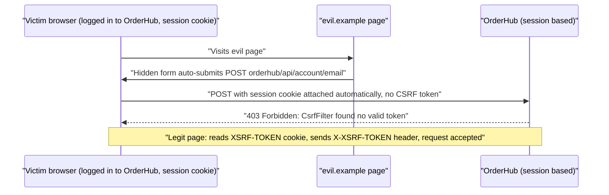

@@ 3 | TOPIC | CSRF, CORS and Common Vulnerabilities | Cross-site request forgery and when to disable protection, CORS preflight and configuration, and the OWASP Top 10 in Spring apps | MUST
# CSRF, CORS and Common Vulnerabilities

**Level: Intermediate | Phase 14 | Priority: MUST | Since: CSRF protection on by default since Spring Security 4.0; BREACH-safe XOR tokens and deferred loading 6.0; CORS support Spring 4.2**

> **30-second interview answer:** CSRF is an attack where a malicious site makes the victim's browser send a request that automatically carries their session cookie. Spring Security blocks it by requiring a secret CSRF token on state-changing requests; you keep it on for cookie or session-based apps and can disable it for stateless APIs that authenticate with an `Authorization` header. CORS is not a protection but a controlled relaxation of the browser's same-origin policy: the server tells the browser which other origins may read its responses, configured in Spring with a `CorsConfigurationSource` and `http.cors()`. Beyond these, the vulnerabilities interviewers ask about most are broken access control (IDOR), injection, XSS, mass assignment and exposed secrets or actuator endpoints.

## 1. Concept in Simple Words
### Analogy
A forged letter with your signature stamp, and a guest list at the door.

| Situation | Web security |
|---|---|
| Your office has a stamp on your desk that makes any letter look signed by you | The browser attaches your session cookie to every request to that site |
| A stranger slips a pre-written letter "transfer 1000 to me" into your outbox while you are at your desk | A malicious page auto-submits a form to `bank.com` while you are logged in |
| The bank now requires a secret code from inside your office on every letter | CSRF token the attacker's page cannot read |
| The receptionist at a partner company decides which visitors may read your mail | CORS: the API declares which origins may read responses |
| The receptionist does not stop letters being sent, only who may read the reply | CORS does not prevent requests; it controls reading responses |

### What it is
- **Origin:** scheme + host + port. `https://app.orderhub.com` and `https://api.orderhub.com` are different origins.
- **Same-origin policy (SOP):** browsers let a page read responses only from its own origin.
- **CSRF (Cross-Site Request Forgery):** a forged request from another site that the browser sends with the victim's cookies. The attacker cannot read the response, but the action (transfer, change email) happens.
- **CSRF token (synchronizer token):** a random value tied to the session that must be sent in a header or form field; other sites cannot read it because of SOP.
- **`SameSite` cookie attribute:** `Lax` (Chrome's default for cookies without the attribute) stops cookies on cross-site POSTs, `Strict` on all cross-site requests, `None` allows them (requires `Secure`). A strong second layer, not a full replacement.
- **CORS (Cross-Origin Resource Sharing):** response headers like `Access-Control-Allow-Origin` that let a server opt in to cross-origin reads.
- **Preflight:** an `OPTIONS` request the browser sends before "non-simple" requests (JSON body, `Authorization` header, PUT or DELETE) to ask permission.
- **OWASP Top 10:** the standard list of the most critical web risks (2021 edition: broken access control, cryptographic failures, injection, insecure design, security misconfiguration, vulnerable components, identification and authentication failures, software and data integrity failures, logging and monitoring failures, SSRF).

### Why it exists
Browsers send cookies automatically, which is what makes "stay logged in" work and also what makes CSRF possible. SOP protects users from sites reading each other's data, but it blocked legitimate architectures where a frontend on one domain calls an API on another, so CORS was added as a safe opt-in. The broader vulnerability list exists because most breaches come from a few repeated mistakes, and interviewers expect a backend developer to recognise them in code.

## 2. How It Works
CSRF attack and defence:


What `CsrfFilter` does (Spring Security 6):
1. Safe methods (`GET`, `HEAD`, `OPTIONS`, `TRACE`) are never checked; that is why GETs must not change state.
2. For `POST`, `PUT`, `PATCH`, `DELETE` it loads the expected token from the `CsrfTokenRepository` (session by default, or `CookieCsrfTokenRepository`) and compares it with the `X-CSRF-TOKEN` / `X-XSRF-TOKEN` header or `_csrf` parameter.
3. Tokens are loaded lazily (deferred) and, by default, sent to pages XOR-masked with random bytes (`XorCsrfTokenRequestAttributeHandler`) to defeat the BREACH compression attack. SPAs that read the raw cookie value need `CsrfTokenRequestAttributeHandler` (plain) for header validation.
4. Mismatch: `AccessDeniedException` (an `InvalidCsrfTokenException` or `MissingCsrfTokenException`), giving a 403.

CORS preflight:
```text
Browser on https://app.orderhub.com wants: PUT https://api.orderhub.com/api/orders/7 with JSON and Authorization header

1) Preflight                                         2) Real request (only if preflight allowed)
OPTIONS /api/orders/7                                PUT /api/orders/7
Origin: https://app.orderhub.com                     Origin: https://app.orderhub.com
Access-Control-Request-Method: PUT                   Authorization: Bearer eyJ
Access-Control-Request-Headers: authorization,      Content-Type: application/json
  content-type
                                                     200 OK
200 OK                                               Access-Control-Allow-Origin: https://app.orderhub.com
Access-Control-Allow-Origin: https://app.orderhub.com
Access-Control-Allow-Methods: GET,POST,PUT,DELETE
Access-Control-Allow-Headers: authorization, content-type
Access-Control-Max-Age: 3600
```
`CorsFilter` sits before authentication in the chain, so the preflight, which carries no token, is answered without a 401.

## 3. Code Example
### Code
Three pieces for OrderHub: CORS for the React frontend on the stateless API chain, a session-based admin chain with CSRF kept on in SPA-friendly cookie mode, and fixes for three classic vulnerabilities.

```yaml
# application.yml
orderhub:
  cors:
    allowed-origins: https://app.orderhub.com,http://localhost:5173
```

```java
package com.orderhub.security;

import java.time.Duration;
import java.util.List;
import org.springframework.beans.factory.annotation.Value;
import org.springframework.context.annotation.Bean;
import org.springframework.context.annotation.Configuration;
import org.springframework.core.annotation.Order;
import org.springframework.security.config.Customizer;
import org.springframework.security.config.annotation.web.builders.HttpSecurity;
import org.springframework.security.web.SecurityFilterChain;
import org.springframework.security.web.csrf.CookieCsrfTokenRepository;
import org.springframework.security.web.csrf.CsrfTokenRequestAttributeHandler;
import org.springframework.web.cors.CorsConfiguration;
import org.springframework.web.cors.CorsConfigurationSource;
import org.springframework.web.cors.UrlBasedCorsConfigurationSource;

@Configuration
public class WebSecurityExtras {

    /** Picked up by http.cors(Customizer.withDefaults()) in the API chain. */
    @Bean
    CorsConfigurationSource corsConfigurationSource(@Value("${orderhub.cors.allowed-origins}") List<String> origins) {
        CorsConfiguration config = new CorsConfiguration();
        config.setAllowedOrigins(origins);                                   // exact origins, never "*" with credentials
        config.setAllowedMethods(List.of("GET", "POST", "PUT", "PATCH", "DELETE"));
        config.setAllowedHeaders(List.of("Authorization", "Content-Type"));
        config.setExposedHeaders(List.of("Location"));                       // lets JS read the Location header
        config.setAllowCredentials(false);                                   // bearer header, no cookies
        config.setMaxAge(Duration.ofHours(1));                               // cache preflight results
        UrlBasedCorsConfigurationSource source = new UrlBasedCorsConfigurationSource();
        source.registerCorsConfiguration("/api/**", config);
        return source;
    }

    /** Session-based admin UI: cookies authenticate, so CSRF must stay on. */
    @Bean
    @Order(0)
    SecurityFilterChain adminUi(HttpSecurity http) throws Exception {
        CsrfTokenRequestAttributeHandler plain = new CsrfTokenRequestAttributeHandler();  // SPA sends the raw cookie value
        return http
            .securityMatcher("/admin-ui/**", "/login", "/logout")
            .authorizeHttpRequests(a -> a.anyRequest().hasRole("ADMIN"))
            .formLogin(Customizer.withDefaults())
            .csrf(csrf -> csrf
                .csrfTokenRepository(CookieCsrfTokenRepository.withHttpOnlyFalse())   // JS can read XSRF-TOKEN
                .csrfTokenRequestHandler(plain))
            .build();
    }
}
```

```java
package com.orderhub.product;

import jakarta.persistence.EntityManager;
import java.util.List;
import org.springframework.data.jpa.repository.JpaRepository;
import org.springframework.data.jpa.repository.Query;
import org.springframework.data.repository.query.Param;
import org.springframework.stereotype.Repository;

@Repository
class ProductSearch {
    private final EntityManager em;
    ProductSearch(EntityManager em) { this.em = em; }

    // VULNERABLE: SQL injection. name = "x' OR '1'='1" returns every row; worse payloads drop tables.
    List<?> searchUnsafe(String name) {
        return em.createNativeQuery("SELECT * FROM product WHERE name = '" + name + "'").getResultList();
    }

    // SAFE: bind parameter, the value is never parsed as SQL
    List<?> searchSafe(String name) {
        return em.createNativeQuery("SELECT * FROM product WHERE name = :name")
                 .setParameter("name", name).getResultList();
    }
}

interface ProductRepository extends JpaRepository<Product, Long> {
    @Query("select p from Product p where lower(p.name) like lower(concat('%', :q, '%'))")   // also bound safely
    List<Product> search(@Param("q") String q);
}
```

```java
package com.orderhub.customer;

import jakarta.validation.Valid;
import jakarta.validation.constraints.NotBlank;
import jakarta.validation.constraints.Size;
import com.orderhub.security.OrderAccess;
import org.springframework.security.core.Authentication;
import org.springframework.web.bind.annotation.PathVariable;
import org.springframework.web.bind.annotation.PutMapping;
import org.springframework.web.bind.annotation.RequestBody;
import org.springframework.web.bind.annotation.RestController;

@RestController
class ProfileController {

    /** Only the fields a customer may change. No role, no customerId, no credit limit. */
    record UpdateProfileRequest(@NotBlank @Size(max = 100) String name, @Size(max = 30) String phone) { }

    private final CustomerService service;
    ProfileController(CustomerService service) { this.service = service; }

    // VULNERABLE versions (do not write):
    //   @PutMapping("/api/customers/{id}") update(@PathVariable Long id, @RequestBody Customer body)
    //     -> mass assignment: the client can send "role":"ADMIN" or "creditLimit":100000
    //     -> IDOR: any logged-in user can change any id

    @PutMapping("/api/customers/me")
    CustomerDto updateMe(@Valid @RequestBody UpdateProfileRequest req, Authentication auth) {
        Long cid = OrderAccess.customerId(auth);             // identity from the token, not the URL
        return service.updateProfile(cid, req.name(), req.phone());
    }
}
```

### Walkthrough
- **CORS bean:** exact allowed origins from configuration, explicit methods and headers, and a preflight cache. `allowCredentials(false)` because the SPA sends a bearer header, not cookies; if credentials are true, the origin can never be `*`. The API chain uses it with `.cors(Customizer.withDefaults())` (shown in [[JWT Stateless Authentication]]).
- **Admin UI chain:** uses form login and a session cookie, so CSRF protection stays on. `CookieCsrfTokenRepository.withHttpOnlyFalse()` writes an `XSRF-TOKEN` cookie that the admin SPA reads and echoes in the `X-XSRF-TOKEN` header (Angular and Axios do this automatically). The plain request handler accepts the raw cookie value.
- **SQL injection:** string concatenation lets input become SQL. Bind parameters (`:name`), Spring Data derived queries and JPQL with `@Param` are safe because the driver sends values separately from the SQL text.
- **Mass assignment and IDOR:** binding the entity directly lets clients set fields they should not; a dedicated request record limits the writable fields. Using `/me` with the id from the token removes the IDOR entirely.

### Output
```http
OPTIONS /api/orders/7
Origin: https://app.orderhub.com
Access-Control-Request-Method: PUT
Access-Control-Request-Headers: authorization, content-type

HTTP/1.1 200 OK
Vary: Origin, Access-Control-Request-Method, Access-Control-Request-Headers
Access-Control-Allow-Origin: https://app.orderhub.com
Access-Control-Allow-Methods: GET,POST,PUT,PATCH,DELETE
Access-Control-Allow-Headers: Authorization, Content-Type
Access-Control-Expose-Headers: Location
Access-Control-Max-Age: 3600
```
```http
OPTIONS /api/orders/7
Origin: https://evil.example
Access-Control-Request-Method: DELETE

HTTP/1.1 403 Forbidden
Invalid CORS request
```
```http
POST /admin-ui/products/7/delete          (session cookie, no X-XSRF-TOKEN header)
Cookie: JSESSIONID=8F2A; XSRF-TOKEN=4b1d6c2e-9a7f-4e0b-8c3d-1f2e3a4b5c6d

HTTP/1.1 403 Forbidden

POST /admin-ui/products/7/delete
Cookie: JSESSIONID=8F2A; XSRF-TOKEN=4b1d6c2e-9a7f-4e0b-8c3d-1f2e3a4b5c6d
X-XSRF-TOKEN: 4b1d6c2e-9a7f-4e0b-8c3d-1f2e3a4b5c6d

HTTP/1.1 302 Found
Location: /admin-ui/products
```
SQL logged for the injection attempt `name = x' OR '1'='1`:
```sql
-- unsafe: the input became part of the SQL
SELECT * FROM product WHERE name = 'x' OR '1'='1'
-- safe: one bound parameter
SELECT * FROM product WHERE name = ?    -- binding parameter [1] as [VARCHAR] - [x' OR '1'='1]
```

### Compare
| Question | CSRF | CORS |
|---|---|---|
| What is it? | An attack | A browser mechanism (relaxation of SOP) |
| Who enforces it? | The server (`CsrfFilter`) | The browser, using server headers |
| Protects against | Forged state-changing requests with cookies | Nothing by itself; it allows cross-origin reads |
| Relevant when | Authentication uses cookies (sessions, cookie-stored tokens) | Frontend and API on different origins |
| Spring config | `http.csrf()` | `CorsConfigurationSource` + `http.cors()` |
| Disable when | Stateless API with `Authorization` header only | Never "disable"; just do not configure it if same-origin |

## 4. Interview Questions
**Basic**
1. **What is CSRF?**
   A malicious site makes the victim's browser send a state-changing request to a site where the victim is logged in, and the browser automatically attaches the session cookie. The attacker cannot read the response but the action happens. Defences are CSRF tokens, `SameSite` cookies and not using GET for changes.
2. **Should you disable CSRF for a REST API?**
   Only if the API does not use cookies for authentication: a stateless API with `Authorization: Bearer` headers is not vulnerable, because a foreign site cannot make the browser add that header. If the token is stored in a cookie, or you use sessions, CSRF protection must stay on.
3. **What is CORS?**
   A way for a server to tell the browser that pages from specified other origins may read its responses, using `Access-Control-Allow-*` headers. Without it, the same-origin policy blocks a frontend on `app.example.com` from reading responses from `api.example.com`.

**Follow-up**
4. **What is a preflight request and when does the browser send it?**
   An `OPTIONS` request asking whether the real request is allowed, sent for non-simple requests: methods other than GET, HEAD and POST, custom headers such as `Authorization`, or a JSON content type. The server answers with allowed origins, methods and headers, and the browser caches the answer for `Max-Age`.
5. **Why does CORS configuration belong in Spring Security and not only in `WebMvcConfigurer`?**
   Spring Security filters run before MVC; without `http.cors()`, the preflight (which has no credentials) gets a 401 from the security chain before MVC's CORS handling can answer. `http.cors(Customizer.withDefaults())` puts `CorsFilter` early in the chain using your `CorsConfigurationSource`.
6. **Is CORS a security feature that protects my API?**
   No. It protects users' browsers from malicious sites reading data, and only for browser clients; curl, Postman and servers ignore it completely. Your API must still authenticate and authorize every request.

**Tricky / scenario**
7. **You set `allowedOrigins("*")` with `allowCredentials(true)` and the app fails at startup or the browser rejects responses. Why?**
   The CORS spec forbids a wildcard origin with credentials, because that would let any site make credentialed reads. Spring throws an `IllegalArgumentException` for this combination. List exact origins or use `allowedOriginPatterns` carefully.
8. **What is IDOR and how do you prevent it in Spring?**
   Insecure Direct Object Reference: an endpoint like `GET /api/orders/205` returns an order without checking it belongs to the caller, so users can enumerate ids. It is the top OWASP risk (broken access control). Prevent it with ownership checks (`@PreAuthorize` with a bean), queries scoped by the current user, and `/me` endpoints that take the id from the token.
9. **A security scan flags `/actuator/env` and `/actuator/heapdump` as exposed. What is the risk and fix?**
   `env` can reveal configuration and, with some setups, secrets; `heapdump` contains everything in memory, including tokens and passwords. Expose only `health` and `info` publicly (`management.endpoints.web.exposure.include=health,info`), put others behind an admin role on a separate management port, and never expose them to the internet.

**What the interviewer is really testing:** whether you can tell CSRF and CORS apart, decide correctly when CSRF can be disabled, and spot the common vulnerabilities (IDOR, injection, mass assignment, exposed actuators) in Spring code.

## 5. Pitfalls & Best Practices
### Common mistakes
| Mistake | What goes wrong | Fix |
|---|---|---|
| Disabling CSRF on a session or cookie-based app because "it is a REST API" | Forged requests succeed | Keep CSRF on whenever cookies authenticate |
| `allowedOrigins("*")` in production | Any site can read API responses in the browser | Exact origins from configuration |
| CORS only in `WebMvcConfigurer` with Spring Security | Preflight gets 401 | Add `http.cors()` with a `CorsConfigurationSource` |
| State changes on GET | CSRF protection skipped, links and prefetching trigger actions | Use POST, PUT, PATCH, DELETE |
| String-concatenated SQL or JPQL | SQL injection | Bind parameters |
| `@RequestBody` straight into an entity | Mass assignment of role or price | Request DTO with only allowed fields |
| Secrets in `application.yml` committed to git | Credential leak | Environment variables or a secret manager |

### Best practices
- Decide per chain: stateless bearer API (CSRF off, CORS on if needed) versus cookie-based UI (CSRF on with `SameSite` cookies).
- Keep default security headers; add a Content Security Policy for anything serving HTML to reduce XSS.
- Validate input with Bean Validation, encode output (Thymeleaf escapes by default; never build HTML with string concatenation).
- Scan dependencies (OWASP Dependency-Check, GitHub Dependabot, Snyk) and update Spring Boot patch versions promptly.
- Limit actuator exposure, run management on a separate port, and never expose `heapdump`, `env` or `shutdown` publicly.
- Log security events (failed logins, access denied) without logging secrets; alert on spikes.

### Compare with
| Vulnerability | Example in a Spring app | Spring-side defence |
|---|---|---|
| Broken access control (IDOR) | `GET /api/orders/{id}` without owner check | `@PreAuthorize`, user-scoped queries |
| Injection | Concatenated native query | Bind parameters, Spring Data |
| XSS | Rendering user input unescaped in HTML | Thymeleaf escaping, CSP header |
| CSRF | Session app without tokens | `CsrfFilter` (default on) |
| Security misconfiguration | Public actuator endpoints, verbose errors | Limited exposure, `server.error.include-stacktrace=never` |
| Cryptographic failures | Plain-text or SHA-256 passwords, HTTP | BCrypt, TLS, HSTS header |
| Vulnerable components | Old Spring or Jackson versions | Dependency scanning, Boot upgrades |
| SSRF | Fetching a user-supplied URL server-side | Allow-list hosts, block internal IP ranges |

## 6. Hands-on Exercise
Harden OrderHub:
1. Configure CORS for `http://localhost:5173` (Vite dev server) and `https://app.orderhub.com` on `/api/**`.
2. Expose only `health` and `info` actuator endpoints publicly and require `ADMIN` for the rest.
3. Replace the `PUT /api/customers/{id}` endpoint that binds the `Customer` entity with a safe `PUT /api/customers/me` using a request record.
4. Write a test proving that a preflight from `https://evil.example` is rejected and one from the allowed origin succeeds.

Acceptance criteria: preflight tests pass; `/actuator/env` returns 401 anonymously; a request body containing `"role":"ADMIN"` has no effect.

<details><summary>Solution</summary>

```yaml
management:
  endpoints:
    web:
      exposure:
        include: health,info,metrics,prometheus
  endpoint:
    health:
      show-details: when-authorized
server:
  error:
    include-stacktrace: never
    include-message: never
```

```java
package com.orderhub.security;

import static org.springframework.test.web.servlet.request.MockMvcRequestBuilders.options;
import static org.springframework.test.web.servlet.result.MockMvcResultMatchers.header;
import static org.springframework.test.web.servlet.result.MockMvcResultMatchers.status;

import org.junit.jupiter.api.Test;
import org.springframework.beans.factory.annotation.Autowired;
import org.springframework.boot.test.autoconfigure.web.servlet.AutoConfigureMockMvc;
import org.springframework.boot.test.context.SpringBootTest;
import org.springframework.test.web.servlet.MockMvc;

@SpringBootTest(properties = "orderhub.cors.allowed-origins=http://localhost:5173,https://app.orderhub.com")
@AutoConfigureMockMvc
class CorsTest {

    @Autowired MockMvc mvc;

    @Test
    void allowedOriginPreflightSucceeds() throws Exception {
        mvc.perform(options("/api/orders/7")
                .header("Origin", "http://localhost:5173")
                .header("Access-Control-Request-Method", "PUT")
                .header("Access-Control-Request-Headers", "authorization,content-type"))
           .andExpect(status().isOk())
           .andExpect(header().string("Access-Control-Allow-Origin", "http://localhost:5173"));
    }

    @Test
    void unknownOriginPreflightRejected() throws Exception {
        mvc.perform(options("/api/orders/7")
                .header("Origin", "https://evil.example")
                .header("Access-Control-Request-Method", "DELETE"))
           .andExpect(status().isForbidden());
    }
}
```
The CORS bean from the code example plus `.cors(Customizer.withDefaults())` in the API chain handles step 1. For step 2, add `requestMatchers("/actuator/health/**", "/actuator/info").permitAll()` and `requestMatchers("/actuator/**").hasRole("ADMIN")` in an actuator chain (or `EndpointRequest.toAnyEndpoint()` matchers from Spring Boot). For step 3, use `ProfileController` from the code example: `UpdateProfileRequest` has no `role` field, so Jackson ignores `"role":"ADMIN"` (or rejects it if `spring.jackson.deserialization.fail-on-unknown-properties=true`).
</details>

## 7. Recall
Q: What is a CSRF attack?
A: A malicious site makes the victim's browser send a state-changing request to a site where the victim is logged in, with the session cookie attached automatically.

Q: When is it safe to disable CSRF protection in Spring Security?
A: When the API is stateless and authenticates only with an `Authorization` header, not with cookies or sessions.

Q: What is a CORS preflight request?
A: An `OPTIONS` request the browser sends before a non-simple cross-origin request to ask which origins, methods and headers the server allows.

Q: Why must CORS be configured with http.cors() when using Spring Security?
A: So `CorsFilter` answers preflight requests before the security filters reject them with 401.

Q: Why can't a CORS configuration use allowedOrigins "*" together with allowCredentials true?
A: The CORS spec forbids it because any site could make credentialed reads; Spring throws an exception.

Q: What is IDOR and how is it prevented in a Spring API?
A: Accessing another user's object by changing an id; prevent it with ownership checks, user-scoped queries and `/me` endpoints.

**Related:** [[SecurityFilterChain Configuration]] · [[JWT Stateless Authentication]] · [[Method Security with @PreAuthorize]]

@@ 3 | TOPIC | Practice — Coding drill: Secure OrderHub | Eleven hands-on security tasks: filter chain, users, JWT filter, ownership, CORS, lockout and security tests | MUST
# Coding drill: Secure OrderHub

Eleven tasks that interviewers give in live-coding or take-home rounds on Spring Security. Every solution uses Spring Security 6 with the lambda DSL and a `SecurityFilterChain` bean. Try each one in your OrderHub project before opening the solution.

## 1. Write the filter chain from requirements
Requirements: stateless JWT API; `POST /api/auth/**` public; `GET /api/products/**` public; product writes need `ADMIN`; `/api/admin/**` needs `ADMIN`; `/actuator/health` public; everything else authenticated; CSRF off; CORS on.

Hint: specific rules first, method-specific rules before path-only rules, `anyRequest()` last.

<details><summary>Solution</summary>

```java
package com.orderhub.security;

import org.springframework.context.annotation.Bean;
import org.springframework.context.annotation.Configuration;
import org.springframework.http.HttpMethod;
import org.springframework.security.config.Customizer;
import org.springframework.security.config.annotation.method.configuration.EnableMethodSecurity;
import org.springframework.security.config.annotation.web.builders.HttpSecurity;
import org.springframework.security.config.http.SessionCreationPolicy;
import org.springframework.security.oauth2.server.resource.authentication.JwtAuthenticationConverter;
import org.springframework.security.web.SecurityFilterChain;

@Configuration
@EnableMethodSecurity
public class SecurityConfig {

    @Bean
    SecurityFilterChain api(HttpSecurity http, JwtAuthenticationConverter converter) throws Exception {
        return http
            .authorizeHttpRequests(auth -> auth
                .requestMatchers("/error", "/actuator/health/**").permitAll()
                .requestMatchers(HttpMethod.POST, "/api/auth/**").permitAll()
                .requestMatchers(HttpMethod.GET, "/api/products/**").permitAll()
                .requestMatchers("/api/products/**", "/api/admin/**").hasRole("ADMIN")
                .anyRequest().authenticated())
            .oauth2ResourceServer(rs -> rs.jwt(jwt -> jwt.jwtAuthenticationConverter(converter)))
            .sessionManagement(s -> s.sessionCreationPolicy(SessionCreationPolicy.STATELESS))
            .csrf(csrf -> csrf.disable())
            .cors(Customizer.withDefaults())
            .build();
    }
}
```
Explanation: the GET products rule must sit above the products `ADMIN` rule; reversing them would make browsing require admin. `/error` is permitted so that error responses are not converted into 401s.
</details>

## 2. Load users with many roles from the database
Users have a many-to-many `roles` relation (`app_user`, `role`, `user_role`). Write a `UserDetailsService` that loads the user and roles in one query and maps them to `ROLE_` authorities.

Hint: a fetch join avoids `LazyInitializationException` and the N+1 problem.

<details><summary>Solution</summary>

```java
package com.orderhub.user;

import jakarta.persistence.Entity;
import jakarta.persistence.Id;
import jakarta.persistence.JoinColumn;
import jakarta.persistence.JoinTable;
import jakarta.persistence.ManyToMany;
import java.util.HashSet;
import java.util.Optional;
import java.util.Set;
import org.springframework.data.jpa.repository.JpaRepository;
import org.springframework.data.jpa.repository.Query;
import org.springframework.security.core.authority.SimpleGrantedAuthority;
import org.springframework.security.core.userdetails.User;
import org.springframework.security.core.userdetails.UserDetails;
import org.springframework.security.core.userdetails.UserDetailsService;
import org.springframework.security.core.userdetails.UsernameNotFoundException;
import org.springframework.stereotype.Service;
import org.springframework.transaction.annotation.Transactional;

@Entity
class RoleEntity { @Id Long id; String name; }            // table "role" mapped via naming strategy or @Table

@Entity
class UserEntity {
    @Id Long id;
    String username;
    String passwordHash;
    boolean enabled;
    @ManyToMany
    @JoinTable(name = "user_role", joinColumns = @JoinColumn(name = "user_id"),
               inverseJoinColumns = @JoinColumn(name = "role_id"))
    Set<RoleEntity> roles = new HashSet<>();
}

interface UserEntityRepository extends JpaRepository<UserEntity, Long> {
    @Query("select u from UserEntity u left join fetch u.roles where u.username = :username")
    Optional<UserEntity> findWithRoles(String username);
}

@Service
class MultiRoleUserDetailsService implements UserDetailsService {
    private final UserEntityRepository repo;
    MultiRoleUserDetailsService(UserEntityRepository repo) { this.repo = repo; }

    @Override
    @Transactional(readOnly = true)
    public UserDetails loadUserByUsername(String username) {
        UserEntity u = repo.findWithRoles(username)
                .orElseThrow(() -> new UsernameNotFoundException(username));
        return User.withUsername(u.username)
                .password(u.passwordHash)
                .disabled(!u.enabled)
                .authorities(u.roles.stream().map(r -> new SimpleGrantedAuthority("ROLE_" + r.name)).toList())
                .build();
    }
}
```
Explanation: `left join fetch` loads roles in the same SQL statement. Returning Spring's immutable `User` (not the entity) means nothing lazy is touched after the transaction ends.
</details>

## 3. The interview classic: a custom JWT filter
Some interviewers ask you to write the JWT filter yourself instead of using the resource server. Write a `OncePerRequestFilter` that reads the bearer token, validates it with a `JwtDecoder`, and sets the security context; invalid tokens must return 401, missing tokens must continue anonymously.

Hint: never swallow a validation failure and continue, or the user silently becomes anonymous.

<details><summary>Solution</summary>

```java
package com.orderhub.security;

import jakarta.servlet.FilterChain;
import jakarta.servlet.ServletException;
import jakarta.servlet.http.HttpServletRequest;
import jakarta.servlet.http.HttpServletResponse;
import java.io.IOException;
import java.util.Collection;
import java.util.List;
import org.springframework.http.HttpHeaders;
import org.springframework.security.authentication.UsernamePasswordAuthenticationToken;
import org.springframework.security.core.GrantedAuthority;
import org.springframework.security.core.authority.SimpleGrantedAuthority;
import org.springframework.security.core.context.SecurityContext;
import org.springframework.security.core.context.SecurityContextHolder;
import org.springframework.security.oauth2.jwt.Jwt;
import org.springframework.security.oauth2.jwt.JwtDecoder;
import org.springframework.security.oauth2.jwt.JwtException;
import org.springframework.web.filter.OncePerRequestFilter;

public class JwtAuthFilter extends OncePerRequestFilter {

    private final JwtDecoder decoder;

    public JwtAuthFilter(JwtDecoder decoder) { this.decoder = decoder; }

    @Override
    protected void doFilterInternal(HttpServletRequest request, HttpServletResponse response,
                                    FilterChain chain) throws ServletException, IOException {
        String header = request.getHeader(HttpHeaders.AUTHORIZATION);
        if (header == null || !header.startsWith("Bearer ")) {
            chain.doFilter(request, response);                     // anonymous; rules decide
            return;
        }
        try {
            Jwt jwt = decoder.decode(header.substring(7));        // signature, exp, iss
            List<String> roles = jwt.getClaimAsStringList("roles");
            Collection<GrantedAuthority> authorities = roles == null ? List.of()
                    : roles.stream().<GrantedAuthority>map(r -> new SimpleGrantedAuthority("ROLE_" + r)).toList();
            var auth = UsernamePasswordAuthenticationToken.authenticated(jwt.getSubject(), null, authorities);
            SecurityContext ctx = SecurityContextHolder.createEmptyContext();
            ctx.setAuthentication(auth);
            SecurityContextHolder.setContext(ctx);
            chain.doFilter(request, response);
        } catch (JwtException e) {
            SecurityContextHolder.clearContext();
            response.setHeader(HttpHeaders.WWW_AUTHENTICATE, "Bearer error=\"invalid_token\"");
            response.sendError(HttpServletResponse.SC_UNAUTHORIZED, "Invalid token");
        }
    }
}
```
Register it with `.addFilterBefore(new JwtAuthFilter(decoder), UsernamePasswordAuthenticationFilter.class)` and do not also enable `oauth2ResourceServer`. In the interview, say you would normally prefer the built-in resource server because it already handles all of this, including RFC 6750 error headers.
</details>

## 4. Issue a token on login
Write `POST /api/auth/login` that authenticates with the `AuthenticationManager` and returns a signed JWT with `sub`, `roles` and a 15-minute expiry.

Hint: expose the `AuthenticationManager` from `AuthenticationConfiguration`; sign with `JwtEncoder`.

<details><summary>Solution</summary>

```java
package com.orderhub.security;

import java.time.Duration;
import java.time.Instant;
import org.springframework.security.authentication.AuthenticationManager;
import org.springframework.security.authentication.UsernamePasswordAuthenticationToken;
import org.springframework.security.core.Authentication;
import org.springframework.security.core.GrantedAuthority;
import org.springframework.security.oauth2.jose.jws.MacAlgorithm;
import org.springframework.security.oauth2.jwt.JwsHeader;
import org.springframework.security.oauth2.jwt.JwtClaimsSet;
import org.springframework.security.oauth2.jwt.JwtEncoder;
import org.springframework.security.oauth2.jwt.JwtEncoderParameters;
import org.springframework.web.bind.annotation.PostMapping;
import org.springframework.web.bind.annotation.RequestBody;
import org.springframework.web.bind.annotation.RestController;

@RestController
class LoginController {
    record Login(String username, String password) { }
    record Token(String accessToken, long expiresIn) { }

    private static final Duration TTL = Duration.ofMinutes(15);
    private final AuthenticationManager am;
    private final JwtEncoder encoder;

    LoginController(AuthenticationManager am, JwtEncoder encoder) { this.am = am; this.encoder = encoder; }

    @PostMapping("/api/auth/login")
    Token login(@RequestBody Login req) {
        Authentication auth = am.authenticate(
                UsernamePasswordAuthenticationToken.unauthenticated(req.username(), req.password()));
        Instant now = Instant.now();
        JwtClaimsSet claims = JwtClaimsSet.builder()
                .issuer("orderhub").subject(auth.getName())
                .issuedAt(now).expiresAt(now.plus(TTL))
                .claim("roles", auth.getAuthorities().stream()
                        .map(GrantedAuthority::getAuthority).map(a -> a.replaceFirst("^ROLE_", "")).toList())
                .build();
        String token = encoder.encode(JwtEncoderParameters.from(JwsHeader.with(MacAlgorithm.HS256).build(), claims))
                              .getTokenValue();
        return new Token(token, TTL.toSeconds());
    }
}
```
Explanation: the password check reuses `DaoAuthenticationProvider` (BCrypt, enumeration protection). Wrong credentials throw `BadCredentialsException`; map it to 401 in the `@RestControllerAdvice`.
</details>

## 5. Ownership check with @PreAuthorize
`GET /api/orders/{orderId}` must work for the owning customer or an admin only. Write the access bean and the annotated service method.

Hint: `@beanName.method(#arg, authentication)`.

<details><summary>Solution</summary>

```java
package com.orderhub.order;

import org.springframework.security.access.prepost.PreAuthorize;
import org.springframework.security.core.Authentication;
import org.springframework.security.oauth2.jwt.Jwt;
import org.springframework.stereotype.Component;
import org.springframework.stereotype.Service;

@Component("orderGuard")
class OrderGuard {
    private final OrderRepository repo;
    OrderGuard(OrderRepository repo) { this.repo = repo; }

    public boolean owns(Long orderId, Authentication auth) {
        if (!(auth.getPrincipal() instanceof Jwt jwt)) return false;
        Number cid = jwt.getClaim("cid");
        return cid != null && repo.existsByIdAndCustomerId(orderId, cid.longValue());
    }
}

@Service
class OrderQueryService {
    private final OrderRepository repo;
    OrderQueryService(OrderRepository repo) { this.repo = repo; }

    @PreAuthorize("hasRole('ADMIN') or @orderGuard.owns(#orderId, authentication)")
    public OrderDto get(Long orderId) {
        return repo.findById(orderId).map(OrderDto::from).orElseThrow(() -> new OrderNotFoundException(orderId));
    }
}
```
Explanation: the check runs before the method in the security proxy. Admins short-circuit the `or`, so no query runs for them.
</details>

## 6. Predict the outcome: rule order and prefixes
```java
http.authorizeHttpRequests(auth -> auth
        .requestMatchers("/api/**").authenticated()
        .requestMatchers("/api/admin/**").hasAuthority("ADMIN")
        .anyRequest().denyAll());
// user bob has authorities [ROLE_ADMIN]
```
What do `GET /api/admin/users` (as bob, as a customer) and `GET /health` return?

<details><summary>Solution</summary>

```text
GET /api/admin/users as bob       -> 200 (first rule matches: only "authenticated" is required)
GET /api/admin/users as customer  -> 200 (same: the admin rule is never reached)
GET /health                       -> 401 anonymous (denyAll, anonymous user goes to the entry point)
```
Two bugs: the broad `/api/**` rule shadows the admin rule, and even if reordered, `hasAuthority("ADMIN")` would not match `ROLE_ADMIN`. Fix: put `requestMatchers("/api/admin/**").hasRole("ADMIN")` first.
</details>

## 7. CORS for the React frontend
Allow `http://localhost:5173` to call the API with a bearer header, including PUT and DELETE.

<details><summary>Solution</summary>

```java
package com.orderhub.security;

import java.util.List;
import org.springframework.context.annotation.Bean;
import org.springframework.context.annotation.Configuration;
import org.springframework.web.cors.CorsConfiguration;
import org.springframework.web.cors.CorsConfigurationSource;
import org.springframework.web.cors.UrlBasedCorsConfigurationSource;

@Configuration
class CorsConfig {
    @Bean
    CorsConfigurationSource corsConfigurationSource() {
        CorsConfiguration c = new CorsConfiguration();
        c.setAllowedOrigins(List.of("http://localhost:5173"));
        c.setAllowedMethods(List.of("GET", "POST", "PUT", "DELETE", "PATCH"));
        c.setAllowedHeaders(List.of("Authorization", "Content-Type"));
        c.setMaxAge(3600L);
        UrlBasedCorsConfigurationSource source = new UrlBasedCorsConfigurationSource();
        source.registerCorsConfiguration("/api/**", c);
        return source;
    }
}
```
Plus `.cors(Customizer.withDefaults())` in the chain. Without it the preflight `OPTIONS` hits the security filters and fails with 401.
</details>

## 8. Lock accounts after five failed logins
After five consecutive failed logins, lock the account for 15 minutes. Reset the counter on success.

Hint: Spring publishes `AuthenticationFailureBadCredentialsEvent` and `AuthenticationSuccessEvent` through an `AuthenticationEventPublisher`.

<details><summary>Solution</summary>

```java
package com.orderhub.security;

import java.time.Duration;
import java.time.Instant;
import java.util.Map;
import java.util.concurrent.ConcurrentHashMap;
import org.springframework.context.event.EventListener;
import org.springframework.security.authentication.event.AuthenticationFailureBadCredentialsEvent;
import org.springframework.security.authentication.event.AuthenticationSuccessEvent;
import org.springframework.stereotype.Component;

@Component
public class LoginAttemptService {
    private static final int MAX = 5;
    private static final Duration LOCK = Duration.ofMinutes(15);

    private record Attempts(int count, Instant lockedUntil) { }
    private final Map<String, Attempts> attempts = new ConcurrentHashMap<>();

    @EventListener
    public void onFailure(AuthenticationFailureBadCredentialsEvent e) {
        String user = e.getAuthentication().getName();
        attempts.compute(user, (k, a) -> {
            int count = (a == null ? 0 : a.count()) + 1;
            return new Attempts(count, count >= MAX ? Instant.now().plus(LOCK) : null);
        });
    }

    @EventListener
    public void onSuccess(AuthenticationSuccessEvent e) {
        attempts.remove(e.getAuthentication().getName());
    }

    public boolean isLocked(String username) {
        Attempts a = attempts.get(username);
        return a != null && a.lockedUntil() != null && a.lockedUntil().isAfter(Instant.now());
    }
}
```
In `JpaUserDetailsService`, build the `UserDetails` with `accountNonLocked = !attemptService.isLocked(username)`; `DaoAuthenticationProvider` then throws `LockedException`. Spring Boot registers a `DefaultAuthenticationEventPublisher` automatically. In a multi-instance deployment store the counters in Redis or the `app_user` table instead of a local map, and lock per username plus per IP to avoid letting attackers lock out arbitrary users too easily.
</details>

## 9. Test a secured endpoint with a mock JWT
Write MockMvc tests for `GET /api/orders/mine`: 401 without a token, 200 with a customer JWT.

<details><summary>Solution</summary>

```java
package com.orderhub.order;

import static org.springframework.security.test.web.servlet.request.SecurityMockMvcRequestPostProcessors.jwt;
import static org.springframework.test.web.servlet.request.MockMvcRequestBuilders.get;
import static org.springframework.test.web.servlet.result.MockMvcResultMatchers.status;

import org.junit.jupiter.api.Test;
import org.springframework.beans.factory.annotation.Autowired;
import org.springframework.boot.test.autoconfigure.web.servlet.WebMvcTest;
import org.springframework.context.annotation.Import;
import org.springframework.security.core.authority.SimpleGrantedAuthority;
import org.springframework.test.context.bean.override.mockito.MockitoBean;
import org.springframework.test.web.servlet.MockMvc;
import com.orderhub.security.SecurityConfig;
import com.orderhub.security.JwtConfig;

@WebMvcTest(MyOrdersController.class)
@Import({SecurityConfig.class, JwtConfig.class})
class MyOrdersControllerTest {

    @Autowired MockMvc mvc;
    @MockitoBean OrderService orders;            // Boot 3.4+: replaces @MockBean

    @Test
    void noTokenIs401() throws Exception {
        mvc.perform(get("/api/orders/mine")).andExpect(status().isUnauthorized());
    }

    @Test
    void customerTokenIs200() throws Exception {
        mvc.perform(get("/api/orders/mine")
                .with(jwt().jwt(j -> j.subject("alice").claim("cid", 7L))
                           .authorities(new SimpleGrantedAuthority("ROLE_CUSTOMER"))))
           .andExpect(status().isOk());
    }
}
```
Explanation: `@WebMvcTest` is a slice, so you import the security configuration explicitly. The `jwt()` post-processor bypasses decoding and places a `JwtAuthenticationToken` in the context. `JwtConfig` needs `orderhub.jwt.*` properties in `src/test/resources/application.yml`.
</details>

## 10. Get the current user in a service and in async code
Write a `CurrentUser` helper that returns the customer id, and make `@Async` methods see the security context.

<details><summary>Solution</summary>

```java
package com.orderhub.security;

import java.util.Optional;
import java.util.concurrent.Executor;
import org.springframework.context.annotation.Bean;
import org.springframework.context.annotation.Configuration;
import org.springframework.core.task.TaskExecutor;
import org.springframework.scheduling.annotation.EnableAsync;
import org.springframework.scheduling.concurrent.ThreadPoolTaskExecutor;
import org.springframework.security.core.Authentication;
import org.springframework.security.core.context.SecurityContextHolder;
import org.springframework.security.oauth2.jwt.Jwt;
import org.springframework.security.task.DelegatingSecurityContextAsyncTaskExecutor;
import org.springframework.stereotype.Component;

@Component
public class CurrentUser {
    public Optional<Long> customerId() {
        Authentication auth = SecurityContextHolder.getContext().getAuthentication();
        if (auth != null && auth.getPrincipal() instanceof Jwt jwt && jwt.getClaim("cid") instanceof Number n) {
            return Optional.of(n.longValue());
        }
        return Optional.empty();
    }
}

@Configuration
@EnableAsync
class AsyncSecurityConfig {
    @Bean(name = "taskExecutor")
    Executor taskExecutor() {
        ThreadPoolTaskExecutor pool = new ThreadPoolTaskExecutor();
        pool.setCorePoolSize(4);
        pool.setThreadNamePrefix("async-");
        pool.initialize();
        // copies the caller's SecurityContext onto the worker thread and clears it afterwards
        return new DelegatingSecurityContextAsyncTaskExecutor(pool);
    }
}
```
Explanation: the security context is a `ThreadLocal`, so a plain pool thread sees nothing. The delegating executor captures the context at submit time and restores and clears it around each task, which avoids leaking one user's identity to the next task.
</details>

## 11. Code review: find the vulnerabilities
```java
@RestController
class AdminishController {
    @Autowired EntityManager em;

    @GetMapping("/api/orders/search")
    List<?> search(@RequestParam String status) {
        return em.createNativeQuery("select * from orders where status = '" + status + "'").getResultList();
    }

    @PutMapping("/api/users/{id}")
    AppUser update(@PathVariable Long id, @RequestBody AppUser body) {
        body.id = id;
        return em.merge(body);
    }

    @GetMapping("/api/orders/{id}/delete")
    void delete(@PathVariable Long id) { em.remove(em.find(Order.class, id)); }
}
```

<details><summary>Solution</summary>

```text
1. SQL injection in search: status is concatenated into SQL.
2. Mass assignment in update: the client can set role, passwordHash, enabled.
3. IDOR in update: any authenticated user can update any user id.
4. Returning the AppUser entity leaks the password hash.
5. State change on GET (delete): bypasses CSRF protection and can be triggered by links, crawlers or prefetch.
6. No authorization on delete at all; anyone authenticated can delete any order.
7. Field injection with @Autowired makes testing harder (minor).
```
```java
@RestController
class OrderAdminController {
    private final OrderRepository orders;
    private final UserService users;

    OrderAdminController(OrderRepository orders, UserService users) { this.orders = orders; this.users = users; }

    record UpdateUserRequest(@NotBlank String displayName) { }
    record UserView(Long id, String username, String displayName) { }

    @GetMapping("/api/orders/search")
    @PreAuthorize("hasRole('ADMIN')")
    List<OrderDto> search(@RequestParam OrderStatus status) {               // enum binding rejects junk values
        return orders.findByStatus(status).stream().map(OrderDto::from).toList();
    }

    @PutMapping("/api/users/me")
    UserView updateMe(@Valid @RequestBody UpdateUserRequest req, Authentication auth) {
        return users.updateDisplayName(auth.getName(), req.displayName());
    }

    @DeleteMapping("/api/orders/{orderId}")
    @PreAuthorize("hasRole('ADMIN')")
    @ResponseStatus(HttpStatus.NO_CONTENT)
    void delete(@PathVariable Long orderId) { orders.deleteById(orderId); }
}
```
Explanation: derived queries bind parameters; a request record limits writable fields; identity comes from the authentication; DELETE is the right verb and is admin-only; responses are DTOs without secrets.
</details>
