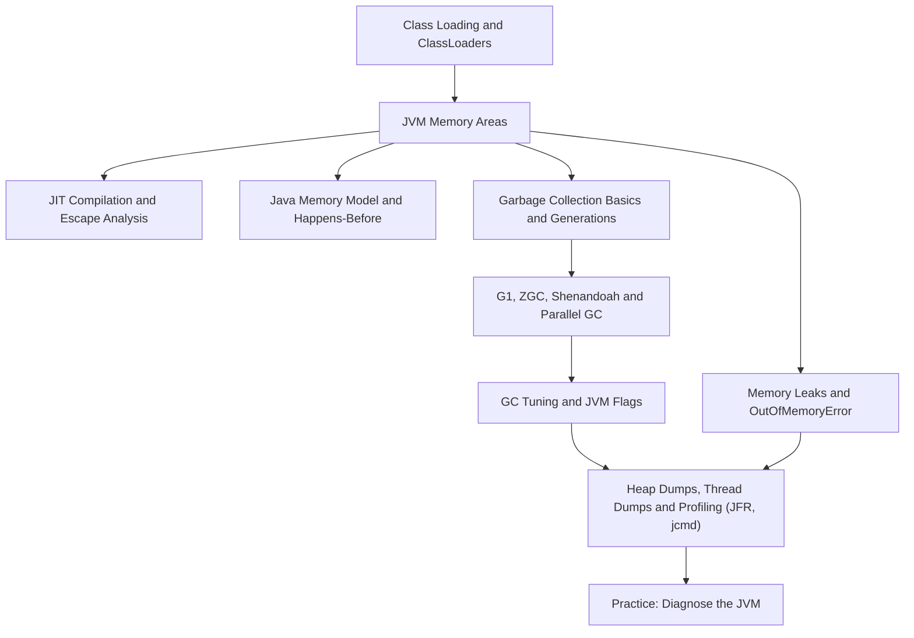
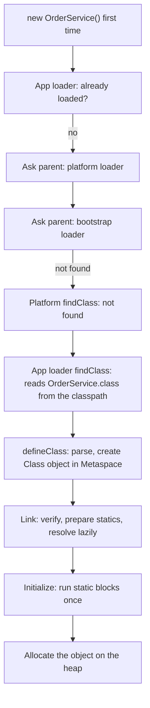
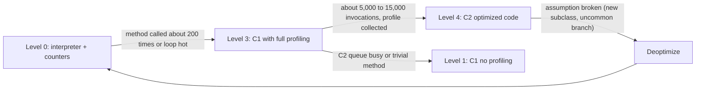

@@ 1 | MODULE | Phase 15 — JVM Internals and Performance (Advanced) | Class loading, memory areas, JIT, the Java Memory Model, garbage collectors, tuning and diagnosing leaks with dumps and JFR | MUST
# Phase 15: JVM Internals and Performance (Advanced)

This phase opens the hood of the Java Virtual Machine: how classes get into memory, where objects and stack frames live, how the JIT compiler turns hot bytecode into machine code, what the Java Memory Model promises between threads, how garbage collectors reclaim memory, and how you diagnose a slow or crashing JVM in production. Senior interviews lean on this heavily because it separates people who write Java from people who can run Java services: "our pod is OOM-killed", "p99 latency spikes every few minutes", "CPU is 100% and nobody knows why" are real scenarios you will be asked to reason through.

For OrderHub this phase is about operating it: choosing container-friendly JVM flags, reading GC logs, taking heap and thread dumps from the running Spring Boot app, and recording a Java Flight Recorder profile. Examples are plain Java 21 programs you can compile and run with `javac` and `java`, plus the commands you would run against OrderHub.



**Prerequisites:** Phase 9 (threads, `synchronized`, `volatile`), Phase 8 (how `HashMap` stores objects, useful for leak analysis), Phase 10 (Spring proxies are generated classes, relevant to class loading and Metaspace), and Phase 2 (`equals` and `hashCode`, the root of a classic leak).

**The 5 questions from this phase that come up most often**
1. Explain the JVM memory areas: heap, stack, Metaspace. What lives where?
2. How does garbage collection work, and what are the young and old generations?
3. Which garbage collector would you choose for a low-latency service, and why (G1 vs ZGC vs Parallel)?
4. What is the Java Memory Model and happens-before? Why is `volatile` needed in double-checked locking?
5. Your service throws `OutOfMemoryError` in production. Walk me through how you find the cause.

@@ 2 | MODULE | The JVM | How code is loaded, laid out in memory, compiled and shared between threads | MUST
# The JVM

**Shared analogy: a factory.** Class loaders are the receiving dock that accepts blueprints (class files), checks them and files them in the archive (Metaspace). The factory floor (heap) is where products (objects) are built, while each worker (thread) has a personal workbench (stack) with notes for the task in hand. At first workers follow the blueprint step by step (the interpreter), but for jobs repeated thousands of times the factory builds a dedicated machine (JIT-compiled code). And because workers share the floor, there must be rules about when one worker's changes become visible to another (the Java Memory Model). This group covers those four parts.

@@ 3 | TOPIC | Class Loading and ClassLoaders | Loading, linking and initialization, the bootstrap, platform and application loaders, parent delegation and class loader leaks | MUST
# Class Loading and ClassLoaders

**Level: Advanced | Phase 15 | Priority: MUST | Since: Java 1.0 (class loaders); platform class loader replaced the extension loader in Java 9 (modules)**

> **30-second interview answer:** The JVM loads classes lazily, the first time they are needed, in three phases: loading (find the bytes and create a `Class` object), linking (verify the bytecode, prepare static fields with default values, resolve symbolic references) and initialization (run static initializers). Class loaders form a hierarchy: bootstrap (core `java.*`), platform, and application (your classpath), and they use parent delegation, asking the parent first so core classes cannot be replaced. A class's identity is its name plus its loader, which explains `ClassCastException` between "identical" classes and Metaspace leaks when a loader cannot be collected.

## 1. Concept in Simple Words
### Analogy
A library's request desk.

| Library | Class loading |
|---|---|
| A reader asks for a book by its catalogue number | Code refers to a class by its fully qualified name |
| The local branch first asks the regional library, which first asks the national library | Parent delegation: application → platform → bootstrap |
| The national library owns the classics and never lets branches substitute their own edition | Bootstrap loader owns `java.lang.String`; nobody can replace it |
| The local branch only fetches a book itself if no parent has it | A loader defines a class only if its parents cannot find it |
| A book is checked for damage and missing pages before shelving | Verification during linking |
| Reading the preface the first time someone opens the book | Static initialization on first active use |
| Two branches with their own copy of the same title count as different books | Same class name in two loaders = two different classes |

### What it is
- **Class loader:** an object (subclass of `java.lang.ClassLoader`) that finds class bytes and turns them into `Class` objects with `defineClass`.
- **Bootstrap loader:** built into the JVM (native), loads core modules like `java.base`. In Java code it shows up as `null`.
- **Platform loader:** loads other Java SE and JDK modules such as `java.sql`. Before Java 9 this role was the "extension" loader reading `jre/lib/ext`.
- **Application (system) loader:** loads classes from the classpath or module path, i.e. your code and libraries.
- **Parent delegation:** `loadClass` first checks whether the class is already loaded, then asks the parent, and only if the parent fails calls its own `findClass`.
- **Loading / linking / initialization:** the three phases. Linking has three steps: **verification** (bytecode is type-safe and well-formed), **preparation** (allocate static fields, set default values like 0 and null), **resolution** (turn symbolic references into direct references, often lazily).
- **Initialization:** running `<clinit>`, the static initializer and static field assignments, exactly once, thread-safely, on first **active use**: `new`, a static method call, reading or writing a non-constant static field, reflection like `Class.forName(name)`, or initializing a subclass.
- **`ClassNotFoundException` vs `NoClassDefFoundError`:** the first is a checked exception when code explicitly asks for a class by name that cannot be found; the second is an error when a class that was present at compile time is missing at runtime, or when its static initializer failed earlier.

### Why it exists
Loading on demand keeps startup fast and memory small: a Spring Boot app's classpath has tens of thousands of classes, and only those actually used get loaded. Separate loaders allow isolation: an application server can run two web apps with different versions of the same library, and frameworks can generate classes at runtime (Spring's CGLIB proxies, Hibernate's bytecode enhancement, lambdas via hidden classes). Parent delegation protects the platform: a malicious `java.lang.String` on the classpath is never used.

## 2. How It Works


```text
Loader hierarchy (Java 9+)
  Bootstrap (native, shows as null)   java.base: java.lang, java.util, java.time ...
        ^
  Platform ("platform")               java.sql, java.xml.crypto, jdk.httpserver ...
        ^
  Application ("app")                 classpath: com.orderhub.*, spring-*.jar, jackson-*.jar
        ^
  Custom loaders                      Spring Boot LaunchedClassLoader (fat jar), Tomcat WebappClassLoader,
                                      plugin loaders, hot-reload loaders (DevTools RestartClassLoader)
```

Memory and lifetime:
- Class metadata (methods, bytecode, constant pool) lives in **Metaspace**, native memory outside the heap. The `Class` object (the mirror you use in reflection) lives on the heap.
- A class can be unloaded only when its class loader is unreachable, along with all its classes and instances. Classes loaded by the bootstrap, platform or app loaders are effectively never unloaded.
- **Class loader leak:** if anything long-lived (a `ThreadLocal` in a pooled thread, a JDBC driver registered in `DriverManager`, a static cache in a parent-loaded library) references one object from a child loader, the whole loader and every class it loaded stay in Metaspace. Redeploying an app in Tomcat repeatedly then ends in `OutOfMemoryError: Metaspace`.

Spring Boot fat jars: the `java -jar app.jar` entry point is Spring Boot's launcher (`org.springframework.boot.loader.launch.JarLauncher` in Boot 3.2+), which creates a class loader that can read the nested jars in `BOOT-INF/lib/`, because the standard app loader cannot read jars inside jars.

## 3. Code Example
### Code
```java
import java.sql.Connection;
import java.util.ArrayList;
import java.util.List;

public class ClassLoadingDemo {

    static class Config {
        static { System.out.println("  [Config initialized]"); }
        static final String NAME = "orderhub";          // compile-time constant: inlined, no init needed
        static String region = "eu-west-1";             // non-constant: reading it triggers init
    }

    static class Parent {
        static { System.out.println("  [Parent initialized]"); }
        static int parentValue = 1;
    }

    static class Child extends Parent {
        static { System.out.println("  [Child initialized]"); }
    }

    static class Broken {
        static int value = 1 / Integer.parseInt("0");    // ArithmeticException in the static initializer
    }

    public static void main(String[] args) throws Exception {
        System.out.println("1. Who loaded what:");
        System.out.println("  String     -> " + String.class.getClassLoader());
        System.out.println("  Connection -> " + Connection.class.getClassLoader().getName());
        System.out.println("  this class -> " + ClassLoadingDemo.class.getClassLoader().getName());
        System.out.println("  app parent -> " + ClassLoadingDemo.class.getClassLoader().getParent().getName());

        System.out.println("2. Constant does not initialize:");
        System.out.println("  NAME = " + Config.NAME);
        System.out.println("3. Non-constant static field does:");
        System.out.println("  region = " + Config.region);

        System.out.println("4. Child.parentValue initializes only Parent:");
        System.out.println("  value = " + Child.parentValue);

        System.out.println("5. Class.forName without initialization:");
        Class<?> c = Class.forName("ClassLoadingDemo$Child", false, ClassLoadingDemo.class.getClassLoader());
        System.out.println("  loaded " + c.getSimpleName() + ", not yet initialized");
        c.getDeclaredConstructor().newInstance();       // first instance: Child is initialized now

        System.out.println("6. Arrays do not initialize the element class:");
        List<Broken[]> holder = new ArrayList<>();
        holder.add(new Broken[3]);
        System.out.println("  created Broken[3] without running its static block");

        System.out.println("7. A failed static initializer:");
        for (int i = 0; i < 2; i++) {
            try {
                System.out.println(Broken.value);
            } catch (Throwable t) {
                System.out.println("  attempt " + (i + 1) + ": " + t.getClass().getSimpleName());
            }
        }
    }
}
```

### Walkthrough
- **Block 1:** `String` is loaded by the bootstrap loader, shown as `null`. `java.sql.Connection` comes from the platform loader. Our class comes from the app loader, whose parent is the platform loader.
- **Block 2:** `Config.NAME` is a `static final` compile-time constant, so `javac` copied the value into the caller; the class is not initialized.
- **Block 3:** reading `region` is an active use, so the static block runs first, exactly once.
- **Block 4:** accessing a static field declared in `Parent` through `Child` initializes only `Parent`.
- **Block 5:** `Class.forName(name, false, loader)` loads and links without initializing; creating an instance then triggers `Child`'s initializer (Parent is already initialized).
- **Block 6:** creating an array of a type does not initialize that type.
- **Block 7:** the first access runs the broken initializer and throws `ExceptionInInitializerError`. The class is then marked as erroneous, and every later access throws `NoClassDefFoundError`. In production this is the classic "NoClassDefFoundError but the jar is there" puzzle: look for the first error in the log.

### Output
```text
1. Who loaded what:
  String     -> null
  Connection -> platform
  this class -> app
  app parent -> platform
2. Constant does not initialize:
  NAME = orderhub
3. Non-constant static field does:
  [Config initialized]
  region = eu-west-1
4. Child.parentValue initializes only Parent:
  [Parent initialized]
  value = 1
5. Class.forName without initialization:
  loaded Child, not yet initialized
  [Child initialized]
6. Arrays do not initialize the element class:
  created Broken[3] without running its static block
7. A failed static initializer:
  attempt 1: ExceptionInInitializerError
  attempt 2: NoClassDefFoundError
```

### Compare
| Situation | `ClassNotFoundException` | `NoClassDefFoundError` |
|---|---|---|
| Type | Checked exception | Error (`LinkageError`) |
| Trigger | `Class.forName`, `loadClass`, reflection by name | JVM resolving a class referenced in bytecode |
| Typical cause | Typo in name, missing driver or plugin jar | Jar missing at runtime, version conflict, or earlier failed static initializer |
| Fix | Add the dependency or correct the name | Check runtime classpath, `mvn dependency:tree`, find the first `ExceptionInInitializerError` |

## 4. Interview Questions
**Basic**
1. **What are the phases of class loading?**
   Loading (find the bytes and create the `Class`), linking (verify, prepare static fields with defaults, resolve references) and initialization (run static initializers). Initialization happens lazily on first active use and is thread-safe: the JVM holds an initialization lock so `<clinit>` runs exactly once.
2. **What class loaders exist in Java 9+?**
   Bootstrap (native, core modules, appears as `null`), platform (other SE and JDK modules, replacing the old extension loader), and application or system (classpath and module path). Frameworks and servers add custom loaders on top.
3. **What is parent delegation and why does it exist?**
   A loader asks its parent before trying itself. It guarantees that core classes come from the platform and are loaded once, preventing spoofing of `java.lang` classes and duplicate copies of shared types.

**Follow-up**
4. **What is the difference between `ClassNotFoundException` and `NoClassDefFoundError`?**
   The first is thrown when code explicitly asks for a class by name and it is not found. The second is thrown when the JVM needs a class that existed at compile time but is now missing, or whose static initializer failed earlier. The latter often hides the real cause, an `ExceptionInInitializerError` logged once at the first attempt.
5. **When can a class be unloaded?**
   Only when its defining class loader becomes unreachable, together with all classes it defined and their instances. So classes from the built-in loaders stay for the JVM's lifetime, while classes from a discarded web-app or plugin loader can be collected by a full or concurrent GC that unloads classes.
6. **Why is the static holder idiom a thread-safe lazy singleton?**
   The nested `Holder` class is initialized only when `getInstance()` first touches `Holder.INSTANCE`, and the JVM guarantees class initialization runs once with proper synchronization and visibility. You get laziness and thread safety without `volatile` or locks.

**Tricky / scenario**
7. **You see `ClassCastException: com.acme.Order cannot be cast to com.acme.Order`. How?**
   The two `Order` classes were defined by different class loaders, so they are different types even with identical bytes. Typical with Spring Boot DevTools (restart loader vs base loader for a library that caches objects), application servers, or plugin systems. Fix by making the shared type load from a common parent, or excluding the library from DevTools restart.
8. **After 20 redeploys on Tomcat the server dies with `OutOfMemoryError: Metaspace`. What is happening?**
   A class loader leak: something in a parent loader still references objects of the old web app (a `ThreadLocal` on a container thread, a JDBC driver registered in `DriverManager`, a shutdown hook or a running thread started by the app), so the old web app loader and all its classes cannot be unloaded. Find it with a heap dump: look for multiple `WebappClassLoader` instances and their path to GC roots. Fix by deregistering drivers, clearing `ThreadLocal`s and stopping threads on shutdown.
9. **Why might the first request to a Spring Boot service be slow?**
   Lazy class loading, initialization and JIT warm-up: many classes (Jackson serializers, Hibernate proxies, controller advice) are loaded and initialized on first use, and code runs interpreted at first. Mitigations are warm-up requests before marking the pod ready, Class Data Sharing (AppCDS) archives, or Spring AOT and GraalVM native images; Java 24+ adds ahead-of-time class loading and linking caches (JEP 483), marked `Java 25+` for production use in this guide.

**What the interviewer is really testing:** whether you understand class identity, initialization semantics and loader lifetimes well enough to debug linkage errors and Metaspace leaks.

## 5. Pitfalls & Best Practices
### Common mistakes
| Mistake | What goes wrong | Fix |
|---|---|---|
| Heavy work or I/O in static initializers | Failure becomes permanent `NoClassDefFoundError` for that class | Initialize lazily in methods or beans |
| Two versions of a library on the classpath | `NoSuchMethodError` at runtime | `mvn dependency:tree`, dependency management, enforcer plugin |
| Leaving threads or `ThreadLocal`s from an app in a shared server | Class loader leak, Metaspace OOM | Clean up on shutdown, avoid static caches of app objects |
| Generating classes without bound (dynamic proxies per request, Groovy scripts) | Metaspace grows until OOM | Cache generated classes, set `MaxMetaspaceSize` to fail fast |
| Assuming `static final` always triggers initialization | Logic in static block never runs | Remember constants are inlined |

### Best practices
- Read `NoClassDefFoundError` together with the first `ExceptionInInitializerError` in the log.
- Use `-verbose:class` or `-Xlog:class+load=info` to see which jar a class came from when you suspect conflicts.
- Watch Metaspace in metrics (`jvm.memory.used{area="nonheap",id="Metaspace"}` in Micrometer) and alert on steady growth.
- Prefer AppCDS or Spring AOT when startup time matters (serverless, scale-to-zero).

### Compare with
| Loader | Loads | Visible as | Can be unloaded |
|---|---|---|---|
| Bootstrap | `java.base` and core modules | `null` | No |
| Platform | Other SE and JDK modules | `"platform"` | No |
| Application | Classpath, module path | `"app"` | No |
| Spring Boot launcher loader | Nested jars in `BOOT-INF/lib` | `LaunchedClassLoader` | Effectively no |
| Web app or plugin loader | One app's classes | Custom | Yes, if nothing references it |

## 6. Hands-on Exercise
Write a tiny plugin loader: compile a class `Greeter` with a `greet()` method into a separate folder `plugins/`, then load it twice with two different `URLClassLoader`s. Show that the two `Class` objects have the same name but are not equal, and that after closing and dropping both loaders the classes can be collected.

Acceptance criteria: prints both loader names, `same class? false`, and the greeting from each instance.

<details><summary>Solution</summary>

```java
import java.io.IOException;
import java.lang.reflect.Method;
import java.net.URL;
import java.net.URLClassLoader;
import java.nio.file.Files;
import java.nio.file.Path;
import javax.tools.ToolProvider;

public class PluginDemo {
    public static void main(String[] args) throws Exception {
        Path dir = Files.createTempDirectory("plugins");
        Path src = dir.resolve("Greeter.java");
        Files.writeString(src, "public class Greeter { public String greet() { return \"hello from plugin\"; } }");
        int rc = ToolProvider.getSystemJavaCompiler().run(null, null, null, src.toString());  // needs a JDK
        if (rc != 0) throw new IllegalStateException("compile failed");

        URL[] urls = { dir.toUri().toURL() };
        try (URLClassLoader l1 = new URLClassLoader("plugin-1", urls, PluginDemo.class.getClassLoader());
             URLClassLoader l2 = new URLClassLoader("plugin-2", urls, PluginDemo.class.getClassLoader())) {
            Class<?> c1 = l1.loadClass("Greeter");
            Class<?> c2 = l2.loadClass("Greeter");
            System.out.println(c1.getName() + " via " + c1.getClassLoader().getName());
            System.out.println(c2.getName() + " via " + c2.getClassLoader().getName());
            System.out.println("same class? " + (c1 == c2));
            for (Class<?> c : new Class<?>[] { c1, c2 }) {
                Object o = c.getDeclaredConstructor().newInstance();
                Method greet = c.getMethod("greet");
                System.out.println(greet.invoke(o));
            }
        } catch (IOException e) {
            throw new IllegalStateException(e);
        }
        // After the try block nothing references l1, l2 or their classes: they are eligible for unloading.
    }
}
```
Output:
```text
Greeter via plugin-1
Greeter via plugin-2
same class? false
hello from plugin
hello from plugin
```
Parent delegation goes to the app loader first, which cannot find `Greeter` (it is not on the classpath), so each `URLClassLoader` defines its own copy. If `Greeter` were also on the app classpath, both would return the same class from the parent. Run with `-Xlog:class+unload` and call `System.gc()` after the block to watch them unload (timing is not guaranteed).
</details>

## 7. Recall
Q: What are the three phases of Java class loading?
A: Loading, linking (verification, preparation, resolution) and initialization (running static initializers).

Q: What are the three built-in class loaders in Java 9 and later?
A: Bootstrap (shown as null), platform, and application (system).

Q: What is parent delegation in Java class loading?
A: A class loader asks its parent to load a class before trying itself, so core classes always come from the platform.

Q: What determines a class's identity in the JVM?
A: Its fully qualified name together with the class loader that defined it.

Q: Why does NoClassDefFoundError sometimes appear even though the class is on the classpath?
A: Its static initializer failed earlier (ExceptionInInitializerError), so the JVM marks the class unusable.

Q: When can a class be unloaded from Metaspace?
A: Only when its class loader, all classes it defined, and their instances are unreachable.

**Related:** [[JVM Memory Areas]] · [[Memory Leaks and OutOfMemoryError]] · [[JIT Compilation and Escape Analysis]]

@@ 3 | TOPIC | JVM Memory Areas | Heap generations, thread stacks and frames, Metaspace, code cache, direct memory and what counts toward a container limit | MUST
# JVM Memory Areas

**Level: Advanced | Phase 15 | Priority: MUST | Since: Java 1.0; PermGen replaced by Metaspace in Java 8; container awareness Java 10 (backported to 8u191)**

> **30-second interview answer:** The JVM's main memory areas are the heap, shared by all threads, where every object and array lives and which the garbage collector manages (split into young and old generations); one stack per thread holding frames with local variables and partial results; Metaspace, native memory for class metadata (it replaced PermGen in Java 8); the code cache for JIT-compiled code; and other native memory such as direct byte buffers and thread stacks themselves. A container's memory limit has to cover all of them, not just `-Xmx`, which is why a pod can be OOM-killed while the heap looks fine.

## 1. Concept in Simple Words
### Analogy
An open-plan office.

| Office | JVM memory |
|---|---|
| The shared warehouse where all finished goods are stored | Heap (objects) |
| The intake area near the door where new parcels land and most get thrown away quickly | Young generation (Eden and survivors) |
| The long-term storage room for things kept for months | Old generation |
| Each employee's desk with sticky notes for the current task, cleared when the task ends | Thread stack and frames |
| The pointer on each desk: "I am on step 7 of the procedure" | Program counter register |
| The filing cabinet of procedure manuals | Metaspace (class metadata) |
| Pre-built machines for jobs done all the time | Code cache (JIT-compiled code) |
| Rented storage across the street, not counted in the warehouse inventory | Direct (off-heap) memory |
| The building's total floor space | The container memory limit |

### What it is
- **Heap:** created at JVM start, size between `-Xms` and `-Xmx`. All objects, arrays and the `Class` mirrors. Shared by all threads, so access needs synchronization. Reclaimed by GC.
- **Young generation:** **Eden** (new objects are allocated here) plus two **survivor** spaces. Most objects die young and are collected cheaply here.
- **Old (tenured) generation:** objects that survived several young collections (or are very large) are promoted here.
- **Java stack (per thread):** a stack of **frames**, one per active method call. Each frame has a **local variable array** (primitives and references), an **operand stack** (the bytecode's scratch area) and a reference to the class's runtime constant pool. Size per thread is set with `-Xss` (default 1 MB on 64-bit Linux). Overflow gives `StackOverflowError`.
- **PC register (per thread):** the address of the bytecode instruction being executed.
- **Native method stack (per thread):** for JNI native code.
- **Metaspace:** native memory for class metadata: method bytecode, field and method descriptors, constant pools. Grows automatically unless capped with `-XX:MaxMetaspaceSize`. Replaced the fixed-size **PermGen** in Java 8, which used to throw `OutOfMemoryError: PermGen space`.
- **Code cache:** native memory for JIT-compiled machine code, `-XX:ReservedCodeCacheSize` (240 MB with tiered compilation).
- **Direct memory:** off-heap buffers from `ByteBuffer.allocateDirect` (used by Netty, NIO, many drivers), capped by `-XX:MaxDirectMemorySize` (defaults to the max heap size).
- **TLAB (thread-local allocation buffer):** a private chunk of Eden per thread so most allocations are a pointer bump with no locking.

### Why it exists
Separating short-lived per-call data (stack) from shared long-lived data (heap) makes method calls cheap: a frame is pushed and popped with no GC involvement. Splitting the heap into generations exploits the observation that most objects die young, so the collector can scan a small young area often and the large old area rarely. Moving class metadata out of the heap into Metaspace removed the PermGen sizing guesswork that caused frequent crashes in Java 7 apps with many classes.

## 2. How It Works
```text
                        JVM process memory (what the container sees as RSS)
+-------------------------------------------------------------------------------------------+
| HEAP (-Xms / -Xmx, GC managed, shared)                                                    |
|  +------------------- Young -------------------+  +------------- Old ------------------+  |
|  |  Eden (TLABs per thread)   | S0  | S1       |  |  long-lived objects, caches,       |  |
|  |  new Order(), new byte[]   |     |          |  |  Spring singletons, connection pool |  |
|  +-----------------------------------------------+  +-----------------------------------+  |
+-------------------------------------------------------------------------------------------+
| NON-HEAP (native)                                                                         |
|  Metaspace (classes)  |  Code cache (JIT)  |  Thread stacks (-Xss x threads)              |
|  Direct buffers       |  GC data structures (card table, remembered sets)  |  Symbols, JNI |
+-------------------------------------------------------------------------------------------+

Thread "http-nio-8080-exec-1" stack                Heap
+-------------------------------------+
| frame: OrderController.place()       |
|   locals: this ------------------------------> OrderController (singleton, old gen)
|           req  ------------------------------> PlaceOrderRequest (eden)
+-------------------------------------+
| frame: OrderService.place()          |
|   locals: customerId = 7 (primitive, lives IN the frame)
|           order -----------------------------> Order (eden) --> ArrayList --> OrderLine x2
|   operand stack: [ ... partial results ]
+-------------------------------------+
```

Allocation path of `new Order()`:
1. The JIT-compiled code bumps a pointer in the thread's TLAB (a few instructions, no lock).
2. If the TLAB is full, the thread gets a new TLAB from Eden.
3. If Eden is full, a **minor (young) GC** runs: live objects are copied to a survivor space (or to old gen if they are old enough or survivors overflow); Eden is then empty again.
4. Very large objects (in G1, larger than half a region: "humongous") go straight to the old generation.

Container sizing:
- Since Java 10 the JVM reads cgroup limits. Default max heap is `MaxRAMPercentage` = 25% of the container memory, which is usually too small for a dedicated service container.
- A common setting is `-XX:MaxRAMPercentage=75` leaving about 25% for non-heap. Total RSS is roughly heap + Metaspace (often 100 to 200 MB for a Spring Boot app) + code cache + threads x stack size + direct buffers + GC overhead.
- If the total exceeds the limit, the Linux kernel's OOM killer kills the process (exit code 137) with no Java exception and no heap dump.

## 3. Code Example
### Code
```java
import java.lang.management.ManagementFactory;
import java.lang.management.MemoryPoolMXBean;
import java.lang.management.MemoryType;
import java.nio.ByteBuffer;
import java.util.ArrayList;
import java.util.List;

public class MemoryAreasDemo {

    static int depth = 0;

    static void recurse() {          // each call pushes a frame onto this thread's stack
        depth++;
        recurse();
    }

    static long mb(long bytes) { return bytes / (1024 * 1024); }

    public static void main(String[] args) throws Exception {
        Runtime rt = Runtime.getRuntime();
        System.out.println("max heap (-Xmx): " + mb(rt.maxMemory()) + " MB");
        System.out.println("committed heap:  " + mb(rt.totalMemory()) + " MB");

        System.out.println("\nMemory pools:");
        for (MemoryPoolMXBean pool : ManagementFactory.getMemoryPoolMXBeans()) {
            String type = pool.getType() == MemoryType.HEAP ? "heap" : "non-heap";
            System.out.printf("  %-32s %-8s used %4d MB%n", pool.getName(), type, mb(pool.getUsage().getUsed()));
        }

        // Heap allocation: 50 MB of arrays referenced from a local variable on the stack
        List<byte[]> blocks = new ArrayList<>();
        for (int i = 0; i < 50; i++) blocks.add(new byte[1024 * 1024]);
        System.out.println("\nafter allocating 50 MB, heap used: " + mb(rt.totalMemory() - rt.freeMemory()) + " MB");

        // Direct (off-heap) memory: not counted in heap usage
        ByteBuffer direct = ByteBuffer.allocateDirect(64 * 1024 * 1024);
        System.out.println("allocated 64 MB direct buffer, isDirect=" + direct.isDirect());

        // Stack depth: run in a thread with a small explicit stack (256 KB) to show the limit
        Thread t = new Thread(null, () -> {
            try {
                recurse();
            } catch (StackOverflowError e) {
                System.out.println("StackOverflowError after about " + (depth / 1000) * 1000 + " frames");
            }
        }, "small-stack", 256 * 1024);
        t.start();
        t.join();
        System.out.println("blocks still referenced: " + blocks.size());
    }
}
```

### Walkthrough
- `Runtime.maxMemory()` is the heap ceiling (`-Xmx` or the container-derived default); `totalMemory()` is what is currently committed.
- `MemoryPoolMXBean`s list each area. With G1 you see heap pools `G1 Eden Space`, `G1 Survivor Space`, `G1 Old Gen` and non-heap pools such as `Metaspace`, `Compressed Class Space` and the code heap segments.
- The 50 arrays live in the heap; the `blocks` local variable (a reference) lives in `main`'s frame and keeps them reachable.
- `allocateDirect` takes native memory, invisible in heap usage but visible in the process RSS and in `BufferPoolMXBean` named `direct`.
- The thread is created with a 256 KB stack, so recursion overflows after a few thousand frames. The exact number depends on the JIT, frame sizes and platform, which is why the program rounds it.

### Output
Run with `java -Xmx512m MemoryAreasDemo` on Java 21 with G1 (numbers vary by machine and run):
```text
max heap (-Xmx): 512 MB
committed heap:  254 MB

Memory pools:
  CodeHeap 'non-nmethods'          non-heap used    1 MB
  Metaspace                        non-heap used    0 MB
  CodeHeap 'profiled nmethods'     non-heap used    0 MB
  Compressed Class Space           non-heap used    0 MB
  G1 Eden Space                    heap     used    2 MB
  G1 Old Gen                       heap     used    1 MB
  G1 Survivor Space                heap     used    0 MB
  CodeHeap 'non-profiled nmethods' non-heap used    0 MB

after allocating 50 MB, heap used: 103 MB
allocated 64 MB direct buffer, isDirect=true
StackOverflowError after about 2000 frames
blocks still referenced: 50
```
Why 103 MB and not 53 MB? With a 512 MB heap, G1 uses 1 MB regions, and any object larger than half a region is **humongous**: it gets its own contiguous regions in the old generation. A `byte[1024 * 1024]` plus its 16-byte header is slightly more than 1 MB, so each array occupies two regions, about 100 MB for 50 arrays. This is a real production trap: arrays just above a region-size boundary waste almost half their memory. `-XX:G1HeapRegionSize=4m` would fix it here.

### Compare
| Area | Shared? | Holds | Error when full | Tuned by |
|---|---|---|---|---|
| Heap | All threads | Objects, arrays | `OutOfMemoryError: Java heap space` | `-Xmx`, `-XX:MaxRAMPercentage` |
| Stack | Per thread | Frames, locals, primitives, references | `StackOverflowError` | `-Xss` |
| Metaspace | All threads | Class metadata | `OutOfMemoryError: Metaspace` | `-XX:MaxMetaspaceSize` |
| Code cache | All threads | JIT machine code | Warning "CodeCache is full. Compiler has been disabled" | `-XX:ReservedCodeCacheSize` |
| Direct memory | All threads | NIO buffers | `OutOfMemoryError: Direct buffer memory` | `-XX:MaxDirectMemorySize` |
| PermGen (Java 7 and earlier) | All threads | Classes, interned strings | `OutOfMemoryError: PermGen space` | `-XX:MaxPermSize` (removed in 8) |

## 4. Interview Questions
**Basic**
1. **What is stored on the stack and what on the heap?**
   The stack holds one frame per method call with local primitives, references and partial results; it belongs to one thread and is freed automatically when the method returns. The heap holds all objects and arrays, is shared by all threads, and is cleaned by the garbage collector. A local `Order order` reference is on the stack; the `Order` object it points to is on the heap.
2. **What replaced PermGen and why?**
   Metaspace in Java 8. PermGen was a fixed-size part of the heap for class metadata and interned strings, and apps with many classes (frameworks, proxies, redeploys) hit `PermGen space` errors. Metaspace lives in native memory and grows dynamically; interned strings moved to the regular heap in Java 7.
3. **What are the young and old generations?**
   The young generation (Eden plus two survivor spaces) is where new objects are allocated and collected frequently and cheaply. Objects that survive several young collections are promoted to the old generation, which is collected less often. This design follows the weak generational hypothesis: most objects die young.

**Follow-up**
4. **Are objects always allocated on the heap?**
   Semantically yes, but the JIT's escape analysis can avoid the allocation entirely when an object never escapes a method, replacing it with its fields in registers or on the stack (scalar replacement). So small temporary objects are often free in hot code. See [[JIT Compilation and Escape Analysis]].
5. **What is a TLAB?**
   A thread-local allocation buffer: a chunk of Eden reserved for one thread, so allocation is a lock-free pointer bump. When it runs out, the thread gets a new one. This is why allocating short-lived objects in Java is very cheap.
6. **How does the JVM decide the default heap size in a container?**
   Since Java 10 (and 8u191) it reads the cgroup memory limit and sets the max heap to `MaxRAMPercentage` of it, 25% by default, and the initial heap to `InitialRAMPercentage` (1.5625%). For a dedicated container you normally raise the max to around 70 to 75%.

**Tricky / scenario**
7. **Our pod with a 1 GB limit and `-Xmx1g` keeps getting killed with exit code 137, but there is no `OutOfMemoryError`. Why?**
   The container limit covers the whole process, and heap alone already equals the limit; Metaspace, code cache, thread stacks, direct buffers and GC structures push RSS over 1 GB, so the kernel OOM killer kills the process. Set the heap to about 70 to 75% of the limit (`-XX:MaxRAMPercentage=75`), cap direct memory if Netty is used, and use Native Memory Tracking (`-XX:NativeMemoryTracking=summary`, `jcmd <pid> VM.native_memory summary`) to see the breakdown.
8. **A service with 2,000 platform threads uses far more memory than expected. Why?**
   Each thread reserves a stack (1 MB by default, committed as it is used) plus native thread structures. Thousands of threads cost hundreds of MB of native memory and context-switching overhead. Use bounded pools, or virtual threads (Java 21), whose stacks are stored on the heap as small chunks and grow only as needed.
9. **Where do `static` fields live?**
   Since Java 8 (HotSpot), static fields are stored with the `Class` mirror object on the heap, not in Metaspace; Metaspace holds the class metadata. A big static collection is therefore heap memory, and because classes from the app loader are never unloaded, it lives forever: a classic leak source.

**What the interviewer is really testing:** whether you have a precise mental map of memory, can explain container OOM kills, and know which error points to which area.

## 5. Pitfalls & Best Practices
### Common mistakes
| Mistake | What goes wrong | Fix |
|---|---|---|
| `-Xmx` equal to the container limit | OOM-killed (137) with no heap dump | Heap about 70 to 75% of the limit |
| Relying on the 25% default in containers | Huge unused memory, early GC pressure | Set `MaxRAMPercentage` explicitly |
| Ignoring direct memory with Netty or NIO | `Direct buffer memory` OOM or RSS growth | Monitor buffer pools, set `MaxDirectMemorySize` |
| Raising `-Xss` globally to fix deep recursion | Every thread uses more memory | Fix the recursion or use a dedicated thread with a bigger stack |
| Unlimited Metaspace with dynamic class generation | Native memory grows until the node is starved | Cap `MaxMetaspaceSize` to fail fast and investigate |

### Best practices
- Set `-Xms` equal to `-Xmx` (or `InitialRAMPercentage` equal to `MaxRAMPercentage`) for servers to avoid resize pauses, and consider `-XX:+AlwaysPreTouch` for latency-sensitive services.
- Expose JVM memory metrics with Micrometer (`jvm.memory.used` by area, `jvm.buffer.memory.used`) and alert on trends.
- Use Native Memory Tracking when RSS does not match heap usage.
- Prefer virtual threads or bounded pools over thousands of platform threads.

### Compare with
| Concept | Java (JVM) | C or C++ |
|---|---|---|
| Object allocation | Heap, automatic, GC frees | `malloc` or `new`, manual `free` or `delete` |
| Stack objects | Only primitives and references (plus JIT scalar replacement) | Whole objects can live on the stack |
| Dangling pointers | Impossible | Common bug |
| Memory leak meaning | Unintended references keep objects reachable | Forgot to free |

## 6. Hands-on Exercise
Write a program that prints, for each memory pool, its name, type, used, committed and max (or "unbounded" when max is -1), and the direct and mapped buffer pool usage. Then compute the default max heap your JVM would use in a container with 2 GB of memory by running it with `-XX:MaxRAM=2g` and with `-XX:MaxRAM=2g -XX:MaxRAMPercentage=75`.

Acceptance criteria: the table prints for all pools; you can explain why the two runs show about 512 MB and about 1536 MB of max heap.

<details><summary>Solution</summary>

```java
import java.lang.management.BufferPoolMXBean;
import java.lang.management.ManagementFactory;
import java.lang.management.MemoryPoolMXBean;
import java.lang.management.MemoryUsage;

public class MemoryReport {
    static String mb(long v) { return v < 0 ? "unbounded" : (v / (1024 * 1024)) + " MB"; }

    public static void main(String[] args) {
        System.out.println("max heap: " + mb(Runtime.getRuntime().maxMemory()));
        System.out.printf("%-34s %-14s %10s %10s %12s%n", "pool", "type", "used", "committed", "max");
        for (MemoryPoolMXBean p : ManagementFactory.getMemoryPoolMXBeans()) {
            MemoryUsage u = p.getUsage();
            System.out.printf("%-34s %-14s %10s %10s %12s%n",
                    p.getName(), p.getType(), mb(u.getUsed()), mb(u.getCommitted()), mb(u.getMax()));
        }
        for (BufferPoolMXBean b : ManagementFactory.getPlatformMXBeans(BufferPoolMXBean.class)) {
            System.out.println("buffer pool " + b.getName() + ": count=" + b.getCount()
                    + " used=" + mb(b.getMemoryUsed()));
        }
    }
}
```
```bash
java -XX:MaxRAM=2g MemoryReport | head -1                           # max heap: about 512 MB (25% of 2 GB)
java -XX:MaxRAM=2g -XX:MaxRAMPercentage=75 MemoryReport | head -1   # max heap: about 1536 MB
```
`-XX:MaxRAM` simulates the physical or container memory the JVM believes it has. The heap default is `MaxRAMPercentage` of it. The reported max can be slightly lower than the exact percentage because of alignment to region sizes and because `Runtime.maxMemory()` excludes one survivor space in some collectors. Metaspace shows "unbounded" unless `MaxMetaspaceSize` is set.
</details>

## 7. Recall
Q: What is stored in a JVM thread's stack versus the heap?
A: The stack holds one frame per method call with local primitives and references; the heap holds all objects and arrays shared by all threads.

Q: What replaced PermGen in Java 8 and where does it live?
A: Metaspace, which stores class metadata in native memory outside the heap.

Q: What are Eden and the survivor spaces in the JVM heap?
A: Parts of the young generation: new objects are allocated in Eden, and objects surviving a minor GC are copied between the two survivor spaces before promotion to old gen.

Q: What is the default maximum heap size of a JVM in a container?
A: 25% of the container memory limit (`MaxRAMPercentage=25`) since Java 10.

Q: Why can a Java pod be OOM-killed when the heap is not full?
A: The container limit covers heap plus Metaspace, code cache, thread stacks, direct buffers and GC structures; total RSS exceeded it.

Q: Which error does each JVM memory area produce when exhausted?
A: Heap: `OutOfMemoryError: Java heap space`; stack: `StackOverflowError`; Metaspace: `OutOfMemoryError: Metaspace`; direct memory: `OutOfMemoryError: Direct buffer memory`.

**Related:** [[Garbage Collection Basics and Generations]] · [[GC Tuning and JVM Flags]] · [[Memory Leaks and OutOfMemoryError]]

@@ 3 | TOPIC | JIT Compilation and Escape Analysis | Interpreter, C1 and C2 tiered compilation, inlining, deoptimization, escape analysis, warm-up and why microbenchmarks lie | NICE
# JIT Compilation and Escape Analysis

**Level: Advanced | Phase 15 | Priority: NICE | Since: HotSpot JIT Java 1.3; tiered compilation default Java 8; escape analysis default Java 6u23**

> **30-second interview answer:** The JVM starts by interpreting bytecode, while profiling which methods and loops are hot. Hot code is compiled to machine code by the JIT: first quickly by C1 with profiling, then aggressively by C2 using the profile, which enables inlining, loop optimizations and escape analysis. Escape analysis proves an object never leaves a method or thread, so the JIT can remove the allocation (scalar replacement) or remove its locks. Optimizations are speculative, so if an assumption breaks the JVM deoptimizes back to the interpreter. This is why Java services need warm-up and why naive microbenchmarks are misleading.

## 1. Concept in Simple Words
### Analogy
A new employee learning a recipe.

| Kitchen | JIT |
|---|---|
| On day one the cook reads the recipe card line by line for every dish | Interpreter executing bytecode |
| The manager notes which dishes are ordered most | Profiling: invocation and loop counters |
| For popular dishes the cook writes a quick cheat sheet | C1 compilation (fast, light optimization, keeps profiling) |
| For the top three dishes the kitchen buys a dedicated machine tuned to how they are actually ordered | C2 compilation (slow to build, very fast, uses the profile) |
| Merging "chop onions" into the main recipe instead of walking to another station | Inlining |
| Noticing that the plate never leaves the kitchen, so skip washing a separate plate | Escape analysis and scalar replacement |
| A new menu item breaks the machine's assumptions, so back to the recipe card | Deoptimization |
| The first evening is slow; by week two it is fast | Warm-up |

### What it is
- **Bytecode:** platform-independent instructions in `.class` files, produced by `javac`.
- **Interpreter:** executes bytecode one instruction at a time; starts instantly, runs slowly.
- **JIT (just-in-time) compiler:** compiles hot methods to native code at runtime.
- **C1 (client compiler):** compiles fast with simple optimizations; in tiered mode it also inserts profiling.
- **C2 (server compiler):** slow, aggressive optimizing compiler using profile data. **Graal** is an alternative compiler written in Java (used in GraalVM).
- **Tiered compilation:** levels 0 (interpreter), 1 to 3 (C1 with no, light, full profiling), 4 (C2). Methods typically go 0 → 3 → 4.
- **OSR (on-stack replacement):** switching a long-running loop to compiled code while the method is still executing.
- **Inlining:** replacing a call with the callee's body. The most important optimization, because it enables all the others. Small methods (under 35 bytes of bytecode by default, or hot ones up to 325 bytes) are inlined.
- **Escape analysis:** determining whether an object can be seen outside the method (returned, stored in a field, passed to non-inlined code) or another thread. **NoEscape** objects can be **scalar replaced** (fields become local variables, no heap allocation); **ArgEscape** objects can have their locks elided.
- **Deoptimization:** discarding compiled code when a speculative assumption is invalidated (a new subclass is loaded, an "impossible" branch is taken), continuing in the interpreter.
- **Warm-up:** the period until hot code is compiled at the top tier.

### Why it exists
Interpreting is portable but 10 to 50 times slower than native code. Compiling everything ahead of time would lose the runtime information that makes Java fast: which branches are actually taken, which concrete class a call site always sees (allowing a virtual call to be inlined), and which objects never escape. JIT compilation gets near or better than static compilation for long-running servers precisely because it optimizes for the actual workload.

## 2. How It Works


What C2 does with a profile, illustrated:
```text
Source:                                       After inlining + escape analysis + scalar replacement:
double total(List<Line> lines) {              double total(List<Line> lines) {
  double sum = 0;                               double sum = 0;
  for (Line l : lines) {                        // iterator inlined: index loop over the backing array
    Money m = new Money(l.price, l.qty);  -->   for (int i = 0; i < size; i++) {
    sum += m.amount();                            Line l = elementData[i];
  }                                               sum += l.price * l.qty;   // no Money object allocated
  return sum;                                   }
}                                               return sum;
                                              }
Assumption recorded: "lines is always ArrayList" (monomorphic call site). If a LinkedList arrives: deoptimize.
```

Important facts:
- Compilation happens on background compiler threads; the app keeps running interpreted meanwhile.
- Call sites are classified by the profile as **monomorphic** (one receiver type: inlined directly), **bimorphic** (two: inlined with a type check), or **megamorphic** (three or more: a real virtual call, no inlining). This is why interfaces with many implementations at one hot call site can be slower.
- Escape analysis only works if the allocation and its uses are inlined into one compilation unit. A big method that fails to inline defeats it.
- **Lock elision:** `synchronized` on an object that does not escape (for example a local `StringBuffer`) is removed. **Lock coarsening** merges adjacent synchronized blocks on the same lock.
- **Dead code elimination:** results that are never used are removed, the classic microbenchmark trap.

## 3. Code Example
### Code
```java
import java.util.ArrayList;
import java.util.List;

public class JitDemo {

    record Point(double x, double y) {
        double length() { return Math.sqrt(x * x + y * y); }
    }

    // Allocates a Point per iteration in the source code. After C2 + escape analysis: no allocation.
    static double sumLengths(int n) {
        double sum = 0;
        for (int i = 0; i < n; i++) {
            Point p = new Point(i, i + 1);       // never escapes: candidate for scalar replacement
            sum += p.length();
        }
        return sum;
    }

    static long allocatedBytes() {
        // HotSpot-specific: bytes allocated by the current thread
        return ((com.sun.management.ThreadMXBean) java.lang.management.ManagementFactory.getThreadMXBean())
                .getCurrentThreadAllocatedBytes();
    }

    public static void main(String[] args) {
        int n = 1_000_000;
        List<String> report = new ArrayList<>();
        double sink = 0;                          // consume results so they are not dead code
        for (int round = 1; round <= 8; round++) {
            long bytesBefore = allocatedBytes();
            long start = System.nanoTime();
            sink += sumLengths(n);
            long micros = (System.nanoTime() - start) / 1_000;
            long kb = (allocatedBytes() - bytesBefore) / 1024;
            report.add(String.format("round %d: %6d us, allocated %6d KB", round, micros, kb));
        }
        report.forEach(System.out::println);
        System.out.println("sink = " + (sink > 0));
    }
}
```

### Walkthrough
- `sumLengths` creates a million `Point` records per round in the source. Each `Point` takes 32 bytes on a typical 64-bit JVM with compressed class pointers (12-byte header, 4 bytes of padding, two 8-byte doubles), so a million is about 31 MB.
- In the first round the method runs interpreted and then in C1 code, and every `Point` is really allocated.
- After C2 compiles the loop (via OSR or a full compile) and inlines the constructor and `length()`, escape analysis sees that `p` never escapes, and scalar replacement keeps `x` and `y` in registers. Allocation drops to almost zero and time drops sharply.
- `getCurrentThreadAllocatedBytes` (HotSpot's extended `ThreadMXBean`) measures allocation without a profiler.
- `sink` is printed so the JIT cannot discard the computation as dead code.
- Run it once normally and once with `-XX:-DoEscapeAnalysis` to see the difference, and with `-XX:+PrintCompilation` to see the tier transitions.

### Output
Typical output on Java 21 (timings vary by machine; the shape is what matters):
```text
round 1:  10552 us, allocated  10903 KB
round 2:   5077 us, allocated   6656 KB
round 3:   2119 us, allocated    256 KB
round 4:   1895 us, allocated      0 KB
round 5:   1993 us, allocated      0 KB
round 6:   1919 us, allocated      0 KB
round 7:   1894 us, allocated      0 KB
round 8:   1896 us, allocated      0 KB
sink = true
```
Round 1 already allocates less than the full 31 MB because the loop is OSR-compiled partway through the round; by round 4 the C2 version with scalar replacement runs from the start and allocates nothing.
With `-XX:-DoEscapeAnalysis`:
```text
round 1:  14002 us, allocated  31255 KB
round 2:   7882 us, allocated  31250 KB
round 3:   3841 us, allocated  31250 KB
round 4:   6833 us, allocated  31250 KB
round 5:   7125 us, allocated  31250 KB
round 6:   5605 us, allocated  31250 KB
round 7:   3678 us, allocated  31250 KB
round 8:   3443 us, allocated  31250 KB
```
Excerpt from `-XX:+PrintCompilation` (columns: timestamp ms, compile id, flags, tier, method, size):
```text
108   86 %     3       JitDemo::sumLengths @ 4 (40 bytes)
109   87       3       JitDemo::sumLengths (40 bytes)
110   88 %     4       JitDemo::sumLengths @ 4 (40 bytes)
113   86 %     3       JitDemo::sumLengths @ 4 (40 bytes)   made not entrant: OSR invalidation of lower level
114   88 %     4       JitDemo::sumLengths @ 4 (40 bytes)   made not entrant: uncommon trap
130  144 %     4       JitDemo::sumLengths @ 4 (40 bytes)
132  145       4       JitDemo::sumLengths (40 bytes)
134   87       3       JitDemo::sumLengths (40 bytes)   made not entrant: not used
```
`%` marks an OSR compilation at bytecode index 4 (the loop head). "made not entrant: uncommon trap" is a real deoptimization: the first C2 version had pruned a path the profile never saw (the loop exit), the path was taken, so C2 recompiled (ids 144 and 145). The C1 version is finally discarded as "not used".

### Compare
| Approach | Startup | Peak performance | Memory | Notes |
|---|---|---|---|---|
| Interpreter only (`-Xint`) | Instant | Very slow | Low | Debugging only |
| JIT (default, tiered C1 + C2) | Slower warm-up | Highest for long-running services | Code cache, compiler threads | Profile-guided |
| AOT native image (GraalVM, Spring AOT) | Milliseconds | Good, often lower peak (PGO helps) | Lowest | Closed world: reflection needs hints |
| CDS / AppCDS archives | Faster class loading | Same as JIT | Shared | Easy win for startup |

## 4. Interview Questions
**Basic**
1. **What is the JIT compiler?**
   A component of the JVM that compiles frequently executed bytecode into native machine code at runtime, using profiling data gathered while the code was interpreted. HotSpot uses two compilers, C1 for quick compilation and C2 for highly optimized code, combined in tiered compilation.
2. **What is tiered compilation?**
   Code starts in the interpreter (level 0), hot methods are compiled by C1 with profiling (level 3), and once enough profile data exists, by C2 (level 4). It gives fast warm-up from C1 and peak speed from C2. It has been the default since Java 8.
3. **What is escape analysis?**
   A JIT analysis that checks whether an object can be reached outside the method or thread that created it. If not, the JIT can replace the object by its fields (scalar replacement, no heap allocation) and remove locks on it (lock elision).

**Follow-up**
4. **What is deoptimization and when does it happen?**
   C2 makes speculative optimizations based on the profile, such as inlining the only implementation seen at a call site or pruning a never-taken branch. When the assumption is violated (a new class is loaded, the branch is taken), the JVM discards that compiled code and resumes in the interpreter, later recompiling with the new profile.
5. **Why is inlining so important?**
   Calls cost a few nanoseconds, but the main value is that inlining creates a larger compilation unit where other optimizations work: constant folding, escape analysis, loop optimizations and removing null checks. Megamorphic call sites (three or more receiver types) cannot be inlined, which can noticeably slow hot code.
6. **Why should you not write microbenchmarks with `System.nanoTime` loops?**
   Results are distorted by warm-up, OSR, dead code elimination, constant folding and GC. Use JMH (Java Microbenchmark Harness), which handles forks, warm-up iterations, blackholes for results, and statistics.

**Tricky / scenario**
7. **After a deployment, p99 latency is high for the first two minutes, then normal. Why and what can you do?**
   JIT warm-up and lazy class loading: early requests run interpreted or in C1 code while C2 compiles. Mitigations: send synthetic warm-up traffic before readiness, use slow-start in the load balancer, AppCDS for class loading, give the pod enough CPU during startup (compiler threads compete with request threads), or consider GraalVM native images. Java 25+ also adds AOT method profiling caches (JEP 515) to shorten warm-up.
8. **CPU is fine but the log says "CodeCache is full. Compiler has been disabled." What happens next?**
   No more methods get compiled, so new hot code stays interpreted and performance degrades over time. Increase `-XX:ReservedCodeCacheSize` (default 240 MB with tiered) and investigate why so much code is generated (huge apps, many generated classes, frequent deoptimization cycles).
9. **Does creating many short-lived objects in Java hurt performance?**
   Much less than people expect: allocation is a TLAB pointer bump, young GC cost is proportional to live objects, not dead ones, and escape analysis often removes allocations completely. Problems come from objects that survive and get promoted, or from huge allocation rates that cause very frequent young GCs; measure allocation rate with JFR before optimizing.

**What the interviewer is really testing:** whether you understand that Java performance is dynamic (profile-guided, speculative, warm-up dependent) and know how to measure instead of guessing.

## 5. Pitfalls & Best Practices
### Common mistakes
| Mistake | What goes wrong | Fix |
|---|---|---|
| Benchmarking with one timed loop | Measures the interpreter, or dead code | JMH with warm-up and forks |
| Manual object pooling of small objects | More complexity, more old-gen objects, worse GC | Allocate freely; let escape analysis and young GC work |
| Disabling tiered compilation or the JIT to "save memory" | Huge slowdown | Keep defaults unless measured |
| Starving the pod of CPU at startup | Long warm-up, slow first minutes | Enough CPU request, warm-up before readiness |
| Giant methods in hot paths | Not inlined, escape analysis fails | Keep hot methods small and focused |

### Best practices
- Measure with JMH for code-level questions and JFR for production behaviour.
- Use readiness probes plus warm-up for latency-sensitive services.
- Prefer clear code; the JIT optimizes idiomatic code (small methods, final fields, monomorphic call sites) best.
- Consider AppCDS (`-XX:SharedArchiveFile`, Spring Boot supports creating it with `-XX:ArchiveClassesAtExit`) and Spring AOT for faster startup.

### Compare with
| Optimization | Requires | Effect |
|---|---|---|
| Inlining | Small or hot callee, mono or bimorphic site | Removes call overhead, enables everything else |
| Escape analysis + scalar replacement | Object not escaping, inlined uses | No allocation |
| Lock elision | Lock object not escaping the thread | `synchronized` becomes free |
| Loop unrolling and vectorization | Simple counted loops | Fewer branches, SIMD instructions |
| Null check elimination | Profile shows never null | Implicit checks via hardware traps |

## 6. Hands-on Exercise
Write a JMH benchmark comparing `String` concatenation with `+` inside a loop versus `StringBuilder` for building a 100-item comma-separated string, and a second benchmark showing the cost of a megamorphic call site (one interface with 1 vs 4 implementations called at the same site).

Acceptance criteria: the benchmark uses `@Warmup`, `@Measurement`, `@Fork` and a `Blackhole` or returned values; you can explain the results in terms of allocation and inlining.

<details><summary>Solution</summary>

```xml
<!-- pom.xml (JMH project created with the jmh-java-benchmark-archetype) -->
<dependency>
    <groupId>org.openjdk.jmh</groupId>
    <artifactId>jmh-core</artifactId>
    <version>1.37</version>
</dependency>
<dependency>
    <groupId>org.openjdk.jmh</groupId>
    <artifactId>jmh-generator-annprocess</artifactId>
    <version>1.37</version>
    <scope>provided</scope>
</dependency>
```

```java
package bench;

import java.util.concurrent.TimeUnit;
import org.openjdk.jmh.annotations.Benchmark;
import org.openjdk.jmh.annotations.BenchmarkMode;
import org.openjdk.jmh.annotations.Fork;
import org.openjdk.jmh.annotations.Measurement;
import org.openjdk.jmh.annotations.Mode;
import org.openjdk.jmh.annotations.OutputTimeUnit;
import org.openjdk.jmh.annotations.Param;
import org.openjdk.jmh.annotations.Scope;
import org.openjdk.jmh.annotations.Setup;
import org.openjdk.jmh.annotations.State;
import org.openjdk.jmh.annotations.Warmup;
import org.openjdk.jmh.infra.Blackhole;

@BenchmarkMode(Mode.AverageTime)
@OutputTimeUnit(TimeUnit.NANOSECONDS)
@Warmup(iterations = 5, time = 1)
@Measurement(iterations = 5, time = 1)
@Fork(2)
@State(Scope.Thread)
public class JitBench {

    interface Shape { double area(); }
    record Square(double s) implements Shape { public double area() { return s * s; } }
    record Circle(double r) implements Shape { public double area() { return 3.14159 * r * r; } }
    record Rect(double w, double h) implements Shape { public double area() { return w * h; } }
    record Tri(double b, double h) implements Shape { public double area() { return 0.5 * b * h; } }

    @Param({"1", "4"})
    int types;
    Shape[] shapes;

    @Setup
    public void setup() {
        shapes = new Shape[1024];
        for (int i = 0; i < shapes.length; i++) {
            int k = i % types;
            shapes[i] = switch (k) {
                case 0 -> new Square(i);
                case 1 -> new Circle(i);
                case 2 -> new Rect(i, 2);
                default -> new Tri(i, 3);
            };
        }
    }

    @Benchmark
    public double callSite() {
        double sum = 0;
        for (Shape s : shapes) sum += s.area();     // monomorphic when types=1, megamorphic when types=4
        return sum;                                 // returned value is consumed by JMH
    }

    @Benchmark
    public void concatPlus(Blackhole bh) {
        String s = "";
        for (int i = 0; i < 100; i++) s += i + ",";  // new String each iteration: O(n^2) copying
        bh.consume(s);
    }

    @Benchmark
    public void concatBuilder(Blackhole bh) {
        StringBuilder sb = new StringBuilder(400);
        for (int i = 0; i < 100; i++) sb.append(i).append(',');
        bh.consume(sb.toString());
    }
}
```
```bash
mvn clean package && java -jar target/benchmarks.jar JitBench -prof gc
```
Typical result shape: `callSite` with `types=4` is several times slower per element than with `types=1`, because the single-type site is inlined and vectorizable while the megamorphic site does a virtual call per element. `concatPlus` is roughly an order of magnitude slower than `concatBuilder` and `-prof gc` shows far more bytes allocated per operation, because each `+=` copies the whole string so far. Exact numbers depend on hardware; the explanation is what interviewers want.
</details>

## 7. Recall
Q: What does the JIT compiler do in the JVM?
A: It compiles hot bytecode into optimized native machine code at runtime, guided by profiling data.

Q: What are C1 and C2 in HotSpot tiered compilation?
A: C1 compiles quickly with light optimization and profiling; C2 compiles slowly with aggressive, profile-guided optimization.

Q: What is escape analysis in the JIT?
A: An analysis that proves an object does not escape its method or thread, enabling scalar replacement (no allocation) and lock elision.

Q: What is deoptimization in the JVM?
A: Discarding speculatively optimized compiled code when its assumptions break and continuing in the interpreter.

Q: Why do Java services need warm-up?
A: Code starts interpreted and is compiled to optimized code only after it becomes hot, and classes are loaded lazily.

Q: Why is a megamorphic call site slower?
A: With three or more receiver types the JIT cannot inline the call, so it stays a virtual call and blocks further optimization.

**Related:** [[JVM Memory Areas]] · [[Java Memory Model and Happens-Before]] · [[Heap Dumps, Thread Dumps and Profiling (JFR, jcmd)]]
