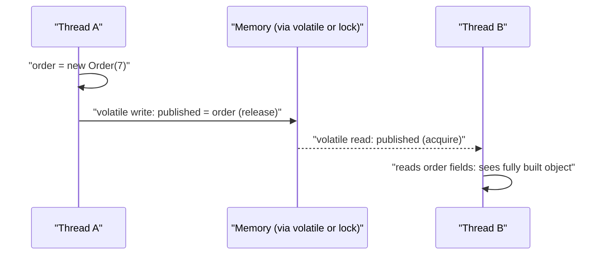
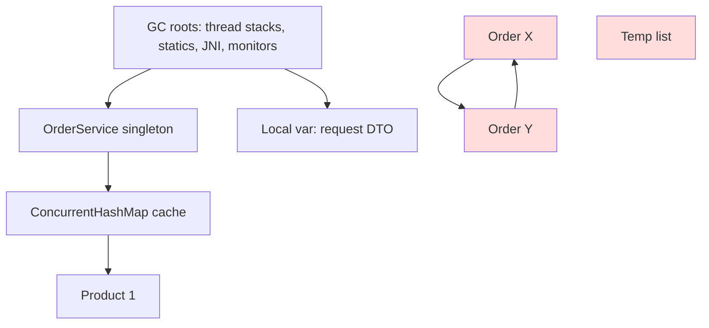
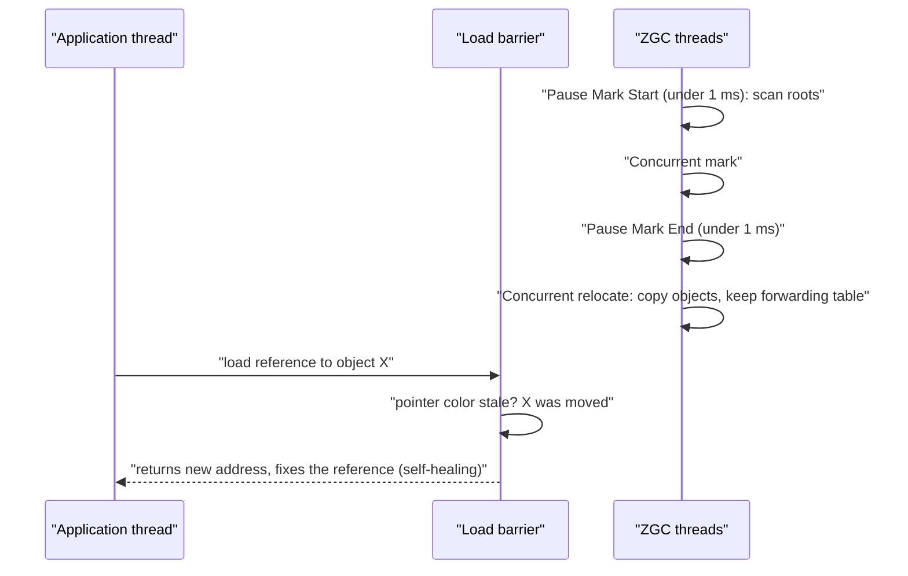

@@ 3 | TOPIC | Java Memory Model and Happens-Before | Visibility, reordering, happens-before rules, volatile, synchronized, final fields, safe publication and data races | MUST
# Java Memory Model and Happens-Before

**Level: Advanced | Phase 15 | Priority: MUST | Since: Java 1.0 (original model); JSR-133 revised memory model Java 5; VarHandle access modes Java 9**

> **30-second interview answer:** The Java Memory Model (JMM) defines when a write by one thread is guaranteed to be visible to a read by another. Without synchronization, the compiler, JIT and CPU may reorder operations and keep values in registers or caches, so another thread can see stale or partially constructed data. The JMM's guarantee is the happens-before relation: if action A happens-before B, then A's effects are visible to B. Happens-before is created by unlocking and later locking the same monitor, writing and later reading the same `volatile` variable, `Thread.start` and `join`, and the final-field rules. A program without data races behaves as if sequentially consistent.

## 1. Concept in Simple Words
### Analogy
A shared office whiteboard with personal notebooks.

| Office | Java Memory Model |
|---|---|
| Each employee copies numbers from the whiteboard into a personal notebook and works from it | Threads use CPU caches and registers |
| Someone updates the whiteboard, but you keep reading your old notebook | Stale read, visibility problem |
| To save time, an employee writes steps in a different order when nobody is watching | Compiler and CPU reordering |
| A rule: "when you hand over the meeting room key, also update the whiteboard; whoever takes the key must re-read the board" | Monitor unlock and lock: happens-before |
| A big red sign "always read this number from the board, never from your notebook" | `volatile` |
| A sealed envelope: once handed over, everyone sees the same contents | `final` fields after construction |
| Two employees erasing and rewriting the same number at once | Data race (lost update) |

### What it is
- **Visibility:** whether a thread sees another thread's write at all.
- **Ordering (reordering):** compilers, the JIT and CPUs may execute independent operations in a different order than written, as long as a single thread cannot tell the difference ("as-if-serial").
- **Atomicity:** whether an operation happens all at once. Reads and writes of references and of primitives up to 32 bits are atomic; plain `long` and `double` writes may be split into two 32-bit halves (in practice atomic on 64-bit JVMs, but only `volatile` guarantees it). `count++` is never atomic: it is read, add, write.
- **Happens-before (HB):** a partial order; if A HB B, the effects of A are visible to B and A appears ordered before B.
- **Data race:** two threads access the same variable, at least one writes, and there is no happens-before between them.
- **Sequential consistency for data-race-free programs (DRF-SC):** the JMM's central promise; if you have no data races, you can reason as if all operations ran in some single interleaved order.
- **Safe publication:** making a newly created object visible to other threads such that they see it fully constructed: via `volatile`, `final` fields, a lock, a concurrent collection, or static initialization.

The happens-before rules:
1. **Program order:** each action in a thread HB every later action in that thread.
2. **Monitor lock:** an unlock of a monitor HB every subsequent lock of the same monitor.
3. **Volatile:** a write to a volatile variable HB every subsequent read of the same variable.
4. **Thread start:** `t.start()` HB every action in thread `t`.
5. **Thread termination:** every action in `t` HB another thread returning from `t.join()` (or seeing `t.isAlive()` false).
6. **Interruption:** `t.interrupt()` HB the interrupted thread detecting it.
7. **Finalizer:** the end of a constructor HB the start of the finalizer.
8. **Transitivity:** A HB B and B HB C implies A HB C.
Plus **final field semantics:** if a constructor does not leak `this`, other threads see `final` fields' constructed values without synchronization. And library guarantees build on these: putting into a `ConcurrentHashMap` HB a get that sees it; submitting to an `ExecutorService` HB the task; completing a `Future` HB `get()` returning; `CountDownLatch.countDown` HB `await` returning.

### Why it exists
Modern CPUs have per-core caches and store buffers, and compilers reorder aggressively; forcing every memory access to be globally ordered would make Java many times slower. The JMM is a contract: hardware and JIT may optimize freely, except across the synchronization points you declare. Before Java 5 the model was broken (for example, `final` fields could appear to change and volatile did not prevent reordering of surrounding writes), which made patterns like double-checked locking unfixable. JSR-133 gave Java a precise, portable model across x86, ARM and others.

## 2. How It Works
```text
Without happens-before (possible outcome on real hardware/JIT):

Thread A (writer)                     Thread B (reader)
data = 42;           (1)              while (!ready) { }     (3)
ready = true;        (2)              print(data);           (4)

The JIT or CPU may reorder (1) and (2), or B may keep `ready` in a register forever.
B can print 0, or loop forever.

With `volatile boolean ready`:

data = 42;           (1)  program order
ready = true;        (2)  volatile write  ---- happens-before ---->  (3) volatile read sees true
                                                                     (4) print(data): guaranteed 42
(1) HB (2) HB (3) HB (4), by transitivity (1) HB (4).
```



How the JVM implements it: volatile writes act as **release** (earlier writes cannot move after them), volatile reads act as **acquire** (later reads cannot move before them), plus a full fence after volatile writes on most platforms. On x86 (strong memory model) only the store-load fence costs something (`lock`-prefixed instruction); on ARM (weak model) the JIT emits `ldar` and `stlr` instructions. `synchronized` gives acquire on entry and release on exit, plus mutual exclusion.

Why double-checked locking needs `volatile`: `instance = new Config()` is really three steps (allocate, run the constructor, assign the reference). Without volatile, the assignment can become visible before the constructor's writes, so a second thread on the unsynchronized fast path sees a non-null reference to an object whose non-final fields are still default values.

## 3. Code Example
### Code
```java
import java.util.concurrent.CountDownLatch;
import java.util.concurrent.atomic.AtomicInteger;

public class JmmDemo {

    // 1. Visibility: without volatile the worker may never see stop = true (JIT hoists the read)
    private static volatile boolean stop = false;

    // 2. Safe publication with double-checked locking: volatile is required
    static final class Config {
        final String region;                  // final fields are safely published after construction
        final int maxOrders;
        Config(String region, int maxOrders) { this.region = region; this.maxOrders = maxOrders; }
    }
    private static volatile Config instance;

    static Config config() {
        Config c = instance;                  // one volatile read on the fast path
        if (c == null) {
            synchronized (JmmDemo.class) {
                c = instance;
                if (c == null) {
                    c = new Config("eu-west-1", 500);
                    instance = c;             // volatile write: publishes the fully built object
                }
            }
        }
        return c;
    }

    // 3. Data race: plain int ++ from two threads loses updates; AtomicInteger does not
    static int plainCounter = 0;
    static final AtomicInteger atomicCounter = new AtomicInteger();

    public static void main(String[] args) throws Exception {
        Thread worker = new Thread(() -> {
            long spins = 0;
            while (!stop) { spins++; }        // volatile read each iteration
            System.out.println("1. worker saw stop=true and exited");
        });
        worker.start();
        Thread.sleep(100);
        stop = true;                          // volatile write happens-before the worker's next read
        worker.join();                        // join: everything the worker did happens-before this line

        // Thread.start rule: writes before start() are visible inside the thread
        int[] data = new int[1];
        data[0] = 42;
        Thread reader = new Thread(() -> System.out.println("2. reader sees data[0] = " + data[0]));
        reader.start();
        reader.join();

        CountDownLatch go = new CountDownLatch(1);
        Runnable task = () -> {
            try { go.await(); } catch (InterruptedException e) { Thread.currentThread().interrupt(); }
            for (int i = 0; i < 1_000_000; i++) {
                plainCounter++;               // read-modify-write, not atomic, not visible-safe
                atomicCounter.incrementAndGet();
            }
        };
        Thread t1 = new Thread(task);
        Thread t2 = new Thread(task);
        t1.start(); t2.start();
        go.countDown();
        t1.join(); t2.join();
        System.out.println("3. atomic = " + atomicCounter.get() + ", plain lost updates: " + (plainCounter < 2_000_000));

        Config c1 = config();
        Config c2 = config();
        System.out.println("4. same instance: " + (c1 == c2) + ", region = " + c1.region);
    }
}
```

### Walkthrough
- **Block 1:** `stop` is `volatile`, so the worker re-reads it on every iteration and sees the main thread's write. Remove `volatile` and, once the JIT compiles the loop, it may hoist the read out of the loop (`if (!stop) while (true)`), and the program hangs. That is legal under the JMM because there is no happens-before.
- **`join`:** guarantees that the worker's println and all its writes are complete and visible.
- **Block 2:** the write `data[0] = 42` happens before `reader.start()`, so the reader is guaranteed to see 42 even though the array is not volatile.
- **Block 3:** `plainCounter++` from two threads is a data race with lost updates; `AtomicInteger.incrementAndGet` uses compare-and-set and is atomic and visible. The plain result is almost always below 2,000,000; the exact number varies per run.
- **Block 4:** double-checked locking with a `volatile` field and a local variable `c` (so the fast path does one volatile read). `Config` has only final fields, which would make it safe even without volatile, but the volatile is the general fix and also guarantees the reference itself is seen.

### Output
```text
1. worker saw stop=true and exited
2. reader sees data[0] = 42
3. atomic = 2000000, plain lost updates: true
4. same instance: true, region = eu-west-1
```

### Compare
| Tool | Visibility | Atomicity | Ordering | Blocking | Use for |
|---|---|---|---|---|---|
| Plain field | No guarantee | Single read or write only | None across threads | No | Thread-confined data |
| `volatile` | Yes | Single read or write (including long and double) | Acquire and release | No | Flags, published references |
| `synchronized` / `Lock` | Yes | Whole block | Yes | Yes | Compound actions, invariants over several fields |
| `AtomicXxx` / `VarHandle` | Yes | CAS and single-variable compound ops | Yes | No (lock-free) | Counters, sequences, non-blocking algorithms |
| `final` field | Yes after construction (no `this` escape) | Not applicable | Constructor writes frozen | No | Immutable objects |

## 4. Interview Questions
**Basic**
1. **What is the Java Memory Model?**
   The part of the language specification that defines which values a read may see in a multithreaded program, and therefore which reorderings are allowed. Its key concept is happens-before: writes are guaranteed visible to reads only if a happens-before chain connects them. It lets the JIT and CPU optimize while giving programmers clear rules.
2. **What does `volatile` guarantee?**
   Visibility (every read sees the latest write to that variable), ordering (writes before a volatile write are visible to a thread that reads that volatile value, and accesses cannot be reordered across it), and atomic reads and writes even for `long` and `double`. It does not make compound actions like `count++` atomic.
3. **What is a data race?**
   Two threads access the same variable without a happens-before relationship, and at least one access is a write. Programs with data races can see stale values, torn values, or reordered effects, and their behaviour may change with the JIT, CPU or JVM version.

**Follow-up**
4. **Name the main happens-before rules.**
   Program order within a thread; monitor unlock HB a later lock of the same monitor; volatile write HB a later read of the same variable; `Thread.start` HB actions in the started thread; a thread's actions HB `join` returning; and transitivity. Concurrency utilities add their own (executor submission, future completion, latch countdown, concurrent collection put and get).
5. **Why does double-checked locking need `volatile`?**
   Without it, the write of the reference can be reordered before the constructor's writes become visible, so another thread can see a non-null reference to a partially constructed object on the unsynchronized fast path. Making the field `volatile` (Java 5+) creates a happens-before from the publishing write to the reader's read. Alternatives are the holder-class idiom or an enum singleton.
6. **What do `final` fields guarantee across threads?**
   Once the constructor finishes, any thread that obtains a reference to the object sees the final fields' values as set in the constructor (and objects reachable through them as of that point), without synchronization, provided `this` did not escape during construction. This is why immutable objects are thread-safe to share.

**Tricky / scenario**
7. **A background thread loops `while (!shutdown)` and never stops in production, though it works in the debugger. Why?**
   `shutdown` is not volatile, so the JIT compiled the loop with the field read hoisted out, reading it once. In the debugger or interpreter the read happens each time, so the bug hides. Make it `volatile` (or an `AtomicBoolean`), or use interruption.
8. **Is `volatile long counter; counter++` thread-safe?**
   No. Each read and write is atomic and visible, but `++` is a read followed by a write, and two threads can read the same value and both write value + 1. Use `AtomicLong`, `LongAdder` for high contention, or a lock.
9. **Does `synchronized` on two different objects make code safe?**
   No. Happens-before is only created between unlock and lock of the same monitor. If the writer synchronizes on `this` and the reader on another lock, there is no ordering or visibility guarantee between them. All accesses to shared state must use the same lock.

**What the interviewer is really testing:** whether you reason about concurrency with happens-before instead of intuition, and know why the classic patterns (volatile flag, safe publication, DCL) are written the way they are.

## 5. Pitfalls & Best Practices
### Common mistakes
| Mistake | What goes wrong | Fix |
|---|---|---|
| Non-volatile stop flag | Thread never stops after JIT compilation | `volatile` or interruption |
| `volatile` for counters | Lost updates | `AtomicInteger`, `LongAdder` or a lock |
| Double-checked locking without `volatile` | Partially constructed object seen | `volatile` field, holder idiom or enum |
| Leaking `this` from a constructor (registering a listener, starting a thread) | Other threads see unfinished object, final guarantees void | Register or start after construction (factory method) |
| Guarding the same state with different locks | No visibility between threads | One lock per piece of shared state |
| Publishing a mutable object via a plain static field | Readers see stale or partial state | Publish via `volatile`, concurrent collection or immutability |

### Best practices
- Prefer immutability and thread confinement; share less.
- Use higher-level `java.util.concurrent` tools (executors, concurrent collections, `CompletableFuture`) whose happens-before guarantees are documented.
- Document thread-safety of classes (`@ThreadSafe` in comments) and which lock guards which field.
- Test concurrent code with stress tools such as jcstress; normal unit tests rarely catch memory model bugs.
- Remember Spring singleton beans are shared across request threads: keep them stateless or use thread-safe fields.

### Compare with
| Concept | What it governs |
|---|---|
| JMM (happens-before) | Visibility and ordering of memory between threads |
| Mutual exclusion (locks) | Only one thread in a critical section |
| Atomicity (CAS) | Indivisible read-modify-write |
| Hardware memory model (x86 TSO, ARM weak) | What the CPU itself reorders; the JVM hides this behind the JMM |
| C++ memory model | Similar acquire and release concepts; Java has no undefined behaviour for races |

## 6. Hands-on Exercise
OrderHub has a `PriceCache` bean refreshed every minute by a scheduler thread and read by request threads:
```java
class PriceCache {
    private Map<Long, BigDecimal> prices = new HashMap<>();
    void refresh(Map<Long, BigDecimal> fresh) { prices.clear(); prices.putAll(fresh); }
    BigDecimal price(long id) { return prices.get(id); }
}
```
Explain every JMM problem and rewrite it so readers always see a complete, consistent snapshot without locking on reads.

Acceptance criteria: no locks in `price`; a reader never sees a half-refreshed map; a test with one writer and several readers never sees a missing price for a product that exists in every snapshot.

<details><summary>Solution</summary>

Problems: (1) `prices` is mutated in place by one thread while others read it: a data race on a non-thread-safe `HashMap`, which can return wrong results or, during a resize, misbehave badly; (2) `clear` then `putAll` exposes an empty or half-filled map to readers; (3) without happens-before, readers may never see the refreshed contents.

```java
import java.math.BigDecimal;
import java.util.Map;
import java.util.concurrent.CountDownLatch;
import java.util.concurrent.atomic.AtomicBoolean;

public class PriceCacheDemo {

    static final class PriceCache {
        // volatile reference to an immutable snapshot: copy-on-write publication
        private volatile Map<Long, BigDecimal> prices = Map.of();

        void refresh(Map<Long, BigDecimal> fresh) {
            prices = Map.copyOf(fresh);          // build fully, then publish with one volatile write
        }

        BigDecimal price(long id) {
            return prices.get(id);               // one volatile read, then an immutable map
        }
    }

    public static void main(String[] args) throws Exception {
        PriceCache cache = new PriceCache();
        cache.refresh(Map.of(1L, new BigDecimal("10.00"), 2L, new BigDecimal("20.00")));
        AtomicBoolean missing = new AtomicBoolean(false);
        CountDownLatch done = new CountDownLatch(4);

        Thread writer = new Thread(() -> {
            for (int i = 0; i < 100_000; i++) {
                cache.refresh(Map.of(1L, BigDecimal.valueOf(i), 2L, BigDecimal.valueOf(i * 2L)));
            }
        });
        writer.start();
        for (int r = 0; r < 4; r++) {
            new Thread(() -> {
                for (int i = 0; i < 100_000; i++) {
                    if (cache.price(1L) == null || cache.price(2L) == null) missing.set(true);
                }
                done.countDown();
            }).start();
        }
        writer.join();
        done.await();
        System.out.println("any reader saw a missing price: " + missing.get());
    }
}
```
Output:
```text
any reader saw a missing price: false
```
Each refresh builds a new immutable map and publishes it with a single volatile write; readers either see the old snapshot or the new one, never a mix. This is the same idea as `CopyOnWriteArrayList`, ideal for read-mostly data. If prices must be consistent across two reads in one request, read the map reference once into a local variable.
</details>

## 7. Recall
Q: What does the Java Memory Model define?
A: When writes by one thread are guaranteed to be visible to reads by another, using the happens-before relation.

Q: What does a volatile write followed by a volatile read of the same variable guarantee?
A: A happens-before edge: everything the writer did before the write is visible to the reader after the read.

Q: Why is volatile not enough for count++?
A: `++` is a read-modify-write of two steps; two threads can interleave and lose updates.

Q: Why does double-checked locking need a volatile field?
A: Without it, another thread can see the reference before the constructor's writes, i.e. a partially constructed object.

Q: Name four happens-before rules in Java.
A: Program order, monitor unlock before later lock of the same monitor, volatile write before later read, and Thread.start before the thread's actions (also join and transitivity).

Q: What do final fields guarantee in the Java Memory Model?
A: After construction (without `this` escaping), all threads see the final fields' constructed values without synchronization.

**Related:** [[JIT Compilation and Escape Analysis]] · [[JVM Memory Areas]] · [[Heap Dumps, Thread Dumps and Profiling (JFR, jcmd)]]

@@ 2 | MODULE | Garbage collection | How the JVM finds and frees dead objects, the main collectors and how to tune them | MUST
# Garbage collection

**Shared analogy: cleaning a busy restaurant.** Everything still on a table where a guest sits (reachable from a GC root) stays; everything else is trash. Most mess is created and abandoned quickly near the entrance (the young generation), so staff sweep that area often and quickly. The back storage room (old generation) is cleaned rarely and carefully. Some restaurants close the doors briefly while cleaning (stop-the-world pauses), others clean while guests eat (concurrent collectors like ZGC). Tuning is choosing how big each area is and which cleaning crew to hire for your kind of restaurant: a fast-food chain wants throughput, a fine-dining place wants no interruptions.

@@ 3 | TOPIC | Garbage Collection Basics and Generations | Reachability from GC roots, mark-sweep-compact and copying, the generational hypothesis, minor and full GC, stop-the-world and reference types | MUST
# Garbage Collection Basics and Generations

**Level: Advanced | Phase 15 | Priority: MUST | Since: Java 1.0 (GC); generational HotSpot collectors Java 1.3; G1 default Java 9**

> **30-second interview answer:** The garbage collector frees objects that are no longer reachable from GC roots: thread stacks' local variables, static fields, JNI references and active monitors. It does not use reference counting, so cycles are collected too. HotSpot collectors are generational because most objects die young: new objects go to Eden in the young generation, which is collected often by copying the few survivors; objects that survive several collections are promoted to the old generation, collected less often with mark-and-compact. Collections pause application threads (stop-the-world) to different degrees depending on the collector.

## 1. Concept in Simple Words
### Analogy
Sorting a shared fridge at the office.

| Office fridge | Garbage collection |
|---|---|
| Food with a name tag of someone still working here | Reachable object (path from a GC root) |
| The list of current employees | GC roots |
| Food nobody claims, even two containers labelled for each other | Unreachable objects, including cycles |
| The "today" shelf cleaned every evening, where most lunches are eaten the same day | Young generation, minor GC |
| Anything still there after a few evenings moves to the back shelf | Promotion to the old generation (tenuring) |
| The back shelf, cleaned once a month with a full sort | Old generation, major or full GC |
| Everyone must step away from the fridge while it is cleaned | Stop-the-world pause |
| Pushing remaining items together to free one big space | Compaction |

### What it is
- **GC roots:** local variables and operands in active frames of every thread, static fields of loaded classes, JNI global references, objects used as monitors in `synchronized`, and some JVM internals.
- **Reachable:** there is a chain of strong references from a root. Everything else is garbage, regardless of cycles.
- **Mark:** traverse the object graph from roots and mark live objects.
- **Sweep:** free the memory of unmarked objects (leaves fragmentation).
- **Compact:** move live objects together and update references (no fragmentation, costs moves).
- **Copying (evacuation):** copy live objects from one area to another and treat the old area as empty. Cost is proportional to live objects, ideal when most objects are dead.
- **Weak generational hypothesis:** most objects die young; few old objects reference young ones.
- **Minor (young) GC:** collects only the young generation. **Major / old GC:** collects the old generation. **Full GC:** collects the whole heap (and usually Metaspace), typically the longest pause.
- **Tenuring threshold:** number of young collections an object must survive before promotion (`MaxTenuringThreshold`, up to 15; adaptive).
- **Card table / remembered set:** structures that record old-to-young references so a minor GC does not have to scan the whole old generation.
- **Stop-the-world (STW):** all application threads are paused at a **safepoint** while the GC works. **Concurrent** phases run alongside the application.
- **Reference types:** **strong** (normal), **soft** (`SoftReference`, cleared only under memory pressure), **weak** (`WeakReference`, cleared at the next GC once only weakly reachable; used by `WeakHashMap`), **phantom** (`PhantomReference`, enqueued after the object is finalized-unreachable, used with `Cleaner` for native resource cleanup).

### Why it exists
Manual memory management causes two of the worst bug classes: use-after-free and memory leaks from forgotten frees. Automatic GC removes the first entirely and makes the second rarer (a Java leak is an unintentionally retained reference). The generational design makes GC cheap in practice: a young collection touching only a few percent of surviving objects typically takes a few milliseconds even for gigabytes of allocation per second.

## 2. How It Works
Life of an object in a generational heap:
```text
           Young generation                                      Old generation
  +----------------------------+--------+--------+        +----------------------------------+
  | Eden                       |   S0   |   S1   |        |                                  |
  | new Order() lands here     | (from) |  (to)  |        |  long-lived: caches, singletons, |
  +----------------------------+--------+--------+        |  session data, pools             |
                                                          +----------------------------------+
Minor GC #1: live objects in Eden + S0  --copy-->  S1   (age 1), Eden and S0 now empty
Minor GC #2: live objects in Eden + S1  --copy-->  S0   (age 2)
   ...
Age reaches tenuring threshold, or survivor space overflows  --promote-->  Old generation
Old generation fills  -->  concurrent marking (G1) then mixed collections; Full GC only as a last resort
```


Red objects have no path from a root, so they are garbage even though X and Y reference each other.

Safepoints and pauses:
1. The JVM sets a flag; each running thread stops at its next safepoint poll (method returns, loop back-edges).
2. Time-to-safepoint can itself be a source of latency (long counted loops without polls in older JVMs, or threads in heavy native code).
3. The collector does its STW work (root scanning, evacuation), then threads resume.
4. Concurrent collectors (G1's marking, ZGC, Shenandoah) do most work while the app runs, using **barriers** (small code inserted by the JIT on reference reads or writes) to keep the collector's view consistent.

GC cost model (useful for interviews):
- Young GC cost grows with **live** young objects and roots, not with garbage. Allocating a lot of short-lived garbage is cheap; keeping medium-lived objects (survive a few GCs, then die in old gen) is expensive.
- Old-gen work grows with the live set size and the rate of promotion.

## 3. Code Example
### Code
```java
import java.lang.management.GarbageCollectorMXBean;
import java.lang.management.ManagementFactory;
import java.lang.ref.SoftReference;
import java.lang.ref.WeakReference;
import java.util.ArrayList;
import java.util.List;
import java.util.Map;
import java.util.WeakHashMap;

public class GcBasicsDemo {

    static class Node {
        Node other;
        final byte[] payload = new byte[1024];
    }

    static String gcCounts() {
        StringBuilder sb = new StringBuilder();
        for (GarbageCollectorMXBean gc : ManagementFactory.getGarbageCollectorMXBeans()) {
            sb.append(gc.getName()).append('=').append(gc.getCollectionCount()).append("  ");
        }
        return sb.toString().trim();
    }

    public static void main(String[] args) throws Exception {
        // 1. Reachability: a cycle with no path from a GC root is garbage
        Node a = new Node();
        Node b = new Node();
        a.other = b;
        b.other = a;
        WeakReference<Node> watchA = new WeakReference<>(a);
        a = null;
        b = null;                              // the cycle is now unreachable
        System.gc();                           // a request, not a command
        Thread.sleep(100);
        System.out.println("1. cycle collected: " + (watchA.get() == null));

        // 2. Weak vs soft vs strong
        byte[] strong = new byte[10_000];
        WeakReference<byte[]> weak = new WeakReference<>(new byte[10_000]);
        SoftReference<byte[]> soft = new SoftReference<>(new byte[10_000]);
        System.gc();
        Thread.sleep(100);
        System.out.println("2. strong alive: " + (strong != null)
                + ", weak alive: " + (weak.get() != null)
                + ", soft alive: " + (soft.get() != null));

        // 3. WeakHashMap drops entries whose keys are no longer strongly reachable
        Map<Object, String> cache = new WeakHashMap<>();
        Object key1 = new Object();
        Object key2 = new Object();
        cache.put(key1, "order-1");
        cache.put(key2, "order-2");
        key2 = null;
        System.gc();
        Thread.sleep(100);
        System.out.println("3. WeakHashMap size after GC: " + cache.size() + " (key1 still used: " + (key1 != null) + ")");

        // 4. Allocation churn triggers young collections
        String before = gcCounts();
        long sink = 0;
        for (int i = 0; i < 200_000; i++) {
            List<byte[]> temp = new ArrayList<>();
            temp.add(new byte[1024]);
            sink += temp.size();
        }
        System.out.println("4. before: " + before);
        System.out.println("   after:  " + gcCounts());
        System.out.println("   allocated about " + sink / 1024 + " MB of short-lived arrays");
    }
}
```

### Walkthrough
- **Block 1:** `a` and `b` reference each other, but once both locals are null there is no path from a root. A `WeakReference` lets us observe collection without keeping the object alive. `System.gc()` is only a hint (with G1 it normally triggers a full GC; `-XX:+DisableExplicitGC` turns it off), so demos like this are illustrative, not guaranteed.
- **Block 2:** the strongly referenced array survives; the weakly referenced one is cleared at the GC; the softly referenced one survives because there is no memory pressure. Soft references are cleared only before an `OutOfMemoryError` would be thrown, or based on an LRU policy (`SoftRefLRUPolicyMSPerMB`).
- **Block 3:** `WeakHashMap` holds keys weakly, so the entry for `key2` disappears after GC. Values are held strongly, so a value that references its own key prevents removal, a classic surprise.
- **Block 4:** 200,000 temporary lists and 1 KB arrays (about 195 MB) die immediately; the counters show several young collections and no new old collections. The three full collections before were our explicit `System.gc()` calls.

### Output
Run with `java -Xmx256m GcBasicsDemo` (G1, Java 21 or later; the number of young collections depends on heap sizing):
```text
1. cycle collected: true
2. strong alive: true, weak alive: false, soft alive: true
3. WeakHashMap size after GC: 1 (key1 still used: true)
4. before: G1 Young Generation=0  G1 Concurrent GC=0  G1 Old Generation=3
   after:  G1 Young Generation=6  G1 Concurrent GC=0  G1 Old Generation=3
   allocated about 195 MB of short-lived arrays
```
With `-Xlog:gc` you see each collection:
```text
[0.031s][info][gc] Using G1
[0.094s][info][gc] GC(0) Pause Full (System.gc()) 2M->1M(10M) 4.293ms
[0.210s][info][gc] GC(1) Pause Full (System.gc()) 1M->1M(8M) 4.326ms
[0.322s][info][gc] GC(2) Pause Full (System.gc()) 1M->1M(8M) 3.997ms
[0.463s][info][gc] GC(3) Pause Young (Normal) (G1 Evacuation Pause) 4M->1M(8M) 0.827ms
[0.464s][info][gc] GC(4) Pause Young (Normal) (G1 Evacuation Pause) 3M->1M(8M) 0.578ms
```
Read a line as: GC number, type and cause, heap used before → after (committed heap size), pause duration. Young pauses here are under 1 ms because almost nothing survives.

### Compare
| Algorithm | How | Strength | Weakness | Used in |
|---|---|---|---|---|
| Reference counting | Count references per object | Immediate freeing | Cannot free cycles, counter overhead | Not used by HotSpot (used by CPython, Swift) |
| Mark-sweep | Mark live, free the rest in place | No moving | Fragmentation | Parts of old-gen collectors |
| Mark-compact | Mark, then slide live objects together | No fragmentation | Moving cost | Full GCs (Serial, Parallel, G1) |
| Copying | Copy live objects to a free area | Cost proportional to live data, compacts | Needs spare space | Young generation (all generational collectors) |
| Concurrent with barriers | Mark and move while app runs | Tiny pauses | CPU and throughput overhead | G1 marking, ZGC, Shenandoah |

## 4. Interview Questions
**Basic**
1. **How does the JVM decide an object is garbage?**
   By reachability: starting from GC roots (thread stacks, static fields, JNI references, monitors), it traces references; any object not reached is garbage. Reference counting is not used, so cyclic structures are collected as long as no root reaches them.
2. **What are the young and old generations and why have them?**
   New objects go into the young generation (Eden, then survivor spaces), which is collected frequently by copying the few survivors. Long-lived objects are promoted to the old generation, collected rarely. This exploits the observation that most objects die young, making most collections small and fast.
3. **What is a stop-the-world pause?**
   A period when all application threads are halted at safepoints so the collector can work on a consistent heap. Every HotSpot collector has some STW phases; collectors differ in how long they are, from hundreds of milliseconds (Parallel full GC on a big heap) to under a millisecond (ZGC).

**Follow-up**
4. **Minor GC vs major GC vs full GC?**
   Minor collects the young generation only and is usually short. Major refers to collecting the old generation (in G1, concurrent marking followed by mixed collections). Full GC collects the entire heap, usually single STW compaction, and in G1 indicates a failure mode such as evacuation failure or too slow concurrent marking, something to investigate.
5. **What are soft, weak and phantom references for?**
   Weak references do not keep an object alive; they are cleared at the next GC, useful for canonicalizing maps and listener registries (`WeakHashMap`). Soft references are cleared only under memory pressure, once used for caches but unpredictable; prefer a bounded cache like Caffeine. Phantom references, with `Cleaner`, run cleanup of native resources after an object becomes unreachable, replacing finalizers (deprecated for removal since Java 18).
6. **Does calling `System.gc()` force a garbage collection?**
   It is only a request; the JVM may ignore it, and `-XX:+DisableExplicitGC` makes it a no-op. With G1 it usually triggers a full STW collection, so calling it in production code (some libraries did, around direct buffers) causes pauses. Never rely on it for correctness.

**Tricky / scenario**
7. **Young GC pauses grew from 5 ms to 80 ms after a feature that caches results for 30 seconds. Why?**
   Objects that live 30 seconds survive several young collections, so each young GC must copy them between survivor spaces, and then they get promoted and die in the old generation. Young GC cost is proportional to survivors. Options: shorten or remove the cache, make it a properly sized long-lived cache, or tune survivor sizing and tenuring; first confirm with GC logs (`-Xlog:gc+age=trace`).
8. **Can a Java program have a memory leak if the GC collects unreachable objects?**
   Yes: a leak in Java is memory that is still reachable but no longer needed, such as entries in a static map that are never removed, listeners never unregistered, or `ThreadLocal` values on pooled threads. The GC cannot know you will never use them. See [[Memory Leaks and OutOfMemoryError]].
9. **The heap is 70% full after every GC and GC runs constantly. What does that mean?**
   The live set is large relative to the heap, so each collection frees little and must run again soon (GC thrashing), eventually ending in `GC overhead limit exceeded` or Java heap space errors. Either the heap is too small for the real live set, or there is a leak. Check the post-GC heap trend over time: flat means size up the heap; steadily rising means a leak.

**What the interviewer is really testing:** whether you can explain reachability, the generational model and its cost model, and use that to reason about pause problems instead of reciting definitions.

## 5. Pitfalls & Best Practices
### Common mistakes
| Mistake | What goes wrong | Fix |
|---|---|---|
| Calling `System.gc()` in application code | Long full GC pauses | Remove it; let the collector decide |
| Using `SoftReference` for caches | Unpredictable eviction, GC pressure near full heap | Bounded cache (Caffeine) with size and TTL |
| Using finalizers to release resources | Delayed, unreliable, slows GC | try-with-resources, `Cleaner` |
| Medium-lived objects (seconds to minutes) in hot paths | Expensive copying and promotion | Keep objects very short-lived or truly long-lived |
| Judging memory by heap usage before GC | Looks like a leak when it is just garbage | Look at heap after GC (live set) |

### Best practices
- Always run production JVMs with GC logging: `-Xlog:gc*:file=/logs/gc.log:time,uptime,level,tags:filecount=5,filesize=20m`.
- Monitor GC pause time, frequency and post-GC old-gen occupancy (Micrometer `jvm.gc.pause`, `jvm.memory.used` after GC).
- Reduce allocation in very hot paths only after measuring allocation rate with JFR.
- Prefer try-with-resources over any GC-based cleanup.

### Compare with
| Reference type | Cleared when | Typical use |
|---|---|---|
| Strong | Never while reachable | Normal references |
| Soft | Memory pressure (before OOM) | Memory-sensitive caches (better: Caffeine) |
| Weak | Next GC once only weakly reachable | `WeakHashMap`, listener registries, canonical maps |
| Phantom | After the object is unreachable, enqueued for cleanup | `Cleaner` for native resources |

## 6. Hands-on Exercise
Write a program that demonstrates promotion: allocate objects in batches and keep every tenth batch alive in a list. Run it with `-Xmx128m -Xlog:gc,gc+age=trace` and observe young collections, survivor ages and promotion to the old generation. Then run it with `-XX:MaxTenuringThreshold=1` and explain the difference.

Acceptance criteria: you can point to the log lines showing objects at different ages and old-gen growth, and explain why a lower threshold promotes more.

<details><summary>Solution</summary>

```java
import java.util.ArrayList;
import java.util.List;

public class PromotionDemo {
    public static void main(String[] args) {
        List<byte[][]> keep = new ArrayList<>();
        long allocated = 0;
        for (int batch = 0; batch < 2_000; batch++) {
            byte[][] objects = new byte[100][];
            for (int i = 0; i < objects.length; i++) objects[i] = new byte[1024];
            allocated += 100 * 1024;
            if (batch % 10 == 0) keep.add(objects);          // 10% survive: medium and long-lived
        }
        System.out.println("allocated MB: " + allocated / (1024 * 1024) + ", kept batches: " + keep.size());
    }
}
```
```bash
java -Xmx128m -Xlog:gc,gc+age=trace PromotionDemo
java -Xmx128m -XX:MaxTenuringThreshold=1 -Xlog:gc,gc+age=trace PromotionDemo
```
Output of the program itself:
```text
allocated MB: 195, kept batches: 200
```
In the first run, `gc+age` lines such as `Age table with threshold 15 (max threshold 15)` and `- age 1: 1048576 bytes, 1048576 total` show survivors aging in survivor spaces before promotion, while the old generation grows slowly. With `MaxTenuringThreshold=1`, survivors are promoted after one collection, so old-gen occupancy grows faster and survivor spaces stay nearly empty. Promoting early is good for objects that will live long anyway (less copying) and bad for objects that would have died soon (they now clutter the old generation until a mixed or full collection).
</details>

## 7. Recall
Q: How does the JVM garbage collector determine that an object is garbage?
A: It is unreachable: no chain of strong references leads to it from any GC root (stacks, statics, JNI references, monitors).

Q: Can the Java garbage collector free objects that reference each other in a cycle?
A: Yes, because it uses reachability tracing, not reference counting.

Q: What is the weak generational hypothesis?
A: Most objects die young, so collecting a small young generation often is cheap and frees most memory.

Q: What is the difference between a minor GC and a full GC?
A: A minor GC collects only the young generation; a full GC collects the whole heap, usually with a longer stop-the-world pause.

Q: When is a WeakReference cleared versus a SoftReference?
A: A weak reference is cleared at the next GC once the object is only weakly reachable; a soft reference only under memory pressure.

Q: Why does young GC time depend on surviving objects rather than garbage?
A: Young collections copy live objects out and discard the rest wholesale, so cost scales with survivors.

**Related:** [[JVM Memory Areas]] · [[G1, ZGC, Shenandoah and Parallel GC]] · [[Memory Leaks and OutOfMemoryError]]

@@ 3 | TOPIC | G1, ZGC, Shenandoah and Parallel GC | How each modern collector works, pause versus throughput trade-offs, versions and how to choose one for a service | SHOULD
# G1, ZGC, Shenandoah and Parallel GC

**Level: Advanced | Phase 15 | Priority: SHOULD | Since: Parallel Java 1.4; G1 Java 7u4, default Java 9; ZGC production Java 15, generational Java 21, generational-only Java 24; Shenandoah production Java 15; CMS removed Java 14**

> **30-second interview answer:** G1 is the default: it splits the heap into equal regions, collects young regions with short stop-the-world evacuations, marks the old generation concurrently, and then collects the regions with the most garbage first, aiming for a pause target (200 ms by default). Parallel GC maximizes throughput with multi-threaded stop-the-world collections, good for batch jobs. ZGC and Shenandoah do almost everything concurrently, including moving objects, so pauses stay under about a millisecond regardless of heap size, at the cost of some CPU and throughput. For a typical Spring Boot service, G1 is right; for strict latency SLAs or very large heaps, generational ZGC.

## 1. Concept in Simple Words
### Analogy
Four ways to clean a shopping mall.

| Cleaning crew | Collector |
|---|---|
| One cleaner, mall closed while cleaning | Serial GC |
| A big crew, mall closed but cleaned very fast at night | Parallel GC (throughput) |
| Mall divided into numbered sections; crew closes a few dirtiest sections at a time for short periods, within a time budget | G1 (regions, garbage-first, pause target) |
| Cleaners work while shoppers walk around; when they move a bench, a sign tells shoppers where it went | ZGC and Shenandoah (concurrent compaction with barriers and forwarding) |
| No cleaning at all; the mall closes when it is full | Epsilon (no-op GC, for testing) |

### What it is
- **Serial GC (`-XX:+UseSerialGC`):** single-threaded, STW, young copying plus old mark-compact. Chosen automatically by the JVM on machines or containers with fewer than 2 CPUs or less than about 1.8 GB of memory. Fine for tiny heaps.
- **Parallel GC (`-XX:+UseParallelGC`):** like Serial but multi-threaded in all phases. Best throughput (least total GC CPU), but pauses grow with heap size. Good for batch, ETL, offline jobs.
- **G1 (Garbage-First, `-XX:+UseG1GC`, default since Java 9):** heap divided into 1 to 32 MB regions (about 2,048 regions target). Each region is Eden, Survivor, Old or Humongous. Young collections are STW evacuations of all young regions. When old occupancy passes the Initiating Heap Occupancy Percent (adaptive, starting at 45%), concurrent marking finds live data per region, then **mixed collections** evacuate young regions plus the old regions with the most garbage. Pause target `-XX:MaxGCPauseMillis=200`.
- **ZGC (`-XX:+UseZGC`):** concurrent marking and concurrent relocation using **colored pointers** (metadata bits in references) and **load barriers** (checks on every reference load that fix up moved objects). Pauses are typically well under 1 ms and do not grow with heap size (supports up to 16 TB). Generational mode added in Java 21 (`-XX:+ZGenerational`), made the default in Java 23, and the only mode since Java 24.
- **Shenandoah (`-XX:+UseShenandoahGC`):** Red Hat's concurrent compacting collector using forwarding pointers and load-reference barriers. Similar goals to ZGC. Included in most OpenJDK builds (Temurin, Red Hat, Amazon Corretto) but not in Oracle JDK. Generational mode is experimental in Java 24 and a product feature in `Java 25+`.
- **Epsilon (`-XX:+UseEpsilonGC`, experimental, Java 11):** allocates but never collects; for benchmarking and very short-lived processes.
- **CMS (Concurrent Mark Sweep):** older low-pause collector, deprecated in Java 9, removed in Java 14. Interviewers still ask about it; say it was replaced by G1.

### Why it exists
There is no single best collector because of the trade-off triangle: throughput (how much CPU goes to the application), latency (how long pauses are) and memory footprint (how much headroom the collector needs). Batch jobs want throughput, user-facing APIs want low latency, small containers want low footprint. Heaps also grew from hundreds of MB to hundreds of GB, where STW compaction of the whole heap takes seconds, which drove the development of concurrent compacting collectors.

## 2. How It Works
G1 heap layout and cycle:
```text
G1 heap: equal-sized regions (example: 4 GB heap, 2 MB regions = 2048 regions)
+---+---+---+---+---+---+---+---+---+---+---+---+---+---+---+---+
| E | E | S | O | O | H | H | E | O | . | . | O | E | S | O | . |
+---+---+---+---+---+---+---+---+---+---+---+---+---+---+---+---+
E = Eden  S = Survivor  O = Old  H = Humongous (object larger than half a region)  . = free

1. Young GC (STW):        evacuate live objects from all E and S regions to new S or O regions
2. Old occupancy > IHOP:  concurrent start (piggybacks on a young GC), then concurrent marking
3. Remark (STW, short):   finish marking; compute liveness per region
4. Cleanup (STW, short):  free completely empty regions, select candidate old regions
5. Mixed GCs (STW):       young regions + some old regions with most garbage, within the pause target
6. Fallback Full GC:      only if evacuation fails or marking cannot keep up (investigate!)
```

ZGC concurrent relocation:


The choice in practice:
```text
Heap < 2 GB, 1 CPU, tiny tool        -> Serial (JVM picks it automatically)
Batch, offline, throughput matters   -> Parallel
Typical web service, 1-32 GB heap    -> G1 (default), maybe tune MaxGCPauseMillis
p99 latency SLA < 10 ms, big heaps   -> Generational ZGC (Java 21+: -XX:+UseZGC -XX:+ZGenerational; Java 23+: -XX:+UseZGC)
Red Hat / OpenJDK shop, low latency  -> Shenandoah
```

## 3. Code Example
### Code
A program that reports which collector runs and whether each collector's MXBean recorded activity, run under each collector to compare names and behaviour.

```java
import java.lang.management.GarbageCollectorMXBean;
import java.lang.management.ManagementFactory;
import java.util.ArrayList;
import java.util.List;

public class WhichGc {
    public static void main(String[] args) {
        List<String> flags = ManagementFactory.getRuntimeMXBean().getInputArguments();
        System.out.println("flags: " + flags);
        // allocate some garbage so collectors run at least once
        long sink = 0;
        for (int i = 0; i < 300_000; i++) {
            List<byte[]> tmp = new ArrayList<>();
            tmp.add(new byte[1024]);
            sink += tmp.size();
        }
        for (GarbageCollectorMXBean gc : ManagementFactory.getGarbageCollectorMXBeans()) {
            System.out.printf("  %-22s ran=%s%n", gc.getName(), gc.getCollectionCount() > 0 ? "yes" : "no");
        }
        System.out.println("sink " + (sink > 0));
    }
}
```

```bash
for gc in UseG1GC UseParallelGC UseSerialGC UseZGC UseShenandoahGC; do
  java -Xmx256m -XX:+$gc WhichGc
done

# Compare pause behaviour on a real service (OrderHub) with GC logs:
java -XX:+UseG1GC -XX:MaxGCPauseMillis=100 -Xlog:gc:file=g1.log -jar orderhub.jar
java -XX:+UseZGC -XX:+ZGenerational -Xlog:gc:file=zgc.log -jar orderhub.jar      # Java 21/22 flag
```

### Walkthrough
- The program prints the JVM flags, creates about 300 MB of short-lived garbage, then lists each `GarbageCollectorMXBean`. Each collector exposes different beans, which is also how monitoring tools (and Micrometer's `jvm.gc.pause` metric tags) tell them apart.
- G1 exposes young, concurrent and old beans; Parallel and Serial expose young (`PS Scavenge`, `Copy`) and old (`PS MarkSweep`, `MarkSweepCompact`); ZGC generational exposes cycles and pauses for minor and major collections; Shenandoah exposes pauses and cycles.
- The GC log commands show how you would compare collectors on OrderHub under load: run the same load test and compare pause distributions and throughput, not single runs.

### Output
Run on a JDK with all collectors (Temurin; output from Java 25, where ZGC is generational-only; on Java 21 without `-XX:+ZGenerational` ZGC shows `ZGC Cycles` and `ZGC Pauses` instead):
```text
flags: [-Xmx256m, -XX:+UseG1GC]
  G1 Young Generation    ran=yes
  G1 Concurrent GC       ran=no
  G1 Old Generation      ran=no
sink true
flags: [-Xmx256m, -XX:+UseParallelGC]
  PS MarkSweep           ran=no
  PS Scavenge            ran=yes
sink true
flags: [-Xmx256m, -XX:+UseSerialGC]
  Copy                   ran=yes
  MarkSweepCompact       ran=no
sink true
flags: [-Xmx256m, -XX:+UseZGC]
  ZGC Minor Cycles       ran=no
  ZGC Minor Pauses       ran=no
  ZGC Major Cycles       ran=yes
  ZGC Major Pauses       ran=yes
sink true
flags: [-Xmx256m, -XX:+UseShenandoahGC]
  Shenandoah Pauses      ran=yes
  Shenandoah Cycles      ran=yes
sink true
```
Typical GC log lines for comparison:
```text
G1:  [12.345s][info][gc] GC(41) Pause Young (Normal) (G1 Evacuation Pause) 812M->204M(1024M) 18.214ms
G1:  [30.101s][info][gc] GC(57) Pause Young (Mixed) (G1 Evacuation Pause) 790M->310M(1024M) 31.502ms
ZGC: [12.345s][info][gc] GC(12) Minor Collection (Allocation Rate) 640M(62%)->180M(18%) 0.041s
ZGC: [12.346s][info][gc,phases] GC(12) y: Pause Mark Start 0.012ms
```
For ZGC, the 0.041 s is the whole concurrent cycle; the actual pauses are the tiny `Pause Mark Start` and `Pause Mark End` lines.

### Compare
| Collector | Pauses | Throughput | Footprint | Heap sizes | Best for |
|---|---|---|---|---|---|
| Serial | Long (single thread) | OK for tiny heaps | Lowest | Up to about 100s of MB | Tiny containers, CLIs |
| Parallel | Long, grow with heap | Highest | Low | Any | Batch, ETL, offline |
| G1 | Short young, controlled mixed (target 200 ms) | High | Moderate (remembered sets) | 1 GB to tens of GB | Default for services |
| ZGC (generational) | Under 1 ms, independent of heap | Good (some CPU for barriers) | Higher (needs headroom) | 8 MB to 16 TB | Strict latency, huge heaps |
| Shenandoah | Under about 10 ms, often under 1 ms | Good | Moderate | Small to large | Low latency on OpenJDK builds |
| CMS (removed Java 14) | Short, but fragmentation and failures | Moderate | Moderate | Medium | Legacy only |

## 4. Interview Questions
**Basic**
1. **What is the default garbage collector in modern Java?**
   G1 since Java 9 for server-class machines; the JVM falls back to Serial on very small machines or containers (under 2 CPUs or about 1.8 GB). G1 balances throughput and pause times with a configurable pause target.
2. **How is G1 different from Parallel GC?**
   Parallel collects whole generations in STW pauses using many threads, maximizing throughput but with pauses that grow with heap size. G1 divides the heap into regions, does marking concurrently, and incrementally evacuates the regions with the most garbage within a pause-time goal, so pauses stay bounded on larger heaps.
3. **What makes ZGC's pauses so short?**
   It does marking and relocation (compaction) concurrently with the application. Load barriers inserted by the JIT check pointer metadata (colored pointers) on every reference load and transparently forward references to moved objects, so the STW pauses only scan roots and are typically sub-millisecond regardless of heap size.

**Follow-up**
4. **What are humongous objects in G1 and why do they matter?**
   Objects larger than half a region are allocated directly in contiguous old-gen regions. They can waste space (the tail of the last region), are only reclaimed at certain points, and frequent large arrays can trigger premature marking or even full GCs. Fix with a larger `G1HeapRegionSize` or by avoiding giant arrays (stream large payloads).
5. **What is a mixed collection in G1?**
   After concurrent marking computes how much live data each old region has, G1 performs several young collections that also evacuate a selection of old regions with the most garbage (hence "garbage first"), staying within the pause target. That reclaims old space incrementally without a full GC.
6. **What is the cost of using ZGC instead of G1?**
   Load barriers add CPU overhead on reference loads, the collector threads use CPU concurrently, and it needs memory headroom to keep up with allocation (if allocation outpaces it, threads stall: "Allocation Stall" in logs). Throughput is typically a few percent lower than G1, which is acceptable when tail latency matters more. Generational ZGC (Java 21+) greatly reduced the overhead and headroom needed.

**Tricky / scenario**
7. **An API with a 50 ms p99 SLA sees 300 ms spikes every few minutes on G1 with an 8 GB heap. What do you do?**
   Read the GC log for those times: if they are mixed or full GCs, check the cause (humongous allocations, evacuation failure "to-space exhausted", concurrent mode failure because marking started too late). Fixes: lower `MaxGCPauseMillis`, give more heap headroom, start marking earlier, eliminate humongous allocations, or switch to generational ZGC for sub-millisecond pauses. Also rule out non-GC causes with JFR (safepoint time, lock contention).
8. **Your batch job processes 50 GB of files nightly and only total runtime matters. Which collector?**
   Parallel GC: it spends the least total CPU on collection, and pauses do not matter for an offline job. Size the heap generously so full collections are rare.
9. **The JVM in a container with 1 CPU and 1 GB chooses Serial GC. Is that a problem?**
   For a tiny service it is a reasonable automatic choice. For a Spring Boot web service it can cause long pauses; giving the container at least 2 CPUs or setting `-XX:+UseG1GC` explicitly is common. Always set the collector explicitly in production so behaviour does not change with container size.

**What the interviewer is really testing:** whether you understand the throughput, latency and footprint trade-off and can pick and justify a collector from requirements and GC logs.

## 5. Pitfalls & Best Practices
### Common mistakes
| Mistake | What goes wrong | Fix |
|---|---|---|
| Relying on the JVM's automatic GC choice in containers | Serial GC on small pods, surprising pauses | Set `-XX:+UseG1GC` or `-XX:+UseZGC` explicitly |
| Setting `MaxGCPauseMillis=10` on G1 | More frequent GCs, lower throughput, target still missed | Realistic target or switch to ZGC |
| Switching to ZGC on a tiny heap with no headroom | Allocation stalls | Give ZGC headroom, measure |
| Using CMS flags on Java 14+ | JVM fails to start | Remove `UseConcMarkSweepGC` |
| Comparing collectors with one short run | Noise, wrong conclusions | Load test with realistic traffic, compare percentiles |

### Best practices
- Start with G1 defaults plus correct heap sizing; most services need nothing else.
- Choose by measured requirements: p99 or p99.9 latency targets, CPU budget, heap size.
- For generational ZGC on Java 21 and 22 add `-XX:+ZGenerational`; from Java 23 it is the default ZGC mode.
- Keep GC logs on and compare before and after any change.

### Compare with
| Goal | Choose | Why |
|---|---|---|
| Maximum throughput | Parallel | Least GC CPU |
| Balanced default | G1 | Bounded pauses, good throughput |
| Lowest latency | ZGC or Shenandoah | Concurrent compaction |
| Smallest footprint | Serial | No extra threads or structures |
| Benchmark without GC noise | Epsilon | No collection at all |

## 6. Hands-on Exercise
Load-test OrderHub's `GET /api/products` endpoint for 5 minutes under G1 and under generational ZGC with the same heap (`-Xmx2g`), recording GC logs and latency percentiles. Write a short comparison of p50, p99 and max latency, total GC pause time and CPU usage.

Acceptance criteria: identical load and heap for both runs; the comparison uses GC log data and load-test percentiles, not averages only.

<details><summary>Solution</summary>

```bash
# 1. Run OrderHub with G1
java -Xms2g -Xmx2g -XX:+UseG1GC \
     -Xlog:gc*:file=g1.log:time,uptime,level,tags \
     -jar target/orderhub.jar &
# 2. Load test (k6, wrk or Gatling); example with wrk: 4 threads, 200 connections, 5 minutes
wrk -t4 -c200 -d300s --latency http://localhost:8080/api/products
# 3. Stop, then repeat with ZGC (Java 21/22 needs -XX:+ZGenerational; Java 23+ does not)
java -Xms2g -Xmx2g -XX:+UseZGC -XX:+ZGenerational \
     -Xlog:gc*:file=zgc.log:time,uptime,level,tags \
     -jar target/orderhub.jar &
wrk -t4 -c200 -d300s --latency http://localhost:8080/api/products
# 4. Sum pause times from the logs
grep -E "Pause (Young|Remark|Cleanup|Full)" g1.log | awk '{s += $NF+0} END {print "G1 total pause ms:", s}'
grep -E "Pause Mark (Start|End)|Pause Relocate Start" zgc.log | awk '{s += $NF+0} END {print "ZGC total pause ms:", s}'
```
Example write-up shape (your numbers will differ):
```text
                p50     p99     max      total GC pause   avg CPU
G1             2.1 ms  14 ms   61 ms    3.9 s            62%
ZGC (gen)      2.2 ms   6 ms   19 ms    0.04 s           66%
Conclusion: ZGC removes GC-induced tail latency at a few percent more CPU. For OrderHub's 50 ms SLA, G1 is sufficient; ZGC would matter for a stricter SLA.
```
The awk sums rely on the last field being the pause in ms (for example `18.214ms`; `+0` strips the unit). Tools such as GCeasy or GCViewer parse logs with charts. Use averages of several runs, and warm up before measuring.
</details>

## 7. Recall
Q: What is the default garbage collector since Java 9?
A: G1 (Garbage-First), except on very small machines where the JVM chooses Serial.

Q: How does G1 organize the heap?
A: Into equal-sized regions (1 to 32 MB), each acting as Eden, Survivor, Old or Humongous, collecting the regions with the most garbage first.

Q: Which collector maximizes throughput and when should you use it?
A: Parallel GC, for batch and offline jobs where pause length does not matter.

Q: How does ZGC achieve sub-millisecond pauses?
A: Concurrent marking and relocation using colored pointers and load barriers that redirect references to moved objects.

Q: Which Java versions introduced generational ZGC and made it the only mode?
A: Java 21 introduced it (`-XX:+ZGenerational`), Java 23 made it the default, and Java 24 removed the non-generational mode.

Q: When was CMS removed from the JDK?
A: Java 14 (deprecated in Java 9).

**Related:** [[Garbage Collection Basics and Generations]] · [[GC Tuning and JVM Flags]] · [[JVM Memory Areas]]
