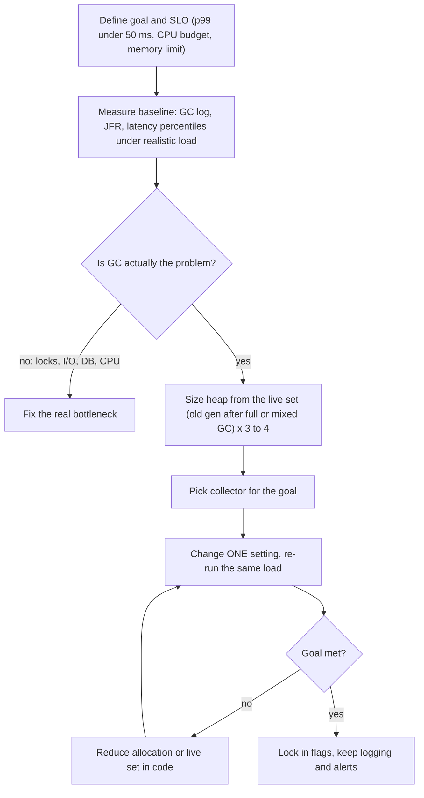
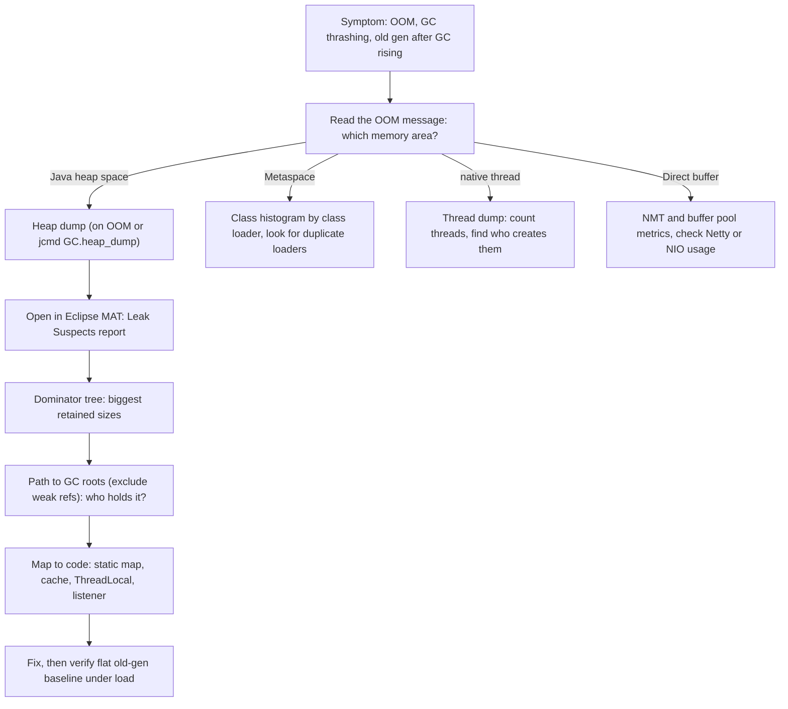
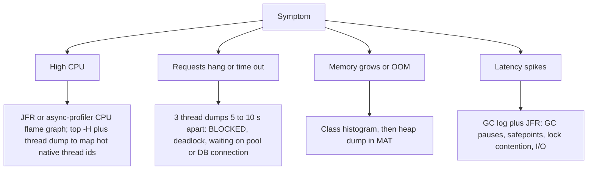

@@ 3 | TOPIC | GC Tuning and JVM Flags | Heap sizing in containers, choosing flags that matter, GC logging, pause goals and a measure-first tuning process | SHOULD
# GC Tuning and JVM Flags

**Level: Advanced | Phase 15 | Priority: SHOULD | Since: Unified logging -Xlog Java 9; container-aware RAM percentages Java 10 (8u191); -XX:+ExitOnOutOfMemoryError 8u92**

> **30-second interview answer:** Tuning starts with measurement, not flags: turn on GC logging, define the goal (p99 latency, throughput or memory), and change one thing at a time. The flags that matter for most services are few: heap size (`-Xmx`, or `-XX:MaxRAMPercentage` in containers, usually 70 to 75%), the collector (`-XX:+UseG1GC` or `-XX:+UseZGC`), a pause goal for G1 (`-XX:MaxGCPauseMillis`), GC logs (`-Xlog:gc*`), and OOM behaviour (`-XX:+HeapDumpOnOutOfMemoryError`, `-XX:+ExitOnOutOfMemoryError`). Most problems blamed on GC are fixed by right-sizing the heap or by reducing allocation and live data in the code.

## 1. Concept in Simple Words
### Analogy
Tuning a car for a race.

| Car tuning | JVM tuning |
|---|---|
| Decide first: drag race, rally or economy run? | Goal: throughput, latency or footprint |
| Put sensors on the car before touching the engine | GC logs, JFR, metrics |
| Fuel tank size | Heap size |
| The garage the car must fit in | Container memory limit |
| Engine type: diesel for hauling, electric for instant response | Collector: Parallel for throughput, ZGC for latency |
| "Shift at 6,000 rpm" instruction to the driver | Pause target `MaxGCPauseMillis` |
| Changing ten settings at once, then not knowing which helped | Flag cargo-culting |
| Most speed comes from a lighter car, not engine tweaks | Reducing allocation and live set in code |

### What it is
- **Heap sizing flags:** `-Xms` (initial), `-Xmx` (maximum), or container-relative `-XX:InitialRAMPercentage`, `-XX:MaxRAMPercentage`. `-Xmn` or `-XX:NewRatio` set young-gen size (avoid with G1, it sizes young gen adaptively to meet the pause goal).
- **Collector selection:** `-XX:+UseG1GC`, `-XX:+UseZGC` (plus `-XX:+ZGenerational` on Java 21 and 22), `-XX:+UseParallelGC`, `-XX:+UseSerialGC`.
- **G1 knobs:** `-XX:MaxGCPauseMillis` (default 200), `-XX:G1HeapRegionSize` (1 to 32 MB), `-XX:InitiatingHeapOccupancyPercent` (start of marking, adaptive by default), `-XX:G1ReservePercent`.
- **ZGC knobs:** mostly heap size; `-XX:SoftMaxHeapSize` to keep the heap smaller unless needed.
- **Logging:** `-Xlog:gc*:file=gc.log:time,uptime,level,tags:filecount=5,filesize=20m` (unified logging, Java 9+), replacing the old `-XX:+PrintGCDetails`.
- **Failure handling:** `-XX:+HeapDumpOnOutOfMemoryError`, `-XX:HeapDumpPath=/dumps`, `-XX:+ExitOnOutOfMemoryError` (let the orchestrator restart a broken JVM instead of limping), `-XX:+CrashOnOutOfMemoryError` (also writes a core file).
- **Other memory:** `-XX:MaxMetaspaceSize`, `-XX:MaxDirectMemorySize`, `-Xss`, `-XX:ReservedCodeCacheSize`.
- **Startup and latency helpers:** `-XX:+AlwaysPreTouch` (touch all heap pages at start, avoiding page faults later), `-XX:ActiveProcessorCount` (override detected CPUs), AppCDS archives.
- **Ergonomics:** the JVM's automatic choices based on CPUs and memory (collector, heap size, GC threads). Flags you do not set have values with origin `DEFAULT` or `ERGONOMIC`.

### Why it exists
Default ergonomics target a generic workload on a machine the JVM owns. Real deployments are different: containers with strict limits, latency SLAs, many JVMs per node. Flags let you align the JVM with the environment. But HotSpot has hundreds of flags and most "tuning guides" online are from the CMS era; modern collectors are adaptive, so a few well-chosen flags beat long lists.

## 2. How It Works
The tuning loop:


Sizing rule of thumb:
```text
Live set (old gen after a full or mixed GC, under peak load)   = 600 MB
Heap  = live set x 3 to 4                                       = 2 GB to 2.4 GB  -> -Xmx2g (or 2.5g)
Non-heap (Metaspace 150 MB, code cache 50-240 MB, threads 200 x 1 MB, direct buffers, GC structures)
                                                                about 0.5 to 0.8 GB
Container limit                                                 = heap / 0.75  ->  about 3 GB
=> limits.memory: 3Gi with -XX:MaxRAMPercentage=70 to 75
```

Reading the main GC log events (G1):
```text
[2025-11-24T10:15:01.123+0000][3600.123s][info][gc] GC(812) Pause Young (Normal) (G1 Evacuation Pause) 1520M->412M(2048M) 21.417ms
                                                          |      |       |          |                  |      |      |       |
                                                          |      |       |          |                  before after  heap    pause
                                                          |      |       |          cause
                                                          id     type    subtype
Warning signs:  "Pause Full"   "To-space exhausted"   "Humongous"   "Allocation Stall" (ZGC)   rising "after" values
```

## 3. Code Example
### Code
A program that prints the effective JVM settings (what the JVM actually decided), plus the container and Kubernetes configuration for OrderHub.

```java
import com.sun.management.HotSpotDiagnosticMXBean;
import java.lang.management.ManagementFactory;
import java.util.List;

public class JvmSettings {
    public static void main(String[] args) {
        HotSpotDiagnosticMXBean hs = ManagementFactory.getPlatformMXBean(HotSpotDiagnosticMXBean.class);
        System.out.println("input args: " + ManagementFactory.getRuntimeMXBean().getInputArguments());
        System.out.println("cpus seen:  " + Runtime.getRuntime().availableProcessors());
        List<String> options = List.of("UseG1GC", "UseZGC", "MaxHeapSize", "InitialHeapSize", "MaxRAMPercentage",
                "MaxGCPauseMillis", "G1HeapRegionSize", "HeapDumpOnOutOfMemoryError", "ExitOnOutOfMemoryError",
                "MaxMetaspaceSize", "ParallelGCThreads", "ConcGCThreads");
        for (String name : options) {
            var opt = hs.getVMOption(name);
            System.out.printf("  %-28s = %-22s (%s)%n", name, opt.getValue(), opt.getOrigin());
        }
    }
}
```

```text
# Dockerfile for OrderHub (Phase 21 builds on this)
FROM eclipse-temurin:21-jre
WORKDIR /app
COPY target/orderhub.jar app.jar
RUN mkdir -p /dumps /logs
ENV JAVA_TOOL_OPTIONS="-XX:MaxRAMPercentage=75 -XX:InitialRAMPercentage=75 \
 -XX:+UseG1GC -XX:MaxGCPauseMillis=100 \
 -XX:+HeapDumpOnOutOfMemoryError -XX:HeapDumpPath=/dumps -XX:+ExitOnOutOfMemoryError \
 -XX:MaxMetaspaceSize=256m \
 -Xlog:gc*:file=/logs/gc.log:time,uptime,level,tags:filecount=5,filesize=20m"
ENTRYPOINT ["java", "-jar", "app.jar"]
```

```yaml
# k8s deployment excerpt
resources:
  requests:
    cpu: "1"
    memory: 3Gi
  limits:
    memory: 3Gi            # request = limit for memory: predictable, no surprise OOM kills from overcommit
volumeMounts:
  - name: dumps
    mountPath: /dumps      # persistent or emptyDir that survives the container restart for collection
```

### Walkthrough
- `HotSpotDiagnosticMXBean.getVMOption` shows each flag's value and **origin**: `VM_CREATION` (you set it), `ERGONOMIC` (the JVM computed it), `DEFAULT`. It is the programmatic version of `java -XX:+PrintFlagsFinal -version` or `jcmd <pid> VM.flags`.
- `-XX:MaxRAM=4g` simulates a 4 GB container here; `MaxRAMPercentage=75` gives a 3 GB heap and G1 chooses 2 MB regions for it.
- `-XX:ActiveProcessorCount=4` fixes the CPU count the JVM sees, which drives GC thread counts and common pool size. Useful when CPU limits are fractional or absent.
- The Dockerfile puts flags in `JAVA_TOOL_OPTIONS`, which every JVM in the container picks up (the JVM prints "Picked up JAVA_TOOL_OPTIONS" at start). Initial equals max heap avoids resizing; heap dumps go to a mounted volume; `ExitOnOutOfMemoryError` lets Kubernetes restart the pod.
- Kubernetes: memory request equals limit; the JVM derives its heap from the limit.

### Output
`java -XX:MaxRAM=4g -XX:MaxRAMPercentage=75 -XX:InitialRAMPercentage=75 -XX:ActiveProcessorCount=4 -XX:+UseG1GC -XX:MaxGCPauseMillis=100 -XX:+HeapDumpOnOutOfMemoryError -XX:+ExitOnOutOfMemoryError -XX:MaxMetaspaceSize=256m JvmSettings`
```text
input args: [-XX:MaxRAM=4g, -XX:MaxRAMPercentage=75, -XX:InitialRAMPercentage=75, -XX:ActiveProcessorCount=4, -XX:+UseG1GC, -XX:MaxGCPauseMillis=100, -XX:+HeapDumpOnOutOfMemoryError, -XX:+ExitOnOutOfMemoryError, -XX:MaxMetaspaceSize=256m]
cpus seen:  4
  UseG1GC                      = true                   (VM_CREATION)
  UseZGC                       = false                  (DEFAULT)
  MaxHeapSize                  = 3221225472             (ERGONOMIC)
  InitialHeapSize              = 3221225472             (ERGONOMIC)
  MaxRAMPercentage             = 75.0                   (VM_CREATION)
  MaxGCPauseMillis             = 100                    (VM_CREATION)
  G1HeapRegionSize             = 2097152                (ERGONOMIC)
  HeapDumpOnOutOfMemoryError   = true                   (VM_CREATION)
  ExitOnOutOfMemoryError       = true                   (VM_CREATION)
  MaxMetaspaceSize             = 268435456              (VM_CREATION)
  ParallelGCThreads            = 4                      (DEFAULT)
  ConcGCThreads                = 1                      (ERGONOMIC)
```
3221225472 bytes is exactly 3 GiB (75% of 4 GiB).

### Compare
| Old habit (Java 8 era, CMS) | Modern equivalent |
|---|---|
| `-XX:+PrintGCDetails -XX:+PrintGCDateStamps -Xloggc:gc.log` | `-Xlog:gc*:file=gc.log:time,uptime,level,tags` |
| `-XX:+UseConcMarkSweepGC` | `-XX:+UseG1GC` or `-XX:+UseZGC` (CMS removed in 14) |
| `-XX:MaxPermSize=256m` | `-XX:MaxMetaspaceSize=256m` (PermGen removed in 8) |
| Fixed `-Xmx` in container images | `-XX:MaxRAMPercentage=75` |
| `-XX:NewRatio`, `-XX:SurvivorRatio` on G1 | Leave young sizing to G1's pause-goal ergonomics |
| `-XX:+UseCGroupMemoryLimitForHeap` (8u131 experimental) | Built-in container support (Java 10+, 8u191+) |

## 4. Interview Questions
**Basic**
1. **Which JVM flags would you set for a Spring Boot service in Kubernetes?**
   A heap relative to the container (`-XX:MaxRAMPercentage=75`, often with the same initial percentage), an explicit collector (`-XX:+UseG1GC`), GC logging to a file, `-XX:+HeapDumpOnOutOfMemoryError` with a dump path on a volume, and `-XX:+ExitOnOutOfMemoryError` so the pod restarts cleanly. Everything else stays default until measurements say otherwise.
2. **Why set `-Xms` equal to `-Xmx` on servers?**
   The heap does not need to grow and shrink, which avoids resize-related full GCs and gives predictable memory use. In containers the memory is reserved anyway, so there is no benefit to starting small. For desktop or many small JVMs on one host, a smaller initial heap can save memory.
3. **What does `MaxGCPauseMillis` do?**
   It is a goal for G1 (and Parallel's adaptive sizing), not a guarantee: G1 sizes the young generation and picks how many old regions to collect per mixed GC to meet it. A lower value means smaller, more frequent collections and lower throughput; an unrealistic value is missed anyway.

**Follow-up**
4. **How do you decide the heap size?**
   Measure the live set: old-generation occupancy right after a mixed or full GC under peak load. A heap of three to four times the live set gives the collector room to work efficiently. Then check that heap plus non-heap memory fits the container limit with margin.
5. **Why use `-XX:+ExitOnOutOfMemoryError`?**
   After an `OutOfMemoryError` a JVM may be in an inconsistent state: some threads died, caches are half updated, and it often limps along in GC thrashing. Exiting lets the orchestrator restart a clean instance, and combined with `HeapDumpOnOutOfMemoryError` you still get the evidence. The heap dump is written before the exit.
6. **What is unified JVM logging?**
   The `-Xlog` framework introduced in Java 9, with tags (gc, gc+heap, gc+age, safepoint, class+load), levels and outputs with decorators and rotation. It replaces the many old `-XX:+PrintGC*` flags; for GC analysis `-Xlog:gc*` at info level is the standard.

**Tricky / scenario**
7. **A team copied 25 GC flags from a blog for Java 8 into their Java 21 service, and latency got worse. What do you do?**
   Remove them all, return to defaults plus heap sizing and logging, and measure the baseline. Many old flags are obsolete, harmful with G1 (fixed young-gen sizes defeat the pause-goal heuristics), or ignored. Then reintroduce a flag only if a measurement shows a specific problem it solves.
8. **The service runs with `-Xmx4g` in a 4 GB container and was OOM-killed. A colleague wants `-Xmx6g` and a 6 GB container. What do you say?**
   The kill came from total process memory exceeding the limit, not from the heap. Raising both by the same amount repeats the problem. Use `MaxRAMPercentage=75` so non-heap memory has room, check the live set to see whether 3 GB of heap is enough, and use Native Memory Tracking to find unexpected native usage (thread count, direct buffers).
9. **GC logs show frequent young collections, each very short, and CPU usage from GC is 15%. Is that bad, and what helps?**
   The pause times are fine, but 15% of CPU on GC means a very high allocation rate or a too-small young generation. First find allocation hot spots with JFR's allocation profiling and reduce them (reuse buffers, avoid boxing, stream instead of building huge lists). A bigger heap (letting G1 grow young gen) also reduces frequency.

**What the interviewer is really testing:** whether you tune methodically from goals and measurements, know the handful of flags that matter in containers, and can spot cargo-cult configuration.

## 5. Pitfalls & Best Practices
### Common mistakes
| Mistake | What goes wrong | Fix |
|---|---|---|
| Tuning without GC logs | Guessing, unverifiable changes | Always log GC in production |
| Fixed young-gen size with G1 (`-Xmn`) | G1 cannot meet pause goals | Remove; use `MaxGCPauseMillis` |
| Heap equal to container limit | OOM-killed, no dump | 70 to 75% of the limit |
| Heap dumps written to the container's ephemeral disk | Dump lost on restart, or disk fills | Mount a volume, ship dumps elsewhere |
| Changing many flags at once | Cannot attribute improvements | One change per experiment under the same load |
| Using a huge heap "to be safe" | Longer pauses with some collectors, wasted memory | Size from the live set |

### Best practices
- Default flags plus correct sizing first; most services are done at that point.
- Make GC behaviour observable: Micrometer `jvm.gc.pause`, `jvm.gc.memory.allocated`, `jvm.gc.memory.promoted`, and alert on old-gen after-GC growth.
- Keep JVM options in one place (`JAVA_TOOL_OPTIONS` or a start script) and in version control.
- Re-evaluate on every major JDK upgrade: defaults improve (generational ZGC, compact object headers in `Java 25+` with `-XX:+UseCompactObjectHeaders`).
- Load test changes with production-like data sizes; GC behaviour depends on the live set.

### Compare with
| Problem | First thing to try | Flag-level fix if needed |
|---|---|---|
| Long young pauses | Reduce medium-lived objects | Lower `MaxGCPauseMillis` |
| Frequent full GCs | Find leak or humongous allocations | Bigger heap, `G1HeapRegionSize` |
| Tail latency from GC | Check pauses really cause it (JFR) | Switch to generational ZGC |
| OOM-killed pod | Account for non-heap memory | `MaxRAMPercentage`, NMT, `MaxDirectMemorySize` |
| Slow startup | AppCDS, Spring AOT, lazy init | `-XX:TieredStopAtLevel=1` for dev only |

## 6. Hands-on Exercise
Prepare OrderHub's production JVM configuration:
1. Write the `JAVA_TOOL_OPTIONS` for a 2 GiB container with G1, a 100 ms pause goal, GC log rotation, heap dumps to `/dumps`, and exit on OOM.
2. Start OrderHub with them locally (simulate the container with `-XX:MaxRAM=2g`) and confirm the effective heap with `jcmd <pid> VM.flags` and `jcmd <pid> GC.heap_info`.
3. Enable Native Memory Tracking and record a summary after a short load test.

Acceptance criteria: the heap is 1.5 GiB, GC logs rotate, and the NMT summary shows Java heap, class, thread and code categories.

<details><summary>Solution</summary>

```bash
export JAVA_TOOL_OPTIONS="-XX:MaxRAMPercentage=75 -XX:InitialRAMPercentage=75 -XX:+UseG1GC -XX:MaxGCPauseMillis=100 \
 -Xlog:gc*:file=logs/gc.log:time,uptime,level,tags:filecount=5,filesize=20m \
 -XX:+HeapDumpOnOutOfMemoryError -XX:HeapDumpPath=dumps -XX:+ExitOnOutOfMemoryError \
 -XX:NativeMemoryTracking=summary"
mkdir -p logs dumps
java -XX:MaxRAM=2g -jar target/orderhub.jar &
PID=$!
jcmd $PID VM.flags | tr ' ' '\n' | grep -E "MaxHeapSize|UseG1GC|MaxGCPauseMillis"
jcmd $PID GC.heap_info
wrk -t2 -c50 -d60s http://localhost:8080/api/products
jcmd $PID VM.native_memory summary
```
Expected key output:
```text
-XX:MaxHeapSize=1610612736
-XX:MaxGCPauseMillis=100
-XX:+UseG1GC
 garbage-first heap   total 1572864K, used 312456K [0x00000000a0000000, 0x0000000100000000)
  region size 1024K, 120 young (122880K), 8 survivors (8192K)
Native Memory Tracking:
Total: reserved=3650MB, committed=1985MB
-                 Java Heap (reserved=1536MB, committed=1536MB)
-                     Class (reserved=1035MB, committed=67MB)
-                    Thread (reserved=58MB, committed=58MB)
-                      Code (reserved=245MB, committed=38MB)
-                        GC (reserved=90MB, committed=90MB)
```
1610612736 bytes = 1.5 GiB. Reserved memory is address space; committed is what counts toward RSS. NMT costs about 5 to 10% overhead in `detail` mode and less in `summary` mode, so enable it for investigations rather than permanently. The used and committed figures will differ on your machine.
</details>

## 7. Recall
Q: Which flag sizes the Java heap relative to the container memory limit?
A: `-XX:MaxRAMPercentage` (often 70 to 75 for a dedicated container), with `-XX:InitialRAMPercentage` for the initial heap.

Q: What is the first step of GC tuning?
A: Define the goal and measure a baseline with GC logs and latency percentiles under realistic load.

Q: How do you estimate the right heap size for a service?
A: Measure the live set (old gen after a full or mixed GC under peak load) and use about three to four times that.

Q: What does -XX:+ExitOnOutOfMemoryError do and why use it?
A: It makes the JVM exit on the first OutOfMemoryError so the orchestrator restarts a clean instance instead of a degraded one.

Q: What is the modern flag for detailed GC logging?
A: `-Xlog:gc*:file=gc.log:time,uptime,level,tags` (unified logging, Java 9+).

Q: Is MaxGCPauseMillis a guarantee?
A: No, it is a goal that G1 tries to meet by adapting young-gen size and mixed collection work.

**Related:** [[G1, ZGC, Shenandoah and Parallel GC]] · [[JVM Memory Areas]] · [[Heap Dumps, Thread Dumps and Profiling (JFR, jcmd)]]

@@ 2 | MODULE | Diagnosing problems | Finding leaks, deadlocks and hot spots in a running JVM | MUST
# Diagnosing problems

**Shared analogy: a doctor examining a patient.** Symptoms come first: the service is slow, memory keeps growing, or it crashed with `OutOfMemoryError`. A heap dump is an X-ray: a frozen picture of every object and who holds it, perfect for finding a leak. A thread dump is a snapshot of what every worker is doing right now, revealing deadlocks and blocked threads. A profiler like Java Flight Recorder is a heart monitor worn for an hour: low overhead, continuous, showing where time and memory go. `jcmd` is the doctor's bag that holds all these instruments. This group teaches you to recognise the illnesses (leaks and OOM types) and to use the instruments on OrderHub.

@@ 3 | TOPIC | Memory Leaks and OutOfMemoryError | The OOM types and what each means, classic Java leak patterns, and a step-by-step method to find a leak | MUST
# Memory Leaks and OutOfMemoryError

**Level: Advanced | Phase 15 | Priority: MUST | Since: Java 1.0; OOM detail messages expanded over versions (Metaspace Java 8, helpful messages for native threads and direct buffers)**

> **30-second interview answer:** A Java memory leak is memory that is still reachable but no longer needed, so the GC cannot free it: unbounded static maps and caches, keys without proper `equals` and `hashCode`, `ThreadLocal` values on pooled threads, listeners never removed, or class loaders pinned after redeploys. The symptom is old-gen usage after GC rising steadily until `OutOfMemoryError: Java heap space` or `GC overhead limit exceeded`. To find it, capture a heap dump (automatically with `-XX:+HeapDumpOnOutOfMemoryError` or with `jcmd GC.heap_dump`), open it in Eclipse MAT, look at the dominator tree and the biggest retained sizes, and follow the path to GC roots to see who holds the objects.

## 1. Concept in Simple Words
### Analogy
A hotel cloakroom that never returns coats.

| Cloakroom | Memory leak |
|---|---|
| Guests hand in coats and get a ticket | Objects added to a collection |
| Guests leave by the back door and never collect their coats | Code forgets to remove entries |
| The attendant keeps every coat because a ticket might still come back | The GC keeps reachable objects |
| The room fills up until no new coats fit | `OutOfMemoryError: Java heap space` |
| Tickets printed with a smudged number so a returning guest never finds their coat | Mutable or broken `hashCode` keys |
| A coat rack that belongs to a single attendant, who works for years | `ThreadLocal` on a pooled thread |
| Taking a photo of the cloakroom and checking who owns the most coats | Heap dump and dominator tree |

### What it is
- **Memory leak (Java):** unintentionally retained references. Distinguish from a **too-small heap** (live set legitimately bigger than the heap) and from **memory bloat** (wasteful representation, such as millions of boxed `Long`s).
- **`OutOfMemoryError` types** (the message tells you which area):
  - `Java heap space`: the heap cannot fit a new object after GC.
  - `GC overhead limit exceeded`: Parallel GC spent over 98% of time collecting and freed under 2% (a near-leak); G1 does not throw this, it eventually reports heap space.
  - `Metaspace`: class metadata exceeded `MaxMetaspaceSize` (class loader leak, runaway class generation).
  - `Requested array size exceeds VM limit`: an array larger than the JVM allows (near `Integer.MAX_VALUE`).
  - `unable to create native thread`: OS refused a new thread (thread limit, memory for stacks): a thread leak or unbounded thread creation.
  - `Direct buffer memory`: direct `ByteBuffer`s exceeded `MaxDirectMemorySize` (often Netty or NIO misuse).
  - `Compressed class space`: class pointers area full (related to Metaspace).
  - Container kill (exit code 137) is not an `OutOfMemoryError`; it is the kernel killing the process.
- **Shallow size:** memory of the object itself. **Retained size:** memory that would be freed if the object were collected (it and everything only it keeps alive).
- **Dominator:** object X dominates Y if every path from GC roots to Y goes through X. The **dominator tree** groups memory by the objects responsible for keeping it alive.

### Why it exists
Garbage collection removes dangling pointers but cannot read your mind: if a static map still points to an object, it might be used again, so it stays. Leaks are slow in production (hours or days), invisible in tests, and end in crashes or GC thrashing that degrades latency long before the crash, so being able to find them methodically is an essential senior skill.

## 2. How It Works
How a leak looks over time:
```text
Old gen used AFTER each GC (not before!)

Healthy (sawtooth around a flat baseline)      Leak (baseline climbs until OOM)
MB                                             MB
800 |                                          800 |                               ___/ OOM
600 |  /|  /|  /|  /|  /|  /|                  600 |                    __/|__/|__/
400 | / | / | / | / | / | / |                  400 |         __/|__/|__/
200 |/  |/  |/  |/  |/  |/  |                  200 |  /|__/|_/
    +--------------------------- time              +--------------------------- time
```

The method:


Classic leak patterns:
```text
1. static Map<Key, Value> cache;  put() on every request, never remove()         -> bounded cache (Caffeine) with size or TTL
2. Key class without equals/hashCode (or mutable fields used in hashCode)         -> every put adds a new entry
3. ThreadLocal set on Tomcat or executor threads, never remove()                   -> value lives as long as the pooled thread
4. Listeners or callbacks registered, never unregistered (lambdas capture state)  -> unregister, or weak listeners
5. Unclosed resources (streams, connections, ResultSets)                           -> try-with-resources
6. Non-static inner class or lambda capturing a big outer object                   -> static nested class, capture only what you need
7. Class loader leaks on redeploy (drivers, threads, ThreadLocals)                 -> cleanup on shutdown
8. Unbounded queues in executors (Executors.newFixedThreadPool uses an unbounded LinkedBlockingQueue) -> bounded queue + rejection policy
9. String.intern() or huge string dedupe tables misuse                             -> avoid manual interning
10. Hibernate session (persistence context) growing in long batch transactions     -> flush and clear every N entities
```

## 3. Code Example
### Code
```java
import java.util.ArrayList;
import java.util.HashMap;
import java.util.List;
import java.util.Map;
import java.util.Objects;
import java.util.concurrent.ExecutorService;
import java.util.concurrent.Executors;
import java.util.concurrent.TimeUnit;

public class LeakDemo {

    // Leak 1: key class without equals/hashCode used in a long-lived map
    static final class BadKey {
        final long customerId;
        BadKey(long customerId) { this.customerId = customerId; }
    }

    record GoodKey(long customerId) { }          // records generate equals and hashCode

    static final Map<Object, String> SESSION_CACHE = new HashMap<>();   // static = lives forever

    // Leak 2: ThreadLocal on pooled threads that is never removed
    static final ThreadLocal<byte[]> REQUEST_BUFFER = new ThreadLocal<>();

    // Leak 3: listener registry that only grows
    static final List<Runnable> LISTENERS = new ArrayList<>();

    public static void main(String[] args) throws Exception {
        for (int i = 0; i < 1_000; i++) SESSION_CACHE.put(new BadKey(42), "cart");
        System.out.println("BadKey entries for one customer:  " + SESSION_CACHE.size());
        SESSION_CACHE.clear();
        for (int i = 0; i < 1_000; i++) SESSION_CACHE.put(new GoodKey(42), "cart");
        System.out.println("GoodKey entries for one customer: " + SESSION_CACHE.size());

        ExecutorService pool = Executors.newFixedThreadPool(2);
        for (int i = 0; i < 10; i++) {
            pool.submit(() -> {
                if (REQUEST_BUFFER.get() == null) REQUEST_BUFFER.set(new byte[1024 * 1024]);  // 1 MB per thread
                // forgot: REQUEST_BUFFER.remove() in finally
            });
        }
        pool.submit(() -> System.out.println("pooled thread still holds buffer: " + (REQUEST_BUFFER.get() != null)));
        pool.shutdown();
        pool.awaitTermination(5, TimeUnit.SECONDS);

        for (int i = 0; i < 5; i++) {
            byte[] screenState = new byte[100_000];
            LISTENERS.add(() -> Objects.requireNonNull(screenState));   // lambda captures screenState
        }
        System.out.println("listeners retained: " + LISTENERS.size() + " (each pins 100 KB)");

        // Leak until OOM: run with -Xmx64m to see the error
        if (args.length > 0 && args[0].equals("oom")) {
            List<byte[]> forever = new ArrayList<>();
            while (true) forever.add(new byte[1024 * 1024]);
        }
    }
}
```

### Walkthrough
- **BadKey:** without `equals` and `hashCode`, every `new BadKey(42)` is a different key (identity hash), so the "cache" gets 1,000 entries for one customer, growing forever in a real service. The record `GoodKey` gets value-based `equals` and `hashCode`, so there is one entry.
- **ThreadLocal:** the two pool threads keep their 1 MB buffer after the task ends, because the thread (and its `ThreadLocalMap`) lives on. With Tomcat's 200 request threads and a bigger object, that is a real leak; worse, data from one request is visible to the next request on that thread. Always `remove()` in a `finally`.
- **Listeners:** each lambda captures `screenState`, so registering without unregistering pins 100 KB per registration.
- **OOM mode:** with `-Xmx64m` the loop exhausts the heap; `-XX:+HeapDumpOnOutOfMemoryError` writes an `.hprof` file before the error propagates.

### Output
`java LeakDemo`
```text
BadKey entries for one customer:  1000
GoodKey entries for one customer: 1
pooled thread still holds buffer: true
listeners retained: 5 (each pins 100 KB)
```
`java -Xmx64m -XX:+HeapDumpOnOutOfMemoryError -XX:HeapDumpPath=leak.hprof LeakDemo oom` (last lines; the dump size varies):
```text
listeners retained: 5 (each pins 100 KB)
java.lang.OutOfMemoryError: Java heap space
Dumping heap to leak.hprof ...
Heap dump file created [37200978 bytes in 0.050 secs]
Exception in thread "main" java.lang.OutOfMemoryError: Java heap space
	at LeakDemo.main(LeakDemo.java:55)
```
What Eclipse MAT shows for a real OrderHub leak of pattern 1 (Leak Suspects report):
```text
Problem Suspect 1
One instance of java.util.HashMap loaded by <system class loader> occupies 412,331,520 (81.2%) bytes.
The instance is referenced by com.orderhub.cart.CartCache @ 0x7f3a1c2d8 , loaded by "app".
Keywords: java.util.HashMap, com.orderhub.cart.CartCache

Shortest path to GC root:
  class com.orderhub.cart.CartCache  (static field SESSION_CACHE)
    -> java.util.HashMap @ 0x7f3a1c3e0   retained 412 MB
       -> java.util.HashMap$Node[1048576]
          -> com.orderhub.cart.CartKey  (1,000,213 instances)
```

### Compare
| Situation | Old gen after GC | GC log | Fix |
|---|---|---|---|
| Leak | Rises steadily, never returns | More frequent mixed or full GCs freeing less each time | Find the retainer in a heap dump |
| Heap too small | High but flat | Frequent GCs from the start | Increase heap to 3 to 4 times the live set |
| Allocation spike | Spikes then drops back | Burst of young GCs | Reduce allocation, stream large data |
| Native memory growth | Heap normal, RSS rising | Nothing unusual | NMT, buffer pools, thread count |

## 4. Interview Questions
**Basic**
1. **Can Java have memory leaks with a garbage collector?**
   Yes. The GC frees only unreachable objects; a leak is memory still reachable but no longer needed, for example entries in a static map that are never removed. The application keeps references the GC must respect.
2. **Name common causes of memory leaks in Java.**
   Unbounded static collections and caches, map keys without correct `equals` and `hashCode` (or mutated after insertion), `ThreadLocal` values on pooled threads, listeners and callbacks never unregistered, unclosed resources, inner classes or lambdas capturing large objects, and class loader leaks after redeploys.
3. **What does `OutOfMemoryError: Metaspace` mean?**
   The class metadata area hit its limit: too many classes loaded, usually from runaway dynamic class generation (proxies, scripting) or class loader leaks where old loaders cannot be unloaded. A heap dump's class loader view shows duplicate loaders and what keeps them alive.

**Follow-up**
4. **How do you find a memory leak in production?**
   Confirm it with metrics: old-gen occupancy after GC trending up. Capture a heap dump (on OOM automatically or `jcmd <pid> GC.heap_dump`), ideally two at different times to compare growth. Open in Eclipse MAT, run Leak Suspects, inspect the dominator tree, and follow the path to GC roots to find the retaining field, then map that to code.
5. **What is the difference between shallow and retained size?**
   Shallow size is the object's own memory (header plus fields). Retained size is the total memory that would be freed if that object became unreachable, including everything only it keeps alive. Leaks are found by retained size: a small `HashMap` object can retain gigabytes.
6. **Why are `ThreadLocal`s dangerous with thread pools?**
   A `ThreadLocal` value lives as long as the thread unless removed, and pool threads live as long as the application. Values accumulate memory and can leak data between requests (a user's context visible to the next request). Always call `remove()` in a `finally`; frameworks like Spring do this for their request-scoped holders.

**Tricky / scenario**
7. **A service's memory grows for three days and then it crashes with OOM. Restarting fixes it. How do you approach this?**
   It is a classic leak. Enable `HeapDumpOnOutOfMemoryError` with a dump path on persistent storage, and also take a dump after a day of uptime to compare with a fresh instance; the class histogram difference (`jcmd <pid> GC.class_histogram`) often points directly at the growing type. Look for caches without eviction, maps keyed by request data, or session-like state, and add metrics for cache sizes so the next regression is visible before the crash.
8. **`OutOfMemoryError: unable to create native thread` appears under load, while heap is half empty. What is going on?**
   It is not a heap problem: the process hit the OS thread limit (`ulimit -u`, container pids limit) or ran out of native memory for thread stacks. Likely causes are creating threads per request or per task, unbounded thread pools (`newCachedThreadPool` under load), or thread leaks. Take a thread dump to count threads by name prefix and find who creates them; fix with bounded pools or virtual threads.
9. **The heap dump of an 8 GB heap is too large to copy off the server. What are your options?**
   Take a class histogram first (`jcmd <pid> GC.class_histogram`), which is small and often enough. Dump only live objects (`GC.heap_dump` defaults to live) and compress (`-gz=1` option on Java 15+). Analyse on a machine with enough RAM for MAT, or use MAT's headless parsing on the server. Remember heap dumps contain secrets and personal data, so handle them like production data.

**What the interviewer is really testing:** whether you know the leak patterns, can tell a leak from an undersized heap, and follow a concrete evidence-driven procedure rather than "just increase -Xmx".

## 5. Pitfalls & Best Practices
### Common mistakes
| Mistake | What goes wrong | Fix |
|---|---|---|
| Increasing `-Xmx` as the fix for a leak | Crash happens later, not never | Find and fix the retainer |
| `HashMap` used as a cache | Unbounded growth | Caffeine with `maximumSize` and `expireAfterWrite` |
| `ThreadLocal` without `remove()` | Memory and data leak across requests | `try { set } finally { remove }` |
| Keys with mutable fields in `hashCode` | Entries become unreachable but stay in the map | Immutable keys (records) |
| Heap dump written to a small or ephemeral disk | No evidence after the crash | Dedicated volume, ship to storage |
| `Executors.newFixedThreadPool` with slow consumers | Unbounded queue grows until OOM | `ThreadPoolExecutor` with bounded queue |

### Best practices
- Always run with `-XX:+HeapDumpOnOutOfMemoryError -XX:HeapDumpPath=<dir>` and `-XX:+ExitOnOutOfMemoryError`.
- Expose metrics for cache sizes, queue sizes and thread counts; alert on old-gen-after-GC trends.
- Bound everything: caches, queues, pools, batch sizes, request payloads.
- Load test for hours (soak tests), not minutes; leaks need time.
- Treat heap dumps as sensitive data (they contain passwords, tokens and personal data).

### Compare with
| Tool | Answers | Cost |
|---|---|---|
| Metrics (Micrometer, `jvm.memory.used`) | Is there a trend? | Always on |
| `jcmd GC.class_histogram` | Which classes have the most instances and bytes? | Seconds, small output |
| Heap dump + Eclipse MAT | Who retains the memory and through which path? | Pause during dump, large file |
| JFR Old Object Sample | Which allocation sites create long-lived objects? | Low overhead, continuous |
| Native Memory Tracking | Which non-heap area grows? | 5 to 10% overhead while enabled |

## 6. Hands-on Exercise
OrderHub has a `RecentlyViewedService` that stores the last products a customer viewed in `static Map<String, List<Long>> RECENT = new HashMap<>()` keyed by session id, and nothing ever removes old sessions. Reproduce the leak, prove it with a class histogram, and fix it with a bounded, expiring cache that also limits each list to 20 products.

Acceptance criteria: before the fix, the number of map entries grows with every new session; after the fix, the cache holds at most 10,000 sessions and entries expire after 30 minutes of inactivity; the code is thread-safe.

<details><summary>Solution</summary>

```java
import java.util.ArrayDeque;
import java.util.ArrayList;
import java.util.Deque;
import java.util.LinkedHashMap;
import java.util.List;
import java.util.Map;

public class RecentlyViewedDemo {

    /** JDK-only bounded LRU map: evicts the least recently accessed session when full. */
    static final class LruCache<K, V> {
        private final Map<K, V> map;

        LruCache(int maxEntries) {
            this.map = new LinkedHashMap<>(16, 0.75f, true) {          // accessOrder = true
                @Override
                protected boolean removeEldestEntry(Map.Entry<K, V> eldest) {
                    return size() > maxEntries;
                }
            };
        }

        synchronized V computeIfAbsent(K key, java.util.function.Function<K, V> f) { return map.computeIfAbsent(key, f); }
        synchronized int size() { return map.size(); }
    }

    static final class RecentlyViewedService {
        private static final int MAX_PER_SESSION = 20;
        private final LruCache<String, Deque<Long>> recent = new LruCache<>(10_000);

        void viewed(String sessionId, long productId) {
            Deque<Long> items = recent.computeIfAbsent(sessionId, k -> new ArrayDeque<>());
            synchronized (items) {
                items.remove(productId);                   // move to front if already present
                items.addFirst(productId);
                while (items.size() > MAX_PER_SESSION) items.removeLast();
            }
        }

        List<Long> recentFor(String sessionId) {
            Deque<Long> items = recent.computeIfAbsent(sessionId, k -> new ArrayDeque<>());
            synchronized (items) { return new ArrayList<>(items); }
        }

        int sessions() { return recent.size(); }
    }

    public static void main(String[] args) {
        RecentlyViewedService service = new RecentlyViewedService();
        for (int s = 0; s < 50_000; s++) {
            for (long p = 0; p < 30; p++) service.viewed("session-" + s, p);
        }
        System.out.println("sessions kept: " + service.sessions());
        System.out.println("items for last session: " + service.recentFor("session-49999").size());
    }
}
```
Output:
```text
sessions kept: 10000
items for last session: 20
```
To prove the original leak: run the old version under a load test and execute `jcmd <pid> GC.class_histogram | head` twice a few minutes apart; the instance counts of `java.util.HashMap$Node` and `java.util.ArrayList` grow without bound. In the real OrderHub, prefer Caffeine, which adds time-based expiry and is lock-free for reads:
```java
Cache<String, Deque<Long>> recent = Caffeine.newBuilder()
        .maximumSize(10_000)
        .expireAfterAccess(Duration.ofMinutes(30))
        .recordStats()                                  // hit rate and evictions as Micrometer metrics
        .build();
```
</details>

## 7. Recall
Q: What is a memory leak in Java?
A: Memory that is still reachable from GC roots but no longer needed, so the garbage collector cannot free it.

Q: What does OutOfMemoryError: GC overhead limit exceeded mean?
A: The JVM (Parallel GC) spent over 98% of its time in GC while recovering under 2% of the heap, a sign of a leak or a heap far too small.

Q: What is the difference between shallow size and retained size in a heap dump?
A: Shallow size is the object's own memory; retained size is all memory that would be freed if that object were collected.

Q: Why do ThreadLocal values leak in thread pools?
A: Pooled threads live for the application's lifetime, so values stay attached until `remove()` is called.

Q: How do you capture a heap dump automatically when a Java service runs out of memory?
A: Start it with `-XX:+HeapDumpOnOutOfMemoryError -XX:HeapDumpPath=<dir>`.

Q: What does OutOfMemoryError: unable to create native thread indicate?
A: The OS refused a new thread (thread limit or native memory), usually unbounded thread creation, not a heap problem.

**Related:** [[Heap Dumps, Thread Dumps and Profiling (JFR, jcmd)]] · [[Garbage Collection Basics and Generations]] · [[JVM Memory Areas]]

@@ 3 | TOPIC | Heap Dumps, Thread Dumps and Profiling (JFR, jcmd) | Taking and reading heap dumps and thread dumps, detecting deadlocks, Java Flight Recorder, async-profiler and Spring Boot actuator endpoints | SHOULD
# Heap Dumps, Thread Dumps and Profiling (JFR, jcmd)

**Level: Advanced | Phase 15 | Priority: SHOULD | Since: jcmd Java 7; JFR open-sourced in Java 11 (commercial before); JFR event streaming Java 14; jcmd Thread.dump_to_file for virtual threads Java 21**

> **30-second interview answer:** `jcmd` is the Swiss-army tool for a running JVM: `jcmd <pid> Thread.print` for a thread dump, `GC.heap_dump` for a heap dump, `GC.class_histogram` for a quick object count, `VM.flags` for settings, and `JFR.start` to record a profile. A thread dump shows every thread's state and stack, so it reveals deadlocks, lock contention and threads stuck on I/O; take several a few seconds apart. A heap dump is a snapshot of all objects for leak analysis in Eclipse MAT. Java Flight Recorder is a low-overhead (around 1%) always-available profiler built into the JVM, recording CPU samples, allocations, locks, GC and I/O, viewed in JDK Mission Control.

## 1. Concept in Simple Words
### Analogy
Investigating a traffic jam in a city.

| Traffic investigation | JVM diagnostics |
|---|---|
| A helicopter photo of every car on every street at one moment | Thread dump (every thread's stack at one instant) |
| Several photos 10 seconds apart: which cars have not moved? | Multiple thread dumps to find stuck threads |
| Two cars blocking each other at a crossing, each waiting for the other to move | Deadlock |
| A full inventory of every parked car and who owns it | Heap dump |
| Dashcams in a sample of cars recording all day | Java Flight Recorder (continuous sampling) |
| The traffic control centre's toolbox | `jcmd` |
| The city's public live traffic page | Spring Boot actuator `/threaddump`, `/heapdump`, metrics |

### What it is
- **`jcmd`:** sends diagnostic commands to a running JVM by PID (`jcmd` alone lists Java processes). Commands include `Thread.print`, `GC.heap_dump`, `GC.class_histogram`, `GC.heap_info`, `VM.flags`, `VM.system_properties`, `VM.native_memory`, `JFR.start`, `JFR.dump`, `JFR.stop`, `Thread.dump_to_file` (Java 21, includes virtual threads, JSON format option).
- **Legacy tools:** `jstack` (thread dump), `jmap` (heap dump and histogram), `jstat -gcutil <pid> 1000` (GC statistics every second), `jinfo`. Still work; `jcmd` covers them all.
- **Thread dump:** for each thread: name, daemon flag, priority, native id, state (`RUNNABLE`, `BLOCKED`, `WAITING`, `TIMED_WAITING`), stack trace, and locks held (`- locked <address>`) or awaited (`- waiting to lock <address>`). The JVM also detects monitor deadlocks and prints "Found one Java-level deadlock".
- **Heap dump (`.hprof`):** every object, its fields and references, plus GC roots. Taking it pauses the JVM (seconds for large heaps); `live` option runs a full GC first.
- **Eclipse MAT (Memory Analyzer):** opens heap dumps; Leak Suspects report, dominator tree, histogram, path to GC roots, OQL queries. VisualVM and IntelliJ's profiler also open dumps.
- **JFR (Java Flight Recorder):** event-based recorder in the JVM. Default profile about 1% overhead, `profile` setting about 2%. Records method samples, allocation samples, lock contention, GC phases, thread parking, socket and file I/O, exceptions, safepoints, and custom events you define.
- **JMC (JDK Mission Control):** desktop tool to analyse `.jfr` files with automated findings.
- **async-profiler:** popular open-source sampling profiler producing flame graphs, avoiding safepoint bias, supports CPU, allocation, lock and wall-clock modes.
- **Spring Boot Actuator:** `/actuator/threaddump`, `/actuator/heapdump` (downloads an `.hprof`), `/actuator/metrics`; must be secured.

### Why it exists
Production problems rarely reproduce locally. You need evidence from the live process without restarting it, with low enough overhead to be safe. Thread dumps answer "what is it doing now?", heap dumps answer "what is in memory and why?", and profilers answer "where does time or allocation go over a period?". JFR exists so that profiling can run continuously in production, ready to dump the last minutes when an incident happens.

## 2. How It Works
Which tool for which symptom:


Reading a thread dump excerpt from OrderHub:
```text
"http-nio-8080-exec-17" #63 daemon prio=5 os_prio=0 cpu=812.41ms elapsed=3600.12s tid=0x00007f... nid=12345 waiting on condition
   java.lang.Thread.State: TIMED_WAITING (parking)
	at jdk.internal.misc.Unsafe.park(java.base@21/Native Method)
	- parking to wait for  <0x00000000c1a2b3c4> (a java.util.concurrent.SynchronousQueue$TransferStack)
	at com.zaxxer.hikari.util.ConcurrentBag.borrow(ConcurrentBag.java:151)
	at com.zaxxer.hikari.pool.HikariPool.getConnection(HikariPool.java:181)
	at org.springframework.orm.jpa.JpaTransactionManager.doBegin(JpaTransactionManager.java:420)
	at com.orderhub.order.OrderService.place(OrderService.java:58)
```
Interpretation: a request thread is waiting for a database connection from HikariCP. If 150 of 200 Tomcat threads look like this, the connection pool is exhausted, usually because transactions are slow or hold connections during remote calls.

States to know:
```text
RUNNABLE       running or ready (also in native I/O reads: a socket read shows RUNNABLE)
BLOCKED        waiting to enter a synchronized block held by another thread  -> contention or deadlock
WAITING        Object.wait(), LockSupport.park(), join() without timeout     -> waiting for a signal or a pool
TIMED_WAITING  sleep, wait or park with a timeout                            -> often idle pool threads
```

JFR workflow:
```text
Start at launch:  java -XX:StartFlightRecording=duration=5m,filename=orderhub.jfr,settings=profile -jar orderhub.jar
Start on demand:  jcmd <pid> JFR.start name=incident settings=profile maxage=10m
Dump now:         jcmd <pid> JFR.dump name=incident filename=/dumps/incident.jfr
Analyse:          jmc   (or: jfr print --events jdk.ExecutionSample incident.jfr; jfr summary incident.jfr)
```

## 3. Code Example
### Code
A deliberate deadlock between two OrderHub-style workers, detected programmatically the same way `jcmd Thread.print` does, followed by a programmatic heap dump.

```java
import com.sun.management.HotSpotDiagnosticMXBean;
import java.lang.management.LockInfo;
import java.lang.management.ManagementFactory;
import java.lang.management.ThreadInfo;
import java.lang.management.ThreadMXBean;
import java.nio.file.Files;
import java.nio.file.Path;
import java.util.Arrays;
import java.util.concurrent.CountDownLatch;

public class DiagnosticsDemo {

    static final Object INVENTORY_LOCK = new Object();
    static final Object PAYMENT_LOCK = new Object();

    static Thread worker(String name, Object first, Object second, CountDownLatch bothHoldFirst) {
        Thread t = new Thread(() -> {
            synchronized (first) {
                bothHoldFirst.countDown();
                try { bothHoldFirst.await(); } catch (InterruptedException e) { return; }
                synchronized (second) {                    // each waits for the other's lock forever
                    System.out.println(name + " finished");
                }
            }
        }, name);
        t.setDaemon(true);                                 // let the JVM exit despite the deadlock
        return t;
    }

    public static void main(String[] args) throws Exception {
        CountDownLatch latch = new CountDownLatch(2);
        worker("order-worker", INVENTORY_LOCK, PAYMENT_LOCK, latch).start();
        worker("refund-worker", PAYMENT_LOCK, INVENTORY_LOCK, latch).start();
        Thread.sleep(500);

        // 1. Programmatic deadlock detection (what jstack and jcmd Thread.print report)
        ThreadMXBean threads = ManagementFactory.getThreadMXBean();
        long[] ids = threads.findDeadlockedThreads();
        ThreadInfo[] infos = threads.getThreadInfo(ids, true, true);
        Arrays.sort(infos, (a, b) -> a.getThreadName().compareTo(b.getThreadName()));
        System.out.println("deadlocked threads: " + infos.length);
        for (ThreadInfo info : infos) {
            LockInfo waitingFor = info.getLockInfo();
            System.out.println("  " + info.getThreadName() + " is " + info.getThreadState()
                    + ", waiting for a lock held by " + info.getLockOwnerName()
                    + " (lock class " + waitingFor.getClassName() + ")");
        }

        // 2. Programmatic heap dump (same as jcmd <pid> GC.heap_dump)
        Path dump = Files.createTempDirectory("dumps").resolve("orderhub.hprof");
        HotSpotDiagnosticMXBean hs = ManagementFactory.getPlatformMXBean(HotSpotDiagnosticMXBean.class);
        hs.dumpHeap(dump.toString(), true);                // true = only live objects (forces a full GC)
        System.out.println("heap dump written: " + Files.exists(dump) + ", size > 1 MB: " + (Files.size(dump) > 1_000_000));
        Files.delete(dump);
    }
}
```

```bash
# While the deadlock exists, the same evidence from outside the process:
jcmd                                    # list JVMs: "12345 DiagnosticsDemo"
jcmd 12345 Thread.print                 # thread dump with deadlock detection
jcmd 12345 GC.class_histogram | head -8
jcmd 12345 GC.heap_dump /tmp/orderhub.hprof
jcmd 12345 JFR.start name=demo settings=profile duration=60s filename=/tmp/demo.jfr
jstat -gcutil 12345 1000 3              # GC utilisation every second, 3 samples
```

```yaml
# OrderHub: actuator endpoints for diagnostics, admin-only (see Phase 14)
management:
  endpoints:
    web:
      exposure:
        include: health,info,metrics,threaddump,heapdump
  server:
    port: 9090                          # separate management port, not exposed publicly
```

### Walkthrough
- Each worker locks one object, waits on the latch until both hold their first lock, then tries the other's lock: a guaranteed lock-ordering deadlock. Daemon threads let the demo exit.
- `ThreadMXBean.findDeadlockedThreads()` finds cycles of threads waiting on monitors or `java.util.concurrent` locks, the same analysis the JVM does for thread dumps. `getThreadInfo(ids, true, true)` includes locked monitors and synchronizers.
- `HotSpotDiagnosticMXBean.dumpHeap(path, live)` writes an `.hprof` like `jcmd GC.heap_dump`; `live=true` runs a full GC first so the dump contains only reachable objects.
- The bash block shows the external tools you would actually use against OrderHub in production, plus `jstat` for a quick GC overview.
- The actuator config exposes `threaddump` and `heapdump` on a separate, non-public port; the heap dump endpoint downloads a file containing every secret in memory, so it must be admin-only.

### Output
```text
deadlocked threads: 2
  order-worker is BLOCKED, waiting for a lock held by refund-worker (lock class java.lang.Object)
  refund-worker is BLOCKED, waiting for a lock held by order-worker (lock class java.lang.Object)
heap dump written: true, size > 1 MB: true
```
The corresponding part of `jcmd <pid> Thread.print` (addresses vary):
```text
Found one Java-level deadlock:
=============================
"order-worker":
  waiting to lock monitor 0x00007f8b2c003a80 (object 0x0000000711e0c2a8, a java.lang.Object),
  which is held by "refund-worker"

"refund-worker":
  waiting to lock monitor 0x00007f8b2c006b10 (object 0x0000000711e0c298, a java.lang.Object),
  which is held by "order-worker"

Java stack information for the threads listed above:
===================================================
"order-worker":
	at DiagnosticsDemo.lambda$worker$0(DiagnosticsDemo.java:22)
	- waiting to lock <0x0000000711e0c2a8> (a java.lang.Object)
	- locked <0x0000000711e0c298> (a java.lang.Object)

Found 1 deadlock.
```
`jstat -gcutil` sample (columns: survivor 0 and 1, Eden, Old, Metaspace, compressed class percent used; young, full and concurrent GC counts and times):
```text
  S0     S1     E      O      M     CCS    YGC     YGCT     FGC    FGCT     CGC    CGCT       GCT
  0.00 100.00  42.11  12.73  96.10  89.47     14    0.061     1    0.012      2    0.004    0.077
```

### Compare
| Tool | What it captures | Overhead | When |
|---|---|---|---|
| `jcmd Thread.print` / `jstack` | All thread stacks and locks now | Tiny pause | Hangs, deadlocks, pool exhaustion |
| `jcmd GC.class_histogram` | Instance counts and bytes per class | Short pause (full GC if live) | Quick leak triage |
| `jcmd GC.heap_dump` / actuator heapdump | Every object and reference | Pause of seconds, big file | Leak root cause |
| JFR | Sampled CPU, allocation, locks, GC, I/O over time | About 1 to 2% | Performance problems, always-on in production |
| async-profiler | CPU, allocation, lock, wall-clock flame graphs | Low | Hot-spot analysis, no safepoint bias |
| `jstat` | GC counters over time | Negligible | Quick GC health check |

## 4. Interview Questions
**Basic**
1. **How do you take a thread dump?**
   `jcmd <pid> Thread.print` (or `jstack <pid>`), `kill -3 <pid>` on Linux which prints to the JVM's stdout, or Spring Boot's `/actuator/threaddump`. For virtual threads on Java 21 use `jcmd <pid> Thread.dump_to_file -format=json file.json`. Take three dumps a few seconds apart to distinguish stuck threads from busy ones.
2. **How do you take a heap dump?**
   `jcmd <pid> GC.heap_dump /path/file.hprof`, `jmap -dump:live,format=b,file=file.hprof <pid>`, automatically on OOM with `-XX:+HeapDumpOnOutOfMemoryError`, or Spring Boot's `/actuator/heapdump`. Analyse it with Eclipse MAT or VisualVM.
3. **What is Java Flight Recorder?**
   A profiling and event recording framework built into the JVM, free and open since Java 11, with around 1% overhead in its default configuration. It records CPU samples, allocations, lock contention, GC, I/O and exceptions to a `.jfr` file that you analyse in JDK Mission Control, and it can run continuously with a rolling buffer.

**Follow-up**
4. **How do you find which code is causing 100% CPU?**
   Record a JFR or async-profiler CPU profile for a minute and look at the hottest stacks (flame graph). Without a profiler: `top -H -p <pid>` shows the hottest native thread ids, convert the id to hex, and find the thread with that `nid` in a thread dump taken at the same time. Common culprits are busy loops, regex backtracking, huge JSON serialization, or GC itself (check the GC log).
5. **How does a thread dump reveal a deadlock?**
   The JVM analyses monitor and lock ownership and prints "Found one Java-level deadlock" with the cycle: each thread is `BLOCKED` waiting to lock a monitor held by the other. The stacks show where each lock was taken, which tells you which code paths acquire locks in inconsistent order.
6. **What is the difference between a heap dump and a class histogram?**
   A histogram is a small table of instance counts and shallow bytes per class, quick and cheap, good for spotting which type grows. A heap dump contains every object and reference, which is needed to know who retains those objects (path to GC roots), but it is large and pauses the JVM while written.

**Tricky / scenario**
7. **All requests to OrderHub time out, CPU is low, and the database looks idle. What do you check first?**
   Take thread dumps. Low CPU with timeouts means threads are waiting: likely all Tomcat threads are waiting for a Hikari connection, or on a lock, or on a slow downstream HTTP call without timeouts. If threads wait in `HikariPool.getConnection` while the DB is idle, connections are leaked or held during remote calls inside transactions; Hikari's `leakDetectionThreshold` finds where they were borrowed.
8. **Is it safe to take a heap dump of a production instance?**
   It pauses the JVM for seconds (longer for large heaps), so take the instance out of the load balancer first if possible. The file contains all data in memory, including passwords, tokens and personal data, so store and transfer it as sensitive data and delete it after analysis. Make sure the disk has room for a file about the size of the used heap.
9. **Why might a sampling profiler that uses thread dumps give misleading results?**
   Stack sampling through the standard JVM API only captures threads at safepoints, so hot code without safepoint polls is under-reported and the time is attributed to nearby safepoints (safepoint bias). JFR and async-profiler sample asynchronously (async-profiler via `AsyncGetCallTrace` and perf events), which gives accurate CPU profiles.

**What the interviewer is really testing:** whether you can pick the right diagnostic for a symptom, read dumps confidently, and handle production diagnostics safely.

## 5. Pitfalls & Best Practices
### Common mistakes
| Mistake | What goes wrong | Fix |
|---|---|---|
| Taking a single thread dump | Cannot tell stuck from busy | Three dumps, 5 to 10 seconds apart |
| Exposing `/actuator/heapdump` publicly | Anyone can download memory contents including secrets | Admin-only, management port, or disable |
| Heap dump on a full disk | Dump fails or crashes the node | Dedicated volume with space for the heap size |
| Profiling only in a dev environment | Production behaviour differs | Continuous JFR in production |
| Reading `RUNNABLE` as "busy on CPU" | Threads in socket reads also show RUNNABLE | Check the stack: native socket read means waiting for I/O |

### Best practices
- Keep JFR running in production with a rolling buffer (`-XX:StartFlightRecording=maxage=30m,settings=default,disk=true`) and dump it on incidents.
- Name your threads (`ThreadFactory` or Spring's thread name prefixes) so dumps are readable.
- Automate evidence collection in runbooks: thread dumps, histogram, JFR dump, GC log, before restarting a sick instance.
- Use Hikari's `leakDetectionThreshold` and timeouts on all remote calls so hangs become visible errors.
- Practice reading dumps before an incident; the deadlock and pool-exhaustion patterns repeat.

### Compare with
| Question | Best tool |
|---|---|
| What is the JVM doing right now? | Thread dump |
| Who holds this memory? | Heap dump in MAT |
| Which class is growing? | Class histogram (twice) |
| Where does CPU time go? | JFR or async-profiler flame graph |
| Why are there latency spikes? | GC log plus JFR (GC, safepoints, locks, I/O) |
| Which native area grows? | Native Memory Tracking |

## 6. Hands-on Exercise
Simulate HikariCP pool exhaustion in OrderHub: make `OrderService.place` call a slow fake payment service (sleep 5 seconds) inside the `@Transactional` method, set `spring.datasource.hikari.maximum-pool-size=5`, and fire 50 concurrent requests. Capture three thread dumps and a 60-second JFR recording, identify the problem from the evidence, and fix it.

Acceptance criteria: you can point to the stack frames showing threads waiting in `HikariPool.getConnection` and threads holding connections in `Thread.sleep`; after the fix, throughput improves and no threads wait for connections.

<details><summary>Solution</summary>

```bash
PID=$(jcmd | grep orderhub | cut -d' ' -f1)
jcmd $PID JFR.start name=pool settings=profile duration=60s filename=pool.jfr
seq 1 50 | xargs -P50 -I{} curl -s -o /dev/null -w "%{http_code}\n" -X POST localhost:8080/api/orders \
     -H "Authorization: Bearer $TOKEN" -H "Content-Type: application/json" -d '{"lines":[{"productId":1,"quantity":1}]}' &
for i in 1 2 3; do jcmd $PID Thread.print > dump-$i.txt; sleep 5; done
grep -c "HikariPool.getConnection" dump-*.txt
grep -B2 -A12 "FakePaymentClient.charge" dump-1.txt | head -30
```
Evidence: in each dump about 45 request threads are `TIMED_WAITING (parking)` in `HikariPool.getConnection`, and 5 are `TIMED_WAITING (sleeping)` in `FakePaymentClient.charge` called from `OrderService.place`, below `TransactionInterceptor`, so each holds a connection for 5 seconds. JFR's "Thread Park" and "Socket" views confirm long waits; requests fail with `SQLTransientConnectionException: Connection is not available, request timed out after 30000ms`.

Fix: never hold a transaction (and its connection) during a remote call.
```java
import org.springframework.stereotype.Service;

@Service
public class OrderPlacementService {
    private final OrderTxService tx;              // separate bean so @Transactional proxies apply
    private final PaymentClient payments;

    public OrderPlacementService(OrderTxService tx, PaymentClient payments) {
        this.tx = tx; this.payments = payments;
    }

    public OrderDto place(Long customerId, PlaceOrderRequest req) {
        OrderDto pending = tx.createPending(customerId, req);         // short transaction, connection released
        PaymentResult result = payments.charge(pending.id(), pending.total());   // no connection held
        return tx.markPaidOrFailed(pending.id(), result);              // second short transaction
    }
}
```
Also set a timeout on the payment client and `spring.datasource.hikari.connection-timeout=2000` so exhaustion fails fast instead of piling up threads. After the fix the dumps show no threads waiting for connections, and the 50 requests complete in about the time of the payment calls running in parallel.
</details>

## 7. Recall
Q: Which jcmd command produces a thread dump?
A: `jcmd <pid> Thread.print` (Java 21 also offers `Thread.dump_to_file` for virtual threads).

Q: Which jcmd command writes a heap dump?
A: `jcmd <pid> GC.heap_dump <file.hprof>`.

Q: Why take several thread dumps a few seconds apart?
A: To distinguish threads that are stuck (same stack in every dump) from threads that are just busy.

Q: What is Java Flight Recorder and what does it cost?
A: A built-in low-overhead event recorder and profiler (about 1 to 2% overhead) for CPU, allocation, locks, GC and I/O, analysed in JDK Mission Control.

Q: How does a thread dump show a deadlock?
A: It prints "Found one Java-level deadlock" with each thread BLOCKED waiting for a monitor held by the other, plus their stacks.

Q: Why must /actuator/heapdump be protected?
A: A heap dump contains everything in memory, including passwords, tokens and personal data.

**Related:** [[Memory Leaks and OutOfMemoryError]] · [[GC Tuning and JVM Flags]] · [[Java Memory Model and Happens-Before]]
