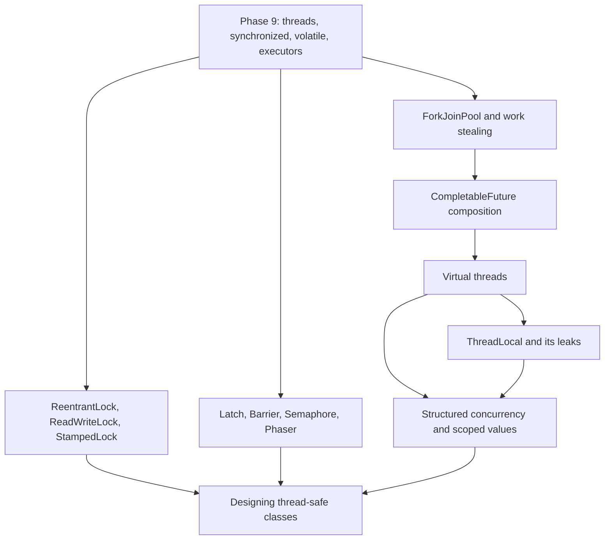
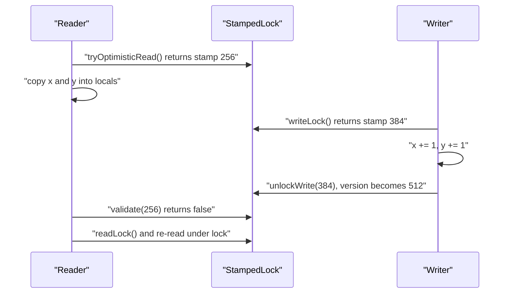
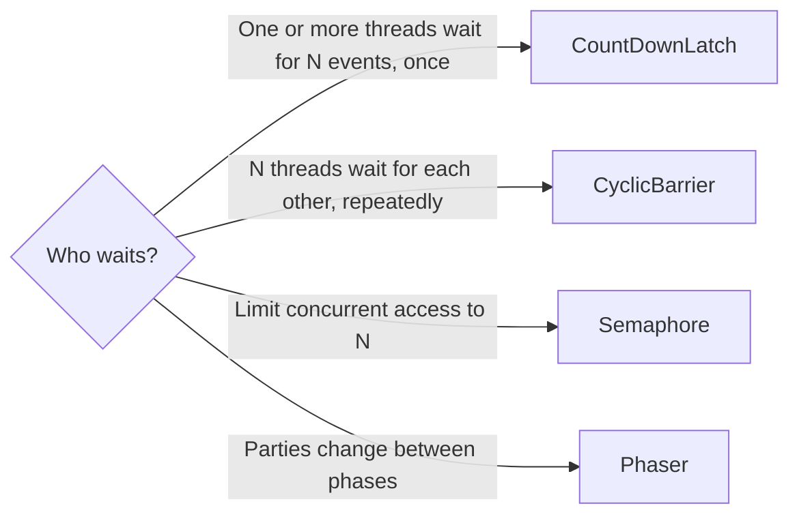
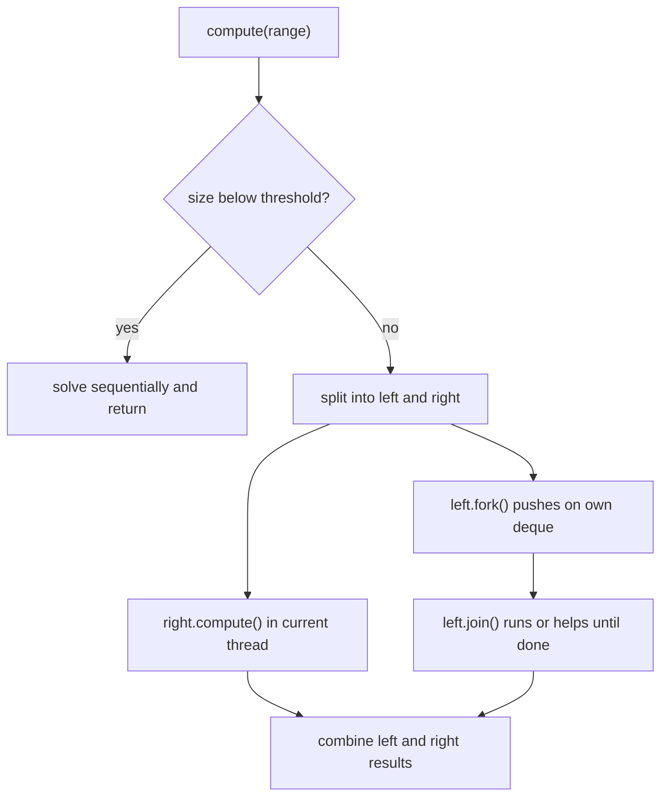

@@ 1 | MODULE | Phase 16 — Advanced Concurrency (Advanced) | Explicit locks, synchronizers, fork-join, async composition, virtual threads, structured concurrency and thread-safe design | MUST
# Phase 16: Advanced Concurrency (Advanced)

Phase 9 gave you threads, `synchronized`, `volatile`, atomics and executors. This phase is what senior interviews actually probe: explicit locks and when they beat `synchronized`, coordination tools (latches, barriers, semaphores), the fork-join pool behind parallel streams, composing async work with `CompletableFuture` without losing errors, virtual threads (final in Java 21, the biggest change to Java concurrency in 20 years), structured concurrency and scoped values (newer, version-dependent), `ThreadLocal` leaks, and finally how to design a class that is thread-safe by construction.

Interviewers care because concurrency bugs are the most expensive bugs in production: they do not show up in unit tests, they appear under load at 3 a.m., and they corrupt data silently. A candidate who can explain *why* a design is safe (happens-before, confinement, immutability) and *what it costs* (contention, pinning, pool starvation) stands out immediately.



**Prerequisites:** Phase 9 (all of it, especially [[Race Conditions and synchronized]], [[volatile and Visibility]], [[ExecutorService and Thread Pools]] and [[Future and CompletableFuture]]), Phase 15 [[Java Memory Model and Happens-Before]], and Phase 8 [[ConcurrentHashMap Internals]].

**The 5 questions from this phase that come up most often**
1. When would you use `ReentrantLock` instead of `synchronized`?
2. What are virtual threads, how do they differ from platform threads, and when do they *not* help?
3. How do you combine several `CompletableFuture` calls and handle a failure in one of them?
4. CountDownLatch vs CyclicBarrier vs Semaphore: give a use case for each.
5. How do you make a class thread-safe? Walk me through your design choices.

@@ 2 | MODULE | Locks and coordination | Explicit locks, synchronizers and divide-and-conquer parallelism with fork-join | MUST
# Locks and coordination

**Shared analogy: running a busy restaurant kitchen.** `synchronized` is a single key to the walk-in fridge that hangs on a hook: simple, but you cannot ask "is it free?" or give up after waiting. Explicit locks are a smart keycard system: you can try the door, wait a limited time, let many people *look* at the menu board while only one person *rewrites* it. The synchronizers are the kitchen's coordination rituals: the head chef waits until every station shouts "ready" (CountDownLatch), the whole team meets at the pass before each course goes out (CyclicBarrier), only four burners exist so only four cooks can fry at once (Semaphore). Fork-join is how a big catering order is split into trays, and idle cooks steal trays from busy cooks' piles.

@@ 3 | TOPIC | ReentrantLock, ReadWriteLock and StampedLock | Explicit locks vs synchronized, tryLock, fairness, conditions, read-write locks and optimistic reads | MUST
# ReentrantLock, ReadWriteLock and StampedLock

**Level: Advanced | Phase 16 | Priority: MUST | Since: Java 5 (ReentrantLock, ReentrantReadWriteLock), Java 8 (StampedLock)**

> **30-second interview answer:** `ReentrantLock` is an explicit mutual-exclusion lock with the same memory semantics as `synchronized`, plus features `synchronized` lacks: `tryLock` with a timeout, interruptible waiting, optional fairness and multiple `Condition` queues. `ReentrantReadWriteLock` lets many readers in at once but only one writer, which helps when reads vastly outnumber writes. `StampedLock` adds an optimistic read mode that takes no lock at all and validates afterwards; it is the fastest for read-mostly data but is not reentrant and has no conditions. Always unlock in `finally`.

## 1. Concept in Simple Words
### Analogy
A meeting room with a smart booking system, compared with an old room key.

| Meeting room | Java |
|---|---|
| Old brass key on a hook: you wait forever if someone has it | `synchronized` |
| Smart badge: "try the door, give up after 10 seconds" | `tryLock(10, SECONDS)` |
| Badge system remembers it is still you when you step out and back in | Reentrancy (hold count) |
| A queue at the door that serves people strictly in arrival order | Fair lock (`new ReentrantLock(true)`) |
| Separate waiting benches: "wait for projector", "wait for coffee" | Multiple `Condition` objects |
| Whiteboard: anyone can read it together, one person erases and rewrites alone | `ReadWriteLock` |
| Glance at the whiteboard without asking anyone, then check nobody rewrote it while you looked | `StampedLock` optimistic read |

### What it is
- **Lock interface** (`java.util.concurrent.locks.Lock`): `lock()`, `unlock()`, `tryLock()`, `tryLock(time, unit)`, `lockInterruptibly()`, `newCondition()`.
- **ReentrantLock:** a mutual-exclusion lock. *Reentrant* means the owning thread can acquire it again without blocking itself; it keeps a hold count and the lock is free only when the count returns to zero.
- **Fairness:** a fair lock grants access in roughly FIFO order; a non-fair lock (the default) lets a newly arriving thread "barge" ahead, which gives much higher throughput.
- **Condition:** a wait-set tied to a lock (`await()`, `signal()`, `signalAll()`), the explicit version of `wait`/`notify`, but you can have several per lock.
- **ReentrantReadWriteLock:** a pair of locks. The read lock is shared (many holders), the write lock is exclusive. A writer waits until all readers leave.
- **StampedLock:** three modes: write (exclusive), read (shared), and *optimistic read* (no lock; returns a stamp you later `validate`). Every acquire returns a `long` stamp that you pass to the unlock method.

### Why it exists
Before Java 5, `synchronized` was the only lock. It cannot time out, cannot be interrupted while waiting, cannot be tested ("is it free?"), offers no fairness, has one wait-set per object and must be released in the same block it was taken. These gaps made deadlock recovery, responsive cancellation and read-heavy caches hard. Doug Lea's `java.util.concurrent` (JSR 166) added explicit locks built on `AbstractQueuedSynchronizer`. Java 8 added `StampedLock` because `ReentrantReadWriteLock` still makes readers write to shared lock state, which causes cache-line contention on many-core machines.

## 2. How It Works
**AbstractQueuedSynchronizer (AQS)** is the engine behind `ReentrantLock`, `ReentrantReadWriteLock`, `Semaphore` and `CountDownLatch`. It holds a single `volatile int state` and a FIFO queue of waiting threads.

```text
ReentrantLock internals (AQS)

state = 0        -> free
state = n > 0    -> held, n = hold count; exclusiveOwnerThread = T1

lock():
  CAS state 0 -> 1 ?  yes: owner = me, done (fast path, no queue)
  owner == me ?       yes: state++ (reentrancy)
  otherwise:          enqueue node, park() the thread

unlock():
  state--; if state == 0: owner = null, unpark head successor

Wait queue (CLH variant):
  head -> [T2 parked] -> [T3 parked] -> [T4 parked] <- tail
```

- **Memory semantics:** `unlock()` does a volatile write of `state`, and a later `lock()` does a volatile read, so everything written before unlock happens-before everything after the next lock. Same guarantee as leaving and entering a `synchronized` block.
- **Non-fair vs fair:** non-fair `lock()` first tries a CAS even if others are queued (barging). Fair `lock()` checks `hasQueuedPredecessors()` first. Fair locks are typically several times slower under contention because every handoff requires a context switch.
- **Read-write lock state:** the 32-bit state is split: high 16 bits count readers, low 16 bits count write holds. A thread holding the write lock may acquire the read lock (downgrading); a thread holding the read lock that asks for the write lock deadlocks itself (no upgrading).
- **StampedLock optimistic read:** `tryOptimisticRead()` returns the current version stamp if no writer holds the lock. You copy the fields into locals, then call `validate(stamp)`. If a writer acquired the lock in between, the version changed and validation fails, so you fall back to a real read lock. Readers write nothing to shared memory, which is why it scales.



**Condition queues:** a bounded buffer needs "not full" and "not empty" waits. With `synchronized` both share one wait-set, so you must `notifyAll()` and wake everyone. With `ReentrantLock` you create two conditions and `signal()` exactly the right group:

```java
final Lock lock = new ReentrantLock();
final Condition notFull = lock.newCondition();
final Condition notEmpty = lock.newCondition();

void put(T item) throws InterruptedException {
    lock.lock();
    try {
        while (count == items.length) notFull.await();   // always a loop: spurious wakeups
        enqueue(item);
        notEmpty.signal();                              // wake one consumer only
    } finally {
        lock.unlock();
    }
}
```

## 3. Code Example
### Code
```java
import java.util.HashMap;
import java.util.Map;
import java.util.concurrent.ExecutorService;
import java.util.concurrent.Executors;
import java.util.concurrent.ThreadLocalRandom;
import java.util.concurrent.TimeUnit;
import java.util.concurrent.atomic.AtomicInteger;
import java.util.concurrent.locks.ReentrantLock;
import java.util.concurrent.locks.ReentrantReadWriteLock;
import java.util.concurrent.locks.StampedLock;

public class LocksDemo {

    // 1. ReentrantLock + tryLock: a transfer that cannot deadlock
    static class Account {
        private final String id;
        private long balance;
        private final ReentrantLock lock = new ReentrantLock();

        Account(String id, long balance) { this.id = id; this.balance = balance; }

        long balance() {
            lock.lock();
            try { return balance; } finally { lock.unlock(); }
        }
    }

    static boolean transfer(Account from, Account to, long amount) throws InterruptedException {
        while (true) {
            if (from.lock.tryLock(5, TimeUnit.MILLISECONDS)) {
                try {
                    if (to.lock.tryLock(5, TimeUnit.MILLISECONDS)) {
                        try {
                            if (from.balance < amount) return false;
                            from.balance -= amount;
                            to.balance += amount;
                            return true;
                        } finally {
                            to.lock.unlock();
                        }
                    }
                } finally {
                    from.lock.unlock();      // give up the first lock: no hold-and-wait
                }
            }
            // random back-off so two threads do not retry in lock step (livelock)
            Thread.sleep(ThreadLocalRandom.current().nextInt(0, 2));
        }
    }

    // 2. Reentrancy: the same thread takes the lock twice
    static final ReentrantLock audit = new ReentrantLock();

    static void outer() {
        audit.lock();
        try { inner(); } finally { audit.unlock(); }
    }

    static void inner() {
        audit.lock();                          // would deadlock if the lock were not reentrant
        try {
            System.out.println("hold count inside inner(): " + audit.getHoldCount());
        } finally {
            audit.unlock();
        }
    }

    // 3. ReadWriteLock: many concurrent readers, exclusive writer
    static class Settings {
        private final Map<String, String> map = new HashMap<>();
        private final ReentrantReadWriteLock rw = new ReentrantReadWriteLock();

        String get(String key) {
            rw.readLock().lock();
            try { return map.get(key); } finally { rw.readLock().unlock(); }
        }

        void put(String key, String value) {
            rw.writeLock().lock();
            try { map.put(key, value); } finally { rw.writeLock().unlock(); }
        }
    }

    // 4. StampedLock: optimistic read with fallback
    static class Point {
        private double x, y;
        private final StampedLock sl = new StampedLock();

        void move(double dx, double dy) {
            long stamp = sl.writeLock();
            try { x += dx; y += dy; } finally { sl.unlockWrite(stamp); }
        }

        double distanceFromOrigin() {
            long stamp = sl.tryOptimisticRead();     // no lock taken
            double cx = x, cy = y;                   // copy to locals first
            if (!sl.validate(stamp)) {               // a writer slipped in
                stamp = sl.readLock();
                try { cx = x; cy = y; } finally { sl.unlockRead(stamp); }
            }
            return Math.sqrt(cx * cx + cy * cy);
        }
    }

    public static void main(String[] args) throws Exception {
        Account a = new Account("A", 1_000);
        Account b = new Account("B", 1_000);
        ExecutorService pool = Executors.newFixedThreadPool(2);
        pool.submit(() -> { for (int i = 0; i < 1_000; i++) transfer(a, b, 1); return null; });
        pool.submit(() -> { for (int i = 0; i < 1_000; i++) transfer(b, a, 1); return null; });
        pool.shutdown();
        pool.awaitTermination(30, TimeUnit.SECONDS);
        System.out.println("A=" + a.balance() + " B=" + b.balance() + " total=" + (a.balance() + b.balance()));

        outer();
        System.out.println("locked after outer(): " + audit.isLocked());

        Settings settings = new Settings();
        settings.put("mode", "fast");
        AtomicInteger hits = new AtomicInteger();
        ExecutorService readers = Executors.newFixedThreadPool(4);
        for (int r = 0; r < 4; r++) {
            readers.submit(() -> {
                for (int i = 0; i < 1_000; i++) {
                    if ("fast".equals(settings.get("mode"))) hits.incrementAndGet();
                }
            });
        }
        readers.shutdown();
        readers.awaitTermination(30, TimeUnit.SECONDS);
        System.out.println("successful reads=" + hits.get());

        Point p = new Point();
        p.move(3, 4);
        System.out.println("distance=" + p.distanceFromOrigin());
    }
}
```

### Walkthrough
- **transfer:** two threads move money in opposite directions (A to B and B to A). With nested `synchronized` blocks this is the textbook deadlock: thread 1 holds A and waits for B, thread 2 holds B and waits for A. Here each thread uses `tryLock` with a 5 ms timeout; if it cannot get the second lock it releases the first one, breaking the "hold and wait" condition. The random sleep prevents livelock (both threads backing off and retrying in perfect sync).
- **Every unlock in finally:** if the body throws, a lock that is never released freezes every other thread forever. This is the number one `ReentrantLock` bug.
- **outer/inner:** `getHoldCount()` is 2 inside `inner()`; after both unlocks the lock is free again (`isLocked()` is false).
- **Settings:** four reader threads hold the read lock at the same time; the single `put` takes the exclusive write lock. In real code, prefer `ConcurrentHashMap` for a map; a read-write lock pays off when the guarded structure has no concurrent alternative (for example a large object graph rebuilt occasionally).
- **Point:** the optimistic read copies `x` and `y` into locals *before* `validate`, then uses only the locals. If validation fails it re-reads under a real read lock.

### Output
```text
A=1000 B=1000 total=2000
hold count inside inner(): 2
locked after outer(): false
successful reads=4000
distance=5.0
```

### Compare
| Feature | `synchronized` | `ReentrantLock` | `ReentrantReadWriteLock` | `StampedLock` |
|---|---|---|---|---|
| Reentrant | Yes | Yes | Yes | No |
| Try or timeout | No | Yes | Yes | Yes |
| Interruptible wait | No | Yes | Yes | Yes |
| Fairness option | No | Yes | Yes | No |
| Conditions | One wait-set | Many | Many (write lock only) | None |
| Concurrent readers | No | No | Yes | Yes, plus lock-free optimistic reads |
| Auto release | Yes, on block exit | No, needs finally | No, needs finally | No, needs finally |
| Virtual thread pinning (Java 21-23) | Pins carrier while blocked | Does not pin | Does not pin | Does not pin |

## 4. Interview Questions
**Basic**
1. **When would you choose `ReentrantLock` over `synchronized`?**
   When you need something `synchronized` cannot do: a timed or non-blocking `tryLock` (deadlock avoidance, fail fast), `lockInterruptibly` for cancellable waits, fairness, or several condition queues. For plain mutual exclusion, `synchronized` is simpler and since Java 24 it no longer pins virtual threads, so it is fine. Pick the explicit lock for a reason, not by default.
2. **What does "reentrant" mean?**
   A thread that already owns the lock can acquire it again without blocking; the lock tracks a hold count and is released only when the owner has called `unlock` as many times as `lock`. Without reentrancy, a synchronized method calling another synchronized method on the same object would deadlock on itself.
3. **What is a read-write lock?**
   Two linked locks: a shared read lock any number of threads can hold at once, and an exclusive write lock. It improves throughput when reads dominate and the critical section is long enough for the extra bookkeeping to pay off.

**Follow-up**
4. **Fair vs non-fair lock: what is the trade-off?**
   A fair lock hands the lock to the longest-waiting thread, which prevents starvation but forces a context switch on every handoff, often cutting throughput by an order of magnitude under contention. Non-fair allows barging: a thread that arrives just as the lock is released can grab it while it is still on-CPU and cache-warm. Default to non-fair; use fair only if you have measured starvation.
5. **Can you upgrade a read lock to a write lock in `ReentrantReadWriteLock`?**
   No. If a thread holding the read lock calls `writeLock().lock()`, it waits for all readers to leave, including itself, so it deadlocks. Downgrading works: take the write lock, take the read lock, release the write lock. `StampedLock` offers `tryConvertToWriteLock`, which may fail and must be checked.
6. **How does `StampedLock` optimistic reading work and what can go wrong?**
   `tryOptimisticRead` returns a version stamp without locking; you read fields into locals and call `validate`. If a write happened in between, you retry under a read lock. The danger is using the fields before validating: you may see inconsistent values (half-updated object) and, for example, index out of bounds. Also it is not reentrant, so calling a method that takes the same lock again deadlocks.

**Tricky / scenario**
7. **In production, a service froze and the thread dump shows 200 threads waiting on a `ReentrantLock` with no owner thread doing work. What happened?**
   Almost certainly a code path that called `lock()` and then threw before reaching `unlock()`, typically because `unlock` was not in a `finally`, or `lock()` was called inside the `try` and an exception path unlocked a lock it did not hold. The thread dump's "Locked ownable synchronizers" section shows which thread owns it; if that thread is gone or idle, the lock leaked. Fix: `lock()` just before `try`, `unlock()` in `finally`, and add `tryLock` timeouts on paths that can wait for a long time.
8. **We replaced `synchronized` with `ReentrantReadWriteLock` for a cache and throughput went down. Why?**
   Read-write locks have more overhead than a simple lock, and every reader still does a CAS on the shared state, so on many cores readers contend on the same cache line. If the critical section is tiny (a `HashMap.get`), that overhead dominates. Better choices: `ConcurrentHashMap`, an immutable snapshot swapped via `volatile` or `AtomicReference` (copy-on-write), or `StampedLock` optimistic reads.
9. **Your app moved to virtual threads on Java 21 and throughput dropped in a JDBC-heavy path. A JFR event `jdk.VirtualThreadPinned` fires constantly. What do you change?**
   On Java 21-23, a virtual thread that blocks inside a `synchronized` block pins its carrier thread, so a small carrier pool gets exhausted. Replace long `synchronized` sections around blocking I/O with `ReentrantLock`, upgrade the JDBC driver (many replaced `synchronized` internally), or move to Java 24+, where JEP 491 removed pinning for `synchronized`.

**What the interviewer is really testing:** whether you know the concrete capabilities explicit locks add, can avoid deadlock by design, and understand the performance trade-offs instead of assuming "fancier lock equals faster".

## 5. Pitfalls & Best Practices
### Common mistakes
| Mistake | What goes wrong | Fix |
|---|---|---|
| `unlock()` not in `finally` | An exception leaks the lock and all other threads block forever | `lock(); try { ... } finally { unlock(); }` |
| Calling `lock()` inside the `try` | If `lock()` fails, `finally` unlocks a lock you do not hold and throws `IllegalMonitorStateException` | Call `lock()` on the line before `try` |
| Upgrading read lock to write lock | Self-deadlock | Release the read lock first, then re-check state after acquiring the write lock |
| Using fields before `validate` in optimistic reads | Inconsistent values, wrong results | Copy into locals, validate, then use locals only |
| Reentering a `StampedLock` | Deadlock, it is not reentrant | Keep lock scope inside one method, never call out while holding it |
| Fair lock "for safety" | Throughput collapses under load | Default non-fair; fairness only after measuring starvation |

### Best practices
- Keep critical sections short; never do network or disk I/O while holding a lock unless that is the whole point of the lock.
- Acquire multiple locks in a global order (for example by account id) or use `tryLock` with back-off.
- Prefer higher-level tools first: `ConcurrentHashMap`, atomics, immutable snapshots, `BlockingQueue`. Reach for explicit locks when those do not fit.
- Name lock fields after what they guard (`balanceLock`) and document the guarded state (`@GuardedBy("balanceLock")` comment style).
- Use thread dumps (`jcmd <pid> Thread.print -l`) to see owners of `ReentrantLock`s ("ownable synchronizers").

### Compare with
| Tool | Best for | Avoid when |
|---|---|---|
| `synchronized` | Simple short critical sections | You need timeouts, interruptibility or several conditions |
| `ReentrantLock` | Timeouts, cancellation, conditions | You only need plain exclusion |
| `ReentrantReadWriteLock` | Long reads, rare writes, structure without concurrent alternative | Tiny critical sections |
| `StampedLock` | Very read-heavy small state (coordinates, counters snapshot) | You need reentrancy or conditions |
| Atomics and `ConcurrentHashMap` | Single variables and maps | Invariants across several variables |

## 6. Hands-on Exercise
Build a `BoundedBuffer<T>` with capacity N using one `ReentrantLock` and two `Condition`s (`notFull`, `notEmpty`). Add `put(T)`, `take()`, and `offer(T, long timeout, TimeUnit unit)` that returns `false` if there is no space within the timeout.

Acceptance criteria:
- Two producers put 1-100 and 101-200; two consumers take 200 items in total; the sum of taken items is 20100.
- `offer` on a full buffer with a 50 ms timeout returns `false`.
- No `synchronized`, no `notifyAll`.

<details><summary>Solution</summary>

```java
import java.util.concurrent.ExecutorService;
import java.util.concurrent.Executors;
import java.util.concurrent.TimeUnit;
import java.util.concurrent.atomic.AtomicLong;
import java.util.concurrent.locks.Condition;
import java.util.concurrent.locks.ReentrantLock;

public class BoundedBuffer<T> {
    private final Object[] items;
    private int putIndex, takeIndex, count;
    private final ReentrantLock lock = new ReentrantLock();
    private final Condition notFull = lock.newCondition();
    private final Condition notEmpty = lock.newCondition();

    public BoundedBuffer(int capacity) { items = new Object[capacity]; }

    public void put(T item) throws InterruptedException {
        lock.lockInterruptibly();
        try {
            while (count == items.length) notFull.await();
            enqueue(item);
        } finally {
            lock.unlock();
        }
    }

    public boolean offer(T item, long timeout, TimeUnit unit) throws InterruptedException {
        long nanos = unit.toNanos(timeout);
        lock.lockInterruptibly();
        try {
            while (count == items.length) {
                if (nanos <= 0) return false;
                nanos = notFull.awaitNanos(nanos);   // returns remaining time
            }
            enqueue(item);
            return true;
        } finally {
            lock.unlock();
        }
    }

    @SuppressWarnings("unchecked")
    public T take() throws InterruptedException {
        lock.lockInterruptibly();
        try {
            while (count == 0) notEmpty.await();
            T item = (T) items[takeIndex];
            items[takeIndex] = null;
            takeIndex = (takeIndex + 1) % items.length;
            count--;
            notFull.signal();
            return item;
        } finally {
            lock.unlock();
        }
    }

    private void enqueue(T item) {
        items[putIndex] = item;
        putIndex = (putIndex + 1) % items.length;
        count++;
        notEmpty.signal();
    }

    public static void main(String[] args) throws Exception {
        BoundedBuffer<Integer> buffer = new BoundedBuffer<>(10);
        AtomicLong sum = new AtomicLong();
        ExecutorService pool = Executors.newFixedThreadPool(4);
        pool.submit(() -> { for (int i = 1; i <= 100; i++) buffer.put(i); return null; });
        pool.submit(() -> { for (int i = 101; i <= 200; i++) buffer.put(i); return null; });
        for (int c = 0; c < 2; c++) {
            pool.submit(() -> { for (int i = 0; i < 100; i++) sum.addAndGet(buffer.take()); return null; });
        }
        pool.shutdown();
        pool.awaitTermination(10, TimeUnit.SECONDS);
        System.out.println("sum=" + sum.get());

        BoundedBuffer<String> tiny = new BoundedBuffer<>(1);
        tiny.put("x");
        System.out.println("offer on full buffer: " + tiny.offer("y", 50, TimeUnit.MILLISECONDS));
    }
}
```
Output:
```text
sum=20100
offer on full buffer: false
```
Each condition wakes only the right kind of thread: producers wait on `notFull`, consumers on `notEmpty`. `awaitNanos` returns the remaining wait time, which makes the timeout loop correct even with spurious wakeups.
</details>

## 7. Recall
Q: Name four things `ReentrantLock` can do that `synchronized` cannot.
A: Timed or non-blocking `tryLock`, interruptible acquisition with `lockInterruptibly`, a fairness policy, and multiple `Condition` queues per lock.

Q: Why must `ReentrantLock.unlock()` be in a `finally` block?
A: Explicit locks are not released automatically; if the body throws, the lock stays held and every other thread waiting for it blocks forever.

Q: Can a `ReentrantReadWriteLock` read lock be upgraded to a write lock?
A: No, the thread deadlocks waiting for itself to release the read lock; only downgrading (write to read) is supported.

Q: What is a `StampedLock` optimistic read?
A: A lock-free read that returns a version stamp; you copy fields to locals and call `validate(stamp)`, falling back to a real read lock if a writer intervened.

Q: What is the default fairness of `ReentrantLock` and why?
A: Non-fair, because allowing barging avoids a context switch on each handoff and gives much higher throughput.

Q: Which engine class implements `ReentrantLock`, `Semaphore` and `CountDownLatch`?
A: `AbstractQueuedSynchronizer` (AQS): a volatile int state plus a FIFO queue of parked threads.

**Related:** [[Race Conditions and synchronized]] · [[Deadlock, Livelock and Starvation]] · [[Virtual Threads]] · [[Designing Thread-Safe Classes]]

@@ 3 | TOPIC | CountDownLatch, CyclicBarrier, Semaphore and Phaser | Synchronizers for waiting on events, meeting at a point, limiting concurrency and multi-phase work | SHOULD
# CountDownLatch, CyclicBarrier, Semaphore and Phaser

**Level: Advanced | Phase 16 | Priority: SHOULD | Since: Java 5 (CountDownLatch, CyclicBarrier, Semaphore), Java 7 (Phaser)**

> **30-second interview answer:** These are synchronizers: objects whose state controls when threads may proceed. `CountDownLatch` lets threads wait until a count reaches zero; it is one-shot ("wait until N services have started"). `CyclicBarrier` makes a fixed group of threads wait for each other at a meeting point and is reusable each round. `Semaphore` holds N permits and limits how many threads use a resource at once ("max 10 concurrent calls to the payment API"). `Phaser` is a flexible, reusable barrier where parties can register and deregister dynamically across multiple phases.

## 1. Concept in Simple Words
### Analogy
A rocket launch, a group hike, and a car park.

| Everyday scene | Synchronizer |
|---|---|
| Launch control waits until all 5 stations report "go", then launches once | `CountDownLatch(5)`, `countDown()`, `await()` |
| Hikers wait at each viewpoint until the whole group arrives, then all walk on, at every viewpoint | `CyclicBarrier(groupSize)`, reused per phase |
| The guide takes a photo every time the group regathers | Barrier action (`Runnable` run once per trip) |
| Car park with 10 spaces and a sign showing free spaces | `Semaphore(10)`, `acquire()`, `release()` |
| A tour where people can join or leave the group between viewpoints | `Phaser` with `register()` and `arriveAndDeregister()` |

### What it is
- **CountDownLatch(n):** `countDown()` decrements; `await()` blocks until the count is zero. Cannot be reset. Any thread can count down, and the counting threads do not wait.
- **CyclicBarrier(parties, action):** each thread calls `await()`; when the last of `parties` threads arrives, the optional barrier action runs (in the last arriving thread) and all are released. Then it resets automatically. If one waiting thread is interrupted or times out, the barrier becomes *broken* and every waiter gets `BrokenBarrierException`.
- **Semaphore(permits, fair):** `acquire()` takes a permit (blocks if none), `release()` returns one, `tryAcquire(timeout)` gives up. Permits are not owned: any thread can release, which is powerful and dangerous.
- **Phaser:** parties call `arriveAndAwaitAdvance()` (like a barrier), `arrive()` (signal without waiting), `arriveAndDeregister()` (leave). Phase number increments each round; override `onAdvance` to stop after N phases.
- **Exchanger** (bonus, rarely asked): two threads swap objects at a rendezvous point.

### Why it exists
Coordinating threads with `wait`/`notify` and a shared counter is error-prone: missed signals, spurious wakeups, forgotten `notifyAll`. These classes package the most common coordination shapes, tested and built on AQS, so your code says *what* it waits for instead of *how*.

## 2. How It Works
```text
CountDownLatch(3)   one-shot gate
  main: await() ------------------ blocked ------------------> runs
  w1:   work... countDown() (2)
  w2:   work........ countDown() (1)
  w3:   work.............. countDown() (0)  -> gate opens forever

CyclicBarrier(3)    reusable meeting point
  t1: phase0 ---await|           |phase1 ---await|        |phase2
  t2: phase0 -------await|       |phase1 -await|          |phase2
  t3: phase0 -----------await -> action, release all -> phase1 ... await -> action
                         (barrier resets automatically after each trip)

Semaphore(2)        at most 2 inside at once
  t1: acquire ===== inside ===== release
  t2: acquire ===== inside ========== release
  t3: acquire (blocked) ......... acquire ok == inside == release
```

- **CountDownLatch** uses AQS shared mode: state = count. `await` succeeds when state is 0. `countDown` CASes state down and, at zero, releases all waiters.
- **Semaphore** also uses shared mode: state = permits. `acquire` CASes state down if positive, otherwise parks. `release` CASes it up and unparks.
- **CyclicBarrier** is built on `ReentrantLock` plus a `Condition` and a generation object; each trip creates a new generation.
- **Memory visibility:** actions before `countDown()` happen-before actions after the corresponding `await()` returns; actions before `release()` happen-before a successful `acquire()`. You can safely read results written by workers after `await()`.



## 3. Code Example
### Code
```java
import java.util.ArrayList;
import java.util.Collections;
import java.util.List;
import java.util.concurrent.BrokenBarrierException;
import java.util.concurrent.CountDownLatch;
import java.util.concurrent.CyclicBarrier;
import java.util.concurrent.ExecutorService;
import java.util.concurrent.Executors;
import java.util.concurrent.Phaser;
import java.util.concurrent.Semaphore;
import java.util.concurrent.TimeUnit;
import java.util.concurrent.atomic.AtomicInteger;

public class SynchronizersDemo {

    public static void main(String[] args) throws Exception {
        ExecutorService pool = Executors.newFixedThreadPool(8);

        // 1. CountDownLatch: wait for 3 services to start
        CountDownLatch ready = new CountDownLatch(3);
        List<String> started = Collections.synchronizedList(new ArrayList<>());
        for (String service : List.of("db", "cache", "broker")) {
            pool.submit(() -> {
                started.add(service);          // pretend start-up work
                ready.countDown();
            });
        }
        boolean allUp = ready.await(5, TimeUnit.SECONDS);   // always use a timeout in real code
        List<String> sorted = new ArrayList<>(started);
        Collections.sort(sorted);
        System.out.println("latch: all up=" + allUp + " " + sorted);

        // 2. CyclicBarrier: 3 workers, 2 rounds, merge results after each round
        AtomicInteger roundTotal = new AtomicInteger();
        CyclicBarrier barrier = new CyclicBarrier(3,
                () -> System.out.println("barrier: round finished, total=" + roundTotal.getAndSet(0)));
        CountDownLatch workersDone = new CountDownLatch(3);
        for (int w = 1; w <= 3; w++) {
            int worker = w;
            pool.submit(() -> {
                try {
                    for (int round = 1; round <= 2; round++) {
                        roundTotal.addAndGet(worker * round);   // round 1: 1+2+3, round 2: 2+4+6
                        barrier.await();                         // wait for the others
                    }
                } catch (InterruptedException | BrokenBarrierException e) {
                    Thread.currentThread().interrupt();
                } finally {
                    workersDone.countDown();
                }
            });
        }
        workersDone.await(5, TimeUnit.SECONDS);

        // 3. Semaphore: at most 2 concurrent calls to a fragile API
        Semaphore permits = new Semaphore(2);
        AtomicInteger inside = new AtomicInteger();
        AtomicInteger maxInside = new AtomicInteger();
        CountDownLatch callsDone = new CountDownLatch(6);
        for (int i = 0; i < 6; i++) {
            pool.submit(() -> {
                try {
                    permits.acquire();
                    try {
                        int now = inside.incrementAndGet();
                        maxInside.accumulateAndGet(now, Math::max);
                        Thread.sleep(20);                       // simulated remote call
                        inside.decrementAndGet();
                    } finally {
                        permits.release();                      // always release in finally
                    }
                } catch (InterruptedException e) {
                    Thread.currentThread().interrupt();
                } finally {
                    callsDone.countDown();
                }
            });
        }
        callsDone.await(5, TimeUnit.SECONDS);
        System.out.println("semaphore: max concurrent calls=" + maxInside.get());

        // 4. Phaser: 2 phases, one party leaves after phase 0
        Phaser phaser = new Phaser(1);                 // register main thread
        AtomicInteger phase1Arrivals = new AtomicInteger();
        for (int i = 0; i < 3; i++) {
            phaser.register();
            int id = i;
            pool.submit(() -> {
                phaser.arriveAndAwaitAdvance();        // end of phase 0
                if (id == 0) {
                    phaser.arriveAndDeregister();      // worker 0 leaves
                    return;
                }
                phase1Arrivals.incrementAndGet();
                phaser.arriveAndAwaitAdvance();        // end of phase 1
                phaser.arriveAndDeregister();
            });
        }
        phaser.arriveAndAwaitAdvance();                // main: phase 0 done
        phaser.arriveAndAwaitAdvance();                // main: phase 1 done
        System.out.println("phaser: phase now=" + phaser.getPhase()
                + " phase-1 workers=" + phase1Arrivals.get());
        phaser.arriveAndDeregister();

        pool.shutdown();
        pool.awaitTermination(5, TimeUnit.SECONDS);
    }
}
```

### Walkthrough
- **Latch:** three tasks each count down once. `await(5, SECONDS)` returns `true` when the count hits zero, or `false` on timeout, which is how a real start-up check fails fast instead of hanging. Because thread order is non-deterministic, the list is sorted before printing.
- **Barrier:** each worker adds to `roundTotal` and waits. When the third arrives, the barrier action prints the total and resets it, then all three continue to round 2. Round 1 total is 1+2+3 = 6, round 2 is 2+4+6 = 12. The barrier is reused without any reset call.
- **Semaphore:** six tasks compete for two permits. `maxInside` records the highest concurrency ever observed: 2. The `release()` sits in a `finally` so an exception cannot leak a permit.
- **Phaser:** main registers itself plus three workers (4 parties). After phase 0, worker 0 deregisters, so phase 1 needs only 3 arrivals (main plus workers 1 and 2). After two advances the phase number is 2.

### Output
```text
latch: all up=true [broker, cache, db]
barrier: round finished, total=6
barrier: round finished, total=12
semaphore: max concurrent calls=2
phaser: phase now=2 phase-1 workers=2
```

### Compare
| Old way | Modern way |
|---|---|
| Shared `int counter` + `synchronized` + `wait`/`notifyAll` to wait for N workers | `CountDownLatch` or `invokeAll` on an executor |
| `Thread.join()` on each thread you created | Latch, or `ExecutorService.invokeAll`, or structured concurrency |
| A fixed thread pool sized to limit calls to a slow API | `Semaphore` around the call (works with virtual threads too) |

## 4. Interview Questions
**Basic**
1. **CountDownLatch vs CyclicBarrier?**
   A latch is one-shot: some threads count down, others wait, and once zero it stays open. A barrier is reusable and symmetric: a fixed set of threads all wait for each other, then it resets for the next round. Use a latch for "wait for start-up or N results", a barrier for iterative parallel algorithms where all workers must finish step k before step k+1.
2. **What is a Semaphore used for?**
   To bound concurrency: only N threads may hold a permit at a time. Typical uses are limiting calls to a rate-limited API, capping concurrent DB-heavy jobs, or implementing a resource pool. A `Semaphore(1)` is a mutex that any thread can release.
3. **What is a Phaser?**
   A reusable barrier with a dynamic number of parties and numbered phases. Parties can register and deregister between phases and you can override `onAdvance` to decide when to terminate. It generalizes both latch and barrier.

**Follow-up**
4. **What happens if a thread waiting at a `CyclicBarrier` is interrupted?**
   The barrier breaks: that thread gets `InterruptedException`, and every other thread waiting (and any thread arriving later) gets `BrokenBarrierException`. You must call `reset()` to reuse it. This all-or-nothing behaviour prevents the others from waiting forever for a dead party.
5. **Does the thread that releases a Semaphore permit have to be the one that acquired it?**
   No, permits are not owned. That allows patterns like one thread acquiring and a callback releasing, but it also means a bug that releases twice silently increases the number of permits beyond the limit. Always pair `acquire` and `release` with `try`/`finally`.
6. **Can you reuse a CountDownLatch?**
   No, there is no reset. Create a new one, or use a `CyclicBarrier` or `Phaser` if you need rounds.

**Tricky / scenario**
7. **An integration test hangs forever on `latch.await()`. What are the likely causes and the fix?**
   A worker threw before calling `countDown()` (so the count never hits zero), or fewer tasks were started than the latch count. Fix: put `countDown()` in a `finally`, always use `await(timeout, unit)` and assert on its boolean result, and check task futures for exceptions.
8. **You must limit calls to a partner API to 20 concurrent requests across a service that now uses virtual threads. How?**
   Do not shrink a thread pool, because virtual threads are not pooled. Wrap the call in a `Semaphore(20)` with `tryAcquire(timeout)` so callers fail fast when saturated. For per-second rate limits rather than concurrency, use a rate limiter such as Resilience4j `RateLimiter`; a semaphore limits how many are in flight, not how many per second.
9. **Implement "start N threads at exactly the same moment" for a load test.**
   Use a start latch of 1 that all workers `await()`, plus a done latch of N. Main creates the workers, calls `start.countDown()` to release them together, then `done.await()` to wait for completion. This removes thread start-up skew from your measurements.

**What the interviewer is really testing:** whether you pick the right coordination primitive for a scenario and know the failure modes (hangs, broken barriers, permit leaks), instead of hand-rolling `wait`/`notify`.

## 5. Pitfalls & Best Practices
### Common mistakes
| Mistake | What goes wrong | Fix |
|---|---|---|
| `countDown()` not in `finally` | A failing worker leaves the latch stuck; waiter hangs | Count down in `finally` |
| `await()` without timeout | Production thread blocks forever | `await(timeout, unit)` and handle `false` |
| `release()` without a matching `acquire()` | Permits grow past the limit | `acquire(); try { } finally { release(); }` |
| Barrier parties larger than pool size | Workers wait at the barrier while the remaining parties cannot get a thread: deadlock | Pool size at least equal to parties, or virtual threads |
| Ignoring `BrokenBarrierException` | Remaining rounds silently skipped | Log, abort the computation, `reset()` deliberately |

### Best practices
- Prefer higher-level APIs when they fit: `invokeAll`, `CompletableFuture.allOf`, structured concurrency. Use latches when you coordinate threads you do not control (test harnesses, start-up).
- Use `Semaphore` for bulkheads around slow dependencies; combine with timeouts.
- For per-second limits, use a token bucket rate limiter; a semaphore limits in-flight work only.
- Document the party count next to the barrier or latch, and derive it from the same variable that starts the workers.

### Compare with
| Synchronizer | Reusable | Who waits | Typical use |
|---|---|---|---|
| `CountDownLatch` | No | Waiters, not counters | Wait for start-up or N results |
| `CyclicBarrier` | Yes | All parties | Iterative parallel computation |
| `Semaphore` | Yes | Threads needing a permit | Concurrency limit, bulkhead |
| `Phaser` | Yes, dynamic parties | Registered parties | Multi-phase work with changing participants |
| `CompletableFuture.allOf` | No | Whoever joins | Wait for N async results |

## 6. Hands-on Exercise
OrderHub calls an external fraud-check API that allows at most 3 concurrent requests. Write a `FraudCheckClient` (plain Java, no Spring) whose `check(orderId)` method uses a fair `Semaphore(3)` with `tryAcquire(200, MILLISECONDS)`; if no permit is available it returns `"SKIPPED"` instead of waiting. Simulate 10 concurrent orders where each check takes 300 ms.

Acceptance criteria:
- Never more than 3 checks run at once (track with an `AtomicInteger`).
- With 10 simultaneous orders and 300 ms checks, exactly 3 return `"OK"` and 7 return `"SKIPPED"`.
- Permits are released in `finally`.

<details><summary>Solution</summary>

```java
import java.util.List;
import java.util.concurrent.CountDownLatch;
import java.util.concurrent.ExecutorService;
import java.util.concurrent.Executors;
import java.util.concurrent.Future;
import java.util.concurrent.Semaphore;
import java.util.concurrent.TimeUnit;
import java.util.concurrent.atomic.AtomicInteger;
import java.util.stream.IntStream;

public class FraudCheckClient {
    private final Semaphore permits = new Semaphore(3, true);
    private final AtomicInteger inFlight = new AtomicInteger();
    private final AtomicInteger maxInFlight = new AtomicInteger();

    public String check(long orderId) throws InterruptedException {
        if (!permits.tryAcquire(200, TimeUnit.MILLISECONDS)) {
            return "SKIPPED";                         // fail fast instead of piling up
        }
        try {
            maxInFlight.accumulateAndGet(inFlight.incrementAndGet(), Math::max);
            Thread.sleep(300);                        // simulated remote call
            return "OK";
        } finally {
            inFlight.decrementAndGet();
            permits.release();
        }
    }

    public static void main(String[] args) throws Exception {
        FraudCheckClient client = new FraudCheckClient();
        CountDownLatch start = new CountDownLatch(1);
        try (ExecutorService pool = Executors.newVirtualThreadPerTaskExecutor()) {
            List<Future<String>> results = IntStream.rangeClosed(1, 10)
                    .mapToObj(id -> pool.submit(() -> { start.await(); return client.check(id); }))
                    .toList();
            start.countDown();                        // release all 10 at the same moment
            long ok = 0, skipped = 0;
            for (Future<String> f : results) {
                if (f.get().equals("OK")) ok++; else skipped++;
            }
            System.out.println("OK=" + ok + " SKIPPED=" + skipped + " max in flight=" + client.maxInFlight.get());
        }
    }
}
```
Output:
```text
OK=3 SKIPPED=7 max in flight=3
```
The first three get permits and hold them for 300 ms; the other seven give up after 200 ms. The start latch makes all requests arrive together. Executors became `AutoCloseable` in Java 19, so try-with-resources waits for all tasks.
</details>

## 7. Recall
Q: What is the key difference between `CountDownLatch` and `CyclicBarrier`?
A: A latch is one-shot and separates counters from waiters; a barrier is reusable and all parties wait for each other each round.

Q: What happens to other waiters when one thread at a `CyclicBarrier` times out or is interrupted?
A: The barrier breaks and they all receive `BrokenBarrierException`.

Q: What does a `Semaphore` limit?
A: The number of threads that can hold a permit concurrently, that is, how much work is in flight at once.

Q: Are `Semaphore` permits owned by the acquiring thread?
A: No; any thread may release a permit, so an unmatched release silently raises the limit.

Q: When would you choose a `Phaser` over a `CyclicBarrier`?
A: When the number of participating parties changes between phases or you need phase numbers and custom termination via `onAdvance`.

Q: What memory guarantee does `CountDownLatch` give?
A: Actions before `countDown()` happen-before actions after the matching `await()` returns, so workers' results are visible to the waiter.

**Related:** [[ReentrantLock, ReadWriteLock and StampedLock]] · [[ExecutorService and Thread Pools]] · [[Resilience4j: Circuit Breaker, Retry, Rate Limiter, Bulkhead]] · [[Structured Concurrency and Scoped Values]]

@@ 3 | TOPIC | ForkJoinPool and Work Stealing | Divide-and-conquer tasks, RecursiveTask, the common pool, work stealing and why blocking breaks it | SHOULD
# ForkJoinPool and Work Stealing

**Level: Advanced | Phase 16 | Priority: SHOULD | Since: Java 7 (ForkJoinPool), Java 8 (common pool, used by parallel streams and CompletableFuture)**

> **30-second interview answer:** `ForkJoinPool` is an executor designed for divide-and-conquer: a task splits itself into subtasks (`fork`), runs them in parallel, and combines the results (`join`). Each worker thread has its own double-ended queue; it pushes and pops its own tasks at one end (LIFO) and, when idle, steals from the other end of another worker's deque (FIFO). This work stealing keeps all cores busy with little contention. The JVM-wide common pool, sized to cores minus one, runs parallel streams and async `CompletableFuture` stages by default, so blocking inside it starves the whole application.

## 1. Concept in Simple Words
### Analogy
A team folding 10,000 leaflets.

| Folding team | ForkJoinPool |
|---|---|
| A stack too big for one person is split in half again and again | `fork()` recursive splitting |
| Each person has their own pile on their desk | Per-worker deque |
| You take the top leaflet from your own pile (the one you just put there) | LIFO pop from own deque, cache-friendly |
| An idle person walks over and takes a big chunk from the *bottom* of a busy person's pile | Work stealing (FIFO from the other end) |
| A stack small enough is just folded directly | Sequential threshold |
| The team leader adds up the counts from each half | `join()` combining results |
| One person leaves to wait for a delivery, and nobody covers their pile | Blocking in a fork-join task starves the pool |

### What it is
- **ForkJoinPool:** an `ExecutorService` with work-stealing worker threads.
- **ForkJoinTask:** the lightweight task type; subclasses `RecursiveTask<V>` (returns a value) and `RecursiveAction` (no value), plus `CountedCompleter` for advanced use.
- **fork():** pushes a subtask onto the current worker's deque for asynchronous execution.
- **join():** waits for and returns the subtask's result. While waiting, the worker may run other tasks instead of blocking (helping).
- **compute():** the method you override: if the problem is small, solve it directly; otherwise split.
- **Common pool:** `ForkJoinPool.commonPool()`, shared JVM-wide, parallelism = `availableProcessors() - 1` by default (configurable with `-Djava.util.concurrent.ForkJoinPool.common.parallelism`).

### Why it exists
A normal `ThreadPoolExecutor` has one shared queue; with many tiny recursive tasks every worker contends on that queue, and a task that waits for its own subtasks occupies a thread doing nothing (with a bounded pool, that can deadlock). Fork-join gives each worker its own deque, lets waiting workers execute other tasks, and balances load automatically, making recursive parallelism efficient. It is the engine under parallel streams (Java 8) and the default executor for `CompletableFuture.supplyAsync`.

## 2. How It Works
```text
Worker deques (each worker owns one)

 Worker 1 deque:  bottom [T1a][T1b][T1c] top   <- W1 pushes/pops at top (LIFO)
                         ^
                         |  steal from bottom (FIFO), takes the biggest, oldest task
 Worker 2 deque:  bottom [] top   (idle -> steals T1a)

Splitting sum(0..8M):
                 [0..8M]
               /         \
          [0..4M]       [4M..8M]       forked: pushed on own deque
          /     \        /     \
      [0..2M] [2M..4M] ...            leaves below threshold computed sequentially
```

1. You `invoke` the root task on a pool. A worker runs `compute()`.
2. `compute()` splits: it calls `left.fork()` (push left on its own deque) and usually computes `right` directly in the same thread (saves a push and a steal), then `left.join()`.
3. Other workers that are idle scan for work and steal from the *bottom* of a busy worker's deque. Old tasks near the bottom are the big, unsplit ones, so one steal gives a thief lots of work.
4. When `join()` finds the subtask unfinished, the worker does not just park: it tries to run the subtask itself if still in its deque, or helps by running other tasks ("work helping"). This is why fork-join does not deadlock on recursive waits.
5. Results propagate back up the tree.



**ManagedBlocker:** if a fork-join task must block, wrapping the block in `ForkJoinPool.managedBlock` lets the pool add a compensating thread. Virtual thread schedulers rely on the same idea: the default virtual thread scheduler is itself a `ForkJoinPool` in FIFO mode.

## 3. Code Example
### Code
```java
import java.util.Arrays;
import java.util.concurrent.ForkJoinPool;
import java.util.concurrent.RecursiveAction;
import java.util.concurrent.RecursiveTask;
import java.util.stream.LongStream;

public class ForkJoinDemo {

    // RecursiveTask: returns a value
    static class SumTask extends RecursiveTask<Long> {
        private static final int THRESHOLD = 10_000;   // below this, plain loop is faster
        private final long[] data;
        private final int from, to;

        SumTask(long[] data, int from, int to) { this.data = data; this.from = from; this.to = to; }

        @Override
        protected Long compute() {
            if (to - from <= THRESHOLD) {
                long sum = 0;
                for (int i = from; i < to; i++) sum += data[i];
                return sum;
            }
            int mid = (from + to) >>> 1;
            SumTask left = new SumTask(data, from, mid);
            SumTask right = new SumTask(data, mid, to);
            left.fork();                        // run left asynchronously
            long rightResult = right.compute(); // run right in this thread
            long leftResult = left.join();      // wait (and help) for left
            return leftResult + rightResult;
        }
    }

    // RecursiveAction: no return value, in-place parallel merge sort
    static class SortAction extends RecursiveAction {
        private static final int THRESHOLD = 4_096;
        private final int[] a, tmp;
        private final int lo, hi;

        SortAction(int[] a, int[] tmp, int lo, int hi) { this.a = a; this.tmp = tmp; this.lo = lo; this.hi = hi; }

        @Override
        protected void compute() {
            if (hi - lo <= THRESHOLD) {
                Arrays.sort(a, lo, hi);
                return;
            }
            int mid = (lo + hi) >>> 1;
            invokeAll(new SortAction(a, tmp, lo, mid), new SortAction(a, tmp, mid, hi));
            merge(mid);
        }

        private void merge(int mid) {
            System.arraycopy(a, lo, tmp, lo, hi - lo);
            int i = lo, j = mid, k = lo;
            while (i < mid && j < hi) a[k++] = tmp[i] <= tmp[j] ? tmp[i++] : tmp[j++];
            while (i < mid) a[k++] = tmp[i++];
            while (j < hi) a[k++] = tmp[j++];
        }
    }

    public static void main(String[] args) throws Exception {
        long[] numbers = LongStream.rangeClosed(1, 8_000_000).toArray();

        ForkJoinPool pool = ForkJoinPool.commonPool();
        long sum = pool.invoke(new SumTask(numbers, 0, numbers.length));
        System.out.println("fork-join sum = " + sum);
        System.out.println("formula sum   = " + (8_000_000L * 8_000_001L / 2));

        int[] values = new java.util.Random(42).ints(1_000_000, 0, 1_000_000).toArray();
        pool.invoke(new SortAction(values, new int[values.length], 0, values.length));
        boolean sorted = true;
        for (int i = 1; i < values.length; i++) if (values[i - 1] > values[i]) { sorted = false; break; }
        System.out.println("array sorted  = " + sorted);

        // A custom pool isolates CPU work from the common pool
        try (ForkJoinPool custom = new ForkJoinPool(4)) {
            long parallelStreamSum = custom.submit(
                    () -> LongStream.rangeClosed(1, 8_000_000).parallel().sum()).get();
            System.out.println("custom pool   = " + parallelStreamSum + " (parallelism " + custom.getParallelism() + ")");
        }
    }
}
```

### Walkthrough
- **SumTask.compute:** below 10,000 elements a plain loop wins, because creating and scheduling tasks costs more than adding numbers. Above it, the task splits at the midpoint, forks the left half, computes the right half in the current thread and then joins the left. Computing one half directly halves the number of forked tasks.
- **Order matters:** `left.fork(); right.compute(); left.join();` is the idiom. Writing `left.fork(); right.fork(); left.join(); right.join();` wastes the current thread, and `left.join()` before `right.compute()` makes the code sequential.
- **SortAction:** `invokeAll(a, b)` forks one and computes the other for you. Each level merges its two sorted halves using a shared temporary array (non-overlapping ranges, so no data race).
- **Custom pool:** a parallel stream started *from inside* a fork-join task runs in that task's pool. Running the stream inside `custom.submit(...)` therefore uses 4 workers instead of the common pool. It is a widely used trick, but it relies on an implementation detail; a cleaner option is to avoid parallel streams for work that must be isolated. `ForkJoinPool` implements `AutoCloseable` since Java 19.

### Output
```text
fork-join sum = 32000004000000
formula sum   = 32000004000000
array sorted  = true
custom pool   = 32000004000000 (parallelism 4)
```

### Compare
| Wrong | Right | Why |
|---|---|---|
| Blocking HTTP or JDBC call inside `parallelStream()` | Use a dedicated executor or virtual threads for I/O | Blocking occupies the few common-pool workers; every parallel stream and default async stage in the JVM stalls |
| No threshold, split down to single elements | Threshold of thousands of cheap operations | Task overhead dominates and it becomes slower than a loop |
| `left.fork(); left.join(); right.compute();` | `left.fork(); right.compute(); left.join();` | The first version is sequential |
| `supplyAsync(blockingCall)` with default executor | `supplyAsync(blockingCall, ioExecutor)` | Default is the common pool |

## 4. Interview Questions
**Basic**
1. **What is work stealing?**
   Each worker thread has its own deque of tasks. It works LIFO on its own deque, and when it runs out it steals tasks FIFO from the opposite end of another worker's deque. Owners and thieves touch different ends, so contention is low, and stolen tasks tend to be large, so load balances itself.
2. **RecursiveTask vs RecursiveAction?**
   `RecursiveTask<V>` returns a result from `compute()` (sum, max, count); `RecursiveAction` returns nothing and typically mutates shared data in disjoint parts (sorting an array in place, updating pixels).
3. **What is the common pool and who uses it?**
   A static JVM-wide `ForkJoinPool` with parallelism of cores minus one. Parallel streams, `CompletableFuture.*Async` methods without an executor, and `Arrays.parallelSort` all run there.

**Follow-up**
4. **Why does the owner use LIFO and thieves FIFO?**
   LIFO on the owner side processes the most recently split, smallest subtask while its data is still in the CPU cache. FIFO on the thief side takes the oldest task, which is near the root of the recursion and therefore the largest unit of work, so a thief does not need to come back soon.
5. **How do you choose the sequential threshold?**
   By measuring. A rule of thumb is that each leaf should do roughly 10,000 or more basic operations (or about 100 microseconds of work) and the number of leaves should be well above the number of cores so stealing can balance. Too small wastes time on task overhead; too large leaves cores idle at the end.
6. **Why does `join()` not cause thread starvation the way `Future.get()` does in a fixed pool?**
   A fork-join worker blocked in `join()` keeps executing other queued tasks, including the subtask it waits for if nobody stole it. In a fixed `ThreadPoolExecutor`, a task that blocks on a subtask's `Future.get()` occupies the thread; if all threads do this the pool deadlocks.

**Tricky / scenario**
7. **After adding a `parallelStream()` that calls a REST API per element, all `CompletableFuture.supplyAsync` work in the service became slow. Why?**
   Both use the common pool, which has only cores-minus-one threads. The blocking REST calls hold every worker, so unrelated async stages queue behind them. Fix: never block in the common pool; use a dedicated bounded executor or virtual threads for I/O fan-out, and pass that executor explicitly to `supplyAsync`.
8. **A recursive task on a 64-core machine is only 3 times faster than sequential. What do you check?**
   Threshold too small (overhead) or too large (few leaves), memory bandwidth limits (summing an array is memory-bound, not CPU-bound), false sharing on shared result arrays, boxing (`RecursiveTask<Long>` boxes at each level, fine; boxing per element is not), and whether the work is evenly splittable. Also check that the container really has 64 CPUs (`availableProcessors()` honours cgroup limits).
9. **Is the default virtual thread scheduler related to ForkJoinPool?**
   Yes. Virtual threads are scheduled on a dedicated `ForkJoinPool` (in FIFO async mode, separate from the common pool) whose parallelism defaults to the number of cores. When a virtual thread blocks, it unmounts and the carrier steals other virtual threads to run.

**What the interviewer is really testing:** whether you understand the scheduling model well enough to avoid the classic production trap (blocking in the common pool) and can reason about when parallelism really pays off.

## 5. Pitfalls & Best Practices
### Common mistakes
| Mistake | What goes wrong | Fix |
|---|---|---|
| Blocking I/O in fork-join tasks or parallel streams | Common pool starvation, whole JVM slows | Dedicated executor or virtual threads for I/O |
| Threshold too low | Task overhead makes it slower than sequential | Measure with JMH, use thousands of operations per leaf |
| Shared mutable accumulator across tasks | Data races, wrong totals | Return partial results and combine in `compute()` |
| Calling `invoke` on the common pool from within a task | Extra overhead, confusing control flow | Use `fork`, `join`, `invokeAll` inside tasks |
| Assuming parallel always faster | Small inputs and memory-bound work get slower | Benchmark; parallelism wins for large CPU-bound work |

### Best practices
- Use fork-join (or parallel streams) only for CPU-bound, splittable, side-effect-free work on large inputs.
- Keep tasks pure: read shared input, write only to disjoint regions or return values.
- Isolate heavy CPU batch jobs in their own `ForkJoinPool` so they do not compete with request handling.
- In containers, set CPU limits correctly; the common pool sizes itself from them.
- Benchmark with JMH, not `System.currentTimeMillis` around one run.

### Compare with
| Executor | Queue model | Best for |
|---|---|---|
| `ForkJoinPool` | Per-worker deques with stealing | Recursive CPU-bound tasks, parallel streams |
| `ThreadPoolExecutor` | One shared queue | Independent request-style tasks, bounded I/O |
| Virtual thread per task | No pool, one cheap thread per task | Massive blocking I/O concurrency |
| Parallel stream | Uses common fork-join pool | Simple data-parallel transformations |

## 6. Hands-on Exercise
Write a `RecursiveTask<Integer>` called `MaxTask` that finds the maximum of an `int[]` of 5,000,000 random numbers, with a threshold of 50,000. Compare the result with `Arrays.stream(a).max()` and print whether they match. Then count how many tasks were forked using a `LongAdder`.

Acceptance criteria:
- `MaxTask` result equals the stream result.
- Uses `fork`, `compute`, `join` in the correct order.
- Forked task count is printed and is less than 200.

<details><summary>Solution</summary>

```java
import java.util.Arrays;
import java.util.Random;
import java.util.concurrent.ForkJoinPool;
import java.util.concurrent.RecursiveTask;
import java.util.concurrent.atomic.LongAdder;

public class MaxTask extends RecursiveTask<Integer> {
    static final int THRESHOLD = 50_000;
    static final LongAdder FORKS = new LongAdder();
    private final int[] a;
    private final int lo, hi;

    MaxTask(int[] a, int lo, int hi) { this.a = a; this.lo = lo; this.hi = hi; }

    @Override
    protected Integer compute() {
        if (hi - lo <= THRESHOLD) {
            int max = Integer.MIN_VALUE;
            for (int i = lo; i < hi; i++) max = Math.max(max, a[i]);
            return max;
        }
        int mid = (lo + hi) >>> 1;
        MaxTask left = new MaxTask(a, lo, mid);
        MaxTask right = new MaxTask(a, mid, hi);
        left.fork();
        FORKS.increment();
        int r = right.compute();
        int l = left.join();
        return Math.max(l, r);
    }

    public static void main(String[] args) {
        int[] a = new Random(7).ints(5_000_000, 0, Integer.MAX_VALUE).toArray();
        int fj = ForkJoinPool.commonPool().invoke(new MaxTask(a, 0, a.length));
        int st = Arrays.stream(a).max().orElseThrow();
        System.out.println("match=" + (fj == st));
        System.out.println("forks=" + FORKS.sum());
    }
}
```
Output:
```text
match=true
forks=127
```
5,000,000 / 50,000 = 100, and splitting by halves gives 128 leaves (the next power of two whose leaves are at most 50,000 elements), which means 127 internal nodes, each forking once.
</details>

## 7. Recall
Q: What is work stealing in `ForkJoinPool`?
A: Idle workers take tasks from the opposite end of other workers' deques, so each worker mostly uses its own deque and load balances automatically.

Q: What is the correct fork-join idiom for two subtasks?
A: `left.fork(); rightResult = right.compute(); leftResult = left.join();` so the current thread does useful work instead of waiting.

Q: What is the default parallelism of the common `ForkJoinPool`?
A: Number of available processors minus one (the calling thread also helps).

Q: Which Java features run on the common `ForkJoinPool` by default?
A: Parallel streams, `CompletableFuture` async methods without an explicit executor, and `Arrays.parallelSort`.

Q: Why should you never block on I/O inside the common `ForkJoinPool`?
A: It has very few threads shared by the whole JVM, so blocked workers stall every parallel stream and default async task.

Q: What does `join()` do while the subtask is not finished?
A: The worker runs the subtask itself or helps by executing other queued tasks instead of simply parking.

**Related:** [[Parallel Streams and Their Traps]] · [[ExecutorService and Thread Pools]] · [[CompletableFuture Composition and Error Handling]] · [[Virtual Threads]]
