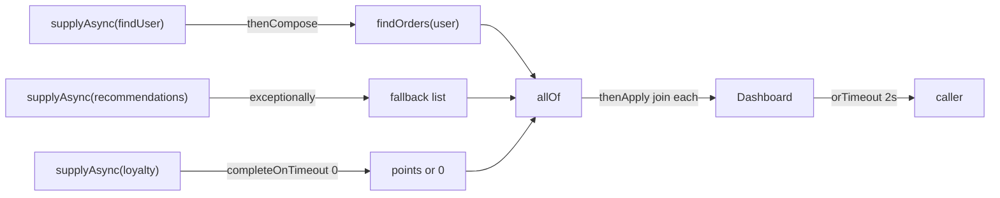
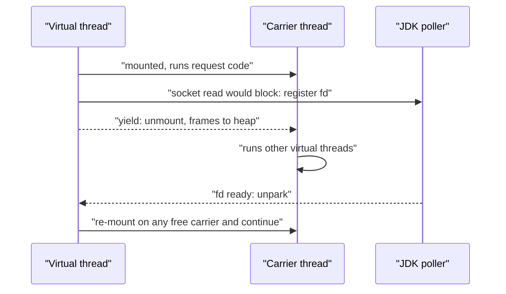
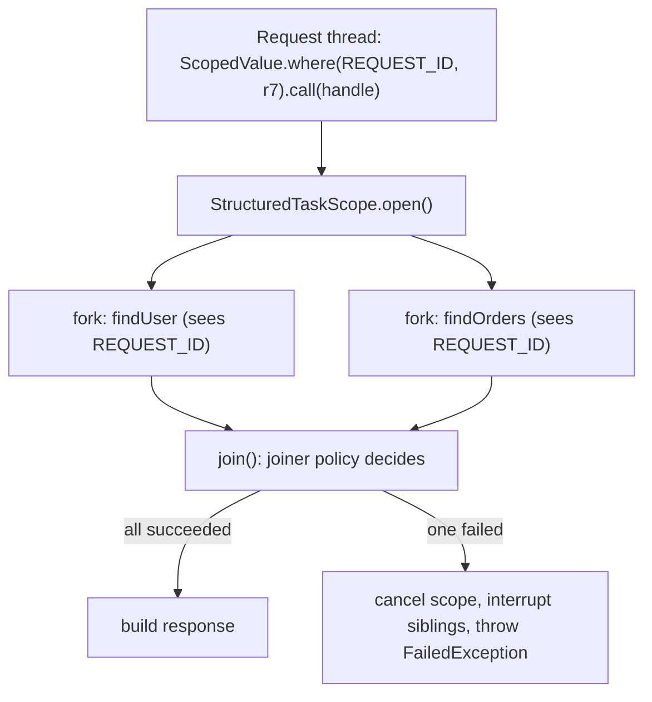

@@ 2 | MODULE | Modern concurrency | Async composition, virtual threads, structured concurrency, ThreadLocal and thread-safe class design | MUST
# Modern concurrency

**Shared analogy: a modern airport instead of a single-desk travel agency.** In the old model every passenger needed a dedicated agent (a platform thread) for the whole trip, even while waiting at the gate, so you ran out of agents. `CompletableFuture` is the itinerary that chains flights and says what to do if one is cancelled. Virtual threads give every passenger their own cheap boarding pass and free the gate agent the moment they sit down to wait. Structured concurrency is a family travelling together: if one member misses the flight, the whole group rebooks, and nobody is left wandering the terminal. `ThreadLocal` is a locker assigned to an agent: fine with one agent per passenger, dangerous when agents are reused and the next passenger finds the last one's belongings. Designing thread-safe classes is the airport's rulebook that makes all of this safe by construction.

@@ 3 | TOPIC | CompletableFuture Composition and Error Handling | thenCompose vs thenCombine, allOf and anyOf, exceptionally vs handle vs whenComplete, timeouts and executors | MUST
# CompletableFuture Composition and Error Handling

**Level: Advanced | Phase 16 | Priority: MUST | Since: Java 8 (CompletableFuture), Java 9 (orTimeout, completeOnTimeout), Java 12 (exceptionallyCompose), Java 19 (resultNow, state)**

> **30-second interview answer:** `CompletableFuture` lets you build a non-blocking pipeline of dependent and independent async steps. `thenApply` transforms a result, `thenCompose` chains a step that itself returns a future (flatMap), `thenCombine` joins two independent futures, and `allOf`/`anyOf` wait for many. Errors travel down the chain, skipping normal stages until `exceptionally` (recover), `handle` (see result or error) or `whenComplete` (side effect, error continues). In production always pass your own executor for I/O, add timeouts with `orTimeout` or `completeOnTimeout`, and remember that exceptions arrive wrapped in `CompletionException`.

## 1. Concept in Simple Words
### Analogy
Planning a trip with a travel assistant who works on several bookings at once.

| Trip planning | CompletableFuture |
|---|---|
| "Book the flight, then (using the flight's arrival time) book the airport taxi" | `thenCompose` (dependent async step) |
| "Book hotel and car in parallel, then print one confirmation sheet with both" | `thenCombine` |
| "Tell me when all five bookings are done" | `allOf` |
| "Ask three taxi companies, take whichever answers first" | `anyOf` |
| "If the hotel is full, book the backup hotel" | `exceptionally` / `exceptionallyCompose` |
| "Whatever happens, log the outcome in the trip diary" | `whenComplete` |
| "If the airline has not answered in 2 seconds, assume no upgrade" | `completeOnTimeout` |
| Which assistant does the work | The `Executor` you pass |

### What it is
- **Future vs CompletableFuture:** a plain `Future` can only be polled or blocked on with `get()`. A `CompletableFuture` (CF) is a `Future` plus `CompletionStage`: you attach callbacks that run when it completes, and you can complete it manually.
- **Stage:** each `thenX` call returns a *new* CF representing that step.
- **Transform stages:** `thenApply(fn)` (value to value), `thenAccept(consumer)`, `thenRun(runnable)`.
- **Composition:** `thenCompose(fn returning CF)` flattens a nested future; `thenCombine(other, bifn)` merges two; `allOf(cfs...)` returns `CompletableFuture<Void>`; `anyOf(cfs...)` returns the first completion (value or exception) as `CompletableFuture<Object>`.
- **Error stages:** `exceptionally(fn)` runs only on failure and returns a replacement value; `handle((value, ex) -> ...)` always runs and can transform both; `whenComplete((value, ex) -> ...)` always runs but does not change the outcome; `exceptionallyCompose` recovers with another future.
- **Async variants:** `thenApplyAsync(fn, executor)` runs the callback on the given executor instead of whatever thread completed the previous stage.
- **Timeouts (Java 9):** `orTimeout(d, unit)` completes exceptionally with `TimeoutException`; `completeOnTimeout(value, d, unit)` completes with a default value.

### Why it exists
Java 5's `Future` forced you to block a thread on `get()` to use a result, so combining three remote calls meant three blocked threads or nested callbacks. Java 8 added CF, inspired by promises, so you can describe the whole dependency graph declaratively and let completions trigger the next steps. It is the backbone of `@Async` return types in Spring, of reactive bridges, and of fan-out aggregation in microservices.

## 2. How It Works
Every CF holds a `result` field (null while pending) and a stack of dependent actions. When `complete(value)` or `completeExceptionally(ex)` is called, the CF CASes its result and then pops and fires its dependents.

```text
Which thread runs a non-async callback such as thenApply(fn)?

  if the CF is ALREADY complete when thenApply is called:
        the CALLING thread runs fn immediately
  else:
        the thread that later COMPLETES the CF runs fn
        (an executor worker, a Netty event loop, a timer thread...)

thenApplyAsync(fn)            -> fn runs on ForkJoinPool.commonPool()
thenApplyAsync(fn, executor)  -> fn runs on your executor
```

**Error propagation:** when a stage fails, every dependent normal stage (`thenApply`, `thenCompose`, `thenCombine`) is skipped and completes exceptionally with the same error wrapped in `CompletionException`. The first `exceptionally`, `handle` or `whenComplete` sees it.



**Exception wrapping rules (a favourite trick question):**

| How you observe the failure | What you get |
|---|---|
| `join()` | `CompletionException` with the original as cause |
| `get()` | `ExecutionException` with the original as cause |
| `exceptionally` or `handle` on a `supplyAsync` that threw, or any later stage | `CompletionException` wrapping the original |
| `exceptionally` on a CF completed with `completeExceptionally(ex)` directly | `ex` itself, unwrapped |
| `orTimeout` expiry | `TimeoutException` (wrapped when seen downstream) |

So always unwrap: `Throwable cause = ex instanceof CompletionException ce && ce.getCause() != null ? ce.getCause() : ex;`

**Cancellation:** `cf.cancel(true)` completes the CF with `CancellationException` but does **not** interrupt the thread running the supplier; CF has no link to its running thread. The task keeps running and its result is discarded. For real cancellation, use `Future`s from an `ExecutorService` or structured concurrency.

## 3. Code Example
### Code
```java
import java.util.List;
import java.util.concurrent.CompletableFuture;
import java.util.concurrent.CompletionException;
import java.util.concurrent.ExecutionException;
import java.util.concurrent.ExecutorService;
import java.util.concurrent.Executors;
import java.util.concurrent.TimeUnit;

public class CompletableFutureDemo {

    record User(long id, String name) { }
    record Order(long id, double total) { }
    record Dashboard(String user, int orders, double spent, String recommendation, double points) { }

    // Dedicated executor for blocking I/O: never use the common pool for this
    static final ExecutorService IO = Executors.newFixedThreadPool(8);

    static void sleep(long ms) {
        try { Thread.sleep(ms); } catch (InterruptedException e) { Thread.currentThread().interrupt(); throw new IllegalStateException(e); }
    }

    static CompletableFuture<User> findUser(long id) {
        return CompletableFuture.supplyAsync(() -> { sleep(100); return new User(id, "alice"); }, IO);
    }

    static CompletableFuture<List<Order>> findOrders(User user) {
        return CompletableFuture.supplyAsync(() -> { sleep(100); return List.of(new Order(1, 20.0), new Order(2, 30.5)); }, IO);
    }

    static CompletableFuture<String> recommendations(long userId) {
        return CompletableFuture.supplyAsync(() -> {
            sleep(100);
            throw new IllegalStateException("recommendation service down");
        }, IO);
    }

    static CompletableFuture<Double> loyaltyPoints(long userId) {
        return CompletableFuture.supplyAsync(() -> { sleep(2_000); return 99.0; }, IO);
    }

    static Throwable unwrap(Throwable ex) {
        return (ex instanceof CompletionException || ex instanceof ExecutionException) && ex.getCause() != null
                ? ex.getCause() : ex;
    }

    public static void main(String[] args) throws Exception {
        long start = System.nanoTime();

        CompletableFuture<User> user = findUser(42);
        CompletableFuture<List<Order>> orders = user.thenCompose(CompletableFutureDemo::findOrders); // dependent
        CompletableFuture<String> recommendation = recommendations(42)                                 // independent
                .exceptionally(ex -> {
                    System.out.println("fallback: " + ex.getClass().getSimpleName() + " caused by " + unwrap(ex).getMessage());
                    return "bestsellers";
                });
        CompletableFuture<Double> points = loyaltyPoints(42).completeOnTimeout(0.0, 200, TimeUnit.MILLISECONDS);

        CompletableFuture<Dashboard> dashboard = CompletableFuture.allOf(orders, recommendation, points)
                .thenApply(ignored -> new Dashboard(
                        user.join().name(),                       // join() is safe: all are complete
                        orders.join().size(),
                        orders.join().stream().mapToDouble(Order::total).sum(),
                        recommendation.join(),
                        points.join()))
                .orTimeout(2, TimeUnit.SECONDS);

        System.out.println(dashboard.join());
        long ms = TimeUnit.NANOSECONDS.toMillis(System.nanoTime() - start);
        System.out.println("finished in under 500 ms: " + (ms < 500));

        // How failures surface
        CompletableFuture<Integer> failing = CompletableFuture.supplyAsync(() -> 10 / 0, IO);
        try {
            failing.join();
        } catch (CompletionException e) {
            System.out.println("join() -> " + e.getClass().getSimpleName() + " / cause " + e.getCause().getClass().getSimpleName());
        }
        try {
            failing.get();
        } catch (ExecutionException e) {
            System.out.println("get()  -> " + e.getClass().getSimpleName() + " / cause " + e.getCause().getClass().getSimpleName());
        }

        String handled = failing.handle((value, ex) -> ex == null ? "value " + value : "handled " + unwrap(ex).getClass().getSimpleName()).join();
        System.out.println(handled);

        CompletableFuture<Integer> logged = failing.whenComplete((value, ex) -> System.out.println("whenComplete saw error: " + (ex != null)));
        System.out.println("after whenComplete still failed: " + logged.isCompletedExceptionally());

        try {
            loyaltyPoints(1).orTimeout(100, TimeUnit.MILLISECONDS).join();
        } catch (CompletionException e) {
            System.out.println("orTimeout -> " + e.getCause().getClass().getSimpleName());
        }

        Object first = CompletableFuture.anyOf(
                CompletableFuture.supplyAsync(() -> { sleep(300); return "mirror-A"; }, IO),
                CompletableFuture.supplyAsync(() -> { sleep(50); return "mirror-B"; }, IO)).join();
        System.out.println("anyOf -> " + first);

        IO.shutdownNow();   // interrupt the still-sleeping loyalty calls
    }
}
```

### Walkthrough
- **Dependent vs independent:** orders need the user, so they use `thenCompose` (it takes a function returning a CF and flattens it; `thenApply` would give a `CompletableFuture<CompletableFuture<List<Order>>>`). Recommendations and loyalty points do not depend on anything, so they start immediately and run in parallel with the user lookup.
- **Graceful degradation:** recommendations fail, and `exceptionally` substitutes "bestsellers". The `ex` it receives is a `CompletionException` because `supplyAsync` wraps what the supplier throws; `unwrap` digs out the real cause.
- **Timeout with default:** loyalty points take 2 s, but `completeOnTimeout(0.0, 200 ms)` completes the CF with 0.0 at 200 ms. The underlying task is not cancelled; it keeps sleeping until `shutdownNow` interrupts it.
- **allOf then join:** `allOf` returns `CompletableFuture<Void>`, so you read results from the original futures; `join()` does not block because they are all complete. Total time is about 200 ms (user then orders, in parallel with the 200 ms timeout) instead of 2.3 s sequentially.
- **Overall deadline:** `orTimeout(2, SECONDS)` on the final stage guarantees the caller never waits forever.
- **Failure APIs:** `join` wraps in `CompletionException`, `get` in `ExecutionException`. `handle` turns the failure into a value. `whenComplete` observes but the returned CF is still failed.
- **anyOf:** returns whichever completes first ("mirror-B" after 50 ms), typed `Object`, so you cast.

### Output
```text
fallback: CompletionException caused by recommendation service down
Dashboard[user=alice, orders=2, spent=50.5, recommendation=bestsellers, points=0.0]
finished in under 500 ms: true
join() -> CompletionException / cause ArithmeticException
get()  -> ExecutionException / cause ArithmeticException
handled ArithmeticException
whenComplete saw error: true
after whenComplete still failed: true
orTimeout -> TimeoutException
anyOf -> mirror-B
```

### Compare
| Blocking style (Java 5 Future) | Composed style (CompletableFuture) |
|---|---|
| `User u = userFuture.get(); List<Order> o = orderService.submit(() -> find(u)).get();` | `findUser(id).thenCompose(this::findOrders)` |
| One thread blocked per waiting step | No thread blocked until the final `join` |
| Error handling with try/catch around every `get` | One `exceptionally` or `handle` at the right stage |
| No built-in timeout per step | `orTimeout`, `completeOnTimeout` |

## 4. Interview Questions
**Basic**
1. **`thenApply` vs `thenCompose`?**
   `thenApply` maps the result with a plain function (`T -> U`). `thenCompose` is for a function that itself returns a future (`T -> CompletableFuture<U>`) and flattens it, like `flatMap` on streams or `Optional`. Use `thenCompose` whenever the next step is another async call.
2. **`thenCombine` vs `allOf`?**
   `thenCombine` merges exactly two independent futures with a `BiFunction` and keeps types. `allOf` waits for any number of futures but returns `CompletableFuture<Void>`, so you then `join()` each original future to collect results.
3. **`exceptionally` vs `handle` vs `whenComplete`?**
   `exceptionally` runs only on failure and returns a fallback value. `handle` runs always, receives value and exception, and returns a new value (can recover or transform). `whenComplete` runs always for side effects (logging, metrics) and leaves the outcome unchanged, so the error continues downstream.

**Follow-up**
4. **Which thread runs `thenApply`'s callback?**
   If the future is already complete, the thread calling `thenApply` runs it immediately; otherwise the thread that completes the future runs it. That could be an I/O thread of an HTTP client, so heavy callbacks there can stall it. Use `thenApplyAsync(fn, executor)` to control the thread.
5. **Why should you pass a custom executor to `supplyAsync`?**
   Without it, tasks run on `ForkJoinPool.commonPool()`, sized for CPU work and shared by the whole JVM. Blocking I/O there starves parallel streams and every other default async task. A dedicated, bounded executor (or a virtual-thread-per-task executor) isolates I/O and makes thread naming, metrics and back-pressure possible.
6. **Does `cancel(true)` stop the running task?**
   No. It completes the future with `CancellationException` and dependents fail, but the supplier keeps running because CF does not track its thread. You need cooperative cancellation (check a flag or interruption) through a `Future` from an executor, or structured concurrency.

**Tricky / scenario**
7. **An aggregation endpoint calls 5 services with `supplyAsync` and sometimes hangs forever under load. What is wrong and how do you fix it?**
   Likely causes: no timeouts, so one slow downstream holds the request; tasks submitted to a small shared pool while other tasks in the same pool block on `join()` waiting for them (pool-induced deadlock); or the common pool is saturated by blocking calls. Fix: per-call `orTimeout` or `completeOnTimeout` plus an overall deadline, a dedicated executor that no task blocks on, and fallbacks via `exceptionally`.
8. **What does this print? `CompletableFuture.supplyAsync(() -> { throw new IllegalStateException("x"); }).exceptionally(ex -> ex.getClass().getSimpleName()).join()`**
   It prints `CompletionException`, not `IllegalStateException`, because `supplyAsync` wraps the thrown exception before storing it. That is why production code unwraps the cause before deciding on a fallback or logging.
9. **A `thenApply` stage throws an exception. What happens to later stages?**
   The CF returned by `thenApply` completes exceptionally with a `CompletionException` wrapping it. Every subsequent normal stage is skipped, and the first `exceptionally`, `handle` or `whenComplete` downstream receives it. If nothing handles it and nobody calls `join`, the error is silently lost, so always end chains with handling or a `whenComplete` that logs.
10. **How would you return a CF from a Spring `@Async` method, and what executor does it use?**
   Annotate a public method on a Spring bean with `@Async` and return `CompletableFuture<T>` (`CompletableFuture.completedFuture(result)` at the end). Spring Boot auto-configures a `ThreadPoolTaskExecutor` named `applicationTaskExecutor` (or a virtual-thread executor when `spring.threads.virtual.enabled=true`). Self-invocation bypasses the proxy, so calls must come from another bean.

**What the interviewer is really testing:** whether you can build a parallel aggregation that is fast, bounded and fails gracefully, and whether you know the wrapping, threading and cancellation details that cause production incidents.

## 5. Pitfalls & Best Practices
### Common mistakes
| Mistake | What goes wrong | Fix |
|---|---|---|
| Blocking I/O in `supplyAsync` with no executor | Common pool starvation | Pass a dedicated executor |
| No timeouts | One slow service hangs requests and holds threads | `orTimeout` or `completeOnTimeout` per call plus overall deadline |
| `thenApply` with a function returning a CF | Nested `CompletableFuture<CompletableFuture<T>>` | `thenCompose` |
| Calling `join()` inside a stage running on the same small pool | Pool-induced deadlock | Compose instead of join; separate pools |
| Swallowing errors: chain with no handler and nobody joins | Failures vanish silently | End chains with `whenComplete` logging or `handle` |
| Catching `IllegalStateException` but receiving `CompletionException` | Fallback never runs | Unwrap the cause |

### Best practices
- Name your executors (thread factory) and expose their metrics; size them for the downstream limits.
- Use `completeOnTimeout` for optional data (degrade gracefully) and `orTimeout` for required data (fail fast).
- Keep callbacks short and non-blocking; do heavy work with an `Async` variant on your executor.
- Propagate context (MDC, security, trace ids) explicitly or with a decorating executor; `ThreadLocal`s do not follow async stages.
- On Java 21+, consider plain blocking code on virtual threads for simple fan-out: often easier to read and debug than long CF chains.

### Compare with
| Approach | Strength | Weakness |
|---|---|---|
| `Future` + `ExecutorService` | Simple, real cancellation via interrupt | Blocking `get`, no composition |
| `CompletableFuture` | Rich composition, timeouts, fallbacks | Callback style, no cancellation of running work, context propagation pain |
| Virtual threads, blocking style | Plain sequential code, cheap threads | Need your own fan-out structure |
| Structured concurrency (Java 25+ preview) | Fan-out with automatic cancellation and lifetime | Preview API, changes between releases |
| Reactor `Mono`/`Flux` | Back-pressure, streaming, operators | Steep learning curve, viral |

## 6. Hands-on Exercise
OrderHub needs `GET /api/orders/{id}/summary` that returns the order plus customer details, a shipping quote and loyalty points, fetched from three internal services in parallel. Requirements: customer and shipping are required (fail the request with 504 after 800 ms), loyalty points are optional (default 0 after 300 ms). Implement it in Spring Boot with `CompletableFuture` and a dedicated executor bean.

Acceptance criteria:
- `OrderSummaryService` builds the summary with `thenCombine`/`allOf`, uses the `orderHubIoExecutor` bean, and never uses the common pool.
- A timeout on a required call results in HTTP 504 via a `@RestControllerAdvice`.
- Loyalty failure or slowness produces `loyaltyPoints: 0`.

<details><summary>Solution</summary>

```java
// config/AsyncConfig.java
package com.orderhub.config;

import java.util.concurrent.ExecutorService;
import java.util.concurrent.Executors;
import org.springframework.context.annotation.Bean;
import org.springframework.context.annotation.Configuration;

@Configuration
public class AsyncConfig {

    // Java 21: one virtual thread per task; bounded concurrency is enforced by the downstream clients
    @Bean(destroyMethod = "close")
    public ExecutorService orderHubIoExecutor() {
        return Executors.newThreadPerTaskExecutor(Thread.ofVirtual().name("orderhub-io-", 0).factory());
    }
}
```

```java
// summary/OrderSummaryService.java
package com.orderhub.summary;

import java.math.BigDecimal;
import java.util.concurrent.CompletableFuture;
import java.util.concurrent.CompletionException;
import java.util.concurrent.ExecutorService;
import java.util.concurrent.TimeUnit;
import org.slf4j.Logger;
import org.slf4j.LoggerFactory;
import org.springframework.beans.factory.annotation.Qualifier;
import org.springframework.stereotype.Service;

@Service
public class OrderSummaryService {
    private static final Logger log = LoggerFactory.getLogger(OrderSummaryService.class);

    public record CustomerDto(long id, String name, String email) { }
    public record ShippingQuote(String carrier, BigDecimal price) { }
    public record OrderSummary(long orderId, CustomerDto customer, ShippingQuote shipping, int loyaltyPoints) { }

    private final CustomerClient customers;
    private final ShippingClient shipping;
    private final LoyaltyClient loyalty;
    private final ExecutorService io;

    public OrderSummaryService(CustomerClient customers, ShippingClient shipping, LoyaltyClient loyalty,
                               @Qualifier("orderHubIoExecutor") ExecutorService io) {
        this.customers = customers;
        this.shipping = shipping;
        this.loyalty = loyalty;
        this.io = io;
    }

    public OrderSummary summary(long orderId) {
        CompletableFuture<CustomerDto> customer = CompletableFuture
                .supplyAsync(() -> customers.forOrder(orderId), io)
                .orTimeout(800, TimeUnit.MILLISECONDS);                 // required
        CompletableFuture<ShippingQuote> quote = CompletableFuture
                .supplyAsync(() -> shipping.quote(orderId), io)
                .orTimeout(800, TimeUnit.MILLISECONDS);                 // required
        CompletableFuture<Integer> points = CompletableFuture
                .supplyAsync(() -> loyalty.points(orderId), io)
                .completeOnTimeout(0, 300, TimeUnit.MILLISECONDS)       // optional
                .exceptionally(ex -> {
                    log.warn("loyalty unavailable for order {}: {}", orderId, ex.toString());
                    return 0;
                });

        return customer
                .thenCombine(quote, (c, q) -> new OrderSummary(orderId, c, q, 0))
                .thenCombine(points, (s, p) -> new OrderSummary(s.orderId(), s.customer(), s.shipping(), p))
                .join();          // throws CompletionException on failure or timeout
    }

    // Client interfaces implemented elsewhere with RestClient
    public interface CustomerClient { CustomerDto forOrder(long orderId); }
    public interface ShippingClient { ShippingQuote quote(long orderId); }
    public interface LoyaltyClient { int points(long orderId); }
}
```

```java
// summary/OrderSummaryController.java
package com.orderhub.summary;

import java.util.concurrent.CompletionException;
import java.util.concurrent.TimeoutException;
import org.springframework.http.HttpStatus;
import org.springframework.http.ProblemDetail;
import org.springframework.web.bind.annotation.ExceptionHandler;
import org.springframework.web.bind.annotation.GetMapping;
import org.springframework.web.bind.annotation.PathVariable;
import org.springframework.web.bind.annotation.RestController;
import org.springframework.web.bind.annotation.RestControllerAdvice;

@RestController
public class OrderSummaryController {
    private final OrderSummaryService service;

    public OrderSummaryController(OrderSummaryService service) { this.service = service; }

    @GetMapping("/api/orders/{id}/summary")
    public OrderSummaryService.OrderSummary summary(@PathVariable long id) {
        return service.summary(id);
    }

    @RestControllerAdvice
    static class AsyncErrors {
        @ExceptionHandler(CompletionException.class)
        ProblemDetail onCompletion(CompletionException e) {
            if (e.getCause() instanceof TimeoutException) {
                return ProblemDetail.forStatusAndDetail(HttpStatus.GATEWAY_TIMEOUT, "A required downstream service timed out");
            }
            return ProblemDetail.forStatusAndDetail(HttpStatus.BAD_GATEWAY, "Downstream failure: " + e.getCause().getMessage());
        }
    }
}
```

Example exchange when loyalty is slow:
```http
GET /api/orders/1001/summary HTTP/1.1
Host: localhost:8080

HTTP/1.1 200 OK
Content-Type: application/json

{"orderId":1001,"customer":{"id":7,"name":"Alice","email":"alice@example.com"},"shipping":{"carrier":"DHL","price":4.99},"loyaltyPoints":0}
```
And when shipping is slower than 800 ms:
```http
HTTP/1.1 504 Gateway Timeout
Content-Type: application/problem+json

{"type":"about:blank","title":"Gateway Timeout","status":504,"detail":"A required downstream service timed out","instance":"/api/orders/1001/summary"}
```
The required calls use `orTimeout` so the whole request fails fast; the optional call uses `completeOnTimeout` plus `exceptionally` so it degrades. All work runs on the named virtual-thread executor, never on the common pool.
</details>

## 7. Recall
Q: What is the difference between `thenApply` and `thenCompose` in `CompletableFuture`?
A: `thenApply` maps a value with a plain function; `thenCompose` chains a function that returns another `CompletableFuture` and flattens it.

Q: Which `CompletableFuture` method recovers from failure, which observes both outcomes and transforms, and which only observes?
A: `exceptionally` recovers on failure, `handle` sees value or exception and returns a new value, `whenComplete` observes for side effects and keeps the outcome.

Q: What exception does `CompletableFuture.join()` throw versus `get()`?
A: `join()` throws unchecked `CompletionException`; `get()` throws checked `ExecutionException`; both wrap the original cause.

Q: What is the difference between `orTimeout` and `completeOnTimeout`?
A: `orTimeout` completes exceptionally with `TimeoutException`; `completeOnTimeout` completes normally with a default value.

Q: Does `CompletableFuture.cancel(true)` interrupt the running task?
A: No; it only completes the future with `CancellationException`, and the supplier keeps running.

Q: Where do `CompletableFuture.supplyAsync` tasks run if no executor is given?
A: On `ForkJoinPool.commonPool()`, which must not be used for blocking I/O.

**Related:** [[Future and CompletableFuture]] · [[ForkJoinPool and Work Stealing]] · [[Virtual Threads]] · [[Structured Concurrency and Scoped Values]]

@@ 3 | TOPIC | Virtual Threads | Lightweight JVM-scheduled threads, carriers and mounting, pinning, when they help and when they do not, Spring Boot support | MUST
# Virtual Threads

**Level: Advanced | Phase 16 | Priority: MUST | Since: Java 21 (final, JEP 444; preview in 19 and 20), synchronized pinning fixed in Java 24 (JEP 491), Spring Boot 3.2 support**

> **30-second interview answer:** A virtual thread is a `java.lang.Thread` scheduled by the JVM rather than the operating system. Millions can exist because each one is a small heap object; when it blocks on I/O, a lock or `sleep`, the JVM unmounts it from its carrier (a platform thread in a small fork-join pool) and runs another virtual thread on that carrier. This makes the simple thread-per-request blocking style scale like asynchronous code. They improve throughput for I/O-bound work, not speed for CPU-bound work, they must not be pooled, and on Java 21-23 blocking inside `synchronized` pins the carrier. In Spring Boot 3.2+ you enable them with `spring.threads.virtual.enabled=true`.

## 1. Concept in Simple Words
### Analogy
A restaurant with a few waiters and many tables.

| Restaurant | Virtual threads |
|---|---|
| Old style: one waiter assigned to each table for the whole meal, standing idle while guests read the menu | Platform thread per request, blocked during I/O |
| You can only hire 200 waiters, so the 201st guest waits outside | Thread pool exhaustion |
| New style: an order ticket for every table (cheap paper) | Virtual thread (cheap heap object) |
| A handful of waiters pick up whichever ticket is ready to act on | Carrier threads (platform threads) |
| Guest reads the menu: waiter puts the ticket down and serves someone else | Unmounting on blocking I/O |
| Kitchen calls "table 7 food ready": any free waiter takes ticket 7 | Remounting on any carrier |
| A guest who grabs the waiter's sleeve while thinking holds the waiter hostage | Pinning (`synchronized`, native code) |
| More tickets do not make the chef cook faster | No speed-up for CPU-bound work |

### What it is
- **Platform thread:** a thin wrapper over an OS thread, about 1 MB of reserved stack, expensive to create, typically a few thousand per machine at most.
- **Virtual thread:** an instance of `Thread` whose `isVirtual()` is true. It is a *continuation* (the paused stack frames stored on the heap) plus a scheduler. Creation costs about as much as a small object; you can create millions.
- **Carrier thread:** the platform thread a virtual thread is currently running (mounted) on. Carriers come from a dedicated `ForkJoinPool` with parallelism equal to the CPU count by default.
- **Mount / unmount:** when a virtual thread blocks in a JDK-aware operation (socket read, `Thread.sleep`, `BlockingQueue.take`, `ReentrantLock`), its stack frames are copied to the heap and the carrier is freed. When the operation completes, it is scheduled again, on any carrier.
- **Pinning:** situations where the virtual thread cannot unmount and holds its carrier while blocked: on Java 21-23, inside `synchronized` blocks or methods and `Object.wait()`; on all versions, during native method calls and foreign function calls.
- **APIs:** `Thread.ofVirtual().start(r)`, `Thread.startVirtualThread(r)`, `Executors.newVirtualThreadPerTaskExecutor()`, `Thread.ofVirtual().factory()`.

### Why it exists
Server code had two bad options. Thread-per-request is easy to write, debug and profile, but OS threads are scarce, so a server handling 10,000 concurrent slow requests needs 10,000 threads and runs out of memory or spends its life context-switching. Asynchronous code (callbacks, `CompletableFuture`, reactive) scales but is hard to read, loses stack traces and infects every API. Project Loom (Java 21) keeps the simple blocking style and makes threads cheap, so the number of concurrent requests is limited by memory and downstream capacity, not by thread count.

## 2. How It Works
```text
Virtual threads (millions)        VT1   VT2   VT3   VT4   VT5 ... VT100000
                                    \     |     /      |
Scheduler: ForkJoinPool (FIFO)    [ carrier-1 ] [ carrier-2 ] ... [ carrier-N ]   N = CPU cores
                                         |              |
OS threads                           OS thread      OS thread

Timeline of VT1 calling a remote API on carrier-1:

carrier-1: [VT1 runs: build request] [VT7 runs] [VT3 runs] [VT1 runs: parse response]
VT1:        mounted ----> socket.read() blocks -> unmount (stack frames copied to heap)
                                         ... I/O completes, VT1 re-queued ...
                                                         -> mount (may be on carrier-2!)
```

1. `Thread.ofVirtual().start(task)` creates a `VirtualThread` object and submits its continuation to the scheduler.
2. A carrier picks it up and runs the continuation (mount).
3. The task calls a blocking JDK API. The JDK has been rewritten so these APIs detect a virtual thread: instead of blocking the OS thread, they register interest (for sockets, with an internal poller using epoll or kqueue) and *yield* the continuation. Stack frames move to the heap (unmount).
4. The carrier immediately runs another virtual thread.
5. When the socket is readable, the poller unparks the virtual thread, it goes back to the scheduler queue and resumes on whichever carrier is free, with its stack restored.

**Pinning in detail:** while holding a monitor (`synchronized`), the JVM on Java 21-23 tracked lock ownership by the carrier's OS thread, so the virtual thread could not leave its carrier. If 8 virtual threads block on I/O inside `synchronized` on an 8-core machine, every carrier is stuck and the remaining 100,000 virtual threads wait. Java 24 (JEP 491) reworked monitors so `synchronized` no longer pins. Native frames (JNI) still pin on every version. Detect it with the JFR event `jdk.VirtualThreadPinned` (on 21-23 also `-Djdk.tracePinnedThreads=full`, removed in 24).



**Little's law** explains the benefit: concurrency = throughput x latency. If each request waits 100 ms on a database and you want 10,000 requests per second, you need 1,000 concurrent requests in flight. With a 200-thread pool you cap at 2,000 req/s; with virtual threads the cap moves to the database.

**Spring Boot 3.2+:**
```yaml
spring:
  threads:
    virtual:
      enabled: true   # Tomcat/Jetty request handling, @Async, @Scheduled, Kafka/Rabbit listeners use virtual threads
```
With this flag Boot configures the embedded web server's executor, the `applicationTaskExecutor` (as a `SimpleAsyncTaskExecutor` with virtual threads), the task scheduler, and messaging listener containers to use virtual threads. On Java below 21 the flag has no effect.

## 3. Code Example
### Code
```java
import java.time.Duration;
import java.util.concurrent.ExecutorService;
import java.util.concurrent.Executors;
import java.util.concurrent.Semaphore;
import java.util.concurrent.TimeUnit;
import java.util.concurrent.atomic.AtomicInteger;
import java.util.concurrent.atomic.LongAdder;
import java.util.stream.IntStream;

public class VirtualThreadsDemo {

    static void blockingCall(Duration d) {
        try { Thread.sleep(d); } catch (InterruptedException e) { Thread.currentThread().interrupt(); }
    }

    static long timeMillis(Runnable r) {
        long start = System.nanoTime();
        r.run();
        return TimeUnit.NANOSECONDS.toMillis(System.nanoTime() - start);
    }

    public static void main(String[] args) throws Exception {
        // 1. Creating virtual and platform threads
        Thread vt = Thread.ofVirtual().name("vt-1").start(() ->
                System.out.println("hello from " + Thread.currentThread().getName()
                        + " virtual=" + Thread.currentThread().isVirtual()));
        vt.join();
        Thread pt = Thread.ofPlatform().name("pt-1").start(() ->
                System.out.println("hello from " + Thread.currentThread().getName()
                        + " virtual=" + Thread.currentThread().isVirtual()));
        pt.join();

        // 2. Same I/O-bound workload: 1,000 tasks, each blocks 100 ms
        long fixedMs = timeMillis(() -> {
            try (ExecutorService pool = Executors.newFixedThreadPool(50)) {
                IntStream.range(0, 1_000).forEach(i -> pool.submit(() -> blockingCall(Duration.ofMillis(100))));
            }   // close() waits for all tasks (Java 19+)
        });
        long virtualMs = timeMillis(() -> {
            try (ExecutorService pool = Executors.newVirtualThreadPerTaskExecutor()) {
                IntStream.range(0, 1_000).forEach(i -> pool.submit(() -> blockingCall(Duration.ofMillis(100))));
            }
        });
        System.out.println("fixed pool of 50 took at least 2 s: " + (fixedMs >= 2_000));
        System.out.println("virtual threads took under 1 s: " + (virtualMs < 1_000));

        // 3. One hundred thousand concurrent sleeping threads
        LongAdder done = new LongAdder();
        try (ExecutorService pool = Executors.newVirtualThreadPerTaskExecutor()) {
            for (int i = 0; i < 100_000; i++) {
                pool.submit(() -> { blockingCall(Duration.ofSeconds(1)); done.increment(); });
            }
        }
        System.out.println("completed virtual tasks: " + done.sum());

        // 4. Limit access to a scarce resource with a Semaphore, not a pool
        Semaphore dbPermits = new Semaphore(10);
        AtomicInteger inUse = new AtomicInteger();
        AtomicInteger peak = new AtomicInteger();
        try (ExecutorService pool = Executors.newVirtualThreadPerTaskExecutor()) {
            for (int i = 0; i < 200; i++) {
                pool.submit(() -> {
                    dbPermits.acquireUninterruptibly();
                    try {
                        peak.accumulateAndGet(inUse.incrementAndGet(), Math::max);
                        blockingCall(Duration.ofMillis(20));
                        inUse.decrementAndGet();
                    } finally {
                        dbPermits.release();
                    }
                });
            }
        }
        System.out.println("peak concurrent DB calls: " + peak.get());
    }
}
```

### Walkthrough
- **Creation:** `Thread.ofVirtual()` and `Thread.ofPlatform()` are builders (Java 21). Both produce a normal `Thread`; `isVirtual()` tells them apart. Virtual threads are always daemon threads, so the JVM does not wait for them unless you `join` or close the executor.
- **Throughput comparison:** 1,000 tasks of 100 ms on 50 platform threads run in 20 waves, so at least 2 seconds. With a virtual thread per task, all 1,000 sleep at the same time on a handful of carriers and the batch finishes in roughly 100-200 ms. The work did not get faster; more of it waited concurrently.
- **100,000 threads:** with platform threads this would need about 100 GB of reserved stack and likely fail with `OutOfMemoryError: unable to create native thread`. Virtual threads use a few hundred bytes to a few KB each while parked, so it completes in a bit over a second.
- **Semaphore:** virtual threads remove the thread limit, so the limit must move to the scarce resource. Here at most 10 tasks use the "database" at once, matching a connection pool of 10. Never limit virtual threads by putting them in a fixed-size pool.

### Output
```text
hello from vt-1 virtual=true
hello from pt-1 virtual=false
fixed pool of 50 took at least 2 s: true
virtual threads took under 1 s: true
completed virtual tasks: 100000
peak concurrent DB calls: 10
```

### Compare
| Aspect | Platform thread | Virtual thread |
|---|---|---|
| Scheduled by | OS kernel | JVM (fork-join scheduler) |
| Memory | About 1 MB stack reserved up front | Stack chunks on the heap, grows as needed |
| Creation cost | Microseconds to milliseconds, syscalls | Like allocating an object |
| How many | Thousands | Millions |
| Pooling | Yes, pools are standard | Never pool; create one per task |
| Best for | CPU-bound work, long-running background loops | I/O-bound concurrent tasks (requests, calls, queries) |
| `ThreadLocal` | Fine, few threads | Works, but millions of copies can waste memory |
| Daemon | Configurable | Always daemon |
| Priority | Configurable | Always normal; `setPriority` ignored |

## 4. Interview Questions
**Basic**
1. **What is a virtual thread?**
   A lightweight `Thread` implemented by the JVM. It runs on a small pool of carrier platform threads and unmounts whenever it blocks, so blocking costs no OS thread. You can create one per task, even millions, and write ordinary blocking code that scales.
2. **How do you create virtual threads?**
   `Thread.startVirtualThread(runnable)`, `Thread.ofVirtual().name("worker-", 0).start(runnable)`, a `ThreadFactory` from `Thread.ofVirtual().factory()`, or most commonly `Executors.newVirtualThreadPerTaskExecutor()` in a try-with-resources block. In Spring Boot 3.2+, set `spring.threads.virtual.enabled=true`.
3. **Do virtual threads make code faster?**
   They increase throughput for I/O-bound workloads by letting many more tasks wait concurrently; they do not make any single task faster and give nothing for CPU-bound work, which is limited by cores. Latency of one request is the same; requests per second under load can rise dramatically.

**Follow-up**
4. **What is pinning and how do you detect and fix it?**
   Pinning is when a virtual thread cannot unmount while blocked, so it holds its carrier. Causes: `synchronized` blocks and `Object.wait` on Java 21-23 and native or FFM calls on all versions. Detect with JFR `jdk.VirtualThreadPinned` events (and `-Djdk.tracePinnedThreads` on 21-23). Fix by upgrading to Java 24+, replacing `synchronized` around blocking I/O with `ReentrantLock`, or updating libraries (JDBC drivers, HTTP clients) that did so.
5. **Why should you not pool virtual threads?**
   Pools exist because platform threads are expensive; virtual threads are cheap and meant to be created per task and discarded. Pooling them reintroduces a limit and lets `ThreadLocal` state leak between tasks. If you need to limit concurrency to a resource, use a `Semaphore` or the resource's own pool (like HikariCP).
6. **How are virtual threads scheduled?**
   By a dedicated `ForkJoinPool` in FIFO mode whose parallelism defaults to the number of cores (tunable with `jdk.virtualThreadScheduler.parallelism`). It is a cooperative scheduler from the JVM's point of view: a virtual thread runs until it blocks or finishes; there is no time slicing, so a CPU-bound virtual thread occupies its carrier.

**Tricky / scenario**
7. **You enabled virtual threads in a Spring Boot service and now the database falls over with "too many connections" errors, or requests time out waiting for a connection. Why?**
   Previously the 200-thread Tomcat pool implicitly limited concurrent DB access. Now thousands of requests run at once and all hit the Hikari pool, which either times out (`connectionTimeout`) or, if someone raised the pool size, overloads the database. Keep the Hikari pool sized for the database, add a bulkhead or rate limit on expensive endpoints, and set sensible timeouts; virtual threads move the bottleneck, they do not remove it.
8. **After moving to virtual threads on Java 21, throughput fell and thread dumps show carriers stuck in a library's `synchronized` method that does network I/O. Options?**
   It is pinning. Short term: upgrade the library or driver to a version using `ReentrantLock`, increase `jdk.virtualThreadScheduler.maxPoolSize` only as a band-aid (the scheduler can add carriers for some pinned operations), or keep that path on a platform-thread executor. Long term: run on Java 24+ where `synchronized` no longer pins.
9. **A team caches expensive `SimpleDateFormat` objects in a `ThreadLocal`. Is that a problem with virtual threads?**
   Functionally it works, but with a new virtual thread per request the cache never hits: each thread creates its own instance and throws it away, and with millions of threads the memory adds up. Replace with an immutable, thread-safe alternative (`DateTimeFormatter`) or a shared bounded pool. Per-request context should move to scoped values when available.
10. **Should you switch a CPU-heavy image-processing service to virtual threads?**
   No benefit: the work is limited by cores, not by waiting, and virtual threads have no time slicing so long CPU tasks can starve other virtual threads on the same carriers. Use a fixed platform pool sized to cores (or fork-join) for CPU work, and virtual threads for the I/O around it.

**What the interviewer is really testing:** whether you understand *why* virtual threads help (cheap blocking, Little's law), where the bottleneck moves (downstream resources), and the real production gotchas (pinning, pooling, ThreadLocal, CPU-bound work).

## 5. Pitfalls & Best Practices
### Common mistakes
| Mistake | What goes wrong | Fix |
|---|---|---|
| Pooling virtual threads in a fixed pool | Limits concurrency, ThreadLocal leaks between tasks | One virtual thread per task; limit with `Semaphore` |
| Blocking I/O inside `synchronized` on Java 21-23 | Pinning starves carriers | `ReentrantLock`, newer libraries, or Java 24+ |
| Expecting CPU-bound speed-up | No gain, possible starvation | Platform pool sized to cores for CPU work |
| Removing all limits after enabling virtual threads | Database or partner API overload | Connection pools, bulkheads, rate limiters, timeouts |
| Heavy `ThreadLocal` caches | Memory bloat, no reuse | Immutable shared objects, scoped values |
| Measuring with tiny loads | No visible difference | Test at realistic concurrency with realistic latency |

### Best practices
- Write plain blocking code and give each concurrent task its own virtual thread; it is the intended style.
- Put explicit limits at the resources: Hikari pool size, `Semaphore` bulkheads, client connection pools, timeouts everywhere.
- Monitor with JFR (`jdk.VirtualThreadStart`, `jdk.VirtualThreadPinned`, `jdk.VirtualThreadSubmitFailed`) and new thread dumps: `jcmd <pid> Thread.dump_to_file -format=json dump.json`.
- Prefer Java 24+ (or 25 LTS) for virtual-thread-heavy services because of the `synchronized` fix.
- Name virtual threads with `Thread.ofVirtual().name("orders-", 0)` so logs stay readable.

### Compare with
| Model | Code style | Scales to | Main cost |
|---|---|---|---|
| Platform thread pool | Blocking | Thousands of concurrent tasks | Memory, context switches |
| Virtual threads | Blocking | Millions | Pinning gotchas, needs explicit resource limits |
| `CompletableFuture` | Callback chains | Millions | Readability, context propagation |
| Reactive (WebFlux, Reactor) | Operators, non-blocking everywhere | Millions with back-pressure | Learning curve, every library must be non-blocking |

## 6. Hands-on Exercise
Switch OrderHub to virtual threads and protect the inventory service. Add `GET /api/products/{id}/availability` that calls the slow inventory service (300 ms) through a `RestClient`. Allow at most 20 concurrent inventory calls; when the limit is reached for more than 100 ms, return 503.

Acceptance criteria:
- `application.yml` enables virtual threads.
- The controller logs `Thread.currentThread()` and shows a `VirtualThread`.
- A `Semaphore(20)` bulkhead in `InventoryGateway` with `tryAcquire(100, MILLISECONDS)`; a `BulkheadFullException` maps to HTTP 503.

<details><summary>Solution</summary>

```yaml
# src/main/resources/application.yml
spring:
  threads:
    virtual:
      enabled: true
orderhub:
  inventory:
    base-url: http://localhost:8081
```

```java
// inventory/InventoryGateway.java
package com.orderhub.inventory;

import java.util.concurrent.Semaphore;
import java.util.concurrent.TimeUnit;
import org.springframework.beans.factory.annotation.Value;
import org.springframework.stereotype.Component;
import org.springframework.web.client.RestClient;

@Component
public class InventoryGateway {

    public record Availability(long productId, int inStock) { }

    public static class BulkheadFullException extends RuntimeException {
        public BulkheadFullException(String msg) { super(msg); }
    }

    private final RestClient restClient;
    private final Semaphore bulkhead = new Semaphore(20);

    public InventoryGateway(RestClient.Builder builder, @Value("${orderhub.inventory.base-url}") String baseUrl) {
        this.restClient = builder.baseUrl(baseUrl).build();
    }

    public Availability availability(long productId) {
        boolean acquired;
        try {
            acquired = bulkhead.tryAcquire(100, TimeUnit.MILLISECONDS);
        } catch (InterruptedException e) {
            Thread.currentThread().interrupt();
            throw new BulkheadFullException("interrupted while waiting for inventory permit");
        }
        if (!acquired) throw new BulkheadFullException("inventory bulkhead full");
        try {
            return restClient.get()
                    .uri("/inventory/{id}", productId)
                    .retrieve()
                    .body(Availability.class);        // blocking call: cheap on a virtual thread
        } finally {
            bulkhead.release();
        }
    }
}
```

```java
// inventory/AvailabilityController.java
package com.orderhub.inventory;

import org.slf4j.Logger;
import org.slf4j.LoggerFactory;
import org.springframework.http.HttpStatus;
import org.springframework.http.ProblemDetail;
import org.springframework.web.bind.annotation.ExceptionHandler;
import org.springframework.web.bind.annotation.GetMapping;
import org.springframework.web.bind.annotation.PathVariable;
import org.springframework.web.bind.annotation.RestController;

@RestController
public class AvailabilityController {
    private static final Logger log = LoggerFactory.getLogger(AvailabilityController.class);
    private final InventoryGateway gateway;

    public AvailabilityController(InventoryGateway gateway) { this.gateway = gateway; }

    @GetMapping("/api/products/{id}/availability")
    public InventoryGateway.Availability availability(@PathVariable long id) {
        log.info("handling on {}", Thread.currentThread());
        return gateway.availability(id);
    }

    @ExceptionHandler(InventoryGateway.BulkheadFullException.class)
    ProblemDetail bulkheadFull(InventoryGateway.BulkheadFullException e) {
        return ProblemDetail.forStatusAndDetail(HttpStatus.SERVICE_UNAVAILABLE, e.getMessage());
    }
}
```

Log line (thread ids vary):
```text
INFO  c.o.inventory.AvailabilityController : handling on VirtualThread[#87,tomcat-handler-12]/runnable@ForkJoinPool-1-worker-3
```
Under a burst of 100 concurrent requests, 20 are served at a time and requests that cannot get a permit within 100 ms receive:
```http
HTTP/1.1 503 Service Unavailable
Content-Type: application/problem+json

{"type":"about:blank","title":"Service Unavailable","status":503,"detail":"inventory bulkhead full","instance":"/api/products/5/availability"}
```
Virtual threads remove the Tomcat thread limit, so the semaphore becomes the explicit limit that protects the downstream service. In Phase 20 this is replaced by a Resilience4j bulkhead.
</details>

## 7. Recall
Q: What is a virtual thread in Java 21?
A: A lightweight `Thread` scheduled by the JVM onto a few carrier platform threads, which unmounts when it blocks so blocking does not hold an OS thread.

Q: What is a carrier thread for virtual threads?
A: The platform thread (from a dedicated fork-join pool sized to the CPU count) that a virtual thread is currently mounted and running on.

Q: What is virtual thread pinning and which Java version fixed it for `synchronized`?
A: A blocked virtual thread that cannot unmount and holds its carrier; `synchronized` pinning was removed in Java 24 (JEP 491), native calls still pin.

Q: How should you limit concurrency when using virtual threads?
A: With a `Semaphore` or the resource's own pool (database connection pool, HTTP client limits), never by pooling the virtual threads.

Q: Which property enables virtual threads in Spring Boot 3.2+?
A: `spring.threads.virtual.enabled=true`.

Q: Do virtual threads help CPU-bound work?
A: No; they raise throughput for I/O-bound concurrency only, because CPU work is limited by cores and virtual threads have no time slicing.

**Related:** [[Processes, Threads and Thread Lifecycle]] · [[ThreadLocal and Its Leaks]] · [[Virtual Threads vs Reactive]] · [[Structured Concurrency and Scoped Values]]

@@ 3 | TOPIC | Structured Concurrency and Scoped Values | Treating concurrent subtasks as one unit with StructuredTaskScope and replacing ThreadLocal with ScopedValue, with version status | NICE
# Structured Concurrency and Scoped Values

**Level: Advanced | Phase 16 | Priority: NICE | Since: both preview in Java 21 (JEPs 453 and 446); Scoped Values final in Java 25 (JEP 506); Structured Concurrency still preview in Java 25 (JEP 505, redesigned API with `StructuredTaskScope.open` and `Joiner`)**

> **30-second interview answer:** Structured concurrency treats a group of concurrent subtasks as one unit of work with a clear lifetime: you fork subtasks inside a `StructuredTaskScope` block, `join` them, and by the time the block exits every subtask has finished or been cancelled. If one fails, the others are cancelled automatically, so there are no orphaned threads and stack traces show the parent-child relationship. Scoped values are the replacement for `ThreadLocal` for passing immutable context (request id, user) down a call chain: bound for a limited scope, inherited by forked subtasks, and cheap with millions of virtual threads. `ScopedValue` is final since Java 25; `StructuredTaskScope` is still a preview API in Java 25, so in Java 21 production code you emulate the pattern with executors.

## 1. Concept in Simple Words
### Analogy
A family going on a trip, and a name badge at a conference.

| Everyday scene | Java |
|---|---|
| Parents send kids to buy tickets, snacks and coffee, and wait for all of them before boarding | `scope.fork(...)` then `scope.join()` |
| If the tickets are sold out, they call the other kids back immediately | Cancel siblings on first failure |
| Nobody leaves the station without the parents knowing | Subtasks cannot outlive the scope block |
| "Whoever finds a taxi first, we take it, the others stop looking" | `Joiner.anySuccessfulResultOrThrow()` |
| "Be back in 10 minutes whatever happens" | Scope timeout |
| A conference badge printed at the entrance, valid only inside the building, nobody can rewrite it | `ScopedValue` bound with `where(...).run(...)`, immutable |
| Kids traveling with the family show the same family badge | Scoped value inherited by forked subtasks |
| A sticky note left in a hotel locker that the next guest finds | `ThreadLocal` leak in a reused thread |

### What it is
- **Unstructured concurrency:** `executor.submit(...)` returns a `Future` that can live forever, be forgotten, keep running after the caller failed, and has no relation to the caller in thread dumps.
- **Structured concurrency:** the lifetime of concurrent subtasks is confined to a syntactic block, just as structured programming confined control flow to blocks. Rule: a task that forks subtasks waits for all of them before it completes.
- **StructuredTaskScope (Java 25 preview API):** `StructuredTaskScope.open()` creates a scope (default policy: all must succeed, fail fast on the first failure); `fork(callable)` starts a subtask in a new virtual thread and returns a `Subtask`; `join()` waits according to the `Joiner` policy; `close()` (end of try-with-resources) ensures all subtasks are done.
- **Joiner:** the completion policy: `awaitAllSuccessfulOrThrow()` (default), `allSuccessfulOrThrow()` (collect results), `anySuccessfulResultOrThrow()` (first success wins), `awaitAll()` (wait regardless of failures), or a custom one.
- **Java 21-24 preview API (older shape):** `new StructuredTaskScope.ShutdownOnFailure()` and `ShutdownOnSuccess`, with `scope.join().throwIfFailed()`. Interviewers on Java 21 may show this version; it was replaced in Java 25.
- **ScopedValue (final Java 25):** `static final ScopedValue<String> REQUEST_ID = ScopedValue.newInstance();` then `ScopedValue.where(REQUEST_ID, "r-1").run(() -> ...)`. Inside, `REQUEST_ID.get()` returns the value; outside, it is unbound. Values are immutable for the scope (rebinding creates a nested scope), and they are automatically visible in subtasks forked by a `StructuredTaskScope`.

### Why it exists
With virtual threads, forking a task is cheap, so code forks a lot. Unstructured `Future`s leak: when one call fails, the others keep running and wasting resources; when the parent is cancelled, children do not know; thread dumps show a flat list of unrelated threads. Structured concurrency makes cancellation and error propagation automatic. `ThreadLocal` has three problems at that scale: values are mutable from anywhere, their lifetime is unbounded (leaks in pools), and `InheritableThreadLocal` copies values into every child thread (expensive with millions). Scoped values are one-way, bounded, and inherited cheaply.

## 2. How It Works
```text
Unstructured (Futures):                      Structured (scope):

handle()                                     handle()
  |-- submit(findUser) ------> runs...         try (scope)
  |-- submit(findOrders) ---> FAILS              |-- fork(findUser)    ---\
  |  get() throws, handle() returns              |-- fork(findOrders)  -X  failure
  |                                              |   joiner sees failure -> cancel scope
  `-- findUser keeps running (orphan)            |-- findUser interrupted
                                                 join() throws FailedException
                                               } close(): all subtasks done, no orphans
```

**Lifecycle of a Java 25 scope:**
1. `open(joiner, config)` creates the scope owned by the current thread. Config can set a timeout, a name and a thread factory.
2. `fork(task)` starts the task in a new virtual thread (by default) and returns a `Subtask` whose state is `UNAVAILABLE`, `SUCCESS` or `FAILED`. Scoped value bindings of the owner are inherited.
3. Each completing subtask is reported to the `Joiner` (`onComplete`). A joiner can decide to cancel the scope (for example on the first failure, or the first success for "any").
4. `join()` blocks the owner until all subtasks finish or the scope is cancelled, then returns the joiner's result (or throws `FailedException`, `TimeoutException`, or `InterruptedException`). Cancellation interrupts unfinished subtasks.
5. `close()` waits for any still-running subtask threads to terminate. Only the owner thread may call `fork`, `join` and `close`; misuse throws `StructureViolationException`.

**Scoped value binding:**
```text
ScopedValue.where(USER, alice).run(() -> {      // binding pushed for this thread
    service();          // USER.get() == alice
    ScopedValue.where(USER, admin).run(() -> {  // nested rebinding, inner scope only
        audit();        // USER.get() == admin
    });
    service();          // USER.get() == alice again
});                     // binding popped: USER.isBound() == false
```
Lookups are fast (cached per thread), there is no `set()` method, and a binding cannot outlive its `run` or `call`.



**Java 25+ preview code.** This is a Java 25 compact source file (implicit class and instance `main`, final in Java 25). It does **not** compile with `--release 21`; run it with `java --enable-preview --source 25 Sc25Compact.java`. Preview APIs can change again in later releases.

```java
// Java 25+ preview: StructuredTaskScope is a preview API (JEP 505); ScopedValue is final (JEP 506)
import java.time.Duration;
import java.util.List;
import java.util.concurrent.StructuredTaskScope;
import java.util.concurrent.StructuredTaskScope.Joiner;
import java.util.concurrent.StructuredTaskScope.Subtask;

static final ScopedValue<String> REQUEST_ID = ScopedValue.newInstance();

String findUser(long id) throws InterruptedException {
    Thread.sleep(100);
    return "alice(" + REQUEST_ID.get() + ")";        // inherited from the owner thread
}

List<String> findOrders(long id) throws InterruptedException {
    Thread.sleep(150);
    return List.of("o-1", "o-2");
}

String checkInventory() throws InterruptedException {
    Thread.sleep(50);
    throw new IllegalStateException("inventory down");
}

String dashboard(long userId) throws InterruptedException {
    try (var scope = StructuredTaskScope.open()) {    // default: all must succeed
        Subtask<String> user = scope.fork(() -> findUser(userId));
        Subtask<List<String>> orders = scope.fork(() -> findOrders(userId));
        scope.join();                                 // throws FailedException on first failure
        return user.get() + " " + orders.get();
    }
}

String fastestReplica() throws InterruptedException {
    try (var scope = StructuredTaskScope.open(Joiner.<String>anySuccessfulResultOrThrow())) {
        scope.fork(() -> { Thread.sleep(300); return "replica-A"; });
        scope.fork(() -> { Thread.sleep(50); return "replica-B"; });
        return scope.join();                          // first success; the slower one is cancelled
    }
}

String withDeadline() throws InterruptedException {
    try (var scope = StructuredTaskScope.open(Joiner.<String>awaitAllSuccessfulOrThrow(),
            cfg -> cfg.withTimeout(Duration.ofMillis(100)))) {
        Subtask<String> slow = scope.fork(() -> { Thread.sleep(1_000); return "slow"; });
        scope.join();                                 // throws TimeoutException after 100 ms
        return slow.get();
    }
}

void main() throws Exception {
    String result = ScopedValue.where(REQUEST_ID, "req-7").call(() -> dashboard(42));
    IO.println("dashboard: " + result);

    try (var scope = StructuredTaskScope.open()) {
        scope.fork(() -> findOrders(1));
        scope.fork(this::checkInventory);
        scope.join();
    } catch (StructuredTaskScope.FailedException e) {
        IO.println("failed: " + e.getCause().getMessage());
    }

    IO.println("fastest: " + fastestReplica());

    try {
        withDeadline();
    } catch (StructuredTaskScope.TimeoutException e) {
        IO.println("deadline hit: " + e.getClass().getSimpleName());
    }
    IO.println("REQUEST_ID bound in main: " + REQUEST_ID.isBound());
}
```
Output on JDK 25 with `--enable-preview`:
```text
dashboard: alice(req-7) [o-1, o-2]
failed: inventory down
fastest: replica-B
deadline hit: TimeoutException
REQUEST_ID bound in main: false
```

For reference, the **Java 21 preview** shape (needs `--enable-preview --release 21`, removed in Java 25):
```text
try (var scope = new StructuredTaskScope.ShutdownOnFailure()) {
    Supplier<User> user = scope.fork(() -> findUser(id));
    Supplier<List<Order>> orders = scope.fork(() -> findOrders(id));
    scope.join().throwIfFailed();          // throws ExecutionException with the first failure
    return new Response(user.get(), orders.get());
}
```

## 3. Code Example
### Code
The example below compiles and runs on plain Java 21 (no preview flags). It builds the structured pattern by hand with a virtual-thread executor and an `ExecutorCompletionService`, and shows why `ThreadLocal` context does not reach child tasks, which is exactly what the preview APIs fix.

```java
import java.util.ArrayList;
import java.util.List;
import java.util.concurrent.Callable;
import java.util.concurrent.CompletionService;
import java.util.concurrent.ExecutionException;
import java.util.concurrent.ExecutorCompletionService;
import java.util.concurrent.ExecutorService;
import java.util.concurrent.Executors;
import java.util.concurrent.Future;
import java.util.concurrent.TimeUnit;
import java.util.concurrent.atomic.AtomicBoolean;

public class StructuredStyleDemo {

    static final ThreadLocal<String> REQUEST_ID = new ThreadLocal<>();
    static final AtomicBoolean slowTaskInterrupted = new AtomicBoolean();

    static String findUser(long id) throws InterruptedException {
        Thread.sleep(100);
        return "alice";
    }

    static String findOrders(long id) throws InterruptedException {
        Thread.sleep(150);
        return "[o-1, o-2]";
    }

    static String slowShipping() {
        try {
            Thread.sleep(2_000);
            return "DHL";
        } catch (InterruptedException e) {
            slowTaskInterrupted.set(true);            // we were cancelled by the scope
            return "cancelled";
        }
    }

    static String failingInventory() throws InterruptedException {
        Thread.sleep(50);
        throw new IllegalStateException("inventory down");
    }

    // "Shutdown on failure" by hand: wait for results in completion order,
    // cancel every sibling as soon as one fails, and never leak a running task.
    static List<String> allOrFail(List<Callable<String>> tasks) throws InterruptedException, ExecutionException {
        try (ExecutorService scope = Executors.newVirtualThreadPerTaskExecutor()) {
            CompletionService<String> completion = new ExecutorCompletionService<>(scope);
            List<Future<String>> futures = new ArrayList<>();
            for (Callable<String> task : tasks) futures.add(completion.submit(task));
            try {
                for (int i = 0; i < tasks.size(); i++) {
                    completion.take().get();          // throws on the FIRST failure, whatever its position
                }
            } catch (ExecutionException e) {
                futures.forEach(f -> f.cancel(true)); // interrupt the siblings
                throw e;
            }
            List<String> results = new ArrayList<>();
            for (Future<String> f : futures) results.add(f.resultNow());   // Java 19+
            return results;
        }   // close() waits until every task has really finished: no orphans
    }

    public static void main(String[] args) throws Exception {
        // 1. Happy path, with explicit context passing
        REQUEST_ID.set("req-7");
        try {
            String requestId = REQUEST_ID.get();      // capture before forking
            List<String> results = allOrFail(List.of(
                    () -> findUser(42) + " seen by " + requestId,
                    () -> findOrders(42),
                    () -> "ThreadLocal in child = " + REQUEST_ID.get()));
            results.forEach(System.out::println);
        } finally {
            REQUEST_ID.remove();
        }

        // 2. Failure path: the 50 ms failure cancels the 2 s sibling
        long start = System.nanoTime();
        try {
            allOrFail(List.of(StructuredStyleDemo::slowShipping, StructuredStyleDemo::failingInventory));
        } catch (ExecutionException e) {
            long ms = TimeUnit.NANOSECONDS.toMillis(System.nanoTime() - start);
            System.out.println("failed fast: " + e.getCause().getMessage() + " (under 1 s: " + (ms < 1_000) + ")");
        }
        System.out.println("slow sibling interrupted: " + slowTaskInterrupted.get());
    }
}
```

### Walkthrough
- **allOrFail:** the try-with-resources executor is the "scope": `close()` (Java 19+) waits for all tasks, so nothing outlives the block. `ExecutorCompletionService` hands back futures in completion order, so the first failure is noticed after 50 ms even though the failing task was submitted second. Waiting on futures in submission order would block 2 s on the slow task before discovering the failure.
- **Cancellation:** on failure every future is cancelled with `cancel(true)`, which interrupts the slow task's virtual thread. `slowShipping` sees `InterruptedException` and records it. This is what the default `Joiner` (or `ShutdownOnFailure` in Java 21) does for you automatically.
- **ThreadLocal does not propagate:** the third task prints `null` because it runs on a different thread. Values must be captured and passed explicitly (`requestId`), which is error-prone across deep call chains. `ScopedValue` is inherited by `StructuredTaskScope` forks automatically.
- **remove in finally:** the main thread cleans its `ThreadLocal`; in a pooled thread, forgetting this leaks the value into the next request.

### Output
```text
alice seen by req-7
[o-1, o-2]
ThreadLocal in child = null
failed fast: inventory down (under 1 s: true)
slow sibling interrupted: true
```

### Compare
| Concern | Futures and executors (Java 21 final) | `StructuredTaskScope` (Java 25 preview) |
|---|---|---|
| Subtask lifetime | Unbounded unless you close the executor | Confined to the block |
| Cancel siblings on failure | Manual, easy to forget | Automatic via the joiner |
| Parent cancelled or interrupted | Children keep running | Children interrupted |
| First failure detection | Needs completion-order tricks | Built in |
| Thread dumps | Flat list | Tree of scopes and subtasks (JSON thread dump) |
| Context | `ThreadLocal` not inherited, pass manually | Scoped values inherited |

| Concern | `ThreadLocal` | `ScopedValue` (final Java 25) |
|---|---|---|
| Mutability | `set()` anywhere, any time | Immutable within a binding; rebinding nests |
| Lifetime | Until `remove()` or thread death | Exactly the `run`/`call` body |
| Leak risk in pools | High | None |
| Inheritance | Only `InheritableThreadLocal`, copies per child | Cheap sharing with structured subtasks |
| Typical use | Per-thread caches, legacy frameworks | Request context, security principal, transaction context |

## 4. Interview Questions
**Basic**
1. **What is structured concurrency?**
   A model where concurrent subtasks have a lifetime bounded by a code block: the parent forks them, joins them, and cannot exit the block until all have completed or been cancelled. Errors and cancellation propagate automatically between parent and children, the same way structured programming made control flow follow block structure.
2. **What is a scoped value?**
   A `ScopedValue<T>` is a key for an immutable value bound for the duration of a `ScopedValue.where(key, value).run(...)` call. Code called inside can read it with `key.get()`; it is unbound afterwards, cannot be changed by callees, and is inherited by subtasks forked in a `StructuredTaskScope`. It is final since Java 25.
3. **What is the status of these features by Java version?**
   Both arrived as previews in Java 21. Scoped values became final in Java 25 (JEP 506). Structured concurrency is still a preview in Java 25 (JEP 505), with a redesigned API: `StructuredTaskScope.open()` and `Joiner` policies replaced the `ShutdownOnFailure` and `ShutdownOnSuccess` subclasses. Preview features need `--enable-preview` and may change.

**Follow-up**
4. **How is this different from `ExecutorService.invokeAll` or `CompletableFuture.allOf`?**
   `invokeAll` waits for all tasks even when one fails early and does not cancel the rest on failure; `allOf` does not cancel running work at all because `CompletableFuture.cancel` cannot interrupt. Neither confines lifetimes, propagates parent cancellation to children, or shows parent-child relationships in dumps. Structured scopes do all of that by design.
5. **Why are scoped values better than `ThreadLocal` for virtual threads?**
   `ThreadLocal` values are mutable, live until removed, and `InheritableThreadLocal` copies every value into each child thread, which is costly with millions of threads. Scoped values are immutable, have a strictly bounded lifetime, are shared cheaply with structured children, and lookups are optimized. They also cannot leak across tasks in a reused thread.
6. **How would you implement "use the fastest of three replicas" in each model?**
   With Java 25 preview: `StructuredTaskScope.open(Joiner.anySuccessfulResultOrThrow())`, fork the three calls, `return scope.join()`; the losers are cancelled automatically. On Java 21 final: `ExecutorService.invokeAny`, which also cancels the remaining tasks, or `CompletableFuture.anyOf` (which does not cancel the losers).

**Tricky / scenario**
7. **Your team is on Java 21 LTS. Should production code use `StructuredTaskScope`?**
   Generally no: it is a preview API that requires `--enable-preview` at compile and run time, and its API changed significantly in Java 25, so code would need rewriting on upgrade. Use the structured pattern with a try-with-resources virtual-thread executor and explicit cancellation (or `invokeAny`), and plan to adopt the final API when it is released. On Java 25 you can use `ScopedValue` in production.
8. **A request handler forks three subtasks and one of them stores the user in a `ThreadLocal` that later code reads. After switching to scoped values, the value is unbound in a callback. Why?**
   Scoped value bindings are visible only within the dynamic extent of `run`/`call` and in subtasks forked by a structured scope inside it. A callback executed later on another thread (an executor or `CompletableFuture` stage) is outside that extent, so the value is unbound. Either run the work inside the scope with structured subtasks or pass the value explicitly to code that runs asynchronously.
9. **What happens if a forked subtask in a structured scope ignores interruption?**
   The scope cancels it by interrupting, but `close()` must still wait until the thread actually terminates, so the block's exit is delayed until that subtask finishes. Structured concurrency guarantees no orphans by waiting, so subtasks must be interruption-responsive (blocking JDK calls are) to get fast cancellation.

**What the interviewer is really testing:** whether you follow where Java concurrency is heading, know exactly what is final versus preview in which version, and can explain the problems (orphaned tasks, leaky context) these APIs solve, while still writing safe Java 21 code today.

## 5. Pitfalls & Best Practices
### Common mistakes
| Mistake | What goes wrong | Fix |
|---|---|---|
| Shipping preview APIs to production on an LTS without a plan | Build breaks on upgrade, flags required everywhere | Use the executor-based pattern on 21; adopt final APIs when released |
| Copying Java 21 `ShutdownOnFailure` examples into Java 25 | Does not compile: API was redesigned | Use `StructuredTaskScope.open` with a `Joiner` |
| Waiting on futures in submission order | Late failure detection, wasted work | Completion order (`ExecutorCompletionService`) or a structured scope |
| Expecting scoped values in async callbacks | Value unbound | Keep work inside the binding and structured subtasks, or pass explicitly |
| Subtasks that swallow interruption | Scope close is slow, cancellation ineffective | Restore the interrupt flag, stop work promptly |

### Best practices
- On Java 21: confine fan-out to a try-with-resources virtual-thread executor, cancel siblings on failure, and capture context explicitly.
- On Java 25: use `ScopedValue` for request context in new code; keep `StructuredTaskScope` behind a small internal helper so preview API changes touch one class.
- Give every scope a timeout for remote calls.
- Make subtasks idempotent and interruption-responsive.
- Use JSON thread dumps (`jcmd <pid> Thread.dump_to_file -format=json`) to see scope trees when debugging.

### Compare with
| Tool | Version status | Cancels siblings | Bounded lifetime |
|---|---|---|---|
| `ExecutorService.invokeAll` | Final since Java 5 | No | Only if you close the executor |
| `ExecutorService.invokeAny` | Final since Java 5 | Yes (losers) | Only if you close the executor |
| `CompletableFuture.allOf` | Final since Java 8 | No | No |
| `StructuredTaskScope` | Preview (21-25 and later) | Yes | Yes |
| `ScopedValue` | Final in Java 25 | Not applicable | Yes (binding extent) |

## 6. Hands-on Exercise
Write a Java 21 (no preview) helper `Scopes.firstSuccess(List<Callable<T>> tasks, Duration timeout)` that returns the first successful result, cancels the losers, throws `TimeoutException` if no task succeeds in time, and throws `ExecutionException` if all fail. Test it with three "replica" tasks taking 300 ms, 80 ms (fails) and 120 ms.

Acceptance criteria:
- Returns the 120 ms replica's result (the 80 ms one failed).
- Compiles with `--release 21`, no preview flags.
- The 300 ms task is interrupted (record it with an `AtomicBoolean`).

<details><summary>Solution</summary>

```java
import java.time.Duration;
import java.util.List;
import java.util.concurrent.Callable;
import java.util.concurrent.ExecutionException;
import java.util.concurrent.ExecutorService;
import java.util.concurrent.Executors;
import java.util.concurrent.TimeUnit;
import java.util.concurrent.TimeoutException;
import java.util.concurrent.atomic.AtomicBoolean;

public class Scopes {

    // invokeAny = "first success wins, cancel the rest", final since Java 5
    public static <T> T firstSuccess(List<Callable<T>> tasks, Duration timeout)
            throws InterruptedException, ExecutionException, TimeoutException {
        try (ExecutorService scope = Executors.newVirtualThreadPerTaskExecutor()) {
            return scope.invokeAny(tasks, timeout.toMillis(), TimeUnit.MILLISECONDS);
        }   // close(): waits until the cancelled losers have actually stopped
    }

    public static void main(String[] args) throws Exception {
        AtomicBoolean slowInterrupted = new AtomicBoolean();
        List<Callable<String>> replicas = List.of(
                () -> {
                    try { Thread.sleep(300); return "replica-A"; }
                    catch (InterruptedException e) { slowInterrupted.set(true); throw e; }
                },
                () -> { Thread.sleep(80); throw new IllegalStateException("replica-B down"); },
                () -> { Thread.sleep(120); return "replica-C"; });

        System.out.println("winner: " + firstSuccess(replicas, Duration.ofSeconds(1)));
        System.out.println("slow replica interrupted: " + slowInterrupted.get());

        try {
            firstSuccess(List.<Callable<String>>of(() -> { Thread.sleep(500); return "late"; }), Duration.ofMillis(100));
        } catch (TimeoutException e) {
            System.out.println("timeout: no replica answered in 100 ms");
        }
    }
}
```
Output:
```text
winner: replica-C
slow replica interrupted: true
timeout: no replica answered in 100 ms
```
`invokeAny` ignores failed tasks while others are still running, returns the first successful result, and cancels (interrupts) the remaining tasks. Closing the executor waits for them to stop, giving the same "no orphans" guarantee as a structured scope with `Joiner.anySuccessfulResultOrThrow()`.
</details>

## 7. Recall
Q: What is the core rule of structured concurrency?
A: Subtasks forked inside a scope must complete or be cancelled before the scope's block exits, so no subtask outlives its parent.

Q: In which Java version did `ScopedValue` become final, and what is the status of `StructuredTaskScope` there?
A: `ScopedValue` became final in Java 25 (JEP 506); `StructuredTaskScope` is still a preview API in Java 25 (JEP 505).

Q: What does the default joiner of `StructuredTaskScope.open()` do when one subtask fails?
A: It cancels the scope, interrupting the other subtasks, and `join()` throws `FailedException` with the failure as the cause.

Q: How is a `ScopedValue` bound and read?
A: Bound with `ScopedValue.where(KEY, value).run(...)` or `.call(...)`, read with `KEY.get()` inside that extent; it is unbound outside.

Q: Why is `ThreadLocal` a poor fit for millions of virtual threads?
A: Values are mutable, live until removed, and inheritable thread locals copy into every child, wasting memory and risking leaks.

Q: How can you get "first success wins, cancel the rest" on Java 21 without preview APIs?
A: `ExecutorService.invokeAny` on a try-with-resources virtual-thread executor.

**Related:** [[Virtual Threads]] · [[ThreadLocal and Its Leaks]] · [[CompletableFuture Composition and Error Handling]] · [[Java Version Features: 8 to 25]]
